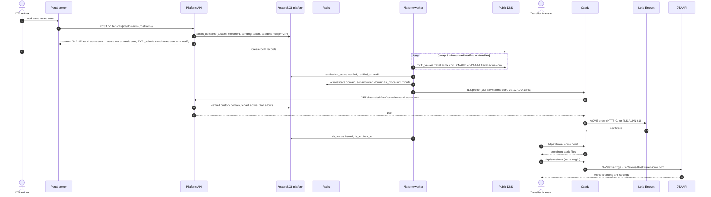

# Flow: custom domains

This flow lets an OTA serve the hosted storefront on its own host name, for example `travel.acme.com`, next to its sub-domain `acme.ota.example.com`: the owner adds the domain, creates two DNS records, the platform worker verifies them, Caddy obtains a certificate on the first HTTPS request after asking the platform's `ask` endpoint, and the domain can become primary. It also covers re-checks, removal and abuse handling. It implements PF-40 to PF-42 and PF-92 of [`../scope.md`](../scope.md), and refines [ADR-0018](../../../docs/mvp/adr/0018-hosted-storefront-custom-domains.md) and flow (e) of [`docs/mvp/architecture.md`](../../../docs/mvp/architecture.md#e-custom-domain-with-caddy-on-demand-tls).

Related: [PADR-0004](../adr/0004-custom-domain-verification.md), [`../api-inventory-resources.md`](../api-inventory-resources.md) §2, [`../api-inventory-admin.md`](../api-inventory-admin.md) §7 and §9.

## Sequence

## Steps

1. **Add.** Owners and admins add a host name when `F:custom_domains` is on and the plan has `limits.customDomains` greater than the number of custom domains already present. The API:
   - lower-cases the input, converts IDN labels to punycode, strips a trailing dot, and checks: valid host syntax, at least two labels, total length 253 or less, not an IP address, not a host under `STOREFRONT_BASE_DOMAIN` or any Velexis host of [`decisions.md`](../../../docs/mvp/decisions.md) §4, and not on a small deny list of shared suffixes (`github.io`, `herokuapp.com`, …) where the OTA cannot prove ownership;
   - inserts `tenant_domains` with `kind = 'custom'`, `purpose = 'storefront'`, `verification_status = 'pending'`, `verification_token = 'vx-verify-' + 32 base32 characters`, `verification_deadline_at = now() + 72 hours`, `created_by_account_id`; the unique host name index refuses a host used by any tenant (`DOMAIN_TAKEN`);
   - returns the records to create: `TXT _velexis.<host> = <token>`, plus **either** `CNAME <host> → <key>.ota.example.com` (recommended, for hosts such as `travel.acme.com`) **or** `A`/`AAAA` to `STOREFRONT_IPV4`/`STOREFRONT_IPV6` (for an apex such as `acme.com`, which cannot have a CNAME). The portal shows both options; verification accepts either.
2. **Verify** (`domains.verify_pending` every 5 minutes → one `domain.verify` job per pending domain; or "Check now", 1 per minute). The job uses a `node:dns` `Resolver` set to `DNS_RESOLVERS` (public resolvers, 5 s timeout):
   - **ownership**: the TXT record set of `_velexis.<host>` contains the token;
   - **routing**: the CNAME chain of the host ends at `<key>.ota.example.com`, or its A/AAAA records are all among the VM's public addresses;
   - both must hold. Success: `verified`, `verified_at`, `check_failures = 0`, audit `domain.verified`, then `vx:invalidate {type: "domain", hostname}`, e-mail to the owners, and a `domain.tls_probe` job in one minute. Otherwise `last_checked_at` and a short `last_check_error` (`txt_missing`, `txt_mismatch`, `cname_missing`, `cname_wrong_target`, `a_wrong_address`, `dns_timeout`) are stored for the portal.
   - Past `verification_deadline_at`: `failed`, e-mail. "Check now" on a failed domain restarts the window with a new deadline and the same token.
3. **Certificate.** Caddy's on-demand TLS calls `GET /internal/tls/ask?domain=<host>` on the first handshake for an unknown host. The endpoint answers `200` only for the rules of [`../api-inventory-admin.md`](../api-inventory-admin.md) §9. It rejects malformed or over-long hosts before any lookup, caches a `200` for 60 s in Redis `tlsask:<host>`, and keeps a `404` only in a bounded in-process cache, so names that random clients put in TLS handshakes never reach Redis ([PADR-0004](../adr/0004-custom-domain-verification.md) item 6). The proactive TLS probe triggers this right after verification, so the first traveller does not wait for issuance.
4. **TLS probe** (`domain.tls_probe`, after verification and daily): the worker opens a TLS connection to `127.0.0.1:443` with SNI = host, reads the peer certificate, and stores `tls_status` (`issued`, or `expired` if past `valid_to`, or `failed` on handshake error), `tls_expires_at` and `tls_checked_at`. Caddy renews certificates itself; the probe only reports.
5. **Primary.** `makeDomainPrimary` (verified domains only) clears `is_primary` on the other storefront host of the tenant and sets it on this one in one transaction (the partial unique index keeps one primary), then invalidates both hosts. The OTA backend uses the primary host in e-mail links. Redirecting the sub-domain to the primary host is a follow-up of ADR-0018.
6. **Daily re-check** (`domains.recheck_verified`): the same DNS checks for verified domains. A failure increments `check_failures`; at **3 consecutive failures** the domain becomes `failed` (`ask` stops answering `200`, the OTA backend no longer maps the host), the primary flag moves back to the sub-domain, and the owners are e-mailed. A success resets the counter.
7. **Remove.** `removeDomain` deletes the row (custom domains only), moves the primary flag back to the sub-domain if needed, invalidates, and audits. The host can then be added by another tenant that proves ownership. Caddy keeps the old certificate in its storage until expiry, but no request is served for the host because the OTA backend and `ask` no longer know it.
8. **Admin.** Platform admins see every domain, can re-check, and can remove an abusive one with a reason ([`platform-admin-operations.md`](platform-admin-operations.md)).

## Failure handling

| Failure | Behaviour |
|---|---|
| Records not created within 72 h | `failed`; restart with "Check now". Failed custom domains older than 7 days are deleted by `purge.daily` to free the host name. |
| DNS provider slow | `dns_timeout`; the next run retries. |
| Domain points elsewhere later | Three daily failures → `failed`; e-mail. |
| Let's Encrypt rate limit or outage | `ask` still answers; Caddy retries issuance with backoff; probe shows `failed`; existing certificates are unaffected ([ADR-0018](../../../docs/mvp/adr/0018-hosted-storefront-custom-domains.md)). |
| Platform API down | `ask` fails, so no new certificates; existing ones keep working. |
| Tenant suspended | `ask` refuses custom domains of non-active tenants (sub-domains of suspended tenants are still allowed so the "suspended" page can be shown over HTTPS). |
| Plan downgraded below the number of domains | Existing verified domains keep working until removed; adding is refused. `ask` checks `customDomains > 0` only. |

## Tables touched

`tenant_domains`, `tenants` (read), `plans` (read), `email_outbox`, `platform_audit_log`. Redis: `platform-domains`, `tlsask:*`, `vx:invalidate`.

## Tests that prove it

- Unit: host name validation (IDN, apex, Velexis hosts, shared suffixes); DNS check logic with a fake resolver for every error code.
- Integration: `ask` answers for sub-domains by tenant status, verified versus pending custom domains, plan without custom domains, feature switch off; the 60 s cache is invalidated on `domain` events; primary swap keeps one primary; three-strike failure.
- Manual (M5 exit): a real test domain verified, certificate issued by Let's Encrypt staging, storefront served on it.
