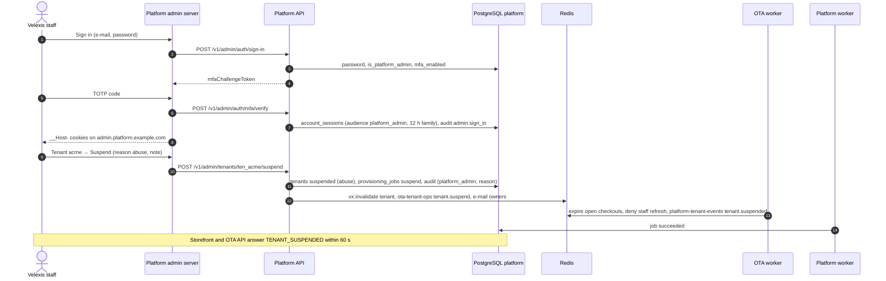
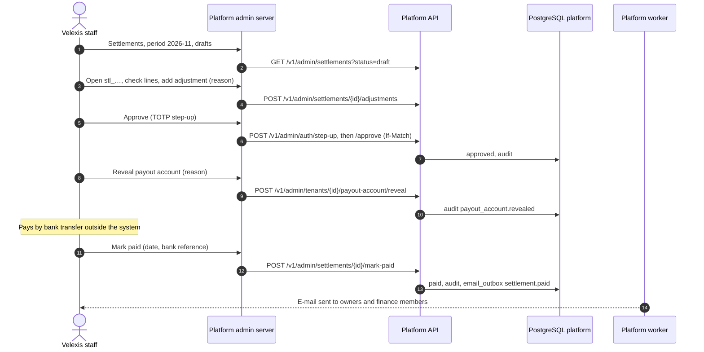

# Flow: platform admin operations

This flow covers what Velexis staff do in the platform admin at `admin.platform.example.com`: signing in with mandatory MFA, looking after tenants (suspend, resume, migrate), retrying provisioning jobs, watching queues, managing plans and Stripe prices, the shared Amadeus account and office pool, settlements, domains, account support, platform admins, and the audit log. Every action goes through the platform API and is audited. It implements PF-80 to PF-92 of [`../scope.md`](../scope.md).

Related: [PADR-0006](../adr/0006-platform-admin-access-and-audit.md), [PADR-0014](../adr/0014-tenant-suspension-and-resume.md), [`../api-inventory-admin.md`](../api-inventory-admin.md), [`../../admin/README.md`](../../admin/README.md), and the flows each operation belongs to: [provisioning](provisioning.md), [Amadeus](amadeus-connection.md), [Stripe payments](stripe-payments-account.md), [billing](subscription-billing.md), [domains](custom-domains.md).

## Sequence: sign-in and suspend a tenant

## Sequence: settlement review and payout

## Operations

### A. Access

1. Only accounts with `is_platform_admin = true` **and** MFA enabled can sign in; the password step answers the same `INVALID_CREDENTIALS` to non-admins. TOTP (or a recovery code) is required on every sign-in. Sessions use `audience = 'platform_admin'`, a 12-hour absolute family lifetime and the admin's own cookies.
2. The first admin is created with a CLI command on the VM (`node dist/cli.js admin:grant <email>`, run by the developer through the deploy user; the account must exist, be verified and have MFA). Later admins are granted in the admin UI (reason and MFA step-up).
3. Caddy may restrict `admin.platform.example.com` to the developer's IP addresses (`PLATFORM_ADMIN_ALLOWED_IPS` in the Caddy environment, optional).
4. Sensitive actions require a TOTP step-up within 15 minutes: entering or rotating Amadeus credentials, approving and paying settlements, revealing a payout account, resetting MFA, granting and revoking admins.

### B. Tenants

- **Find and inspect**: search by key, name or owner e-mail; the detail page shows status, plan and subscription, members and invitations, Amadeus and payment connections (masked), domains, recent provisioning jobs and the last 50 audit rows for the tenant.
- **Suspend** (reason `abuse`, `request` or `admin`, plus a note): the API sets `tenants.status = 'suspended'`, `suspended_at`, `suspension_reason`, creates a `suspend` job, audits, publishes `vx:invalidate tenant`, dispatches `tenant.suspend`, and e-mails the owners. Billing suspensions (`billing`) are set only by billing sync.
- **Resume**: allowed when `suspended`. For a `billing` suspension the admin must confirm and the subscription must be `trialing` or `active` (otherwise `CONFLICT`). Sets `active`, clears suspension fields, `resume` job, invalidation, e-mail.
- **Migrate**: creates a `migrate` job for one tenant (after a failed deploy fan-out).
- **Connections**: disable or re-enable a tenant's Amadeus or payment connection with a reason.

### C. Provisioning jobs and queues

- The jobs page filters by status and kind and shows the step log, attempts, last error and the BullMQ state of the current attempt.
- **Retry** a `failed` job: a new job of the same kind is created (and for `provision` the tenant returns to `provisioning`). **Cancel** a `queued` job that has not been dispatched.
- The queues page shows waiting, active, delayed and failed counts and the oldest waiting age for the platform queues and the OTA queues (`ota-*`, read-only). Failed jobs show their reason and their id-only payload. Only platform jobs can be retried from here; OTA jobs are retried by the OTA admin or the developer.

### D. Plans, subscriptions, invoices, Stripe events (M1 plans, M5 the rest)

- Create and edit plans (limits, features, trial days, settlement fee); link Stripe product and price ids; review price warnings ([`subscription-billing.md`](subscription-billing.md) §A).
- Subscriptions and invoices lists with filters; resync a Stripe subscription; edit a **manual** subscription (plan, trial end, cancel) with a reason.
- Stripe events: failed or ignored events with their error; reprocess after fixing the cause.

### E. Velexis Amadeus account and offices

Enter and verify shared credentials per environment; add offices in bulk; assign an office to a tenant (live requests appear in the dashboard); release a `releasing` office after confirming with the OTA; retire offices. The dashboard shows pool levels ([`amadeus-connection.md`](amadeus-connection.md)).

### F. Settlements and payout accounts (M5)

Review monthly drafts, add adjustments, approve (net > 0 → `approved`, else `carried_forward`), reveal the payout account to pay, mark paid with the bank reference, or void a draft and regenerate. Review payout accounts (`verified` or `rejected`). See [`stripe-payments-account.md`](stripe-payments-account.md) §F.

### G. Domains (M5)

All custom domains with verification and TLS state; re-check now; remove an abusive domain with a reason (owners e-mailed).

### H. Accounts and admins

- **Accounts**: search; detail with memberships and sessions; unlock; disable (revokes sessions, writes `staffdeny`, publishes `account`) and enable; **reset MFA** after an identity check done outside the system (the reason records how), which turns MFA off, deletes recovery codes, revokes sessions and e-mails the user.
- **Platform admins**: list, grant (account must be verified and have MFA), revoke. Nobody can revoke themself or the last admin.

### I. Audit log

Search by tenant, actor, action, target and period; export CSV (at most one year, 100 000 rows; the export itself is audited). The audit table is append-only by database privilege ([PADR-0006](../adr/0006-platform-admin-access-and-audit.md)).

## Failure handling

| Failure | Behaviour |
|---|---|
| Admin without MFA | Sign-in refused with `MFA_REQUIRED`; they enable MFA in the portal first. |
| Stale page (`If-Match`) | `412 PRECONDITION_FAILED`; the page reloads the row. |
| Step-up expired | `401 REAUTH_REQUIRED`; the page asks for a TOTP code and retries. |
| OTA worker down during suspend | The tenant is already suspended (traffic blocked); the job waits and the reconciler re-dispatches. |
| Mistaken suspension | Resume; both actions stay in the audit log. |
| Lost access of the only admin | Developer runs `admin:grant` for another verified account with MFA, or `admin:reset-mfa` on the VM (both audited as `system` with the operator's name). |

## Tables touched

All platform tables are read; writes are those listed per operation in [`../api-inventory-admin.md`](../api-inventory-admin.md). Every write adds a `platform_audit_log` row with `actor_type = 'platform_admin'`, the admin's account id and e-mail snapshot, the request id, IP and user agent, and the reason in `details`.

## Tests that prove it

- Integration: portal tokens are refused on every `/v1/admin/*` route and admin tokens on portal routes; non-admin and no-MFA accounts cannot sign in; every state-changing admin endpoint writes exactly one audit row with `actor_type = 'platform_admin'`; reason and step-up enforcement; last-admin and self-revoke protection.
- End-to-end (M1): an admin suspends and resumes a tenant and the storefront follows within 60 seconds.
