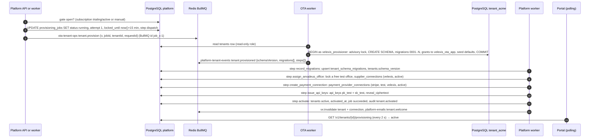
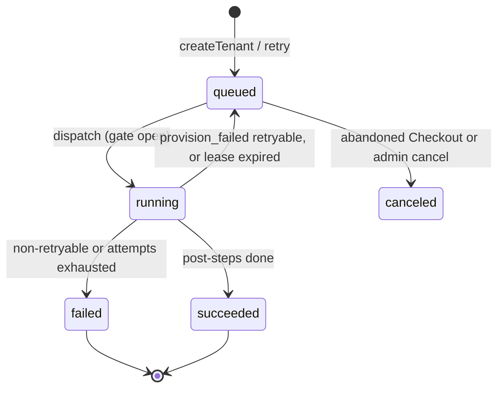

# Flow: tenant provisioning

This flow turns a `provisioning` tenant into an `active` OTA: the platform dispatches a `tenant.provision` job to the OTA worker, which builds the tenant schema; the platform then records the migrations, assigns the default Velexis Amadeus test office, creates the Velexis Stripe test connection, issues test API keys and activates the tenant. It also covers retries, the reconciler and the `tenant.migrate` job. It implements PF-11, PF-50 and PF-60 of [`../scope.md`](../scope.md), follows [db README §3](../../../docs/velexis-sdk/db/README.md) and [ADR-0009](../../../docs/mvp/adr/0009-background-jobs-bullmq.md), and is decided in detail in [PADR-0001](../adr/0001-tenant-provisioning-orchestration.md).

Related: [`signup-and-create-ota.md`](signup-and-create-ota.md) (before), [`amadeus-connection.md`](amadeus-connection.md), [`stripe-payments-account.md`](stripe-payments-account.md), [`api-keys.md`](api-keys.md), [`../architecture.md`](../architecture.md) §5–§6.

## Sequence

## Steps

### 1. Dispatch

- **Gate.** A `provision` job may be dispatched only when the tenant is `provisioning` and its current subscription is `trialing` or `active`, or `billing_provider = 'manual'`. Before M5 the gate is always open; in M5 it opens on `checkout.session.completed`.
- **Dispatch** is one function used by the API (right after `createTenant` commits), the billing webhook processor and the reconciler:
  1. `UPDATE provisioning_jobs SET status = 'running', attempt = attempt + 1, step = 'dispatch', started_at = coalesce(started_at, now()), locked_until = now() + interval '15 minutes' WHERE id = $1 AND status = 'queued' AND scheduled_at <= now() RETURNING attempt` (a no-op if another process won);
  2. after commit, `queue.add('tenant.provision', message, { jobId: '<job_id>-<attempt>', attempts: 3, backoff: { type: 'exponential', delay: 30000 } })`.
- The message carries ids only: `{v: 1, jobId, tenantId, requestedAt, requestId}`. The OTA worker reads the tenant's key, name, currency, locale and time zone from `platform.tenants` with its read-only role.

### 2. OTA worker (owned by the OTA plan)

- One transaction as `velexis_provisioner` ([ADR-0004](../../../docs/mvp/adr/0004-postgresql-schema-per-tenant.md)): `pg_advisory_xact_lock(hashtext('tenant:' || schema))`, `CREATE SCHEMA IF NOT EXISTS`, `set_config('search_path', '<schema>, reference', true)`, every tenant migration not yet in the schema's `schema_migrations` (checksums verified), grants and default privileges for `velexis_ota_app`, then the seed rows (`storefront_settings`, the default markup rule, `notification_templates`) with `ON CONFLICT DO NOTHING` (db README §3 step 3).
- BullMQ retries transient errors 3 times. On success it sends `tenant.provisioned`; after the last attempt, or at once for a non-retryable error (checksum mismatch, foreign objects in an existing schema), it sends `tenant.provision_failed {error: {code, message}, retryable}`.

### 3. Platform post-steps (platform worker, `platform-tenant-events` consumer)

The consumer validates the message (Ajv, `@velexis/api-types/jobs`), loads the job, and ignores the event if the job is already `succeeded`, `failed` or `canceled`, or if `attempt` in the BullMQ id is older than the job's current attempt. Each step below is **idempotent**, runs in its own short transaction, appends to `provisioning_jobs.steps` (`{step, status, startedAt, finishedAt, error?}`) and updates `step`. A crash resumes at the first step not marked `succeeded`.

| Step | What it does | Idempotency |
|---|---|---|
| `record_migrations` | Upsert `tenant_schema_migrations` (`applied`, checksum, phase, duration) from the event; set `tenants.schema_version` | Upsert on `(tenant_id, version)` |
| `assign_amadeus_office` | If the Velexis **test** account is `active`: `SELECT … FROM amadeus_offices WHERE amadeus_account_id = $test AND status = 'available' ORDER BY created_at LIMIT 1 FOR UPDATE SKIP LOCKED`, mark it `assigned`, insert `supplier_connections` (`test`, `velexis`, `office_ids = {office}`, default, queuing and owner office = office, `status = 'active'`). With no free office or no active account: insert the connection with `status = 'pending_verification'` and no office (requires an account row; without any account row, skip and record `skipped`), and e-mail ops ([PADR-0012](../adr/0012-amadeus-office-pool.md)). | Skip if the tenant already has a test connection |
| `create_payment_connection` | Insert `payment_provider_connections` (`stripe`, `test`, `account_mode = 'velexis'`, `capture_mode = 'manual'`, `status = 'active'`, `statement_descriptor_suffix` derived from the OTA name: ASCII letters, digits and spaces, 22 characters at most) | `ON CONFLICT (tenant_id, provider, environment) DO NOTHING` |
| `issue_api_keys` | Create `pk_test_…` (no origins) and `sk_test_…` (scopes `["storefront"]`) as in [PADR-0005](../adr/0005-api-key-format-and-hashing.md); envelope-encrypt the two raw keys into `provisioning_jobs.reveal_ciphertext` | Skip if the job already has `result.apiKeyIds` |
| `activate` | `UPDATE tenants SET status = 'active', activated_at = now(), version = version + 1 WHERE id = $1 AND status = 'provisioning'`; job `succeeded`, `finished_at`, `result = {apiKeyIds, officeId?, schemaVersion}`; audit `tenant.activated` (`actor_type = 'system'`) | Conditional update |
| `notify` | After commit: publish `vx:invalidate` `tenant` and `connection`; queue `tenant.welcome` to the owners | Duplicate invalidations are harmless; the e-mail is keyed by job id |

### 4. Reveal of the test keys

`revealInitialKeys` (owner only) decrypts `reveal_ciphertext`, returns the two keys with `Cache-Control: no-store`, and in the same update sets `revealed_at` and erases the ciphertext. The hourly `provisioning.purge_reveals` job erases unrevealed ciphertext 24 h after `finished_at`. After that, owners create new keys on the API keys page.

### 5. Migrate job

`tenant.migrate` follows the same pattern with `kind = 'migrate'`: created by a platform admin (`adminMigrateTenant`) for one tenant, for example after a failed fan-out. The OTA worker applies pending migrations and answers `tenant.migrated` or `tenant.migration_failed`; the platform mirrors the ledger. The **deploy fan-out** (`pnpm db:migrate:tenants`, OTA side) also emits `tenant.migrated` / `tenant.migration_failed` with `jobId = null`; the platform only mirrors them and alerts ops on failures.

## Failure handling

| Failure | Behaviour |
|---|---|
| `tenant.provision_failed` with `retryable = true` and `attempt < max_attempts` (5) | Job back to `queued`, `scheduled_at = now() + 30 s × 2^attempt`, `error` stored; the reconciler dispatches it when due (BullMQ id `<job>-<attempt+1>`). |
| Non-retryable, or attempts exhausted | Job `failed`. For a `provision` job only: tenant `failed`, audit `tenant.provisioning_failed`, e-mail to ops and to the owner ("setup failed, we are on it"), and the portal shows **Retry** to owners. A `migrate`, `suspend` or `resume` job never changes `tenants.status`; ops get an `ops.alert` ([PADR-0001](../adr/0001-tenant-provisioning-orchestration.md) item 7). |
| Lost message or OTA worker down | The reconciler (every 5 minutes) finds `running` jobs past `locked_until`. If BullMQ reports the job `waiting`, `active` or `delayed`, it extends the lease; if the job is missing or `failed` without an event, it counts as a retryable failure (rule above). This applies to every job kind; the kind decides only the effect of the final failure. |
| Platform post-step error (database, SMTP queue) | The event job throws; BullMQ retries it (5 attempts). Steps already done are skipped on the next run. After the last attempt, the job is marked `failed` with the step name and ops are alerted; an admin retry re-runs the post-steps only (the schema exists; the OTA run is a no-op). |
| No free Amadeus test office | Not a failure: the tenant activates with a `pending_verification` connection; the dashboard warns and an admin assigns an office later. |
| Owner retry | `retryProvisioning` is allowed only for a `failed` tenant: it sets the tenant back to `provisioning` and inserts a **new** `provision` job (the partial unique index allows it because the old one is `failed`), and publishes `vx:invalidate` `tenant` after the commit, as the admin's retry does ([architecture §6.3](../architecture.md#63-cache-invalidation-vxinvalidate)). If the failure was an abandoned Checkout, it returns a new `checkoutUrl` instead and the gate waits again. |
| Duplicate dispatch | Same BullMQ id → no-op. A late event of an older attempt is ignored. |

### States

## Tables touched

`provisioning_jobs` (status, steps, lease, reveal), `tenants` (status, `schema_version`, `activated_at`), `tenant_schema_migrations`, `amadeus_offices`, `supplier_connections`, `payment_provider_connections`, `api_keys`, `email_outbox`, `platform_audit_log`. Redis: `ota-tenant-ops`, `platform-tenant-events`, `vx:invalidate`. The platform never touches `tenant_<key>`.

## Tests that prove it

- Integration (platform): dispatch is single even when called twice concurrently; each post-step is idempotent when an event is delivered twice; a stale-attempt event is ignored; retry and failure paths; reconciler re-dispatch with a missing BullMQ job; reveal works once and after 24 h answers `410`.
- Contract: the `tenant.*` message JSON Schemas in `@velexis/api-types/jobs` validate the fixtures used by both backends.
- End-to-end with the OTA worker: a new OTA becomes `active` with schema version `0001…N`, an assigned test office and two test keys.
