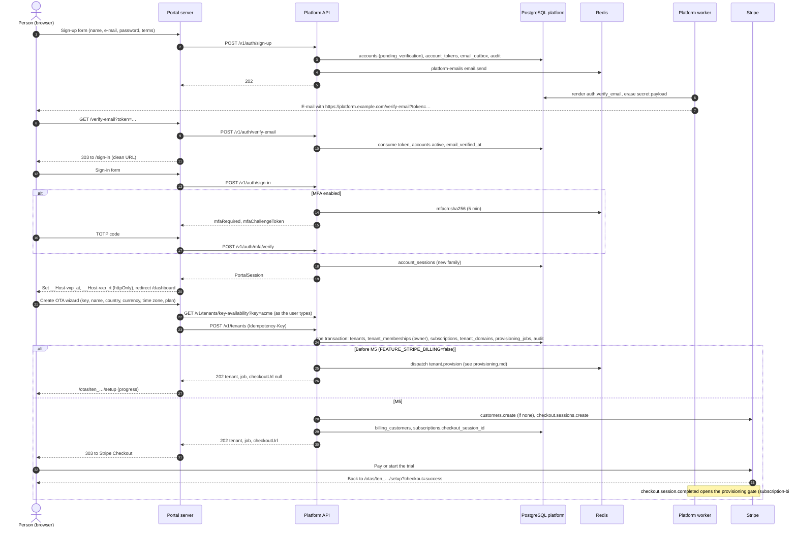

# Flow: sign-up and create an OTA

This flow takes a new person from the sign-up form to an OTA that is being provisioned: account creation, e-mail verification, sign-in with optional MFA, the create-OTA wizard and, from M5, the hand-off to Stripe Checkout. Provisioning itself continues in [`provisioning.md`](provisioning.md). It implements features PF-01 to PF-04 and PF-10 of [`../scope.md`](../scope.md) and refines flow (a) of [`docs/mvp/architecture.md`](../../../docs/mvp/architecture.md#a-sign-up--create-ota--stripe-checkout--provisioning--tenant-live).

Related: [`../api-inventory.md`](../api-inventory.md) §4, §7; [PADR-0008](../adr/0008-email-verification-and-mfa-policy.md) (verification and MFA), [PADR-0002](../adr/0002-stripe-billing-integration.md) (Checkout), [PADR-0013](../adr/0013-platform-email-outbox.md) (e-mails), [`subscription-billing.md`](subscription-billing.md).

## Sequence

## Steps

1. **Sign-up.** The portal server action validates the form with Zod and calls `signUp`. The API:
   - normalises the e-mail (trim, lower-case for the uniqueness check);
   - checks the password (10+ characters, not in the breached top-10k list) and hashes it with Argon2id;
   - if the e-mail is new, inserts `accounts` (`pending_verification`, `terms_accepted_at`, `terms_version`), an `account_tokens` row (`email_verification`, SHA-256 of a 256-bit token, 24 h) and an `email_outbox` row `auth.verify_email` whose link is in `secret_payload_ciphertext`;
   - if the e-mail exists, inserts only an `auth.account_exists` e-mail (with a sign-in and a reset link), so the answer reveals nothing;
   - writes `account.signed_up` to the audit log, commits, enqueues `email.send`, and answers `202`.
2. **Verification e-mail.** The worker renders the template, sends it through SMTP, and erases the secret payload in the same update that marks the row `sent` ([PADR-0013](../adr/0013-platform-email-outbox.md)).
3. **Verify.** `GET /verify-email?token=…` is a portal page that, on the server, calls `verifyEmail` and redirects with `303` to a clean URL, so the token does not stay in the address bar or reach a `Referer`. The page is served with `Referrer-Policy: no-referrer`. The API checks the hash, expiry and single use, sets `email_verified_at` and `status = 'active'`, and audits `account.email_verified`.
4. **Sign-in.** `signIn` checks lockout, the password, then the account status. With MFA on, it stores a challenge in Redis (`mfach:<sha256>`, 5 minutes, 5 attempts) and returns its token; `verifyMfa` completes it with a TOTP code or a recovery code. A new refresh family is written to `account_sessions` (`audience = 'portal'`, `family_expires_at` = 30 days). The portal stores both tokens in `__Host-` httpOnly cookies ([`../../frontend/README.md`](../../frontend/README.md)).
   - An unverified account can sign in; the portal then shows only the "check your e-mail" page (most endpoints answer `EMAIL_NOT_VERIFIED`).
5. **Wizard.** The wizard has three steps: *OTA* (name, key prefilled from the name, country, default currency, time zone), *Plan* (pre-M5: shows `early_access` only; M5: public plans with interval), *Review*. The key field calls `checkTenantKey` (debounced) and shows `acme.ota.example.com`. The wizard creates one `Idempotency-Key` (UUID) when it opens and sends it with the final submit, so a double click or a retry creates one OTA.
6. **Create OTA.** `createTenant` validates:
   - the key: `^[a-z][a-z0-9]{2,29}$`, not in the reserved list (`platform`, `reference`, `public`, `admin`, `api`, `www`, `app`, `console`, `mail`, `static`, `assets`, `cdn`, `status`, `help`, `docs`, `support`, `billing`, `login`, `auth`, `test`, `demo`), not used by any tenant row (deleted or failed tenants keep their key);
   - the account: verified, active, and owning fewer than `MAX_TENANTS_PER_ACCOUNT` non-failed OTAs;
   - the plan: before M5 always `early_access`; from M5 a public, active plan with a Stripe price for the interval.

   Then, in one transaction, it inserts:
   - `tenants` (`provisioning`, `plan_code`, `storefront_environment = 'test'`, `created_by_account_id`);
   - `tenant_memberships` (`owner`);
   - `subscriptions`: pre-M5 `trialing`, `billing_provider = 'manual'`, `trial_ends_at = now() + plans.trial_days`; M5 `incomplete`, `billing_provider = 'stripe'`;
   - `tenant_domains`: `<key>.ota.example.com`, `kind = 'subdomain'`, `purpose = 'storefront'`, primary, `verification_status = 'verified'` (Velexis owns the zone);
   - `provisioning_jobs` (`provision`, `queued`);
   - audit `tenant.created`.
7. **Start provisioning or Checkout.** After commit:
   - pre-M5 the API dispatches the job at once ([`provisioning.md`](provisioning.md));
   - in M5 the dispatch gate stays closed while the subscription is `incomplete`. The API creates the Stripe Customer (or reuses `billing_customers`) and a Checkout Session ([PADR-0002](../adr/0002-stripe-billing-integration.md)), stores `checkout_session_id`, and returns the URL. The browser goes to Stripe. The return page shows progress; the **webhook**, not the redirect, sets the subscription to `trialing` or `active` and dispatches provisioning.
8. **Setup page.** `/otas/{tenantId}/setup` polls `getProvisioning` every 2 seconds (server action plus `router.refresh()`), shows the steps, and when the tenant is `active` offers the one-time reveal of the test keys and the onboarding checklist.

## Failure handling

| Failure | Behaviour |
|---|---|
| E-mail already registered | `202` as usual; the owner of the address gets an "account exists" e-mail. |
| Verification link expired or used | `VERIFICATION_TOKEN_INVALID`; the page offers "send a new link" (`resendVerification`, 3 per hour). |
| SMTP down | The outbox row stays `pending` and is retried with backoff; sign-up still answers `202`. |
| Wrong password 5 times | `423 ACCOUNT_LOCKED` for 15 minutes; audit `auth.locked`. |
| Lost authenticator | Recovery code at the MFA step; otherwise support resets MFA in the admin after an identity check ([`platform-admin-operations.md`](platform-admin-operations.md)). |
| Key taken between check and submit | Unique violation → `409 TENANT_KEY_UNAVAILABLE`; the wizard returns to step 1 with the message. |
| Double submit | Same `Idempotency-Key` → the stored `202` is replayed; a different body with the same key → `IDEMPOTENCY_KEY_REUSED`. |
| Too many OTAs | `422 UNPROCESSABLE` with `details.reason = "tenant_limit"`. |
| Stripe unavailable when creating Checkout (M5) | The tenant and job are committed; the response has `checkoutUrl: null` and `checkoutError`. The setup page shows "Continue to payment", which calls `createCheckoutSession` (Stripe idempotency key `checkout:<sub_id>:<n>`). |
| Checkout abandoned (M5) | The Checkout Session expires after 24 h; the setup page offers "Continue to payment". After 48 h the `billing.abandoned_checkouts` job sets the tenant `failed`, cancels the job and the `incomplete` subscription; the key stays reserved. An owner can still retry, which starts a new Checkout. |
| Redis down | `createTenant` answers `503` before writing (the idempotency store is required). |

## Tables touched

| Table | Rows |
|---|---|
| `accounts` | insert (sign-up), update (verification, lockout counters, `last_login_at`) |
| `account_tokens` | insert, consume |
| `account_sessions` | insert (sign-in), rotate (refresh) |
| `account_recovery_codes` | `used_at` when a recovery code is used |
| `email_outbox` | insert, status, secret purge |
| `tenants`, `tenant_memberships`, `subscriptions`, `tenant_domains`, `provisioning_jobs` | insert (create OTA) |
| `billing_customers` | insert or reuse (M5) |
| `platform_audit_log` | `account.signed_up`, `account.email_verified`, `auth.sign_in`, `auth.sign_in_failed`, `auth.locked`, `tenant.created` |
| Redis | `mfach:*`, `vx:idem:*`, `rl:*` |

## Tests that prove it

- Integration: sign-up for a new and an existing e-mail give identical responses and different e-mails (Mailpit); a token works once; lockout after five failures; MFA challenge with code and with recovery code; `createTenant` writes the five rows in one transaction and replays on the same key; key rules and the reserved list; the tenant limit.
- End-to-end (`tools/e2e/specs/portal-signup.e2e.ts`): sign up, read the e-mail from Mailpit, verify, sign in, create an OTA, see it become active against the OTA worker and the Amadeus stub (M1); with Stripe test mode and `stripe listen`, the M5 variant through Checkout.
