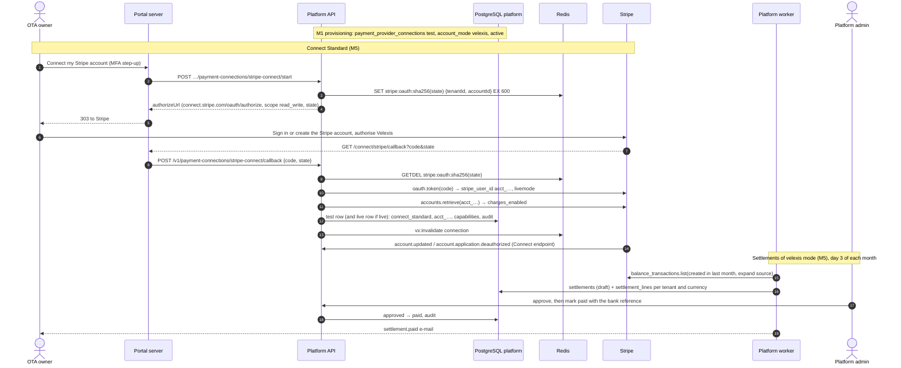

# Flow: Stripe payments account and settlements

This flow covers whose Stripe account takes an OTA's customer payments and how the money reaches the OTA. Every OTA starts on the **Velexis Stripe account** (`velexis` mode), where Velexis collects and settles monthly by bank transfer. From M5 an owner can connect the OTA's **own Stripe account** through Stripe Connect Standard (OAuth) or by entering API keys, or go back to Velexis mode. The platform manages the connection rows and settlements; the OTA backend creates and captures the PaymentIntents ([ADR-0011](../../../docs/mvp/adr/0011-payments-stripe-and-airline-card.md)). It implements PF-60 to PF-64 of [`../scope.md`](../scope.md).

Related: [PADR-0011](../adr/0011-stripe-connect-standard-and-api-key-connections.md) (Connect and API keys), [PADR-0003](../adr/0003-settlement-of-velexis-collected-payments.md) (settlements), [PADR-0010](../adr/0010-credential-submission-and-verification.md), [`../api-inventory-resources.md`](../api-inventory-resources.md) §4–§5, [`../api-inventory-admin.md`](../api-inventory-admin.md) §6.

## Sequence

## Steps

### A. Velexis mode (default)

1. Provisioning inserts the **test** row: `provider = 'stripe'`, `account_mode = 'velexis'`, `capture_mode = 'manual'`, `status = 'active'`, `statement_descriptor_suffix` from the OTA name ([`provisioning.md`](provisioning.md)). No secret is stored: the OTA backend uses Velexis's keys from its environment file.
2. At **go-live** (M5), if the test row is in `velexis` mode, the API inserts the matching **live** row in `velexis` mode. Go-live requires a **verified payout account** in this case, because Velexis must be able to pay the OTA (`PAYOUT_ACCOUNT_REQUIRED`).
3. Owners and admins can edit the statement descriptor suffix (`updatePaymentConnection`, M3).

### B. Payout account (velexis mode, M5)

1. The owner enters holder name, country, currency and either an IBAN (+ BIC) or local account and routing numbers. IBANs are checked with the mod-97 checksum. The action needs an MFA step-up.
2. The API stores the identifiers as encrypted JSON (`bank_details_ciphertext`), keeps `last4` in clear, sets `status = 'pending_review'`, audits `payout_account.updated` (without numbers) and e-mails ops.
3. A platform admin reviews it (`verified` or `rejected` with a note). Any later change resets it to `pending_review`.

*Note (2026-10-30, lead decision (2i), FIX-W35-PLATFORM).* The stored account typed again is no change. When the holder (trimmed), country, currency, scheme and bank identifiers of a `setPayoutAccount`, after the normalisation the save applies (the IBAN without spaces and upper-cased, the BIC upper-cased, local numbers as typed), are the stored ones, the API answers the current account as it is: the same `200` answer, version and review status (a `verified` account stays `verified`, a `rejected` one stays `rejected` with its note), with no write, no `payout_account.updated` audit row and no `ops.alert` e-mail. To compare, the API decrypts the stored copy in the transaction that locks the row, in memory only, and never logs it; a stored copy that cannot be decrypted is replaced as a change. Any field that differs after normalisation is still a change, as in steps 2 and 3. A platform admin's reveal reason, like every admin reason, is trimmed before its 5–500 characters are counted (lead decision (2j), [`../api-inventory-admin.md`](../api-inventory-admin.md) §1).

*Note (2026-10-30, lead decision (2a) of the third batch, FIX-W36-PLATFORM).* A **rejected** account typed again is the exception to the note above: the owner asks for a new review of the same account (for example after correcting the OTA's legal name with the reviewer). The save then works as a change does (steps 2 and 3): the next version, back in `pending_review` with the review note, reviewer and review time cleared, the bank identifiers encrypted again, the `payout_account.updated` audit row with the masked fields before (`rejected`) and after (`pending_review`) and never a number, and the `ops.alert` e-mail for the new version, which says the owner asked for a new review with the same bank details. A `pending_review` or `verified` account typed again still changes nothing.

### C. Connect Standard (M5)

1. **Start** (`startStripeConnect`, owner or admin, MFA step-up): the API creates a 256-bit `state`, stores `stripe:oauth:<sha256(state)> = {tenantId, accountId, membershipId}` for 10 minutes, and returns `https://connect.stripe.com/oauth/authorize?response_type=code&client_id=<STRIPE_CONNECT_CLIENT_ID>&scope=read_write&state=<state>&redirect_uri=https://platform.example.com/connect/stripe/callback&stripe_user[email]=<caller's e-mail>`, prefilled with the address of the owner or admin who starts it and is sent to Stripe.
2. **Callback.** Stripe redirects to the fixed portal URL `/connect/stripe/callback`. The portal route handler (signed-in user required) posts `{code, state}` (or `{error, state}`) to the API and redirects to the OTA's payments page with the outcome. The code never appears in logs; the handler strips the query before rendering.
3. **Complete** (`completeStripeConnect`): `GETDEL` the state (single use) and require the same account, still owner or admin of the tenant. Exchange the code with `stripe.oauth.token({grant_type: 'authorization_code', code})` using Velexis's secret key; the response's `livemode` must match the deployment (live in production, test elsewhere), otherwise `UNPROCESSABLE (livemode_mismatch)`. Reject an `acct_…` already connected to another tenant (`STRIPE_ACCOUNT_ALREADY_CONNECTED`). Retrieve the account for `charges_enabled`, `payouts_enabled`, `details_submitted`.
4. **Apply** in one transaction: the **test** row becomes `account_mode = 'connect_standard'`, `account_reference = acct_…`, `publishable_key = NULL` (the storefront uses Velexis's publishable key with `stripeAccount`), secrets `NULL`, `capabilities`, `connected_at`, `status = 'active'` if charges are enabled else `pending`; the **live** row gets the same if the OTA is live, otherwise it is created in this mode at go-live. Audit `payments.connect_connected`; after commit `vx:invalidate connection`.
5. **Account events** arrive on the platform's Connect endpoint `/webhooks/stripe/connect-accounts` ([`../api-inventory-admin.md`](../api-inventory-admin.md) §8): `account.updated` refreshes `capabilities` and `status` (`pending` ↔ `active`); `account.application.deauthorized` sets `status = 'disabled'`, `disconnected_at`, audits and e-mails the owners. There is **no automatic fallback** to Velexis mode, because that changes who holds the money; the owner chooses **Use Velexis payments** or reconnects.

*Note (2026-10-30, lead decision (2h) of the third batch, FIX-W36-PLATFORM; [PADR-0011](../adr/0011-stripe-connect-standard-and-api-key-connections.md) item 2 note).* `stripe_user[email]` is the caller's own address (step 1). The callback (step 3) is `F:own_stripe` like the start: while the switch is off it answers `403 FEATURE_DISABLED` before it takes the state. After the state and the membership, a callback for an OTA whose payment connection a platform admin disabled (`adminSetConnectionStatus`: `disabled` with no `disconnected_at`) answers `409 CONFLICT` with `details.reason = connection_disabled`, asks Stripe nothing and writes nothing (checked again on the locked rows of step 4); a connection disabled because the OTA disconnected Velexis in Stripe (step 5) can be connected again. A code Stripe refuses (`invalid_grant`: unknown, expired or used) answers `UNPROCESSABLE (oauth_error)`. On a `livemode` mismatch the API first calls `stripe.oauth.deauthorize({client_id, stripe_user_id})` for the account (idempotency key `connect_deauthorize:<sha256 of the state>`), best effort: a failure is logged with Stripe's type, status and code only, never a token, and an account that an OTA's `connect_standard` connection holds is left connected (deauthorising it would cut that OTA off); then it answers `UNPROCESSABLE (livemode_mismatch)`.

*Note (2026-10-31, lead decision (2a), FIX-W37-PLATFORM; [PADR-0011](../adr/0011-stripe-connect-standard-and-api-key-connections.md) item 2 note).* "Holds" means **still connected**: the livemode mismatch skips `stripe.oauth.deauthorize` (logging `stripe_connect.deauthorize_skipped`) only when a `connect_standard` connection of any OTA, this one's included, names the account with `disconnected_at` empty (`active`, `pending`, or `disabled` by a platform admin, whose disable keeps Velexis connected in Stripe). A connection that a Stripe deauthorisation disabled (step 5: `disconnected_at` set) no longer counts: Velexis's access to that account was revoked already, so the account of the mismatched code is deauthorised. When the lookup fails, the account is still left connected and the skip is logged with the failure's class only.

*Note (2026-10-31, lead decision (2k), FIX-W37-PLATFORM; [PADR-0011](../adr/0011-stripe-connect-standard-and-api-key-connections.md) item 3 note).* Step 5's `account.application.deauthorized` keeps a connection a platform admin disabled (`disabled`, `disconnected_at` empty) as it is, so the admin's disable still holds against the OTA's own reconnect (FIX-W36-PLATFORM). It now also writes **one audit row per such connection and event**, `payments.connect_deauthorized_while_disabled` (actor `system`, `stripe.connect_events`; the environment, the `acct_…`, the event id and type and the status it keeps, no secret and no `before` or `after`), so the admin sees that the OTA revoked Velexis in Stripe too. Its `status`, `disconnected_at` and version stay, no owner is e-mailed and nothing is invalidated; a re-run of the same event writes no second row, and a deauthorisation older than the connection (its `connected_at` in a later second than the event's `created`: it revoked an earlier connection) writes none. A connection of the same account that the admin did not disable is still disconnected, audited and e-mailed as step 5 says.

### D. API keys (M5)

1. The owner or an admin enters the publishable key, a secret key (`sk_…`) or restricted key (`rk_…`), and a webhook signing secret (`whsec_…`) for one environment. Prefixes must match the environment (`_test_` or `_live_`). MFA step-up.
2. `submitStripeApiKeys` stores a `credential_submissions` row (`kind = 'stripe_api_keys'`, publishable key in `public_data`, both secrets encrypted), and returns the webhook URL `https://api.ota.example.com/webhooks/stripe/c/<ppc_id>` with the events to enable: `payment_intent.succeeded`, `payment_intent.payment_failed`, `payment_intent.canceled`, `payment_intent.amount_capturable_updated`, `charge.refunded`, `charge.dispute.created`, `charge.dispute.closed`.
3. The `credentials.verify` job calls `GET /v1/account` with the secret key: it must succeed, and `livemode` must match the environment. On success, one transaction: the row becomes `account_mode = 'api_keys'`, `account_reference` = the account id, `publishable_key`, secrets re-encrypted with the connection's associated data, `status = 'active'`; the submission is `applied` with its secrets erased; audit; `vx:invalidate connection`. On failure the connection is unchanged and the submitter is e-mailed.
4. The webhook secret cannot be tested until Stripe sends an event to the OTA backend. The page reminds the owner to send a test event from the Stripe dashboard.

### E. Back to Velexis mode (M5)

`useVelexisPayments` (owner, MFA step-up): for `connect_standard`, call `stripe.oauth.deauthorize({client_id, stripe_user_id})` (a failure is logged and does not block); clear `account_reference`, keys and secrets; set `account_mode = 'velexis'`, `status = 'active'`; audit; invalidate. For live, a verified payout account is required.

**Switching never moves existing payments.** The OTA backend keeps capturing, refunding and receiving webhooks for each payment on the account recorded on that payment row; only new PaymentIntents use the new mode. The page warns about this.

### F. Settlements (velexis mode, M5)

1. On day 3 at 05:00 UTC, `settlements.monthly` enqueues `settlement.generate` for the previous calendar month (UTC).
2. The job pages through `stripe.balanceTransactions.list({created: {gte, lt}, expand: ['data.source']})` on the Velexis account (live in production) once for all tenants. For each transaction it resolves the tenant from `metadata.velexis_tenant_id` of the charge, or of its PaymentIntent, refund's charge or dispute's charge; transactions without a tenant (subscription payments, payouts, Stripe fees not tied to a charge) are skipped.
3. Per tenant and balance currency it rebuilds the **draft**: deletes existing draft lines, inserts one `settlement_lines` row per balance transaction (`charge`, `refund`, `dispute`, `dispute_reversal`) with amount and Stripe fee, adds a `carry_forward` line for the net of earlier `carried_forward` statements not yet absorbed, and computes the totals. Velexis's fee is `round(fee_bps × (gross − refunds) / 10 000)`, never negative, with `fee_bps` copied from the plan. Statements already `approved` or `paid` are never touched; a balance transaction already on one of them is skipped (unique key).
4. An admin reviews the draft and its lines, may add manual adjustments (reason required), and approves (MFA step-up): net > 0 → `approved`, net ≤ 0 → `carried_forward` (its balance moves to next month's draft). Approval requires a verified payout account when net > 0.
5. After paying by bank transfer, the admin records `paidAt` and the bank reference (`mark-paid`, MFA step-up). Owners and finance members are e-mailed; the portal lists the statement and its CSV.

*Note (2026-10-30, lead decision (2g) of the third batch, FIX-W36-PLATFORM; [PADR-0003](../adr/0003-settlement-of-velexis-collected-payments.md) notes under items 3, 5 and 7).* Step 2: a `refund_failure` stays a positive `refund` line; the categories of Velexis's own money (payouts, Stripe's own fees and their tax, transfers, top-ups, …) are skipped silently, and every other category is skipped with one warning line per transaction (`settlement.unknown_category`, its type and id only, never an amount or metadata). Step 3: a dispute fee counts once, in `disputes`, never again in the Stripe fees; the carried-forward balance goes to the **earliest later open draft** of the same tenant, environment and currency, and a tenant whose only open item is such a balance (no transaction in the month) gets a draft holding just that `carry_forward` line (a balance summing to zero opens none). `FEATURE_SETTLEMENTS` requires `STRIPE_SECRET_KEY`, as the other Stripe switches do.

*Note (2026-10-31, lead decisions (2i) and (2j), FIX-W37-PLATFORM).* Step 4: a manual adjustment's amount has no more decimals than the statement currency has minor units (its exponent in `reference.currencies`, the generator's minor units: 2 for EUR, 0 for JPY, 3 for KWD; trailing zeros do not count, and the API's two decimals still bound every currency); more answers `422 UNPROCESSABLE` with `details.reason = amount_precision` and nothing is written. The approval's `409 carry_forward_changed` and this refusal are rows of the failure table below.

## Failure handling

| Failure | Behaviour |
|---|---|
| OAuth state unknown, expired or used | `CONNECT_STATE_INVALID`; the page offers "try again". |
| User denies on Stripe | `UNPROCESSABLE (access_denied)`; nothing changes. |
| Stripe refuses the code (`invalid_grant`) | `UNPROCESSABLE (oauth_error)`; nothing changes. |
| Code of the other mode (`livemode`) | The account is deauthorised again (best effort, not while a connection of any OTA is still connected to it, `disconnected_at` empty, nor when that cannot be read; 2026-10-31, FIX-W37-PLATFORM); `UNPROCESSABLE (livemode_mismatch)`; nothing changes. |
| Payment connection disabled by an admin | `CONFLICT (connection_disabled)` at the callback; Stripe is not asked and nothing changes. |
| Own Stripe switched off | `FEATURE_DISABLED` at the start and at the callback (the state is kept until it expires). |
| Connected account cannot charge yet | Row `pending`; the storefront answers `PAYMENT_PROVIDER_NOT_CONFIGURED` for new payments until `account.updated` sets `active`. |
| Deauthorised in Stripe | Row `disabled`, owners e-mailed, no fallback. |
| Deauthorised in Stripe while an admin had disabled the connection | Row unchanged (`disabled`, no `disconnected_at`), one audit row `payments.connect_deauthorized_while_disabled` per connection and event, no e-mail (2026-10-31, FIX-W37-PLATFORM). |
| Wrong API keys | Submission `failed`, connection unchanged. |
| Stripe down during settlement | The job retries with backoff; a partial draft is rebuilt from scratch on the next run. |
| Refund after a statement was paid | Appears as a negative line in the month it happened. A negative statement is carried forward. |
| Approval of a draft whose carried-forward balance changed (`adminApproveSettlement`) | `409 SETTLEMENT_STATE_INVALID` with `details.reason = carry_forward_changed`: the draft's `carry_forward` line no longer matches the rule (another statement absorbed one of its balances), or a balance was carried forward after the draft was generated. Nothing changes; regenerate the month (`adminGenerateSettlements`) or void the draft, and approve the new draft again (2026-10-31, FIX-W37-PLATFORM). |
| Adjustment with more decimals than its currency has (`adminAddSettlementAdjustment`) | `422 UNPROCESSABLE` with `details.reason = amount_precision`, `details.path = /amount/amount`, the currency and its exponent (`reference.currencies`: 2 for EUR, 0 for JPY, 3 for KWD; trailing zeros do not count); nothing is written (2026-10-31, FIX-W37-PLATFORM). |

## Tables touched

`payment_provider_connections`, `credential_submissions`, `tenant_payout_accounts`, `settlements`, `settlement_lines`, `plans` (fee), `stripe_events` (Connect endpoint), `email_outbox`, `platform_audit_log`. Redis: `stripe:oauth:*`, `vx:invalidate`, `platform-connections`, `platform-settlements`.

## Tests that prove it

- Integration with Stripe test mode fixtures: OAuth state single use and account binding; livemode mismatch; duplicate `acct_` refused; deauthorisation event disables the row; API key verification with a mocked `/v1/account`; switching back clears secrets.
- Settlement unit tests: a month with charges, a refund, a lost dispute and a won dispute, two currencies, and a carried-forward negative balance; regenerate is idempotent; approved statements are never rebuilt.
