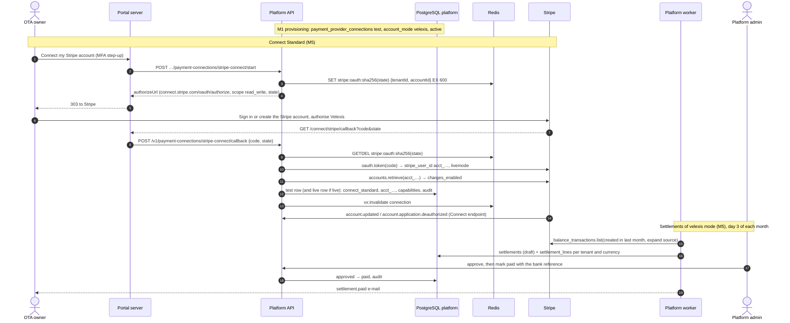

# Flow: Stripe payments account and settlements

This flow covers whose Stripe account takes an OTA's customer payments and how the money reaches the OTA. Every OTA starts on the **Velexis Stripe account** (`velexis` mode), where Velexis collects and settles monthly by bank transfer. From M5 an owner can connect the OTA's **own Stripe account** through Stripe Connect Standard (OAuth) or by entering API keys, or go back to Velexis mode. The platform manages the connection rows and settlements; the OTA backend creates and captures the PaymentIntents ([ADR-0011](../../../docs/mvp/adr/0011-payments-stripe-and-airline-card.md)). It implements PF-60 to PF-64 of [`../scope.md`](../scope.md).

Related: [PADR-0011](../adr/0011-stripe-connect-standard-and-api-key-connections.md) (Connect and API keys), [PADR-0003](../adr/0003-settlement-of-velexis-collected-payments.md) (settlements), [PADR-0010](../adr/0010-credential-submission-and-verification.md), [`../api-inventory-resources.md`](../api-inventory-resources.md) §4–§5, [`../api-inventory-admin.md`](../api-inventory-admin.md) §6.

## Sequence

## Steps

### A. Velexis mode (default)

1. Provisioning inserts the **test** row: `provider = 'stripe'`, `account_mode = 'velexis'`, `capture_mode = 'manual'`, `status = 'active'`, `statement_descriptor_suffix` from the OTA name ([`provisioning.md`](provisioning.md)). No secret is stored: the OTA backend uses Velexis's keys from its environment file.
2. At **go-live** (M5), if the test row is in `velexis` mode, the API inserts the matching **live** row in `velexis` mode. Go-live requires a **verified payout account** in this case, because Velexis must be able to pay the OTA (`PAYOUT_ACCOUNT_REQUIRED`).
3. Owners and admins can edit the statement descriptor suffix (`updatePaymentConnection`, M3).

### B. Payout account (velexis mode, M5)

1. The owner enters holder name, country, currency and either an IBAN (+ BIC) or local account and routing numbers. IBANs are checked with the mod-97 checksum. The action needs an MFA step-up.
2. The API stores the identifiers as encrypted JSON (`bank_details_ciphertext`), keeps `last4` in clear, sets `status = 'pending_review'`, audits `payout_account.updated` (without numbers) and e-mails ops.
3. A platform admin reviews it (`verified` or `rejected` with a note). Any later change resets it to `pending_review`.

### C. Connect Standard (M5)

1. **Start** (`startStripeConnect`, owner or admin, MFA step-up): the API creates a 256-bit `state`, stores `stripe:oauth:<sha256(state)> = {tenantId, accountId, membershipId}` for 10 minutes, and returns `https://connect.stripe.com/oauth/authorize?response_type=code&client_id=<STRIPE_CONNECT_CLIENT_ID>&scope=read_write&state=<state>&redirect_uri=https://platform.example.com/connect/stripe/callback&stripe_user[email]=<owner e-mail>`.
2. **Callback.** Stripe redirects to the fixed portal URL `/connect/stripe/callback`. The portal route handler (signed-in user required) posts `{code, state}` (or `{error, state}`) to the API and redirects to the OTA's payments page with the outcome. The code never appears in logs; the handler strips the query before rendering.
3. **Complete** (`completeStripeConnect`): `GETDEL` the state (single use) and require the same account, still owner or admin of the tenant. Exchange the code with `stripe.oauth.token({grant_type: 'authorization_code', code})` using Velexis's secret key; the response's `livemode` must match the deployment (live in production, test elsewhere), otherwise `UNPROCESSABLE (livemode_mismatch)`. Reject an `acct_…` already connected to another tenant (`STRIPE_ACCOUNT_ALREADY_CONNECTED`). Retrieve the account for `charges_enabled`, `payouts_enabled`, `details_submitted`.
4. **Apply** in one transaction: the **test** row becomes `account_mode = 'connect_standard'`, `account_reference = acct_…`, `publishable_key = NULL` (the storefront uses Velexis's publishable key with `stripeAccount`), secrets `NULL`, `capabilities`, `connected_at`, `status = 'active'` if charges are enabled else `pending`; the **live** row gets the same if the OTA is live, otherwise it is created in this mode at go-live. Audit `payments.connect_connected`; after commit `vx:invalidate connection`.
5. **Account events** arrive on the platform's Connect endpoint `/webhooks/stripe/connect-accounts` ([`../api-inventory-admin.md`](../api-inventory-admin.md) §8): `account.updated` refreshes `capabilities` and `status` (`pending` ↔ `active`); `account.application.deauthorized` sets `status = 'disabled'`, `disconnected_at`, audits and e-mails the owners. There is **no automatic fallback** to Velexis mode, because that changes who holds the money; the owner chooses **Use Velexis payments** or reconnects.

### D. API keys (M5)

1. The owner or an admin enters the publishable key, a secret key (`sk_…`) or restricted key (`rk_…`), and a webhook signing secret (`whsec_…`) for one environment. Prefixes must match the environment (`_test_` or `_live_`). MFA step-up.
2. `submitStripeApiKeys` stores a `credential_submissions` row (`kind = 'stripe_api_keys'`, publishable key in `public_data`, both secrets encrypted), and returns the webhook URL `https://api.ota.example.com/webhooks/stripe/c/<ppc_id>` with the events to enable: `payment_intent.succeeded`, `payment_intent.payment_failed`, `payment_intent.canceled`, `payment_intent.amount_capturable_updated`, `charge.refunded`, `charge.dispute.created`, `charge.dispute.closed`.
3. The `credentials.verify` job calls `GET /v1/account` with the secret key: it must succeed, and `livemode` must match the environment. On success, one transaction: the row becomes `account_mode = 'api_keys'`, `account_reference` = the account id, `publishable_key`, secrets re-encrypted with the connection's associated data, `status = 'active'`; the submission is `applied` with its secrets erased; audit; `vx:invalidate connection`. On failure the connection is unchanged and the submitter is e-mailed.
4. The webhook secret cannot be tested until Stripe sends an event to the OTA backend. The page reminds the owner to send a test event from the Stripe dashboard.

### E. Back to Velexis mode (M5)

`useVelexisPayments` (owner, MFA step-up): for `connect_standard`, call `stripe.oauth.deauthorize({client_id, stripe_user_id})` (a failure is logged and does not block); clear `account_reference`, keys and secrets; set `account_mode = 'velexis'`, `status = 'active'`; audit; invalidate. For live, a verified payout account is required.

**Switching never moves existing payments.** The OTA backend keeps capturing, refunding and receiving webhooks for each payment on the account recorded on that payment row; only new PaymentIntents use the new mode. The page warns about this.

### F. Settlements (velexis mode, M5)

1. On day 3 at 05:00 UTC, `settlements.monthly` enqueues `settlement.generate` for the previous calendar month (UTC).
2. The job pages through `stripe.balanceTransactions.list({created: {gte, lt}, expand: ['data.source']})` on the Velexis account (live in production) once for all tenants. For each transaction it resolves the tenant from `metadata.velexis_tenant_id` of the charge, or of its PaymentIntent, refund's charge or dispute's charge; transactions without a tenant (subscription payments, payouts, Stripe fees not tied to a charge) are skipped.
3. Per tenant and balance currency it rebuilds the **draft**: deletes existing draft lines, inserts one `settlement_lines` row per balance transaction (`charge`, `refund`, `dispute`, `dispute_reversal`) with amount and Stripe fee, adds a `carry_forward` line for the net of earlier `carried_forward` statements not yet absorbed, and computes the totals. Velexis's fee is `round(fee_bps × (gross − refunds) / 10 000)`, never negative, with `fee_bps` copied from the plan. Statements already `approved` or `paid` are never touched; a balance transaction already on one of them is skipped (unique key).
4. An admin reviews the draft and its lines, may add manual adjustments (reason required), and approves (MFA step-up): net > 0 → `approved`, net ≤ 0 → `carried_forward` (its balance moves to next month's draft). Approval requires a verified payout account when net > 0.
5. After paying by bank transfer, the admin records `paidAt` and the bank reference (`mark-paid`, MFA step-up). Owners and finance members are e-mailed; the portal lists the statement and its CSV.

## Failure handling

| Failure | Behaviour |
|---|---|
| OAuth state unknown, expired or used | `CONNECT_STATE_INVALID`; the page offers "try again". |
| User denies on Stripe | `UNPROCESSABLE (access_denied)`; nothing changes. |
| Connected account cannot charge yet | Row `pending`; the storefront answers `PAYMENT_PROVIDER_NOT_CONFIGURED` for new payments until `account.updated` sets `active`. |
| Deauthorised in Stripe | Row `disabled`, owners e-mailed, no fallback. |
| Wrong API keys | Submission `failed`, connection unchanged. |
| Stripe down during settlement | The job retries with backoff; a partial draft is rebuilt from scratch on the next run. |
| Refund after a statement was paid | Appears as a negative line in the month it happened. A negative statement is carried forward. |

## Tables touched

`payment_provider_connections`, `credential_submissions`, `tenant_payout_accounts`, `settlements`, `settlement_lines`, `plans` (fee), `stripe_events` (Connect endpoint), `email_outbox`, `platform_audit_log`. Redis: `stripe:oauth:*`, `vx:invalidate`, `platform-connections`, `platform-settlements`.

## Tests that prove it

- Integration with Stripe test mode fixtures: OAuth state single use and account binding; livemode mismatch; duplicate `acct_` refused; deauthorisation event disables the row; API key verification with a mocked `/v1/account`; switching back clears secrets.
- Settlement unit tests: a month with charges, a refund, a lost dispute and a won dispute, two currencies, and a carried-forward negative balance; regenerate is idempotent; approved statements are never rebuilt.
