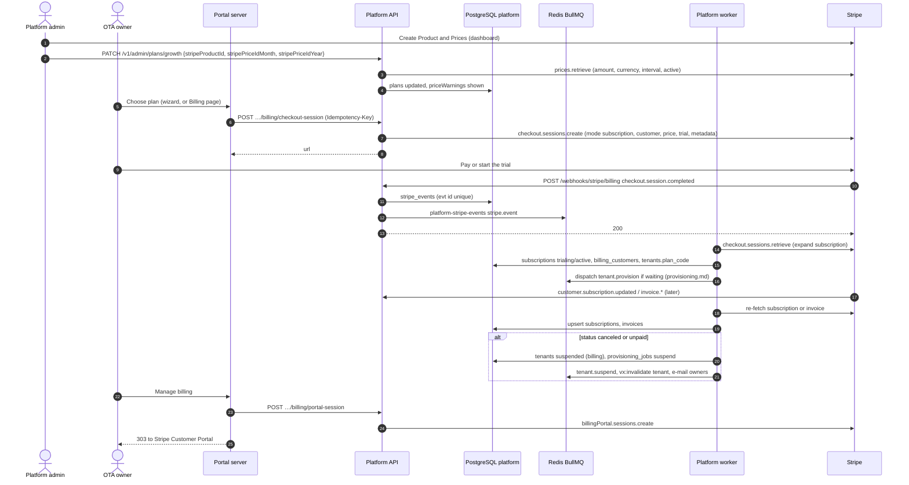

# Flow: subscription billing

This flow covers how an OTA pays Velexis: platform admins link plans to Stripe prices; owners subscribe through Stripe Checkout and manage the subscription in the Stripe Customer Portal; Stripe webhooks keep `platform.subscriptions` and `platform.invoices` in sync; failed payments lead to a banner and, eventually, to suspension; and tenants created before M5 move from the manual trial to Stripe. It implements PF-70 to PF-75 and PF-88, PF-89 of [`../scope.md`](../scope.md), and [ADR-0013](../../../docs/mvp/adr/0013-subscription-billing-stripe-billing.md).

Related: [PADR-0002](../adr/0002-stripe-billing-integration.md), [PADR-0014](../adr/0014-tenant-suspension-and-resume.md), [`signup-and-create-ota.md`](signup-and-create-ota.md), [`../api-inventory-resources.md`](../api-inventory-resources.md) §6, [`../api-inventory-admin.md`](../api-inventory-admin.md) §4 and §8.

## Sequence

## Steps

### A. Plans and prices (admin)

1. Prices are created in Stripe first (one Product per plan, one recurring Price per interval, tax-exclusive, in the plan's currency). Stripe is the source of truth for what is charged.
2. The admin links them on the plan page. The API retrieves each price and stores warnings when the amount, currency or interval differ from the plan, or the price is inactive. Warnings do not block saving; `adminCheckPlanPrices` re-runs the comparison.
3. The Stripe Customer Portal is configured once in the Stripe dashboard: update payment method, view invoices, cancel at period end, switch between the public plans' prices. Velexis builds no billing UI beyond plan display and the portal link.

### B. Checkout

1. **New OTA (M5).** `createTenant` inserts the subscription `incomplete` and calls Checkout ([`signup-and-create-ota.md`](signup-and-create-ota.md)).
2. **Existing OTA** (manual trial ending, canceled subscription, or Checkout abandoned): `createCheckoutSession` on the Billing page. No subscription row is inserted up front, because the current manual row still holds the "one current subscription" slot; the webhook creates the Stripe row.
3. Session parameters: `mode: 'subscription'`; `customer` from `billing_customers` (created with `email = owner e-mail`, `name = legal name or name`, `metadata.velexis_tenant_id` when missing, Stripe idempotency key `customer:<tenantId>`; after a Stripe 5xx, no answer or a refused key, the next attempt first looks for the Customer that attempt made with `customers.search` and otherwise creates it under `customer:<tenantId>:<n>`, the attempt kept in `billing_customer_attempts`, [PADR-0002](../adr/0002-stripe-billing-integration.md) item 3 revision of 2026-10-24); `line_items: [{price, quantity: 1}]`; `client_reference_id: ten_…`; `metadata` and `subscription_data.metadata`: `velexis_tenant_id`, `velexis_subscription_id` (when pre-inserted), `velexis_plan_code`; `subscription_data.trial_period_days` = `plans.trial_days` only for a tenant's first Stripe subscription; `payment_method_collection: 'always'`; `success_url = https://platform.example.com/otas/{id}/setup?checkout=success`; `cancel_url = https://platform.example.com/otas/{id}/billing?checkout=canceled`. Stripe idempotency key `checkout:<tenantId>:<Idempotency-Key>`.

### C. Webhook intake

1. `/webhooks/stripe/billing` verifies the signature on the raw body with `STRIPE_BILLING_WEBHOOK_SECRET`, refuses events whose `livemode` differs from the deployment, inserts `stripe_events {id, endpoint: 'billing', type, livemode, object_type, object_id, api_version, stripe_created_at}` with `ON CONFLICT DO NOTHING`, enqueues `stripe.event` with BullMQ id = event id, and answers `200`.
2. The `stripe_events.sweep` scheduler re-enqueues `received` rows older than 2 minutes, so an enqueue lost after the commit is not lost. It also re-enqueues retryable `failed` rows older than 2 minutes and `processing` rows unchanged for 10 minutes whose BullMQ job is missing or finished, so an attempt that stopped half-way does not strand its event (PBE-043).

### D. Processing (worker, `platform-stripe-events`, concurrency 2)

Each handler sets the event `processing`, **re-fetches the object from Stripe** (never trusts the payload or the order of events), applies the change in one transaction with an audit row, sets `processed` (or `ignored`), then publishes invalidations and enqueues follow-up jobs.

| Event | Handler |
|---|---|
| `checkout.session.completed` (mode subscription) | Retrieve the session with `expand: ['subscription']`. Tenant from `client_reference_id`. Upsert `billing_customers`. Find the subscription row by `metadata.velexis_subscription_id`, else insert one; if a different current row exists (manual trial), set it `canceled` first in the same transaction. Copy status, `provider_customer_id`, `provider_subscription_id`, `provider_price_id`, interval, periods, `trial_ends_at`. Map the price to a plan and set `tenants.plan_code`. If the tenant is `provisioning` with a `queued` job, dispatch it. If the tenant is suspended for `billing`, resume it. |
| `customer.subscription.created`, `…updated`, `…deleted` | Retrieve the subscription. Locate the row by `provider_subscription_id` (or metadata). Update status, periods, `cancel_at_period_end`, `canceled_at`, price and plan. Then apply the status rules of §E. |
| `invoice.finalized`, `invoice.paid`, `invoice.payment_failed`, `invoice.voided` | Retrieve the invoice. Tenant from the customer (`billing_customers`) or the subscription metadata. Upsert `invoices` by `provider_invoice_id`: `number`, status, amounts (minor units converted with the currency's exponent from `reference.currencies`), period, `hosted_invoice_url`, `invoice_pdf_url`, issued, due and paid dates. `payment_failed` also e-mails owners (in addition to Stripe's own e-mail). |
| Anything else, or no tenant found | `ignored`, logged. |

### E. Status rules

| Subscription status | Platform effect |
|---|---|
| `trialing`, `active` | Nothing; if the tenant is suspended with reason `billing`, resume it. |
| `past_due` | `tenants.billing_notice = 'past_due'` and a `tenant` invalidation: banner in the portal and in the OTA admin, which reads it from `tenants`. Stripe Smart Retries and e-mails continue. Cleared when the status is `active` again. |
| `canceled`, `unpaid`, `incomplete_expired` | If the tenant is `active`: suspend with reason `billing` ([PADR-0014](../adr/0014-tenant-suspension-and-resume.md)), e-mail owners. A `provisioning` tenant whose Checkout expired is handled by the abandoned-Checkout job instead. |
| `paused` | Treated like `past_due` (Velexis does not offer pausing in the Customer Portal). |

Billing never deletes data. Reactivation is a new Checkout (canceled) or a successful retry (unpaid → active), which resumes the tenant.

### F. Customer Portal

`createCustomerPortalSession` (owner) calls `stripe.billingPortal.sessions.create({customer, return_url: https://platform.example.com/otas/{id}/billing})` and returns the URL; the portal redirects with `303`.

### G. Manual trials (M1–M4 tenants)

- Before M5, subscriptions are `trialing`, `billing_provider = 'manual'`, on `early_access`, with `trial_ends_at = created_at + 90 days`. Admins may change the date (`adminUpdateManualSubscription`).
- From M5, `billing.manual_trials` (daily) e-mails owners 14 and 3 days before `trial_ends_at` and sets `tenants.billing_notice = 'trial_ending'`; on the end date it sets the manual row `past_due`; 14 days later it sets it `canceled` and suspends the tenant (`billing`). Choosing a plan at any point goes through §B and replaces the manual row.

### H. Abandoned Checkout

`billing.abandoned_checkouts` (daily): tenants in `provisioning` whose current subscription is `incomplete` and older than 48 hours → subscription `incomplete_expired`, job `canceled`, tenant `failed`, audit. The key stays reserved; the owner can retry from the portal.

## Failure handling

| Failure | Behaviour |
|---|---|
| Invalid signature | `400 WEBHOOK_SIGNATURE_INVALID`, logged as a security event. |
| Duplicate event | Inbox insert does nothing; `200`. |
| Out-of-order events | Harmless: every handler re-fetches the current object. |
| Stripe API down during processing | The job fails and retries (5 attempts, backoff); then the event is `failed`, visible in the admin (`adminReprocessStripeEvent`). |
| Price not linked to any plan | Event `failed` with `UNKNOWN_PRICE`; dashboard alert; admin links the price and reprocesses. |
| Webhook endpoint down | Stripe retries for 3 days; Checkout success pages keep polling. |

## Tables touched

`plans`, `billing_customers`, `billing_customer_attempts`, `subscriptions`, `invoices`, `stripe_events`, `tenants` (`plan_code`, suspension), `provisioning_jobs` (dispatch, suspend, resume), `email_outbox`, `platform_audit_log`. Reads `reference.currencies`.

## Tests that prove it

- Signed fixture events in CI ([ADR-0015](../../../docs/mvp/adr/0015-testing-strategy.md)) with a mocked Stripe client: duplicate and reversed delivery give the same final rows; `checkout.session.completed` dispatches provisioning once; `unpaid` suspends and `active` resumes a `billing` suspension but not an `abuse` one; manual row replaced on Checkout.
- Manual run with Stripe test mode and `stripe listen --forward-to localhost:3100/webhooks/stripe/billing`.
