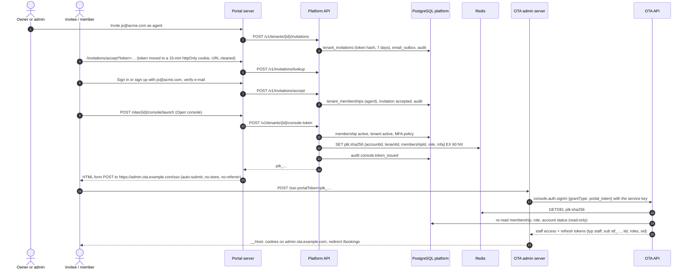

# Flow: team and OTA admin SSO

This flow covers the people of an OTA: inviting members by e-mail, accepting invitations, changing roles and removing members, and "Open console", the single sign-on from the portal into the OTA admin with a one-time portal token. It also covers how revocations reach the OTA admin ("sign out everywhere", password change, removal). It implements PF-06, PF-20 to PF-22 of [`../scope.md`](../scope.md), and refines [ADR-0008](../../../docs/mvp/adr/0008-identity-accounts-customers-sessions.md) and flow (c) of [`docs/mvp/architecture.md`](../../../docs/mvp/architecture.md#c-ota-admin-sso-from-the-portal-and-console-booking-actions).

Related: [PADR-0007](../adr/0007-portal-to-ota-admin-sso-token.md), [PADR-0008](../adr/0008-email-verification-and-mfa-policy.md), [`../api-inventory.md`](../api-inventory.md) §8, [`../scope.md`](../scope.md) §1.2 (role matrix).

## Sequence

## Steps

### A. Invitations

1. **Invite.** Owners and admins invite an e-mail address with a role. Only owners may invite `owner` or `admin`. The API checks:
   - no active member with that e-mail (`ALREADY_MEMBER`) and no pending invitation (`INVITATION_PENDING`, unique index);
   - seats: active members + pending invitations < `plans.limits.staffSeats` (`PLAN_LIMIT_REACHED`).

   It stores `tenant_invitations` with the SHA-256 of a 256-bit token and `expires_at = now() + 7 days`, queues `team.invitation` with the link `https://platform.example.com/invitations/accept?token=…` in the encrypted secret payload, and audits `invitation.created`.
2. **Open the link.** The portal page reads the token on the server, stores it in a `__Host-vxp_invite` httpOnly cookie for 15 minutes, and redirects to the same page without the query (no token in history or `Referer`). It shows the OTA name, role, inviter and invited address (`lookupInvitation`).
3. **Accept.** If the visitor is not signed in, they sign in or sign up (e-mail prefilled); after e-mail verification they come back to the accept page. `acceptInvitation` requires the invitation `pending` and unexpired, and the signed-in account's **verified** e-mail equal to the invited address, case-insensitively (`INVITATION_EMAIL_MISMATCH`). In one transaction it inserts the membership (or re-activates a `removed` one with the new role), sets the invitation `accepted`, and audits `membership.created`. After commit: `vx:invalidate membership`.
4. **Resend and revoke.** Resend issues a new token and 7 more days (the old link stops working). Revoke sets `revoked`. The hourly `invitations.expire` job sets `expired`.

### B. Roles and removal

- `updateMember` changes the role with `If-Match`. Admins may set `agent`, `finance` or `viewer` on members who are not owners or admins; only owners may grant or remove `owner` and `admin`, and granting `owner` needs an MFA step-up. The last active owner cannot be demoted or removed (`LAST_OWNER`).
- `removeMember` sets `status = 'removed'` (the row stays: `stf_` ids are referenced by value in tenant `staff_actions`). A member may remove themself ("leave"), unless they are the last owner.
- Every change audits and publishes `vx:invalidate {type: "membership", accountId, tenantId}`. The OTA staff guard re-checks the cached membership on every console call, so a removed member loses access within seconds (60 s at most if the message is lost).

### C. Open console (M4)

1. The **Open console** button is a small `<form method="post">` to the portal route handler `/otas/{tenantId}/console/launch`, so link prefetching can never mint tokens. The route handler checks `Origin`, then calls `createConsoleToken`.
2. The API ([PADR-0007](../adr/0007-portal-to-ota-admin-sso-token.md)):
   - requires an active, verified account and an active membership (any role);
   - requires the tenant `active` (`TENANT_NOT_ACTIVE` with `details.status`, so the portal can explain "suspended for billing" and link to the billing page);
   - applies the MFA policy: when the tenant is live, the account must have MFA enabled (`MFA_REQUIRED`) ([PADR-0008](../adr/0008-email-verification-and-mfa-policy.md));
   - generates `ptk_` + 43 base62 characters (256 bits), stores `SET ptk:<sha256> <json> EX 60 NX` with `{v: 1, accountId, tenantId, membershipId, role, mfa: <account MFA enabled>, issuedAt, requestId}`, audits `console.token_issued` (never the token), and returns it with `Cache-Control: no-store`.
3. The route handler answers with a minimal HTML page: a form `POST https://admin.ota.example.com/sso` with a hidden `portalToken`, a nonce-allowed script that submits it at once, and a visible "Continue" button for browsers without JavaScript. Headers: `Cache-Control: no-store`, `Referrer-Policy: no-referrer`, CSP `form-action https://admin.ota.example.com`. The token is never in a URL.
4. The OTA admin and OTA backend complete the sign-in as in [ADR-0008](../../../docs/mvp/adr/0008-identity-accounts-customers-sessions.md) (OTA plan). The staff session is bound to that one tenant.
5. **Coming from the OTA admin.** Without a session, the OTA admin redirects to `https://platform.example.com/console?tenant=<tenantId>`. That portal page requires sign-in, then shows the user's OTAs with an **Open console** button each (pre-selecting `tenant`); with exactly one OTA it shows a single button. The OTA admin's tenant switcher links to the same page.

### D. Revocation reaching the OTA admin

The OTA admin's staff sessions live in OTA-owned Redis keys. The platform writes `staffdeny:acct:<accountId> = <epoch ms>` (TTL 30 days) when any of these happens: sign out everywhere, password change or reset, MFA reset by support, account disabled. The OTA staff guard and refresh refuse staff families created before that time ([`../architecture.md`](../architecture.md) §6.4). Membership and account changes also publish `membership` or `account` invalidations.

## Failure handling

| Failure | Behaviour |
|---|---|
| Invitation expired or revoked | `INVITATION_INVALID`; the page asks the inviter to resend. |
| Signed in with another address | `INVITATION_EMAIL_MISMATCH`; the page offers to sign out and continue with the invited address. |
| Seats full | `PLAN_LIMIT_REACHED`; owners see an upgrade hint (M5). |
| Token not redeemed within 60 s | The OTA backend answers `401 PORTAL_TOKEN_INVALID`; the OTA admin sends the user back to the portal's console page. |
| Redis down | `createConsoleToken` answers `503 SERVICE_UNAVAILABLE`; existing staff sessions continue. |
| Tenant suspended | No token; the portal explains why. Existing staff sessions get `TENANT_SUSPENDED` from the OTA backend. |

## Tables touched

`tenant_invitations`, `tenant_memberships`, `accounts`, `tenants`, `plans` (seats), `email_outbox`, `platform_audit_log`. Redis: `ptk:*`, `staffdeny:acct:*`, `vx:invalidate`.

## Tests that prove it

- Integration: role matrix of [`../scope.md`](../scope.md) §1.2 for every endpoint; last-owner protection; e-mail mismatch; seat limit counts pending invitations; console token stored with TTL 60 and `NX`, never logged, refused for suspended tenants and for live tenants without MFA.
- End-to-end (M4, `tools/e2e/specs/console-sso.e2e.ts`): sign in to the portal, open the console, land on `/bookings` of the right OTA; the same token posted twice fails the second time; removal from the team ends the console session.
