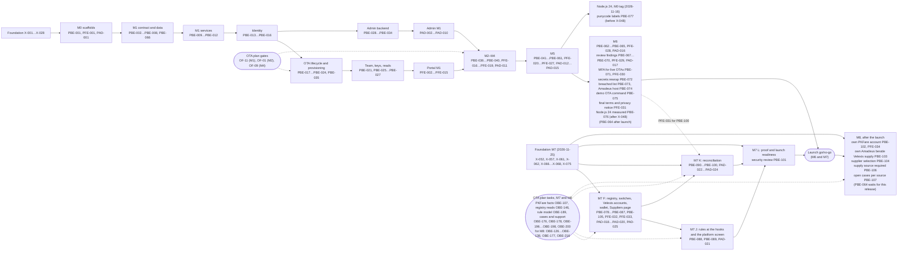

# Platform agent tasks (`PBE-`, `PFE-`, `PAD-`)

This plan breaks the platform group's MVP work (platform backend, portal and platform admin) into small, self-contained tasks for AI coding agents, ordered by the shared milestones M0–M8. Each task names the documents to read, the files to touch, the steps, the acceptance criteria and the command that proves it. Every endpoint of the platform API inventory is implemented by a backend task and, where people use it, by a portal or admin task with a test. The plan follows [`decisions.md`](../../../docs/mvp/decisions.md), [ADR-0020](../../../docs/mvp/adr/0020-ai-agent-development-workflow.md) and the platform ADRs, and is validated by `node tools/plan-lint/plan-lint.mjs`.

Related: [`implementation-plan.md`](implementation-plan.md) (milestones, epics, risks, traceability), [`solo-developer-plan.md`](solo-developer-plan.md) (week by week), [`../scope.md`](../scope.md), [`../architecture.md`](../architecture.md), [`../api-inventory.md`](../api-inventory.md), [`../api-inventory-resources.md`](../api-inventory-resources.md), [`../api-inventory-admin.md`](../api-inventory-admin.md), [`../data-model.md`](../data-model.md), [flows](../README.md#flows), [platform ADRs](../adr/README.md), [`../../../docs/mvp/plans/foundation-tasks.md`](../../../docs/mvp/plans/foundation-tasks.md) (`X-` tasks), [`../../../AGENTS.md`](../../../AGENTS.md).

## How to use this file

1. **Pick** the lowest-milestone task whose **Depends on** tasks are all done and that nobody has claimed (no open PR, no branch `task/<ID>-*`). Prefer the critical path that `node tools/plan-lint/plan-lint.mjs` prints. Finish the `X-` tasks a task depends on first ([AGENTS.md](../../../AGENTS.md) §3). *Since 2026-11-25* (the owner's decision, [ADR-0025](../../../docs/mvp/adr/0025-roadmap-scheduling-and-tracking.md) item 3): M7's tasks may start while every open task of M0–M6 waits on a human step, a nightly run or the launch, in the order of their phases (A to L); M8's tasks start after the launch. M7 and M8 tasks also depend on OTA tasks (`OBE-`).
2. **Claim** it by adding `- **Status:** in progress (PR #n)` under its heading in your PR. plan-lint ignores the extra field.
3. **Finish** it in one branch and one PR. When the PR is merged, the heading ends with ` ✅` (for example `### PBE-012 · Implement … ✅`) and the status line says `done (PR #n)`. A heading with ` ✅` means "done" for every task that depends on it.
4. **Gates.** A few tasks need work of the OTA group. Their first step is a **Gate** naming the OTA feature id of [`../../../ota/docs/scope.md`](../../../ota/docs/scope.md) (OF-01, OF-09, OF-11 …). If the gate is not met, stop and report; never fake the other side ([PADR-0017](../adr/0017-platform-test-doubles-and-end-to-end-harness.md)).
5. **Contract first.** The platform OpenAPI document grows in milestone slices; every operation that is documented but not implemented yet is listed in `platform/backend/test/contract/pending-operations.ts` with its task id, and the implementing task removes it ([PADR-0016](../adr/0016-contract-rollout-per-milestone-and-route-parity.md)).
6. **Milestone switches.** M5 code is merged behind the `FEATURE_*` switches of [PADR-0015](../adr/0015-milestone-feature-switches.md). M5 tests run with the switch on, and at least one test per M5 endpoint proves `403 FEATURE_DISABLED` with it off.
7. **Tests** end their names with the task and criterion, for example `it("locks after five failures [PBE-014 AC2]")`. Integration tests use `createTestApp()` (PBE-008) on a database from `@velexis/testing`, never shared mutable fixtures.
8. **After editing this file**, run `node tools/plan-lint/plan-lint.mjs docs/mvp/plans/foundation-tasks.md platform/docs/plans/agent-tasks.md` and fix every error. New work found during a task becomes a new task here (next free id). *Since 2026-11-25* name `ota/docs/plans/agent-tasks.md` too, or run plan-lint without files: a run without the OTA plan reports the OTA tasks that M7 and M8 tasks depend on as unknown.

Common commands: backend `pnpm --filter @velexis/platform-backend test`, `test:int`, `test:xb`; portal `pnpm --filter @velexis/platform-frontend test`; admin `pnpm --filter @velexis/platform-admin test`; end-to-end `pnpm test:e2e -- --project=portal` or `--project=platform-admin`.

## Milestone summary

| Milestone | Tasks | Demo at the end |
|---|---|---|
| M0 Foundations | PBE-001, PFE-001, PAD-001, PBE-077 | The three platform apps build, start and answer `/health/live`; the release contains them. Since 2026-11-16 (lead decision (25n), [ADR-0029](../../../docs/mvp/adr/0029-nodejs-24-runtime.md) item 7): custom domains and API-key origins refuse host names whose punycode labels do not decode, on Node 22 and 24 alike (PBE-077, tagged M0 so that it lands before the switch to Node.js 24, X-048; it needs PBE-021 and PBE-049, both done). |
| M1 Platform core | PBE-002 … PBE-035, PBE-066, PFE-002 … PFE-015, PAD-002 … PAD-010 | Sign up, verify, MFA, create an OTA that becomes active through the real OTA worker, reveal test keys, manage keys and team; staff sign in to the admin, see the tenant, its job and office, suspend and resume it. |
| M2 Search & price | PBE-036, PAD-011 | A key created in the portal works on the OTA API and stops working after revocation; a suspension reaches the storefront. |
| M3 Book & pay | PBE-037, PBE-038, PFE-016 | Owners edit the card statement descriptor of the Velexis payment connection. |
| M4 OTA admin | PBE-039, PBE-040, PFE-017 … PFE-019 | "Open console" signs a member into the OTA admin; Amadeus office settings are editable. |
| M5 Monetisation & self-service | PBE-041 … PBE-061, PFE-020 … PFE-027, PAD-012 … PAD-015 | Checkout and Customer Portal, own Stripe (Connect or keys), payout account and settlements, own Amadeus credentials and live office, custom domains with TLS, go-live. |
| M6 Hardening & launch | PBE-062 … PBE-065, PBE-067 … PBE-076, PFE-028 … PFE-031, PAD-016, PAD-017 | Security review closed, performance measured, end-to-end suite green nightly, launch checklist ready; since 2026-11-11 the platform's `secrets:rewrap` (PBE-072), so a master-key rotation can remove the old key, portal passwords checked against the rule-meeting entries of a list of a million breached passwords (PBE-073, lead decision (17b)), and in production no Velexis Amadeus account outside the official Amadeus hosts (PBE-074, lead decision (17k)); since 2026-11-13 Velexis's production demo OTA, created with its reserved key `demo` by a platform command and kept out of billing, while the key stays reserved for everyone else (PBE-075, lead decision (20a)); since 2026-11-15 the product owner's approved terms of service and privacy notice in place of the portal's placeholder text, under a new `termsVersion` that sign-up sends (PFE-031, lead decision (23n); it waits for the approved text, a human step); since 2026-11-16 the platform API and worker measured on Node.js 24 against Node 22 and the VM budget, with their share of time in garbage collection (PBE-076, lead decision (25n)). The switches are removed after the launch: PBE-064 is a named exception to "every M6 task done" ([ADR-0025](../../../docs/mvp/adr/0025-roadmap-scheduling-and-tracking.md) item 4). |
| M7 Multi-supplier engine | PBE-078 … PBE-101, PBE-105, PFE-032, PFE-033, PAD-018 … PAD-025 | Built before the launch (since 2026-11-25, the owner's decisions, [ADR-0030](../../../docs/mvp/adr/0030-suppliers-supply-sources-and-ingestion-engine.md) items 19 to 23). Parts of this rest on the lead's proposals, which each block names (ADR-0030 item 26). Staff run the supplier registry in the platform admin's "Suppliers" area: the global switches, source stops with a reason, Velexis's supplier accounts and the PKFare wallet with its watch, panel and dashboard tile. An OTA's tenant page shows its supply sources with their supply ids, the per-tenant switch, the daily limit with the default 0 (what 0 means waits for the owner's answer to question (44a)) and the ticketing defaults and queues of its Velexis connection. The portal's Suppliers page shows the Velexis section with the live access request; today's own Amadeus parts move into its "Amadeus" section, behind `FEATURE_OWN_AMADEUS`, which stays off at the launch. Staff edit Velexis's supply rules on the rules screen. The reconciliation role signs in to the "Reconciliation" area: cases with due times, "Open booking" through a one-time handoff, the ledger with its export, the daily check, statements and top-ups; an OTA can ask which supplier served a booking. The security review of the platform supply modules is done, its findings fixed or tracked (PBE-101). Since 2026-11-26 the owner's answer to (44a) is in: with a limit of 0 no ticket is paid from the wallet until staff set a limit (ADR-0030 item 27; PADR-0020 item 18). |
| M8 Own supplier accounts (after the launch) | PBE-102 … PBE-104, PBE-106, PBE-107, PFE-034 | The release after the launch of ADR-0030 item 21, as the lead reads it; no M8 task starts before the launch. An OTA connects its own PKFare account in the Suppliers page's PKFare section (the lead's reading, question (44d)) and its own Amadeus account beside Velexis supply, and chooses between Velexis supply and its own accounts. Every supplier connection has its supply source. The platform counts open paid-and-not-ticketed cases per supply source and stops a source at the cap. PBE-064 (M6) waits for this release ([PADR-0015](../adr/0015-milestone-feature-switches.md), note of 2026-11-25). Since 2026-11-26 the owner's answer to (44d) is "Yes." (ADR-0030 item 30; PADR-0020 item 19): an OTA's own PKFare account comes after the launch, with own Amadeus. |

## M0 — Foundations

### PBE-001 · Scaffold the platform backend with API, worker and CLI entry points ✅
- **Status:** done (branch claude/intelligent-bardeen-90hhu7)
- **Component:** platform-backend
- **Milestone:** M0
- **Depends on:** X-002, X-003, X-009, X-010
- **Size:** M
- **Read first:** platform/backend/README.md §1, §2, §5; platform/docs/architecture.md §1 and §2.1; docs/mvp/conventions.md §2 and §8; docs/mvp/tech-stack.md §2 and §3 (Platform backend); docs/mvp/adr/0024-reference-data-sources-and-loader.md (Loader)
- **Files:** `platform/backend/package.json`, `platform/backend/nest-cli.json`, `platform/backend/tsconfig.json`, `platform/backend/tsconfig.build.json`, `platform/backend/vitest.config.ts`, `platform/backend/vitest.int.config.ts`, `platform/backend/src/main.ts`, `platform/backend/src/worker.ts`, `platform/backend/src/cli.ts`, `platform/backend/src/app.module.ts`, `platform/backend/src/worker.module.ts`, `platform/backend/src/config.ts`, `platform/backend/src/config.test.ts`, `platform/backend/src/health/health.module.ts`, `platform/backend/src/health/health.controller.ts`, `platform/backend/src/health/health.service.ts`, `platform/backend/test/integration/health/health.int.test.ts`
- **Steps:**
  1. Create `@velexis/platform-backend` (private, CommonJS output) with the exact versions of tech-stack §2: `@nestjs/core`, `@nestjs/common`, `@nestjs/platform-express` 11, `@nestjs/config`, `nestjs-pino`, `pino-http`, `nestjs-cls`, `ioredis`, and the workspace packages `@velexis/config`, `@velexis/logger`, `@velexis/db`, `@velexis/errors`. Scripts: `build` (three entry points `dist/main.js`, `dist/worker.js`, `dist/cli.js`), `dev` (runs `dev:api` and `dev:worker`), `test`, `test:int`, `typecheck`, `lint`, `clean`.
  2. Write `src/config.ts` with `defineConfig`: `APP_ENV`, `LOG_LEVEL`, `PORT` (3100), `HEALTH_PORT` (3101, worker), `TRUST_PROXY` (`loopback`), `DATABASE_URL`, `REDIS_URL`. Call `loadDevEnvFiles` outside production. Later tasks extend this schema.
  3. `main.ts`: bind to `127.0.0.1:PORT`, set Express `trust proxy` from `TRUST_PROXY`, use `nestjs-pino` with the `@velexis/logger` HTTP options, `nestjs-cls` with `requestId` taken from `X-Request-Id` or generated, and shutdown hooks. `worker.ts`: a Nest application context plus a small `node:http` server on `HEALTH_PORT`. `cli.ts`: a command dispatcher with `help` (PBE-028 and PBE-034 add commands).
  4. `HealthModule`: `GET /health/live` answers `200 {status: "ok"}`; `GET /health/ready` checks PostgreSQL (`SELECT 1` on a `createPool` pool) and Redis (`PING`) and answers `200` or `503` with the status of each dependency. The worker serves the same two paths.
  5. Add the package script `ref:load`, which runs `pnpm --dir ../.. db:seed:reference` (README §5). The backend has no `reference-data/` folder and no loader of its own: the datasets and the loader are `tools/reference-data` (ADR-0024, X-017, X-018), and the platform docs already say so.
- **Acceptance:**
  - `pnpm --filter @velexis/platform-backend build` produces `dist/main.js`, `dist/worker.js` and `dist/cli.js`.
  - With PostgreSQL and Redis running, `/health/ready` answers 200 on 3100 and 3101; with Redis unreachable it answers 503 naming `redis` (integration test).
  - Starting without `DATABASE_URL` exits non-zero with a `ConfigError` that names the variable (unit test of `config.ts`).
  - Every request log line carries `requestId`; lint finds no `console.*` and no `process.env`.
  - `src/` has no `reference/` loader and the package has no `reference-data/` folder; `ref:load` only calls the root `db:seed:reference`.
- **Verify:** `pnpm --filter @velexis/platform-backend build && pnpm --filter @velexis/platform-backend test && pnpm --filter @velexis/platform-backend test:int`

### PFE-001 · Scaffold the portal Next.js app with Tailwind, shadcn/ui and health routes ✅
- **Status:** done (branch claude/intelligent-bardeen-90hhu7)
- **Component:** platform-frontend
- **Milestone:** M0
- **Depends on:** X-002, X-003
- **Size:** M
- **Read first:** platform/frontend/README.md §1, §3, §7, §8; docs/mvp/conventions.md §3; docs/mvp/adr/0014-frontend-stack-nextjs-tailwind.md; docs/mvp/tech-stack.md §3 (Portal)
- **Files:** `platform/frontend/package.json`, `platform/frontend/next.config.ts`, `platform/frontend/tsconfig.json`, `platform/frontend/postcss.config.mjs`, `platform/frontend/vitest.config.ts`, `platform/frontend/components.json`, `platform/frontend/src/app/layout.tsx`, `platform/frontend/src/app/globals.css`, `platform/frontend/src/app/(marketing)/page.tsx`, `platform/frontend/src/app/health/live/route.ts`, `platform/frontend/src/app/health/ready/route.ts`, `platform/frontend/src/app/health/ready/route.test.ts`, `platform/frontend/src/lib/config.ts`, `platform/frontend/src/lib/config.test.ts`, `platform/frontend/src/components/ui/button.tsx`, `platform/frontend/README.md`
- **Steps:**
  1. Create `@velexis/platform-frontend`: Next.js 15 App Router, React 19, Tailwind CSS 4 through `@tailwindcss/postcss`, `server-only`, `zod`, `lucide-react`, `openapi-fetch`; `output: "standalone"`; scripts `dev` (port 3000), `build`, `start`, `test`, `typecheck`, `lint`.
  2. Write `src/lib/config.ts` (`import "server-only"`) with `@velexis/config`: `APP_ENV`, `LOG_LEVEL`, `PORT`, `HOSTNAME` (`127.0.0.1`), `PLATFORM_API_URL`, `PUBLIC_PORTAL_URL`, `PUBLIC_OTA_ADMIN_URL`, `STOREFRONT_BASE_DOMAIN`, optional `SENTRY_DSN`.
  3. Initialise shadcn/ui (`components.json`, `Button` as the first copied component), design tokens with `@theme` in `globals.css`, a root layout with `lang="en"` and a skip link, and a placeholder landing page.
  4. Add static security headers in `next.config.ts`: `X-Content-Type-Options: nosniff`, `Referrer-Policy: strict-origin-when-cross-origin`, `Permissions-Policy` minimal. The nonce-based CSP comes with PFE-002's middleware.
  5. Route handlers `/health/live` (200) and `/health/ready` (200 when `PLATFORM_API_URL/health/live` answers within 2 seconds, otherwise 503).
- **Acceptance:**
  - `pnpm --filter @velexis/platform-frontend build` produces `.next/standalone`.
  - `/health/ready` answers 503 when the platform API is down and 200 when it answers (unit test with a mocked `fetch`).
  - No `NEXT_PUBLIC_` variable exists; the config test refuses a missing `PLATFORM_API_URL`.
- **Verify:** `pnpm --filter @velexis/platform-frontend build && pnpm --filter @velexis/platform-frontend test && pnpm --filter @velexis/platform-frontend lint`

### PAD-001 · Scaffold the platform admin Next.js app with health routes ✅
- **Status:** done (branch claude/intelligent-bardeen-90hhu7)
- **Component:** platform-admin
- **Milestone:** M0
- **Depends on:** X-002, X-003
- **Size:** S
- **Read first:** platform/admin/README.md §1, §3, §5; docs/mvp/conventions.md §3; docs/mvp/adr/0014-frontend-stack-nextjs-tailwind.md
- **Files:** `platform/admin/package.json`, `platform/admin/next.config.ts`, `platform/admin/tsconfig.json`, `platform/admin/postcss.config.mjs`, `platform/admin/vitest.config.ts`, `platform/admin/components.json`, `platform/admin/src/app/layout.tsx`, `platform/admin/src/app/globals.css`, `platform/admin/src/app/health/live/route.ts`, `platform/admin/src/app/health/ready/route.ts`, `platform/admin/src/lib/config.ts`, `platform/admin/src/lib/config.test.ts`, `platform/admin/README.md`
- **Steps:**
  1. Create `@velexis/platform-admin` like PFE-001 (same versions), plus `@tanstack/react-table`; port 3001; `output: "standalone"`.
  2. `src/lib/config.ts` (`server-only`): `APP_ENV`, `LOG_LEVEL`, `PORT`, `HOSTNAME`, `PLATFORM_API_URL`, `PUBLIC_PLATFORM_ADMIN_URL`, `PUBLIC_PORTAL_URL`, optional `SENTRY_DSN`.
  3. Headers on every response: `X-Robots-Tag: noindex`, `X-Content-Type-Options: nosniff`, `Referrer-Policy: same-origin`.
  4. `/health/live` and `/health/ready` as in PFE-001.
- **Acceptance:**
  - `pnpm --filter @velexis/platform-admin build` produces `.next/standalone`; `/health/live` answers 200 with `X-Robots-Tag: noindex`.
  - The config test refuses a missing `PLATFORM_API_URL`.
- **Verify:** `pnpm --filter @velexis/platform-admin build && pnpm --filter @velexis/platform-admin test`

### PBE-077 · Refuse host names whose punycode labels do not decode, in custom domains and API-key origins, on Node 22 and 24 ✅
- **Status:** done (branch claude/intelligent-bardeen-90hhu7)
- **Component:** platform-backend
- **Milestone:** M0
- **Depends on:** PBE-021, PBE-049
- **Size:** S
- **Read first:** docs/mvp/adr/0029-nodejs-24-runtime.md (item 7; Accepted on 2026-11-16, the owner's request of 2026-11-15); platform/docs/adr/0004-custom-domain-verification.md item 1 (the host name rules); platform/docs/adr/0005-api-key-format-and-hashing.md item 5 (allowed origins); platform/backend/src/domains/hostname-rules.ts (the file header, `checkCustomHostname`) and its test ("refuses the malformed host %j"); platform/backend/src/api-keys/api-key-rules.ts (`originProblem`) and its test
- **Files:** `platform/backend/src/domains/hostname-rules.ts`, `platform/backend/src/domains/hostname-rules.test.ts`, `platform/backend/src/api-keys/api-key-rules.ts`, `platform/backend/src/api-keys/api-key-rules.test.ts`, `platform/docs/plans/agent-tasks.md` (its status)
- **Steps:**
  1. Added by the lead for the Node.js 24 upgrade (ADR-0029 item 7). Node 24 ships ada 4.0.0 (`process.versions.ada`; 2.9.2 in Node 22.23), whose `url.domainToASCII` returns an invalid punycode label unchanged where Node 22 returned `""`, and whose `new URL()` accepts such a host where Node 22 threw `ERR_INVALID_URL`. On Node 24 `checkCustomHostname` therefore accepts `xn--zz.example.com` (the case `["xn--zz.example.com"]` of "refuses the malformed host %j" fails: it is this bug's failing test) and `originProblem` accepts `https://xn--zz.example`. Both values would be stored: a custom domain row, an API key's allowed origins.
  2. Export one pure check from hostname-rules.ts: every label of an ASCII host name that starts with `xn--` decodes (`domainToUnicode` of the label no longer starts with `xn--`) and encodes back to itself (`domainToASCII` of the decoded label equals the label). `checkCustomHostname` refuses with `syntax` after the conversion when the check fails (rewrite step 4 of the file header to say so); `originProblem` refuses with its `origin` field error when the URL's `hostname` fails it. No other rule changes. Run the new cases on Node 22 and on Node 24 (`NODE24`: the `bin` folder of a Node 24 build, `/opt/node24/bin` on the agents' machine).
  3. Tests, tagged `[PBE-077 AC1]`: keep the existing `xn--zz.example.com` case unchanged; add `xn--a.com`, `xn--ab-.com` and `a.xn--zz` (refused, `syntax`) and `xn--bcher-kva.example.net`, `XN--BCHER-KVA.example.net` and `Bücher.example.net` (accepted as `xn--bcher-kva.example.net`) to hostname-rules.test.ts; add `https://xn--zz.example` and `https://XN--zz.example` (refused, `origin`) and `https://xn--bcher-kva.example` (accepted) to api-key-rules.test.ts. The OTA backend's `isSerializedOrigin` (ota/backend/src/common/http/cors.ts) and the OTA admin's `URL.canParse` rules stay as they are: no invalid origin can be stored through the platform, and a link to such a host fails in the browser (ADR-0029 item 7).
- **Acceptance:**
  - On Node 22 and on Node 24 alike, `checkCustomHostname` refuses `xn--zz.example.com`, `xn--a.com`, `xn--ab-.com` and `a.xn--zz` with `syntax` and accepts `Bücher.example.net` and `XN--BCHER-KVA.example.net` as `xn--bcher-kva.example.net`; `originProblem` refuses `https://xn--zz.example` and `https://XN--zz.example` with `origin` and accepts `https://xn--bcher-kva.example` (`[PBE-077 AC1]`).
  - The case `["xn--zz.example.com"]` of "refuses the malformed host %j" in hostname-rules.test.ts is unchanged, and no existing test changes.
  - `pnpm lint`, `pnpm typecheck` and `pnpm test` pass on Node 22.
- **Verify:** `pnpm --filter @velexis/platform-backend test -- hostname-rules api-key-rules && test -x "$NODE24/node" && PATH="$NODE24:$PATH" node --version | grep -q '^v24\.' && PATH="$NODE24:$PATH" pnpm --filter @velexis/platform-backend test -- hostname-rules api-key-rules`
- **Note (2026-11-18, lead decision (27i) of 2026-11-17, approved by the owner; FIX-W59-DOCS):** the second acceptance criterion named the case by its line, hostname-rules.test.ts:163, which PBE-077's own import of `punycodeLabelsRoundTrip` moved to line 164; it now names the case by its test's title and its value. PBE-077 also changed what Node 22 accepts: `originProblem` now refuses, on Node 22 as on Node 24, API-key origins such as `https://xn--ab-.example`, whose label `xn--ab-` decodes (to `ab`) but does not encode back to itself. Both majors' URL parsers accept such a host, so Node 22 used to store it in a key's allowed origins; the `[PBE-077 AC1]` cases `https://xn--ab-.example` and `http://xn--ab-.example` of api-key-rules.test.ts failed on Node 22.23.4 before the fix. This Note changes no Status.

## M1 — Platform core

### PBE-002 · Add migration 0002 with the MVP platform deltas ✅
- **Status:** done (branch claude/intelligent-bardeen-90hhu7)
- **Component:** platform-backend
- **Milestone:** M1
- **Depends on:** X-012, X-014, X-015, PBE-001
- **Size:** M
- **Read first:** platform/docs/data-model.md (whole); platform/docs/data-model-migration-0002.md ("How to use it"); docs/mvp/conventions.md §9; docs/mvp/adr/0021-migration-cli-and-repeatable-grants.md; platform/backend/migrations/README.md
- **Files:** `platform/backend/migrations/platform/0002_add_mvp_platform_deltas.sql`, `platform/backend/migrations/README.md`, `platform/backend/test/contract/migration-0002.contract.test.ts`, `platform/backend/test/integration/migrations/migrate-0002.int.test.ts`, `packages/db/src/generated/platform.ts`
- **Steps:**
  1. Create `0002_add_mvp_platform_deltas.sql` by concatenating, in order and byte for byte, the ```sql blocks of `data-model-migration-0002.md`, `data-model-migration-0002-part2.md` and `data-model-migration-0002-part3.md`, ending with one newline. Do not reformat: the runner stores the checksum.
  2. Contract test: read the three documents, extract the SQL blocks with a regex, concatenate them and compare with the file; check the first line is `-- velexis:phase expand`.
  3. Integration test, from scratch: the `@velexis/testing` template database has the ledger row `0002_add_mvp_platform_deltas` (phase `expand`) and the 11 new tables. As an upgrade: run the runner on a temporary directory holding only `0001_baseline.sql`, insert one tenant with a valid key and one subscription, then apply the real directory; the rows survive.
  4. Run `pnpm db:migrate` twice (the second run applies nothing), then `pnpm db:codegen`, and commit `packages/db/src/generated/platform.ts`.
  5. Note in the migrations README that `0002` holds every planned MVP delta and that the next platform delta is `0003`.
- **Acceptance:**
  - The contract test passes, and fails when one character of the migration changes.
  - The migration applies from scratch and as an upgrade from `0001`, in one transaction.
  - The generated types contain `platform.amadeus_accounts`, `platform.email_outbox`, `platform.settlements` and `accounts.terms_version`; a second `pnpm db:codegen` gives no diff.
- **Verify:** `pnpm db:migrate && pnpm db:codegen && git diff --exit-code packages/db/src/generated && pnpm --filter @velexis/platform-backend test && pnpm --filter @velexis/platform-backend test:int migrations`

### PBE-003 · Prove the 0002 constraints and privileges with integration tests ✅
- **Status:** done (branch claude/intelligent-bardeen-90hhu7)
- **Component:** platform-backend
- **Milestone:** M1
- **Depends on:** PBE-002, X-015
- **Size:** M
- **Read first:** platform/docs/data-model-migration-0002.md ("How to use it"); platform/docs/data-model.md §4, §5, §6; docs/mvp/adr/0004-postgresql-schema-per-tenant.md (Database roles); platform/backend/migrations/platform/R__ota_read_access.sql
- **Files:** `platform/backend/test/builders/platform-rows.ts`, `platform/backend/test/integration/migrations/constraints-0002.int.test.ts`, `platform/backend/test/integration/migrations/privileges-0002.int.test.ts`
- **Steps:**
  1. Write builders with `defineBuilder` for `accounts`, `plans`, `tenants`, `subscriptions`, `amadeus_accounts`, `amadeus_offices`, `supplier_connections`, `payment_provider_connections`, `settlements`, `settlement_lines`, `tenant_domains` and `email_outbox` (plain SQL inserts as `velexis_platform_app`). Later backend tests reuse them.
  2. Constraint tests, one `it` per rule, asserting the violated constraint name: a key with `_` (`tenants_key_dns_ck`); an unknown suspension reason; a `live` supplier connection on the test Amadeus account (composite foreign key); `credential_source = 'velexis'` without `amadeus_account_id`; a second `assigned` office for one tenant and account; a second current subscription, with `unpaid` counting as current; the old `subscriptions_status_check` gone and `incomplete_expired` accepted; a settlement whose net does not equal its parts; a duplicate `balance_transaction_id`; a `sent` e-mail still holding `secret_payload_ciphertext`; a custom domain without `verification_token`; two `connect_standard` rows with the same account reference; the seeded `early_access` plan.
  3. Privilege tests: `velexis_platform_app` can insert into `platform_audit_log` but cannot update, delete or truncate it; `velexis_ota_app` can select `amadeus_accounts`, `amadeus_offices` and the tables of `R__ota_read_access.sql`, and cannot select `settlements`, `settlement_lines`, `tenant_payout_accounts`, `credential_submissions`, `stripe_events`, `email_outbox`, `account_tokens`, `account_recovery_codes` or `billing_customers`.
- **Acceptance:**
  - Every rule of step 2 has a passing test that checks the constraint name in the error.
  - The privilege matrix of step 3 holds on a fresh test database.
- **Verify:** `pnpm --filter @velexis/platform-backend test:int migrations`

### PBE-004 · Define the tenant job messages and invalidation events in @velexis/api-types/jobs ✅
- **Status:** done (branch claude/intelligent-bardeen-90hhu7)
- **Component:** platform-backend
- **Milestone:** M1
- **Depends on:** X-008
- **Size:** M
- **Read first:** platform/docs/architecture.md §6.1 and §6.3; platform/docs/adr/0001-tenant-provisioning-orchestration.md (items 3–5 and 9); platform/docs/adr/0016-contract-rollout-per-milestone-and-route-parity.md (item 3); docs/mvp/adr/0009-background-jobs-bullmq.md; packages/api-types/src/jobs/envelope.ts
- **Files:** `packages/api-types/src/jobs/queues.ts`, `packages/api-types/src/jobs/tenant-ops.ts`, `packages/api-types/src/jobs/tenant-events.ts`, `packages/api-types/src/jobs/invalidation.ts`, `packages/api-types/src/jobs/validate.ts`, `packages/api-types/src/jobs/index.ts`, `packages/api-types/src/jobs/jobs.test.ts`, `packages/api-types/fixtures/jobs/tenant-provision.json`, `packages/api-types/fixtures/jobs/tenant-provisioned.json`, `packages/api-types/fixtures/jobs/tenant-provision-failed.json`, `packages/api-types/fixtures/jobs/tenant-migrated-fanout.json`, `packages/api-types/package.json`, `packages/api-types/README.md`
- **Steps:**
  1. `queues.ts`: `OTA_TENANT_OPS = "ota-tenant-ops"`, `PLATFORM_TENANT_EVENTS = "platform-tenant-events"`, the BullMQ prefix `vx`, `bullmqJobId(jobId, attempt)` returning `<jobId>-<attempt>`, and two arrays used by the admin queue view: `PLATFORM_QUEUES` (the eight queues of architecture §5) and `OTA_QUEUES` (starting with `ota-tenant-ops`; the OTA plan appends its own queue names here).
  2. `tenant-ops.ts`: types and JSON Schemas (draft 2020-12, `additionalProperties: false`) on the X-008 envelope (`v: 1`, `jobId`, `tenantId`, `requestedAt`, `requestId`) for `tenant.provision`, `tenant.migrate {targetVersion?}`, `tenant.suspend {reason}`, `tenant.resume`.
  3. `tenant-events.ts`: `tenant.provisioned {schemaName, schemaVersion, migrations[{version, checksum, phase, appliedAt, durationMs}], steps[]}`, `tenant.provision_failed {error{code, message}, retryable, steps[]}`, `tenant.migrated {schemaVersion, migrations[]}`, `tenant.migration_failed {version, error}`, `tenant.suspended`, `tenant.resumed`. `jobId` may be `null` only on `tenant.migrated` and `tenant.migration_failed` (deploy fan-out).
  4. `invalidation.ts`: channel `vx:invalidate` and the union `{v: 1, type, …}` for `tenant {id}`, `domain {hostname}`, `api_key {prefix}`, `connection {tenantId}`, `membership {accountId, tenantId}`, `account {accountId}`, `amadeus_account {id}`, `plan {code}`, with its schema.
  5. `validate.ts`: `validateJob(name, data)` and `validateInvalidation(event)` on Ajv, compiled once. Export the fixtures for both backends' tests. Document everything in the README.
- **Acceptance:**
  - Every fixture validates; a fixture with an extra `clientSecret` field or without `jobId` fails.
  - `bullmqJobId("job_01HZX", 2)` returns `job_01HZX-2`.
  - Type tests: the event union narrows on `name`; a `tenant.provisioned` without `schemaVersion` does not compile (`// @ts-expect-error`).
- **Verify:** `pnpm --filter @velexis/api-types build && pnpm --filter @velexis/api-types test`

### PBE-005 · Write the platform OpenAPI document with conventions, error catalogue, identity and plan operations ✅
- **Status:** done (branch claude/intelligent-bardeen-90hhu7)
- **Component:** platform-backend
- **Milestone:** M1
- **Depends on:** X-007, X-008, X-009
- **Size:** L
- **Read first:** platform/docs/api-inventory.md §1–§6; platform/docs/api-inventory-admin.md §9; platform/docs/adr/0009-platform-api-surface-and-authentication.md; platform/docs/adr/0016-contract-rollout-per-milestone-and-route-parity.md; docs/mvp/adr/0006-contract-first-openapi.md; ota/backend/openapi/velexis-ota-booking-api.openapi.yaml (grep `x-error-catalogue:` and the error envelope schema only)
- **Files:** `platform/backend/openapi/velexis-platform-api.openapi.yaml`, `platform/backend/openapi/README.md`, `packages/api-types/src/generated/platform.ts`, `packages/api-types/src/generated/operations.ts`, `packages/errors/src/generated/catalogue.ts`
- **Steps:**
  1. Create the OpenAPI 3.1 document `velexis-platform-api.openapi.yaml`: `info`, server `https://api.platform.example.com`, security schemes `portalBearer` and `adminBearer`, and shared components: the error envelope with the same shape as the OTA one, `Money`, `Page {nextCursor, limit}`, parameters `Idempotency-Key`, `If-Match`, `cursor`, `limit`, `tenantId`, and response headers `X-Request-Id`, `ETag`.
  2. Add `x-error-catalogue` with every code of api-inventory §3 and its status. A code shared with the OTA catalogue must have the same status, or the X-009 generator fails.
  3. Add these operations with the inventory's `operationId`, method and path: §4 auth (11 operations), §5 account (9), `listPlans`, `tlsAsk`, `healthLive`, `healthReady`. Every operation carries `x-scope` (`public`, `portal_unverified` for the inventory's `portal*`, `portal`, `platform_admin`, `internal`, `webhook`), plus `x-idempotent: true` (Idem), `x-mfa-step-up: true` (MFA↑), `x-feature: <switch>` (F:) and `x-reason-required: true` (admin **reason**) where the inventory says so, and `x-internal: true` on internal and webhook operations. Request bodies use `additionalProperties: false`; responses that carry a secret document `Cache-Control: no-store`.
  4. Run `pnpm contracts:lint` until clean, then `pnpm contracts:generate`, and commit the generated files.
  5. Write `openapi/README.md`: where operations come from (the inventory, by milestone slice), the `x-` extensions, and the regenerate commands.
- **Acceptance:**
  - `pnpm contracts:lint` reports zero errors for both documents.
  - The operations index lists the 24 platform operations, each with a `scope`; `PlatformErrorCode` contains `REAUTH_REQUIRED`, `TENANT_KEY_UNAVAILABLE` and `LIVE_PRECONDITIONS_UNMET`.
  - A second `pnpm contracts:generate` gives no diff.
- **Verify:** `pnpm contracts:lint && pnpm contracts:generate && git diff --exit-code packages/api-types/src/generated packages/errors/src/generated`

### PBE-006 · Add tenant, team, API key and M1 resource operations to the OpenAPI document ✅
- **Status:** done (branch claude/intelligent-bardeen-90hhu7)
- **Component:** platform-backend
- **Milestone:** M1
- **Depends on:** PBE-005
- **Size:** L
- **Read first:** platform/docs/api-inventory.md §7 and §8; platform/docs/api-inventory-resources.md §1–§6 (M1 rows); platform/docs/adr/0005-api-key-format-and-hashing.md; ota/backend/openapi/velexis-ota-booking-api.openapi.yaml (grep `ConsoleApiKeyScope:` and `StaffPermission:` only)
- **Files:** `platform/backend/openapi/velexis-platform-api.openapi.yaml`, `packages/api-types/src/generated/platform.ts`, `packages/api-types/src/generated/operations.ts`, `packages/errors/src/generated/catalogue.ts`
- **Steps:**
  1. Add the tenant operations of §7 except `goLive`: `checkTenantKey`, `createTenant`, `listTenants`, `getTenant`, `updateTenant`, `getProvisioning`, `retryProvisioning`, `revealInitialKeys`, `getOnboarding`. `createTenant` already has the M5 fields (`planCode`, `billingInterval`, nullable `checkoutUrl`, `checkoutError`), so its shape does not change later.
  2. Add the team operations of §8 except `createConsoleToken`: `listMembers`, `updateMember`, `removeMember`, `listInvitations`, `createInvitation`, `resendInvitation`, `revokeInvitation`, `lookupInvitation`, `acceptInvitation`.
  3. Add the API key operations `listApiKeys`, `createApiKey`, `updateApiKey`, `rollApiKey`, `revokeApiKey`, and the M1 reads `listDomains`, `listAmadeusConnections`, `listPaymentConnections`, `getSubscription`. API key `scopes` are strings validated by the service against the OTA types (PADR-0005 item 6).
  4. Shared schemas: `Tenant`, `TenantSummary`, `ProvisioningStatus`, `OnboardingItem`, `Member`, `Invitation`, `ApiKey`, `Domain` (with `dnsRecords`), `AmadeusConnection`, `PaymentConnection`, `Subscription`. None of them has a property for a secret or ciphertext.
  5. Lint, regenerate and commit the generated files.
- **Acceptance:**
  - `pnpm contracts:lint` is clean; the operations index has 27 more platform operations, each with `x-scope`.
  - `createTenant` has `x-idempotent: true`; the responses of `createApiKey`, `rollApiKey` and `revealInitialKeys` document `Cache-Control: no-store`.
  - No response schema of the 27 operations has a property whose name ends in `Ciphertext` or `Hash` (checked by grepping the generated `platform.ts` in the PR).
- **Verify:** `pnpm contracts:lint && pnpm contracts:generate && git diff --exit-code packages/api-types/src/generated`

### PBE-007 · Add the M1 admin auth, dashboard, tenant, job and queue operations to the OpenAPI document ✅
- **Status:** done (branch claude/intelligent-bardeen-90hhu7)
- **Component:** platform-backend
- **Milestone:** M1
- **Depends on:** PBE-006
- **Size:** L
- **Read first:** platform/docs/api-inventory-admin.md §1–§3 (M1 rows); platform/docs/adr/0006-platform-admin-access-and-audit.md; platform/docs/adr/0016-contract-rollout-per-milestone-and-route-parity.md (slices); platform/admin/README.md §2
- **Files:** `platform/backend/openapi/velexis-platform-api.openapi.yaml`, `packages/api-types/src/generated/platform.ts`, `packages/api-types/src/generated/operations.ts`, `platform/docs/api-inventory-admin.md`
- **Steps:**
  1. Admin auth and dashboard: `adminSignIn`, `adminVerifyMfa`, `adminRefresh`, `adminStepUp`, `adminSignOut`, `adminGetMe`, `adminGetDashboard` (M5 counters present and nullable). `adminGetMe` also returns the `features` object of `getMe`, because the admin cannot call the portal-scoped `getMe` and PADR-0015 item 3 makes the backend the only source of the switches; note this addition in `platform/docs/api-inventory-admin.md` §2.
  2. Tenants, jobs and queues: `adminListTenants`, `adminGetTenant`, `adminUpdateTenant`, `adminSuspendTenant`, `adminResumeTenant`, `adminMigrateTenant`, `adminSetConnectionStatus`, `adminListProvisioningJobs`, `adminGetProvisioningJob`, `adminRetryProvisioningJob`, `adminCancelProvisioningJob`, `adminListQueues`, `adminListFailedQueueJobs`, `adminRetryQueueJob`.
  3. Every operation has `x-scope: platform_admin` except the public sign-in steps; **reason** actions have a required `reason` (5–500 characters) and `x-reason-required: true`; MFA↑ actions have `x-mfa-step-up: true`.
  4. Lint, regenerate and commit. The other M1 admin operations follow in PBE-066, so the two slices never edit the document at the same time (PADR-0016).
- **Acceptance:**
  - `pnpm contracts:lint` is clean and the operations index has 21 more platform operations.
  - Every operation path starting with `/v1/admin/` has `x-scope: platform_admin` except `adminSignIn`, `adminVerifyMfa` and `adminRefresh` (checked by a small script in the PR or by PBE-008's parity test).
  - `adminSuspendTenant`, `adminResumeTenant`, `adminSetConnectionStatus` and `adminCancelProvisioningJob` require `reason`.
- **Verify:** `pnpm contracts:lint && pnpm contracts:generate && git diff --exit-code packages/api-types/src/generated`

### PBE-066 · Add the M1 admin plan, Amadeus, account, admin and audit operations to the OpenAPI document ✅
- **Status:** done (branch claude/intelligent-bardeen-90hhu7)
- **Component:** platform-backend
- **Milestone:** M1
- **Depends on:** PBE-007
- **Size:** L
- **Read first:** platform/docs/api-inventory-admin.md §4, §5 and §7 (M1 rows); platform/docs/adr/0006-platform-admin-access-and-audit.md; platform/docs/adr/0012-amadeus-office-pool.md; platform/docs/adr/0016-contract-rollout-per-milestone-and-route-parity.md (slices); platform/admin/README.md §2
- **Files:** `platform/backend/openapi/velexis-platform-api.openapi.yaml`, `packages/api-types/src/generated/platform.ts`, `packages/api-types/src/generated/operations.ts`
- **Steps:**
  1. Plans and subscriptions (M1 rows): `adminListPlans`, `adminCreatePlan`, `adminUpdatePlan` (without the Stripe id fields, which PBE-042 adds), `adminListSubscriptions`, `adminGetSubscription`, `adminUpdateManualSubscription`.
  2. Amadeus (M1 rows): `adminListAmadeusAccounts`, `adminCreateAmadeusAccount`, `adminUpdateAmadeusAccount`, `adminVerifyAmadeusAccount`, `adminListAmadeusOffices`, `adminAddAmadeusOffices`, `adminUpdateAmadeusOffice`, `adminAssignAmadeusOffice`, `adminRetireAmadeusOffice`.
  3. Accounts, admins and audit: `adminListAccounts`, `adminGetAccount`, `adminDisableAccount`, `adminEnableAccount`, `adminUnlockAccount`, `adminResetAccountMfa`, `adminListAdmins`, `adminGrantAdmin`, `adminRevokeAdmin`, `adminListAudit`, `adminExportAudit` (`text/csv`).
  4. Apply the same `x-scope: platform_admin`, `reason` / `x-reason-required` and `x-mfa-step-up` rules as PBE-007, then lint, regenerate and commit.
- **Acceptance:**
  - `pnpm contracts:lint` is clean and the operations index has 26 more platform operations (47 M1 admin operations with PBE-007).
  - `adminExportAudit` documents a `text/csv` response; `adminCreateAmadeusAccount`, `adminGrantAdmin` and `adminResetAccountMfa` carry `x-mfa-step-up: true`; no response schema of the 26 operations has a property ending in `Secret`, `Ciphertext` or `Hash`.
- **Verify:** `pnpm contracts:lint && pnpm contracts:generate && git diff --exit-code packages/api-types/src/generated`

### PBE-008 · Build the HTTP pipeline with request context, error filter, OpenAPI validation and route parity ✅
- **Status:** done (branch claude/intelligent-bardeen-90hhu7)
- **Component:** platform-backend
- **Milestone:** M1
- **Depends on:** PBE-001, PBE-066, X-005, X-015
- **Size:** L
- **Read first:** platform/docs/architecture.md §3 and §3.2; platform/docs/adr/0016-contract-rollout-per-milestone-and-route-parity.md; platform/docs/adr/0019-end-user-ip-forwarding-from-the-portal-and-admin.md; docs/mvp/conventions.md §2 and §6; docs/mvp/adr/0006-contract-first-openapi.md (Runtime validation, Checks in CI); packages/testing/README.md
- **Files:** `platform/backend/src/common/common.module.ts`, `platform/backend/src/common/http/openapi-operation.decorator.ts`, `platform/backend/src/common/http/openapi-validation.interceptor.ts`, `platform/backend/src/common/http/openapi-validation.interceptor.test.ts`, `platform/backend/src/common/http/error.filter.ts`, `platform/backend/src/common/http/error.filter.test.ts`, `platform/backend/src/common/http/request-context.ts`, `platform/backend/src/common/http/end-user.ts`, `platform/backend/src/common/http/end-user.test.ts`, `platform/backend/src/common/http/raw-body.ts`, `platform/backend/src/common/clock.ts`, `platform/backend/src/common/ids.ts`, `platform/backend/src/common/ids.test.ts`, `platform/backend/src/main.ts`, `platform/backend/test/contract/route-parity.contract.test.ts`, `platform/backend/test/contract/pending-operations.ts`, `platform/backend/test/support/app.ts`, `platform/backend/test/integration/common/request-context.int.test.ts`, `platform/backend/src/config.ts`, `packages/logger/src/redact-paths.ts`, `packages/logger/src/redaction.test.ts`, `.env.example`, `deploy/env/platform-backend.env.example`, `deploy/scripts/provision-vm.sh`, `docs/mvp/architecture.md`
- **Steps:**
  1. `@OpenApiOperation(operationId)` stores metadata on a handler. `OpenApiValidationInterceptor` compiles Ajv 2020 + `ajv-formats` validators for path, query, headers and body of each operation from the YAML at start-up (unknown `operationId` fails the start), and throws `AppError("VALIDATION_FAILED", { fieldErrors })` whose messages never contain the rejected value.
  2. `ErrorFilter` uses `toErrorEnvelope` from `@velexis/errors`, sets `X-Request-Id`, logs unknown errors with their stack, and never returns the stack.
  3. `request-context.ts`: the `nestjs-cls` store `{requestId, ip, userAgent, actor?}`. `end-user.ts` fills `ip` and `userAgent` as architecture §3.2 and PADR-0019 say: the `X-Velexis-End-User-IP` and `X-Velexis-End-User-Agent` headers count only when the socket peer is loopback, there is no `X-Forwarded-For`, and `X-Velexis-Bff-Key` equals `PLATFORM_BFF_KEY` (new required config variable, compared in constant time). A valid key with a missing or invalid IP answers `400 VALIDATION_FAILED`; otherwise `req.ip` and `User-Agent` are used. Add `PLATFORM_BFF_KEY` to the root `.env.example`, `deploy/env/platform-backend.env.example` (`@@PLATFORM_BFF_KEY@@`, generated once by `provision-vm.sh` like `OTA_ADMIN_SERVICE_KEY`) and the configuration matrix, and `x-velexis-bff-key` to the logger's redaction paths. `raw-body.ts`: keep the raw body only for `/webhooks/*` (Express `verify` callback); add `helmet` and `cookie-parser` in `main.ts`.
  4. `Clock` (injectable `now()`) and `IdGenerator.new(prefix)` on `newId` of `@velexis/crypto`, for the prefixes of api-inventory §2.
  5. Route parity test as PADR-0016 item 2. Seed `pending-operations.ts` with every operation of PBE-005, PBE-006, PBE-007 and PBE-066 except `healthLive` and `healthReady`, each with the id of the task in this plan that implements it.
  6. `test/support/app.ts`: `createTestApp({ overrides })` boots the Nest app on `createTestDatabase()` and `useRedis()` and returns `{ app, http (supertest), db, redis, clock, close }`. Every later integration test uses it.
- **Acceptance:**
  - A body with an unknown property answers `400 VALIDATION_FAILED` with `fieldErrors[].field` and without the submitted value (unit test with a `password` field).
  - A thrown `TypeError` becomes `500 INTERNAL_ERROR` with the `requestId` and no stack in the body.
  - The parity test passes, and fails when a test controller binds an operation that is not in the document.
  - `IdGenerator.new("ten")` matches `^ten_[0-9A-HJKMNP-TV-Z]{26}$`.
  - With a valid `X-Velexis-Bff-Key` from loopback and no `X-Forwarded-For`, the request context holds the forwarded IP and user agent. With a wrong key, or with `X-Forwarded-For` present, both headers are ignored and `req.ip` is used. A valid key without a valid IP answers `400 VALIDATION_FAILED` (integration test) [PADR-0019].
- **Verify:** `pnpm --filter @velexis/platform-backend test && pnpm --filter @velexis/platform-backend test:int`

### PBE-009 · Add Redis, BullMQ queues, the invalidation publisher, idempotency and rate limits ✅
- **Status:** done (branch claude/intelligent-bardeen-90hhu7)
- **Component:** platform-backend
- **Milestone:** M1
- **Depends on:** PBE-008, PBE-004
- **Size:** L
- **Read first:** platform/docs/architecture.md §3 (items 4 and 10), §5, §6.3, §6.4; platform/docs/api-inventory.md §2 (rate limits); docs/mvp/adr/0009-background-jobs-bullmq.md; docs/mvp/conventions.md §2 (Idempotency)
- **Files:** `platform/backend/src/common/redis/redis.module.ts`, `platform/backend/src/common/redis/redis-keys.ts`, `platform/backend/src/common/redis/redis-keys.test.ts`, `platform/backend/src/common/redis/invalidation.publisher.ts`, `platform/backend/src/common/queues/queues.module.ts`, `platform/backend/src/common/queues/queue-names.ts`, `platform/backend/src/common/queues/scheduler.registry.ts`, `platform/backend/src/common/queues/scheduler.registry.test.ts`, `platform/backend/src/common/http/idempotency.interceptor.ts`, `platform/backend/src/common/http/throttler.config.ts`, `platform/backend/src/worker.module.ts`, `platform/backend/test/integration/common/idempotency.int.test.ts`, `platform/backend/test/integration/common/throttler.int.test.ts`, `platform/backend/test/integration/common/invalidation.int.test.ts`
- **Steps:**
  1. An `ioredis` client module on `REDIS_URL`. `redis-keys.ts` builds every key of architecture §6.4 (`ptk:`, `staffdeny:acct:`, `apikey:used:`, `vx:idem:`, `mfach:`, `mfasetup:`, `stripe:oauth:`, `tlsask:`, `rl:`) and its TTL; writing a key without a TTL is impossible through the helpers (`noeviction`).
  2. `InvalidationPublisher.publishAfterCommit(trx, event)` collects events during a platform transaction and publishes them on `vx:invalidate` only after commit, validated with `validateInvalidation`; `publish(event)` for non-transactional use.
  3. `@nestjs/bullmq` with prefix `vx`, the eight queues of architecture §5, defaults `attempts: 5`, exponential backoff from 30 s, failed jobs kept 30 days. `scheduler.registry.ts` registers `upsertJobScheduler` entries at worker start and skips a scheduler whose feature switch is off.
  4. Idempotency interceptor for operations with `x-idempotent`: `Idempotency-Key` required (400 when missing); Redis key `vx:idem:<accountId>:<key>` holds a hash of the body and the response for 24 h; same key and body replays status and body; another body answers `409 IDEMPOTENCY_KEY_REUSED`; a concurrent duplicate waits on a 10-second lock; `no-store` responses are never stored; Redis down answers `503 SERVICE_UNAVAILABLE`.
  5. `@nestjs/throttler` with Redis storage and one named throttler per row of the rate-limit table of api-inventory §2; `429 RATE_LIMITED` with `Retry-After`. The per-IP tracker is the request-context IP of PBE-008 (the end user's IP, PADR-0019), never `req.ip`.
- **Acceptance:**
  - Two concurrent identical idempotent requests to a test-only controller cause one side effect and identical responses; a changed body with the same key answers 409.
  - An invalidation published in a transaction that rolls back is never delivered; after a commit a subscriber receives it.
  - A test-only route with the sign-up throttler answers 429 with `Retry-After` on the sixth call from one IP within an hour.
  - Two clients sending the valid BFF key with different `X-Velexis-End-User-IP` values get separate buckets: after one of them is throttled, the other still passes [PADR-0019].
  - The registry registers no scheduler for a disabled feature.
- **Verify:** `pnpm --filter @velexis/platform-backend test && pnpm --filter @velexis/platform-backend test:int common`
- **Note (2026-11-20, lead decision (32f) of 2026-11-20, approved by the owner with "yes to all"; FIX-W63-PLATFORM):** the `ip` tracker's comment and `trackerValue`'s JSDoc in `throttler.config.ts`, and the rate-limit line of [the backend's README](../../backend/README.md), now say how `@nestjs/throttler`'s `normalizeIp` counts an address (an IPv4-mapped one and, since 6.8.0, a NAT64 well-known-prefix `64:ff9b::a.b.c.d` one as its embedded IPv4 address; any other IPv6 address for its /64), and the new unit test `throttler.config.test.ts` pins that mapping through `trackerValue` (with `64:ff9b::1:c000:201`, inside `64:ff9b::/64` but outside the well-known `/96`, counted for `64:ff9b::/64`), also after `resolveEndUser`; no behaviour changed ([security-review.md](../security-review.md) F-3, the note of 2026-11-19); the Status is unchanged.
- **Note (2026-11-20, lead decision (33g), approved by the owner; FIX-W64-TRACKERS):** the `ip` tracker's comment and `trackerValue`'s JSDoc in `throttler.config.ts`, the header of `throttler.config.test.ts` and a comment in its /64 case, and the rate-limit line of [the backend's README](../../backend/README.md) now also say that, of the other IPv6 addresses counted for their /64, the loopback address `::1` stays `::1` (`normalizeIp`'s own special case, in any written form), and `throttler.config.test.ts` pins `::1` → `::1` through `trackerValue` (`0:0:0:0:0:0:0:1` too, also as the request's own address after `resolveEndUser`; `::2` counts for `::/64`); no behaviour changed; the Status is unchanged.

### PBE-010 · Add the audit module and the platform redaction paths ✅
- **Status:** done (branch claude/intelligent-bardeen-90hhu7)
- **Component:** platform-backend
- **Milestone:** M1
- **Depends on:** PBE-003, PBE-008
- **Size:** M
- **Read first:** platform/docs/adr/0006-platform-admin-access-and-audit.md; platform/docs/architecture.md §4 and §8; platform/docs/flows/*.md ("Tables touched" for audit action names); docs/mvp/conventions.md §7; packages/logger/README.md
- **Files:** `platform/backend/src/audit/audit.module.ts`, `platform/backend/src/audit/audit.service.ts`, `platform/backend/src/audit/audit.repository.ts`, `platform/backend/src/audit/audit-actions.ts`, `platform/backend/src/audit/audit.service.test.ts`, `platform/backend/test/integration/audit/audit.int.test.ts`, `packages/logger/src/redact-paths.ts`, `packages/logger/src/redaction.test.ts`
- **Steps:**
  1. `audit-actions.ts`: a string-literal union of every action named in the flows and the inventory (`account.signed_up`, `auth.sign_in`, `auth.locked`, `tenant.created`, `tenant.activated`, `tenant.suspended`, `console.token_issued`, `api_key.created`, `amadeus.credentials_applied`, `payments.connect_connected`, …). New actions are added here first.
  2. `AuditService.record(trx, {actorType, actorAccountId?, action, targetType, targetId, tenantId?, before?, after?, details?})` inserts one `platform_audit_log` row in the caller's transaction, takes `request_id`, IP and user agent from the request context, and passes `before`, `after` and `details` through `redactPayload` of `@velexis/logger`.
  3. Add the platform paths of architecture §8 to the central redaction list: `secretKey`, `webhookSecret`, `iban`, `accountNumber`, `recoveryCode`, `recoveryCodes`, `totpSecret`, `otpauthUrl`, `mfaChallengeToken`, `invitationToken`, and `code` and `state` under MFA and OAuth bodies, each with a unit test.
- **Acceptance:**
  - A row recorded in a rolled-back transaction does not exist; a committed one carries the request id.
  - `before` or `after` values holding `clientSecret` or `iban` are stored redacted.
  - The redaction test covers every new path.
  - `UPDATE platform.platform_audit_log` through the app role fails with a permission error.
- **Verify:** `pnpm --filter @velexis/logger test && pnpm --filter @velexis/platform-backend test && pnpm --filter @velexis/platform-backend test:int audit`

### PBE-011 · Add the e-mail outbox, templates and the e-mail processor ✅
- **Status:** done (branch claude/intelligent-bardeen-90hhu7)
- **Component:** platform-backend
- **Milestone:** M1
- **Depends on:** PBE-009, PBE-010, X-004, X-025
- **Size:** L
- **Read first:** platform/docs/adr/0013-platform-email-outbox.md; docs/mvp/adr/0017-email-documents-storage.md (E-mail); platform/docs/scope.md PF-97; platform/docs/data-model-migration-0002-part3.md (`email_outbox`); docs/mvp/adr/0010-secrets-envelope-encryption.md
- **Files:** `platform/backend/src/notifications/notifications.module.ts`, `platform/backend/src/notifications/outbox.service.ts`, `platform/backend/src/notifications/outbox.repository.ts`, `platform/backend/src/notifications/email.processor.ts`, `platform/backend/src/notifications/mailer.gateway.ts`, `platform/backend/src/notifications/templates.ts`, `platform/backend/src/notifications/templates.test.ts`, `platform/backend/src/notifications/templates/`, `platform/backend/src/common/crypto.provider.ts`, `platform/backend/src/config.ts`, `platform/backend/test/integration/notifications/email-outbox.int.test.ts`, `.env.example`
- **Steps:**
  1. Config: `SMTP_URL`, `MAIL_FROM`, `OPS_ALERT_EMAIL`, `PUBLIC_PORTAL_URL`, `PUBLIC_PLATFORM_ADMIN_URL`, `MASTER_KEY_DIR`, `MASTER_KEY_CURRENT`. `crypto.provider.ts` exposes the `@velexis/crypto` envelope service with the local-file key provider to every module.
  2. `OutboxService.queue(trx, {templateKey, to, accountId?, tenantId?, data, secretData?, idempotencyKey?})` inserts an `email_outbox` row (`pending`) in the caller's transaction, encrypts `secretData` (links with tokens) into `secret_payload_ciphertext` with associated data `platform.email_outbox.secret_payload_ciphertext:<id>`, and enqueues `email.send {emailId}` after commit. The same `idempotencyKey` never queues twice.
  3. `email.processor.ts` (queue `platform-emails`, concurrency 4): load the row, mark it `sending`, decrypt the secret data, render the Handlebars subject, HTML and text (escaped, strict mode), send with Nodemailer, then mark `sent` and erase the ciphertext in one update. On an SMTP error the row goes back to `pending` and BullMQ retries; after the last attempt it becomes `failed` and the ciphertext is erased.
  4. Templates (`<key>.subject.hbs`, `<key>.html.hbs`, `<key>.txt.hbs`) for `auth.verify_email`, `auth.account_exists`, `auth.password_reset`, `auth.password_changed`, `auth.mfa_changed`, `team.invitation`, `tenant.welcome`, `tenant.provisioning_failed`, `tenant.suspended`, `tenant.resumed` and `ops.alert`. M5 tasks add their own templates.
  5. Add the new variables to the root `.env.example`.
- **Acceptance:**
  - A queued e-mail arrives in Mailpit with its link (`waitForMessage`, `extractLinks`); the row is then `sent` with a null `secret_payload_ciphertext`.
  - With SMTP unreachable the row stays `pending`, and it is sent once SMTP answers again.
  - No captured log line and no BullMQ job payload contains the token.
  - Every template renders with sample data in strict mode.
- **Verify:** `pnpm --filter @velexis/platform-backend test && pnpm --filter @velexis/platform-backend test:int notifications`

### PBE-012 · Add token signing, auth guards and the milestone feature switches ✅
- **Status:** done (branch claude/intelligent-bardeen-90hhu7)
- **Component:** platform-backend
- **Milestone:** M1
- **Depends on:** PBE-008, X-005
- **Size:** L
- **Read first:** platform/docs/architecture.md §3 and §3.1; platform/docs/adr/0009-platform-api-surface-and-authentication.md; platform/docs/adr/0008-email-verification-and-mfa-policy.md; platform/docs/adr/0015-milestone-feature-switches.md; docs/mvp/adr/0008-identity-accounts-customers-sessions.md (tokens)
- **Files:** `platform/backend/src/auth/token.service.ts`, `platform/backend/src/auth/token.service.test.ts`, `platform/backend/src/common/auth/portal-auth.guard.ts`, `platform/backend/src/common/auth/admin-auth.guard.ts`, `platform/backend/src/common/auth/internal-only.guard.ts`, `platform/backend/src/common/auth/recent-mfa.guard.ts`, `platform/backend/src/common/auth/feature.guard.ts`, `platform/backend/src/common/auth/decorators.ts`, `platform/backend/src/common/auth/guards.test.ts`, `platform/backend/src/common/features.ts`, `platform/backend/src/config.ts`, `.env.example`, `deploy/env/platform-backend.env.example`, `deploy/env/platform-worker.env.example`, `docs/mvp/architecture.md`
- **Steps:**
  1. `TokenService` with `jose`: the Ed25519 key from `JWT_PRIVATE_KEY_FILE` (`readKeyFile`), `kid` = JWK thumbprint; `sign({aud: "portal" | "platform_admin", sub, sid, ev, amr, mfa_at?})` for 15 minutes with `iss = https://api.platform.example.com`; `verify(token, audience)`.
  2. Guards selected from the operation's `x-scope` in the operations index: `PortalAuthGuard` (`portal` requires `ev = true`, else `403 EMAIL_NOT_VERIFIED`; `portal_unverified` accepts unverified accounts), `AdminAuthGuard` (audience `platform_admin`; re-reads `is_platform_admin` and `status` on every request), `InternalOnlyGuard` (loopback source and no `X-Forwarded-For`, else `404`), and no guard for `public`. No or expired token gives `401 UNAUTHENTICATED` or `TOKEN_EXPIRED`. The actor goes into the request context.
  3. `RecentMfaGuard` for `x-mfa-step-up`: `mfa_at` within 15 minutes, else `401 REAUTH_REQUIRED`; an account without MFA gets `403 MFA_REQUIRED`.
  4. `features.ts` and config: the six `FEATURE_*` booleans (default `false`) and `MAX_TENANTS_PER_ACCOUNT` (default 3). `FeatureGuard` for `x-feature` answers `403 FEATURE_DISABLED` with `details.feature`. `featuresFor()` builds the `features` object of `getMe`.
  5. Add `JWT_PRIVATE_KEY_FILE`, `TRUST_PROXY`, `MAX_TENANTS_PER_ACCOUNT` and the `FEATURE_*` switches to the root `.env.example`, both `deploy/env/platform-*.env.example` files and the configuration matrix of `docs/mvp/architecture.md` §6.
- **Acceptance:**
  - A portal token is refused on an admin route, and an admin token on a portal route (401).
  - An unverified token reaches `portal_unverified` routes and gets `403 EMAIL_NOT_VERIFIED` on `portal` routes.
  - `mfa_at` 16 minutes old gives `401 REAUTH_REQUIRED`; an account without MFA gets `403 MFA_REQUIRED`.
  - With `FEATURE_CUSTOM_DOMAINS=false`, a route tagged `x-feature: custom_domains` answers `403 FEATURE_DISABLED`.
  - An internal route called with `X-Forwarded-For` answers 404.
- **Verify:** `pnpm --filter @velexis/platform-backend test && pnpm --filter @velexis/platform-backend test:int`

### PBE-013 · Implement sign-up, e-mail verification and resend ✅
- **Status:** done (branch claude/intelligent-bardeen-90hhu7)
- **Component:** platform-backend
- **Milestone:** M1
- **Depends on:** PBE-011, PBE-012
- **Size:** M
- **Read first:** platform/docs/flows/signup-and-create-ota.md (steps 1–3, failure handling); platform/docs/scope.md PF-01 and PF-02; platform/docs/api-inventory.md §4; platform/docs/adr/0008-email-verification-and-mfa-policy.md; docs/mvp/adr/0008-identity-accounts-customers-sessions.md (passwords)
- **Files:** `platform/backend/src/auth/auth.module.ts`, `platform/backend/src/auth/auth.controller.ts`, `platform/backend/src/auth/sign-up.service.ts`, `platform/backend/src/auth/password-policy.ts`, `platform/backend/src/auth/password-policy.test.ts`, `platform/backend/src/auth/breached-passwords.txt`, `platform/backend/src/auth/accounts.repository.ts`, `platform/backend/src/auth/account-tokens.repository.ts`, `platform/backend/test/builders/accounts.ts`, `platform/backend/test/integration/auth/sign-up.int.test.ts`, `platform/backend/test/contract/pending-operations.ts`
- **Steps:**
  1. `password-policy.ts`: at least 10 characters and not in `breached-passwords.txt` (a public top-10 000 list, lower-cased, loaded once); hashing with `argon2` (Argon2id, OWASP parameters).
  2. `signUp` (throttle 5 per IP per hour): trim the e-mail and compare lower-cased. New e-mail: insert `accounts` (`pending_verification`, `terms_accepted_at`, `terms_version`), `account_tokens` (`email_verification`, SHA-256 of a 256-bit token, 24 h) and an outbox e-mail `auth.verify_email` whose link `PUBLIC_PORTAL_URL/verify-email?token=…` is secret data. Existing e-mail: only queue `auth.account_exists`. Audit `account.signed_up`. Always answer `202 {status: "verification_sent"}`.
  3. `verifyEmail`: look up the token hash; unused and unexpired sets `email_verified_at`, `status = 'active'`, consumes the token and audits `account.email_verified`; anything else answers `400 VERIFICATION_TOKEN_INVALID`.
  4. `resendVerification`: always `202`; for an unverified account, consume older verification tokens and send a new link. Throttles: 3 per e-mail and 10 per IP per hour.
  5. Remove the three operations from `pending-operations.ts`; check every response with `expectResponseToMatch`.
- **Acceptance:**
  - A new and an existing e-mail get byte-identical `202` responses and different e-mails in Mailpit [PF-01 AC1].
  - A 9-character password and a breached password answer `422 PASSWORD_TOO_WEAK`; the sixth sign-up from one IP within an hour answers 429 [PF-01 AC2, AC3].
  - A verification token works once; a reused, unknown or 25-hour-old token (FakeClock) answers `VERIFICATION_TOKEN_INVALID` [PF-02 AC1].
  - Resend always answers 202 and sends at most 3 e-mails per hour [PF-02 AC2].
  - The stored hash starts with `$argon2id$` and no captured log contains the password or the token.
- **Verify:** `pnpm --filter @velexis/platform-backend test && pnpm --filter @velexis/platform-backend test:int auth`

### PBE-014 · Implement sign-in, lockout, refresh rotation and sign-out ✅
- **Status:** done (branch claude/intelligent-bardeen-90hhu7)
- **Component:** platform-backend
- **Milestone:** M1
- **Depends on:** PBE-013
- **Size:** L
- **Read first:** platform/docs/flows/signup-and-create-ota.md (step 4); platform/docs/scope.md PF-03 and PF-06; platform/docs/api-inventory.md §4; platform/docs/adr/0009-platform-api-surface-and-authentication.md (lifetimes); platform/docs/adr/0007-portal-to-ota-admin-sso-token.md (`staffdeny`); platform/docs/architecture.md §3.1
- **Files:** `platform/backend/src/auth/sign-in.service.ts`, `platform/backend/src/auth/sessions.service.ts`, `platform/backend/src/auth/sessions.repository.ts`, `platform/backend/src/auth/sessions.service.test.ts`, `platform/backend/src/auth/mfa-challenge.store.ts`, `platform/backend/src/auth/auth.controller.ts`, `platform/backend/test/integration/auth/sign-in.int.test.ts`, `platform/backend/test/integration/auth/refresh.int.test.ts`, `platform/backend/test/contract/pending-operations.ts`
- **Steps:**
  1. `signIn` (throttle 10 per IP per minute): `locked_until` in the future answers `423 ACCOUNT_LOCKED` with `Retry-After`. A wrong e-mail and a wrong password give the same `401 INVALID_CREDENTIALS` and take the same time (verify against a dummy hash for unknown e-mails). Five consecutive failures lock the account for 15 minutes (audit `auth.locked`). A disabled account answers `403 ACCOUNT_DISABLED` only after a correct password. Success resets the counters, sets `last_login_at` and audits `auth.sign_in`.
  2. Without MFA, create a refresh family in `account_sessions` (`audience = 'portal'`, `family_expires_at` = 30 days, SHA-256 of an opaque 256-bit refresh token, user agent, IP) and return `PortalSession`. With MFA, store a challenge in `mfach:<sha256>` (5 minutes, 5 attempts) and return `{mfaRequired: true, mfaChallengeToken, expiresIn: 300}`; PBE-015 completes it.
  3. `refreshSession` rotates on use. Presenting an already rotated token revokes the whole family (`401 REFRESH_TOKEN_REUSED`); an expired family answers `REFRESH_TOKEN_INVALID`. The new access token copies `mfa_at` from `mfa_verified_at`.
  4. `signOut` revokes the current family. `signOutEverywhere` revokes every family of the account (portal and admin), writes `staffdeny:acct:<accountId> = now` with a 30-day TTL, publishes an `account` invalidation and audits.
- **Acceptance:**
  - Valid credentials return a 15-minute access token and a refresh token [PF-03 AC1].
  - Wrong e-mail and wrong password give identical bodies; the fifth failure locks for 15 minutes with `Retry-After` [PF-03 AC2].
  - Reusing a rotated refresh token revokes the family, so the newest token of the family fails too [PF-03 AC3].
  - Sign out everywhere revokes every family and sets `staffdeny:acct:<id>` with a TTL [PF-06 AC2].
- **Verify:** `pnpm --filter @velexis/platform-backend test && pnpm --filter @velexis/platform-backend test:int auth`

### PBE-015 · Implement TOTP MFA, recovery codes and step-up ✅
- **Status:** done (branch claude/intelligent-bardeen-90hhu7)
- **Component:** platform-backend
- **Milestone:** M1
- **Depends on:** PBE-014
- **Size:** L
- **Read first:** platform/docs/scope.md PF-04; platform/docs/api-inventory.md §4 (`verifyMfa`, `stepUp`) and §5 (MFA rows); platform/docs/adr/0008-email-verification-and-mfa-policy.md; docs/mvp/adr/0010-secrets-envelope-encryption.md (associated data)
- **Files:** `platform/backend/src/accounts/accounts.module.ts`, `platform/backend/src/accounts/mfa.controller.ts`, `platform/backend/src/accounts/mfa.service.ts`, `platform/backend/src/accounts/mfa.service.test.ts`, `platform/backend/src/accounts/recovery-codes.repository.ts`, `platform/backend/src/auth/auth.controller.ts`, `platform/backend/src/auth/mfa-challenge.store.ts`, `platform/backend/test/integration/accounts/mfa.int.test.ts`, `platform/backend/test/contract/pending-operations.ts`
- **Steps:**
  1. `startMfaSetup` (`portal_unverified`): `otplib` secret, encrypted into `mfasetup:<accountId>` for 10 minutes; returns `{secret, otpauthUrl, expiresIn: 600}` with `no-store`; `MFA_ALREADY_ENABLED` when on.
  2. `enableMfa`: a valid code (±1 step) stores `mfa_secret_ciphertext` (associated data `platform.accounts.mfa_secret_ciphertext:<id>`), `mfa_enabled`, `mfa_enabled_at`, creates 10 recovery codes (shown once, stored as SHA-256), queues `auth.mfa_changed`, publishes an `account` invalidation and audits. An expired set-up answers `MFA_SETUP_EXPIRED`.
  3. `verifyMfa`: accepts a TOTP code or an unused recovery code (marks `used_at`), 5 attempts per challenge then the challenge is deleted, 10 attempts per account per 10 minutes; success creates the refresh family with `mfa_verified_at = now`.
  4. `stepUp` (`portal`): a valid code returns a new access token in the same family with `mfa_at = now` and updates `mfa_verified_at`. A code already used in the same 30-second step is refused (last step kept in Redis).
  5. `disableMfa` and `regenerateRecoveryCodes` require `x-mfa-step-up`; platform admins cannot disable MFA (`403 FORBIDDEN`, `details.reason = "platform_admin"`). Both audit, and `disableMfa` queues `auth.mfa_changed`.
- **Acceptance:**
  - Set-up returns a secret and URI; enabling with a valid code returns 10 recovery codes once [PF-04 AC1].
  - Sign-in with MFA returns a challenge; a TOTP code or an unused recovery code completes it; the sixth wrong code fails with `MFA_CHALLENGE_INVALID` [PF-04 AC2].
  - Disabling needs a step-up within 15 minutes; a platform admin is refused [PF-04 AC3].
  - The TOTP secret and recovery codes never appear in a log, a queue payload or an audit row.
- **Verify:** `pnpm --filter @velexis/platform-backend test && pnpm --filter @velexis/platform-backend test:int accounts`

### PBE-016 · Implement password reset and change, profile and session management ✅
- **Status:** done (branch claude/intelligent-bardeen-90hhu7)
- **Component:** platform-backend
- **Milestone:** M1
- **Depends on:** PBE-014
- **Size:** M
- **Read first:** platform/docs/scope.md PF-05, PF-06, PF-07; platform/docs/api-inventory.md §4 (reset rows) and §5; platform/docs/flows/team-and-ota-admin-sso.md §D; platform/docs/adr/0015-milestone-feature-switches.md (item 3)
- **Files:** `platform/backend/src/auth/password-reset.service.ts`, `platform/backend/src/accounts/accounts.controller.ts`, `platform/backend/src/accounts/accounts.service.ts`, `platform/backend/src/accounts/accounts.mapper.ts`, `platform/backend/src/auth/auth.controller.ts`, `platform/backend/test/integration/auth/password-reset.int.test.ts`, `platform/backend/test/integration/accounts/me.int.test.ts`, `platform/backend/test/contract/pending-operations.ts`
- **Steps:**
  1. `requestPasswordReset`: always `202`; for an active account, a `password_reset` token (1 hour, single use) and the e-mail `auth.password_reset`. Throttles as for resend.
  2. `confirmPasswordReset`: checks the token, applies the password policy, sets `password_changed_at`, revokes every family, writes `staffdeny:acct:<id>`, queues `auth.password_changed`, publishes an `account` invalidation and audits.
  3. `changePassword` (`portal`): `CURRENT_PASSWORD_INCORRECT` on a wrong current password; revokes every other family and writes `staffdeny`.
  4. `getMe` (`portal_unverified`): the account, its memberships with tenant key, name, status and role, and `features` from `featuresFor()`. `updateMe`: `If-Match` on `version`, `ETag` on the response, `412 PRECONDITION_FAILED` when stale.
  5. `listSessions` (families with audience, user agent, IP, last use, `current`) and `revokeSession` (`NOT_FOUND` for a family of another account).
- **Acceptance:**
  - The reset request answers 202 for known and unknown e-mails; the link works once within 1 hour [PF-05 AC1].
  - A reset revokes every session and sets `staffdeny:acct:<id>` [PF-05 AC2].
  - The session list shows the current family, and revoking another family makes its refresh token fail [PF-06 AC1].
  - `updateMe` with a stale `If-Match` answers 412 [PF-07 AC1]; `getMe` works for an unverified account and shows all six switches.
- **Verify:** `pnpm --filter @velexis/platform-backend test && pnpm --filter @velexis/platform-backend test:int auth accounts`

### PBE-017 · Implement tenant key rules, tenant reads and updates, plans and subscription reads ✅
- **Status:** done (branch claude/intelligent-bardeen-90hhu7)
- **Component:** platform-backend
- **Milestone:** M1
- **Depends on:** PBE-006, PBE-009, PBE-010, PBE-012
- **Size:** L
- **Read first:** platform/docs/scope.md §1.2, PF-10 AC1, PF-13, PF-70; platform/docs/api-inventory.md §6 and §7; platform/docs/api-inventory-resources.md §6 (`getSubscription`); platform/docs/flows/signup-and-create-ota.md (step 6, reserved keys); platform/docs/architecture.md §3 (item 6)
- **Files:** `platform/backend/src/tenants/tenants.module.ts`, `platform/backend/src/tenants/tenants.controller.ts`, `platform/backend/src/tenants/tenants.service.ts`, `platform/backend/src/tenants/tenants.repository.ts`, `platform/backend/src/tenants/tenant-key.ts`, `platform/backend/src/tenants/tenant-key.test.ts`, `platform/backend/src/memberships/memberships.module.ts`, `platform/backend/src/memberships/memberships.repository.ts`, `platform/backend/src/memberships/tenant-roles.ts`, `platform/backend/src/memberships/tenant-roles.test.ts`, `platform/backend/src/common/auth/tenant-role.guard.ts`, `platform/backend/src/billing/billing.module.ts`, `platform/backend/src/billing/plans.controller.ts`, `platform/backend/src/billing/plans.repository.ts`, `platform/backend/src/billing/subscriptions.controller.ts`, `platform/backend/src/billing/subscriptions.repository.ts`, `platform/backend/test/builders/tenants.ts`, `platform/backend/test/integration/tenants/tenants.int.test.ts`, `platform/backend/test/integration/billing/plans.int.test.ts`, `platform/backend/test/contract/pending-operations.ts`
- **Steps:**
  1. `tenant-key.ts`: the pattern `^[a-z][a-z0-9]{2,29}$`, the reserved list of the sign-up flow (step 6), and `storefrontHost(key)` = `<key>.<STOREFRONT_BASE_DOMAIN>`. `checkTenantKey` answers `{key, available, reason?, storefrontHost}` with `invalid`, `reserved` or `taken` (any tenant row in any status); throttle 30 per account per minute.
  2. `TenantRoleGuard` with `@TenantRoles(...)`: reads the caller's **active** membership of `{tenantId}` from the database on every request; a non-member gets `404 NOT_FOUND`, a member with another role `403 FORBIDDEN`. `tenant-roles.ts` encodes the matrix of scope §1.2 for all later tasks.
  3. `listTenants` (`portal_unverified`), `getTenant` (member; `myRole`, `primaryHost`, `schemaVersion`), `updateTenant` (owner, admin; `If-Match`; `TENANT_NOT_ACTIVE` unless `active`; audit `tenant.updated`; `tenant` invalidation after commit).
  4. `listPlans` (public): public active plans by `sort_order`; `checkoutAvailable` is false for an interval without a Stripe price. `getSubscription` (owner, finance): the current subscription with `banner` from its status and `tenants.billing_notice`, and `canManageInStripe = false` for manual rows.
- **Acceptance:**
  - Key rules: `ab`, `1abc`, `a_bc` are invalid, `admin` is reserved, a failed tenant's key is taken [PF-10 AC1].
  - Owners and admins edit the profile with `If-Match`; the key and currency cannot be changed (not in the schema) [PF-13 AC1].
  - The pricing data lists only public active plans in `sort_order` [PF-70 AC1].
  - Every route under `/v1/tenants/{tenantId}` answers 404 to a non-member, and a `tenant` invalidation follows a profile update.
- **Verify:** `pnpm --filter @velexis/platform-backend test && pnpm --filter @velexis/platform-backend test:int tenants billing`

### PBE-018 · Implement createTenant in one idempotent transaction ✅
- **Status:** done (branch claude/intelligent-bardeen-90hhu7)
- **Component:** platform-backend
- **Milestone:** M1
- **Depends on:** PBE-017, PBE-013
- **Size:** L
- **Read first:** platform/docs/flows/signup-and-create-ota.md (steps 5–7, failure handling); platform/docs/scope.md PF-10 and PF-40; platform/docs/api-inventory.md §7 (`createTenant`); docs/mvp/adr/0013-subscription-billing-stripe-billing.md (point 4, the pre-M5 path)
- **Files:** `platform/backend/src/provisioning/provisioning.module.ts`, `platform/backend/src/provisioning/lifecycle.service.ts`, `platform/backend/src/provisioning/lifecycle.controller.ts`, `platform/backend/src/provisioning/provisioning-jobs.repository.ts`, `platform/backend/src/domains/domains.module.ts`, `platform/backend/src/domains/domains.repository.ts`, `platform/backend/src/memberships/memberships.repository.ts`, `platform/backend/src/billing/subscriptions.repository.ts`, `platform/backend/test/integration/provisioning/create-tenant.int.test.ts`, `platform/backend/test/contract/pending-operations.ts`
- **Steps:**
  1. Checks: verified and active account (`EMAIL_NOT_VERIFIED`); key rules (`409 TENANT_KEY_UNAVAILABLE`); fewer than `MAX_TENANTS_PER_ACCOUNT` owned tenants that are not `failed` (`422 UNPROCESSABLE`, `details.reason = "tenant_limit"`). While `FEATURE_STRIPE_BILLING` is off the plan is always `early_access`, whatever the request says.
  2. One transaction: `tenants` (`provisioning`, `schema_name = tenant_<key>`, `storefront_environment = 'test'`, `created_by_account_id`), the owner membership, the subscription (`trialing`, `billing_provider = 'manual'`, `trial_ends_at = now + plans.trial_days`), the sub-domain row (`<key>.<STOREFRONT_BASE_DOMAIN>`, `kind = 'subdomain'`, `purpose = 'storefront'`, primary, `verified`), `provisioning_jobs` (`provision`, `queued`, `max_attempts = 5`) and audit `tenant.created`.
  3. A unique violation on the key maps to `409 TENANT_KEY_UNAVAILABLE`. The operation is idempotent through the PBE-009 interceptor.
  4. Answer `202 {tenant, provisioningJob {id, status}, checkoutUrl: null}`. The job stays `queued`; PBE-019 wires the dispatch.
- **Acceptance:**
  - One call writes the five rows and the audit row; an error injected after the membership insert leaves no row at all [PF-10 AC2].
  - Before M5 the subscription is `trialing`, `manual`, on `early_access` [PF-10 AC3].
  - The fourth non-failed OTA of an account answers `422` with `details.reason = "tenant_limit"` [PF-10 AC4].
  - The sub-domain row is verified and primary at creation [PF-40 AC1].
  - The same `Idempotency-Key` replays the `202`; another body with that key answers 409; with Redis down the call answers 503 before writing.
- **Verify:** `pnpm --filter @velexis/platform-backend test && pnpm --filter @velexis/platform-backend test:int provisioning`

### PBE-019 · Implement provisioning dispatch and a fake OTA worker for tests ✅
- **Status:** done (branch claude/intelligent-bardeen-90hhu7)
- **Component:** platform-backend
- **Milestone:** M1
- **Depends on:** PBE-018, PBE-004
- **Size:** M
- **Read first:** platform/docs/flows/provisioning.md §1; platform/docs/adr/0001-tenant-provisioning-orchestration.md (items 2–4); platform/docs/adr/0017-platform-test-doubles-and-end-to-end-harness.md (item 1)
- **Files:** `platform/backend/src/provisioning/dispatcher.ts`, `platform/backend/src/provisioning/dispatcher.test.ts`, `platform/backend/src/provisioning/lifecycle.service.ts`, `platform/backend/test/support/fake-ota-worker.ts`, `platform/backend/test/support/README.md`, `platform/backend/test/integration/provisioning/dispatch.int.test.ts`
- **Steps:**
  1. `dispatch(jobId)`: check the gate (tenant `provisioning` and current subscription `trialing`, `active` or `billing_provider = 'manual'`); run the conditional update `queued → running`, `attempt + 1`, `step = 'dispatch'`, `started_at = coalesce(started_at, now())`, `locked_until = now() + 15 min` where `scheduled_at <= now()`; after commit, `queue.add` on `ota-tenant-ops` with the message validated by `validateJob` and `{jobId: bullmqJobId(jobId, attempt), attempts: 3, backoff: {type: "exponential", delay: 30000}}`.
  2. Call `dispatch` right after `createTenant` commits.
  3. Write `fake-ota-worker.ts`: a BullMQ worker on `ota-tenant-ops` that answers on `platform-tenant-events` with a per-tenant outcome: `provisioned` (fake ledger of two migrations), `failed {retryable}`, `silent`, and the answers to `suspend`, `resume` and `migrate`. It never opens a tenant schema. Document it in `test/support/README.md`.
- **Acceptance:**
  - Two concurrent `dispatch` calls produce one `running` row and one BullMQ job `<jobId>-1`.
  - With the gate closed (subscription `incomplete`) nothing is dispatched.
  - The message on `ota-tenant-ops` validates against the PBE-004 schema; the fake worker's events validate too.
- **Verify:** `pnpm --filter @velexis/platform-backend test && pnpm --filter @velexis/platform-backend test:int provisioning`

### PBE-020 · Implement the Velexis Amadeus accounts and office pool admin endpoints ✅
- **Status:** done (branch claude/intelligent-bardeen-90hhu7)
- **Component:** platform-backend
- **Milestone:** M1
- **Depends on:** PBE-066, PBE-010, PBE-011, PBE-012, X-027
- **Size:** L
- **Read first:** platform/docs/flows/amadeus-connection.md §A, §B, failure handling; platform/docs/adr/0012-amadeus-office-pool.md; docs/mvp/adr/0012-amadeus-account-model.md; platform/docs/api-inventory-admin.md §1 and §5; platform/docs/scope.md PF-90
- **Files:** `platform/backend/src/supplier-connections/supplier-connections.module.ts`, `platform/backend/src/supplier-connections/amadeus-accounts.service.ts`, `platform/backend/src/supplier-connections/amadeus-accounts.repository.ts`, `platform/backend/src/supplier-connections/amadeus-offices.service.ts`, `platform/backend/src/supplier-connections/amadeus-offices.repository.ts`, `platform/backend/src/supplier-connections/supplier-connections.repository.ts`, `platform/backend/src/supplier-connections/amadeus-oauth.gateway.ts`, `platform/backend/src/supplier-connections/verification.processor.ts`, `platform/backend/src/supplier-connections/pool-level.scheduler.ts`, `platform/backend/src/admin/admin.module.ts`, `platform/backend/src/admin/admin-amadeus.controller.ts`, `platform/backend/test/integration/supplier-connections/amadeus-accounts.int.test.ts`, `platform/backend/test/integration/supplier-connections/amadeus-offices.int.test.ts`, `platform/backend/test/contract/pending-operations.ts`
- **Steps:**
  1. `adminCreateAmadeusAccount` (MFA↑): one row per environment (`CONFLICT` if it exists), `client_secret_ciphertext` with associated data `platform.amadeus_accounts.client_secret_ciphertext:<id>`, status `pending_verification`, then the job `amadeus_account.verify` on `platform-connections`. `adminUpdateAmadeusAccount` (`If-Match`; MFA↑ when the secret changes) re-verifies and publishes `amadeus_account` after commit. `adminVerifyAmadeusAccount` re-runs the job. `adminListAmadeusAccounts` returns office counts and never a secret.
  2. `amadeus-oauth.gateway.ts`: `POST {baseUrl}/v1/security/oauth2/token` with `client_credentials`, 10-second timeout, token discarded. The processor sets `active` and `last_verified_at`, or `invalid_credentials` with a short `last_error` (HTTP status and Amadeus code, never the body).
  3. Offices: `adminAddAmadeusOffices` (one id per line, 9 characters, upper-cased, duplicates reported in `skipped`), `adminListAmadeusOffices` (filters and cursor), `adminUpdateAmadeusOffice` (notes, `If-Match`), `adminRetireAmadeusOffice` (**reason**, only `available`), `adminAssignAmadeusOffice` (creates or completes the tenant's `velexis` connection with `office_ids = {office}` and the three default offices, `status = 'active'`; `AMADEUS_OFFICE_UNAVAILABLE`; `CONFLICT` when the tenant uses its own credentials or already has an assigned office in that environment; publishes `connection` and `amadeus_account`).
  4. `pool-level.scheduler.ts` (`amadeus.pool_level`, 06:55 UTC): an `ops.alert` e-mail when fewer than 3 offices are `available` in an environment.
  5. Every change audits with `actor_type = 'platform_admin'`. Tests mint admin tokens with `TokenService` (admin sign-in comes in PBE-028) and run the Amadeus stub with `startAmadeusStub`.
- **Acceptance:**
  - Verification succeeds against the stub and fails with `server-error`; neither the secret nor the token appears in logs, rows or job data [PF-90].
  - Bulk add of `NCE1A0955`, `nce1a0955`, `PAR1A0001` creates two offices and skips one.
  - Two concurrent assignments of one office: one succeeds, the other answers `AMADEUS_OFFICE_UNAVAILABLE`.
  - With two available test offices the daily job sends one `ops.alert` e-mail (Mailpit).
- **Verify:** `pnpm --filter @velexis/platform-backend test && pnpm --filter @velexis/platform-backend test:int supplier-connections`

### PBE-021 · Implement API keys with the generator, endpoints and usage flush ✅
- **Status:** done (branch claude/intelligent-bardeen-90hhu7)
- **Component:** platform-backend
- **Milestone:** M1
- **Depends on:** PBE-017
- **Size:** L
- **Read first:** platform/docs/adr/0005-api-key-format-and-hashing.md; platform/docs/flows/api-keys.md; platform/docs/api-inventory-resources.md §1; platform/docs/scope.md PF-30; ota/backend/openapi/velexis-ota-booking-api.openapi.yaml (grep `ConsoleApiKeyScope:` and `StaffPermission:`)
- **Files:** `platform/backend/src/api-keys/api-keys.module.ts`, `platform/backend/src/api-keys/api-key-generator.ts`, `platform/backend/src/api-keys/api-key-generator.test.ts`, `platform/backend/src/api-keys/api-key-rules.ts`, `platform/backend/src/api-keys/api-key-rules.test.ts`, `platform/backend/src/api-keys/api-keys.service.ts`, `platform/backend/src/api-keys/api-keys.repository.ts`, `platform/backend/src/api-keys/api-keys.controller.ts`, `platform/backend/src/api-keys/usage-flush.processor.ts`, `platform/backend/src/config.ts`, `platform/backend/test/integration/api-keys/api-keys.int.test.ts`, `platform/backend/test/integration/api-keys/usage-flush.int.test.ts`, `platform/backend/test/contract/pending-operations.ts`
- **Steps:**
  1. `api-key-generator.ts` per PADR-0005: `<pk|sk>_<env>_` + 40 base62 characters from the CSPRNG, 14-character prefix, `key_hash = hex(HMAC-SHA-256(pepper, key))` with the pepper from `API_KEY_PEPPER_FILE`, `last4`, at most three tries on a prefix collision. `issueInitialTestKeys(trx, tenantId)` returns the raw `pk_test` and `sk_test` keys for provisioning.
  2. `api-key-rules.ts`: origins (exact `https://host[:port]`; `http://localhost:<port>` and `http://127.0.0.1:<port>` only for test keys; no wildcards, paths or trailing slash; at most 20) and scopes (default `["storefront"]`; `storefront` excludes console scopes; `console:automation` needs at least one permission; permissions only with it), validated against the generated OTA `ConsoleApiKeyScope` and `StaffPermission` types.
  3. Endpoints (owner, admin): `listApiKeys` (filters `environment`, `includeRevoked`), `createApiKey` (limit `plans.limits.apiKeys` over keys neither revoked nor expired → `PLAN_LIMIT_REACHED`; `environment = live` answers `LIVE_MODE_NOT_ENABLED` until the tenant is live; `TENANT_NOT_ACTIVE` unless active; `no-store`, never stored for replay), `updateApiKey` (name, origins; `api_key` invalidation), `rollApiKey` (`expireOldIn` now, 1h, 24h, 7d), `revokeApiKey` (`revoked_at`, `revoked_by_account_id`, invalidation). Audit `api_key.created`, `api_key.rolled`, `api_key.revoked` with prefix, kind, environment and scopes only.
  4. `usage-flush.processor.ts` (`api_keys.flush_usage`, every 5 minutes): `GETDEL apikey:used:<keyId>` for each pending key and update `last_used_at` and `last_used_ip`.
- **Acceptance:**
  - Create shows the full key once; neither the row nor any log holds it, only its HMAC [PF-30 AC1].
  - A publishable key with `https://*.acme.com` or a secret key with permissions but no `console:automation` answers `VALIDATION_FAILED` [PF-30 AC2].
  - Revoke publishes `{type: "api_key", prefix}` after commit [PF-30 AC3]; roll with `24h` sets the old key's `expires_at` 24 hours ahead (FakeClock) [PF-30 AC4].
  - After a usage counter is written to Redis, the next flush updates `last_used_at` [PF-30 AC5]; revoked and expired keys do not count against the limit.
- **Verify:** `pnpm --filter @velexis/platform-backend test && pnpm --filter @velexis/platform-backend test:int api-keys`

### PBE-022 · Consume tenant events and run the provisioning post-steps ✅
- **Status:** done (branch claude/intelligent-bardeen-90hhu7)
- **Component:** platform-backend
- **Milestone:** M1
- **Depends on:** PBE-019, PBE-020, PBE-021
- **Size:** L
- **Read first:** platform/docs/flows/provisioning.md §3; platform/docs/adr/0001-tenant-provisioning-orchestration.md (items 1 and 5); platform/docs/flows/stripe-payments-account.md §A; platform/docs/scope.md PF-50 and PF-60
- **Files:** `platform/backend/src/provisioning/tenant-events.processor.ts`, `platform/backend/src/provisioning/post-steps/post-steps.runner.ts`, `platform/backend/src/provisioning/post-steps/record-migrations.step.ts`, `platform/backend/src/provisioning/post-steps/assign-amadeus-office.step.ts`, `platform/backend/src/provisioning/post-steps/create-payment-connection.step.ts`, `platform/backend/src/provisioning/post-steps/issue-api-keys.step.ts`, `platform/backend/src/provisioning/post-steps/activate.step.ts`, `platform/backend/src/provisioning/post-steps/notify.step.ts`, `platform/backend/src/payment-connections/payment-connections.module.ts`, `platform/backend/src/payment-connections/payment-connections.repository.ts`, `platform/backend/src/payment-connections/descriptor.ts`, `platform/backend/src/payment-connections/descriptor.test.ts`, `platform/backend/test/integration/provisioning/post-steps.int.test.ts`
- **Steps:**
  1. `tenant-events.processor.ts` on `platform-tenant-events` (concurrency 4): validate with `validateJob`; load the job; ignore events of jobs that are `succeeded`, `failed` or `canceled` and of attempts older than the current one (attempt from the BullMQ id).
  2. `post-steps.runner.ts` on `tenant.provisioned`: runs the steps in order, each in its own short transaction, appends `{step, status, startedAt, finishedAt, error?}` to `provisioning_jobs.steps`, updates `step`, and resumes at the first step not `succeeded`.
  3. Steps as the flow's table: `record_migrations` (upsert `tenant_schema_migrations`, set `tenants.schema_version`); `assign_amadeus_office` (oldest `available` test office with `FOR UPDATE SKIP LOCKED`, connection `velexis`/`active`; with no office or no active account, a `pending_verification` connection and an `ops.alert` e-mail; without any account row, `skipped`); `create_payment_connection` (`stripe`, `test`, `velexis`, `manual` capture, `active`, descriptor suffix from `descriptor.ts`: ASCII letters, digits and spaces, at most 22 characters; `ON CONFLICT DO NOTHING`); `issue_api_keys` (PBE-021 generator, raw keys envelope-encrypted into `reveal_ciphertext`; skip when `result.apiKeyIds` exists); `activate` (conditional update to `active`, job `succeeded`, `result`, audit `tenant.activated` as `system`); `notify` (after commit: `tenant` and `connection` invalidations, `tenant.welcome` keyed by the job id).
- **Acceptance:**
  - With the fake OTA worker, a created tenant becomes `active` with one test office, a `velexis` test payment connection, two keys and the mirrored ledger [PF-50 AC1, PF-60 AC1].
  - Delivering `tenant.provisioned` twice creates no duplicate row and sends one welcome e-mail; an event of an older attempt is ignored.
  - Two tenants provisioned concurrently get different offices; with an empty pool the tenant is active with a `pending_verification` connection and ops get an e-mail [PF-50 AC2].
  - A crash injected after `issue_api_keys` resumes at `activate` on retry.
- **Verify:** `pnpm --filter @velexis/platform-backend test && pnpm --filter @velexis/platform-backend test:int provisioning`

### PBE-023 · Add the reconciler, retries, setup progress and the one-time key reveal ✅
- **Status:** done (branch claude/intelligent-bardeen-90hhu7)
- **Component:** platform-backend
- **Milestone:** M1
- **Depends on:** PBE-022
- **Size:** L
- **Read first:** platform/docs/flows/provisioning.md §4 and failure handling; platform/docs/adr/0001-tenant-provisioning-orchestration.md (items 4, 6, 7 and follow-ups); platform/docs/scope.md PF-11; platform/docs/api-inventory.md §7 (`getProvisioning`, `retryProvisioning`, `revealInitialKeys`)
- **Files:** `platform/backend/src/provisioning/reconciler.scheduler.ts`, `platform/backend/src/provisioning/reconciler.test.ts`, `platform/backend/src/provisioning/failure-handler.ts`, `platform/backend/src/provisioning/failure-handler.test.ts`, `platform/backend/src/provisioning/purge-reveals.scheduler.ts`, `platform/backend/src/provisioning/lifecycle.controller.ts`, `platform/backend/src/provisioning/lifecycle.service.ts`, `platform/backend/src/provisioning/tenant-events.processor.ts`, `platform/backend/test/integration/provisioning/failures.int.test.ts`, `platform/backend/test/integration/provisioning/reveal.int.test.ts`, `platform/backend/test/contract/pending-operations.ts`
- **Steps:**
  1. `failure-handler.ts`, one entry point for every job kind: a retryable failure with `attempt < max_attempts` puts the job back to `queued` with `scheduled_at = now() + 30 s × 2^attempt` and the error; otherwise the job becomes `failed`, and the effect depends on the kind (PADR-0001 item 7). A `provision` job also sets the tenant `failed` (conditional on `status = 'provisioning'`), audits `tenant.provisioning_failed` and sends the `ops.alert` and `tenant.provisioning_failed` e-mails. A `migrate`, `suspend` or `resume` job never changes `tenants.status` and sends only `ops.alert`. `tenant.provision_failed` events go through it. A post-step error that exhausts BullMQ's attempts marks the job `failed` with the step name.
  2. `provisioning.reconcile` (every 5 minutes): dispatch due `queued` jobs whose gate is open; for `running` jobs past `locked_until`, look up `bullmqJobId(jobId, attempt)` in BullMQ: `waiting`, `active` or `delayed` extends the lease; missing or failed without an event counts as a retryable failure of that job and goes through `failure-handler.ts`, whatever its kind. Send one `ops.alert` when a job stays `running` across two leases (PADR-0001 follow-up). Never touch jobs younger than their lease.
  3. `getProvisioning` (member): tenant status, job steps, attempts, error, `initialKeysAvailable`. `retryProvisioning` (owner): only for a `failed` tenant (`409 PROVISIONING_NOT_RETRYABLE`), sets it back to `provisioning`, inserts a new `provision` job and dispatches it, audit.
  4. `revealInitialKeys` (owner): decrypts `reveal_ciphertext`, answers with `no-store`, and in the same update sets `revealed_at`, `revealed_by_account_id` and erases the ciphertext; afterwards, or 24 hours after `finished_at`, `410 KEYS_ALREADY_REVEALED`. `provisioning.purge_reveals` (hourly) erases unrevealed ciphertext older than 24 hours.
- **Acceptance:**
  - The progress endpoint shows the steps and `active` once done [PF-11 AC1].
  - After 5 retryable failures from the fake worker the tenant is `failed`; an owner retry creates a new job and the tenant becomes active [PF-11 AC2].
  - With a `silent` fake worker and the clock moved past the lease, the reconciler re-dispatches as attempt 2.
  - Unit test of `failure-handler.ts`: an exhausted `suspend`, `resume` or `migrate` job leaves `tenants.status` unchanged and sends only `ops.alert`; only an exhausted `provision` job of a `provisioning` tenant sets the tenant `failed`.
  - The keys are revealed once; a second reveal and a reveal after 24 hours answer 410 [PF-11 AC3].
- **Verify:** `pnpm --filter @velexis/platform-backend test && pnpm --filter @velexis/platform-backend test:int provisioning`

### PBE-024 · Compute the onboarding checklist ✅
- **Status:** done (branch claude/intelligent-bardeen-90hhu7)
- **Component:** platform-backend
- **Milestone:** M1
- **Depends on:** PBE-021, PBE-022
- **Size:** S
- **Read first:** platform/docs/adr/0018-onboarding-checklist-computation.md; platform/docs/scope.md PF-12; platform/docs/api-inventory.md §7 (`getOnboarding`)
- **Files:** `platform/backend/src/provisioning/onboarding.service.ts`, `platform/backend/src/provisioning/onboarding.service.test.ts`, `platform/backend/src/provisioning/lifecycle.controller.ts`, `platform/backend/test/integration/provisioning/onboarding.int.test.ts`, `platform/backend/test/contract/pending-operations.ts`
- **Steps:**
  1. Implement `getOnboarding` (member) with exactly the items, order, done rules and links of PADR-0018. Account items are computed for the caller.
  2. M5 items appear only when their switch is on; read everything in one read-only transaction and write nothing.
- **Acceptance:**
  - Each item flips to done when its rule becomes true (one test per item), and every item has an `href` [PF-12 AC1].
  - With all switches off only the seven M1 items appear; with them on, eleven.
- **Verify:** `pnpm --filter @velexis/platform-backend test && pnpm --filter @velexis/platform-backend test:int provisioning`

### PBE-025 · Implement members and role rules ✅
- **Status:** done (branch claude/intelligent-bardeen-90hhu7)
- **Component:** platform-backend
- **Milestone:** M1
- **Depends on:** PBE-017
- **Size:** M
- **Read first:** platform/docs/flows/team-and-ota-admin-sso.md §B; platform/docs/scope.md §1.2 and PF-21; platform/docs/api-inventory.md §8
- **Files:** `platform/backend/src/memberships/members.controller.ts`, `platform/backend/src/memberships/members.service.ts`, `platform/backend/src/memberships/members.service.test.ts`, `platform/backend/src/memberships/memberships.repository.ts`, `platform/backend/test/integration/memberships/members.int.test.ts`, `platform/backend/test/contract/pending-operations.ts`
- **Steps:**
  1. `listMembers` (member): active members with name, e-mail, role, MFA flag and `version`.
  2. `updateMember` (owner, admin; `If-Match`): admins may set `agent`, `finance` or `viewer` on members who are not owners or admins; only owners grant or remove `owner` and `admin`; granting `owner` needs a step-up; the last active owner cannot be demoted (`409 LAST_OWNER`).
  3. `removeMember` (owner, admin, or the member themself to leave): `status = 'removed'` (the row stays); not the last owner.
  4. Every change audits and publishes `{type: "membership", accountId, tenantId}` after commit.
- **Acceptance:**
  - The role matrix of scope §1.2 holds for both endpoints, with a table-driven test over all role pairs [PF-21 AC1].
  - Demoting or removing the last owner answers `LAST_OWNER` [PF-21 AC2].
  - Removal publishes the `membership` invalidation the OTA admin relies on [PF-21 AC3].
- **Verify:** `pnpm --filter @velexis/platform-backend test && pnpm --filter @velexis/platform-backend test:int memberships`

### PBE-026 · Implement invitations ✅
- **Status:** done (branch claude/intelligent-bardeen-90hhu7)
- **Component:** platform-backend
- **Milestone:** M1
- **Depends on:** PBE-025, PBE-011
- **Size:** M
- **Read first:** platform/docs/flows/team-and-ota-admin-sso.md §A; platform/docs/scope.md PF-20; platform/docs/api-inventory.md §8
- **Files:** `platform/backend/src/memberships/invitations.controller.ts`, `platform/backend/src/memberships/invitations.service.ts`, `platform/backend/src/memberships/invitations.repository.ts`, `platform/backend/src/memberships/invitations-expire.scheduler.ts`, `platform/backend/test/integration/memberships/invitations.int.test.ts`, `platform/backend/test/contract/pending-operations.ts`
- **Steps:**
  1. `createInvitation` (owner, admin): only owners invite owners or admins; `ALREADY_MEMBER`, `INVITATION_PENDING`; seats = active members + pending invitations < `plans.limits.staffSeats` (`PLAN_LIMIT_REACHED` with `details.limit` and `details.used`); token SHA-256, 7 days; `team.invitation` with the link `PUBLIC_PORTAL_URL/invitations/accept?token=…` as secret data; audit.
  2. `listInvitations`, `resendInvitation` (new token, 7 more days, old link dead; `CONFLICT` unless pending), `revokeInvitation`.
  3. `lookupInvitation` (public, 20 per IP per hour) and `acceptInvitation` (`portal`): pending and unexpired, and the caller's verified e-mail equals the invited one case-insensitively (`INVITATION_EMAIL_MISMATCH`); inserts the membership or re-activates a `removed` one; invitation `accepted`; audit; `membership` invalidation.
  4. `invitations.expire` (hourly) sets `expired`.
- **Acceptance:**
  - Admins invite agents, finance and viewers; inviting an admin as an admin answers 403 [PF-20 AC1].
  - With `staffSeats = 3`, two members and one pending invitation, a new invitation answers `PLAN_LIMIT_REACHED` [PF-20 AC2].
  - Accepting with another verified e-mail answers `INVITATION_EMAIL_MISMATCH`; an 8-day-old link answers `INVITATION_INVALID` [PF-20 AC3].
  - After resend the old token fails and the new one works; a revoked invitation cannot be accepted [PF-20 AC4].
- **Verify:** `pnpm --filter @velexis/platform-backend test && pnpm --filter @velexis/platform-backend test:int memberships`

### PBE-027 · Implement connection and domain reads and the TLS ask endpoint ✅
- **Status:** done (branch claude/intelligent-bardeen-90hhu7)
- **Component:** platform-backend
- **Milestone:** M1
- **Depends on:** PBE-022
- **Size:** M
- **Read first:** platform/docs/api-inventory-resources.md §2–§4 (list rows); platform/docs/api-inventory-admin.md §9 (`tlsAsk`); docs/mvp/adr/0018-hosted-storefront-custom-domains.md; platform/docs/adr/0004-custom-domain-verification.md (`ask` rules); platform/docs/scope.md PF-40, PF-42
- **Files:** `platform/backend/src/domains/domains.controller.ts`, `platform/backend/src/domains/domains.service.ts`, `platform/backend/src/domains/tls-ask.controller.ts`, `platform/backend/src/domains/tls-ask.service.ts`, `platform/backend/src/domains/tls-ask.service.test.ts`, `platform/backend/src/domains/tls-ask.negative-cache.ts`, `platform/backend/src/supplier-connections/connections.controller.ts`, `platform/backend/src/payment-connections/payment-connections.controller.ts`, `platform/backend/src/common/redis/invalidation.subscriber.ts`, `platform/backend/test/integration/domains/tls-ask.int.test.ts`, `platform/backend/test/integration/connections/connection-reads.int.test.ts`, `platform/backend/test/contract/pending-operations.ts`
- **Steps:**
  1. `listDomains` (member): sub-domain and custom domains with DNS records, deadline, last check and TLS fields.
  2. `listAmadeusConnections` and `listPaymentConnections` (owner, admin, finance): test and live rows mapped without any ciphertext column; `pendingSubmission` stays `null` until M5.
  3. `tlsAsk` (`internal`): `200` for `<key>.<STOREFRONT_BASE_DOMAIN>` of a tenant in `provisioning`, `active` or `suspended`, or for a verified custom storefront domain of an `active` tenant whose plan has `customDomains > 0` while `FEATURE_CUSTOM_DOMAINS` is on; `404` otherwise. Order (PADR-0004 item 6): first the host syntax check (lower-cased, at most 253 characters, labels of 1–63 characters of `a-z`, `0-9` and inner `-`, at least two labels, not an IP), which answers `404` with no cache or database access; then Redis `tlsask:<host>` (60 s, **positive answers only**); then `tls-ask.negative-cache.ts`, a bounded in-process LRU (10 000 entries, 60 s) for `404`s of well-formed hosts; then the database.
  4. `invalidation.subscriber.ts`: the API process subscribes to `vx:invalidate` and, on `domain` events and for the tenant's hosts on `tenant` events, deletes both the `tlsask:<host>` key and the matching negative-cache entries.
- **Acceptance:**
  - `ask` answers 200 for the sub-domain of an active, provisioning or suspended tenant and 404 for a failed one [PF-40 AC1, PF-42 AC1].
  - A pending custom domain, a plan without custom domains, or the switch off gives 404; a request with `X-Forwarded-For` gives 404.
  - A cached answer is dropped by a `domain` invalidation within one second, and a host refused a moment before is accepted right after its domain is verified.
  - 10 000 asks for random well-formed unknown hosts create no `tlsask:` key (`SCAN` in the integration test), and the negative cache never holds more than 10 000 entries; a 300-character host answers 404 without a database query.
  - A `viewer` gets 403 on the connection lists; responses contain no field ending in `Ciphertext`.
- **Verify:** `pnpm --filter @velexis/platform-backend test && pnpm --filter @velexis/platform-backend test:int domains connections`

### PBE-028 · Implement admin sign-in, step-up and the admin bootstrap CLI ✅
- **Status:** done (branch claude/intelligent-bardeen-90hhu7)
- **Component:** platform-backend
- **Milestone:** M1
- **Depends on:** PBE-015, PBE-007
- **Size:** M
- **Read first:** platform/docs/adr/0006-platform-admin-access-and-audit.md; platform/docs/api-inventory-admin.md §1 and §2; platform/docs/flows/platform-admin-operations.md §A; platform/docs/scope.md PF-80; platform/backend/README.md §5 (CLI commands)
- **Files:** `platform/backend/src/admin/admin-auth.controller.ts`, `platform/backend/src/admin/admin-auth.service.ts`, `platform/backend/src/admin/admin-cli.commands.ts`, `platform/backend/src/cli.ts`, `platform/backend/test/integration/admin/admin-auth.int.test.ts`, `platform/backend/test/integration/admin/admin-cli.int.test.ts`, `platform/backend/test/contract/pending-operations.ts`
- **Steps:**
  1. `adminSignIn` (public, sign-in throttle): returns an MFA challenge only for active platform admins with MFA; a non-admin gets the same `401 INVALID_CREDENTIALS` as a wrong password; an admin without MFA gets `403 MFA_REQUIRED`; lockout as in PBE-014.
  2. `adminVerifyMfa` creates an `account_sessions` family with `audience = 'platform_admin'` and a 12-hour `family_expires_at`, returning `AdminSession`. `adminRefresh` rotates only admin families (a portal refresh token answers `REFRESH_TOKEN_INVALID`). `adminStepUp`, `adminSignOut`, `adminGetMe` (with `features` from `featuresFor()`).
  3. CLI: `node dist/cli.js admin:grant <email>` (account verified with MFA, else exit 1 with a message) and `admin:reset-mfa <email>` (emergency reset of an admin, revokes sessions, writes `staffdeny`); both audited with `actor_type = 'system'`.
- **Acceptance:**
  - Only active admins with MFA get a challenge; TOTP is required on every sign-in; a family older than 12 hours cannot refresh [PF-80].
  - Portal and admin refresh tokens never refresh each other.
  - `admin:grant` refuses an account without MFA and grants a verified one with MFA, writing one audit row.
- **Verify:** `pnpm --filter @velexis/platform-backend build && pnpm --filter @velexis/platform-backend test:int admin`

### PBE-029 · Implement the admin dashboard and tenant views ✅
- **Status:** done (branch claude/intelligent-bardeen-90hhu7)
- **Component:** platform-backend
- **Milestone:** M1
- **Depends on:** PBE-028, PBE-022
- **Size:** M
- **Read first:** platform/docs/api-inventory-admin.md §2 (`adminGetDashboard`) and §3 (tenant rows); platform/docs/flows/platform-admin-operations.md §B; platform/docs/scope.md PF-81
- **Files:** `platform/backend/src/admin/admin-dashboard.controller.ts`, `platform/backend/src/admin/admin-dashboard.service.ts`, `platform/backend/src/admin/admin-tenants.controller.ts`, `platform/backend/src/admin/admin-tenants.service.ts`, `platform/backend/src/admin/admin-tenants.mapper.ts`, `platform/backend/test/integration/admin/admin-tenants.int.test.ts`, `platform/backend/test/contract/pending-operations.ts`
- **Steps:**
  1. `adminGetDashboard`: tenants by status, failed provisioning in the last 24 hours, failed jobs per platform queue (BullMQ counts), office pool per environment; the M5 counters are `null` while their switch is off.
  2. `adminListTenants`: `q` matches key, name or owner e-mail (case-insensitive), filters `status` and `planCode`, cursor pagination (limit 50, max 200).
  3. `adminGetTenant`: tenant, members, invitations, subscription, Amadeus and payment connections (masked, no ciphertext), domains, the last 20 jobs and the last 50 audit rows.
  4. `adminUpdateTenant`: `notes` (stored in `metadata.notes`) and `legalName` with `If-Match`; audit; `tenant` invalidation.
- **Acceptance:**
  - Searching by part of an owner's e-mail finds the tenant; pagination returns every tenant exactly once across pages [PF-81].
  - The detail response validates against the document and contains no property ending in `Ciphertext`.
  - With all switches off, the M5 dashboard counters are `null`.
- **Verify:** `pnpm --filter @velexis/platform-backend test:int admin`

### PBE-030 · Implement suspend, resume, migrate and connection status ✅
- **Status:** done (branch claude/intelligent-bardeen-90hhu7)
- **Component:** platform-backend
- **Milestone:** M1
- **Depends on:** PBE-029, PBE-019, PBE-023
- **Size:** M
- **Read first:** platform/docs/adr/0014-tenant-suspension-and-resume.md; platform/docs/flows/provisioning.md §5; platform/docs/api-inventory-admin.md §3; platform/docs/scope.md PF-82; platform/docs/architecture.md §6.1
- **Files:** `platform/backend/src/provisioning/suspension.service.ts`, `platform/backend/src/provisioning/migrate.service.ts`, `platform/backend/src/provisioning/tenant-events.processor.ts`, `platform/backend/src/admin/admin-tenants.controller.ts`, `platform/backend/test/integration/provisioning/suspension.int.test.ts`, `platform/backend/test/integration/provisioning/migrate.int.test.ts`, `platform/backend/test/contract/pending-operations.ts`
- **Steps:**
  1. `suspend(tenantId, reason, actor)` used by the admin and later by billing: one transaction (`suspended`, `suspended_at`, `suspension_reason`, `version + 1`, a `suspend` job, audit); after commit a `tenant` invalidation, dispatch `tenant.suspend {reason}`, e-mail `tenant.suspended` to the owners. `resume` mirrors it with `tenant.resume` and `tenant.resumed`. `adminSuspendTenant` (**reason**, `abuse`, `request` or `admin`; `CONFLICT` unless active) and `adminResumeTenant` (**reason**; `CONFLICT` unless suspended, or when suspended for `billing` without a `trialing` or `active` subscription).
  2. `adminMigrateTenant` (`targetVersion?`): a `migrate` job dispatched as `tenant.migrate`; `CONFLICT` when a migrate job is active or the tenant has no schema yet.
  3. Event handling: `tenant.suspended` and `tenant.resumed` mark their job `succeeded`; `tenant.migrated` mirrors `tenant_schema_migrations` and `schema_version` (also when `jobId` is `null`, from the deploy fan-out); `tenant.migration_failed` marks the job `failed` and sends `ops.alert`.
  4. `adminSetConnectionStatus` (**reason**): `active` or `disabled` for the `amadeus` or `payment` connection of an environment; audit; `connection` invalidation.
  5. Until the OTA consumer for `tenant.suspend` and `tenant.resume` exists (OBE-074, M4), the real OTA worker rejects these jobs as unknown names. The reconciler (PBE-023) retries them, then marks them `failed` with an `ops.alert`, and the tenant keeps its status because `failure-handler.ts` never changes `tenants.status` for these kinds (PADR-0001 item 7). The status switch is the effect. The admin shows the job state.
- **Acceptance:**
  - Suspend sets the status, writes one audit row with `actor_type = 'platform_admin'`, publishes the `tenant` invalidation, sends `tenant.suspend` and e-mails the owners [PF-82].
  - Resume of a `billing` suspension without a valid subscription answers 409; of an `admin` suspension it succeeds.
  - A fan-out `tenant.migrated` with `jobId: null` updates the mirror and `schema_version`.
  - Disabling the test Amadeus connection publishes `{type: "connection", tenantId}`.
  - With a `silent` fake worker, a suspend job ends `failed` after the reconciler's attempts (FakeClock past each lease) and the tenant stays `suspended`; the same holds for a resume job and an `active` tenant [PADR-0001 item 7].
- **Verify:** `pnpm --filter @velexis/platform-backend test:int provisioning admin`

### PBE-031 · Implement admin provisioning jobs and queue inspection ✅
- **Status:** done (branch claude/intelligent-bardeen-90hhu7)
- **Component:** platform-backend
- **Milestone:** M1
- **Depends on:** PBE-023, PBE-028
- **Size:** M
- **Read first:** platform/docs/api-inventory-admin.md §3 (jobs and queues); platform/docs/flows/platform-admin-operations.md §C; platform/docs/scope.md PF-83, PF-84; docs/mvp/adr/0009-background-jobs-bullmq.md
- **Files:** `platform/backend/src/admin/admin-jobs.controller.ts`, `platform/backend/src/admin/admin-jobs.service.ts`, `platform/backend/src/admin/queue-inspector.ts`, `platform/backend/test/integration/admin/admin-jobs.int.test.ts`, `platform/backend/test/contract/pending-operations.ts`
- **Steps:**
  1. `adminListProvisioningJobs` (filters `status`, `kind`, `tenantId`; cursor) and `adminGetProvisioningJob` (steps, payload, `result` without ciphertext, `lockedUntil`, BullMQ state of `<jobId>-<attempt>`).
  2. `adminRetryProvisioningJob`: a new job of the same kind for a failed one (a failed `provision` job sets the tenant back to `provisioning`); `PROVISIONING_NOT_RETRYABLE` otherwise. When the schema already exists, the OTA run is a no-op and only the post-steps run again.
  3. `adminCancelProvisioningJob` (**reason**): only `queued` jobs (`CONFLICT` when running).
  4. `queue-inspector.ts`: counts (`waiting`, `active`, `delayed`, `failed`, oldest waiting age) for every queue in `PLATFORM_QUEUES` and `OTA_QUEUES` of `@velexis/api-types/jobs`; `adminListFailedQueueJobs` with reasons and id-only payloads; `adminRetryQueueJob` only for platform queues (`403 FORBIDDEN` for `ota-*`).
- **Acceptance:**
  - Filters return the right jobs; the detail never contains `reveal_ciphertext` [PF-83].
  - Retrying a failed provisioning job with the fake worker set to succeed activates the tenant; cancelling a running job answers 409.
  - Queue counts match jobs added in the test; retry on `ota-tenant-ops` answers 403 [PF-84].
- **Verify:** `pnpm --filter @velexis/platform-backend test:int admin`

### PBE-032 · Implement admin accounts, platform admins and the audit log ✅
- **Status:** done (branch claude/intelligent-bardeen-90hhu7)
- **Component:** platform-backend
- **Milestone:** M1
- **Depends on:** PBE-028, PBE-016
- **Size:** L
- **Read first:** platform/docs/api-inventory-admin.md §7 (accounts, admins, audit); platform/docs/flows/platform-admin-operations.md §H and §I; platform/docs/scope.md PF-85, PF-86, PF-87; platform/docs/adr/0006-platform-admin-access-and-audit.md
- **Files:** `platform/backend/src/admin/admin-accounts.controller.ts`, `platform/backend/src/admin/admin-accounts.service.ts`, `platform/backend/src/admin/admin-admins.controller.ts`, `platform/backend/src/admin/admin-audit.controller.ts`, `platform/backend/src/audit/audit-query.service.ts`, `platform/backend/src/audit/audit-csv.ts`, `platform/backend/src/audit/audit-csv.test.ts`, `platform/backend/test/integration/admin/admin-accounts.int.test.ts`, `platform/backend/test/integration/admin/admin-audit.int.test.ts`, `platform/backend/test/contract/pending-operations.ts`
- **Steps:**
  1. `adminListAccounts` (search and status filter), `adminGetAccount` (memberships, active session count, recent audit).
  2. `adminDisableAccount` and `adminEnableAccount` (**reason**): disable revokes sessions, writes `staffdeny:acct:<id>`, publishes `account`; never oneself or the last admin. `adminUnlockAccount` clears the lockout. `adminResetAccountMfa` (**reason**, MFA↑): MFA off, recovery codes deleted, sessions revoked, `staffdeny`, `auth.mfa_changed` e-mail; refused for a platform admin target.
  3. `adminListAdmins`, `adminGrantAdmin` (**reason**, MFA↑; `UNPROCESSABLE` with `email_not_verified` or `mfa_not_enabled`), `adminRevokeAdmin` (MFA↑; never oneself or the last admin; revokes admin sessions).
  4. `adminListAudit` (filters of the inventory, cursor) and `adminExportAudit` (`text/csv`, streamed, at most 100 000 rows, a range over one year answers `VALIDATION_FAILED`; the export itself writes an audit row).
- **Acceptance:**
  - Filters by tenant, actor, action and period return the right rows; the CSV export is audited [PF-85].
  - Granting needs an existing verified account with MFA; revoking oneself or the last admin answers 403 [PF-86].
  - Unlock, disable, enable and reset MFA each require a reason where listed, write one audit row and e-mail the account on MFA reset [PF-87].
  - Every state-changing admin endpoint of this task writes exactly one audit row with `actor_type = 'platform_admin'`.
- **Verify:** `pnpm --filter @velexis/platform-backend test && pnpm --filter @velexis/platform-backend test:int admin`

### PBE-033 · Implement admin plans and manual subscriptions ✅
- **Status:** done (branch claude/intelligent-bardeen-90hhu7)
- **Component:** platform-backend
- **Milestone:** M1
- **Depends on:** PBE-028, PBE-017
- **Size:** M
- **Read first:** platform/docs/api-inventory-admin.md §4 (M1 rows); platform/docs/flows/subscription-billing.md §A and §G; platform/docs/scope.md PF-75; platform/docs/adr/0002-stripe-billing-integration.md
- **Files:** `platform/backend/src/admin/admin-billing.controller.ts`, `platform/backend/src/billing/plans.service.ts`, `platform/backend/src/billing/subscriptions.service.ts`, `platform/backend/test/integration/admin/admin-plans.int.test.ts`, `platform/backend/test/integration/admin/admin-subscriptions.int.test.ts`, `platform/backend/test/contract/pending-operations.ts`
- **Steps:**
  1. `adminListPlans` (with tenant counts), `adminCreatePlan` (`CONFLICT` when the code exists), `adminUpdatePlan` (any field except `code` and `currency`, `If-Match`; a change of `limits` or `features` publishes `{type: "plan", code}`).
  2. `adminListSubscriptions` (filters `status`, `provider`, `planCode`), `adminGetSubscription` (with invoices and Stripe events, empty before M5).
  3. `adminUpdateManualSubscription` (**reason**, `If-Match`): `planCode`, `trialEndsAt` or status `trialing`/`canceled` on manual rows only (`CONFLICT` for Stripe-billed rows); a change of plan updates `tenants.plan_code` and publishes `tenant`.
- **Acceptance:**
  - Creating a plan with an existing code answers 409; changing a plan's limits publishes the `plan` invalidation.
  - An admin moves a manual trial's end date with a reason, and the audit row holds the reason [PF-75].
  - Editing a Stripe-billed subscription answers 409.
- **Verify:** `pnpm --filter @velexis/platform-backend test:int admin`

### PBE-034 · Add the daily purge and the dev:seed command ✅
- **Status:** done (branch claude/intelligent-bardeen-90hhu7)
- **Component:** platform-backend
- **Milestone:** M1
- **Depends on:** PBE-020, PBE-023, PBE-026, X-026
- **Size:** M
- **Read first:** platform/docs/architecture.md §5 (`purge.daily`); platform/backend/README.md §5 (`dev:seed`); platform/docs/flows/amadeus-connection.md §A (item 4)
- **Files:** `platform/backend/src/common/purge.scheduler.ts`, `platform/backend/src/common/purge.repository.ts`, `platform/backend/src/dev/dev-seed.command.ts`, `platform/backend/src/cli.ts`, `platform/backend/package.json`, `platform/backend/test/integration/common/purge.int.test.ts`, `platform/backend/test/integration/dev/dev-seed.int.test.ts`, `platform/backend/README.md`
- **Steps:**
  1. `purge.daily` (02:50 UTC): consumed or expired `account_tokens` older than 7 days, `account_sessions` expired more than 30 days ago, `sent` outbox rows older than 30 days, `processed` `stripe_events` older than 90 days, final `credential_submissions` older than 90 days. Batches of 1 000 rows; counts logged.
  2. `dev:seed` CLI command and `pnpm --filter @velexis/platform-backend dev:seed`: refused when `APP_ENV=production`; creates (idempotently) a platform admin `admin@example.com` with MFA and prints its `otpauth://` URI once, a Velexis test Amadeus account pointing at `AMADEUS_BASE_URL_TEST` (the stub) and verified, and 10 test offices (20 since lead decision (2f) of 2026-10-30, `DEV1A0001` to `DEV1A0020`: the lead raised it to 20 for the e2e journeys, which set up one OTA per journey on an office of this pool; FIX-W34-SHARED; 40 since lead decision (5m) of 2026-11-05, `DEV1A0001` to `DEV1A0040`, before the platform admin's M5 journeys added three more OTAs; PAD-015).
- **Acceptance:**
  - The purge removes only rows past their retention (FakeClock) and never touches `platform_audit_log`.
  - Running `dev:seed` twice creates no duplicates; with `APP_ENV=production` it exits 1 without writing.
- **Verify:** `pnpm --filter @velexis/platform-backend test:int common dev`

### PBE-035 · Prove provisioning end to end with the real OTA worker ✅
- **Status:** done (branch claude/intelligent-bardeen-90hhu7)
- **Component:** platform-backend
- **Milestone:** M1
- **Depends on:** PBE-023, PBE-034
- **Size:** M
- **Read first:** platform/docs/flows/provisioning.md ("Tests that prove it"); platform/docs/adr/0017-platform-test-doubles-and-end-to-end-harness.md (item 2); ota/docs/adr/0007-tenant-migration-runner-and-provisioning-worker.md
- **Files:** `platform/backend/test/cross-backend/provisioning.xb.test.ts`, `platform/backend/test/cross-backend/stack.ts`, `platform/backend/vitest.xb.config.ts`, `platform/backend/package.json`, `.github/workflows/ci.yml`
- **Steps:**
  1. **Gate:** the OTA provisioning worker (OTA feature OF-11) and the OTA worker build (`ota/backend/dist/worker.js`) are merged. If not, stop and report.
  2. `stack.ts` starts the platform API and worker and the OTA worker against one `createTestDatabase()` database and one Redis database, with `DATABASE_PROVISIONER_URL` (role `velexis_provisioner`, ADR-0004) for the OTA worker. PBE-036 and PFE-019 reuse it.
  3. The test signs up and verifies an account through the API (token from Mailpit), creates an OTA, polls `getProvisioning` until `active` (at most 60 seconds), and asserts: `tenant_<key>` exists with the same migrations as `platform.tenant_schema_migrations`, one test office is assigned and two test keys exist.
  4. Add the script `test:xb` and a step in the CI `build-test` job that runs it **after the `Build` step**. `pnpm test:int` only builds each package's dependencies (`^build`), so `ota/backend/dist/worker.js` exists only after `pnpm build`.
- **Acceptance:**
  - A new OTA becomes `active` through the real OTA worker within 60 seconds, with matching ledgers, one office and two keys.
  - The test runs in CI after the `Build` step, and fails clearly (not by timeout) when `ota/backend/dist/worker.js` is missing.
- **Verify:** `pnpm --filter @velexis/ota-backend build && pnpm --filter @velexis/platform-backend test:xb`

### PFE-002 · Add the API client, session cookies and middleware to the portal ✅
- **Status:** done (branch claude/intelligent-bardeen-90hhu7)
- **Component:** platform-frontend
- **Milestone:** M1
- **Depends on:** PFE-001, PBE-005
- **Size:** L
- **Read first:** platform/frontend/README.md §5, §6, §7; docs/mvp/conventions.md §3; docs/mvp/adr/0014-frontend-stack-nextjs-tailwind.md; platform/docs/api-inventory.md §3 (error catalogue); platform/docs/adr/0019-end-user-ip-forwarding-from-the-portal-and-admin.md
- **Files:** `platform/frontend/src/lib/api.ts`, `platform/frontend/src/lib/session.ts`, `platform/frontend/src/lib/session.test.ts`, `platform/frontend/src/lib/errors.ts`, `platform/frontend/src/lib/errors.test.ts`, `platform/frontend/src/lib/strings.ts`, `platform/frontend/src/lib/csp.ts`, `platform/frontend/src/middleware.ts`, `platform/frontend/src/middleware.test.ts`, `platform/frontend/src/lib/end-user.ts`, `platform/frontend/src/lib/end-user.test.ts`, `platform/frontend/src/lib/config.ts`, `platform/frontend/.env.example`, `deploy/env/platform-frontend.env.example`, `platform/frontend/package.json`
- **Steps:**
  1. `lib/api.ts` (`server-only`): `openapi-fetch` typed by `@velexis/api-types/platform`, base `PLATFORM_API_URL`, bearer from `__Host-vxp_at`, `cache: "no-store"`, forwards `X-Request-Id`; returns `{data}` or `{error: {code, fieldErrors, details}}`. Every call, including the refresh in `middleware.ts`, adds the headers of `lib/end-user.ts` (README §5, PADR-0019): `X-Velexis-End-User-IP` (right-most `X-Forwarded-For` entry, `127.0.0.1` without one), `X-Velexis-End-User-Agent` (at most 512 characters) and `X-Velexis-Bff-Key` from the new config variable `PLATFORM_BFF_KEY` (added to `.env.example` and `deploy/env/platform-frontend.env.example` as `@@PLATFORM_BFF_KEY@@`).
  2. `lib/session.ts` (`server-only`): read and write the cookies of README §6 (`HttpOnly; Secure; SameSite=Lax; Path=/`, `__Host-` prefix; `SameSite=Strict` for MFA, reset and invitation cookies); `refresh()` single-flighted in-process by refresh-token hash for 10 seconds.
  3. `middleware.ts`: refresh an expired access token before rendering; send unauthenticated `(app)` requests to `/sign-in?next=<relative path>` (absolute or protocol-relative `next` values are dropped) and unverified accounts to `/verify-pending`; set the nonce-based CSP of README §7 from `lib/csp.ts`, with `form-action 'self'` plus the origin of `PUBLIC_OTA_ADMIN_URL`.
  4. `lib/errors.ts` maps every `PlatformErrorCode` to a user message in `lib/strings.ts`; the test fails when a code of the generated catalogue has no message.
- **Acceptance:**
  - Five parallel requests with an expired access token cause exactly one refresh call (unit test with a mocked `fetch`).
  - `next=https://evil.example/x` and `next=//evil.example` are ignored.
  - Every platform error code has a message.
  - A test scanning `src/` fails if a file with `"use client"` imports `lib/api` or `lib/session`.
  - `lib/end-user.ts` takes the right-most `X-Forwarded-For` entry and ignores a browser-supplied left-most one, falls back to `127.0.0.1`, cuts the user agent to 512 characters; every mocked API call carries the three headers [PADR-0019].
- **Verify:** `pnpm --filter @velexis/platform-frontend test && pnpm --filter @velexis/platform-frontend typecheck`

### PFE-003 · Add the portal app shell and shared components ✅
- **Status:** done (branch claude/intelligent-bardeen-90hhu7)
- **Component:** platform-frontend
- **Milestone:** M1
- **Depends on:** PFE-002
- **Size:** M
- **Read first:** platform/frontend/README.md §2 (route map), §4 (components), §5; platform/docs/scope.md §1.2; docs/mvp/conventions.md §3 (UI rules)
- **Files:** `platform/frontend/src/app/(app)/layout.tsx`, `platform/frontend/src/components/app-shell.tsx`, `platform/frontend/src/components/side-nav.tsx`, `platform/frontend/src/components/ota-switcher.tsx`, `platform/frontend/src/components/tenant-banner.tsx`, `platform/frontend/src/components/status-badge.tsx`, `platform/frontend/src/components/form-field.tsx`, `platform/frontend/src/components/form-error-summary.tsx`, `platform/frontend/src/components/step-up-dialog.tsx`, `platform/frontend/src/components/secret-reveal-panel.tsx`, `platform/frontend/src/components/copy-field.tsx`, `platform/frontend/src/components/confirm-dialog.tsx`, `platform/frontend/src/components/data-table.tsx`, `platform/frontend/src/components/money.tsx`, `platform/frontend/src/components/date-time.tsx`, `platform/frontend/src/components/ui/`, `platform/frontend/src/lib/roles.ts`, `platform/frontend/src/lib/roles.test.ts`, `platform/frontend/src/components/components.test.tsx`, `platform/frontend/src/app/(app)/step-up-actions.ts`
- **Steps:**
  1. Copy the needed shadcn/ui components (dialog, input, label, table, badge, dropdown, tabs, alert, toast).
  2. `(app)/layout.tsx` loads `getMe` once and renders `AppShell` with `SideNav` filtered by role (`lib/roles.ts`, the matrix of scope §1.2) and by `features`; `OtaSwitcher` lists memberships.
  3. `StepUpDialog` + `step-up-actions.ts`: when an action returns `REAUTH_REQUIRED`, ask for a TOTP code, call `stepUp`, store the new access token, and re-submit the original action.
  4. `SecretRevealPanel` and `CopyField` keep values in memory only and warn they cannot be shown again; `FormField` links errors with `aria-describedby`; `FormErrorSummary` takes focus; `Money` and `DateTime` use `Intl`.
- **Acceptance:**
  - A viewer's navigation shows no API keys, team management, billing or connection settings entries; a finance member sees billing (table-driven test over the five roles).
  - `StepUpDialog` re-submits after a successful step-up (component test).
  - `SecretRevealPanel` writes nothing to `localStorage`, `sessionStorage` or cookies.
  - Every `FormField` error is announced through `aria-describedby`.
- **Verify:** `pnpm --filter @velexis/platform-frontend test`

### PFE-004 · Build the landing, pricing and legal pages ✅
- **Status:** done (branch claude/intelligent-bardeen-90hhu7)
- **Component:** platform-frontend
- **Milestone:** M1
- **Depends on:** PFE-003, PBE-017
- **Size:** S
- **Read first:** platform/frontend/README.md §2 (Public); platform/docs/scope.md §2.2 and PF-70
- **Files:** `platform/frontend/src/app/(marketing)/page.tsx`, `platform/frontend/src/app/(marketing)/pricing/page.tsx`, `platform/frontend/src/app/(marketing)/legal/terms/page.tsx`, `platform/frontend/src/app/(marketing)/legal/privacy/page.tsx`, `platform/frontend/src/lib/terms.ts`, `platform/frontend/src/app/(marketing)/pricing/pricing.test.tsx`
- **Steps:**
  1. Landing page with static content and a call to action to `/sign-up`.
  2. `/pricing` renders `listPlans` (monthly and annual price with `Money`, limits, trial days); "Start" links to `/sign-up?plan=<code>`.
  3. Legal pages with placeholder text; `lib/terms.ts` exports the current `termsVersion` used by sign-up.
- **Acceptance:**
  - The pricing page lists only the plans returned by the API, in order, with formatted prices [PF-70 AC1].
  - The landing and pricing pages render without JavaScript errors and with one `h1` each.
- **Verify:** `pnpm --filter @velexis/platform-frontend test`

### PFE-005 · Build sign-up, e-mail verification and the verify-pending page ✅
- **Status:** done (branch claude/intelligent-bardeen-90hhu7)
- **Component:** platform-frontend
- **Milestone:** M1
- **Depends on:** PFE-003, PBE-013
- **Size:** M
- **Read first:** platform/docs/flows/signup-and-create-ota.md (steps 1–3); platform/frontend/README.md §2 (Auth); platform/docs/scope.md PF-01, PF-02
- **Files:** `platform/frontend/src/app/(auth)/sign-up/page.tsx`, `platform/frontend/src/app/(auth)/sign-up/actions.ts`, `platform/frontend/src/app/(auth)/sign-up/sign-up-form.tsx`, `platform/frontend/src/app/(auth)/sign-up/check-email/page.tsx`, `platform/frontend/src/app/verify-email/route.ts`, `platform/frontend/src/app/verify-email/route.test.ts`, `platform/frontend/src/app/(auth)/verify-pending/page.tsx`, `platform/frontend/src/app/(auth)/verify-pending/actions.ts`, `platform/frontend/src/app/(auth)/sign-up/sign-up-form.test.tsx`
- **Steps:**
  1. `/sign-up`: full name, e-mail, password, terms checkbox; Zod validation; `signUp` with `termsVersion`; field errors mapped; on success redirect to `/sign-up/check-email`.
  2. `/sign-up/check-email` and `/verify-pending`: explain the next step and offer "send a new link" (`resendVerification`), with the 3-per-hour message on `RATE_LIMITED`.
  3. `/verify-email` route handler (GET): call `verifyEmail` with `?token=` on the server, then `303` to `/sign-in?verified=1` (or `/dashboard` when signed in); `Referrer-Policy: no-referrer`; an invalid token redirects to `/verify-pending?error=token`.
- **Acceptance:**
  - Submitting the form shows field errors for a short password (`PASSWORD_TOO_WEAK`) and redirects on success (component test) [PF-01].
  - The route handler answers `303` without the token in `Location` and with `Referrer-Policy: no-referrer` [PF-02 AC1].
  - The end-to-end journey of PFE-015 covers the full path through Mailpit.
- **Verify:** `pnpm --filter @velexis/platform-frontend test`

### PFE-006 · Build sign-in with MFA, password reset and sign-out ✅
- **Status:** done (branch claude/intelligent-bardeen-90hhu7)
- **Component:** platform-frontend
- **Milestone:** M1
- **Depends on:** PFE-005, PBE-015, PBE-016
- **Size:** M
- **Read first:** platform/frontend/README.md §2 (Auth) and §6; platform/docs/scope.md PF-03, PF-04 AC2, PF-05
- **Files:** `platform/frontend/src/app/(auth)/sign-in/page.tsx`, `platform/frontend/src/app/(auth)/sign-in/actions.ts`, `platform/frontend/src/app/(auth)/sign-in/mfa/page.tsx`, `platform/frontend/src/app/(auth)/sign-in/mfa/actions.ts`, `platform/frontend/src/app/(auth)/forgot-password/page.tsx`, `platform/frontend/src/app/(auth)/forgot-password/actions.ts`, `platform/frontend/src/app/(auth)/reset-password/page.tsx`, `platform/frontend/src/app/(auth)/reset-password/actions.ts`, `platform/frontend/src/app/sign-out/route.ts`, `platform/frontend/src/app/(auth)/sign-in/sign-in.test.tsx`
- **Steps:**
  1. `/sign-in`: e-mail and password; on `PortalSession` set cookies and redirect to the validated `next` or `/dashboard`; on `mfaRequired` store the challenge in `__Host-vxp_mfa` (5 minutes) and go to `/sign-in/mfa`; show `INVALID_CREDENTIALS`, `ACCOUNT_LOCKED` (with the wait time) and `ACCOUNT_DISABLED` messages.
  2. `/sign-in/mfa`: TOTP code or a "use a recovery code" toggle; `verifyMfa`; clear the challenge cookie.
  3. `/forgot-password` (`requestPasswordReset`, always the same confirmation) and `/reset-password` (move `?token=` into `__Host-vxp_reset` for 15 minutes and redirect to the clean URL; then the new-password form; `confirmPasswordReset`).
  4. `/sign-out` (POST, `Origin` checked against `PUBLIC_PORTAL_URL`): `signOut` and clear cookies.
- **Acceptance:**
  - A locked account shows the wait time from `Retry-After` [PF-03 AC2].
  - The MFA page accepts a recovery code [PF-04 AC2].
  - After `/reset-password?token=…` the browser URL has no token and the token cookie is `HttpOnly` [PF-05 AC1].
  - `/sign-out` with a foreign `Origin` answers 403.
- **Verify:** `pnpm --filter @velexis/platform-frontend test`

### PFE-007 · Build the account profile and security pages ✅
- **Status:** done (branch claude/intelligent-bardeen-90hhu7)
- **Component:** platform-frontend
- **Milestone:** M1
- **Depends on:** PFE-006
- **Size:** M
- **Read first:** platform/frontend/README.md §2 (`/account`, `/account/security`) and §5 (secrets shown once); platform/docs/scope.md PF-04, PF-06, PF-07; docs/mvp/tech-stack.md (adding a dependency)
- **Files:** `platform/frontend/src/app/(app)/account/page.tsx`, `platform/frontend/src/app/(app)/account/actions.ts`, `platform/frontend/src/app/(app)/account/security/page.tsx`, `platform/frontend/src/app/(app)/account/security/actions.ts`, `platform/frontend/src/app/(app)/account/security/mfa-setup.tsx`, `platform/frontend/src/app/(app)/account/security/sessions-table.tsx`, `platform/frontend/src/lib/qr.ts`, `platform/frontend/src/app/(app)/account/security/security.test.tsx`, `platform/frontend/package.json`
- **Steps:**
  1. `/account`: name, locale and time zone with `If-Match` (`updateMe`); a `PRECONDITION_FAILED` asks the user to reload.
  2. `/account/security`: password change; MFA set-up showing a QR code rendered on the server as SVG (`lib/qr.ts` with the `qrcode` package, exact version, justified in the PR as tech-stack requires) and the base32 secret, confirm with a code, then the 10 recovery codes in `SecretRevealPanel`; regenerate codes and disable MFA through `StepUpDialog`.
  3. Sessions table (`listSessions`) with "revoke" and "Sign out everywhere" (`ConfirmDialog`).
- **Acceptance:**
  - Enabling MFA shows the recovery codes once; reloading the page does not show them again [PF-04 AC1].
  - Disabling MFA asks for a step-up and succeeds after it [PF-04 AC3].
  - The sessions table marks the current session and revoking another removes it [PF-06 AC1]; a stale profile edit shows the reload message [PF-07 AC1].
- **Verify:** `pnpm --filter @velexis/platform-frontend test`

### PFE-008 · Build the dashboard and the create-OTA wizard ✅
- **Status:** done (branch claude/intelligent-bardeen-90hhu7)
- **Component:** platform-frontend
- **Milestone:** M1
- **Depends on:** PFE-006, PBE-018
- **Size:** L
- **Read first:** platform/docs/flows/signup-and-create-ota.md (steps 5–7, failure handling); platform/frontend/README.md §2 (`/dashboard`, `/otas/new`) and §4 (Wizard components); platform/docs/scope.md PF-10
- **Files:** `platform/frontend/src/app/(app)/dashboard/page.tsx`, `platform/frontend/src/app/(app)/otas/new/page.tsx`, `platform/frontend/src/app/(app)/otas/new/actions.ts`, `platform/frontend/src/app/(app)/otas/new/wizard.tsx`, `platform/frontend/src/app/(app)/otas/new/key-availability-field.tsx`, `platform/frontend/src/app/(app)/otas/new/plan-picker.tsx`, `platform/frontend/src/app/(app)/otas/new/wizard.test.tsx`
- **Steps:**
  1. `/dashboard`: my OTAs (`listTenants`) with status, plan, role and storefront link `https://<key>.<STOREFRONT_BASE_DOMAIN>`; "Create OTA" (hidden for unverified accounts).
  2. `/otas/new` wizard: step 1 details (name, key prefilled from the name, country, default currency, time zone); `KeyAvailabilityField` calls a debounced server action with `checkTenantKey` and shows `<key>.ota.example.com` and the reason when unavailable; step 2 plan (`PlanPicker`; before M5 only `early_access`, read from `getMe.features.stripeBilling`); step 3 review.
  3. The wizard creates one `Idempotency-Key` (UUID) when it opens, keeps it in a hidden field, and sends it with the final submit, so a double click creates one OTA; success redirects to `/otas/{id}/setup`; `TENANT_KEY_UNAVAILABLE` returns to step 1 with the message; `tenant_limit` shows the limit message.
- **Acceptance:**
  - Typing a taken key shows "taken" without submitting [PF-10 AC1].
  - Two quick submits send the same `Idempotency-Key` (component test) [PF-10 AC2].
  - Before M5 the plan step shows only `early_access` [PF-10 AC3]; the tenant-limit error is shown [PF-10 AC4].
- **Verify:** `pnpm --filter @velexis/platform-frontend test`

### PFE-009 · Build the setup page with progress, retry and key reveal ✅
- **Status:** done (branch claude/intelligent-bardeen-90hhu7)
- **Component:** platform-frontend
- **Milestone:** M1
- **Depends on:** PFE-008, PBE-023
- **Size:** M
- **Read first:** platform/docs/flows/provisioning.md §4; platform/frontend/README.md §2 (`/otas/[tenantId]/setup`) and §5 (polling, secrets); platform/docs/scope.md PF-11
- **Files:** `platform/frontend/src/app/(app)/otas/[tenantId]/setup/page.tsx`, `platform/frontend/src/app/(app)/otas/[tenantId]/setup/actions.ts`, `platform/frontend/src/components/provisioning-progress.tsx`, `platform/frontend/src/app/(app)/otas/[tenantId]/setup/setup.test.tsx`
- **Steps:**
  1. `ProvisioningProgress` (client) calls a server action with `getProvisioning` every 2 seconds and stops at `active` or `failed`; it renders the steps with `StatusBadge`.
  2. When `active`: the storefront link, "Reveal test keys" (owner only; `revealInitialKeys`, shown in `SecretRevealPanel`; `KEYS_ALREADY_REVEALED` explains how to create keys) and a link to the OTA dashboard.
  3. When `failed`: the error summary and "Retry" for owners (`retryProvisioning`), which restarts polling.
- **Acceptance:**
  - Polling stops at a final state (component test with fake timers) [PF-11 AC1].
  - Owners see "Retry" on a failed tenant and other roles do not [PF-11 AC2].
  - The revealed keys render once and are not in the page after a reload [PF-11 AC3].
- **Verify:** `pnpm --filter @velexis/platform-frontend test`

### PFE-010 · Build the OTA dashboard, onboarding checklist and settings ✅
- **Status:** done (branch claude/intelligent-bardeen-90hhu7)
- **Component:** platform-frontend
- **Milestone:** M1
- **Depends on:** PFE-008, PBE-024
- **Size:** M
- **Read first:** platform/frontend/README.md §2 (`/otas/[tenantId]`, `/settings`); platform/docs/adr/0018-onboarding-checklist-computation.md; platform/docs/adr/0014-tenant-suspension-and-resume.md (item 5); platform/docs/scope.md PF-12, PF-13
- **Files:** `platform/frontend/src/app/(app)/otas/[tenantId]/layout.tsx`, `platform/frontend/src/app/(app)/otas/[tenantId]/page.tsx`, `platform/frontend/src/components/onboarding-checklist.tsx`, `platform/frontend/src/app/(app)/otas/[tenantId]/settings/page.tsx`, `platform/frontend/src/app/(app)/otas/[tenantId]/settings/actions.ts`, `platform/frontend/src/app/(app)/otas/[tenantId]/settings/settings-form.tsx`, `platform/frontend/src/app/(app)/otas/[tenantId]/ota-dashboard.test.tsx`
- **Steps:**
  1. `otas/[tenantId]/layout.tsx` loads `getTenant` once (role, status) and passes it down; a `NOT_FOUND` renders the not-found page.
  2. The dashboard shows `TenantBanner` (suspended with reason and, for `billing`, a billing link; `billing_notice`; "Test mode"), the storefront link, and `OnboardingChecklist` from `getOnboarding` with each item linking to its `href`.
  3. `/settings` (owner, admin): name, legal name, support e-mail, country, time zone with `If-Match`; key and currency shown read-only; writes disabled with an explanation while the tenant is not active.
- **Acceptance:**
  - Every checklist item links to its page and shows its done state [PF-12 AC1].
  - Owners and admins can save the profile; agents see no settings link and get the not-allowed page by URL [PF-13 AC1].
  - A suspended tenant shows the banner with its reason.
- **Verify:** `pnpm --filter @velexis/platform-frontend test`

### PFE-011 · Build the API keys page ✅
- **Status:** done (branch claude/intelligent-bardeen-90hhu7)
- **Component:** platform-frontend
- **Milestone:** M1
- **Depends on:** PFE-010, PBE-021
- **Size:** M
- **Read first:** platform/docs/flows/api-keys.md; platform/docs/adr/0005-api-key-format-and-hashing.md (items 5–7); platform/frontend/README.md §2 (`/api-keys`) and §4 (`ScopePicker`, `OriginsField`); platform/docs/scope.md PF-30
- **Files:** `platform/frontend/src/app/(app)/otas/[tenantId]/api-keys/page.tsx`, `platform/frontend/src/app/(app)/otas/[tenantId]/api-keys/actions.ts`, `platform/frontend/src/app/(app)/otas/[tenantId]/api-keys/create-key-form.tsx`, `platform/frontend/src/components/scope-picker.tsx`, `platform/frontend/src/components/origins-field.tsx`, `platform/frontend/src/app/(app)/otas/[tenantId]/api-keys/api-keys.test.tsx`
- **Steps:**
  1. Page (owner, admin) with a "Test" tab (and a "Live" tab only when the tenant is live, wired in PFE-026): name, kind, prefix and `…last4`, origins or scopes, created by, last used, expiry, revoked.
  2. Create form: kind; for publishable keys `OriginsField` (exact origins, `http://localhost:<port>` allowed only for test keys, at most 20); for secret keys `ScopePicker` (`storefront` default, `console`, or `console:automation` with permissions from the generated OTA `StaffPermission` type); optional expiry. The new key appears once in `SecretRevealPanel` with the recommended set-ups of the flow.
  3. Edit name and origins; roll with `expireOldIn` (now, 1 h, 24 h, 7 days; shows the new key once); revoke through `ConfirmDialog`.
- **Acceptance:**
  - The created key is shown once and is absent after reload [PF-30 AC1].
  - `ScopePicker` forbids permissions without `console:automation`, and server `fieldErrors` appear next to the field [PF-30 AC2].
  - Roll shows the new key and the old key's expiry [PF-30 AC4]; "last used" is displayed [PF-30 AC5].
- **Verify:** `pnpm --filter @velexis/platform-frontend test`

### PFE-012 · Build the team page and invitation acceptance ✅
- **Status:** done (branch claude/intelligent-bardeen-90hhu7)
- **Component:** platform-frontend
- **Milestone:** M1
- **Depends on:** PFE-010, PBE-026
- **Size:** M
- **Read first:** platform/docs/flows/team-and-ota-admin-sso.md §A and §B; platform/frontend/README.md §2 (`/team`, `/invitations/accept`) and §6; platform/docs/scope.md PF-20, PF-21
- **Files:** `platform/frontend/src/app/(app)/otas/[tenantId]/team/page.tsx`, `platform/frontend/src/app/(app)/otas/[tenantId]/team/actions.ts`, `platform/frontend/src/components/members-table.tsx`, `platform/frontend/src/components/invite-form.tsx`, `platform/frontend/src/app/(auth)/invitations/accept/page.tsx`, `platform/frontend/src/app/(auth)/invitations/accept/actions.ts`, `platform/frontend/src/app/(app)/otas/[tenantId]/team/team.test.tsx`
- **Steps:**
  1. Team page (any member; changes for owner and admin): members with role selector (only allowed roles offered, owner grant through `StepUpDialog`), remove, "leave"; pending invitations with resend and revoke; `InviteForm` with e-mail and role. Show `LAST_OWNER`, `PLAN_LIMIT_REACHED` (with used and limit), `ALREADY_MEMBER` and `INVITATION_PENDING` messages.
  2. `/invitations/accept`: move `?token=` into `__Host-vxp_invite` (15 minutes) and redirect to the clean URL; show `lookupInvitation` details; a visitor who is not signed in gets sign-in and sign-up links with the e-mail prefilled and `next` back to this page; signed in, "Accept" calls `acceptInvitation` and redirects to the OTA dashboard; `INVITATION_EMAIL_MISMATCH` explains which address was invited.
- **Acceptance:**
  - An admin cannot pick `owner` or `admin` in the role selector or the invite form [PF-20 AC1, PF-21 AC1].
  - The seat-limit error shows used and limit [PF-20 AC2]; the mismatch message names the invited address [PF-20 AC3].
  - The accept URL loses its token after the first request.
- **Verify:** `pnpm --filter @velexis/platform-frontend test`

### PFE-013 · Build the read-only domains, Amadeus, payments and billing pages ✅
- **Status:** done (branch claude/intelligent-bardeen-90hhu7)
- **Component:** platform-frontend
- **Milestone:** M1
- **Depends on:** PFE-010, PBE-027, PBE-017
- **Size:** M
- **Read first:** platform/frontend/README.md §2 (`/domains`, `/amadeus`, `/payments`, `/billing`); platform/docs/flows/amadeus-connection.md §B; platform/docs/flows/stripe-payments-account.md §A; platform/docs/scope.md PF-40, PF-50, PF-60, PF-75
- **Files:** `platform/frontend/src/app/(app)/otas/[tenantId]/domains/page.tsx`, `platform/frontend/src/app/(app)/otas/[tenantId]/amadeus/page.tsx`, `platform/frontend/src/app/(app)/otas/[tenantId]/payments/page.tsx`, `platform/frontend/src/app/(app)/otas/[tenantId]/billing/page.tsx`, `platform/frontend/src/components/connection-card.tsx`, `platform/frontend/src/components/dns-records-table.tsx`, `platform/frontend/src/app/(app)/otas/[tenantId]/resources.test.tsx`
- **Steps:**
  1. `/domains` (member): the sub-domain as primary and verified, with a link; the custom-domain section appears only when `features.customDomains` is on (PFE-022).
  2. `/amadeus` and `/payments` (owner, admin, finance): `ConnectionCard` per environment ("Velexis test account, office NCE1A0955, active"; "Velexis Stripe account, test, active"); a `pending_verification` Amadeus connection explains that Velexis assigns an office soon.
  3. `/billing` (owner, finance): plan, status, trial end, and for manual trials "Paid plans arrive soon"; actions come in PFE-021.
- **Acceptance:**
  - The domains page shows the sub-domain as primary and verified [PF-40 AC1].
  - The Amadeus page shows the assigned test office or the pending explanation [PF-50 AC1, AC2]; the payments page shows the Velexis test connection [PF-60 AC1].
  - A viewer gets the not-allowed page on `/amadeus`, `/payments` and `/billing`; the billing page shows the trial end [PF-75].
- **Verify:** `pnpm --filter @velexis/platform-frontend test`

### PFE-014 · Create the tools/e2e Playwright harness ✅
- **Status:** done (branch claude/intelligent-bardeen-90hhu7)
- **Component:** platform-frontend
- **Milestone:** M1
- **Depends on:** PBE-001, PFE-001, PAD-001, X-025, X-026
- **Size:** M
- **Read first:** platform/docs/adr/0017-platform-test-doubles-and-end-to-end-harness.md; docs/mvp/adr/0015-testing-strategy.md (End-to-end, CI); docs/mvp/local-development.md; packages/testing/README.md (`mailpit`)
- **Files:** `tools/e2e/package.json`, `tools/e2e/tsconfig.json`, `tools/e2e/playwright.config.ts`, `tools/e2e/support/stack.ts`, `tools/e2e/support/seed.ts`, `tools/e2e/support/mailpit.ts`, `tools/e2e/support/totp.ts`, `tools/e2e/support/a11y.ts`, `tools/e2e/support/fixtures.ts`, `tools/e2e/specs/smoke.e2e.ts`, `tools/e2e/README.md`, `.github/workflows/e2e.yml`
- **Steps:**
  1. Create `@velexis/e2e` (devDependencies only: Playwright 1.5x, `@axe-core/playwright`, `otplib`, workspace `@velexis/testing`) with the script `test:e2e` that the root script calls.
  2. `playwright.config.ts`: projects `portal` (base URL `http://127.0.0.1:3000`), `platform-admin` (`http://127.0.0.1:3001`) and `portal-stripe` (nightly only); `testMatch` `specs/**/*.e2e.ts`; traces and screenshots on failure. The OTA plan adds its projects here.
  3. `support/stack.ts` (global setup): create a fresh database, run `pnpm db:migrate`, start the built platform API and worker, the portal and the admin, and, when `E2E_WITH_OTA=1`, the Amadeus stub and the OTA worker; wait for every `/health/ready`; stop everything in teardown.
  4. Helpers: `mailpit.ts` (wraps `@velexis/testing/mailpit`), `totp.ts` (codes from a secret), `a11y.ts` (`expectNoSeriousA11yViolations(page)`), `seed.ts` (builders for data that cannot be created through the UI), `fixtures.ts` (a signed-in portal user, a signed-in admin).
  5. `smoke.e2e.ts`: the portal landing page loads with no serious or critical axe violation, and the admin's `/health/live` answers 200 (the admin has no page yet; PAD-010 adds the admin journeys). `.github/workflows/e2e.yml`: nightly, `workflow_dispatch`, and pull requests labelled `e2e`; services PostgreSQL, Redis and Mailpit; uploads traces on failure.
- **Acceptance:**
  - `pnpm test:e2e -- --project=portal --project=platform-admin specs/smoke.e2e.ts` passes locally against the built apps.
  - The workflow file is valid (`actionlint` or GitHub's check in the PR) and runs the two projects.
- **Verify:** `pnpm --filter @velexis/platform-backend build && pnpm --filter @velexis/platform-frontend build && pnpm --filter @velexis/platform-admin build && pnpm test:e2e -- --project=portal --project=platform-admin specs/smoke.e2e.ts`

### PFE-015 · Write the portal M1 end-to-end journeys ✅
- **Status:** done (branch claude/intelligent-bardeen-90hhu7)
- **Component:** platform-frontend
- **Milestone:** M1
- **Depends on:** PFE-014, PFE-007, PFE-009, PFE-011, PFE-012, PFE-013, PBE-035
- **Size:** L
- **Read first:** platform/docs/flows/signup-and-create-ota.md ("Tests that prove it"); platform/frontend/README.md §9; tools/e2e/README.md
- **Files:** `tools/e2e/specs/portal-signup.e2e.ts`, `tools/e2e/specs/portal-account-security.e2e.ts`, `tools/e2e/specs/portal-api-keys.e2e.ts`, `tools/e2e/specs/portal-team.e2e.ts`
- **Steps:**
  1. `portal-signup.e2e.ts` (with `E2E_WITH_OTA=1`): sign up, open the verification link from Mailpit, enable MFA (secret read from the page), sign out, sign in with TOTP, create an OTA, see it become active within 60 seconds, reveal the test keys once, see the checklist.
  2. `portal-account-security.e2e.ts`: forgot password, reset through the Mailpit link, sign in with the new password; sign out everywhere ends the other browser context's session.
  3. `portal-api-keys.e2e.ts`: create a secret key (shown once), reload (gone), revoke it, see it revoked.
  4. `portal-team.e2e.ts`: an owner invites a second user (second browser context), who signs up with the invited address, accepts, gets a role change and is removed.
  5. Call `expectNoSeriousA11yViolations` on every page visited.
- **Acceptance:**
  - The four specs pass locally and in the `e2e` workflow, covering PF-01 to PF-07, PF-10, PF-11, PF-20, PF-21 and PF-30 from the browser.
  - No serious or critical accessibility violation on the visited pages.
- **Verify:** `E2E_WITH_OTA=1 pnpm test:e2e -- --project=portal`

### PAD-002 · Add the admin API client, session and TOTP sign-in ✅
- **Status:** done (branch claude/intelligent-bardeen-90hhu7)
- **Component:** platform-admin
- **Milestone:** M1
- **Depends on:** PAD-001, PBE-028
- **Size:** L
- **Read first:** platform/admin/README.md §2 (sign-in routes) and §4; platform/docs/adr/0006-platform-admin-access-and-audit.md; platform/docs/adr/0009-platform-api-surface-and-authentication.md; platform/docs/adr/0019-end-user-ip-forwarding-from-the-portal-and-admin.md; docs/mvp/conventions.md §3
- **Files:** `platform/admin/src/lib/api.ts`, `platform/admin/src/lib/end-user.ts`, `platform/admin/src/lib/end-user.test.ts`, `platform/admin/src/lib/config.ts`, `platform/admin/.env.example`, `deploy/env/platform-admin.env.example`, `platform/admin/src/lib/session.ts`, `platform/admin/src/lib/session.test.ts`, `platform/admin/src/lib/errors.ts`, `platform/admin/src/lib/strings.ts`, `platform/admin/src/middleware.ts`, `platform/admin/src/app/(auth)/sign-in/page.tsx`, `platform/admin/src/app/(auth)/sign-in/actions.ts`, `platform/admin/src/app/(auth)/sign-in/mfa/page.tsx`, `platform/admin/src/app/(auth)/sign-in/mfa/actions.ts`, `platform/admin/src/app/sign-out/route.ts`, `platform/admin/src/app/(auth)/sign-in/sign-in.test.tsx`
- **Steps:**
  1. `lib/api.ts` and `lib/session.ts` (`server-only`) as in the portal, with the cookies `__Host-vxa_at`, `__Host-vxa_rt`, `__Host-vxa_mfa` (`HttpOnly; Secure; SameSite=Strict; Path=/`), single-flighted refresh, and the three end-user headers of PFE-002 on every call (`lib/end-user.ts`, `PLATFORM_BFF_KEY` added to `.env.example` and `deploy/env/platform-admin.env.example`; PADR-0019).
  2. `middleware.ts`: redirect to `/sign-in` without a session; refresh expired access tokens; CSP with a nonce and `form-action 'self'`; `X-Robots-Tag: noindex`.
  3. `/sign-in` (`adminSignIn`) then `/sign-in/mfa` (`adminVerifyMfa` with a code or recovery code); `MFA_REQUIRED` explains that MFA must be enabled in the portal and links to `PUBLIC_PORTAL_URL/account/security`; `/sign-out` (POST, `Origin` checked).
  4. `lib/errors.ts` covers every platform error code (test as in PFE-002).
- **Acceptance:**
  - Sign-in requires the TOTP step every time; the access cookie is `SameSite=Strict` [PF-80].
  - Without a session every `(app)` route redirects to `/sign-in`.
  - Five parallel requests with an expired token cause one refresh.
  - Every mocked API call, the sign-in calls included, carries `X-Velexis-End-User-IP` from the right-most `X-Forwarded-For` entry, `X-Velexis-End-User-Agent` and `X-Velexis-Bff-Key` [PADR-0019].
- **Verify:** `pnpm --filter @velexis/platform-admin test && pnpm --filter @velexis/platform-admin typecheck`

### PAD-003 · Add the admin shell, reason and step-up dialogs and data tables ✅
- **Status:** done (branch claude/intelligent-bardeen-90hhu7)
- **Component:** platform-admin
- **Milestone:** M1
- **Depends on:** PAD-002
- **Size:** M
- **Read first:** platform/admin/README.md §2 (step-up and reason), §3, §4
- **Files:** `platform/admin/src/app/(app)/layout.tsx`, `platform/admin/src/components/admin-shell.tsx`, `platform/admin/src/components/data-table.tsx`, `platform/admin/src/components/filter-bar.tsx`, `platform/admin/src/components/status-badge.tsx`, `platform/admin/src/components/reason-dialog.tsx`, `platform/admin/src/components/step-up-dialog.tsx`, `platform/admin/src/components/confirm-dialog.tsx`, `platform/admin/src/components/json-view.tsx`, `platform/admin/src/components/masked-value.tsx`, `platform/admin/src/components/reveal-panel.tsx`, `platform/admin/src/components/money.tsx`, `platform/admin/src/components/date-time.tsx`, `platform/admin/src/components/ui/`, `platform/admin/src/app/(app)/step-up-actions.ts`, `platform/admin/src/components/components.test.tsx`
- **Steps:**
  1. `AdminShell` with navigation for every area of README §2 and an environment badge (`APP_ENV`); M5 areas are hidden while their switch is off, read from `features` in `adminGetMe` (PADR-0015 item 3).
  2. `DataTable` on `@tanstack/react-table` with filters and cursor in URL search params, so lists are linkable.
  3. `ReasonDialog` (5–500 characters, required for **reason** actions), `StepUpDialog` (TOTP → `adminStepUp` → retry), `ConfirmDialog`, `JsonView` (id-only payloads and audit details), `MaskedValue`, `RevealPanel` (hides after 60 seconds, no copy of the full value), `Money`, `DateTime`.
- **Acceptance:**
  - `ReasonDialog` refuses 4 characters and accepts 5 (component test).
  - `StepUpDialog` retries the action after a successful step-up.
  - `RevealPanel` clears its content after 60 seconds (fake timers).
  - Changing a filter updates the URL and keeps the other filters.
- **Verify:** `pnpm --filter @velexis/platform-admin test`

### PAD-004 · Build the admin dashboard and the tenant list and detail pages ✅
- **Status:** done (branch claude/intelligent-bardeen-90hhu7)
- **Component:** platform-admin
- **Milestone:** M1
- **Depends on:** PAD-003, PBE-029
- **Size:** L
- **Read first:** platform/admin/README.md §2 (`/`, `/tenants`, `/tenants/[tenantId]`); platform/docs/flows/platform-admin-operations.md §B; platform/docs/scope.md PF-81
- **Files:** `platform/admin/src/app/(app)/page.tsx`, `platform/admin/src/app/(app)/tenants/page.tsx`, `platform/admin/src/app/(app)/tenants/[tenantId]/page.tsx`, `platform/admin/src/app/(app)/tenants/[tenantId]/tabs.tsx`, `platform/admin/src/app/(app)/tenants/tenants.test.tsx`
- **Steps:**
  1. Dashboard: tenants by status, failed provisioning (24 h), failed jobs per queue, office pool levels (warning below 3), live office requests; each count links to its filtered list.
  2. `/tenants`: `FilterBar` (search, status, plan) and `DataTable` with cursor paging.
  3. `/tenants/[tenantId]` tabs: overview, members and invitations, subscription and invoices, connections (masked), domains, provisioning jobs, audit. Actions come in PAD-005.
- **Acceptance:**
  - Searching by owner e-mail finds the tenant and the URL is shareable [PF-81].
  - The detail page shows every tab with data from `adminGetTenant` and no secret value.
- **Verify:** `pnpm --filter @velexis/platform-admin test`

### PAD-005 · Build the tenant actions in the platform admin ✅
- **Status:** done (branch claude/intelligent-bardeen-90hhu7)
- **Component:** platform-admin
- **Milestone:** M1
- **Depends on:** PAD-004, PBE-030, PBE-020
- **Size:** M
- **Read first:** platform/admin/README.md §2 (tenant key actions); platform/docs/adr/0014-tenant-suspension-and-resume.md; platform/docs/scope.md PF-82
- **Files:** `platform/admin/src/app/(app)/tenants/[tenantId]/actions.ts`, `platform/admin/src/app/(app)/tenants/[tenantId]/suspend-form.tsx`, `platform/admin/src/app/(app)/tenants/[tenantId]/connection-status-form.tsx`, `platform/admin/src/app/(app)/tenants/[tenantId]/notes-form.tsx`, `platform/admin/src/app/(app)/tenants/[tenantId]/assign-office-form.tsx`, `platform/admin/src/app/(app)/tenants/[tenantId]/actions.test.tsx`
- **Steps:**
  1. Suspend (reason type `abuse`, `request`, `admin` plus `ReasonDialog`) and resume (`ReasonDialog`); show the resulting job and its state.
  2. Migrate (optional target version) and show the job.
  3. Disable or enable the Amadeus or payment connection of an environment (`ReasonDialog`); edit notes and legal name with `If-Match`.
  4. "Assign office" on a tenant whose Amadeus connection is pending: pick an available office of the environment (`adminAssignAmadeusOffice`).
- **Acceptance:**
  - Suspend and resume each require a reason and show the new status and job [PF-82].
  - A stale notes edit shows the reload message (412).
  - Assigning an office turns the connection active on the page.
- **Verify:** `pnpm --filter @velexis/platform-admin test`

### PAD-006 · Build the provisioning jobs and queues pages ✅
- **Status:** done (branch claude/intelligent-bardeen-90hhu7)
- **Component:** platform-admin
- **Milestone:** M1
- **Depends on:** PAD-003, PBE-031
- **Size:** M
- **Read first:** platform/admin/README.md §2 (`/provisioning-jobs`, `/queues`); platform/docs/scope.md PF-83, PF-84
- **Files:** `platform/admin/src/app/(app)/provisioning-jobs/page.tsx`, `platform/admin/src/app/(app)/provisioning-jobs/[jobId]/page.tsx`, `platform/admin/src/app/(app)/provisioning-jobs/[jobId]/actions.ts`, `platform/admin/src/app/(app)/queues/page.tsx`, `platform/admin/src/app/(app)/queues/[queue]/page.tsx`, `platform/admin/src/app/(app)/queues/[queue]/actions.ts`, `platform/admin/src/app/(app)/provisioning-jobs/jobs.test.tsx`
- **Steps:**
  1. Jobs list with status and kind filters; job detail with the step log, attempts, errors, lease and BullMQ state; "Retry" on failed jobs and "Cancel" (reason) on queued ones.
  2. Queues page with counts for every queue of both backends and the oldest waiting age; failed jobs per queue with reasons and `JsonView` payloads; "Retry" only on platform queues.
- **Acceptance:**
  - Retry and cancel appear only in the states the API allows [PF-83].
  - OTA queues show counts and failures but no retry button [PF-84].
- **Verify:** `pnpm --filter @velexis/platform-admin test`

### PAD-007 · Build the Amadeus accounts and office pool pages ✅
- **Status:** done (branch claude/intelligent-bardeen-90hhu7)
- **Component:** platform-admin
- **Milestone:** M1
- **Depends on:** PAD-003, PBE-020
- **Size:** M
- **Read first:** platform/admin/README.md §2 (`/amadeus/accounts`, `/amadeus/offices`); platform/docs/flows/amadeus-connection.md §A; platform/docs/scope.md PF-90
- **Files:** `platform/admin/src/app/(app)/amadeus/accounts/page.tsx`, `platform/admin/src/app/(app)/amadeus/accounts/actions.ts`, `platform/admin/src/app/(app)/amadeus/accounts/account-form.tsx`, `platform/admin/src/app/(app)/amadeus/offices/page.tsx`, `platform/admin/src/app/(app)/amadeus/offices/actions.ts`, `platform/admin/src/app/(app)/amadeus/offices/add-offices-form.tsx`, `platform/admin/src/app/(app)/amadeus/amadeus.test.tsx`
- **Steps:**
  1. Accounts per environment with verification state and last error; create and rotate the secret through `StepUpDialog` (the secret field is never pre-filled or echoed); verify; disable.
  2. Office pool filtered by environment and status with the assigned tenant; bulk add (textarea, one id per line, result lists created and skipped); assign to a tenant; retire (reason); notes. Release comes in PAD-014.
- **Acceptance:**
  - Creating an account asks for a step-up and then shows `pending_verification`, later `active` [PF-90].
  - Bulk add reports created and skipped ids.
- **Verify:** `pnpm --filter @velexis/platform-admin test`

### PAD-008 · Build the plans and subscriptions pages ✅
- **Status:** done (branch claude/intelligent-bardeen-90hhu7)
- **Component:** platform-admin
- **Milestone:** M1
- **Depends on:** PAD-003, PBE-033
- **Size:** M
- **Read first:** platform/admin/README.md §2 (`/plans`, `/subscriptions`); platform/docs/flows/subscription-billing.md §A and §G; platform/docs/scope.md PF-75
- **Files:** `platform/admin/src/app/(app)/plans/page.tsx`, `platform/admin/src/app/(app)/plans/[planCode]/page.tsx`, `platform/admin/src/app/(app)/plans/actions.ts`, `platform/admin/src/app/(app)/plans/plan-form.tsx`, `platform/admin/src/app/(app)/subscriptions/page.tsx`, `platform/admin/src/app/(app)/subscriptions/[subscriptionId]/page.tsx`, `platform/admin/src/app/(app)/subscriptions/actions.ts`, `platform/admin/src/app/(app)/plans/plans.test.tsx`
- **Steps:**
  1. Plans list with tenant counts; create; edit (limits and features as structured fields, not raw JSON; `If-Match`); retire (inactive).
  2. Subscriptions list with filters; detail; "Edit manual subscription" (plan, trial end, status, `ReasonDialog`) for manual rows only.
- **Acceptance:**
  - A new plan appears on the portal pricing page when public and active.
  - A manual trial end date can be moved with a reason [PF-75]; the edit form is absent for Stripe-billed rows.
- **Verify:** `pnpm --filter @velexis/platform-admin test`

### PAD-009 · Build the accounts, platform admins and audit pages ✅
- **Status:** done (branch claude/intelligent-bardeen-90hhu7)
- **Component:** platform-admin
- **Milestone:** M1
- **Depends on:** PAD-003, PBE-032
- **Size:** M
- **Read first:** platform/admin/README.md §2 (`/accounts`, `/admins`, `/audit`); platform/docs/scope.md PF-85, PF-86, PF-87
- **Files:** `platform/admin/src/app/(app)/accounts/page.tsx`, `platform/admin/src/app/(app)/accounts/[accountId]/page.tsx`, `platform/admin/src/app/(app)/accounts/[accountId]/actions.ts`, `platform/admin/src/app/(app)/admins/page.tsx`, `platform/admin/src/app/(app)/admins/actions.ts`, `platform/admin/src/app/(app)/audit/page.tsx`, `platform/admin/src/app/(app)/audit/export.csv/route.ts`, `platform/admin/src/app/(app)/accounts/accounts.test.tsx`
- **Steps:**
  1. Accounts search and detail (memberships, sessions, recent audit) with unlock, disable and enable (reason), reset MFA (reason and step-up).
  2. Admins list; grant (e-mail, reason, step-up) and revoke (step-up); the buttons are disabled for oneself and the last admin.
  3. Audit search with all filters and `JsonView` details; `export.csv` route handler streams `adminExportAudit` with the admin token.
- **Acceptance:**
  - Each account action asks for exactly the reason and step-up the API requires [PF-87].
  - Revoking oneself is not offered [PF-86].
  - The audit filters are kept in the URL and the CSV download streams [PF-85].
- **Verify:** `pnpm --filter @velexis/platform-admin test`

### PAD-010 · Write the platform admin M1 end-to-end journeys ✅
- **Status:** done (branch claude/intelligent-bardeen-90hhu7)
- **Component:** platform-admin
- **Milestone:** M1
- **Depends on:** PFE-014, PFE-010, PFE-013, PAD-005, PAD-006, PAD-007, PAD-008, PAD-009
- **Size:** M
- **Read first:** platform/admin/README.md §6; platform/docs/flows/platform-admin-operations.md ("Tests that prove it"); tools/e2e/README.md
- **Files:** `tools/e2e/specs/admin-signin.e2e.ts`, `tools/e2e/specs/admin-tenant-lifecycle.e2e.ts`, `tools/e2e/specs/admin-amadeus-pool.e2e.ts`, `tools/e2e/specs/admin-audit.e2e.ts`
- **Steps:**
  1. `admin-signin.e2e.ts`: an admin created by `seed.ts` signs in with password and TOTP; a portal user without admin rights cannot.
  2. `admin-tenant-lifecycle.e2e.ts`: with a tenant created through the API, suspend it with a reason, see the suspended banner in the portal as its owner, resume it, and find both actions in the tenant's audit tab.
  3. `admin-amadeus-pool.e2e.ts`: add offices in bulk, assign one to a tenant whose connection is pending, see the portal's Amadeus page show the office.
  4. `admin-audit.e2e.ts`: filter the audit log by tenant and download the CSV.
- **Acceptance:**
  - The four specs pass locally and in the `e2e` workflow, covering PF-80 to PF-87 and PF-90 from the browser, with no serious accessibility violation.
- **Verify:** `E2E_WITH_OTA=1 pnpm test:e2e -- --project=platform-admin`

## M2 — Search & price

The OTA group builds tenancy, shopping and the storefront in M2. The platform proves that what it publishes (keys, domains, tenant status, invalidations) works on the OTA side.

### PBE-036 · Prove invalidation coverage and API key acceptance across the backends ✅
- **Status:** done (branch claude/intelligent-bardeen-90hhu7)
- **Component:** platform-backend
- **Milestone:** M2
- **Depends on:** PBE-021, PBE-030, PBE-032, PBE-033, PBE-035
- **Size:** M
- **Read first:** platform/docs/architecture.md §6.2 and §6.3; platform/docs/flows/api-keys.md ("Tests that prove it"); platform/docs/adr/0017-platform-test-doubles-and-end-to-end-harness.md (item 2); ota/backend/openapi/velexis-ota-booking-api.openapi.yaml (grep `operationId: getStorefront`)
- **Files:** `platform/backend/test/integration/common/invalidation-coverage.int.test.ts`, `platform/backend/test/cross-backend/api-keys.xb.test.ts`, `platform/backend/test/cross-backend/stack.ts`
- **Steps:**
  1. Coverage test (no OTA needed): a table of every platform mutation that changes a row the OTA backend caches and the event it must publish, from architecture §6.3: tenant profile update, suspend, resume, plan change (`tenant`); key revoke, roll, origins change (`api_key`); connection status, office assignment (`connection`); member role change and removal, invitation acceptance (`membership`); account disable, MFA reset, password change and reset, sign out everywhere (`account`); shared account rotation (`amadeus_account`); plan limits change (`plan`). Subscribe to `vx:invalidate` and assert exactly the expected event per mutation.
  2. **Gate:** OTA tenant resolution and key verification (OTA feature OF-01) are merged. If not, stop after step 1 and report.
  3. Cross-backend test with the OTA API started by `stack.ts`: a secret key created through `createApiKey` authenticates `getStorefront` (`GET /v1/storefront`, `storefront.get`) on the OTA API; after `revokeApiKey` the same call fails within one second; a suspended tenant gets `403 TENANT_SUSPENDED` within one second of `adminSuspendTenant`.
- **Acceptance:**
  - Every row of the coverage table publishes its event; a mutation added later without an event fails the test when added to the table.
  - A portal-created key works on the OTA API and stops working within one second of revocation [PF-30 AC3].
  - A suspension is visible on the OTA API within one second (60 seconds is the documented bound) [PF-82].
- **Verify:** `pnpm --filter @velexis/platform-backend test:int invalidation-coverage && pnpm --filter @velexis/platform-backend test:xb`

### PAD-011 · Prove that a suspension reaches the storefront ✅
- **Status:** done (branch claude/intelligent-bardeen-90hhu7)
- **Component:** platform-admin
- **Milestone:** M2
- **Depends on:** PAD-010, PBE-036
- **Size:** S
- **Read first:** platform/docs/flows/platform-admin-operations.md ("Tests that prove it"); platform/docs/adr/0014-tenant-suspension-and-resume.md (item 5); tools/e2e/README.md
- **Files:** `tools/e2e/specs/admin-suspension-storefront.e2e.ts`
- **Steps:**
  1. **Gate:** the hosted storefront and its Playwright project (OTA plan, OF-01) are merged. If not, stop and report.
  2. With `E2E_WITH_OTA=1`: create and provision a tenant, open its storefront home page, suspend the tenant in the admin with a reason, reload the storefront until it shows the "temporarily unavailable" state (at most 60 seconds), resume, and see the storefront work again.
- **Acceptance:**
  - The storefront follows a suspension and a resume within 60 seconds each [PF-82].
- **Verify:** `E2E_WITH_OTA=1 pnpm test:e2e -- --project=platform-admin specs/admin-suspension-storefront.e2e.ts`

## M3 — Book & pay

The OTA group builds checkout, Stripe payments on the Velexis account and the airline-card path in M3. The platform only adds the statement descriptor that Velexis-mode payments show on cards.

### PBE-037 · Add the M3 and M4 operations to the OpenAPI document ✅
- **Status:** done (branch claude/intelligent-bardeen-90hhu7)
- **Component:** platform-backend
- **Milestone:** M3
- **Depends on:** PBE-066
- **Size:** S
- **Read first:** platform/docs/api-inventory-resources.md §3 and §4 (`updateAmadeusConnection`, `updatePaymentConnection`); platform/docs/api-inventory.md §8 (`createConsoleToken`); platform/docs/adr/0007-portal-to-ota-admin-sso-token.md; platform/docs/adr/0016-contract-rollout-per-milestone-and-route-parity.md
- **Files:** `platform/backend/openapi/velexis-platform-api.openapi.yaml`, `packages/api-types/src/generated/platform.ts`, `packages/api-types/src/generated/operations.ts`, `platform/backend/test/contract/pending-operations.ts`
- **Steps:**
  1. Add `updatePaymentConnection` (`PATCH …/payment-connections/{environment}`, `If-Match`, `{statementDescriptorSuffix}`), `createConsoleToken` (`POST …/console-token`, `no-store`, response `{portalToken, expiresAt, consoleSsoUrl}`) and `updateAmadeusConnection` (`PATCH …/amadeus-connections/{environment}`, `If-Match`, office fields, `ticketingDefaults`, `monitoredQueues`).
  2. Lint, regenerate, and add the three operations to `pending-operations.ts` with PBE-038, PBE-039 and PBE-040.
- **Acceptance:**
  - `pnpm contracts:lint` is clean; the parity test passes with the three new pending entries.
- **Verify:** `pnpm contracts:lint && pnpm contracts:generate && pnpm --filter @velexis/platform-backend test`

### PBE-038 · Implement the statement descriptor update ✅
- **Status:** done (branch claude/intelligent-bardeen-90hhu7)
- **Component:** platform-backend
- **Milestone:** M3
- **Depends on:** PBE-037, PBE-027
- **Size:** S
- **Read first:** platform/docs/flows/stripe-payments-account.md §A (item 3); docs/mvp/adr/0011-payments-stripe-and-airline-card.md (Velexis mode); platform/docs/api-inventory-resources.md §4
- **Files:** `platform/backend/src/payment-connections/payment-connections.controller.ts`, `platform/backend/src/payment-connections/payment-connections.service.ts`, `platform/backend/src/payment-connections/descriptor.ts`, `platform/backend/src/payment-connections/descriptor.test.ts`, `platform/backend/test/integration/connections/payment-descriptor.int.test.ts`, `platform/backend/test/contract/pending-operations.ts`
- **Steps:**
  1. `updatePaymentConnection` (owner, admin; `If-Match`): the suffix must contain only ASCII letters, digits and spaces, at least one letter, at most 22 characters, and none of Stripe's forbidden characters (`<`, `>`, `\`, `'`, `"`, `*`).
  2. Update the row, audit `payments.descriptor_updated`, publish `connection` after commit.
- **Acceptance:**
  - A valid suffix is saved and published as a `connection` invalidation; `"ACME*TRAVEL"` and a 23-character suffix answer `VALIDATION_FAILED`; a stale `If-Match` answers 412 [PF-60].
- **Verify:** `pnpm --filter @velexis/platform-backend test && pnpm --filter @velexis/platform-backend test:int connections`

### PFE-016 · Add the statement descriptor form to the payments page ✅
- **Status:** done (branch claude/intelligent-bardeen-90hhu7)
- **Component:** platform-frontend
- **Milestone:** M3
- **Depends on:** PFE-013, PBE-038
- **Size:** S
- **Read first:** platform/frontend/README.md §2 (`/payments`); platform/docs/flows/stripe-payments-account.md §A
- **Files:** `platform/frontend/src/app/(app)/otas/[tenantId]/payments/actions.ts`, `platform/frontend/src/app/(app)/otas/[tenantId]/payments/descriptor-form.tsx`, `platform/frontend/src/app/(app)/otas/[tenantId]/payments/page.tsx`, `platform/frontend/src/app/(app)/otas/[tenantId]/payments/descriptor-form.test.tsx`
- **Steps:**
  1. On each Velexis-mode connection card, owners and admins edit the descriptor suffix with a live preview of the card statement line; Zod applies the same rules as the API.
  2. Map `VALIDATION_FAILED` and `PRECONDITION_FAILED` to field and reload messages.
- **Acceptance:**
  - Owners and admins can save a valid suffix; finance members see it read-only; invalid characters are refused before submit [PF-60].
- **Verify:** `pnpm --filter @velexis/platform-frontend test`

## M4 — OTA admin

The OTA group builds the OTA admin and the console in M4. The platform issues the one-time console token and lets owners edit the Amadeus office settings that the console uses.

### PBE-039 · Implement the one-time console token for OTA admin SSO ✅
- **Status:** done (branch claude/intelligent-bardeen-90hhu7)
- **Component:** platform-backend
- **Milestone:** M4
- **Depends on:** PBE-037, PBE-025
- **Size:** M
- **Read first:** platform/docs/adr/0007-portal-to-ota-admin-sso-token.md; platform/docs/flows/team-and-ota-admin-sso.md §C and §D; platform/docs/adr/0008-email-verification-and-mfa-policy.md (live OTAs); platform/docs/scope.md PF-22
- **Files:** `platform/backend/src/memberships/console-token.service.ts`, `platform/backend/src/memberships/console-token.service.test.ts`, `platform/backend/src/memberships/members.controller.ts`, `platform/backend/src/config.ts`, `platform/backend/test/integration/memberships/console-token.int.test.ts`, `platform/backend/test/contract/pending-operations.ts`
- **Steps:**
  1. `createConsoleToken` (any active member of a verified, active account; throttle 30 per account per minute): `TENANT_NOT_ACTIVE` with `details.status` (and `details.suspensionReason`) unless the tenant is `active`; when `storefront_environment = 'live'`, an account without MFA gets `403 MFA_REQUIRED`.
  2. Generate `ptk_` + 43 base62 characters (256 bits); `SET ptk:<sha256> <json> EX 60 NX` with `{v: 1, accountId, tenantId, membershipId, role, mfa, issuedAt, requestId}`; audit `console.token_issued` (never the token); answer `201 {portalToken, expiresAt, consoleSsoUrl: PUBLIC_OTA_ADMIN_URL + "/sso"}` with `no-store`. Add `PUBLIC_OTA_ADMIN_URL` to the config.
- **Acceptance:**
  - An active member gets a token stored with a TTL of 60 seconds and `NX`, and the audit row holds no token [PF-22 AC2].
  - A suspended tenant answers `TENANT_NOT_ACTIVE` with its status; a live tenant and an account without MFA answer `MFA_REQUIRED` [PF-22 AC3].
  - The token never appears in logs or in idempotency storage.
- **Verify:** `pnpm --filter @velexis/platform-backend test && pnpm --filter @velexis/platform-backend test:int memberships`

### PBE-040 · Implement the Amadeus connection settings update ✅
- **Status:** done (branch claude/intelligent-bardeen-90hhu7)
- **Component:** platform-backend
- **Milestone:** M4
- **Depends on:** PBE-037, PBE-027
- **Size:** S
- **Read first:** platform/docs/flows/amadeus-connection.md §E; platform/docs/api-inventory-resources.md §3; docs/velexis-sdk/db/platform.sql (grep `ticketing_defaults` and `monitored_queues` comments); platform/docs/scope.md PF-53
- **Files:** `platform/backend/src/supplier-connections/connections.controller.ts`, `platform/backend/src/supplier-connections/connections.service.ts`, `platform/backend/src/supplier-connections/connections.service.test.ts`, `platform/backend/test/integration/connections/amadeus-settings.int.test.ts`, `platform/backend/test/contract/pending-operations.ts`
- **Steps:**
  1. `updateAmadeusConnection` (owner, admin; `If-Match`): default, queuing and owner offices must be in `office_ids` (`VALIDATION_FAILED` otherwise); `ticketingDefaults` `{ticketingAgreement: {option, delay}, automatedProcess, issue}` and `monitoredQueues` `[{officeId, queueId, category}]` validated by the schema.
  2. Update with `version + 1`, audit `amadeus.settings_updated`, publish `connection` after commit.
- **Acceptance:**
  - Saving a default office outside `office_ids` answers `VALIDATION_FAILED`; a valid change publishes `{type: "connection", tenantId}`; a stale `If-Match` answers 412 [PF-53 AC1].
- **Verify:** `pnpm --filter @velexis/platform-backend test && pnpm --filter @velexis/platform-backend test:int connections`

### PFE-017 · Build the Open console launch handler and the console picker ✅
- **Status:** done (branch claude/intelligent-bardeen-90hhu7)
- **Component:** platform-frontend
- **Milestone:** M4
- **Depends on:** PFE-010, PBE-039
- **Size:** M
- **Read first:** platform/docs/flows/team-and-ota-admin-sso.md §C; platform/docs/adr/0007-portal-to-ota-admin-sso-token.md; platform/frontend/README.md §2 (`/console`, route handlers) and §7; docs/mvp/conventions.md §12 (Origin checks)
- **Files:** `platform/frontend/src/app/(app)/otas/[tenantId]/console/launch/route.ts`, `platform/frontend/src/app/(app)/otas/[tenantId]/console/launch/route.test.ts`, `platform/frontend/src/app/(app)/console/page.tsx`, `platform/frontend/src/components/open-console-button.tsx`, `platform/frontend/src/app/(app)/otas/[tenantId]/page.tsx`, `platform/frontend/src/app/(app)/dashboard/page.tsx`
- **Steps:**
  1. `OpenConsoleButton`: a small `<form method="post">` to `/otas/{tenantId}/console/launch`, so prefetching never mints tokens; shown on the OTA dashboard and on each dashboard row.
  2. The route handler checks `Origin` against `PUBLIC_PORTAL_URL` (403 otherwise), calls `createConsoleToken`, and answers a minimal HTML page with a form `POST {consoleSsoUrl}` holding a hidden `portalToken`, a nonce-allowed script that submits it, and a visible "Continue" button. Headers: `Cache-Control: no-store`, `Referrer-Policy: strict-origin` (not `no-referrer`, which makes browsers send `Origin: null` on the form POST and the OTA admin's `/sso` refuse it; PADR-0007 point 4, lead decision of 2026-10-23), CSP `form-action` limited to the origin of `PUBLIC_OTA_ADMIN_URL`.
  3. Errors: `TENANT_NOT_ACTIVE` redirects to the OTA dashboard with an explanation (and a billing link for `billing` suspensions); `MFA_REQUIRED` redirects to `/account/security` with a message.
  4. `/console?tenant=`: after sign-in, the user's OTAs with an "Open console" button each, the `tenant` one pre-selected; with one OTA, a single button.
- **Acceptance:**
  - The launch response contains the token only in the form body, never in a URL, and carries `no-store` and `Referrer-Policy: strict-origin` [PF-22 AC2].
  - A foreign `Origin` gets 403; `MFA_REQUIRED` leads to the security page [PF-22 AC3].
  - `/console?tenant=<id>` pre-selects that OTA.
- **Verify:** `pnpm --filter @velexis/platform-frontend test`

### PFE-018 · Add the Amadeus connection settings form ✅
- **Status:** done (branch claude/intelligent-bardeen-90hhu7)
- **Component:** platform-frontend
- **Milestone:** M4
- **Depends on:** PFE-013, PBE-040
- **Size:** S
- **Read first:** platform/docs/flows/amadeus-connection.md §E; platform/frontend/README.md §2 (`/amadeus`); platform/docs/scope.md PF-53
- **Files:** `platform/frontend/src/app/(app)/otas/[tenantId]/amadeus/actions.ts`, `platform/frontend/src/app/(app)/otas/[tenantId]/amadeus/settings-form.tsx`, `platform/frontend/src/app/(app)/otas/[tenantId]/amadeus/page.tsx`, `platform/frontend/src/app/(app)/otas/[tenantId]/amadeus/settings-form.test.tsx`
- **Steps:**
  1. Owners and admins edit default, queuing and owner offices (select lists limited to the connection's offices), ticketing defaults and monitored queues (add and remove rows) with `If-Match`.
  2. Finance members see the same values read-only.
- **Acceptance:**
  - Office selects offer only the connection's offices; saving shows the new values; a stale version shows the reload message [PF-53 AC1].
- **Verify:** `pnpm --filter @velexis/platform-frontend test`

### PFE-019 · Write the console SSO journey and cross-backend test ✅
- **Status:** done (branch claude/intelligent-bardeen-90hhu7)
- **Component:** platform-frontend
- **Milestone:** M4
- **Depends on:** PFE-017, PFE-014
- **Size:** M
- **Read first:** platform/docs/flows/team-and-ota-admin-sso.md ("Tests that prove it"); platform/docs/adr/0017-platform-test-doubles-and-end-to-end-harness.md (item 2); ota/backend/openapi/velexis-ota-booking-api.openapi.yaml (grep `operationId: consoleSignIn`)
- **Files:** `tools/e2e/specs/console-sso.e2e.ts`, `platform/backend/test/cross-backend/console-token.xb.test.ts`
- **Steps:**
  1. **Gate:** the OTA admin `/sso` route and the `portal_token` grant of `consoleSignIn` (OTA feature OF-09) are merged, with the `ota-admin` Playwright project. If not, stop and report.
  2. Cross-backend test: a token from `createConsoleToken` is redeemed once by `consoleSignIn` (`POST /v1/console/auth/sign-in`, `grantType: "portal_token"`) on the OTA API; a second redemption fails; a token for a removed member fails.
  3. `console-sso.e2e.ts` (`E2E_WITH_OTA=1`): sign in to the portal, click "Open console", land on `/bookings` of the right OTA in the OTA admin; posting the captured form a second time fails; after the owner removes the member, the member's console session ends within 60 seconds.
- **Acceptance:**
  - The journey and the cross-backend test pass [PF-22 AC1, AC2, PF-21 AC3].
- **Verify:** `pnpm --filter @velexis/platform-backend test:xb && E2E_WITH_OTA=1 pnpm test:e2e -- --project=portal specs/console-sso.e2e.ts`

## M5 — Monetisation & self-service

M5 work is merged behind the `FEATURE_*` switches (PADR-0015). The switches are turned on in production when the outside steps are done: legal and Stripe review of Velexis-collected payments, Amadeus live contracts, Stripe Connect approval.

### PBE-041 · Add the M5 tenant resource operations to the OpenAPI document ✅
- **Status:** done (branch claude/intelligent-bardeen-90hhu7)
- **Component:** platform-backend
- **Milestone:** M5
- **Depends on:** PBE-037
- **Size:** L
- **Read first:** platform/docs/api-inventory.md §7 (`goLive`); platform/docs/api-inventory-resources.md §2–§6 (M5 rows); platform/docs/adr/0016-contract-rollout-per-milestone-and-route-parity.md; platform/docs/adr/0015-milestone-feature-switches.md
- **Files:** `platform/backend/openapi/velexis-platform-api.openapi.yaml`, `packages/api-types/src/generated/platform.ts`, `packages/api-types/src/generated/operations.ts`, `packages/errors/src/generated/catalogue.ts`, `platform/backend/test/contract/pending-operations.ts`
- **Steps:**
  1. Lifecycle and domains: `goLive` (`x-feature: live_switch`, MFA↑), `addDomain` (`x-feature: custom_domains`), `checkDomain`, `makeDomainPrimary`, `removeDomain`.
  2. Amadeus: `requestLiveAmadeus` (`live_switch`), `submitAmadeusCredentials` (`own_amadeus`, MFA↑; request with `clientSecret` marked `writeOnly`), `getCredentialSubmission`.
  3. Payments: `startStripeConnect` (`own_stripe`, MFA↑), `completeStripeConnect`, `submitStripeApiKeys` (`own_stripe`, MFA↑, `writeOnly` secrets), `useVelexisPayments` (MFA↑).
  4. Payout and settlements: `getPayoutAccount`, `setPayoutAccount` (`settlements`, MFA↑, `writeOnly` bank fields), `listSettlements`, `getSettlement`, `downloadSettlementLines` (`text/csv`).
  5. Billing: `createCheckoutSession` (`stripe_billing`, Idem), `createCustomerPortalSession` (`stripe_billing`), `listInvoices`. Lint, regenerate, and add the 20 operations to `pending-operations.ts` with their implementing tasks (PBE-043 to PBE-061).
- **Acceptance:**
  - `pnpm contracts:lint` is clean and the operations index has 20 more platform operations with the right `x-feature` and `x-mfa-step-up` flags.
  - No response schema exposes a secret field; secret request fields are `writeOnly`.
- **Verify:** `pnpm contracts:lint && pnpm contracts:generate && pnpm --filter @velexis/platform-backend test`

### PBE-042 · Add the M5 admin and webhook operations to the OpenAPI document ✅
- **Status:** done (branch claude/intelligent-bardeen-90hhu7)
- **Component:** platform-backend
- **Milestone:** M5
- **Depends on:** PBE-041
- **Size:** M
- **Read first:** platform/docs/api-inventory-admin.md §4–§8 (M5 rows); platform/docs/adr/0016-contract-rollout-per-milestone-and-route-parity.md (item 4)
- **Files:** `platform/backend/openapi/velexis-platform-api.openapi.yaml`, `packages/api-types/src/generated/platform.ts`, `packages/api-types/src/generated/operations.ts`, `platform/backend/test/contract/pending-operations.ts`, `platform/docs/api-inventory-admin.md`
- **Steps:**
  1. Billing admin: `adminCheckPlanPrices`, `adminResyncSubscription`, `adminListInvoices`, `adminListStripeEvents`, `adminReprocessStripeEvent`; extend the `adminUpdatePlan` body and `AdminPlan` with `stripeProductId`, `stripePriceIdMonth`, `stripePriceIdYear` and `priceWarnings`.
  2. Amadeus: `adminReleaseAmadeusOffice` (**reason**, `confirmNoOpenBookings: true`).
  3. Settlements and payout: `adminListSettlements`, `adminGenerateSettlements`, `adminGetSettlement`, `adminListSettlementLines`, `adminDownloadSettlementLines` (new name for the `…/lines.csv` path; add it to §6 of the inventory), `adminAddSettlementAdjustment`, `adminApproveSettlement`, `adminMarkSettlementPaid`, `adminVoidSettlement`, `adminGetPayoutAccount`, `adminRevealPayoutAccount`, `adminReviewPayoutAccount`.
  4. Domains: `adminListDomains`, `adminRecheckDomain`, `adminRemoveDomain`. Webhooks: `receiveStripeBillingEvent` and `receiveStripeConnectAccountEvent` (`x-scope: webhook`, `x-internal: true`, header `Stripe-Signature`).
  5. Lint, regenerate, and add every new operation to `pending-operations.ts` with its task.
- **Acceptance:**
  - `pnpm contracts:lint` is clean; the operations index has 23 more platform operations; the inventory lists `adminDownloadSettlementLines`.
- **Verify:** `pnpm contracts:lint && pnpm contracts:generate && pnpm --filter @velexis/platform-backend test`

### PBE-043 · Add the Stripe client, the webhook inbox and the billing webhook receiver ✅
- **Status:** done (branch claude/intelligent-bardeen-90hhu7)
- **Component:** platform-backend
- **Milestone:** M5
- **Depends on:** PBE-042, PBE-009, X-028
- **Size:** L
- **Read first:** platform/docs/flows/subscription-billing.md §C and failure handling; platform/docs/api-inventory-admin.md §8; platform/docs/adr/0002-stripe-billing-integration.md; platform/docs/adr/0015-milestone-feature-switches.md (item 4); platform/docs/architecture.md §7 (Stripe rules); docs/mvp/adr/0013-subscription-billing-stripe-billing.md
- **Files:** `platform/backend/src/common/stripe/stripe.client.ts`, `platform/backend/src/common/stripe/stripe-signature.guard.ts`, `platform/backend/src/common/stripe/stripe-events.repository.ts`, `platform/backend/src/common/stripe/stripe-inbox.service.ts`, `platform/backend/src/billing/sync/billing-sync.module.ts`, `platform/backend/src/billing/sync/billing-webhook.controller.ts`, `platform/backend/src/billing/sync/stripe-events.processor.ts`, `platform/backend/src/billing/sync/stripe-events-sweep.scheduler.ts`, `platform/backend/src/config.ts`, `platform/backend/test/integration/billing/billing-webhook.int.test.ts`, `platform/backend/test/support/fake-stripe.ts`, `platform/backend/test/contract/pending-operations.ts`, `.env.example`
- **Steps:**
  1. `stripe.client.ts`: the `stripe` Node SDK 18.x with `apiVersion` pinned in code, 10-second timeout, and `idempotencyKey(purpose, rowId)` returning `<purpose>:<rowId>` for every POST. Config: `STRIPE_SECRET_KEY`, `STRIPE_BILLING_WEBHOOK_SECRET`, `STRIPE_CONNECT_CLIENT_ID`, `STRIPE_CONNECT_WEBHOOK_SECRET` (required only when a Stripe switch is on). `test/support/fake-stripe.ts` is an injectable fake of the few Stripe calls the platform makes.
  2. `StripeSignatureGuard(endpoint)`: verifies `Stripe-Signature` on the raw body with the endpoint's secret; failure answers `400 WEBHOOK_SIGNATURE_INVALID` and logs a security event.
  3. `receiveStripeBillingEvent`: refuse an event whose `livemode` differs from the deployment (`APP_ENV=production` means live) with 400; insert `stripe_events {id, endpoint: "billing", type, livemode, object_type, object_id, api_version, stripe_created_at}` with `ON CONFLICT DO NOTHING`; enqueue `stripe.event` on `platform-stripe-events` with the event id as BullMQ job id; answer `200 {received: true}` within 2 seconds. A database error answers 500 so Stripe retries.
  4. `stripe-events.processor.ts` (concurrency 2): sets `processing`, routes by type to handlers registered by later tasks, marks unknown types and disabled features `ignored`, records `attempts` and `last_error`, and marks `failed` after the last attempt.
  5. `stripe_events.sweep` (every 5 minutes): re-enqueue `received` rows, and `failed` rows marked retryable, older than 2 minutes whose BullMQ job is missing.
- **Acceptance:**
  - Each X-028 fixture signed with the test secret is stored once and enqueued once, even when delivered twice; a payload changed after signing answers 400.
  - With `FEATURE_STRIPE_BILLING=false` events are still stored and end `ignored`.
  - An event whose enqueue is lost after commit is enqueued by the sweep (FakeClock).
- **Verify:** `pnpm --filter @velexis/platform-backend test && pnpm --filter @velexis/platform-backend test:int billing`

### PBE-044 · Implement Stripe customers, Checkout and the Customer Portal session ✅
- **Status:** done (branch claude/intelligent-bardeen-90hhu7)
- **Component:** platform-backend
- **Milestone:** M5
- **Depends on:** PBE-043, PBE-018
- **Size:** L
- **Read first:** platform/docs/flows/subscription-billing.md §B and §F; platform/docs/flows/signup-and-create-ota.md (step 7, Stripe failure rows); platform/docs/adr/0002-stripe-billing-integration.md; platform/docs/scope.md PF-71, PF-72
- **Files:** `platform/backend/src/billing/stripe-billing.gateway.ts`, `platform/backend/src/billing/billing-customers.repository.ts`, `platform/backend/src/billing/checkout.service.ts`, `platform/backend/src/billing/checkout.service.test.ts`, `platform/backend/src/billing/billing.controller.ts`, `platform/backend/src/provisioning/lifecycle.service.ts`, `platform/backend/test/integration/billing/checkout.int.test.ts`, `platform/backend/test/contract/pending-operations.ts`
- **Steps:**
  1. `createTenant` with `FEATURE_STRIPE_BILLING` on: a public, active plan with a Stripe price for the interval (`PLAN_NOT_AVAILABLE`); subscription `incomplete`, `billing_provider = 'stripe'`; after commit, create or reuse the Stripe Customer (`billing_customers`, `email` = owner e-mail, `name` = legal name or name, `metadata.velexis_tenant_id`) and a Checkout Session with the parameters of flow §B (mode `subscription`, `client_reference_id`, metadata, `trial_period_days` only for the tenant's first Stripe subscription, `payment_method_collection: "always"`, success and cancel URLs on `PUBLIC_PORTAL_URL`, idempotency key `checkout:<tenantId>:<Idempotency-Key>`); store `checkout_session_id` and return `checkoutUrl`. If Stripe fails, return `checkoutUrl: null` and `checkoutError`; the tenant and job stay committed.
  2. The dispatch gate of PBE-019 stays closed while the subscription is `incomplete`.
  3. `createCheckoutSession` (owner, Idem): for an existing tenant (manual trial ending, canceled, abandoned Checkout); `CONFLICT` when an active Stripe subscription exists. `retryProvisioning` on a tenant failed by an abandoned Checkout returns a new `checkoutUrl`.
  4. `createCustomerPortalSession` (owner): `billingPortal.sessions.create({customer, return_url: PUBLIC_PORTAL_URL/otas/{id}/billing})`; `CONFLICT` without a Stripe customer.
- **Acceptance:**
  - With the switch on, `createTenant` returns a Checkout URL built with the flow's parameters (asserted on the fake Stripe), and the tenant stays `provisioning` until the webhook [PF-71 AC1].
  - A Stripe failure returns `checkoutUrl: null` with `checkoutError`, and `createCheckoutSession` later succeeds.
  - Owners get a Customer Portal URL; finance members get 403 [PF-72 AC1].
  - With the switch off, `createTenant` behaves as in M1 and both endpoints answer `403 FEATURE_DISABLED`.
- **Verify:** `pnpm --filter @velexis/platform-backend test && pnpm --filter @velexis/platform-backend test:int billing`

### PBE-045 · Process billing events with re-fetch and apply the status rules ✅
- **Status:** done (branch claude/intelligent-bardeen-90hhu7)
- **Component:** platform-backend
- **Milestone:** M5
- **Depends on:** PBE-044, PBE-030
- **Size:** L
- **Read first:** platform/docs/flows/subscription-billing.md §D and §E; platform/docs/adr/0014-tenant-suspension-and-resume.md; platform/docs/scope.md PF-73, PF-74
- **Files:** `platform/backend/src/billing/sync/handlers/checkout-session-completed.handler.ts`, `platform/backend/src/billing/sync/handlers/subscription-changed.handler.ts`, `platform/backend/src/billing/sync/status-rules.ts`, `platform/backend/src/billing/sync/status-rules.test.ts`, `platform/backend/src/billing/sync/price-to-plan.ts`, `platform/backend/src/billing/sync/stripe-events.processor.ts`, `platform/backend/test/integration/billing/billing-events.int.test.ts`
- **Steps:**
  1. `checkout.session.completed` (subscription mode): retrieve the session (no `expand`); tenant from `client_reference_id`; then, under the lock of the subscription the session names (`subscription-lock.ts`, FIX-W30-PLATFORM), retrieve that subscription (`subscriptions.retrieve`); upsert `billing_customers`; find the subscription row by `provider_subscription_id`, else by `metadata.velexis_subscription_id`, else insert one, cancelling a different current row (manual trial) first in the same transaction; copy status, ids, price, interval, periods and trial end; map the price to a plan (`price-to-plan.ts`; an unknown price fails the event with `UNKNOWN_PRICE`) and set `tenants.plan_code`; dispatch a `queued` provision job; resume a `billing` suspension.
  2. `customer.subscription.created`, `.updated`, `.deleted`: retrieve the subscription, locate the row by `provider_subscription_id` (or metadata), update status, periods, `cancel_at_period_end`, `canceled_at`, price and plan, then apply `status-rules.ts`.
  3. `status-rules.ts` (flow §E): `trialing`/`active` clear `billing_notice` and resume a `billing` suspension; `past_due` and `paused` set `billing_notice = 'past_due'`; `canceled`, `unpaid`, `incomplete_expired` suspend an `active` tenant with reason `billing` (PBE-030) and e-mail the owners. Every change audits and publishes `tenant`.
  4. Handlers never trust the payload or the event order: they always re-fetch, so duplicates and reordering converge.
- **Acceptance:**
  - Delivering the fixture events twice and in reverse order gives the same final rows [PF-73 AC1].
  - `checkout.session.completed` dispatches provisioning exactly once and replaces the manual row.
  - `past_due` sets the banner state [PF-74 AC1]; `unpaid` suspends with reason `billing` and a later `active` resumes it, while an `abuse` suspension is not resumed [PF-74 AC2].
- **Verify:** `pnpm --filter @velexis/platform-backend test && pnpm --filter @velexis/platform-backend test:int billing`

### PBE-046 · Sync and list invoices ✅
- **Status:** done (branch claude/intelligent-bardeen-90hhu7)
- **Component:** platform-backend
- **Milestone:** M5
- **Depends on:** PBE-045
- **Size:** M
- **Read first:** platform/docs/flows/subscription-billing.md §D (invoice row); platform/docs/api-inventory-resources.md §6 (`listInvoices`); docs/mvp/adr/0017-email-documents-storage.md (platform invoices); platform/docs/scope.md PF-73 AC2
- **Files:** `platform/backend/src/billing/sync/handlers/invoice.handler.ts`, `platform/backend/src/billing/invoices.repository.ts`, `platform/backend/src/billing/invoices.controller.ts`, `platform/backend/src/billing/minor-units.ts`, `platform/backend/src/billing/minor-units.test.ts`, `platform/backend/src/notifications/templates/`, `platform/backend/test/integration/billing/invoices.int.test.ts`, `platform/backend/test/contract/pending-operations.ts`
- **Steps:**
  1. `invoice.finalized`, `invoice.paid`, `invoice.payment_failed`, `invoice.voided`: retrieve the invoice; tenant from `billing_customers` or the subscription metadata; upsert `invoices` by `provider_invoice_id` with number, status, amounts (minor units converted with the currency exponent from `reference.currencies`, `decimal.js`), period, hosted and PDF URLs, dates.
  2. `invoice.payment_failed` also queues `billing.payment_failed` to the owners (new template).
  3. `listInvoices` (owner, finance), newest first.
  4. (lead decision (2) of 2026-10-27) Each invoice handler takes the `SubscriptionSyncLock` (`src/billing/sync/subscription-lock.ts`) of the invoice's subscription, when the invoice has one, before the re-fetch whose answer it writes, and holds it until its write has committed (`confirm()` in the transaction just before the commit), as [PADR-0002](../adr/0002-stripe-billing-integration.md) item 5 (revision of 2026-10-27) says: a first retrieve may name the subscription (it never changes), then the lock, then the re-fetch under it. An invoice without a subscription is serialised by a lock keyed on its own id with the same rules, or a test shows that its upsert keeps the newest state whichever of two overlapping re-fetches commits last (the lock's Redis key, `stripeSubscriptionLock` of `src/common/redis/redis-keys.ts`, takes `sub_…` ids only: a lock on the invoice's own id needs a key of its own, outside this task's Files, so report it).
- **Acceptance:**
  - A JPY invoice of 5000 minor units is stored as `5000` and a EUR invoice of 4900 as `49.00` [PF-73 AC2].
  - The list shows number, period, total, status and Stripe links; a payment failure e-mails the owners.
- **Verify:** `pnpm --filter @velexis/platform-backend test && pnpm --filter @velexis/platform-backend test:int billing`

### PBE-047 · Add the abandoned-Checkout and manual-trial schedulers ✅
- **Status:** done (branch claude/intelligent-bardeen-90hhu7)
- **Component:** platform-backend
- **Milestone:** M5
- **Depends on:** PBE-045
- **Size:** M
- **Read first:** platform/docs/flows/subscription-billing.md §G and §H; platform/docs/scope.md PF-71 AC2 and PF-75
- **Files:** `platform/backend/src/billing/sync/abandoned-checkouts.scheduler.ts`, `platform/backend/src/billing/sync/manual-trials.scheduler.ts`, `platform/backend/src/notifications/templates/`, `platform/backend/test/integration/billing/billing-schedules.int.test.ts`
- **Steps:**
  1. `billing.abandoned_checkouts` (03:20 UTC): tenants in `provisioning` whose current subscription is `incomplete` and older than 48 hours → subscription `incomplete_expired`, job `canceled`, tenant `failed`, audit. The key stays reserved.
  2. `billing.manual_trials` (08:10 UTC): for manual trials, e-mail `billing.trial_ending` 14 and 3 days before `trial_ends_at` and set `billing_notice = 'trial_ending'`; on the end date set the row `past_due`; 14 days later set it `canceled` and suspend the tenant with reason `billing`.
  3. Both schedulers are registered only with `FEATURE_STRIPE_BILLING` on.
- **Acceptance:**
  - A 49-hour-old abandoned Checkout fails the tenant and keeps its key reserved [PF-71 AC2].
  - With FakeClock, a manual trial gets the two notices, then `past_due`, then suspension 14 days after the end [PF-75 AC1].
- **Verify:** `pnpm --filter @velexis/platform-backend test:int billing`

### PBE-048 · Implement the admin billing endpoints ✅
- **Status:** done (branch claude/intelligent-bardeen-90hhu7)
- **Component:** platform-backend
- **Milestone:** M5
- **Depends on:** PBE-046, PBE-033
- **Size:** M
- **Read first:** platform/docs/api-inventory-admin.md §4; platform/docs/flows/subscription-billing.md §A; platform/docs/adr/0002-stripe-billing-integration.md; platform/docs/scope.md PF-88, PF-89
- **Files:** `platform/backend/src/admin/admin-billing.controller.ts`, `platform/backend/src/billing/price-check.ts`, `platform/backend/src/billing/price-check.test.ts`, `platform/backend/src/billing/plans.service.ts`, `platform/backend/test/integration/admin/admin-billing.int.test.ts`, `platform/backend/test/contract/pending-operations.ts`
- **Steps:**
  1. `adminUpdatePlan` accepts the Stripe product and price ids (unique); `price-check.ts` retrieves each price and returns warnings when amount, currency, interval or `active` differ from the plan; warnings never block the save. `adminCheckPlanPrices` re-runs the comparison.
  2. `adminResyncSubscription`: re-fetch from Stripe and apply PBE-045's update path; `CONFLICT` for manual rows.
  3. `adminListInvoices` (filters `tenantId`, `status`), `adminListStripeEvents` (filters `status`, `type`, `tenantId`; failed and ignored first), `adminReprocessStripeEvent` (re-enqueue a `failed` or `ignored` event; `CONFLICT` while `processing`).
- **Acceptance:**
  - A price of another currency produces a warning but the plan is saved [PF-88].
  - Resync updates a drifted row; reprocessing a failed event after linking its price processes it [PF-89].
- **Verify:** `pnpm --filter @velexis/platform-backend test && pnpm --filter @velexis/platform-backend test:int admin`

### PBE-049 · Implement custom domain add, primary and removal ✅
- **Status:** done (branch claude/intelligent-bardeen-90hhu7)
- **Component:** platform-backend
- **Milestone:** M5
- **Depends on:** PBE-041, PBE-027
- **Size:** M
- **Read first:** platform/docs/flows/custom-domains.md (steps 1, 5, 7); platform/docs/adr/0004-custom-domain-verification.md; platform/docs/api-inventory-resources.md §2; platform/docs/scope.md PF-41
- **Files:** `platform/backend/src/domains/hostname-rules.ts`, `platform/backend/src/domains/hostname-rules.test.ts`, `platform/backend/src/domains/domains.service.ts`, `platform/backend/src/domains/domains.controller.ts`, `platform/backend/src/config.ts`, `platform/backend/test/integration/domains/custom-domains.int.test.ts`, `platform/backend/test/contract/pending-operations.ts`
- **Steps:**
  1. `hostname-rules.ts`: lower-case, IDN to punycode (`node:url` `domainToASCII`), strip a trailing dot; valid syntax, at least two labels, at most 253 characters, not an IP, not under `STOREFRONT_BASE_DOMAIN` or any Velexis host of decisions §4, not on the shared-suffix deny list (`github.io`, `herokuapp.com`, `vercel.app`, `netlify.app`, …); `DOMAIN_INVALID` otherwise.
  2. `addDomain` (owner, admin, `F:custom_domains`): plan `limits.customDomains` greater than current custom domains (`PLAN_LIMIT_REACHED`); insert `pending` with `vx-verify-` + 32 base32 characters and a 72-hour deadline; unique host (`DOMAIN_TAKEN`); return the TXT record and both routing options (CNAME to `<key>.<STOREFRONT_BASE_DOMAIN>`, or A/AAAA to `STOREFRONT_IPV4`/`STOREFRONT_IPV6`, new config values).
  3. `makeDomainPrimary` (verified only, `DOMAIN_NOT_VERIFIED`): swap `is_primary` in one transaction; invalidate both hosts. `removeDomain` (custom only, `CONFLICT` with `details.reason = "subdomain"`): delete, move primary back to the sub-domain, invalidate, audit.
- **Acceptance:**
  - `Travel.Acme.com.` is stored as `travel.acme.com` with both record options [PF-41 AC1]; `acme.ota.example.com`, `1.2.3.4` and `x.github.io` answer `DOMAIN_INVALID`.
  - A pending domain cannot become primary; a verified one can, and exactly one primary remains [PF-41 AC4].
  - A plan without custom domains, or the switch off, answers `FEATURE_DISABLED` [PF-41 AC5].
- **Verify:** `pnpm --filter @velexis/platform-backend test && pnpm --filter @velexis/platform-backend test:int domains`

### PBE-050 · Implement DNS verification and check now ✅
- **Status:** done (branch claude/intelligent-bardeen-90hhu7)
- **Component:** platform-backend
- **Milestone:** M5
- **Depends on:** PBE-049
- **Size:** M
- **Read first:** platform/docs/flows/custom-domains.md (step 2, failure handling); platform/docs/adr/0004-custom-domain-verification.md; platform/docs/scope.md PF-41 AC2
- **Files:** `platform/backend/src/domains/dns.gateway.ts`, `platform/backend/src/domains/domain-checks.ts`, `platform/backend/src/domains/domain-checks.test.ts`, `platform/backend/src/domains/domain-checks.processor.ts`, `platform/backend/src/domains/verify-pending.scheduler.ts`, `platform/backend/src/domains/domains.controller.ts`, `platform/backend/src/config.ts`, `platform/backend/src/notifications/templates/`, `platform/backend/test/integration/domains/domain-verification.int.test.ts`, `platform/backend/test/contract/pending-operations.ts`
- **Steps:**
  1. `dns.gateway.ts`: a `node:dns/promises` `Resolver` on `DNS_RESOLVERS` with a 5-second timeout (new config value). `domain-checks.ts` (pure, takes a resolver): ownership (TXT of `_velexis.<host>` contains the token) and routing (CNAME chain ends at `<key>.<STOREFRONT_BASE_DOMAIN>`, or every A/AAAA is a storefront address); error codes `txt_missing`, `txt_mismatch`, `cname_missing`, `cname_wrong_target`, `a_wrong_address`, `dns_timeout`.
  2. `domain.verify` processor on `platform-domains`: success sets `verified`, `verified_at`, `check_failures = 0`, audits, publishes `domain`, e-mails `domain.verified` and schedules `domain.tls_probe` in one minute; otherwise stores `last_checked_at` and `last_check_error`; past the deadline sets `failed` and e-mails `domain.failed`.
  3. `domains.verify_pending` (every 5 minutes) enqueues one job per pending domain. `checkDomain` (owner, admin; 1 per domain per minute; `CONFLICT` for the sub-domain) enqueues now and restarts a failed domain's window with the same token.
- **Acceptance:**
  - With a fake resolver, every error code is produced by its case and correct records verify the domain [PF-41 AC2].
  - A domain past 72 hours becomes `failed` and the owners get an e-mail; "check now" on it restarts the window.
- **Verify:** `pnpm --filter @velexis/platform-backend test && pnpm --filter @velexis/platform-backend test:int domains`

### PBE-051 · Add the TLS probe, the daily re-check and the admin domain endpoints ✅
- **Status:** done (branch claude/intelligent-bardeen-90hhu7)
- **Component:** platform-backend
- **Milestone:** M5
- **Depends on:** PBE-050, PBE-042
- **Size:** M
- **Read first:** platform/docs/flows/custom-domains.md (steps 3, 4, 6, 8); platform/docs/api-inventory-admin.md §7 (domain rows); platform/docs/scope.md PF-41 AC3, PF-92
- **Files:** `platform/backend/src/domains/tls-probe.ts`, `platform/backend/src/domains/tls-probe.test.ts`, `platform/backend/src/domains/domain-checks.processor.ts`, `platform/backend/src/domains/recheck.scheduler.ts`, `platform/backend/src/admin/admin-domains.controller.ts`, `platform/backend/test/integration/domains/domain-recheck.int.test.ts`, `platform/backend/test/integration/admin/admin-domains.int.test.ts`, `platform/backend/test/contract/pending-operations.ts`
- **Steps:**
  1. `domain.tls_probe`: `tls.connect` to `127.0.0.1:443` with SNI = host, read the peer certificate, store `tls_status` (`issued`, `expired`, `failed`), `tls_expires_at`, `tls_checked_at`. `domains.tls_probe` (04:40 UTC) probes every storefront host.
  2. `domains.recheck_verified` (04:10 UTC): the DNS checks for verified domains; a failure increments `check_failures`; at 3 consecutive failures the domain becomes `failed`, the primary flag returns to the sub-domain, `domain` is published and the owners are e-mailed; a success resets the counter.
  3. Admin: `adminListDomains` (filters), `adminRecheckDomain` (DNS check and TLS probe now), `adminRemoveDomain` (**reason**; custom only; invalidation; owner e-mailed).
- **Acceptance:**
  - The probe stores `issued` and the expiry for a local test TLS server, and `failed` on a handshake error [PF-41 AC3].
  - Three failed re-checks fail the domain and move the primary flag back.
  - An admin removes an abusive domain with a reason and the owner gets an e-mail [PF-92].
- **Verify:** `pnpm --filter @velexis/platform-backend test && pnpm --filter @velexis/platform-backend test:int domains admin`

### PBE-052 · Add the credential submission framework ✅
- **Status:** done (branch claude/intelligent-bardeen-90hhu7)
- **Component:** platform-backend
- **Milestone:** M5
- **Depends on:** PBE-041, PBE-009
- **Size:** M
- **Read first:** platform/docs/adr/0010-credential-submission-and-verification.md; platform/docs/data-model-migration-0002.md (`credential_submissions`); platform/docs/data-model.md §5; platform/docs/api-inventory-resources.md §3 (`getCredentialSubmission`)
- **Files:** `platform/backend/src/common/credentials/credential-submissions.repository.ts`, `platform/backend/src/common/credentials/credential-submissions.service.ts`, `platform/backend/src/common/credentials/credentials-verify.processor.ts`, `platform/backend/src/common/credentials/credential-submissions.controller.ts`, `platform/backend/src/notifications/templates/`, `platform/backend/test/integration/connections/credential-submissions.int.test.ts`, `platform/backend/test/contract/pending-operations.ts`
- **Steps:**
  1. `submit(trx, {tenantId, kind, environment, publicData, secrets, submittedBy})`: supersede an open submission of the same tenant, kind and environment (its secrets erased), insert `pending` with each secret encrypted (associated data `platform.credential_submissions.<column>:<id>`), audit without secrets, enqueue `credentials.verify {submissionId}` after commit.
  2. `credentials-verify.processor.ts` on `platform-connections`: set `verifying`, call the verifier registered for the `kind` (PBE-053, PBE-057), then `applied` or `failed` with `error_code`; always erase the secrets at a final status; e-mail the submitter `connections.credentials_verified` or `connections.credentials_failed`. A crash leaves `verifying` and the retry finds it.
  3. `getCredentialSubmission` (owner, admin): status and error, never secrets.
- **Acceptance:**
  - A new submission supersedes the open one and erases its secrets.
  - After `applied` or `failed`, both secret columns are null; no secret appears in logs or job data.
- **Verify:** `pnpm --filter @velexis/platform-backend test:int connections`
- **Note (2026-10-31, lead addition to PBE-052):** the submitter's e-mails use the template keys of [PADR-0013](../adr/0013-platform-email-outbox.md) item 5, `connection.credentials_applied` and `connection.credentials_failed`, not `connections.credentials_verified` and `connections.credentials_failed` as step 2 says. No verifier exists yet: the registry `CredentialVerifiers` (`common/credentials/credentials-verify.processor.ts`) takes one verifier per kind, which PBE-053 (`amadeus`) and PBE-057 (`stripe_api_keys`) register from a worker module that imports `CredentialSubmissionsModule.forWorker()` (the one static worker module, so every importer shares the registry); `credentials.verify` runs from the one processor of `platform-connections` (`supplier-connections/verification.processor.ts`, by job name). `submit` writes the kind's `…_submitted` audit row (`amadeus.credentials_submitted`, `payments.api_keys_submitted`) and the job the `…_applied` or `…_rejected` row, so PBE-053 and PBE-057 write none of these themselves; an attempt that cannot complete (no verifier, a secret that does not decrypt, a verifier that throws) is retried and its last attempt fails with `PROVIDER_UNAVAILABLE`, so no submission keeps its secrets after its job.

### PBE-053 · Implement own Amadeus credentials ✅
- **Status:** done (branch claude/intelligent-bardeen-90hhu7)
- **Component:** platform-backend
- **Milestone:** M5
- **Depends on:** PBE-052, PBE-020
- **Size:** M
- **Read first:** platform/docs/flows/amadeus-connection.md §D and failure handling; platform/docs/adr/0010-credential-submission-and-verification.md; platform/docs/adr/0012-amadeus-office-pool.md; platform/docs/scope.md PF-52
- **Files:** `platform/backend/src/supplier-connections/amadeus-credentials.service.ts`, `platform/backend/src/supplier-connections/amadeus-credentials.verifier.ts`, `platform/backend/src/supplier-connections/connections.controller.ts`, `platform/backend/src/config.ts`, `platform/backend/test/integration/supplier-connections/own-credentials.int.test.ts`, `platform/backend/test/contract/pending-operations.ts`
- **Steps:**
  1. `submitAmadeusCredentials` (owner, admin, MFA↑, `F:own_amadeus`): validate formats (office ids 9 characters, the three default offices within `officeIds`), then `submit` with `kind = 'amadeus'`, the non-secret fields in `public_data` and `clientSecret` encrypted; audit `amadeus.credentials_submitted`; answer `202 {submission}`.
  2. Verifier: token request to `AMADEUS_BASE_URL_TEST` or `AMADEUS_BASE_URL_LIVE` (defaults `https://test.travel.api.amadeus.com` and `https://travel.api.amadeus.com`; new config values). Success applies in one transaction: the tenant's connection for that environment (inserted if missing) becomes `credential_source = 'tenant'`, `amadeus_account_id = NULL`, `base_url`, `client_id`, the secret re-encrypted with the connection's associated data, office fields, `active`, `last_verified_at`, `version + 1`; the previously assigned Velexis office becomes `releasing` with `release_requested_at`; audit `amadeus.credentials_applied`; after commit `connection` and `amadeus_account` invalidations. A 401 or `invalid_client` fails with `AMADEUS_CREDENTIALS_INVALID`; timeouts and 5xx retry, then fail with `PROVIDER_UNAVAILABLE`.
- **Acceptance:**
  - Valid credentials against the Amadeus stub switch the connection to `tenant`, re-encrypt the secret (the connection's ciphertext differs from the submission's and decrypts with the connection's associated data) and set the old office `releasing` [PF-52 AC2].
  - Rejected credentials leave the connection unchanged and e-mail the submitter; the step-up is required [PF-52 AC1].
- **Verify:** `pnpm --filter @velexis/platform-backend test:int supplier-connections`
- **Note:** 2026-10-31 (lead decision (2f) of 2026-10-31, second batch, recorded by FIX-W38-PLATFORM): `CredentialSubmissionsService.submit()` of PBE-052 writes the kind's `amadeus.credentials_submitted` audit row itself, so step 1 does not write it again; the job writes `amadeus.credentials_applied` and `amadeus.credentials_rejected` (step 2 only adds what its `apply` changed, through the verifier's answer). Register the verifier in PBE-052's registry: `CredentialVerifiers.register("amadeus", verifier)` from the `onModuleInit` of a worker module that imports `CredentialSubmissionsModule.forWorker()` (`common/credentials/credentials-verify.processor.ts`, the one static worker module); never a registry or processor of your own. A sweep exists (`credentials.sweep` on `platform-connections`, every 5 minutes, `common/credentials/credentials-sweep.ts`): it queues `credentials.verify` again for a submission `pending` for more than 10 minutes and fails one `verifying` for more than an hour with `PROVIDER_UNAVAILABLE`, its secret erased, so the verifier needs no timeout handling of its own beyond its HTTP timeout. `credential-submissions.int.test.ts` uses its own test registry, which sets the real verifier aside, so registering it in the worker graph needs no change there.

### PBE-054 · Implement live office requests and office release ✅
- **Status:** done (branch claude/intelligent-bardeen-90hhu7)
- **Component:** platform-backend
- **Milestone:** M5
- **Depends on:** PBE-042, PBE-020
- **Size:** M
- **Read first:** platform/docs/flows/amadeus-connection.md §C and §D (item 5); platform/docs/adr/0012-amadeus-office-pool.md; platform/docs/api-inventory-resources.md §3 (`requestLiveAmadeus`); platform/docs/api-inventory-admin.md §5; platform/docs/scope.md PF-51, PF-90
- **Files:** `platform/backend/src/supplier-connections/live-office.service.ts`, `platform/backend/src/supplier-connections/amadeus-offices.service.ts`, `platform/backend/src/supplier-connections/connections.controller.ts`, `platform/backend/src/admin/admin-amadeus.controller.ts`, `platform/backend/src/notifications/templates/`, `platform/backend/test/integration/supplier-connections/live-office.int.test.ts`, `platform/backend/test/contract/pending-operations.ts`
- **Steps:**
  1. `requestLiveAmadeus` (owner, `F:live_switch`): plan with `limits.liveMode` (`FEATURE_DISABLED` otherwise), tenant `active`, no live connection (`CONFLICT`); insert the live connection (`velexis`, live account, no office, `pending_verification`), audit, `ops.alert` e-mail; answer 202.
  2. `adminAssignAmadeusOffice` for a live office completes that connection (`active`) and e-mails the owners (`amadeus.live_ready`).
  3. `adminReleaseAmadeusOffice` (**reason**, `confirmNoOpenBookings: true`): `releasing` → `available` with `released_at` and no tenant; `CONFLICT` for an `assigned` office that backs an active `velexis` connection; publish `amadeus_account`.
- **Acceptance:**
  - An owner requests live access, an admin assigns a live office, and the connection becomes `active` with an e-mail to the owner [PF-51 AC1].
  - A `releasing` office returns to the pool only with the confirmation and a reason [PF-90].
- **Verify:** `pnpm --filter @velexis/platform-backend test:int supplier-connections`

### PBE-055 · Implement Stripe Connect Standard OAuth ✅
- **Status:** done (branch claude/intelligent-bardeen-90hhu7)
- **Component:** platform-backend
- **Milestone:** M5
- **Depends on:** PBE-043, PBE-041
- **Size:** L
- **Read first:** platform/docs/flows/stripe-payments-account.md §C and failure handling; platform/docs/adr/0011-stripe-connect-standard-and-api-key-connections.md; docs/mvp/adr/0011-payments-stripe-and-airline-card.md (account modes); platform/docs/scope.md PF-61
- **Files:** `platform/backend/src/payment-connections/stripe-connect.service.ts`, `platform/backend/src/payment-connections/stripe-connect.service.test.ts`, `platform/backend/src/payment-connections/stripe-connect.controller.ts`, `platform/backend/src/payment-connections/payment-connections.repository.ts`, `platform/backend/test/integration/connections/stripe-connect.int.test.ts`, `platform/backend/test/contract/pending-operations.ts`
- **Steps:**
  1. `startStripeConnect` (owner, admin, MFA↑, `F:own_stripe`): a 256-bit `state`; `stripe:oauth:<sha256(state)> = {tenantId, accountId, membershipId}` for 10 minutes; return the authorize URL of the flow with `STRIPE_CONNECT_CLIENT_ID`, `scope=read_write`, `redirect_uri = PUBLIC_PORTAL_URL/connect/stripe/callback` and the owner's e-mail.
  2. `completeStripeConnect` (`portal`): `GETDEL` the state (`CONNECT_STATE_INVALID`); same account, still owner or admin of the tenant; `{error: "access_denied"}` answers `UNPROCESSABLE` with that reason; exchange the code with `oauth.token`; `livemode` must match the deployment (`UNPROCESSABLE`, `livemode_mismatch`); an `acct_` connected to another tenant answers `STRIPE_ACCOUNT_ALREADY_CONNECTED`; retrieve the account for `charges_enabled`, `payouts_enabled`, `details_submitted`. The OAuth tokens are discarded.
  3. Apply in one transaction: the test row becomes `connect_standard`, `account_reference = acct_…`, `publishable_key` and secrets `NULL`, `capabilities`, `connected_at`, `active` if charges are enabled else `pending`; the live row the same when the tenant is live. Audit `payments.connect_connected`; publish `connection`.
- **Acceptance:**
  - A state is single use and bound to the account that started it [PF-61 AC1].
  - A test-mode code in a live deployment answers `livemode_mismatch`; a duplicate `acct_` answers 409.
  - The connection row holds no Stripe token or secret after connecting.
- **Verify:** `pnpm --filter @velexis/platform-backend test && pnpm --filter @velexis/platform-backend test:int connections`
- **Note (2026-10-30, lead decision (2h), FIX-W36-PLATFORM):** step 1's authorize URL carries the caller's own address in `stripe_user[email]` (the owner or admin who starts it), not necessarily an owner's. The callback also refuses while `F:own_stripe` is off, answers `invalid_grant` `422 oauth_error`, never re-enables a connection a platform admin disabled (`409 CONFLICT`, `connection_disabled`, nothing written), and deauthorises the account of a `livemode` mismatch (best effort) before answering it ([PADR-0011](../adr/0011-stripe-connect-standard-and-api-key-connections.md) item 2 note).

### PBE-056 · Process Connect account events ✅
- **Status:** done (branch claude/intelligent-bardeen-90hhu7)
- **Component:** platform-backend
- **Milestone:** M5
- **Depends on:** PBE-055
- **Size:** M
- **Read first:** platform/docs/flows/stripe-payments-account.md §C (item 5); platform/docs/api-inventory-admin.md §8 (`receiveStripeConnectAccountEvent`); platform/docs/adr/0011-stripe-connect-standard-and-api-key-connections.md; platform/docs/scope.md PF-61 AC2
- **Files:** `platform/backend/src/payment-connections/connect-webhook.controller.ts`, `platform/backend/src/payment-connections/connect-account-events.handler.ts`, `platform/backend/src/notifications/templates/`, `platform/backend/test/integration/connections/connect-events.int.test.ts`, `platform/backend/test/contract/pending-operations.ts`
- **Steps:**
  1. `receiveStripeConnectAccountEvent` (`POST /webhooks/stripe/connect-accounts`, signature with `STRIPE_CONNECT_WEBHOOK_SECRET`): the same inbox handling as PBE-043 with `endpoint = "connect-accounts"`.
  2. Handler for `account.updated`: re-fetch the account, update `capabilities` and `status` (`pending` ↔ `active`) of every row with that `account_reference`. Handler for `account.application.deauthorized`: `status = 'disabled'`, `disconnected_at`, audit, e-mail `payments.stripe_disconnected` to the owners, publish `connection`. There is no fallback to Velexis mode.
  3. Events for an unknown account are `ignored`.
- **Acceptance:**
  - A signed `account.application.deauthorized` fixture disables the row and e-mails the owners, and the mode stays `connect_standard` [PF-61 AC2].
  - `account.updated` with charges enabled turns a `pending` row `active`.
- **Verify:** `pnpm --filter @velexis/platform-backend test:int connections`
- **Note (2026-10-31, lead decisions (2h) and (2k), FIX-W37-PLATFORM):** step 2's e-mail key is `connection.stripe_disconnected`, as [PADR-0013](../adr/0013-platform-email-outbox.md) item 5 names it (template keys follow PADR-0013 item 5 over plan text), not `payments.stripe_disconnected`. Step 1's inbox endpoint value is `connect_accounts` (the `stripe_events.endpoint` CHECK and `@HandlesStripeEvents("connect_accounts", …)`); `connect-accounts` is only the URL (`/webhooks/stripe/connect-accounts`). Since lead decision (2k), a deauthorisation that finds a connection a platform admin disabled also writes one `payments.connect_deauthorized_while_disabled` audit row per connection and event, leaving its status, `disconnected_at` and e-mails unchanged ([PADR-0011](../adr/0011-stripe-connect-standard-and-api-key-connections.md) item 3 note).

### PBE-057 · Implement Stripe API-key connections and the return to Velexis payments ✅
- **Status:** done (branch claude/intelligent-bardeen-90hhu7)
- **Component:** platform-backend
- **Milestone:** M5
- **Depends on:** PBE-052, PBE-055, PBE-058
- **Size:** M
- **Read first:** platform/docs/flows/stripe-payments-account.md §D and §E; platform/docs/adr/0011-stripe-connect-standard-and-api-key-connections.md; platform/docs/api-inventory-resources.md §4; platform/docs/scope.md PF-62
- **Files:** `platform/backend/src/payment-connections/stripe-api-keys.service.ts`, `platform/backend/src/payment-connections/stripe-api-keys.verifier.ts`, `platform/backend/src/payment-connections/use-velexis.service.ts`, `platform/backend/src/payment-connections/payment-connections.controller.ts`, `platform/backend/test/integration/connections/stripe-api-keys.int.test.ts`, `platform/backend/test/contract/pending-operations.ts`
- **Steps:**
  1. `submitStripeApiKeys` (owner, admin, MFA↑, `F:own_stripe`): `pk_<env>_`, `sk_<env>_` or `rk_<env>_` and `whsec_` prefixes matching the environment (`VALIDATION_FAILED`); `submit` with `kind = 'stripe_api_keys'`; answer the webhook URL `https://api.ota.example.com/webhooks/stripe/c/<ppc_id>` and the list of events to enable.
  2. Verifier: `GET /v1/account` with the secret key; it must succeed and `livemode` must match the environment. Success applies in one transaction: `api_keys` mode, `account_reference`, `publishable_key`, both secrets re-encrypted with the connection's associated data, `active`; audit; publish `connection`.
  3. `useVelexisPayments` (owner, MFA↑): for `connect_standard` call `oauth.deauthorize` (a failure is logged and does not block); clear account reference, keys and secrets; `velexis` mode, `active`; for the live environment a verified payout account is required (`PAYOUT_ACCOUNT_REQUIRED`); audit; publish `connection`.
- **Acceptance:**
  - Valid keys (mocked `/v1/account`) switch the row to `api_keys` with re-encrypted secrets; a live key on the test environment answers `VALIDATION_FAILED` [PF-62 AC1].
  - Switching back clears every secret and reference; live without a verified payout account answers 422.
- **Verify:** `pnpm --filter @velexis/platform-backend test:int connections`
- **Note:** 2026-10-30 (lead decision (2i) of the third batch, recorded by FIX-W36-OTA): step 2's re-encrypted secret key must be sealed with the associated data `platform.payment_provider_connections.secret_ciphertext:<ppc_id>` (`aadFor("platform", "payment_provider_connections", "secret_ciphertext", <ppc_id>)` of `@velexis/crypto`, the row's own id), because the OTA backend opens it with exactly that associated data (OBE-077: `connectionSecretAad` in `ota/backend/src/payments/stripe/stripe-client.factory.ts`); a key sealed with any other associated data answers the OTA's payments `424 PAYMENT_PROVIDER_NOT_CONFIGURED` (`connection_secret_unreadable`).
- **Note:** 2026-10-31 (lead decision (2l) of 2026-10-31, recorded by FIX-W37-OTA): step 2's re-encrypted webhook signing secret must be sealed with the associated data `platform.payment_provider_connections.webhook_secret_ciphertext:<ppc_id>` (`aadFor("platform", "payment_provider_connections", "webhook_secret_ciphertext", <ppc_id>)` of `@velexis/crypto`, the row's own id), because the OTA backend opens it with exactly that associated data for each delivery to `POST /webhooks/stripe/c/<ppc_id>` (OBE-078: `ota/backend/src/payments/webhooks/webhook-receiver.service.ts`); a secret sealed with any other associated data answers every delivery `400 INVALID_REQUEST` (`signature_invalid`), and Stripe keeps sending it.
- **Note:** 2026-10-31 (lead decision (2l) of 2026-10-31, recorded by FIX-W37-OTA): step 1 validates the `whsec_` secret with the OTA's own rule, `STRIPE_WEBHOOK_SECRET_PATTERN` in `ota/backend/src/config.ts` (`^whsec_[A-Za-z0-9+/=_-]{8,}$`: `whsec_` and 8 or more characters of that set), answering `VALIDATION_FAILED` otherwise, so that the platform never stores a secret the OTA's receiver refuses (it checks the decrypted secret with the same pattern and answers `400 signature_invalid`).
- **Note:** 2026-10-31 (lead decision (2f) of 2026-10-31, second batch, recorded by FIX-W38-PLATFORM): `CredentialSubmissionsService.submit()` of PBE-052 writes the kind's `payments.api_keys_submitted` audit row itself, so step 1 does not write it again; the job writes `payments.api_keys_applied` and `payments.api_keys_rejected` (step 2's audit is that row, with what the verifier's `apply` changed). Register the verifier in PBE-052's registry: `CredentialVerifiers.register("stripe_api_keys", verifier)` from the `onModuleInit` of a worker module that imports `CredentialSubmissionsModule.forWorker()` (`common/credentials/credentials-verify.processor.ts`, the one static worker module); never a registry or processor of your own. A sweep exists (`credentials.sweep` on `platform-connections`, every 5 minutes, `common/credentials/credentials-sweep.ts`): it queues `credentials.verify` again for a submission `pending` for more than 10 minutes and fails one `verifying` for more than an hour with `PROVIDER_UNAVAILABLE`, both secrets erased, so the verifier needs no timeout handling of its own beyond its HTTP timeout. `credential-submissions.int.test.ts` uses its own test registry, which sets the real verifier aside, so registering it in the worker graph needs no change there.
- **Note:** 2026-11-02 (lead decisions (2k) and (2m) of 2026-11-02, recorded by FIX-W39-PLATFORM): checking a real restricted Stripe key (`rk_…`) against `GET /v1/account` is a human step: the automated tests use the FakeStripe and cannot prove that Stripe answers that call for a restricted key with the permissions an OTA grants (write access to PaymentIntents and Refunds, read access to Charges, Disputes and, since that decision, the Account, which the portal lists, PFE-024; PADR-0011 item 5 note), so before M5 goes live someone checks it once with a real test-mode restricted key (no Status change). Step 1's webhook URL is now `<PUBLIC_OTA_API_URL>/webhooks/stripe/c/<ppc_id>` (the platform backend's PUBLIC_OTA_API_URL, `https://api.ota.example.com` in production), and the `pendingSubmission` of every answered connection comes from one query and one mapper shared with PBE-053.

### PBE-058 · Implement payout accounts ✅
- **Status:** done (branch claude/intelligent-bardeen-90hhu7)
- **Component:** platform-backend
- **Milestone:** M5
- **Depends on:** PBE-042
- **Size:** M
- **Read first:** platform/docs/flows/stripe-payments-account.md §B; platform/docs/adr/0003-settlement-of-velexis-collected-payments.md; platform/docs/api-inventory-resources.md §5 (payout rows); platform/docs/api-inventory-admin.md §6 (payout rows); platform/docs/scope.md PF-64
- **Files:** `platform/backend/src/settlements/settlements.module.ts`, `platform/backend/src/settlements/payout-accounts.service.ts`, `platform/backend/src/settlements/payout-accounts.repository.ts`, `platform/backend/src/settlements/iban.ts`, `platform/backend/src/settlements/iban.test.ts`, `platform/backend/src/settlements/payout-accounts.controller.ts`, `platform/backend/src/admin/admin-payouts.controller.ts`, `platform/backend/src/notifications/templates/`, `platform/backend/test/integration/settlements/payout-accounts.int.test.ts`, `platform/backend/test/contract/pending-operations.ts`
- **Steps:**
  1. `setPayoutAccount` (owner, MFA↑, `F:settlements`): IBAN (mod-97 check, optional BIC) or local account and routing numbers; bank details encrypted as JSON in `bank_details_ciphertext`; `last4` in clear; status back to `pending_review`; audit without numbers; `ops.alert` e-mail.
  2. `getPayoutAccount` (owner, finance) masked.
  3. Admin: `adminGetPayoutAccount` (masked), `adminRevealPayoutAccount` (**reason**, MFA↑, audited, `no-store`), `adminReviewPayoutAccount` (`verified` or `rejected` with a note, `If-Match`, owner e-mailed with `payouts.reviewed`).
- **Acceptance:**
  - An IBAN with a wrong checksum answers `VALIDATION_FAILED`; a valid one is stored encrypted and shown as `…last4` [PF-64 AC1].
  - Revealing in the admin needs a reason and a step-up and writes an audit row; review sets the status and e-mails the owner [PF-64 AC2].
- **Verify:** `pnpm --filter @velexis/platform-backend test && pnpm --filter @velexis/platform-backend test:int settlements`

### PBE-059 · Generate monthly settlement drafts from Stripe balance transactions ✅
- **Status:** done (branch claude/intelligent-bardeen-90hhu7)
- **Component:** platform-backend
- **Milestone:** M5
- **Depends on:** PBE-043, PBE-058
- **Size:** L
- **Read first:** platform/docs/flows/stripe-payments-account.md §F; platform/docs/adr/0003-settlement-of-velexis-collected-payments.md; platform/docs/data-model-migration-0002-part2.md (`settlements`, `settlement_lines`); platform/docs/scope.md PF-63 AC1
- **Files:** `platform/backend/src/settlements/settlement-generator.ts`, `platform/backend/src/settlements/settlement-generator.test.ts`, `platform/backend/src/settlements/settlement-formula.ts`, `platform/backend/src/settlements/settlement-formula.test.ts`, `platform/backend/src/settlements/settlements.processor.ts`, `platform/backend/src/settlements/settlements-monthly.scheduler.ts`, `platform/backend/src/settlements/settlements.repository.ts`, `platform/backend/src/admin/admin-settlements.controller.ts`, `platform/backend/test/integration/settlements/settlement-generation.int.test.ts`, `platform/backend/test/contract/pending-operations.ts`
- **Steps:**
  1. `settlements.monthly` (05:00 UTC on day 3) enqueues `settlement.generate {periodStart}` for the previous calendar month; `adminGenerateSettlements` enqueues it for a closed period (`VALIDATION_FAILED` otherwise), optionally for one tenant.
  2. The generator pages `balanceTransactions.list({created: {gte, lt}, expand: ["data.source"]})` once for all tenants, resolves the tenant from `metadata.velexis_tenant_id` of the charge, its PaymentIntent, the refund's charge or the dispute's charge, and skips transactions without a tenant.
  3. Per tenant and balance currency it rebuilds the **draft**: deletes draft lines, inserts one `settlement_lines` row per transaction (`charge`, `refund`, `dispute`, `dispute_reversal`) with amount and Stripe fee, adds a `carry_forward` line for earlier `carried_forward` statements not yet absorbed, and computes the totals with `decimal.js`. `settlement-formula.ts`: Velexis fee = `round(fee_bps × (gross − refunds) / 10 000)`, never negative, `fee_bps` copied from the plan. `approved` and `paid` statements are never touched; a transaction already on one of them is skipped (unique key).
- **Acceptance:**
  - Unit tests: a month with charges, a refund, a lost and a won dispute, two currencies, and a carried-forward negative balance give the expected totals [PF-63 AC1].
  - Running the generation twice gives the same drafts; an approved statement is unchanged by a re-run.
- **Verify:** `pnpm --filter @velexis/platform-backend test && pnpm --filter @velexis/platform-backend test:int settlements`

### PBE-060 · Implement the settlement review workflow and portal statements ✅
- **Status:** done (branch claude/intelligent-bardeen-90hhu7)
- **Component:** platform-backend
- **Milestone:** M5
- **Depends on:** PBE-059
- **Size:** L
- **Read first:** platform/docs/flows/stripe-payments-account.md §F (items 4 and 5); platform/docs/flows/platform-admin-operations.md (settlement sequence, §F); platform/docs/api-inventory-admin.md §6; platform/docs/api-inventory-resources.md §5; platform/docs/scope.md PF-63, PF-91
- **Files:** `platform/backend/src/settlements/settlement-review.service.ts`, `platform/backend/src/settlements/settlement-csv.ts`, `platform/backend/src/settlements/settlement-csv.test.ts`, `platform/backend/src/settlements/settlements.controller.ts`, `platform/backend/src/admin/admin-settlements.controller.ts`, `platform/backend/src/notifications/templates/`, `platform/backend/test/integration/settlements/settlement-review.int.test.ts`, `platform/backend/test/contract/pending-operations.ts`
- **Steps:**
  1. Admin: `adminListSettlements`, `adminGetSettlement` (with payout account status), `adminListSettlementLines` (cursor) and `adminDownloadSettlementLines` (CSV).
  2. `adminAddSettlementAdjustment` (**reason**, drafts only, totals recomputed); `adminApproveSettlement` (MFA↑, `If-Match`): net > 0 → `approved` (requires a verified payout account, `PAYOUT_ACCOUNT_REQUIRED`), net ≤ 0 → `carried_forward`; `adminMarkSettlementPaid` (MFA↑, `If-Match`, `paidAt`, `payoutReference`) → `paid`, e-mail `settlements.paid` to owners and finance members; `adminVoidSettlement` (**reason**, drafts only, lines deleted). Wrong states answer `SETTLEMENT_STATE_INVALID`.
  3. Portal (owner, finance): `listSettlements` (never drafts), `getSettlement`, `downloadSettlementLines` (CSV columns of the inventory).
- **Acceptance:**
  - Approve, mark paid and void follow the state rules, with step-up and reasons where listed [PF-91, PF-63 AC2].
  - Owners and finance get the paid e-mail; the portal lists the statement but never a draft, and the CSV has the documented columns [PF-63 AC3].
- **Verify:** `pnpm --filter @velexis/platform-backend test && pnpm --filter @velexis/platform-backend test:int settlements`
- **Note (2026-10-31, lead decisions (2h), (2i) and (2j), FIX-W37-PLATFORM):** step 2's e-mail key is `settlement.paid`, as [PADR-0013](../adr/0013-platform-email-outbox.md) item 5 names it (template keys follow PADR-0013 item 5 over plan text), not `settlements.paid`. The approval's `409 SETTLEMENT_STATE_INVALID` with `details.reason = carry_forward_changed` has its row in the failure table of [`stripe-payments-account.md`](../flows/stripe-payments-account.md) ("Failure handling"), and since lead decision (2j) an adjustment whose amount has more decimals than the statement currency's exponent answers `422 UNPROCESSABLE` with `details.reason = amount_precision` and writes nothing.

### PBE-061 · Implement go-live and live API keys ✅
- **Status:** done (branch claude/intelligent-bardeen-90hhu7)
- **Component:** platform-backend
- **Milestone:** M5
- **Depends on:** PBE-054, PBE-057, PBE-058, PBE-045
- **Size:** M
- **Read first:** platform/docs/scope.md PF-14 and PF-30 AC6; platform/docs/api-inventory.md §7 (`goLive`); platform/docs/flows/stripe-payments-account.md §A (item 2); docs/mvp/adr/0018-hosted-storefront-custom-domains.md (environment switch); platform/docs/adr/0008-email-verification-and-mfa-policy.md
- **Files:** `platform/backend/src/provisioning/go-live.service.ts`, `platform/backend/src/provisioning/go-live.service.test.ts`, `platform/backend/src/provisioning/lifecycle.controller.ts`, `platform/backend/src/api-keys/api-keys.service.ts`, `platform/backend/test/integration/provisioning/go-live.int.test.ts`, `platform/backend/test/contract/pending-operations.ts`
- **Steps:**
  1. `goLive` (owner, MFA↑, `F:live_switch`, `{confirm: true}`): collect every missing precondition into `details.missing` and answer `422 LIVE_PRECONDITIONS_UNMET`: `amadeus_live` (active live supplier connection), `payments_live` (a usable live payment mode), `payout_account` (verified, when the mode is `velexis`), `plan_live_mode` (`limits.liveMode`), `subscription` (Stripe `trialing` or `active`), `mfa` (owner MFA on).
  2. Success in one transaction: `storefront_environment = 'live'`, `live_enabled_at`, `live_enabled_by_account_id`, and the live `velexis` payment row when the test row is in `velexis` mode (a `connect_standard` test row is copied to live); audit `tenant.went_live`; after commit publish `tenant` and `connection`.
  3. Live API keys: `createApiKey` and `rollApiKey` accept `environment = live` only for live tenants and with `F:live_switch`; a live secret key requires a step-up.
- **Acceptance:**
  - Each missing precondition appears in `details.missing`; with all met the tenant is live and a `tenant` invalidation is published [PF-14 AC1, AC2].
  - A live secret key without a recent step-up answers `REAUTH_REQUIRED` [PF-30 AC6].
- **Verify:** `pnpm --filter @velexis/platform-backend test && pnpm --filter @velexis/platform-backend test:int provisioning api-keys`

### PFE-020 · Add the plan step and the Checkout hand-off to the create-OTA wizard ✅
- **Status:** done (branch claude/intelligent-bardeen-90hhu7)
- **Component:** platform-frontend
- **Milestone:** M5
- **Depends on:** PFE-009, PBE-044
- **Size:** M
- **Read first:** platform/docs/flows/signup-and-create-ota.md (steps 5–8, Stripe failure rows); platform/frontend/README.md §2 (`/otas/new`, `/setup`) and §5 (external navigations); platform/docs/scope.md PF-71
- **Files:** `platform/frontend/src/app/(app)/otas/new/plan-picker.tsx`, `platform/frontend/src/app/(app)/otas/new/actions.ts`, `platform/frontend/src/app/(app)/otas/new/wizard.tsx`, `platform/frontend/src/app/(app)/otas/[tenantId]/setup/page.tsx`, `platform/frontend/src/app/(app)/otas/[tenantId]/setup/actions.ts`, `platform/frontend/src/app/(app)/otas/new/checkout.test.tsx`
- **Steps:**
  1. With `features.stripeBilling` on, step 2 shows the public plans with a monthly or annual switch (`checkoutAvailable` per interval) and the trial length.
  2. The submit action `redirect()`s to the `checkoutUrl` returned by `createTenant`; with `checkoutUrl: null` it goes to the setup page, which shows "Continue to payment" (`createCheckoutSession`, then `redirect()`).
  3. The setup page with `?checkout=success` keeps polling and explains that payment confirmation can take a minute; a tenant waiting for payment shows "Continue to payment" instead of the steps; a tenant failed by an abandoned Checkout offers "Retry" (new Checkout URL).
- **Acceptance:**
  - Choosing a plan redirects to the Stripe URL from the API, never one built in the browser [PF-71 AC1].
  - A missing `checkoutUrl` shows "Continue to payment", which redirects after `createCheckoutSession`.
  - With the switch off the wizard behaves as in M1.
- **Verify:** `pnpm --filter @velexis/platform-frontend test`

### PFE-021 · Build the billing page actions and invoices ✅
- **Status:** done (branch claude/intelligent-bardeen-90hhu7)
- **Component:** platform-frontend
- **Milestone:** M5
- **Depends on:** PFE-013, PBE-046
- **Size:** M
- **Read first:** platform/docs/flows/subscription-billing.md §B, §E, §F; platform/frontend/README.md §2 (`/billing`) and §4 (`TenantBanner`); platform/docs/scope.md PF-72, PF-73, PF-74
- **Files:** `platform/frontend/src/app/(app)/otas/[tenantId]/billing/page.tsx`, `platform/frontend/src/app/(app)/otas/[tenantId]/billing/actions.ts`, `platform/frontend/src/app/(app)/otas/[tenantId]/billing/invoices-table.tsx`, `platform/frontend/src/components/tenant-banner.tsx`, `platform/frontend/src/app/(app)/otas/[tenantId]/billing/billing.test.tsx`
- **Steps:**
  1. Owners: "Choose a plan" (manual trial, canceled or no Stripe subscription) through `createCheckoutSession`; "Manage in Stripe" (`createCustomerPortalSession`, `303` redirect) when `canManageInStripe`.
  2. Invoices table (owner, finance): number, period, total with `Money`, status, links to the Stripe-hosted page and PDF.
  3. `TenantBanner`: `past_due` ("update your card", link to billing), `trial_ending` (days left), and the billing suspension message; `?checkout=canceled` shows a neutral notice.
- **Acceptance:**
  - Owners see both actions in the right states and finance members see neither [PF-72 AC1].
  - Invoices list number, period, total, status and Stripe links [PF-73 AC2]; a `past_due` subscription shows the banner on every OTA page [PF-74 AC1].
- **Verify:** `pnpm --filter @velexis/platform-frontend test`
- **Note:** 2026-11-03 (lead decision (2i) of 2026-11-03, recorded by FIX-W40-PLATFORM): an OTA whose provisioning failed after an abandoned Checkout (flows/subscription-billing.md §H: the tenant is `failed`, its key still reserved) can still be paid for from this page (`createCheckoutSession`, §B step 2 for an existing OTA). When Stripe sends the owner back with `?checkout=success`, the page does not show a success yet: it says that the payment is being confirmed and polls (`getSubscription`, every 2 seconds, one read at a time, a rate limit's `Retry-After` and an unavailable API tried again with a note) until the subscription has synced (the completed Checkout's webhook makes it `trialing` or `active` and re-dispatches the provisioning, §B table `checkout.session.completed`); then it shows the subscription, and the OTA's setup page takes over the provisioning progress. A `?checkout=canceled` keeps the neutral notice of step 3.

### PFE-022 · Build the custom domains page ✅
- **Status:** done (branch claude/intelligent-bardeen-90hhu7)
- **Component:** platform-frontend
- **Milestone:** M5
- **Depends on:** PFE-013, PBE-051
- **Size:** M
- **Read first:** platform/docs/flows/custom-domains.md; platform/frontend/README.md §2 (`/domains`) and §4 (`DnsRecordsTable`); platform/docs/scope.md PF-41
- **Files:** `platform/frontend/src/app/(app)/otas/[tenantId]/domains/page.tsx`, `platform/frontend/src/app/(app)/otas/[tenantId]/domains/actions.ts`, `platform/frontend/src/app/(app)/otas/[tenantId]/domains/add-domain-form.tsx`, `platform/frontend/src/components/dns-records-table.tsx`, `platform/frontend/src/app/(app)/otas/[tenantId]/domains/domains.test.tsx`
- **Steps:**
  1. With `features.customDomains` on, owners and admins add a host name; the result shows `DnsRecordsTable` with the TXT record and both routing options (CNAME for sub-domains such as `travel.acme.com`, A/AAAA for an apex), with copy buttons.
  2. Each domain shows verification status, deadline, last check and its error in plain words (`txt_missing` → "TXT record not found yet"), TLS status and expiry; actions "Check now" (rate-limit message on 429), "Make primary" (verified only), "Remove" (`ConfirmDialog`).
  3. Plans without custom domains show an upgrade hint instead of the form (`FEATURE_DISABLED`).
- **Acceptance:**
  - Adding a domain shows the records to create [PF-41 AC1]; a pending domain shows its last check error [PF-41 AC2].
  - TLS status and expiry are displayed [PF-41 AC3]; "Make primary" is offered only for verified domains [PF-41 AC4].
- **Verify:** `pnpm --filter @velexis/platform-frontend test`

### PFE-023 · Build live Amadeus access and own credentials in the portal ✅
- **Status:** done (branch claude/intelligent-bardeen-90hhu7)
- **Component:** platform-frontend
- **Milestone:** M5
- **Depends on:** PFE-018, PBE-053, PBE-054
- **Size:** M
- **Read first:** platform/docs/flows/amadeus-connection.md §C and §D; platform/frontend/README.md §2 (`/amadeus`) and §5 (polling); platform/docs/scope.md PF-51, PF-52
- **Files:** `platform/frontend/src/app/(app)/otas/[tenantId]/amadeus/page.tsx`, `platform/frontend/src/app/(app)/otas/[tenantId]/amadeus/actions.ts`, `platform/frontend/src/app/(app)/otas/[tenantId]/amadeus/own-credentials-form.tsx`, `platform/frontend/src/app/(app)/otas/[tenantId]/amadeus/submission-status.tsx`, `platform/frontend/src/app/(app)/otas/[tenantId]/amadeus/amadeus.test.tsx`
- **Steps:**
  1. "Request live access" (owner, `features.liveSwitch`, plan with live mode) creates the pending live connection and explains the commercial onboarding.
  2. "Use my own Amadeus credentials" (owner, admin, `features.ownAmadeus`) per environment: client id, client secret (password field, never echoed back), office ids, default, queuing and owner offices; submit through `StepUpDialog`.
  3. `SubmissionStatus` polls `getCredentialSubmission` every 2 seconds until `applied` or `failed` and shows the error code in plain words; the connection card then shows "Own credentials".
- **Acceptance:**
  - A live request shows the pending live connection [PF-51 AC1].
  - Submitting own credentials asks for a step-up, polls, and shows success or the rejection reason while the old connection stays in place [PF-52 AC1, AC2].
- **Verify:** `pnpm --filter @velexis/platform-frontend test`

### PFE-024 · Build Stripe Connect, API-key connections and the return to Velexis payments ✅
- **Status:** done (branch claude/intelligent-bardeen-90hhu7)
- **Component:** platform-frontend
- **Milestone:** M5
- **Depends on:** PFE-016, PBE-056, PBE-057
- **Size:** L
- **Read first:** platform/docs/flows/stripe-payments-account.md §C, §D, §E; platform/frontend/README.md §2 (`/payments`, `/connect/stripe/callback`) and §7 (CSP navigation targets); platform/docs/scope.md PF-61, PF-62
- **Files:** `platform/frontend/src/app/(app)/otas/[tenantId]/payments/page.tsx`, `platform/frontend/src/app/(app)/otas/[tenantId]/payments/actions.ts`, `platform/frontend/src/app/(app)/otas/[tenantId]/payments/stripe-keys-form.tsx`, `platform/frontend/src/app/(app)/otas/[tenantId]/payments/use-velexis-dialog.tsx`, `platform/frontend/src/app/connect/stripe/callback/route.ts`, `platform/frontend/src/app/connect/stripe/callback/route.test.ts`, `platform/frontend/src/app/(app)/otas/[tenantId]/payments/payments.test.tsx`
- **Steps:**
  1. With `features.ownStripe` on: "Connect Stripe" (owner, admin) runs `startStripeConnect` behind `StepUpDialog` and `redirect()`s to the authorize URL.
  2. `/connect/stripe/callback` (GET, signed-in user required): posts `{code, state}` or `{error, state}` to `completeStripeConnect`, never logs or renders the query, and `303`s to the OTA's payments page with an outcome flag; errors map to messages (`CONNECT_STATE_INVALID` → "try again", `STRIPE_ACCOUNT_ALREADY_CONNECTED`, `access_denied`).
  3. "Use my own Stripe keys": publishable key, secret or restricted key and webhook secret (password fields) behind a step-up; the result shows the webhook URL and the events to enable, plus the reminder to send a test event; submission status polled as in PFE-023.
  4. Connection card: mode, status (`pending` explains that Stripe onboarding is not finished, `disabled` explains the deauthorisation), capabilities; "Use Velexis payments" (owner, step-up, `ConfirmDialog` warning that existing payments stay on their account).
- **Acceptance:**
  - The callback handler never renders the code and redirects with the outcome [PF-61 AC1]; a disabled connection shows the reconnect choice [PF-61 AC2].
  - API keys submission shows the webhook URL and polls to success or failure [PF-62 AC1].
  - Switching back asks for confirmation and a step-up.
- **Verify:** `pnpm --filter @velexis/platform-frontend test`

### PFE-025 · Build the payout account and settlements pages ✅
- **Status:** done (branch claude/intelligent-bardeen-90hhu7)
- **Component:** platform-frontend
- **Milestone:** M5
- **Depends on:** PFE-013, PBE-060
- **Size:** M
- **Read first:** platform/docs/flows/stripe-payments-account.md §B and §F; platform/frontend/README.md §2 (payout and settlement routes, CSV route handler); platform/docs/scope.md PF-63, PF-64
- **Files:** `platform/frontend/src/app/(app)/otas/[tenantId]/payments/payout-account/page.tsx`, `platform/frontend/src/app/(app)/otas/[tenantId]/payments/payout-account/actions.ts`, `platform/frontend/src/app/(app)/otas/[tenantId]/payments/payout-account/payout-form.tsx`, `platform/frontend/src/app/(app)/otas/[tenantId]/payments/settlements/page.tsx`, `platform/frontend/src/app/(app)/otas/[tenantId]/payments/settlements/[settlementId]/page.tsx`, `platform/frontend/src/app/(app)/otas/[tenantId]/payments/settlements/[settlementId]/lines.csv/route.ts`, `platform/frontend/src/app/(app)/otas/[tenantId]/payments/settlements/settlements.test.tsx`
- **Steps:**
  1. Payout account (owner edits behind a step-up, finance reads): holder, country, currency, IBAN (+ BIC) or local numbers; shown masked with the review status and note; editing resets it to "pending review".
  2. Settlements list and detail (owner, finance): period, currency, status, net, paid date, and the totals breakdown; the CSV route handler streams `downloadSettlementLines` with the user's token.
- **Acceptance:**
  - The payout account is shown masked and editing needs a step-up [PF-64 AC1].
  - Paid statements and their CSV are available to owners and finance members; drafts never appear [PF-63 AC3].
- **Verify:** `pnpm --filter @velexis/platform-frontend test`

### PFE-026 · Build the go-live page and live API keys ✅
- **Status:** done (branch claude/intelligent-bardeen-90hhu7)
- **Component:** platform-frontend
- **Milestone:** M5
- **Depends on:** PFE-011, PBE-061
- **Size:** M
- **Read first:** platform/docs/scope.md PF-14 and PF-30 AC6; platform/frontend/README.md §2 (`/go-live`, `/api-keys`)
- **Files:** `platform/frontend/src/app/(app)/otas/[tenantId]/go-live/page.tsx`, `platform/frontend/src/app/(app)/otas/[tenantId]/go-live/actions.ts`, `platform/frontend/src/app/(app)/otas/[tenantId]/api-keys/page.tsx`, `platform/frontend/src/app/(app)/otas/[tenantId]/go-live/go-live.test.tsx`
- **Steps:**
  1. `/go-live` (owner, `features.liveSwitch`): a checklist of the six preconditions, each linking to the page that fixes it, filled from `details.missing` of a dry-run or the onboarding items; "Go live" with `ConfirmDialog` and `StepUpDialog`; success shows the live storefront URL and that it takes effect within 60 seconds.
  2. The API keys page shows the "Live" tab once the tenant is live; creating a live secret key asks for a step-up.
- **Acceptance:**
  - Missing preconditions are listed with links, and the switch succeeds once they are met [PF-14 AC1, AC2].
  - Creating a live secret key asks for a step-up [PF-30 AC6].
- **Verify:** `pnpm --filter @velexis/platform-frontend test`

### PFE-027 · Write the portal M5 end-to-end journeys
- **Status:** in progress (branch claude/intelligent-bardeen-90hhu7; pending: the nightly `portal-stripe` run of `portal-checkout.e2e.ts`, which needs the Stripe test secrets and the Customer Portal's test-mode configuration (human steps; Stripe Billing, the billing forwarder and the pinned Stripe CLI of that step came with FIX-W43-SHARED))
- **Component:** platform-frontend
- **Milestone:** M5
- **Depends on:** PFE-020, PFE-021, PFE-022, PFE-024, PFE-025, PFE-026
- **Size:** M
- **Read first:** platform/frontend/README.md §9; platform/docs/adr/0017-platform-test-doubles-and-end-to-end-harness.md (items 4 and 5); tools/e2e/README.md
- **Files:** `tools/e2e/specs/portal-checkout.e2e.ts`, `tools/e2e/specs/portal-domains.e2e.ts`, `tools/e2e/specs/portal-payments.e2e.ts`, `tools/e2e/specs/portal-go-live.e2e.ts`, `tools/e2e/playwright.config.ts`
- **Steps:**
  1. `portal-checkout.e2e.ts` in the `portal-stripe` project (nightly, Stripe test keys and `stripe listen` forwarding to `/webhooks/stripe/billing`): create an OTA with a paid plan, pay on Stripe Checkout with the test card `4242 4242 4242 4242`, return, see the OTA become active, open the Customer Portal link.
  2. `portal-domains.e2e.ts` (`portal` project, switch on): add a custom domain and see the pending view with the DNS records and "Check now".
  3. `portal-payments.e2e.ts`: set a payout account with a valid test IBAN behind a step-up and see it masked and pending review.
  4. `portal-go-live.e2e.ts`: the go-live page lists the missing preconditions; after `seed.ts` arranges them, the switch succeeds.
- **Acceptance:**
  - The `portal` specs pass in the `e2e` workflow and the `portal-stripe` spec passes in the nightly run, covering PF-14, PF-41, PF-64, PF-71 and PF-72 from the browser.
- **Verify:** `pnpm test:e2e -- --project=portal specs/portal-domains.e2e.ts specs/portal-payments.e2e.ts specs/portal-go-live.e2e.ts`
- **Note (2026-11-04, lead decision (2p), FIX-W41-PLATFORM):** the portal's M5 journey also visits `/otas/[tenantId]/domains` (PFE-022, platform/frontend/README.md §2): `portal-domains.e2e.ts` runs the axe check on that page with the custom domain pending, as on every page of a journey, and presses one copy button of a DNS record in `DnsRecordsTable`. This Note adds to step 2 and changes no Status.
- **Note (2026-11-05, lead decision 5(l), approved by the owner, FIX-W43-SHARED):** the nightly `portal-stripe` step of `.github/workflows/e2e.yml` now gives `portal-checkout.e2e.ts` what step 1 needs: the pinned Stripe CLI, its SHA-256 checked as the `storefront-stripe` step does (the job's one `STRIPE_CLI_VERSION`), and the harness setting `E2E_STRIPE_BILLING=1`, with which `tools/e2e/support/stack.ts` turns `FEATURE_STRIPE_BILLING` on for that step's stack only and starts a `stripe listen` forwarder of Stripe Billing's events to the platform API's `/webhooks/stripe/billing`, whose signing secret the platform API gets as `STRIPE_BILLING_WEBHOOK_SECRET` (the `storefront-stripe` stack is unchanged). The journey creates its paid plan through the admin API (`adminCreatePlan`, then `adminUpdatePlan` with the Stripe test product and monthly price it creates through Stripe's API with the test key) instead of `velexis_migrator` SQL, and archives that product and price in its `afterAll`. Still pending for AC1: the repository's Stripe test secrets (`E2E_STRIPE_SECRET_KEY`, `E2E_STRIPE_BILLING_WEBHOOK_SECRET`), the Customer Portal's test-mode configuration saved in the Stripe dashboard (human steps) and a green nightly run ([`tools/e2e/README.md`](../../../tools/e2e/README.md), Tests of PFE-027). This Note changes no Status.
- **Note (2026-11-15, lead decision (23o) of 2026-11-15, approved by the owner; FIX-W54-DOCS):** step 1's "Stripe test keys" are the repository secrets of the `portal-stripe` step; its secret key `E2E_STRIPE_SECRET_KEY` is a test-mode secret key (`sk_test_…`, never a live key and not a restricted key), which `tools/e2e/support/stack.ts` accepts as the platform's `STRIPE_SECRET_KEY` and with which the journey creates and archives its Stripe test product and price; the roadmap's "restricted test key" for these secrets became a test-mode secret key ([`tools/e2e/README.md`](../../../tools/e2e/README.md#ci-githubworkflowse2eyml), human steps). This Note changes no Status.
- **Note (2026-11-18, FIX-W60-SHARED):** AC1's `portal` part passes on GitHub: the ten scheduled runs of the `e2e` workflow from 42466126031 (2026-11-08) to 44068560326 (2026-11-17) concluded `success`, and the log of 44068560326 shows the 13 `[PFE-027 AC1]` tests of `portal-domains`, `portal-go-live` and `portal-payments` passing in the four-project step (387 passed); [`tools/e2e/README.md`](../../../tools/e2e/README.md#tests-of-pfe-027) records it. That item left the Status's pending list; the nightly `portal-stripe` run of `portal-checkout.e2e.ts` stays pending, and the Status stays in progress.

### PAD-012 · Build the plan price links, subscriptions, invoices and Stripe events pages ✅
- **Status:** done (branch claude/intelligent-bardeen-90hhu7)
- **Component:** platform-admin
- **Milestone:** M5
- **Depends on:** PAD-008, PBE-048
- **Size:** M
- **Read first:** platform/admin/README.md §2 (`/plans/[planCode]`, `/subscriptions/[subscriptionId]`, `/invoices`, `/stripe-events`); platform/docs/scope.md PF-88, PF-89
- **Files:** `platform/admin/src/app/(app)/plans/[planCode]/page.tsx`, `platform/admin/src/app/(app)/plans/actions.ts`, `platform/admin/src/app/(app)/plans/stripe-prices-form.tsx`, `platform/admin/src/app/(app)/subscriptions/[subscriptionId]/page.tsx`, `platform/admin/src/app/(app)/invoices/page.tsx`, `platform/admin/src/app/(app)/stripe-events/page.tsx`, `platform/admin/src/app/(app)/stripe-events/actions.ts`, `platform/admin/src/app/(app)/billing-admin.test.tsx`
- **Steps:**
  1. Plan page: link the Stripe product and the month and year prices; show `priceWarnings` next to each field; "Check prices".
  2. Subscription detail: "Resync from Stripe" for Stripe rows; related invoices and Stripe events.
  3. `/invoices` with filters and Stripe links; `/stripe-events` (failed and ignored first) with "Reprocess".
- **Acceptance:**
  - Price warnings are visible and do not block saving [PF-88].
  - Resync and reprocess are offered only in the states the API allows [PF-89].
- **Verify:** `pnpm --filter @velexis/platform-admin test`

### PAD-013 · Build the settlements and payout account pages in the admin ✅
- **Status:** done (branch claude/intelligent-bardeen-90hhu7)
- **Component:** platform-admin
- **Milestone:** M5
- **Depends on:** PAD-004, PBE-060
- **Size:** L
- **Read first:** platform/admin/README.md §2 (`/settlements`, tenant payout actions) and §4 (reveal); platform/docs/flows/platform-admin-operations.md (settlement sequence); platform/docs/scope.md PF-64 AC2, PF-91
- **Files:** `platform/admin/src/app/(app)/settlements/page.tsx`, `platform/admin/src/app/(app)/settlements/actions.ts`, `platform/admin/src/app/(app)/settlements/[settlementId]/page.tsx`, `platform/admin/src/app/(app)/settlements/[settlementId]/actions.ts`, `platform/admin/src/app/(app)/settlements/[settlementId]/lines.csv/route.ts`, `platform/admin/src/app/(app)/tenants/[tenantId]/payout-account.tsx`, `platform/admin/src/app/(app)/tenants/[tenantId]/payout-actions.ts`, `platform/admin/src/app/(app)/settlements/settlements.test.tsx`
- **Steps:**
  1. Settlements list by period, status and tenant; "Generate drafts" for a closed period.
  2. Detail: totals, paginated lines, CSV download, payout account status; "Add adjustment" (amount, description, reason), "Approve" (step-up), "Mark paid" (paid date, bank reference, step-up), "Void draft" (reason). Buttons follow the statement's status.
  3. Tenant page: payout account masked, "Reveal" (reason, step-up, `RevealPanel` hiding after 60 seconds), "Verify" or "Reject" with a note.
- **Acceptance:**
  - The full review path works from draft to paid with the reasons and step-ups the API requires [PF-91].
  - Revealing the payout account needs a reason and a step-up and hides itself after 60 seconds [PF-64 AC2].
- **Verify:** `pnpm --filter @velexis/platform-admin test`

### PAD-014 · Build the domains page and the live office workflow in the admin ✅
- **Status:** done (branch claude/intelligent-bardeen-90hhu7)
- **Component:** platform-admin
- **Milestone:** M5
- **Depends on:** PAD-007, PBE-051, PBE-054
- **Size:** M
- **Read first:** platform/admin/README.md §2 (`/domains`, `/amadeus/offices`); platform/docs/flows/amadeus-connection.md §C and §D (item 5); platform/docs/scope.md PF-90, PF-92
- **Files:** `platform/admin/src/app/(app)/domains/page.tsx`, `platform/admin/src/app/(app)/domains/actions.ts`, `platform/admin/src/app/(app)/amadeus/offices/page.tsx`, `platform/admin/src/app/(app)/amadeus/offices/actions.ts`, `platform/admin/src/app/(app)/amadeus/offices/release-dialog.tsx`, `platform/admin/src/app/(app)/page.tsx`, `platform/admin/src/app/(app)/domains/domains.test.tsx`
- **Steps:**
  1. `/domains`: every custom domain with verification and TLS state; "Re-check"; "Remove" (reason).
  2. Office pool: live offices; "Release" on `releasing` offices with the "no open bookings" confirmation and a reason.
  3. Dashboard: live office requests (pending live connections) link to the tenant with "Assign office", plus the M5 counters (domains pending, settlements to review, failed Stripe events, past-due subscriptions).
- **Acceptance:**
  - An admin re-checks and removes a domain with a reason [PF-92].
  - Releasing an office requires the confirmation and a reason; a live request can be served from the dashboard [PF-90].
- **Verify:** `pnpm --filter @velexis/platform-admin test`

### PAD-015 · Write the platform admin M5 end-to-end journeys ✅
- **Status:** done (branch claude/intelligent-bardeen-90hhu7)
- **Component:** platform-admin
- **Milestone:** M5
- **Depends on:** PAD-010, PAD-012, PAD-013, PAD-014
- **Size:** M
- **Read first:** platform/admin/README.md §6; platform/docs/adr/0017-platform-test-doubles-and-end-to-end-harness.md (item 5); tools/e2e/README.md
- **Files:** `tools/e2e/specs/admin-settlements.e2e.ts`, `tools/e2e/specs/admin-live-office.e2e.ts`, `tools/e2e/specs/admin-domains.e2e.ts`, `tools/e2e/support/seed.ts`
- **Steps:**
  1. `admin-settlements.e2e.ts`: `seed.ts` creates a draft statement with lines and a verified payout account; the admin adds an adjustment, approves (step-up), marks it paid (step-up); the owner receives the e-mail in Mailpit and sees the statement in the portal.
  2. `admin-live-office.e2e.ts`: an owner requests live access in the portal; the admin assigns a live office from the dashboard; the owner sees the live connection active. Then the office is set `releasing` by an own-credentials apply arranged by `seed.ts`, and the admin releases it with the confirmation.
  3. `admin-domains.e2e.ts`: a pending custom domain arranged by `seed.ts` is listed; the admin removes it with a reason and the owner gets the e-mail.
- **Acceptance:**
  - The three specs pass in the `e2e` workflow, covering PF-51, PF-63, PF-90, PF-91 and PF-92 from the browser.
- **Verify:** `pnpm test:e2e -- --project=platform-admin specs/admin-settlements.e2e.ts specs/admin-live-office.e2e.ts specs/admin-domains.e2e.ts`

## M6 — Hardening & launch

### PBE-062 · Run the platform security review and close the auth matrix gaps ✅
- **Status:** done (branch claude/intelligent-bardeen-90hhu7)
- **Component:** platform-backend
- **Milestone:** M6
- **Depends on:** PBE-061, PBE-060, PBE-036
- **Size:** L
- **Read first:** docs/mvp/conventions.md §12; platform/docs/architecture.md §8; platform/docs/scope.md §1.2; platform/docs/adr/0008-email-verification-and-mfa-policy.md (follow-up: MFA for all owners); docs/mvp/adr/0016-observability.md (redaction)
- **Files:** `platform/docs/security-review.md`, `platform/backend/test/integration/security/auth-matrix.int.test.ts`, `platform/backend/test/integration/security/rate-limits.int.test.ts`, `platform/backend/test/integration/security/secrets-at-rest.int.test.ts`, `platform/backend/test/contract/pending-operations.ts`
- **Steps:**
  1. `auth-matrix.int.test.ts`, generated from the operations index: for every operation, the expected answer for no token, a portal token, an admin token, a non-member (404 on tenant paths) and each of the five roles (scope §1.2). The test fails when an operation has no row.
  2. `rate-limits.int.test.ts`: one test per row of the api-inventory §2 table (`429` with `Retry-After`); the per-IP rows run as the portal and admin servers do, with the BFF key and forwarded end-user IPs (PADR-0019), and prove that one IP's lockout does not throttle another.
  3. `secrets-at-rest.int.test.ts`: run the main flows (sign-up, MFA, keys, own credentials, Connect, payout account, invitations), then scan every `text` and `jsonb` column of the platform schema, the captured logs and the BullMQ job data for key patterns (`sk_test_`, `sk_live_`, `rk_`, `whsec_`, `ptk_`, IBAN-shaped strings, TOTP secrets, invitation and reset tokens); expect none outside the ciphertext columns.
  4. Assert that `pending-operations.ts` is empty (M5 exit, PADR-0016).
  5. Write `platform/docs/security-review.md`: the checklist of conventions §12 for each platform module, `pnpm audit` results (no high or critical), the CSP and cookie flags of both Next.js apps, the decision on making MFA mandatory for owners (PADR-0008 follow-up), and every finding as a new task id in this plan.
- **Acceptance:**
  - The auth matrix covers 100 % of the platform operations and passes.
  - No secret pattern is found outside the allowed ciphertext columns.
  - `pending-operations.ts` is empty; the review document lists findings with task ids or "none".
- **Verify:** `pnpm --filter @velexis/platform-backend test:int security && pnpm audit --audit-level high`
- **Note (2026-11-05, lead decision (5e), FIX-W43-PLATFORM):** the acceptance criteria gain "Every rate limit of api-inventory §2 has a test answering `429` with `Retry-After`" (step 2): `rate-limits.int.test.ts` proves it with one group per row of the table (and the sign-in lockout's `423` with `Retry-After`), its first test failing when the table and the file disagree, and its tests stay tagged `[PBE-062 step 2]` as they already are. The task stays done (lead decision (5d)): the other criteria are unchanged, and the audit's findings are F-2 to F-5 of `platform/docs/security-review.md`.

### PBE-063 · Measure platform performance and memory against the VM budget ✅
- **Status:** done (branch claude/intelligent-bardeen-90hhu7)
- **Component:** platform-backend
- **Milestone:** M6
- **Depends on:** PBE-061
- **Size:** M
- **Read first:** docs/mvp/architecture.md §3 (memory budget); docs/mvp/deployment-single-vm.md (capacity section); platform/docs/architecture.md §1 and §5
- **Files:** `tools/perf/platform-smoke.mjs`, `tools/perf/README.md`, `platform/docs/performance.md`
- **Steps:**
  1. Write `tools/perf/platform-smoke.mjs` (plain Node, `fetch` and a small concurrency limiter, no new dependency): against a production build on `http://127.0.0.1:3100` it runs sign-in (10 per second), `getTenant` and `listApiKeys` (50 per second), `tlsAsk` (100 per second, cached and uncached) and `createTenant` (1 per second) for 60 seconds each, and prints p50, p95 and error counts.
  2. Record the API and worker RSS during the run (from `/proc/<pid>/status`) and compare with the budget (768 MB API, 512 MB worker).
  3. Write `platform/docs/performance.md` with the results and the targets: p95 below 300 ms for reads, below 800 ms for sign-in (Argon2id), below 20 ms for a cached `ask`; RSS within budget. Each missed target becomes a task.
- **Acceptance:**
  - `node tools/perf/platform-smoke.mjs --base http://127.0.0.1:3100` runs and prints the table.
  - The results are recorded and meet the targets, or each miss has a task id.
- **Verify:** `node tools/perf/platform-smoke.mjs --base http://127.0.0.1:3100 --duration 10`

### PBE-064 · Remove the milestone feature switches
- **Component:** platform-backend
- **Milestone:** M6
- **Depends on:** PBE-061, PFE-027, PAD-015
- **Size:** M
- **Read first:** platform/docs/adr/0015-milestone-feature-switches.md (item 5 and follow-ups); platform/backend/README.md §3
- **Files:** `platform/backend/src/config.ts`, `platform/backend/src/common/features.ts`, `platform/backend/src/common/auth/feature.guard.ts`, `platform/backend/src/common/queues/scheduler.registry.ts`, `platform/backend/openapi/velexis-platform-api.openapi.yaml`, `platform/frontend/src/components/side-nav.tsx`, `platform/admin/src/components/admin-shell.tsx`, `.env.example`, `deploy/env/platform-backend.env.example`, `deploy/env/platform-worker.env.example`, `docs/mvp/architecture.md`, `platform/backend/README.md`, `platform/docs/adr/0015-milestone-feature-switches.md`
- **Steps:**
  1. **Gate:** all six switches have been on in production for at least one release (the developer confirms in the PR). If not, stop and report. The switches stay off until their outside approvals, which the launch does not wait for, so this task runs after the launch: it is a named exception to the M6 go criterion "every task done" ([ADR-0025](../../../docs/mvp/adr/0025-roadmap-scheduling-and-tracking.md) items 4 and 5; roadmap "After launch").
  2. Remove the six `FEATURE_*` variables from config, env templates and the configuration matrix; `FeatureGuard` keeps only the plan checks (`limits` and `features` of the plan), and `x-feature` tags that were pure milestone switches are removed from the document.
  3. `getMe.features` and `adminGetMe.features` keep their shape for one more release and always report `true`; simplify the portal and admin navigation that read them. Mark the PADR-0015 follow-up done.
- **Acceptance:**
  - No `FEATURE_` string remains in `platform/` source or `deploy/env/`; plan-based checks (`customDomains`, `liveMode`) still answer `FEATURE_DISABLED` for plans without them.
  - The whole backend, portal and admin test suites pass.
- **Verify:** `pnpm --filter @velexis/platform-backend test && pnpm --filter @velexis/platform-backend test:int && pnpm --filter @velexis/platform-frontend test && pnpm --filter @velexis/platform-admin test`

### PBE-065 · Write the platform launch checklist and runbooks ✅
- **Status:** done (branch claude/intelligent-bardeen-90hhu7)
- **Component:** platform-backend
- **Milestone:** M6
- **Depends on:** PBE-062
- **Size:** S
- **Read first:** docs/mvp/deployment-single-vm.md; platform/backend/README.md §5 and §9; platform/docs/flows/platform-admin-operations.md (failure handling); docs/mvp/adr/0010-secrets-envelope-encryption.md (rotation)
- **Files:** `platform/docs/runbooks/launch-checklist.md`, `platform/docs/runbooks/platform-operations.md`, `platform/docs/README.md`
- **Steps:**
  1. `launch-checklist.md`: Stripe live keys and the two webhook endpoints with their events; Customer Portal configuration; Connect platform settings; the first admin through `admin:grant`; the live Velexis Amadeus account and offices; the order in which switches are turned on; `OPS_ALERT_EMAIL`; legal sign-off of Velexis-collected payments (PADR-0003 follow-up); every item with an owner and a check.
  2. `platform-operations.md`: stuck provisioning job, failed Stripe event, Stripe deauthorisation, abusive custom domain, lost authenticator of an owner or admin, rotation of the JWT key (new `kid`, both keys accepted for 15 minutes), master key rotation (ADR-0010), and why the API key pepper is never rotated (keys are rolled instead).
  3. Add both runbooks to the platform documentation index.
- **Acceptance:**
  - Both runbooks exist, use only the placeholder hosts of decisions §4, and every launch item has an owner and a verification step.
- **Verify:** `pnpm plan:lint && grep -c "\[ \]" platform/docs/runbooks/launch-checklist.md`
- **Note (2026-11-11, lead decision (15b), FIX-W48-SHARED):** the Verify line ran `node tools/plan-lint/plan-lint.mjs docs/mvp/plans/foundation-tasks.md platform/docs/plans/agent-tasks.md`, which fails on every platform task that depends on an OTA task (OTA tasks are not in those two files); it now runs `pnpm plan:lint` (the three plans) and still counts the launch checklist's boxes.

### PFE-028 · Complete the portal end-to-end suite with accessibility and security checks ✅
- **Status:** done (branch claude/intelligent-bardeen-90hhu7)
- **Component:** platform-frontend
- **Milestone:** M6
- **Depends on:** PFE-027, PFE-019
- **Size:** L
- **Read first:** docs/mvp/adr/0015-testing-strategy.md; platform/frontend/README.md §6, §7, §9; docs/mvp/conventions.md §3 and §12
- **Files:** `tools/e2e/specs/portal-a11y.e2e.ts`, `tools/e2e/specs/portal-roles.e2e.ts`, `tools/e2e/specs/portal-headers.e2e.ts`, `tools/e2e/specs/portal-keyboard.e2e.ts`, `tools/e2e/README.md`
- **Steps:**
  1. `portal-a11y.e2e.ts`: visit every portal route of README §2 as an owner and check no serious or critical axe violation.
  2. `portal-keyboard.e2e.ts`: sign up, verify, create an OTA and invite a member using the keyboard only; focus moves to error summaries.
  3. `portal-roles.e2e.ts`: viewer, finance, agent and admin see exactly the navigation and actions of scope §1.2.
  4. `portal-headers.e2e.ts`: CSP with a nonce, `frame-ancestors 'none'`, `no-referrer` on token pages, `__Host-` cookies with `HttpOnly`, `Secure`, `SameSite`; no page HTML or script contains an access token (`eyJ`), a `ptk_` or a full API key after creation.
  5. Run the suite nightly for three consecutive green runs and record it in the README.
- **Acceptance:**
  - The four specs pass and the nightly run is green three times in a row.
  - No serious accessibility violation on any portal route.
- **Verify:** `pnpm test:e2e -- --project=portal`
- **Note (2026-11-13, wave 52's integrator):** step 5 and AC1 are met: the scheduled runs of the `e2e` workflow [42996441373](https://github.com/bhagwati-prasad/velexis-ota/actions/runs/42996441373) (2026-11-11, `ad5e666`), [43195955783](https://github.com/bhagwati-prasad/velexis-ota/actions/runs/43195955783) (2026-11-12, `65f10d1`) and [43403729562](https://github.com/bhagwati-prasad/velexis-ota/actions/runs/43403729562) (2026-11-13, `342ba35`) are green in a row, and each ran the `portal` project with the four specs (41 steps: `portal-a11y` 14, `portal-keyboard` 5, `portal-roles` 8, `portal-headers` 14) in its step of the four projects; the run of 2026-11-13 passed 385 tests in 14.2 minutes. They are recorded in [`tools/e2e/README.md`](../../../tools/e2e/README.md#tests-of-pfe-028). The Stripe projects are not part of this task (PFE-027's `portal-stripe` waits for the Stripe test secrets).

### PAD-016 · Complete the admin end-to-end suite with accessibility and header checks ✅
- **Status:** done (branch claude/intelligent-bardeen-90hhu7)
- **Component:** platform-admin
- **Milestone:** M6
- **Depends on:** PAD-015
- **Size:** M
- **Read first:** platform/admin/README.md §4 and §6; docs/mvp/conventions.md §12; platform/docs/adr/0006-platform-admin-access-and-audit.md
- **Files:** `tools/e2e/specs/admin-a11y.e2e.ts`, `tools/e2e/specs/admin-headers.e2e.ts`, `tools/e2e/specs/admin-step-up.e2e.ts`
- **Steps:**
  1. `admin-a11y.e2e.ts`: every admin route with no serious or critical axe violation.
  2. `admin-headers.e2e.ts`: `X-Robots-Tag: noindex`, CSP with `form-action 'self'`, `SameSite=Strict` cookies, and a portal session cookie that does not work on the admin host.
  3. `admin-step-up.e2e.ts`: every step-up action of README §2 asks for a TOTP code when the last step-up is older than 15 minutes. The test sets the admin session's `mfa_verified_at` to 20 minutes ago through `seed.ts` and clears the access cookie, so the refreshed token carries the old `mfa_at`. Every reason action refuses an empty reason.
- **Acceptance:**
  - The three specs pass in the nightly run; no serious accessibility violation on any admin route.
- **Verify:** `pnpm test:e2e -- --project=platform-admin`

### PBE-067 · Refuse the portal tokens of disabled and deleted accounts at once ✅
- **Status:** done (branch claude/intelligent-bardeen-90hhu7)
- **Component:** platform-backend
- **Milestone:** M6
- **Depends on:** PBE-062
- **Size:** M
- **Read first:** platform/docs/security-review.md (finding F-1, question 1); platform/docs/adr/0009-platform-api-surface-and-authentication.md (item 4); platform/docs/architecture.md §3.1; docs/mvp/adr/0008-identity-accounts-customers-sessions.md (Common mechanics, the note of 2026-10-24)
- **Files:** `platform/backend/src/common/auth/portal-auth.guard.ts`, `platform/backend/src/common/auth/guards.test.ts`, `platform/backend/test/integration/common/auth-guards.int.test.ts`, `platform/backend/test/integration/security/auth-matrix.int.test.ts`, `platform/docs/architecture.md`, `platform/docs/adr/0009-platform-api-surface-and-authentication.md`
- **Steps:**
  1. **Gate:** the lead has confirmed the rule of the security review's question 1 (a portal token of a `disabled` or deleted account answers `401 UNAUTHENTICATED` at once; `locked` and `pending_verification` keep their answers). If not, stop and report.
  2. `PortalAuthGuard`, after the token verifies, reads the account with `AccountAuthStates` (one primary-key read per request, no cache, as `AdminAuthGuard` does) and refuses a missing, erased or `disabled` account with `401 UNAUTHENTICATED`, before the e-mail check; the guard's header comment says why.
  3. Add a dated note to PADR-0009 item 4 and to architecture §3.1 (the portal guard re-reads `status` too), a unit test per state in `guards.test.ts`, the disabled and erased cases (`getTenant`, `createApiKey`, `setPayoutAccount` with a fresh step-up) in `auth-guards.int.test.ts`, and a `disabledAccount` caller to the auth matrix that expects `401 UNAUTHENTICATED` on every `portal_unverified` and `portal` operation.
- **Acceptance:**
  - The unexpired token of a disabled or erased account answers `401 UNAUTHENTICATED` on every portal operation, sensitive actions included, and the auth matrix's new column passes.
  - Every other answer of the auth matrix is unchanged.
- **Verify:** `pnpm --filter @velexis/platform-backend test && pnpm --filter @velexis/platform-backend test:int common/auth-guards security/auth-matrix`

### PBE-068 · Upgrade nodemailer in the platform backend past its high advisories ✅
- **Status:** done (branch claude/intelligent-bardeen-90hhu7)
- **Component:** platform-backend
- **Milestone:** M6
- **Depends on:** PBE-062
- **Size:** S
- **Read first:** platform/docs/security-review.md (finding F-2, §7); docs/mvp/tech-stack.md (E-mail row); docs/mvp/adr/0017-email-documents-storage.md; platform/backend/README.md §8
- **Files:** `platform/backend/package.json`, `platform/backend/src/notifications/mailer.gateway.ts`, `platform/backend/src/notifications/mailer.gateway.test.ts`, `docs/mvp/tech-stack.md`
- **Steps:**
  1. Upgrade `nodemailer` to the latest 10.x (at least 10.0.6) and `@types/nodemailer` to the release that matches it, exact versions checked with `npm view`, and adapt `mailer.gateway.ts` (the transport from `SMTP_URL`, `parseConnectionUrl`) to the new API.
  2. Run the gateway's unit tests and the outbox integration tests against Mailpit; update the tech-stack row (the OTA backend and `@velexis/testing` move with the OTA review's and the foundation plan's tasks).
- **Acceptance:**
  - `pnpm audit --prod` lists no `nodemailer` advisory for `platform/backend`, and the platform e-mails are sent as before.
- **Verify:** `pnpm --filter @velexis/platform-backend test && pnpm --filter @velexis/platform-backend test:int notifications/email-outbox auth/sign-up`

### PBE-069 · Confirm the multer override in the platform backend and keep its API free of multipart routes ✅
- **Status:** done (branch claude/intelligent-bardeen-90hhu7)
- **Component:** platform-backend
- **Milestone:** M6
- **Depends on:** PBE-062, OBE-094
- **Size:** S
- **Read first:** platform/docs/security-review.md (finding F-3, §7); docs/mvp/decisions.md (components 1 and 4: NestJS 11); the OBE-094 block of ota/docs/plans/agent-tasks.md (the root `pnpm.overrides` entry for `multer`); docs/mvp/tech-stack.md (Backend framework row); platform/backend/README.md
- **Files:** `platform/backend/src/entry-points.test.ts`, `platform/docs/security-review.md`
- **Steps:**
  1. After OBE-094 merges, confirm with `pnpm audit --prod` and `pnpm --filter @velexis/platform-backend why multer` that the platform backend resolves `multer` 2.5.0 through the root override (and no other copy of it), with every `@nestjs/*` package still on 11.x; no `package.json` of the platform backend changes. If it resolves anything else, stop and report.
  2. Add a unit test that walks the API's module graph and fails when a route uses a file interceptor (multipart parsing), so the parser stays unreachable whatever its version.
  3. Close F-3 in `security-review.md` with the version, the override and the date.
- **Acceptance:**
  - `pnpm audit --prod` lists no `multer` advisory for `platform/backend`, which resolves `multer` 2.5.0 through OBE-094's override on NestJS 11, and the API has no multipart route (the new test).
- **Verify:** `pnpm --filter @velexis/platform-backend test && pnpm --filter @velexis/platform-backend why multer && pnpm audit --prod`
- **Note (2026-11-05, lead decision (5c), FIX-W43-PLATFORM):** NestJS stays on 11 (`docs/mvp/decisions.md`, components 1 and 4). OBE-094's root `pnpm.overrides` entry lifts `multer` to 2.5.0 for both backends, so this task no longer moves NestJS: its title was "Move the platform backend to a NestJS release without the multer advisory", its step 1 upgraded the four `@nestjs/*` packages to an 11.x patch that requires `multer` 2.5.0 or stopped for a NestJS 12 decision, and its Files were the platform backend's `package.json`, the guard test and `docs/mvp/tech-stack.md`. Step 1 now confirms the override after OBE-094 merges; step 2, the multipart-route guard test, stays as it was; step 3 closes the finding. Depends on gains OBE-094.

### PBE-070 · Upgrade the test and contract tooling past the audit's critical and high advisories ✅
- **Status:** done (branch claude/intelligent-bardeen-90hhu7)
- **Component:** platform-backend
- **Milestone:** M6
- **Depends on:** PBE-062
- **Size:** L
- **Read first:** platform/docs/security-review.md (finding F-5, §7); docs/mvp/tech-stack.md (testing rows); docs/mvp/adr/0015-testing-strategy.md; AGENTS.md §7
- **Files:** `package.json`, `vitest.config.ts` (vitest.workspace.ts until 2026-11-06, FIX-W46-SHARED), `packages/api-types/package.json`, `packages/config/package.json`, `packages/crypto/package.json`, `packages/db/package.json`, `packages/errors/package.json`, `packages/logger/package.json`, `packages/testing/package.json`, `platform/backend/package.json`, `platform/frontend/package.json`, `platform/admin/package.json`, `ota/backend/package.json`, `ota/frontend/package.json`, `ota/admin/package.json`, `ota/sdk/package.json`, `tools/amadeus-stub/package.json`, `tools/e2e/package.json`, `tools/reference-data/package.json`, `docs/mvp/tech-stack.md`
- **Steps:**
  1. Upgrade `vitest` (with its `tinypool` at 2.1.2 or later) and `happy-dom` (21.0.4 or later) in every package that pins them (the package files above; `happy-dom` in the portal, the platform admin, the OTA admin, the storefront and the SDK), and `@redocly/cli` to a release without `undici` older than 6.29.1 and `@faker-js/faker` older than 10.5.0; exact versions checked with `npm view`, no override.
  2. Run the whole workspace's `pnpm test`, `pnpm test:int` and `pnpm contracts:lint` and fix what the new majors change, never weakening a test; update the tech-stack rows. The lead may move this task to the foundation plan (security review question 3).
- **Acceptance:**
  - `pnpm audit --audit-level high` lists no advisory of `vitest`, `tinypool`, `happy-dom`, `undici` or `@faker-js/faker`, and every suite passes as before.
- **Verify:** `pnpm test && pnpm contracts:lint && pnpm audit --audit-level high`

### PFE-029 · Upgrade zod in the portal past its high advisory ✅
- **Status:** done (branch claude/intelligent-bardeen-90hhu7)
- **Component:** platform-frontend
- **Milestone:** M6
- **Depends on:** PBE-062
- **Size:** M
- **Read first:** platform/docs/security-review.md (finding F-4, §7); docs/mvp/tech-stack.md (Validation row); platform/frontend/README.md
- **Files:** `platform/frontend/package.json`, `platform/frontend/src/app`, `docs/mvp/tech-stack.md`
- **Steps:**
  1. Upgrade `zod` to the latest 4.x (at least 4.6.6, exact version) and adapt every schema of the portal's server actions to its API.
  2. Run the portal's UI tests and the portal journeys; update the tech-stack row (once for the portal and the admin).
- **Acceptance:**
  - `pnpm audit --prod` lists no `zod` advisory for `platform/frontend`, and every form answers its field errors as before.
- **Verify:** `pnpm --filter @velexis/platform-frontend test && pnpm --filter @velexis/platform-frontend typecheck`

### PAD-017 · Upgrade zod in the platform admin past its high advisory ✅
- **Status:** done (branch claude/intelligent-bardeen-90hhu7)
- **Component:** platform-admin
- **Milestone:** M6
- **Depends on:** PBE-062
- **Size:** S
- **Read first:** platform/docs/security-review.md (finding F-4, §7); docs/mvp/tech-stack.md (Validation row); platform/admin/README.md
- **Files:** `platform/admin/package.json`, `platform/admin/src/app`
- **Steps:**
  1. Upgrade `zod` to the version PFE-029 chose (at least 4.6.6) and adapt every schema of the admin's server actions to its API.
  2. Run the admin's UI tests and the platform admin journeys.
- **Acceptance:**
  - `pnpm audit --prod` lists no `zod` advisory for `platform/admin`, and every form answers its field errors as before.
- **Verify:** `pnpm --filter @velexis/platform-admin test && pnpm --filter @velexis/platform-admin typecheck`

### PBE-071 · Make MFA mandatory for the owners and admins of live OTAs in the platform API ✅
- **Status:** done (branch claude/intelligent-bardeen-90hhu7)
- **Component:** platform-backend
- **Milestone:** M6
- **Depends on:** PBE-062, and FIX-W43-PLATFORM's PADR-0008 revision of 2026-11-05 (merged with this block)
- **Size:** L
- **Read first:** platform/docs/adr/0008-email-verification-and-mfa-policy.md (the revision of 2026-11-05 and the dated note under the MFA table, FIX-W43-PLATFORM); platform/docs/security-review.md §9 (the decision) and §4 (the auth matrix); platform/docs/scope.md PF-04 (note of 2026-11-05, AC4) and PF-22 AC3; platform/docs/adr/0009-platform-api-surface-and-authentication.md (items 4 and 5); platform/docs/architecture.md §3 (the order of the guards); platform/backend/openapi/README.md §6 and §8 (changing the document, the change log); the PBE-067 block (its per-request account read in `PortalAuthGuard`, to share when it has merged)
- **Files:** `platform/backend/openapi/velexis-platform-api.openapi.yaml`, `platform/backend/openapi/README.md`, `packages/api-types/src/generated/platform.ts`, `platform/backend/src/common/auth/mfa-enrolment.guard.ts`, `platform/backend/src/common/common.module.ts`, `platform/backend/src/common/auth/guards.test.ts`, `platform/backend/src/memberships/memberships.repository.ts`, `platform/backend/src/memberships/memberships.module.ts`, `platform/backend/src/accounts/accounts.service.ts`, `platform/backend/src/accounts/accounts.mapper.ts`, `platform/backend/src/accounts/mfa.service.ts`, `platform/backend/src/accounts/mfa.service.test.ts`, `platform/backend/test/integration/accounts/mfa-enrolment.int.test.ts`, `platform/backend/test/integration/security/auth-matrix.int.test.ts`, `platform/backend/test/integration` (only the arrangements of step 4's last sentence), `platform/frontend/src` (only the test fixtures that build a whole Account, step 1), `platform/docs/api-inventory.md`, `platform/docs/architecture.md`, `platform/docs/security-review.md`, `platform/backend/README.md`
- **Steps:**
  1. Contract first: `Account` (the answer of `getMe` and `updateMe`) gains the required boolean `mfaEnrolmentRequired` (true while the account is an active `owner` or `admin` of a live OTA, `storefront_environment = 'live'` in a status members see, and has MFA off); the `403` of every `portal` operation names `MFA_REQUIRED` with a shared example whose `details.reason` is `enrolment_required`, as it names `EMAIL_NOT_VERIFIED`; `disableMfa` answers `409 CONFLICT` with `details.reason = mfa_mandatory`. Add the change-log row, run `pnpm contracts:lint` and `pnpm contracts:generate`, and update api-inventory §2 (the authentication notation), §3 (`MFA_REQUIRED`) and §5 (`getMe`, `updateMe`, `disableMfa`). The portal's test fixtures that build a whole `Account` gain `mfaEnrolmentRequired: false`, so the workspace still typechecks; no portal behaviour changes here (PFE-030).
  2. `MfaEnrolmentGuard` (`common/auth/mfa-enrolment.guard.ts`, layer 0) runs after `AccountRateLimitGuard` and before `TenantRoleGuard` (API_GUARDS, architecture §3) on `portal` operations only, so `portal_unverified` (`getMe`, `updateMe`, `startMfaSetup`, `enableMfa`, sessions, sign-out, `listTenants`), `public`, `internal`, `webhook` and admin operations pass untouched. It reads through an abstract lookup that MembershipsModule provides: one indexed query per request for an active `owner` or `admin` membership of a live OTA and the account's `mfa_enabled`, no cache, as TenantRoleGuard reads memberships (shared with PBE-067's account read when that has merged), and refuses with `403 MFA_REQUIRED` (`details.reason = enrolment_required`) on every such operation, reads included; the guard's header comment gives the rule and the reasons of PADR-0008.
  3. `getMe` and `updateMe` answer `mfaEnrolmentRequired` from the same lookup; `disableMfa` refuses such an account with `409 CONFLICT` (`mfa_mandatory`) once its step-up has passed (the account has MFA, so `RecentMfaGuard` runs first as today), and writes nothing. `goLive` stays as it is (it already needs the acting owner's MFA and a step-up), and so do `adminResetAccountMfa` (a lost device: the account then meets the guard at its next portal request) and `createConsoleToken` (every member of a live OTA already needs MFA).
  4. Tests: in `guards.test.ts`, the guard refuses an owner and an admin of a live OTA without MFA on a `portal` operation and lets them through on `portal_unverified` ones, and lets through an account with MFA, a member of a test-only OTA, an agent, a finance member or a viewer of a live OTA and a removed membership; in `mfa-enrolment.int.test.ts`, through the API, an admin of an OTA that went live through `goLive` gets `mfaEnrolmentRequired: true` and `403 MFA_REQUIRED` on `getTenant`, `listApiKeys`, `createApiKey` and `createCustomerPortalSession`, enrols with `startMfaSetup` and `enableMfa`, and then answers as before; `disableMfa` answers `409`; after `adminResetAccountMfa` the account meets the guard again; an agent of the same OTA and the owner of a test-only OTA are never refused; the auth matrix gains a `liveAdminWithoutMfa` caller (`portal_unverified` allowed, every `portal` operation `403 MFA_REQUIRED`, admin operations `401`) and every other cell stays as it is. Run the whole `test:int` and both backends' `test:xb`: an existing test whose owner or admin of a live OTA calls a `portal` operation without MFA (a tenant made live by a fixture, for example) enables MFA for that account in its arrangement, and a test that expected the console's `MFA_REQUIRED` for such an account keeps its assertion; no assertion is weakened.
  5. Update architecture §3 (the guard and its place), security-review §9 (implemented, with the task) and the backend README where it lists the guards and the integration tests.
- **Acceptance:**
  - An active owner or admin of a live OTA without MFA gets `403 MFA_REQUIRED` (`enrolment_required`) on every `portal` operation, reads included, and on nothing else, until MFA is on; `getMe` says `mfaEnrolmentRequired: true`, and after `enableMfa` every answer is as before [PF-04 AC4].
  - `disableMfa` refuses such an account with `409 CONFLICT` (`mfa_mandatory`), and a support MFA reset brings it back to the enrolment.
  - Agents, finance members and viewers of live OTAs, members of test-only OTAs and accounts with MFA keep their answers; the auth matrix's new column passes and every other cell is unchanged; the rest of `test:int` and both backends' `test:xb` pass.
- **Verify:** `pnpm contracts:lint && pnpm --filter @velexis/platform-backend test && pnpm --filter @velexis/platform-backend exec vitest run --config vitest.int.config.ts test/integration/accounts/mfa-enrolment.int.test.ts test/integration/security/auth-matrix.int.test.ts`

### PFE-030 · Send the owners and admins of live OTAs to MFA enrolment before any other portal page ✅
- **Status:** done (branch claude/intelligent-bardeen-90hhu7)
- **Component:** platform-frontend
- **Milestone:** M6
- **Depends on:** PBE-062, PBE-071 (the API's rule and `Account.mfaEnrolmentRequired`, which the gate reads), and FIX-W43-PLATFORM's PADR-0008 revision of 2026-11-05 (merged with this block)
- **Size:** L
- **Read first:** platform/docs/adr/0008-email-verification-and-mfa-policy.md (the revision of 2026-11-05 and the dated note under the MFA table, FIX-W43-PLATFORM); platform/docs/scope.md PF-04 (note of 2026-11-05, AC4); the PBE-071 block (`Account.mfaEnrolmentRequired`, `403 MFA_REQUIRED` with `details.reason = enrolment_required`); platform/frontend/README.md §2 (the sign-in and `/account/security` rows: `mfa-setup.tsx`) and §6 (the `next` rule, `safeNextPath()`); tools/e2e/README.md; tools/e2e/support/ota.ts (OFE-022's helpers for going live)
- **Files:** `platform/frontend/src/app/(app)/layout.tsx`, `platform/frontend/src/app/(auth)/mfa-enrolment/page.tsx`, `platform/frontend/src/app/(auth)/mfa-enrolment/actions.ts`, `platform/frontend/src/app/(auth)/mfa-enrolment/mfa-enrolment.test.tsx`, `platform/frontend/src/app/(app)/account/security/mfa-setup.tsx`, `platform/frontend/src/lib/errors.ts`, `platform/frontend/src/lib/strings.ts`, `platform/frontend/src/components/components.test.tsx`, `platform/frontend/README.md`, `tools/e2e/specs/portal-mfa-enrolment.e2e.ts`, `tools/e2e/README.md`
- **Steps:**
  1. The signed-in layout reads `mfaEnrolmentRequired` of the `getMe` it already calls and, when it is true, sends every page of the signed-in area to `/mfa-enrolment?next=<the page>`, a page outside the shell, so no other portal page renders first; a server action or route handler (the console launch included) that gets `403 MFA_REQUIRED` with `details.reason = enrolment_required` sends the browser there too, through one helper of `lib/errors.ts`.
  2. `/mfa-enrolment` says why (an owner or admin of a live OTA needs two-factor sign-in, PADR-0008), runs the set-up of `mfa-setup.tsx` (QR code and base32 secret, the confirming code, the ten recovery codes shown once; nothing more reaches the browser than on the security page) and then continues to `next`, kept only when `safeNextPath()` accepts it, as the sign-in's `next` is; "Sign out" stays offered; an account that no longer needs it goes to `next` at once, and one without a session to `/sign-in`.
  3. UI tests (`mfa-enrolment.test.tsx` and `components.test.tsx`, Testing Library): the layout sends a gated account to the page and nobody else; the enrolment with a wrong and a right code and the recovery codes; the `next` rule (an outside URL falls back to `/dashboard`); a server action's `enrolment_required` answer leads to the page.
  4. `portal-mfa-enrolment.e2e.ts` (`portal` project): an admin invited to an OTA that goes live through OFE-022's helpers signs in without MFA, lands on the enrolment page, is sent back to it from an OTA page, enrols with a TOTP code, sees the recovery codes and continues to the OTA; an agent of the same OTA signs in without being asked; axe on every visited page; the README rows.
- **Acceptance:**
  - An owner or admin of a live OTA without MFA sees only the enrolment page after signing in, enrols there and then reaches the page they asked for [PF-04 AC4].
  - Every other account never sees the enrolment page, and every journey of the e2e suite (the portal ones and those that sign in through the portal to open the console) passes as before.
- **Verify:** `pnpm --filter @velexis/platform-frontend test && pnpm test:e2e -- --project=portal specs/portal-mfa-enrolment.e2e.ts`

### PBE-072 · Add the platform backend's secrets:rewrap command ✅
- **Status:** done (branch claude/intelligent-bardeen-90hhu7)
- **Component:** platform-backend
- **Milestone:** M6
- **Depends on:** X-040, PBE-028
- **Size:** M
- **Read first:** docs/mvp/adr/0010-secrets-envelope-encryption.md ("Rotation", item 3); docs/mvp/runbooks/master-key-rotation.md §1 and §3 (steps 5, 7 and 8); packages/crypto/README.md ("KEK rotation", `rewrapBatch`); platform/docs/runbooks/platform-operations.md §8 (the gap and its query of the ciphertext tables) and §10 item 2; platform/backend/src/cli.ts (`CLI_COMMANDS`) and common/crypto.provider.ts; platform/docs/data-model.md (the ciphertext columns, their writers and associated data); ota/docs/plans/agent-tasks.md (OBE-100, the OTA's command, for the shared output)
- **Files:** `platform/backend/src/cli.ts`, `platform/backend/src/cli.test.ts`, `platform/backend/src/secrets/rewrap.command.ts`, `platform/backend/src/secrets/rewrap.repository.ts`, `platform/backend/src/secrets/rewrap.command.test.ts`, `platform/backend/test/integration/secrets/rewrap.int.test.ts`, `platform/backend/README.md`, `platform/docs/runbooks/platform-operations.md`, `docs/mvp/runbooks/master-key-rotation.md`
- **Steps:**
  1. Added by FIX-W48-SHARED (lead decision (15m) of 2026-11-11): ADR-0010 ("Rotation", item 3) and X-040 leave each backend's re-wrap command to its plan, and without it a master-key rotation can never remove the old key (master-key-rotation.md steps 5, 7 and 8; platform-operations.md §8 and §10 item 2). `secrets:rewrap [--dry-run] [--batch-size <n>]` in `CLI_COMMANDS`: one `rewrapBatch` row source per platform ciphertext column set that §8's query lists (the accounts' MFA secrets, the Velexis Amadeus accounts, the supplier connections, the payment provider connections, the credential submissions, the payout accounts, the e-mail outbox's secret payloads, the provisioning reveals), each with the associated data its writer uses, keyset pages and the optimistic check on the old ciphertext; a row's ciphertexts that share one data key move together. The pending MFA set-ups in Redis (10 minutes) and the 60-second caches of platform rows expire by themselves (the runbook says so).
  2. Output per table, then a total: rows re-wrapped, skipped and failed, and the count per KEK id (`remainingByKekId`) before and after; `--dry-run` reports the counts before and what would move, and writes nothing. Exit codes: 0 when nothing is left under an old KEK, 1 when a row failed or remains, 2 for a usage error, as OBE-100's. It never prints or logs a row id, a ciphertext or a plaintext (counts and KEK ids only), and refuses to start when the current KEK cannot be loaded.
  3. Tests: unit tests of the arguments and the report; integration on a `@velexis/testing` database with values under `local:v1` and `local:v2` in every table: a run moves every value to the current KEK and a second run reports `rewrapped 0` and an empty `remainingByKekId` (idempotent); `--dry-run` changes nothing; a corrupted ciphertext counts as failed and stays, a row changed between the read and the write is skipped; every value still decrypts with its associated data afterwards; the captured output and logs hold no plaintext, ciphertext or row id.
  4. platform-operations.md §8 (the gap closed: the command, its output, and when step 8 may follow) and §10 item 2 (dated: built by PBE-072 and OBE-100), master-key-rotation.md §1 and steps 5 and 7 (the platform command's options and output), and the backend README's CLI table.
- **Acceptance:**
  - `node dist/cli.js secrets:rewrap` moves every platform ciphertext to the current KEK, is idempotent, reports per table the counts per KEK before and after, and `--dry-run` writes nothing.
  - No output, log line or error of the command holds a secret, a ciphertext or a row id.
- **Verify:** `pnpm --filter @velexis/platform-backend test cli rewrap && pnpm --filter @velexis/platform-backend exec vitest run --config vitest.int.config.ts test/integration/secrets/rewrap.int.test.ts`

### PBE-073 · Check portal passwords against the rule-meeting entries of a public list of a million breached passwords ✅
- **Status:** done (branch claude/intelligent-bardeen-90hhu7)
- **Component:** platform-backend
- **Milestone:** M6
- **Depends on:** PBE-013, PBE-016
- **Size:** M
- **Read first:** docs/mvp/adr/0008-identity-accounts-customers-sessions.md (Common mechanics, "Passwords": the notes of 2026-11-10 and 2026-11-11 and the note of 2026-11-11 for lead decision (17b)); platform/backend/src/auth/password-policy.ts (its header: the list's source, its checksum and how it is loaded; `PasswordPolicy.load()`, the order of decision (16b): the list first, then the rule) and password-policy.test.ts; platform/backend/package.json (`build` copies the list to `dist/auth/`); tools/reference-data/README.md and scripts/fetch.mjs (a vendored snapshot: fetched by hand, checked offline, never downloaded by CI or a deploy); platform/docs/scope.md PF-01 AC2; ota/docs/pci/README.md §8 item 1; ota/backend/src/identity/password-policy.ts (the OTA's customer rule and its own copy of today's list, which stays)
- **Files:** `platform/backend/scripts/breached-passwords.mjs`, `platform/backend/src/auth/breached-passwords.txt`, `platform/backend/src/auth/password-policy.ts`, `platform/backend/src/auth/password-policy.test.ts`, `platform/backend/test/integration/auth/sign-up.int.test.ts`, `platform/backend/test/integration/auth/password-reset.int.test.ts`, `platform/backend/test/integration/accounts/me.int.test.ts`, `platform/backend/README.md`, `docs/mvp/adr/0008-identity-accounts-customers-sessions.md`, `ota/backend/src/identity/password-policy.ts` (its header comment only), `ota/backend/README.md`
- **Steps:**
  1. Added by FIX-W49-SHARED (lead decision (17b) of 2026-11-11, approved by the owner): since the owner's decision (15e) every portal password needs at least 12 characters with a letter and a digit, and none of the 10 000 passwords of today's list (SecLists `10k-most-common.txt`) meets that rule, so the list refuses nothing the rule lets through. Replace it with the entries of a public list of about a million breached passwords that meet the rule: SecLists `Passwords/Common-Credentials/xato-net-10-million-passwords-1000000.txt` (MIT licence) at a pinned commit, for example c23b603128ed21e46164a0afd357f0c242135f41, which today's list already names (that file there: 999 999 lines, SHA-256 `424a3e03a17df0a2bc2b3ca749d81b04e79d59cb7aeec8876a5a3f308d0caf51`).
  2. `scripts/breached-passwords.mjs` (plain Node 22, no dependencies) writes the file reproducibly from a local copy of the source fetched by hand (never by CI, a build or a deploy): it checks the source's SHA-256 against the pinned one, keeps the lines that meet the rule exactly as `PasswordPolicy` counts it (at least 12 code points, a letter and a decimal digit of any script), lower-cased and trimmed, without duplicates, sorted by code point, one per line, and prints the counts and the result's SHA-256. `--check` (offline, CI through the unit test) reads only the committed file: every line meets the rule, is lower-cased and in order, there is no duplicate, and its SHA-256 is the one recorded. The source URL, its commit and SHA-256, the date, the count and the file's SHA-256 go into the header of `password-policy.ts` (as today's list's do), the script's usage and the backend README.
  3. Size (measured by FIX-W49-SHARED on 2026-11-11 with that source): 28 897 entries meet the rule, about 411 KiB (421 156 bytes) against today's 71 KiB, so the list adds about 340 KiB to the repository, the build and each release; the set takes about 1.7 MiB of the API's heap instead of 0.6 MiB (measured with `node --expose-gc`). Measure both again with the generated file and record them in the PR and the README.
  4. `PasswordPolicy` and its order stay as they are (decision (16b): the list first, so a listed password is named `breached` whatever else it breaks). A short or common password such as `QwertyUiop`, which today's list names `breached`, is now refused as `password_rule`; the tests that used one for `breached` (the unit test, sign-up, reset and change) take a rule-meeting entry of the new list instead, in another letter case too, and keep every other assertion, the message that never quotes the password among them. No entry of the new list breaks the rule, so the unit test keeps proving the order of decision (16b) with a policy built from its own set, as its `new PasswordPolicy(…)` cases do today, and its test that the shipped list holds no password meeting the rule (`[FIX-W48-PLATFORM AC1] holds no password that meets the rule`) becomes the opposite by this decision: every entry meets it. The unit test's count of the list follows the file (`breachedCount` equal to its lines), and it runs `breached-passwords.mjs --check`. No password that `dev:seed`, the e2e arrangements (tools/e2e), the tests' builders or deploy/demo-deployment.html choose may be on the new list (none was on 2026-11-11, checked by FIX-W49-SHARED's review against the rule-meeting entries of the pinned source).
  5. The OTA backend keeps its own copy of today's list, `ota/backend/src/identity/breached-passwords.txt`, byte for byte (SHA-256 `68782d6a4a19a4768d5f15dd66bd534e7a33055cc755411e33f16d18c50fdcce`): a customer password needs at least 10 characters and no composition (no letter or digit rule; `CustomerPasswordPolicy`, `storefront.auth.passwordPolicy`), so the top-10 000 list still refuses passwords their rule lets through, and decision (17b) names portal passwords only. Change only the comments that call the two copies the same list: the header of `ota/backend/src/identity/password-policy.ts` and the customer sign-up paragraph of the OTA backend README.
  6. Update the note of 2026-11-11 for decision (17b) in ADR-0008 (the list as built: source, count, checksums, size) and the backend README.
- **Acceptance:**
  - `breached-passwords.txt` holds exactly the entries of the pinned source that meet the 12-character letter-and-digit rule, lower-cased, sorted and unique; `breached-passwords.mjs --check` passes offline, and regenerating the file from the pinned source gives the same SHA-256.
  - A rule-meeting password of the list, in any letter case, answers `422 PASSWORD_TOO_WEAK` with the field code `breached` at sign-up, password reset and password change, and a rule-meeting password that is not listed is accepted; no message or log line quotes a password.
  - The source, its checksum, the file's checksum and the size the list adds are recorded in `password-policy.ts`, the backend README and ADR-0008.
  - The OTA backend's `breached-passwords.txt` and its customer password rule are unchanged (its SHA-256 is still the one of step 5, and its `password-policy` tests pass as they are).
- **Verify:** `node platform/backend/scripts/breached-passwords.mjs --check && pnpm --filter @velexis/platform-backend test password-policy && pnpm --filter @velexis/platform-backend exec vitest run --config vitest.int.config.ts test/integration/auth/sign-up.int.test.ts test/integration/auth/password-reset.int.test.ts test/integration/accounts/me.int.test.ts && pnpm --filter @velexis/ota-backend test password-policy`

### PBE-074 · Refuse a Velexis Amadeus account whose base URL is not the official Amadeus host in production ✅
- **Status:** done (branch claude/intelligent-bardeen-90hhu7)
- **Component:** platform-backend
- **Milestone:** M6
- **Depends on:** PBE-020, PAD-007
- **Size:** M
- **Read first:** docs/mvp/runbooks/outbound-allow-list.md §2 (the gap: a Velexis Amadeus account accepts any `https` base URL, also in production, while X-041's allow-list holds only the two official Amadeus hosts); deploy/egress/allowed-hosts.conf (its Amadeus lines); platform/backend/src/config.ts (`AMADEUS_OFFICIAL_BASE_URLS`, `AMADEUS_BASE_URL_PATTERN` and the check of AMADEUS_BASE_URL_TEST and AMADEUS_BASE_URL_LIVE with `APP_ENV=production`); platform/backend/src/supplier-connections/amadeus-accounts.service.ts (`assertBaseUrl`, the `https` field error); the platform OpenAPI document (`adminCreateAmadeusAccount`, `adminUpdateAmadeusAccount`, `AmadeusBaseUrl`) and its README §6 and §8; platform/docs/api-inventory-admin.md §5; platform/admin/src/app/(app)/amadeus/accounts (the form and its field errors); docs/mvp/adr/0012-amadeus-account-model.md
- **Files:** `platform/backend/openapi/velexis-platform-api.openapi.yaml`, `platform/backend/openapi/README.md`, `packages/api-types/src/generated/platform.ts`, `platform/backend/src/config.ts`, `platform/backend/src/config.test.ts`, `platform/backend/src/supplier-connections/amadeus-accounts.service.ts`, `platform/backend/src/supplier-connections/amadeus-accounts.service.test.ts`, `platform/backend/test/integration/supplier-connections/amadeus-accounts.int.test.ts`, `platform/admin/src/app/(app)/amadeus/accounts/actions.ts`, `platform/admin/src/app/(app)/amadeus/accounts/account-form.tsx`, `platform/admin/src/app/(app)/amadeus/amadeus.test.tsx`, `platform/docs/api-inventory-admin.md`, `docs/mvp/runbooks/outbound-allow-list.md`, `platform/backend/README.md`
- **Steps:**
  1. Added by FIX-W49-SHARED (lead decision (17k) of 2026-11-11, approved by the owner): with `APP_ENV=production` the platform refuses AMADEUS_BASE_URL_TEST and AMADEUS_BASE_URL_LIVE other than the official hosts, but a Velexis Amadeus account entered in the platform admin may name any `https` host, which the platform worker's verification and the OTA backend then call with the account's secret, and which X-041's outbound allow-list refuses (outbound-allow-list.md §2 asks the operator to add a line for it). Contract first: the descriptions of `adminCreateAmadeusAccount`, `adminUpdateAmadeusAccount` and `AmadeusBaseUrl` say that with `APP_ENV=production` the base URL must be the official host of the account's environment (`https://test.travel.api.amadeus.com` for `test`, `https://travel.api.amadeus.com` for `live`), and name the field error; change-log row, `pnpm contracts:lint`, `pnpm contracts:generate`, api-inventory-admin §5.
  2. `assertBaseUrl` reads the rule from `config.ts` (one helper next to `AMADEUS_OFFICIAL_BASE_URLS`, shared with the variables' check): in production, an account's base URL other than its environment's official host, with or without a trailing slash, answers `400 VALIDATION_FAILED` with the field error `/baseUrl` and the code `official_host` (the loopback stub keeps its `https` error); an update checks a new base URL against the stored account's environment. Nothing is stored, audited or queued for a refused request. Outside production any `https` host and the loopback stub are accepted as today.
  3. The platform admin's account form shows the refusal at the base URL field with a message that names the two official hosts.
  4. Tests: unit tests of the helper and of the service (both environments, the trailing slash, a look-alike host such as `travel.api.amadeus.com.example.net`, an update of the base URL alone, the same requests outside production); an integration test with `APP_ENV=production` through the API (nothing stored, no audit row, no job); the admin's form test. Update outbound-allow-list.md §2 (the case of an account's base URL removed, with a dated note naming this task) and the backend README.
- **Acceptance:**
  - With `APP_ENV=production`, `adminCreateAmadeusAccount` and `adminUpdateAmadeusAccount` answer `400 VALIDATION_FAILED` (`/baseUrl`, `official_host`) for any base URL but the official Amadeus host of the account's environment, and store, audit and queue nothing; outside production every `https` host and the loopback stub are accepted as before.
  - The platform admin shows the refusal at the field; the contract, api-inventory-admin §5 and outbound-allow-list.md §2 say so.
- **Verify:** `pnpm contracts:lint && pnpm --filter @velexis/platform-backend test config amadeus-accounts && pnpm --filter @velexis/platform-backend exec vitest run --config vitest.int.config.ts test/integration/supplier-connections/amadeus-accounts.int.test.ts && pnpm --filter @velexis/platform-admin test amadeus`

### PBE-075 · Create Velexis's own demo OTA with its reserved key from a platform command ✅
- **Status:** done (branch claude/intelligent-bardeen-90hhu7)
- **Component:** platform-backend
- **Milestone:** M6
- **Depends on:** PBE-018, PBE-028, PBE-033
- **Size:** M
- **Read first:** platform/docs/runbooks/launch-checklist.md §6 (the item "The production demo OTA", lead decisions (19j) of 2026-11-12 and (20a) of 2026-11-13, and the next item on manual subscriptions); platform/backend/src/tenants/tenant-key.ts (`RESERVED_TENANT_KEYS`); platform/backend/src/provisioning/lifecycle.service.ts (`createTenant`: one idempotent transaction, the `409 TENANT_KEY_UNAVAILABLE` for a reserved key); platform/backend/src/cli.ts and the admin bootstrap command of PBE-028 (how a command runs on the VM, its exit codes and logging); the manual-subscription update behind `adminUpdateManualSubscription` (PBE-033) and `billing/sync/manual-trials.scheduler.ts`; docs/mvp/deployment-single-vm.md §13 (`HEALTHCHECK_STOREFRONT_HOST`, the uptime monitor's demo storefront); deploy/demo-deployment.html (the local `demo` OTA that `dev:seed` makes)
- **Files:** `platform/backend/src/cli.ts`, `platform/backend/src/tenants/demo-ota.command.ts`, `platform/backend/src/tenants/demo-ota.command.test.ts`, `platform/backend/src/tenants/tenant-key.ts`, `platform/backend/src/tenants/tenant-key.test.ts`, `platform/backend/src/provisioning/lifecycle.service.ts`, `platform/backend/src/provisioning/lifecycle.service.test.ts`, `platform/backend/test/integration/tenants/demo-ota.int.test.ts`, `platform/backend/README.md`, `platform/docs/runbooks/launch-checklist.md`, `docs/mvp/deployment-single-vm.md`, `platform/backend/src/cli.test.ts` (added by PBE-075: its list of the commands), `platform/backend/src/billing/subscriptions.service.ts` (added by PBE-075: the manual edit's audit row names a command as its actor), `platform/backend/src/audit/audit-actions.ts` and `platform/admin/src/app/(app)/audit/audit-filters.ts` (added by PBE-075: the audit action of the row that names the command, and the admin's copy of the list)
- **Steps:**
  1. Added by the lead for wave 51 (decision (20a) of 2026-11-13, approved by the owner): Velexis's production demo OTA, which the uptime monitor, the on-VM payment page check, the ASV scope and the airline-card go-live use, cannot be created, because `demo` is reserved and nothing creates an OTA with a reserved key in production (`dev:seed` refuses `APP_ENV=production`). Add a CLI command (for example `tenants:create-demo`; name it in the README) that takes the owner's e-mail, the OTA's country, currency and time zone (createTenant requires them, and no document fixes Velexis's own; corrected by PBE-075) and the OTA's name ("Velexis demo" by default), refuses any key but `demo` (a short frozen list of Velexis's own keys beside `RESERVED_TENANT_KEYS`), refuses an e-mail without a portal account or an account without MFA, and creates the OTA through `createTenant`'s own transaction with an option that only this command can set (the portal, the API and every other caller still get `409 TENANT_KEY_UNAVAILABLE` for `demo`): the same rows, events and provisioning job as the portal path, the storefront environment `test`, the free `early_access` plan with its manual subscription.
  2. In the same run, set that manual subscription `active` with the reason "Velexis demo OTA, not billed" through the service behind `adminUpdateManualSubscription` (its audit row), so `billing.manual_trials` never e-mails or suspends it. The audit rows name the command as the actor. A second run for the same owner reports the existing OTA and changes nothing (exit 0); a `demo` tenant of another owner, or in another status than active or provisioning, is refused with a non-zero exit code and changes nothing. Nothing secret is printed or logged.
  3. Tests: unit tests of the argument checks and exit codes; an integration test with `APP_ENV=production` that creates the OTA for an owner with MFA (rows, audit, provisioning job, `active` manual subscription), runs it again without a change, and refuses another key, an owner without MFA and an unknown e-mail; a test that the portal's key check still answers `reserved` and `createTenant` `409` for `demo`.
  4. The launch checklist's demo OTA item replaces "Not possible yet" with the command (how to run it on the VM, as the admin bootstrap is run) and keeps its check; deployment §13 and the platform backend README name the command.
- **Acceptance:**
  - With `APP_ENV=production` the command creates the OTA `demo` for an owner with MFA, provisioned like a portal OTA, in the test environment, with an `active` manual subscription and audit rows naming the command; a second run changes nothing.
  - Any other key, an unknown e-mail, an owner without MFA and a `demo` OTA of another owner are refused with a non-zero exit code and no change.
  - The portal and the API still refuse `demo` (`reserved`, `409 TENANT_KEY_UNAVAILABLE`).
  - The launch checklist's item names the command and no longer says "Not possible yet".
- **Verify:** `pnpm --filter @velexis/platform-backend exec vitest run src/tenants/demo-ota.command.test.ts src/tenants/tenant-key.test.ts && pnpm --filter @velexis/platform-backend exec vitest run --config vitest.int.config.ts test/integration/tenants/demo-ota.int.test.ts`

### PFE-031 · Publish the approved terms of service and privacy notice in the portal
- **Status:** todo
- **Component:** platform-frontend
- **Milestone:** M6
- **Depends on:** PFE-004 (done: the pages `/legal/terms` and `/legal/privacy`, `lib/terms.ts` and the links to them from the marketing footer and the sign-up form). It also waits for a human step that no plan-lint dependency stands for: the product owner's approved text of the terms of service and the privacy notice (step 1).
- **Size:** S
- **Read first:** platform/docs/runbooks/launch-checklist.md §5 (the item "Terms of service and privacy notice"); the PFE-004 block; platform/frontend/README.md §2 (Public: the `/legal/terms` and `/legal/privacy` rows and paragraph) and §9 ("What the public page tests prove"); platform/frontend/src/lib/terms.ts; platform/frontend/src/lib/strings.ts (`LEGAL_STRINGS`); platform/frontend/src/app/(marketing)/legal/terms/page.tsx and legal/privacy/page.tsx; platform/frontend/src/app/(marketing)/pricing/pricing.test.tsx (the legal pages' tests) and platform/frontend/src/app/(auth)/sign-up/sign-up-form.test.tsx (the `termsVersion` sign-up sends); tools/e2e/specs/portal-a11y.e2e.ts and portal-headers.e2e.ts (their visits of both pages); platform/docs/scope.md PF-01; ota/docs/runbooks/airline-card-go-live.md §2 (precondition P23) and ota/docs/pci/responsibility-matrix.md §4
- **Files:** `platform/frontend/src/app/(marketing)/legal/terms/page.tsx`, `platform/frontend/src/app/(marketing)/legal/privacy/page.tsx`, `platform/frontend/src/lib/terms.ts`, `platform/frontend/src/lib/strings.ts`, `platform/frontend/src/app/(marketing)/pricing/pricing.test.tsx`, `platform/frontend/src/app/(auth)/sign-up/sign-up-form.test.tsx`, `platform/frontend/README.md`, `platform/docs/runbooks/launch-checklist.md`
- **Steps:**
  1. Added by FIX-W54-DOCS (lead decision (23n) of 2026-11-15, approved by the owner). **Human step first:** the product owner, with legal counsel, approves the final text of the terms of service and of the privacy notice (launch checklist §5) and hands it over with the date of approval. The task does not start without it: an agent never writes, completes or rewords legal text, it only puts the approved text into the pages word for word. If the product owner puts the OTAs' written acknowledgement of Velexis's responsibility for the cardholder data it handles (PCI DSS 12.9.1) into the terms, those terms meet airline-card precondition **P23** of `ota/docs/runbooks/airline-card-go-live.md` §2 for every OTA that accepts them; the PR says so, and the developer records the new `termsVersion` and its date in that runbook's sign-off (§5) when the airline card goes live (a human step of OBE-086's gate, not of this task).
  2. Replace the placeholder sections of `LEGAL_STRINGS` in `lib/strings.ts` (`termsSections`, `privacySections`, and `termsIntro` and `privacyIntro` where the approved text changes them) with the approved text, as sections of a title and paragraphs (more sections or paragraphs where the text needs them; one `h1` per page, one `h2` per section, as today). Remove `placeholderTitle` and `placeholder`, and the note (`Alert`) that shows them on both pages; update both pages' doc comments, which say they hold placeholder text.
  3. Set a new `termsVersion` in `lib/terms.ts` (1 to 32 characters as `SignUpRequest.termsVersion` allows, different from the placeholder version `2026-10-01`; for example the date of approval) and name the approved text's date in its comment. Both pages show it and sign-up sends it, so the acceptance the API stores (`terms_version`, PF-01) names the final text. Accounts that signed up before keep the version they accepted; this task adds no re-acceptance (if the product owner wants one, say so in the PR: it is a task of its own).
  4. Tests: the legal pages' test of `pricing.test.tsx` shows the new version, every approved section heading, one `h1` and no placeholder note on each page, and no text of either page contains "Placeholder"; `termsVersion` fits the API's 32 characters and is not `2026-10-01`; `sign-up-form.test.tsx` checks that the sign-up request sends the new `termsVersion`. The other public page and middleware tests keep passing as they are, and so do PFE-028's portal journeys that open both pages: `portal-a11y.e2e.ts` (the title, an `h1` and axe on each page, so the approved text must pass axe too) and `portal-headers.e2e.ts` (the title and the portal's headers). The journeys' own accounts may keep accepting `E2E_TERMS_VERSION` of `tools/e2e/support/fixtures.ts` through the API, which stores whatever version a sign-up sends.
  5. Docs: platform/frontend README §2 (Public: the pages hold the approved text under the new version) and §9 (what the public page tests prove); the launch checklist's §5 item "Terms of service and privacy notice", which names PFE-031 since FIX-W54-DOCS, keeps its Check (`grep -c 'Placeholder text'` prints `0` on both pages of the VM once the release is deployed) and names the new `termsVersion` instead of `LEGAL_STRINGS.placeholder` as its evidence.
- **Acceptance:**
  - Neither `/legal/terms` nor `/legal/privacy` shows "Placeholder text" or any placeholder section; both show the product owner's approved text word for word, and `lib/strings.ts` holds no placeholder string of the legal pages.
  - `lib/terms.ts` holds a new `termsVersion` (not `2026-10-01`, at most 32 characters) that both pages show and that sign-up sends.
  - The launch checklist's §5 item "Terms of service and privacy notice" points at PFE-031 (since FIX-W54-DOCS) and its evidence names the new `termsVersion`.
- **Verify:** `pnpm --filter @velexis/platform-frontend exec vitest run "src/app/(marketing)/pricing/pricing.test.tsx" "src/app/(auth)/sign-up/sign-up-form.test.tsx" && ! grep -niE '"Placeholder|placeholder text' platform/frontend/src/lib/strings.ts && pnpm test:e2e -- --project=portal specs/portal-a11y.e2e.ts`

### PBE-076 · Measure the platform API and worker on Node.js 24 against Node 22 and the VM budget ✅
- **Status:** done (branch claude/intelligent-bardeen-90hhu7)
- **Component:** platform-backend
- **Milestone:** M6
- **Depends on:** X-048, PBE-063
- **Size:** M
- **Read first:** docs/mvp/adr/0029-nodejs-24-runtime.md (items 3 and 5); platform/docs/performance.md §1 to §3 and §5; tools/perf/README.md (Run it, Reading the report); docs/mvp/runbooks/node-upgrade.md §2; docs/mvp/architecture.md §3 (memory budget); docs/mvp/deployment-single-vm.md §14; the blocks of PBE-063 and X-050
- **Files:** `platform/docs/performance.md`, `tools/perf/README.md`, `tools/perf/gc-observer.cjs`, `tools/perf/platform-smoke.mjs` (its report and its header comment), `tools/perf/platform-smoke.test.mjs`, `platform/docs/plans/agent-tasks.md` (its status)
- **Steps:**
  1. Added by the lead for the Node.js 24 upgrade (ADR-0029 items 3 and 5). As PBE-063 did, with tools/perf/README.md's steps, on one build: the platform API and worker started with their units' `NODE_OPTIONS` (read from the unit files since X-050), once under Node 22.23.x (`/opt/node22/bin` on the agents' machine) and once under Node 24.22.x or newer, each scenario for 60 seconds; record p50, p95 and errors per scenario, the peak RSS of the API and the worker against 768 and 512 MiB, `nproc` and the load average.
  2. Garbage collection: add `tools/perf/gc-observer.cjs`, a preload (`--require`) that sums the `gc` entries of a `PerformanceObserver` and prints one JSON line per minute and one at exit (milliseconds in garbage collection, the process's uptime), and start both processes with it; platform-smoke.test.mjs covers its output with a child process that allocates. Record the share of time in garbage collection of the API (16 MiB semi-space) and the worker (1 MiB).
  3. Write a new section at the end, "§6 Node.js 24 (PBE-076, <date>)", with both runtimes side by side. §3 stays as written, with a dated note that its run gave the processes only `--max-old-space-size`, so V8 sized their young generation for the whole machine, not for the units' `MemoryMax`. Add any follow-up to §5.
  4. Compare with §2's targets (p95 below 300 ms for reads, below 800 ms for sign-in, below 20 ms for a cached `ask`; RSS within budget) and with Node 22's figures. A missed target, a p95 more than 10 % worse than on Node 22, less than 64 MiB between a peak RSS and its `MemoryMax`, or more than 5 % of the API's or the worker's time in garbage collection is reported with the figures and a proposed task. The "plain Node 22" lines (tools/perf/README.md near lines 5 and 16, platform-smoke.mjs line 7, platform-smoke.test.mjs line 3) say "plain Node (the `.nvmrc` major)".
- **Acceptance:**
  - §6 holds both runtimes' figures from the same build and the units' flags, with the garbage-collection share.
  - §2's targets hold on Node 24, no p95 is more than 10 % worse than on Node 22, every peak RSS stays at least 64 MiB under its `MemoryMax`, and neither process spends more than 5 % of its time in garbage collection; or the pull request names the finding and its proposed task.
  - `node --test tools/perf/*.test.mjs` passes, and `git grep -n 'Node 22' -- tools/perf` finds nothing.
- **Verify:** `node --test tools/perf/*.test.mjs && node tools/perf/platform-smoke.mjs --base http://127.0.0.1:3100 --duration 10`
- **Note (2026-11-18, lead decisions (29a) and (29b) of 2026-11-18, approved by the owner with "yes to all"; FIX-W60-SHARED):** step 4's "a p95 more than 10 % worse than on Node 22" is judged on each runtime's mean p95 over at least two quiet runs (runs under the repeat rule's load limit of 6); on that reading it is met, quiet runs −23.5 % to 0.0 % per phase ([`platform/docs/performance.md`](../performance.md) §6). The single-run and pair crossings (R1 → R2's `signIn` +25 % and `getTenant` +26 % at a load average of about 7; R1 → R2b's and R3 → R4's `ask` phases, up to +25 %, 0.5 ms) need no re-measurement: the `ask` p95s are 2 to 3 ms recorded to 0.1 ms, one runtime's own spread between quiet runs reaches 0.9 ms against a difference of 0.0 to 0.1 ms between the runtimes' means, and both runtimes are about 8 times under the cached `ask`'s 20 ms target, which is below what the measurement resolves. "5 % of its time in garbage collection" means the main-thread garbage-collection pause time over the process's elapsed (wall-clock) time, which `tools/perf/gc-observer.cjs` measures (milliseconds in garbage collection over the process's uptime); a share of CPU time is information only and no bound. No unit's flags change. This Note changes no Status.

## M7 — Multi-supplier engine

The supplier ingestion engine with its adapters (Amadeus, PKFare), the platform registry with the supplier switches, the hidden supplier, the rules at the hooks and the reconciliation role. The owner decided on 2026-11-25 that M7 is built before the launch ([ADR-0030](../../../docs/mvp/adr/0030-suppliers-supply-sources-and-ingestion-engine.md) items 19 to 25; [ADR-0025](../../../docs/mvp/adr/0025-roadmap-scheduling-and-tracking.md) item 3, revision of 2026-11-25). The design is in the [multi-supplier plan](../../../docs/mvp/plans/multi-supplier-plan.md). Each block names the plan task it comes from ("plan key") and the record items it builds. A record item that is still marked **Proposed** is accepted when the owner starts the wave of a task that names it (ADR-0030 item 26). Every task also keeps the guidebook current, as the definition of done in AGENTS.md asks; plan-lint does not accept `guidebook/` paths in Files, so the blocks do not list them, and a block that moves or renames something the guidebook cites names the update in its steps. Tasks that add a migration take the next free number; when two of them run in parallel, the wave integrator renumbers the later one at merge, with the tests that list the migrations. Seven tasks were added in the review of 2026-11-25 (PBE-105, PAD-025 and X-075 in M7; OBE-215, PBE-106, OBE-216 and PBE-107 in M8); they have no plan key. Tests written after X-075 write the platform's supplier rows (connections and supply sources) only through X-075's builders. The blocks cite the lead's rulings for the task blocks by their codes (G1 to G12, T, and S1 to S18); [Annex D of the plan](../../../docs/mvp/plans/multi-supplier-plan.md#annex-d-the-leads-rulings-for-the-task-blocks) states each one, and a ruling that makes a design choice is a proposal of the lead (ADR-0030 item 26).

| Phase | Tasks in this file |
|---|---|
| F. Platform: registry, switches, Velexis accounts, wallet, Suppliers page | PBE-078, PBE-079, PBE-080, PBE-081, PBE-082, PBE-083, PBE-084, PBE-085, PBE-086, PFE-032, PFE-033, PAD-018, PAD-019, PBE-087, PAD-020, PBE-105, PAD-025 |
| J. Rules at the hooks and the platform screen | PBE-088, PBE-089, PAD-021 |
| K. Reconciliation | PBE-090, PBE-091, PBE-092, PBE-093, PBE-094, PBE-095, PBE-096, PBE-097, PBE-098, PAD-022, PAD-023, PAD-024, PBE-099, PBE-100 |
| L. Proof and launch readiness | PBE-101 |

### PBE-078 · Add the supplier registry tables and tie `supplier_connections` to supply sources ✅
- **Status:** done (branch claude/intelligent-bardeen-90hhu7)
- **Component:** platform-backend
- **Milestone:** M7
- **Depends on:** —
- **Size:** L
- **Read first:** docs/mvp/plans/multi-supplier-plan.md §4.4 and §5, the paragraph "Task ids" (plan key SP-01); docs/mvp/adr/0030-suppliers-supply-sources-and-ingestion-engine.md (items 2, 3 and 11; item 14, proposed; item 15, proposed); platform/docs/adr/0020-supplier-registry-switches-and-suppliers-page.md (items 1, 2 and 5; item 7, proposed; item 8, proposed; item 9, proposed); docs/mvp/conventions.md §9 (expand, migrate, contract); platform/backend/migrations/README.md; platform/backend/migrations/platform/0001_baseline.sql (`supplier_connections`: the CHECK and the default of `provider`) and 0002_add_mvp_platform_deltas.sql (`supplier_connections_source_ck`); platform/backend/src/common/ids.ts (`PLATFORM_ID_PREFIXES`, checked against the migrations' id CHECKs); platform/docs/data-model.md §4.10; the block of X-075 (the connection rows of the tests and seeds)
- **Files:** `platform/backend/migrations/platform/`, `platform/backend/migrations/platform/R__ota_read_access.sql`, `platform/backend/migrations/README.md`, `packages/db/src/generated/platform.ts`, `packages/db/src/migrate/baselines.test.ts`, `packages/db/test/integration/baselines.int.test.ts`, `packages/testing/test/integration/test-database.int.test.ts`, `platform/backend/test/contract/`, `platform/backend/test/integration/migrations/`, `platform/backend/src/supplier-connections/supplier-connections.repository.ts`, `platform/backend/src/common/ids.ts`, `platform/backend/test/builders/platform-rows.ts`, `platform/docs/data-model.md`, `platform/docs/architecture.md`, `docs/mvp/adr/0004-postgresql-schema-per-tenant.md`
- **Steps:**
  1. Write the tables and columns into `data-model.md`, then one `expand` migration with the next free platform migration number. New tables: `suppliers` (`amadeus`, `pkfare`), `supplier_environments` (the global state per supplier and environment), `supply_sources` (one supplier used through one account; `sales_stop` records who set the stop, staff, the wallet watch or a balance refusal, with when and why) and `supply_source_ids` (every id a source has had, unique for ever). A source's own id is a prefixed ULID, `ssr_` (Proposed (lead); confirm in the pull request), added to `PLATFORM_ID_PREFIXES`. The `sup_` id is no ULID: its CHECK is a pattern, not `id LIKE 'sup\_%'`.
  2. `supplier_connections` gains the row's supply source, nullable, and the per-tenant switch, NOT NULL and on by default, so that the previous release and the test inserts keep writing. `provider` gets a foreign key to `suppliers` in place of its CHECK and keeps `DEFAULT 'amadeus'`, as the OTA backend's new `supplier` columns do: many test inserts name no provider. The unique key gains `credential_source`; `supplier_connections_source_ck` is rewritten for other suppliers, added `NOT VALID`, then validated.
  3. Existing rows, in the migration (platform rows, not tenant data): one source per Velexis Amadeus account and per `tenant` connection. Each connection points at its source and is switched on. Each source gets one id: `sup_` plus 16 random base32 characters, drawn in SQL from `gen_random_uuid()` (core PostgreSQL 16; `pgcrypto` is not installed).
  4. Grants: `velexis_ota_app` gets `SELECT` on what the OTA backend reads of the four tables, and nothing else. Update platform architecture §6.2 and, by a dated note, ADR-0004.
  5. Run `pnpm db:codegen`. The connection repository names the supplier on every insert and points a `velexis` row at its account's source. Update the tests that list the platform migrations, as `0004` did, and add a contract and an integration test of this file.
- **Acceptance:**
  - The migration applies to an empty and to a populated database: every connection then has a source, and every source one `sup_` id of its own.
  - An unknown supplier fails the foreign key; an insert that names no supplier is an Amadeus row, as today. A second row per tenant, supplier and environment needs the other credential source.
  - `baselines.int.test.ts` proves each grant and each denial of the OTA role on the four tables.
  - Provisioning still gives a new OTA a test connection that serves, the dev seed still runs, and the OTA backend's tests that insert connections pass unchanged. `pnpm db:codegen` leaves no diff; no test is deleted or weakened.
- **Verify:** `pnpm db:migrate && pnpm db:codegen && git diff --exit-code packages/db/src/generated && pnpm --filter @velexis/db test && pnpm --filter @velexis/db test:int && pnpm --filter @velexis/testing test:int && pnpm --filter @velexis/platform-backend test && pnpm --filter @velexis/platform-backend test:int migrations supplier-connections provisioning dev && pnpm --filter @velexis/ota-backend test:int tenancy shopping dev-seed`
- **Note (2026-11-25):** Without the value `pkfare` of `credential_submissions.kind`, which the plan's row had: an OTA's own PKFare account is milestone M8 (PBE-102). Nothing writes a second row per OTA before PBE-103. X-075 makes the shared test helpers and the seeds write each connection with its supply source and its supplier. The source's NOT NULL and the drop of the `provider` default, which the plan's row puts here, are the platform contract step PBE-106 (milestone M8): a contract step ships a release after its writers, and those of M7 after the launch. Verify also runs OTA backend tests that write connections. Rests on ADR-0030, question (44d): the lead recommends that an OTA's own PKFare account moves after the launch (milestone M8), so this task builds no `pkfare` kind of `credential_submissions`. The wave proposal names it; the owner's go for the wave accepts it.
- **Note (2026-11-26):** Question (44d) was answered on 2026-11-26: "Yes." (ADR-0030 item 30; PADR-0020 item 19). An OTA's own PKFare account moves after the launch, so "no `pkfare` kind of `credential_submissions`" now rests on the owner's decision and needs no acceptance by the go of the wave.
- **Note (2026-11-27, merged):** done in wave 71 (feat(platform-backend): add the supplier registry and tie connections and Velexis Amadeus accounts to supply sources [PBE-078]): platform migration `0005_add_supplier_registry.sql`, which the shared development database now holds. The `ssr_` prefix of step 1 was accepted with the owner's go for wave 71 (the lead's ruling S9). `amadeus_accounts` also gained the account's supply source, as PBE-080 step 5 and X-075 need. The previous release's `switchToTenant` keeps a row's source, so between the migration and the restart its switch to own credentials fails (data-model §4.11); it needs `FEATURE_OWN_AMADEUS`, which stays off at launch. The follow-ups of the review are the dated notes of this day on PBE-080 and X-075.

### PBE-079 · Add `supplier_accounts` and `supplier_wallet_readings` with column grants for the OTA role
- **Status:** todo
- **Component:** platform-backend
- **Milestone:** M7
- **Depends on:** PBE-078
- **Size:** M
- **Read first:** docs/mvp/plans/multi-supplier-plan.md §4.6 and §9.4 (plan key SP-02); docs/mvp/adr/0030-suppliers-supply-sources-and-ingestion-engine.md (item 5; item 14, proposed); platform/docs/adr/0020-supplier-registry-switches-and-suppliers-page.md (item 6; item 7, proposed; item 13, proposed); platform/backend/migrations/platform/R__ota_read_access.sql (the column grant on `accounts`); platform/backend/src/secrets/rewrap.repository.ts (`REWRAP_SOURCES`); platform/docs/runbooks/platform-operations.md §8; platform/docs/data-model.md §5; the blocks of OBE-165 and OBE-177 (they read the wallet's currency)
- **Files:** `platform/backend/migrations/platform/`, `platform/backend/migrations/platform/R__ota_read_access.sql`, `platform/backend/migrations/README.md`, `packages/db/src/generated/platform.ts`, `packages/db/src/migrate/baselines.test.ts`, `packages/db/test/integration/baselines.int.test.ts`, `packages/testing/test/integration/test-database.int.test.ts`, `platform/backend/test/contract/`, `platform/backend/test/integration/migrations/`, `platform/backend/src/secrets/rewrap.repository.ts`, `platform/backend/src/secrets/rewrap.command.test.ts`, `platform/backend/test/integration/secrets/rewrap.int.test.ts`, `platform/backend/src/common/ids.ts`, `platform/docs/data-model.md`, `platform/docs/architecture.md`, `platform/docs/runbooks/platform-operations.md`, `docs/mvp/adr/0004-postgresql-schema-per-tenant.md`
- **Steps:**
  1. Describe both tables in `data-model.md` (§3, §5, §6), with a dated line in §5 for the OTA role's new column grant, then write one `expand` migration with the next free platform migration number.
  2. `supplier_accounts` holds Velexis's account with a supplier other than Amadeus, per environment; `amadeus_accounts` stays. Columns: supplier, environment, host, partner id, the key as envelope ciphertext with its key id, a status as `amadeus_accounts` has, the wallet's currency, the wallet floor, the warning level, a `version`, and the account's supply source. Its id is a prefixed ULID, `sac_` (Proposed (lead); confirm in the pull request), added to `PLATFORM_ID_PREFIXES`.
  3. The wallet's currency is not secret, and it is no balance, floor or warning level. Staff never type it: PBE-084 sets it from the balance answer when it verifies the account (Proposed (lead)).
  4. `supplier_wallet_readings` holds one row per balance read: the time, the outcome, and for a successful read the balance and its currency. It has no column for a body or a signature.
  5. Grants: the OTA role gets a column-level `SELECT` on `supplier_accounts`, as on `accounts`: what an adapter needs to sign a request, and the wallet's currency, in which OBE-165 prices the expected debit and OBE-177 counts the daily limit. It never gets the floor, the warning level or a balance, and nothing on `supplier_wallet_readings`. Add the grant to ADR-0004's list by a dated note, as PBE-078 does.
  6. Add `supplier_accounts` to `REWRAP_SOURCES`. The catalogue test of `rewrap.int.test.ts`, the command's unit test and platform-operations §8 follow.
  7. Run `pnpm db:codegen`, update the tests that list the platform migrations, and add the contract and integration tests of this file.
- **Acceptance:**
  - `baselines.int.test.ts`: `velexis_ota_app` reads the granted columns of `supplier_accounts`, the currency included, is refused on the floor, the warning level and `supplier_wallet_readings`, and writes neither table.
  - `secrets:rewrap` moves an account's key to the current KEK, and the test that compares `REWRAP_SOURCES` with the catalogue's ciphertext columns passes.
  - `pnpm db:codegen` leaves no diff. No test is deleted or weakened.
- **Verify:** `pnpm db:migrate && pnpm db:codegen && git diff --exit-code packages/db/src/generated && pnpm --filter @velexis/db test && pnpm --filter @velexis/db test:int && pnpm --filter @velexis/testing test:int && pnpm --filter @velexis/platform-backend test && pnpm --filter @velexis/platform-backend test:int migrations secrets provisioning dev`
- **Note (2026-11-25):** The currency column was added in review: without it the OTA role can read no currency of the wallet, and OBE-165 and OBE-177 need one.

### PBE-080 · Generate supply ids and add `adminRotateSupplyId` and `adminResolveSupplyId`
- **Status:** todo
- **Component:** platform-backend
- **Milestone:** M7
- **Depends on:** PBE-078, X-061
- **Size:** M
- **Read first:** docs/mvp/plans/multi-supplier-plan.md §4.4, the paragraph "Id" (plan key SP-04); docs/mvp/adr/0030-suppliers-supply-sources-and-ingestion-engine.md (items 3, 9 and 11; item 15, proposed; "Notes that wait for a decision", the line on ADR-0004); platform/docs/adr/0020-supplier-registry-switches-and-suppliers-page.md (item 5; item 8, proposed); docs/mvp/conventions.md §1; docs/mvp/adr/0004-postgresql-schema-per-tenant.md; platform/backend/src/common/ids.ts; platform/backend/src/admin/admin-tenants.service.ts (an admin write)
- **Files:** `platform/backend/openapi/velexis-platform-api.openapi.yaml`, `platform/backend/openapi/README.md`, `packages/api-types/src/generated/platform.ts`, `packages/api-types/src/generated/operations.ts`, `platform/backend/src/common/ids.ts`, `platform/backend/src/common/ids.test.ts`, `platform/backend/src/supplier-connections/`, `platform/backend/src/admin/`, `platform/backend/src/audit/audit-actions.ts`, `platform/admin/src/app/(app)/audit/audit-filters.ts`, `platform/backend/migrations/platform/`, `packages/db/src/migrate/baselines.test.ts`, `packages/db/test/integration/baselines.int.test.ts`, `packages/testing/test/integration/test-database.int.test.ts`, `platform/backend/test/contract/`, `platform/backend/test/integration/migrations/`, `platform/backend/migrations/README.md`, `platform/backend/test/integration/supplier-connections/supply-ids.int.test.ts`, `platform/backend/test/integration/common/invalidation-coverage.int.test.ts`, `platform/backend/test/integration/security/auth-matrix.int.test.ts`, `packages/crypto/src/aad.ts`, `packages/crypto/src/envelope.test.ts`, `platform/docs/api-inventory.md`, `platform/docs/api-inventory-admin.md`, `docs/mvp/conventions.md`, `docs/mvp/adr/0004-postgresql-schema-per-tenant.md`, `docs/mvp/adr/0030-suppliers-supply-sources-and-ingestion-engine.md`
- **Steps:**
  1. Contract first: add `adminRotateSupplyId` and `adminResolveSupplyId` (scope `platform_admin`) with a change-log row, and run `pnpm contracts:generate`. Bind both routes here and add them to the auth matrix.
  2. Generator: `sup_` plus 16 random base32 characters from the system's random source, with no time part, hash or counter. An id that `supply_source_ids` already holds is drawn again. `sup` is not a prefix of `PLATFORM_ID_PREFIXES`, whose ids are ULIDs.
  3. `adminRotateSupplyId` gives a source a new current id and keeps the old one with its dates, in one transaction with an audit row. After the commit it publishes `supply_source`; its row in `invalidation-coverage` takes `supply_source` off X-061's pending list.
  4. `adminResolveSupplyId` answers the source of any id, current or old: supplier, environment, whose account, and when the id was current. It writes an audit row: the answer names a supplier.
  5. New sources: a new Velexis Amadeus account and an own connection that the verifier applies get their source and first id in the same transaction. For the account, one function of the supplier-connections module inserts the account with its source and first id; `AmadeusAccountsService.create` calls it. The platform `dev:seed` calls `AmadeusAccountsRepository.insertIfNew` directly (`dev-seed.command.ts`), so X-075's change of the seed is one call of this function, not a second writer of sources. A `migrate` file with the next free platform migration number does the same for rows written since PBE-078's file.
  6. Correct the `sup_` examples of `packages/crypto` to `sc_`, the prefix of `supplier_connections`. Write the dated notes on the id format (ADR-0030 item 15) that ADR-0030 lists as waiting, in conventions §1 and in ADR-0004, take that line out of ADR-0030's list, and name the exception in the id bullet of api-inventory §2.
- **Acceptance:**
  - Generated ids match the contract's pattern, and a collision is drawn again.
  - After a rotation both ids resolve to the same source, and the old id is never issued again.
  - A Velexis Amadeus account created through the admin operation and an applied own connection each have a source and a first id from the same transaction.
  - Each call writes one audit row; a rotation publishes one `supply_source` event. A caller who is not a platform admin is refused.
  - No `sup_` example is left in `packages/crypto`. No test is deleted or weakened.
- **Verify:** `pnpm contracts:lint && pnpm contracts:generate && git diff --exit-code packages/api-types/src/generated && pnpm db:migrate && pnpm --filter @velexis/db test && pnpm --filter @velexis/db test:int && pnpm --filter @velexis/testing test:int && pnpm --filter @velexis/crypto test && pnpm --filter @velexis/platform-backend test && pnpm --filter @velexis/platform-backend test:int migrations provisioning dev supplier-connections common/invalidation-coverage security/auth-matrix && pnpm --filter @velexis/platform-admin test accounts`
- **Note (2026-11-25):** Files of the platform admin: `audit-filters.ts` copies the backend's `AUDIT_ACTIONS`, and `accounts.test.tsx` compares the two lists, so Verify runs it. This task owns the waiting notes of ADR-0030 on the id format. G4: `packages/crypto` (`aad.ts` and `envelope.test.ts`) changes in the pull request that gives `sup_` its new meaning, so that no example names a supply id as a connection's; Verify runs its tests.
- **Note (2026-11-27, after PBE-078):** `applyOwnLiveCredentials` and its test twin `applyOwnTestCredentials` of X-055 (`tools/e2e/support/seed.ts`, both through `applyOwnCredentials`) switch a `velexis` connection to `tenant` with raw SQL and do not clear `supply_source_id`. That is safe today: the harness migrates an empty database, and no writer sets `amadeus_accounts.supply_source_id` before PBE-080, so its accounts and their `velexis` connections have no source. Once this task gives accounts their source (step 5 and its `migrate` file), and until X-075 moves the harness to the builders, the switch hits the composite foreign key `supplier_connections_supply_source_fk`. `tools/e2e/support/seed.ts` is not in this task's Files: X-075 step 4 changes it (its dated note of this day).
- **Note (2026-11-27, after PBE-078's review):** Proposed (lead): this task closes three integrity gaps of PBE-078's tables, or its pull request names the task that does. No constraint stops a `tenant` connection from pointing at another tenant's own source. An account's source is checked for its environment only, not for its supplier or credential source. And `supply_source_ids` rows are deleted with their source (`ON DELETE CASCADE`), and an own source with its tenant, so "unique for ever" holds by randomness, not by the database. Replacing that cascade (for example with `ON DELETE RESTRICT`) and revoking DELETE on the table from `velexis_platform_app`, keeping the UPDATE of `retired_at`, would make the id history append-only; a revoke alone does not stop the cascade, which runs as the table's owner. The wave proposal names it; the owner's go for the wave accepts it.

### PBE-081 · Add the global supplier switch and the source stop with reason, audit row and event
- **Status:** todo
- **Component:** platform-backend
- **Milestone:** M7
- **Depends on:** PBE-078, X-061
- **Size:** M
- **Read first:** docs/mvp/plans/multi-supplier-plan.md §4.4, the table of switch levels, and §4.6 (plan key SP-05); docs/mvp/adr/0030-suppliers-supply-sources-and-ingestion-engine.md (item 2; item 14, proposed); platform/docs/adr/0020-supplier-registry-switches-and-suppliers-page.md (item 1; item 7, proposed; item 9, proposed; item 10, proposed); platform/docs/adr/0006-platform-admin-access-and-audit.md (item 5); platform/backend/src/provisioning/suspension.service.ts (a write with a reason); the blocks of PBE-087 and X-066 (they set a stop through this task)
- **Files:** `platform/backend/openapi/velexis-platform-api.openapi.yaml`, `platform/backend/openapi/README.md`, `packages/api-types/src/generated/platform.ts`, `packages/api-types/src/generated/operations.ts`, `platform/backend/src/supplier-connections/`, `platform/backend/src/admin/`, `platform/backend/src/audit/audit-actions.ts`, `platform/admin/src/app/(app)/audit/audit-filters.ts`, `platform/backend/test/integration/supplier-connections/supplier-switches.int.test.ts`, `platform/backend/test/integration/common/invalidation-coverage.int.test.ts`, `platform/backend/test/integration/security/auth-matrix.int.test.ts`, `platform/docs/api-inventory-admin.md`, `platform/backend/README.md`
- **Steps:**
  1. Contract first: add `adminListSuppliers`, `adminSetSupplierState` and `adminSetSupplySourceStop` (scope `platform_admin`); the two writes carry `x-reason-required: true`. Add the change-log row and run `pnpm contracts:generate`. Bind the routes here and add them to the auth matrix.
  2. `adminListSuppliers` lists every supplier with its state in `test` and `live` and its Velexis sources: the current supply id and the stop, with who set it, when and why. It answers no key, signature or balance.
  3. `adminSetSupplierState` switches one supplier in one environment on or off (`supplier_environments`). Off covers every source of the supplier there, the OTAs' own accounts included. It writes an audit row with the reason and publishes `supplier` after the commit.
  4. `adminSetSupplySourceStop` sets or lifts the stop of one Velexis source (`supply_sources.sales_stop`), for every OTA. One service function sets or lifts a stop and records who set it: staff here, the wallet watch (PBE-087) and a balance refusal (X-066). Those tasks call this function and add no audit action of their own. Staff may lift any stop. The function writes an audit row with the reason and publishes `supply_source` after the commit.
  5. Neither write changes a connection's `status`: `disabled` stays the separate emergency stop.
  6. Tests: unit tests of the rules, `supplier-switches.int.test.ts` through the HTTP pipeline, and the rows of `invalidation-coverage`, which take `supplier` off X-061's pending list.
- **Acceptance:**
  - A write without a reason of 5 to 500 characters answers `VALIDATION_FAILED` and writes nothing.
  - Each write stores one audit row with the reason and publishes exactly one event of its type after the commit.
  - `adminListSuppliers` shows a stop with who set it, and staff can lift a stop that the wallet watch set.
  - A caller who is not a platform admin is refused on all three operations.
- **Verify:** `pnpm contracts:lint && pnpm contracts:generate && git diff --exit-code packages/api-types/src/generated && pnpm --filter @velexis/platform-backend test && pnpm --filter @velexis/platform-backend test:int supplier-connections common/invalidation-coverage security/auth-matrix && pnpm --filter @velexis/platform-admin test accounts`
- **Note (2026-11-25):** Files of the platform admin: `audit-filters.ts` copies the backend's `AUDIT_ACTIONS`, and `accounts.test.tsx` compares the two lists, so Verify runs it. The one stop function of step 4 lets X-066 reuse this task's stop action.

### PBE-082 · Add the per-tenant supply switch and the daily limit per OTA with the default 0
- **Status:** todo
- **Component:** platform-backend
- **Milestone:** M7
- **Depends on:** PBE-078, X-061
- **Size:** M
- **Read first:** docs/mvp/plans/multi-supplier-plan.md §4.4, §4.6 and §9.1 (plan key SP-06); docs/mvp/adr/0030-suppliers-supply-sources-and-ingestion-engine.md (items 2 and 23; item 14, proposed); platform/docs/adr/0020-supplier-registry-switches-and-suppliers-page.md (item 1; item 9, proposed; item 13, proposed; open question 1; 2026-11-26: answered except the Stripe modes, item 18); platform/docs/adr/0006-platform-admin-access-and-audit.md (item 5); platform/backend/src/admin/admin-tenants.service.ts; platform/backend/migrations/platform/R__ota_read_access.sql (the table grant on `tenants`); ota/backend/src/common/redis/redis.keys.ts (`tenant:<tenantId>`); the block of OBE-177
- **Files:** `platform/backend/openapi/velexis-platform-api.openapi.yaml`, `platform/backend/openapi/README.md`, `packages/api-types/src/generated/platform.ts`, `packages/api-types/src/generated/operations.ts`, `platform/backend/src/supplier-connections/`, `platform/backend/src/admin/`, `platform/backend/src/audit/audit-actions.ts`, `platform/admin/src/app/(app)/audit/audit-filters.ts`, `platform/backend/migrations/platform/`, `packages/db/src/generated/platform.ts`, `packages/db/src/migrate/baselines.test.ts`, `packages/db/test/integration/baselines.int.test.ts`, `packages/testing/test/integration/test-database.int.test.ts`, `platform/backend/test/contract/`, `platform/backend/test/integration/migrations/`, `platform/backend/migrations/README.md`, `platform/backend/test/integration/supplier-connections/tenant-supply.int.test.ts`, `platform/backend/test/integration/admin/admin-tenants.int.test.ts`, `platform/backend/test/integration/common/invalidation-coverage.int.test.ts`, `platform/backend/test/integration/security/auth-matrix.int.test.ts`, `platform/docs/api-inventory-admin.md`, `platform/docs/data-model.md`
- **Steps:**
  1. **Gate:** the meaning of 0 is the owner's answer to (44a); the limit part of this task (steps 5 and 6) does not start before it. Steps 2 to 4 and 7 can start before. 2026-11-26: met. The owner answered (44a): "no ticket is paid from the wallet until staff set a limit." (ADR-0030 item 27; PADR-0020 item 18). Steps 5 and 6 may start.
  2. Contract first: add `adminSetSupplySourceState` (scope `platform_admin`, `x-reason-required: true`); `AdminTenantDetail` gains the OTA's supply sources. Add the change-log row, run `pnpm contracts:generate`, bind the route and add it to the auth matrix.
  3. `adminSetSupplySourceState` switches one source on or off for one OTA. It writes an audit row with the reason and publishes `connection` for the tenant after the commit.
  4. Tenant rows for Velexis sources: a Velexis source is off for an OTA until staff switch it on, and the first switch creates the OTA's row. The rows that exist and the row that provisioning creates keep selling.
  5. Daily limit, contract first: `adminSetSupplyDailyLimit` (scope `platform_admin`, `x-reason-required: true`) and the limit in `AdminTenantDetail`, with their change-log row. One value per OTA, default 0, in a column of `platform.tenants` that `data-model.md` names first, from a migration with the next free platform number. The OTA role already reads that table, so no grant is added; OBE-177 reads the value through the cached tenant row (`tenant:<tenantId>`), which the `tenant` event invalidates. Proposed (lead); confirm in the pull request: minor units of the currency of Velexis's PKFare wallet, which PBE-079 stores on the supplier account, never typed by staff; the UTC calendar day; the sum of the expected debits of the orders whose payment was requested that day for that OTA.
  6. `adminSetSupplyDailyLimit` sets the value with a reason, writes an audit row with before and after, and publishes `tenant` after the commit. OBE-177 enforces the limit.
  7. `adminGetTenant` answers each source of the OTA: supplier, environment, current supply id, per-tenant state and the levels above it.
- **Acceptance:**
  - Both writes need a reason, store one audit row and publish one event.
  - A new OTA's test connection sells after provisioning as today. A Velexis source added later is off for every OTA until staff switch it on.
  - An OTA's limit is 0 until staff change it, and `adminGetTenant` shows it with the OTA's sources.
  - No test is deleted or weakened.
- **Verify:** `pnpm contracts:lint && pnpm contracts:generate && git diff --exit-code packages/api-types/src/generated && pnpm db:migrate && pnpm db:codegen && git diff --exit-code packages/db/src/generated && pnpm --filter @velexis/db test && pnpm --filter @velexis/db test:int && pnpm --filter @velexis/testing test:int && pnpm --filter @velexis/platform-backend test && pnpm --filter @velexis/platform-backend test:int admin migrations supplier-connections provisioning dev common/invalidation-coverage security/auth-matrix && pnpm --filter @velexis/platform-admin test accounts`
- **Note (2026-11-25):** The owner's words (ADR-0030 item 23): "Keep limit to 0. It should be configurable from Platform Admin's OTA management." Question (44a): no limit, or no spending until staff set one? The plan's "off by default" is read as: a Velexis source added later starts off (accepted by the lead). Files of the platform admin: `audit-filters.ts` copies the backend's `AUDIT_ACTIONS`, and `accounts.test.tsx` compares the two lists, so Verify runs it.
- **Note (2026-11-26):** Question (44a) was answered on 2026-11-26: "no ticket is paid from the wallet until staff set a limit." (ADR-0030 item 27; PADR-0020 item 18). The lead reads this as: a limit of 0 refuses every ticket paid from Velexis's wallet for that OTA until staff set a limit above 0 in the platform admin's OTA management. So two defaults now refuse: a Velexis source added later is off for an OTA until staff switch it on, and the OTA's limit of 0 pays no ticket until staff set one. The reading of the plan's "off by default" as the source switch stands; for the limit, "off by default" no longer holds. The unit and the UTC day of step 5 stay Proposed (lead); confirm in the pull request. Whether the limit also counts tickets paid from the test wallet, and whether a wallet-paid source is left out of the OTA's search and pricing while the OTA's limit is 0, are ADR-0030 questions 14 and 15.

### PBE-083 · Add the platform's PKFare balance gateway with a redacted signature
- **Status:** todo
- **Component:** platform-backend
- **Milestone:** M7
- **Depends on:** X-057, OBE-107
- **Size:** M
- **Read first:** docs/mvp/plans/multi-supplier-plan.md §4.6, §4.15 and §9.4 (plan key SP-08); docs/mvp/adr/0030-suppliers-supply-sources-and-ingestion-engine.md (item 5); platform/docs/adr/0020-supplier-registry-switches-and-suppliers-page.md (item 6; item 13, proposed); ota/docs/suppliers/pkfare-facts.md (OBE-107); the block of X-057 (the WalletBalance fixtures); platform/backend/src/supplier-connections/amadeus-oauth.gateway.ts and its test (the model)
- **Files:** `platform/backend/src/supplier-connections/pkfare-balance.gateway.ts`, `platform/backend/src/supplier-connections/pkfare-balance.gateway.test.ts`, `platform/backend/src/supplier-connections/pkfare-signature-redaction.test.ts`, `platform/backend/src/supplier-connections/supplier-connections.module.ts`, `packages/logger/src/redact-paths.ts`, `packages/logger/src/redaction.test.ts`, `platform/backend/README.md`, `platform/docs/architecture.md`
- **Steps:**
  1. Read ota/docs/suppliers/pkfare-facts.md (OBE-107); if a fact there differs from this block, stop and tell the lead.
  2. Build the gateway after `AmadeusOAuthGateway`: one read-only WalletBalance request. The signature is a fixed MD5 of the partner id and the key (plan §4.6), so it is worth as much as the key. It is built at send time and kept nowhere.
  3. The request has a 10-second time-out for connection and body. A redirect is never followed, so the signature goes to the given host only. The answer is read up to a fixed size.
  4. The outcome is classified as `AmadeusOAuthGateway` does: the balance with its currency; rejected (the credentials or the host are wrong, a redirect included); unavailable (a time-out, a network error, a server error). The error text holds the HTTP status and PKFare's code, never a body, the key or the signature.
  5. The request body carries the signature, so nothing logs it, and its field, as the facts file names it, joins `REDACT_PATHS` of `@velexis/logger` with a test (AGENTS.md §8); if OBE-159 merged first and added that field, keep its one entry and add only the test. `pkfare-signature-redaction.test.ts` sends a known key through the gateway with a capturing logger and searches every log line, thrown error and returned value for the key, the signature and the request body.
  6. The unit tests answer from the WalletBalance fixtures of X-057 (`tools/pkfare-stub/fixtures/`). No job, table, operation or production host of PKFare is added here: PBE-084 and PBE-087 call the gateway.
- **Acceptance:**
  - `pkfare-signature-redaction.test.ts`: no log line, thrown error or returned value contains the key, the signature or the request body, on success, refusal, time-out and redirect.
  - A request ends after 10 seconds at the latest. A redirect answer is `rejected`, and no second request is sent.
  - The gateway reads the fixtures of X-057 into the balance and currency they hold.
- **Verify:** `pnpm --filter @velexis/logger test && pnpm --filter @velexis/platform-backend test pkfare`
- **Note (2026-11-25):** OBE-107 is added as a dependency: step 1 reads its facts file. G4: `packages/logger` (`REDACT_PATHS` and `redaction.test.ts`) changes with the gateway, so that the signature is redacted from its first call; Verify runs its tests.

### PBE-084 · Add Velexis supplier accounts with verification, the official-host rule and the floor rule
- **Status:** todo
- **Component:** platform-backend
- **Milestone:** M7
- **Depends on:** PBE-079, PBE-083, PBE-080, OBE-107, X-057, X-061
- **Size:** M
- **Read first:** docs/mvp/plans/multi-supplier-plan.md §4.6 and §4.15 (plan key SP-09); docs/mvp/adr/0030-suppliers-supply-sources-and-ingestion-engine.md (item 5; item 14, proposed); platform/docs/adr/0020-supplier-registry-switches-and-suppliers-page.md (item 6; item 7, proposed; item 13, proposed); platform/docs/adr/0010-credential-submission-and-verification.md (item 8); ota/docs/suppliers/pkfare-facts.md (OBE-107); the blocks of PBE-074, X-071 and X-073 (who read the official hosts); platform/backend/src/supplier-connections/amadeus-accounts.service.ts and verification.processor.ts; platform/backend/src/config.ts (`AMADEUS_OFFICIAL_BASE_URLS`, `isOfficialAmadeusBaseUrl`)
- **Files:** `platform/backend/openapi/velexis-platform-api.openapi.yaml`, `platform/backend/openapi/README.md`, `packages/api-types/src/generated/platform.ts`, `packages/api-types/src/generated/operations.ts`, `platform/backend/src/supplier-connections/`, `platform/backend/src/admin/`, `platform/backend/src/config.ts`, `platform/backend/src/config.test.ts`, `platform/backend/src/common/queues/queue-names.ts`, `platform/backend/src/audit/audit-actions.ts`, `platform/admin/src/app/(app)/audit/audit-filters.ts`, `packages/logger/src/redact-paths.ts`, `packages/logger/src/redaction.test.ts`, `platform/backend/test/integration/supplier-connections/supplier-accounts.int.test.ts`, `platform/backend/test/integration/common/invalidation-coverage.int.test.ts`, `platform/backend/test/integration/security/auth-matrix.int.test.ts`, `platform/docs/api-inventory-admin.md`, `platform/backend/README.md`
- **Steps:**
  1. Contract first: the admin operations of a Velexis supplier account, shaped after the four Amadeus account operations: `adminListSupplierAccounts`, `adminCreateSupplierAccount`, `adminUpdateSupplierAccount` and `adminVerifySupplierAccount`. Create and a key change need the step-up, as for Amadeus; disabling needs a reason. The key is write-only, and its request field joins `REDACT_PATHS` of `@velexis/logger` with a test. Add the change-log row, run `pnpm contracts:generate`, bind the routes and add them to the auth matrix.
  2. Read ota/docs/suppliers/pkfare-facts.md (OBE-107); if a fact there differs from this block, stop and tell the lead.
  3. Writes: the key is sealed with the associated data of its row. Each write stores an audit row and publishes `supplier_account` after the commit; its row in `invalidation-coverage` takes `supplier_account` off X-061's pending list. A new account gets its supply source and first id in the same transaction (PBE-080).
  4. The job `supplier_account.verify` on `platform-connections` runs one balance read through the gateway of PBE-083: `active` on success, `invalid_credentials` on a refusal, a retry when the supplier is unavailable. A successful read stores the wallet's currency of the answer on the account (PBE-079's column). The integration test answers the read from a loopback server with the WalletBalance fixtures of X-057.
  5. Official-host rule: with `APP_ENV=production` the host must be the official host of the account's supplier and environment, as PBE-074 does for Amadeus (`VALIDATION_FAILED`, field code `official_host`). PKFare's official hosts are one named constant, `PKFARE_OFFICIAL_BASE_URLS`, in `config.ts` beside `AMADEUS_OFFICIAL_BASE_URLS`, keyed by environment and written as https URLs: the test host comes from the facts file, and X-073 adds the production host. The account's host is a column, so the platform reads no PKFare base URL variable; no task seeds a PKFare account in `dev:seed`, so no dev-seed variable is added; X-065's e2e seed writes the fake's host in the column.
  6. Floor rule: a `live` account becomes `active` only when it has a floor; without one it stays not active and the answer says why. The change operation sets the floor and the warning level.
- **Acceptance:**
  - No answer, audit row, log line or job payload contains the key or the signature.
  - A verified `live` account without a floor is not `active`; with a floor it is. A verified account holds the currency of its balance answer.
  - With `APP_ENV=production` a host that is not the official one is refused with `official_host`, on create and on change.
  - Each write publishes one `supplier_account` event.
- **Verify:** `pnpm contracts:lint && pnpm contracts:generate && git diff --exit-code packages/api-types/src/generated && pnpm --filter @velexis/logger test && pnpm --filter @velexis/platform-backend test && pnpm --filter @velexis/platform-backend test:int supplier-connections common/invalidation-coverage security/auth-matrix && pnpm --filter @velexis/platform-admin test accounts`
- **Note (2026-11-25):** PBE-080 is added as a dependency: a new account takes its supply source and first id from that generator. OBE-107 (the facts file of step 2), X-057 (the fixtures of the integration test) and X-061 (the event and the pending list of step 3) are added as producers. The plan's row names no operation; the four names follow the Amadeus account operations (plan A27: names are proposals). G4: `packages/logger` (`REDACT_PATHS` and `redaction.test.ts`) changes with the key's request field, so that the key is redacted from the first request; Verify runs its tests. Files of the platform admin: `audit-filters.ts` copies the backend's `AUDIT_ACTIONS`, and `accounts.test.tsx` compares the two lists, so Verify runs it.

### PBE-085 · Add `getSuppliersPage` for the portal's Suppliers page
- **Status:** todo
- **Component:** platform-backend
- **Milestone:** M7
- **Depends on:** PBE-082, PBE-078, PBE-086
- **Size:** M
- **Read first:** docs/mvp/plans/multi-supplier-plan.md §4.5 and §4.7 (plan key SP-11); docs/mvp/adr/0030-suppliers-supply-sources-and-ingestion-engine.md (items 3, 6 and 21; item 14, proposed; item 18, proposed); platform/docs/adr/0020-supplier-registry-switches-and-suppliers-page.md (items 3 and 4; item 11, proposed); platform/backend/src/supplier-connections/connections.controller.ts and connections.service.ts; platform/backend/src/supplier-connections/live-office.service.ts; platform/docs/flows/amadeus-connection.md §C and §D; the block of PBE-086 (the function "a supply source sells in an environment")
- **Files:** `platform/backend/openapi/velexis-platform-api.openapi.yaml`, `platform/backend/openapi/README.md`, `packages/api-types/src/generated/platform.ts`, `packages/api-types/src/generated/operations.ts`, `platform/backend/src/supplier-connections/connections.controller.ts`, `platform/backend/src/supplier-connections/suppliers-page.service.ts`, `platform/backend/src/supplier-connections/suppliers-page.service.test.ts`, `platform/backend/src/supplier-connections/supplier-connections.module.ts`, `platform/backend/test/integration/connections/suppliers-page.int.test.ts`, `platform/backend/test/integration/security/auth-matrix.int.test.ts`, `platform/docs/api-inventory-resources.md`, `platform/docs/flows/amadeus-connection.md`, `platform/backend/README.md`
- **Steps:**
  1. Contract first: add `getSuppliersPage` (scope `portal`, for the roles that may call `listAmadeusConnections`) with a change-log row, and run `pnpm contracts:generate`. Bind the route and add it to the auth matrix.
  2. Velexis section: one state per environment, derived from the OTA's Velexis rows and the levels above them with PBE-086's function "a supply source sells in an environment", and the current supply ids of its Velexis sources. The schema of this section has no member for a supplier name, an office id, a host, an account id or a client id.
  3. Live access: the answer says for `live` whether access can be requested, is requested or is there, by the rules `requestLiveAmadeus` applies today.
  4. Own-account sections: a descriptor list from the supplier registry, one entry per supplier that an OTA may connect with its own account. At launch it holds "Amadeus" at most, and only while `FEATURE_OWN_AMADEUS` is on. It holds no PKFare entry and no selection: both are milestone M8 (PBE-102, PBE-104).
  5. Tests: unit tests of the mapping; `suppliers-page.int.test.ts` for a Velexis-only OTA in each state, an OTA with its own connection, each role, and the switch on and off.
- **Acceptance:**
  - For a Velexis-only OTA with `FEATURE_OWN_AMADEUS` off, the serialised answer contains no "Amadeus", no "PKFare", no office id and no host, in every state (the test searches the JSON). With it on, only the Amadeus descriptor names its supplier, and the Velexis section still holds none of them.
  - The supply ids are the current ids of the OTA's Velexis sources. An OTA never gets the own source of another OTA.
  - With `FEATURE_OWN_AMADEUS` off the descriptor list is empty; with it on, it holds the Amadeus entry.
  - Finance members read the page. A non-member gets the refusal that `listAmadeusConnections` gives.
- **Verify:** `pnpm contracts:lint && pnpm contracts:generate && git diff --exit-code packages/api-types/src/generated && pnpm --filter @velexis/platform-backend test suppliers-page && pnpm --filter @velexis/platform-backend test:int connections security/auth-matrix`
- **Note (2026-11-25):** Without `setSupplierSelection` (PBE-104, milestone M8): an OTA has Velexis supply only at launch. The row's second part, "the Amadeus-named portal operations answer only for an own connection", is step 1 of PFE-032: it must merge with the page that replaces today's Amadeus page. The plan names no neutral operation for the live access request; `requestLiveAmadeus` stays the call. PBE-078 is added as a producer: the page reads its registry tables. PBE-086 is added as a producer (the lead's ruling S17): step 2 derives the state with its function, so the page and the onboarding checklist never disagree. Rests on ADR-0030, question (44d): the lead recommends that an OTA's own PKFare account moves after the launch (milestone M8), so this task builds no PKFare entry and no selection. The wave proposal names it; the owner's go for the wave accepts it.
- **Note (2026-11-26):** Question (44d) was answered on 2026-11-26: "Yes." (ADR-0030 item 30; PADR-0020 item 19). An OTA's own PKFare account moves after the launch, so this task builds no PKFare entry and no selection, on the owner's decision.

### PBE-086 · Rename the onboarding item and the go-live precondition to `supply_test` and `supply_live`
- **Status:** todo
- **Component:** platform-backend
- **Milestone:** M7
- **Depends on:** PBE-078
- **Size:** M
- **Read first:** docs/mvp/plans/multi-supplier-plan.md §4.5 and §9.1, the row "A5, A11" (plan key SP-12); docs/mvp/adr/0030-suppliers-supply-sources-and-ingestion-engine.md (item 3; item 18, proposed; "Notes that wait for a decision", the line on ADR-0012); docs/mvp/adr/0012-amadeus-account-model.md (Lifecycle item 2); platform/docs/adr/0020-supplier-registry-switches-and-suppliers-page.md (item 3; item 14, proposed; item 15, proposed; "Notes that wait for a decision"); platform/docs/adr/0018-onboarding-checklist-computation.md (the row `amadeus_test`); platform/docs/adr/0016-contract-rollout-per-milestone-and-route-parity.md; platform/backend/src/provisioning/onboarding.service.ts and go-live.service.ts; guidebook/README.md (how the bundle is rebuilt)
- **Files:** `platform/backend/openapi/velexis-platform-api.openapi.yaml`, `platform/backend/openapi/README.md`, `packages/api-types/src/generated/platform.ts`, `platform/backend/src/provisioning/onboarding.service.ts`, `platform/backend/src/provisioning/onboarding.service.test.ts`, `platform/backend/src/provisioning/onboarding.repository.ts`, `platform/backend/src/provisioning/go-live.service.ts`, `platform/backend/src/provisioning/go-live.service.test.ts`, `platform/backend/src/provisioning/go-live.repository.ts`, `platform/backend/src/supplier-connections/supply-selling.ts`, `platform/backend/src/supplier-connections/live-office.service.ts`, `platform/backend/test/contract/platform-openapi.contract.test.ts`, `platform/backend/test/integration/provisioning/onboarding.int.test.ts`, `platform/backend/test/integration/provisioning/go-live.int.test.ts`, `platform/frontend/src/app/(app)/otas/[tenantId]/go-live/preconditions.ts`, `platform/frontend/src/app/(app)/otas/[tenantId]/go-live/go-live.test.tsx`, `platform/frontend/src/app/(app)/otas/[tenantId]/ota-dashboard.test.tsx`, `platform/frontend/src/lib/strings.ts`, `tools/e2e/support/ota.ts`, `tools/e2e/test/ota.test.ts`, `tools/e2e/specs/portal-go-live.e2e.ts`, `tools/e2e/README.md`, `platform/docs/api-inventory.md`, `platform/backend/README.md`, `platform/docs/adr/0018-onboarding-checklist-computation.md`, `platform/docs/adr/0016-contract-rollout-per-milestone-and-route-parity.md`, `platform/docs/adr/0020-supplier-registry-switches-and-suppliers-page.md`, `docs/mvp/adr/0012-amadeus-account-model.md`, `docs/mvp/adr/0030-suppliers-supply-sources-and-ingestion-engine.md`
- **Steps:**
  1. Contract first: the item id `amadeus_test` of `getOnboarding` becomes `supply_test`, and the go-live precondition `amadeus_live` becomes `supply_live`, in the enumerations, examples and descriptions. This is the one breaking rename of the platform API (PADR-0020 item 14). Its clients, the portal and the end-to-end helpers, change in this pull request. Add a change-log row marked as breaking and run `pnpm contracts:generate`.
  2. The rule of both: at least one supply source that sells in that environment, `test` for the item and `live` for the precondition, by the levels of plan §4.4. One function of `platform/backend/src/supplier-connections/supply-selling.ts` answers whether a source sells in an environment (the supplier is on in `supplier_environments`, the tenant's row is on and `active`, the source has no stop). It is a query expression, because `onboarding.repository.ts` and `go-live.repository.ts` compute their facts in SQL; both use it in place of today's connection checks, and PBE-085's Suppliers page uses it too. Their integration tests cover each level. For today's rows that is the active connection, so no OTA's checklist changes at the merge.
  3. The item's label, the precondition's title and its link text name no supplier. The links keep their target; PFE-032 moves them.
  4. The backend, the portal's `preconditions.ts`, the tests and `support/ota.ts` use the new ids. No alias of an old id stays. The guidebook names both ids (its glossary, the platform API's usage page and its go-live flow): change them in `guidebook/content` and rebuild the bundle with `node guidebook/tools/build.mjs`.
  5. Write the notes that waited for this change, each dated: PADR-0018 (the item's row and rule) and PADR-0016 (the approval of the breaking change), pointing at PADR-0020 items 14 and 15, and ADR-0012 Lifecycle item 2 (go-live with any supply source that sells in `live`, A11), pointing at ADR-0030. Take those lines out of the lists of waiting notes of PADR-0020 and ADR-0030.
- **Acceptance:**
  - `getOnboarding` returns `supply_test` and never `amadeus_test`; go-live names `supply_live`. The contract test and both integration tests pass with the new ids.
  - An OTA whose only test source is switched off or stopped has `supply_test` open; one with a selling test source has it done.
  - No label, title or link text of the two items contains "Amadeus".
  - The portal's unit tests and `portal-go-live.e2e.ts` pass, and the guidebook's test passes with the new ids. No test is deleted or weakened.
- **Verify:** `pnpm contracts:lint && pnpm contracts:generate && git diff --exit-code packages/api-types/src/generated && pnpm --filter @velexis/platform-backend test && pnpm --filter @velexis/platform-backend test:int provisioning && pnpm --filter @velexis/platform-frontend test && pnpm --filter @velexis/e2e test && E2E_WITH_OTA=1 pnpm test:e2e -- --project=portal specs/portal-go-live.e2e.ts && node --test guidebook/tools/guidebook.test.mjs`
- **Note (2026-11-25):** Files of the portal and of the end-to-end helpers: the rename is breaking (PADR-0020 item 14, proposed), so its clients change in the same pull request, and Verify runs their tests. The guidebook cites both ids; plan-lint cannot list `guidebook/` in Files, so step 4 names the update and Verify runs the guidebook's test. This task owns the waiting note of ADR-0030 on ADR-0012, because it changes the go-live check. It also owns the one function "a supply source sells in an environment" (the lead's ruling S17), which PBE-085 uses, so the checklist and the Suppliers page never disagree.

### PFE-032 · Build the portal's Suppliers page with the Velexis section and the live access request
- **Status:** todo
- **Component:** platform-frontend
- **Milestone:** M7
- **Depends on:** PBE-085, PBE-105, PBE-086
- **Size:** L
- **Read first:** docs/mvp/plans/multi-supplier-plan.md §4.5, §4.7 and §4.14 (plan key SP-13; the row SP-11); docs/mvp/adr/0030-suppliers-supply-sources-and-ingestion-engine.md (items 3, 6 and 21; item 18, proposed); platform/docs/adr/0020-supplier-registry-switches-and-suppliers-page.md (items 3 and 4; item 11, proposed); platform/docs/adr/0021-reconciliation-role-ledger-and-cases.md (item 11, proposed; open question 1; 2026-11-26: answered for Velexis supply, as relayed by the owner); the blocks of PBE-085, PBE-086, PBE-105 and PAD-025; platform/frontend/src/lib/roles.ts (`OTA_NAV_RULES`); platform/backend/src/supplier-connections/connections.service.ts; platform/backend/src/supplier-connections/live-office.service.ts (`LIVE_READY_TEMPLATE`); guidebook/README.md (how the bundle is rebuilt)
- **Files:** `platform/frontend/src/app/(app)/otas/[tenantId]/suppliers/`, `platform/frontend/src/app/(app)/otas/[tenantId]/amadeus/`, `platform/frontend/src/lib/roles.ts`, `platform/frontend/src/lib/roles.test.ts`, `platform/frontend/src/lib/strings.ts`, `platform/frontend/src/components/tenant-banner.tsx`, `platform/frontend/src/components/components.test.tsx`, `platform/frontend/src/app/(app)/otas/[tenantId]/go-live/preconditions.ts`, `platform/frontend/src/app/(app)/otas/[tenantId]/go-live/go-live.test.tsx`, `platform/frontend/src/app/(app)/otas/[tenantId]/resources.test.tsx`, `platform/frontend/src/app/(app)/otas/[tenantId]/ota-dashboard.test.tsx`, `platform/frontend/README.md`, `platform/backend/openapi/velexis-platform-api.openapi.yaml`, `platform/backend/openapi/README.md`, `packages/api-types/src/generated/platform.ts`, `platform/backend/src/supplier-connections/connections.service.ts`, `platform/backend/src/supplier-connections/connections.service.test.ts`, `platform/backend/test/integration/connections/amadeus-settings.int.test.ts`, `platform/backend/test/integration/connections/connection-reads.int.test.ts`, `platform/backend/src/provisioning/onboarding.service.ts`, `platform/backend/src/provisioning/onboarding.service.test.ts`, `platform/backend/src/notifications/templates/`, `platform/backend/src/notifications/templates.ts`, `platform/backend/src/notifications/templates.test.ts`, `platform/backend/src/supplier-connections/live-office.service.ts`, `platform/backend/test/integration/supplier-connections/live-office.int.test.ts`, `tools/e2e/specs/portal-a11y.e2e.ts`, `tools/e2e/specs/portal-headers.e2e.ts`, `tools/e2e/specs/portal-roles.e2e.ts`, `tools/e2e/specs/portal-go-live.e2e.ts`, `tools/e2e/specs/admin-amadeus-pool.e2e.ts`, `tools/e2e/specs/admin-live-office.e2e.ts`, `tools/e2e/README.md`
- **Steps:**
  1. Contract first, the backend change of the Note: `listAmadeusConnections` lists own connections only, and `updateAmadeusConnection` answers `404 NOT_FOUND` for a Velexis connection; staff set its ticketing defaults and monitored queues through PBE-105 instead. Change the descriptions and the change log and run `pnpm contracts:generate`. The settings tests re-seed an own connection and keep their assertions.
  2. Route `/otas/[tenantId]/suppliers` reads `getSuppliersPage`. The menu entry of `OTA_NAV_RULES` becomes "Suppliers" with the new path, for the same roles. `/amadeus` redirects to it.
  3. Velexis section: the state of each environment and the supply ids, from the answer alone.
  4. Live access request: today's form moves into the Velexis section with neutral texts. It still calls `requestLiveAmadeus`.
  5. Today's own-account parts (an own connection's card and settings form, the own-credentials form behind `ownAmadeus`) render below the Velexis section, unchanged, until PFE-033.
  6. Texts: the page, the menu, the test-mode banner, the set-up step label and the office error name no supplier to an OTA on Velexis supply. Proposed (lead); confirm in the pull request: the labels of the key scopes `amadeus:read` and `amadeus:write` and the public pages' texts in `strings.ts` that name Amadeus become neutral too; the scope names stay (A5). The links of the checklist item and of the go-live precondition, which PBE-086 renamed, point at `/suppliers`.
  7. E-mail `amadeus.live_ready`: for a Velexis source a neutral subject and text, without a supplier name or an office id; for an own connection the text stays.
  8. The specs that open the page follow the new name and path and keep their checks. The pool journey reads the state, not the office id.
  9. Guidebook: it cites the old page (the portal's route `/otas/[tenantId]/amadeus` and its files, the menu rules, the two Amadeus connection operations, and the journey and flow that open the page). Change them in `guidebook/content` and rebuild the bundle with `node guidebook/tools/build.mjs`.
- **Acceptance:**
  - For an OTA on Velexis supply the Velexis section, the menu, the banner, the scope labels and the public pages contain no "Amadeus", no office id and no host; with `ownAmadeus` off the whole page contains none of them. `/amadeus` redirects to `/suppliers`.
  - `listAmadeusConnections` returns no Velexis connection and `updateAmadeusConnection` refuses one. An own connection works as before.
  - The rendered `amadeus.live_ready` e-mail of a Velexis source holds no supplier name and no office id.
  - axe finds no serious or critical violation on the page, and the guidebook's test passes.
  - No test is deleted or weakened.
- **Verify:** `pnpm contracts:lint && pnpm contracts:generate && git diff --exit-code packages/api-types/src/generated && pnpm --filter @velexis/platform-backend test templates connections onboarding && pnpm --filter @velexis/platform-backend test:int connections supplier-connections && pnpm --filter @velexis/platform-frontend test && E2E_WITH_OTA=1 pnpm test:e2e -- --project=portal --project=platform-admin specs/portal-a11y.e2e.ts specs/portal-headers.e2e.ts specs/portal-roles.e2e.ts specs/portal-go-live.e2e.ts specs/admin-amadeus-pool.e2e.ts specs/admin-live-office.e2e.ts && node --test guidebook/tools/guidebook.test.mjs`
- **Note (2026-11-25):** Step 1 is the second part of the plan's row SP-11, moved here from PBE-085 so that the portal journeys stay green after every merge. Files of the platform backend: that change must merge with the page that replaces today's Amadeus page; Verify runs the backend's tests. PBE-105 is added as a dependency: staff set the ticketing defaults and monitored queues of a Velexis connection there (PAD-025 adds the form), so no OTA on Velexis supply loses them after step 1. PBE-086 is added as a producer: step 6 moves the links of the items it renamed, in the same files. Neutral text says nothing about suppliers, so it needs no wording from counsel; counsel's wording (43d) governs any text here that tells an OTA about suppliers, and no supplier is hidden in live use before counsel's answer (PADR-0021 item 11, proposed; plan §4.14). plan-lint cannot list `guidebook/` in Files; step 9 names the guidebook update and Verify runs its test.
- **Note (2026-11-26):** On 2026-11-26 the owner relayed counsel's answer to (43d) for Velexis supply (ADR-0030 question 4; PADR-0021 question 1). Neutral text still needs no wording from counsel. Any text here that tells an OTA about suppliers still uses counsel's wording, which that answer does not give (ADR-0030 question 19). With the answer recorded, by the lead's reading, the condition of PADR-0021 item 11 (proposed) is met for Velexis supply.

### PFE-033 · Move today's own Amadeus account parts into the section "Amadeus" of the Suppliers page
- **Status:** todo
- **Component:** platform-frontend
- **Milestone:** M7
- **Depends on:** PFE-032, PBE-085
- **Size:** M
- **Read first:** docs/mvp/plans/multi-supplier-plan.md §4.5 (plan key SP-14); docs/mvp/adr/0030-suppliers-supply-sources-and-ingestion-engine.md (items 3, 6 and 21); platform/docs/adr/0020-supplier-registry-switches-and-suppliers-page.md (items 2 and 4; item 11, proposed); platform/docs/adr/0015-milestone-feature-switches.md (items 1 to 3); platform/docs/adr/0010-credential-submission-and-verification.md (item 5); the blocks of PFE-032 and PBE-085; tools/e2e/support/stack.ts (`PLATFORM_SWITCHES_ON`); guidebook/README.md (how the bundle is rebuilt)
- **Files:** `platform/frontend/src/app/(app)/otas/[tenantId]/suppliers/`, `platform/frontend/src/app/(app)/otas/[tenantId]/amadeus/`, `platform/frontend/src/components/connection-card.tsx`, `platform/frontend/src/components/submission-status.tsx`, `platform/frontend/src/lib/strings.ts`, `platform/frontend/README.md`, `tools/e2e/support/stack.ts`, `tools/e2e/test/stack.test.ts`, `tools/e2e/specs/portal-roles.e2e.ts`, `tools/e2e/specs/admin-live-office.e2e.ts`, `tools/e2e/specs/admin-amadeus-pool.e2e.ts`, `tools/e2e/README.md`
- **Steps:**
  1. The Suppliers page renders its own-account sections from the descriptor list of `getSuppliersPage`: one section per entry, titled with the supplier's name. At launch the list holds "Amadeus" at most.
  2. Section "Amadeus": the parts that PFE-032 kept below the Velexis section move in, with the same behaviour: the card of an own connection with its offices, its settings form (`updateAmadeusConnection`), the own-credentials form with the submission status (`submitAmadeusCredentials`, with the step-up), and the live form behind `liveSwitch`.
  3. The section shows only while `FEATURE_OWN_AMADEUS` is on (`features.ownAmadeus`, mirrored by the descriptor). While it is off no own-account part renders. The switch is off at launch.
  4. Nothing new is built for own accounts: no selection, no second connection beside Velexis supply and no PKFare form. They are milestone M8 (PBE-103, PBE-104, PFE-034). Applied own credentials still replace the Velexis connection.
  5. Unit tests: the tests of the own-credentials form, the settings form and the card keep every assertion and run inside the section. New cases cover the hidden section and a finance member's read-only view.
  6. End-to-end stack: turn `FEATURE_OWN_AMADEUS` on in `PLATFORM_SWITCHES_ON` and update its comment, so the journeys with an own live connection keep their assertions inside the section. The specs that assumed the switch off follow and keep their checks.
  7. Guidebook: where a file of `amadeus/` moves into `suppliers/`, change the path that the guidebook cites in `guidebook/content` (the portal's architecture table and routes, the journey of the connections) and rebuild the bundle with `node guidebook/tools/build.mjs`.
- **Acceptance:**
  - With the switch on, an owner sees the section "Amadeus" with the fields, forms and messages of the old page. With it off, the page shows the Velexis section alone.
  - Every test of `amadeus.test.tsx` and `settings-form.test.tsx` still exists with its assertions, moved or not. No test is removed.
  - The page has one `h1` and one `h2` per section, and axe finds no serious or critical violation in both states of the switch.
  - No PKFare text or form appears, and the guidebook's test passes.
- **Verify:** `pnpm --filter @velexis/platform-frontend test && pnpm --filter @velexis/e2e test && E2E_WITH_OTA=1 pnpm test:e2e -- --project=portal --project=platform-admin && node --test guidebook/tools/guidebook.test.mjs`
- **Note (2026-11-25):** Reduced by the lead: only today's own Amadeus parts move in, behind their switch. The plan's PKFare form is PFE-034 (milestone M8). With the switch off an existing own connection has no view in the portal; production has none at launch. The switch flips for every journey of the stack, so Verify runs both projects whole, with `E2E_WITH_OTA=1`: most of their journeys set up an active OTA and fail at once without it. PBE-085 is added as a producer: step 1 renders its descriptor list. plan-lint cannot list `guidebook/` in Files; step 7 names the guidebook update and Verify runs its test. Rests on ADR-0030, question (44d): the lead recommends that an OTA's own PKFare account moves after the launch (milestone M8), so this task builds no PKFare form. The wave proposal names it; the owner's go for the wave accepts it.
- **Note (2026-11-26):** Question (44d) was answered on 2026-11-26: "Yes." (ADR-0030 item 30; PADR-0020 item 19). So this task builds no PKFare form, on the owner's decision.

### PAD-018 · Add the "Suppliers" area to the platform admin: registry, switches, stops, Velexis accounts
- **Status:** todo
- **Component:** platform-admin
- **Milestone:** M7
- **Depends on:** PBE-081, PBE-084
- **Size:** M
- **Read first:** docs/mvp/plans/multi-supplier-plan.md §4.4 and §4.6 (plan key SP-15); docs/mvp/adr/0030-suppliers-supply-sources-and-ingestion-engine.md (items 2 and 5); platform/docs/adr/0020-supplier-registry-switches-and-suppliers-page.md (items 1 and 6; item 9, proposed; item 10, proposed; item 13, proposed); platform/docs/adr/0006-platform-admin-access-and-audit.md (items 4 and 5); platform/admin/README.md §2 and §4; platform/admin/src/components/admin-shell.tsx (`NAV_SECTIONS`); platform/admin/src/app/(app)/amadeus/accounts/ (the model); platform/admin/src/components/reason-dialog.tsx
- **Files:** `platform/admin/src/app/(app)/suppliers/`, `platform/admin/src/components/admin-shell.tsx`, `platform/admin/src/components/components.test.tsx`, `platform/admin/src/lib/strings.ts`, `platform/admin/README.md`
- **Steps:**
  1. Navigation: a section "Suppliers" in `NAV_SECTIONS` with two entries, the registry (`/suppliers`) and the Velexis accounts (`/suppliers/accounts`). No milestone switch hides them. The Amadeus section stays.
  2. `/suppliers` shows `adminListSuppliers`: each supplier with its state in `test` and `live`, and its Velexis sources with the current supply id and the stop (who set it, when and why).
  3. Global switch: a dialog with a mandatory reason (`ReasonDialog`) calls `adminSetSupplierState`. Before it switches off, it says what off does: no new search, pricing or checkout through that supplier in that environment, for every OTA and for own accounts; existing bookings stay serviced.
  4. Source stop: a dialog with a mandatory reason calls `adminSetSupplySourceStop` to set or lift a stop. It shows who set the current one.
  5. `/suppliers/accounts` lists the Velexis supplier accounts with status, host, the wallet's currency, last verification and whether a floor is set. Its forms follow `account-form.tsx`: create and change (step-up for the key; the key field is write-only), verify, and disable with a reason. The floor and the warning level are fields of the change form.
  6. Server actions follow `tenants/[tenantId]/actions.ts`. Tests go into `suppliers/suppliers.test.tsx`. Update README §2 and §4.
- **Acceptance:**
  - Both dialogs refuse an empty or too short reason before any API call and send the trimmed reason.
  - The registry shows a stop with who set it. Lifting it calls `adminSetSupplySourceStop` once.
  - The key of an account is never rendered, also not after a failed save. A live account without a floor shows why it is not active.
  - The navigation shows the new section. Every field has a label, and an error is tied to its field.
- **Verify:** `pnpm --filter @velexis/platform-admin test && pnpm --filter @velexis/platform-admin typecheck`

### PAD-019 · Show an OTA's supply sources on the tenant page with switch, daily limit and supply ids
- **Status:** todo
- **Component:** platform-admin
- **Milestone:** M7
- **Depends on:** PBE-080, PBE-082
- **Size:** M
- **Read first:** docs/mvp/plans/multi-supplier-plan.md §4.4 and §4.6 (plan key SP-16); docs/mvp/adr/0030-suppliers-supply-sources-and-ingestion-engine.md (items 2, 11 and 23); platform/docs/adr/0020-supplier-registry-switches-and-suppliers-page.md (items 1 and 5; item 8, proposed; item 9, proposed; item 10, proposed); the block of PBE-082; platform/admin/README.md §2 and §4; platform/admin/src/app/(app)/tenants/[tenantId]/page.tsx (`tabsOf`), actions.ts and connection-status-form.tsx; platform/admin/src/lib/strings.ts (`TENANT_TAB_LABELS`)
- **Files:** `platform/admin/src/app/(app)/tenants/[tenantId]/page.tsx`, `platform/admin/src/app/(app)/tenants/[tenantId]/tabs.tsx`, `platform/admin/src/app/(app)/tenants/[tenantId]/actions.ts`, `platform/admin/src/app/(app)/tenants/[tenantId]/actions.test.tsx`, `platform/admin/src/app/(app)/tenants/[tenantId]/supply-source-form.tsx`, `platform/admin/src/app/(app)/tenants/[tenantId]/daily-limit-form.tsx`, `platform/admin/src/app/(app)/tenants/[tenantId]/supply-id-form.tsx`, `platform/admin/src/app/(app)/tenants/[tenantId]/connection-status-form.tsx`, `platform/admin/src/app/(app)/tenants/tenants.test.tsx`, `platform/admin/src/lib/strings.ts`, `platform/admin/README.md`
- **Steps:**
  1. **Gate:** the meaning of 0 is the owner's answer to (44a); the limit part of this task (step 4) does not start before it. 2026-11-26: met. The owner answered (44a): "no ticket is paid from the wallet until staff set a limit." (ADR-0030 item 27; PADR-0020 item 18). Step 4 may start.
  2. A tab "Supply" on `/tenants/[tenantId]` (a new key of `TENANT_TAB_LABELS`) lists the OTA's supply sources from `adminGetTenant`: supplier, environment, whose account, the current supply id, the per-tenant state and the levels above it.
  3. Per-tenant switch: a dialog with a mandatory reason calls `adminSetSupplySourceState`. It says what off stops and that existing bookings stay serviced.
  4. Daily limit: the tab shows the OTA's limit. A form with the new value and a mandatory reason calls `adminSetSupplyDailyLimit`. The text at the field names the unit (minor units of the wallet's currency per UTC day, PBE-082) and says what 0 means, as the owner answered (44a).
  5. Supply ids: "Rotate id" with a confirmation calls `adminRotateSupplyId` and shows the new id. A look-up field calls `adminResolveSupplyId` and shows the source of any id, current or old.
  6. The disable dialog of a connection stays the emergency stop. Its text now says that `disabled` also stops the servicing of existing bookings and, for a source that tickets later, the ticketing request and the polling of captured bookings (plan §4.4).
  7. Tests go into `actions.test.tsx` and `tenants.test.tsx`. Update README §2 and §4.
- **Acceptance:**
  - The tab shows each source with its id, its state and the level that stops it. An OTA without a source shows an empty state.
  - The switch and the limit form refuse a missing reason before any API call. A saved limit shows after the page reloads.
  - After a rotation the page shows the new id, and the look-up still finds the old one.
  - The disable dialog carries the warning. No existing test is deleted or weakened.
- **Verify:** `pnpm --filter @velexis/platform-admin test tenants && pnpm --filter @velexis/platform-admin typecheck`
- **Note (2026-11-25):** The owner's words (ADR-0030 item 23): "Keep limit to 0. It should be configurable from Platform Admin's OTA management." That page is `/tenants/[tenantId]`. Steps 2, 3, 5 and 6 can start before the answer to (44a). PAD-025 later adds the form for the ticketing defaults and monitored queues of a Velexis connection to this page.
- **Note (2026-11-26):** The owner answered (44a) on 2026-11-26 (ADR-0030 item 27; PADR-0020 item 18). So the text at the field of step 4 says what 0 means, as the lead reads the owner's answer: with 0, no ticket is paid from Velexis's wallet for this OTA until staff set a limit above 0. The unit stays that of PBE-082 (Proposed (lead)). Whether a wallet-paid source is left out of the OTA's search and pricing while the OTA's limit is 0 is ADR-0030 question 15; the text at the field promises neither.

### PBE-087 · Add the job `supplier.wallet_watch` with readings, the floor stop, alerts and a runbook
- **Status:** todo
- **Component:** platform-backend
- **Milestone:** M7
- **Depends on:** PBE-084, PBE-081, PBE-083, PBE-079, OBE-107
- **Size:** L
- **Read first:** docs/mvp/plans/multi-supplier-plan.md §4.6, §9.2 (the row "Wallet and key") and §9.4 (plan key SP-17); docs/mvp/adr/0030-suppliers-supply-sources-and-ingestion-engine.md (item 5); platform/docs/adr/0020-supplier-registry-switches-and-suppliers-page.md (item 6; item 13, proposed); platform/docs/adr/0013-platform-email-outbox.md; platform/docs/adr/0015-milestone-feature-switches.md (item 2, the schedulers); ota/docs/suppliers/pkfare-facts.md (OBE-107); the blocks of PBE-081 and PBE-083; platform/backend/src/common/queues/scheduler.registry.ts (`ScheduleDefinition`); platform/backend/src/supplier-connections/pool-level.scheduler.ts (the model); platform/docs/architecture.md §5
- **Files:** `platform/backend/openapi/velexis-platform-api.openapi.yaml`, `platform/backend/openapi/README.md`, `packages/api-types/src/generated/platform.ts`, `packages/api-types/src/generated/operations.ts`, `platform/backend/src/supplier-connections/wallet-watch.scheduler.ts`, `platform/backend/src/supplier-connections/wallet-watch.scheduler.test.ts`, `platform/backend/src/supplier-connections/`, `platform/backend/src/admin/`, `platform/backend/src/audit/audit-actions.ts`, `platform/admin/src/app/(app)/audit/audit-filters.ts`, `platform/backend/src/common/queues/scheduler.registry.ts`, `platform/backend/src/common/queues/scheduler.registry.test.ts`, `platform/backend/test/integration/supplier-connections/wallet-watch.int.test.ts`, `platform/backend/test/integration/security/auth-matrix.int.test.ts`, `platform/docs/runbooks/wallet-under-the-floor.md`, `platform/docs/runbooks/platform-operations.md`, `platform/docs/architecture.md`, `platform/docs/api-inventory-admin.md`
- **Steps:**
  1. Contract first, for the reads that PAD-020 shows: the account answers gain the last balance, its time and the stop; a new admin read lists an account's readings of the last 30 days; `adminGetDashboard` gains the wallet state. Add the change-log row, run `pnpm contracts:generate`, bind the route and add it to the auth matrix.
  2. Read ota/docs/suppliers/pkfare-facts.md (OBE-107); if a fact there differs from this block, stop and tell the lead.
  3. Schedule `supplier.wallet_watch` every five minutes in `scheduler.registry.ts`. Its milestone is `M7`, a new value of `ScheduleDefinition.milestone`, and it has no milestone switch: an M7 schedule belongs to no switch of PADR-0015 (Proposed (lead)). For each Velexis supplier account that is not disabled it reads the balance once through the gateway of PBE-083 and stores one row in `supplier_wallet_readings`.
  4. Floor: a read under the floor sets the stop on the account's source, marked as the watch's, through the stop function of PBE-081, with its audit row and `supply_source` event. A later read above the floor lifts that stop. The watch never lifts a stop that staff set or that followed a balance refusal (X-066).
  5. Alerts go through the outbox as `ops.alert`, each with an idempotency key: under the warning level once a day; stopped by the floor once an hour while the stop lasts; "balance unknown" after three failed reads in a row, without a stop.
  6. Runbook "wallet under the floor" (`wallet-under-the-floor.md`): what each alert means, how to top up, how to check the next reading, how staff lift a stop. Link it from platform-operations and the alerts; add the schedule to architecture §5.
  7. Tests: the scheduler's unit test with a fake gateway and clock; `scheduler.registry.test.ts` with the new row of architecture §5 and its milestone; `wallet-watch.int.test.ts` for the stop, the resume, each alert and its repeat.
- **Acceptance:**
  - A reading under the floor stops the source for every OTA, and a reading above it resumes it. A stop that staff set survives a reading above the floor.
  - Each alert is queued once per period. Three failed reads queue "balance unknown" and set no stop.
  - No reading row, alert, audit row or log line holds the key, the signature or a response body. Only platform admins read a balance.
  - The alerts link to the runbook, and `scheduler.registry.test.ts` lists the new schedule as an M7 schedule without a switch.
- **Verify:** `pnpm contracts:lint && pnpm contracts:generate && git diff --exit-code packages/api-types/src/generated && pnpm --filter @velexis/platform-backend test && pnpm --filter @velexis/platform-backend test:int supplier-connections security/auth-matrix && pnpm --filter @velexis/platform-admin test accounts`
- **Note (2026-11-25):** The plan's row names no read operation; step 1 adds what PAD-020 shows. Five minutes, the hourly stop alert and three failed reads are A26, proposed; the owner sets the floor and the warning level. PBE-081 is added as a dependency: the watch sets and lifts that task's stop, marked as its own. PBE-083 (the gateway), PBE-079 (the readings table) and OBE-107 (the facts file of step 2) are added as producers. PBE-094 and PBE-096 add later M7 schedules with the same rule. Files of the platform admin: `audit-filters.ts` copies the backend's `AUDIT_ACTIONS`, and `accounts.test.tsx` compares the two lists, so Verify runs it.

### PAD-020 · Add the wallet panel and the dashboard's wallet tile to the platform admin
- **Status:** todo
- **Component:** platform-admin
- **Milestone:** M7
- **Depends on:** PAD-018, PBE-087
- **Size:** S
- **Read first:** docs/mvp/plans/multi-supplier-plan.md §4.6 (plan key SP-19); docs/mvp/adr/0030-suppliers-supply-sources-and-ingestion-engine.md (item 5); platform/docs/adr/0020-supplier-registry-switches-and-suppliers-page.md (item 6; item 13, proposed); the blocks of PAD-018 and PBE-087; platform/admin/README.md §2 and §4; platform/admin/src/app/(app)/page.tsx (the dashboard); platform/admin/src/app/(app)/tenants/tenants.test.tsx (the dashboard's tests)
- **Files:** `platform/admin/src/app/(app)/suppliers/`, `platform/admin/src/app/(app)/page.tsx`, `platform/admin/src/app/(app)/tenants/tenants.test.tsx`, `platform/admin/src/lib/strings.ts`, `platform/admin/README.md`
- **Steps:**
  1. Wallet panel in the Velexis accounts area of PAD-018, one per supplier account: the last balance with its currency and its time, the floor and the warning level, and the stop of the account's source with who set it.
  2. Below it a table of the readings of the last 30 days from the read of PBE-087, newest first. A failed read is a row of its own.
  3. A balance under the warning level or under the floor is marked in words, not by colour alone. The time of the last reading is always shown, so a watch that stopped is visible.
  4. Dashboard tile: the wallet state from `adminGetDashboard` in words, with a link to the panel. Without a Velexis supplier account the tile is not rendered.
  5. Tests: the panel in `suppliers/suppliers.test.tsx`, the tile in the dashboard tests of `tenants.test.tsx`. Update README §2 and §4.
- **Acceptance:**
  - The panel shows balance, time, floor, stop and the readings of 30 days.
  - The tile shows each state in words and links to the panel.
  - No key and no signature is rendered. No test is deleted or weakened.
- **Verify:** `pnpm --filter @velexis/platform-admin test`

### PBE-105 · Add `adminUpdateAmadeusConnection`: staff set the ticketing defaults and queues of a Velexis connection
- **Status:** todo
- **Component:** platform-backend
- **Milestone:** M7
- **Depends on:** PBE-078
- **Size:** M
- **Read first:** the lead's ruling S10 of 2026-11-25 (this task); docs/mvp/plans/multi-supplier-plan.md §3 (A25, proposed); docs/mvp/adr/0030-suppliers-supply-sources-and-ingestion-engine.md (items 6 and 21; item 18, proposed); platform/docs/adr/0006-platform-admin-access-and-audit.md (Access item 5; Audit items 1 and 6); platform/docs/flows/amadeus-connection.md §E; the blocks of PFE-032 (step 1) and PAD-025; platform/backend/src/supplier-connections/connections.service.ts (`updateSettings`, `officeProblems`, `settingsChanges`) and supplier-connections.repository.ts (`lockViewForTenant`, `updateSettings`); platform/backend/src/admin/admin-tenants.controller.ts (`adminSetConnectionStatus`); the contract's `updateAmadeusConnection`
- **Files:** `platform/backend/openapi/velexis-platform-api.openapi.yaml`, `platform/backend/openapi/README.md`, `packages/api-types/src/generated/platform.ts`, `packages/api-types/src/generated/operations.ts`, `platform/backend/src/admin/admin-tenants.controller.ts`, `platform/backend/src/admin/admin-tenants.service.ts`, `platform/backend/src/supplier-connections/connections.service.ts`, `platform/backend/src/supplier-connections/connections.service.test.ts`, `platform/backend/src/supplier-connections/supplier-connections.repository.ts`, `platform/backend/src/audit/audit-actions.ts`, `platform/backend/test/integration/admin/admin-amadeus-settings.int.test.ts`, `platform/backend/test/integration/common/invalidation-coverage.int.test.ts`, `platform/backend/test/integration/security/auth-matrix.int.test.ts`, `platform/docs/api-inventory-admin.md`, `platform/docs/flows/amadeus-connection.md`
- **Steps:**
  1. Added in the review of 2026-11-25 (the lead's ruling S10): only the portal's `updateAmadeusConnection` edits a connection's ticketing defaults and monitored queues, and PFE-032 step 1 makes it refuse a Velexis connection. Plan A25 (proposed) makes them staff settings for a Velexis source.
  2. Contract first: `adminUpdateAmadeusConnection` (the name is Proposed (lead); confirm in the pull request), `PATCH /v1/admin/tenants/{tenantId}/amadeus-connections/{environment}`, scope `platform_admin`, `If-Match` with the connection's `version`. Its body takes `ticketingDefaults` and `monitoredQueues` with the schemas of `UpdateAmadeusConnectionRequest`, at least one; it answers the connection as `adminGetTenant` shows it, with `ETag`. No reason: PADR-0006 asks none for a settings edit, as for `adminUpdateAmadeusOffice`. Add the change-log row and the row of api-inventory-admin §3, then run `pnpm contracts:generate`.
  3. `ConnectionsService` gains the staff change with the lock order and the rules of `updateSettings`: the tenant `FOR SHARE`, then its `velexis` connection of the environment `FOR UPDATE` without the ciphertext; `412` for a stale version, `409 TENANT_NOT_ACTIVE` for a tenant that is not `active`, `400 VALIDATION_FAILED` at its field for an office outside the connection's (`officeProblems`). A `tenant` connection answers `409 CONFLICT` with `details.reason = own_connection` (Proposed (lead)): its settings stay the OTA's.
  4. A change (`settingsChanges`) writes `version + 1` and one audit row, and publishes `{type: "connection", tenantId}` after the commit, so the OTA backend applies it within seconds; a body that changes nothing writes and publishes nothing. Proposed (lead); confirm in the pull request: the row reuses `amadeus.settings_updated` with the actor `platform_admin`, and that action's comment in `audit-actions.ts` names this operation too. A new action instead would also change the platform admin's `audit-filters.ts` and run `pnpm --filter @velexis/platform-admin test accounts`, as the lead's ruling S15 asks of X-066.
  5. Bind the route in `admin-tenants.controller.ts`, answered through `AdminTenantsService.connectionOf`; add it to the auth matrix and a row to `invalidation-coverage.int.test.ts`.
  6. Tests: unit tests in `connections.service.test.ts`, and `admin-amadeus-settings.int.test.ts` through the HTTP pipeline. Flow §E says who edits what: staff the settings of a Velexis connection, the OTA those of its own.
- **Acceptance:**
  - A platform admin replaces the ticketing defaults and the monitored queues of an OTA's Velexis connection; the answer and `adminGetTenant` show them with the new version.
  - A change writes one audit row and publishes one `connection` event; a body that changes nothing writes and publishes nothing.
  - An office outside the connection's offices answers `400` at its field, a stale `If-Match` `412`, a `tenant` connection `409 CONFLICT`, a suspended OTA `409 TENANT_NOT_ACTIVE`; a caller who is not a platform admin is refused.
  - No test is deleted or weakened.
- **Verify:** `pnpm contracts:lint && pnpm contracts:generate && git diff --exit-code packages/api-types/src/generated && pnpm --filter @velexis/platform-backend test && pnpm --filter @velexis/platform-backend test:int admin connections common/invalidation-coverage security/auth-matrix`
- **Note (2026-11-25):** Found in the review of 2026-11-25: no admin form or operation edits these settings; `adminGetTenant`, `adminSetConnectionStatus` and `adminAssignAmadeusOffice` only answer them. PFE-032 depends on this task (the lead's ruling S10), so an OTA on Velexis supply never loses them without a staff replacement. PBE-078 is the dependency: the change finds the `velexis` row by its credential source. The office defaults stay those of the office assignment (`completeVelexis`). PAD-025 is the form. The lead's ruling S16 accepts the proposals of steps 2 to 4 as written.

### PAD-025 · Add the form for the ticketing defaults and monitored queues of a Velexis connection to the tenant page
- **Status:** todo
- **Component:** platform-admin
- **Milestone:** M7
- **Depends on:** PBE-105, PAD-019
- **Size:** S
- **Read first:** the lead's ruling S10 of 2026-11-25 (this task); docs/mvp/plans/multi-supplier-plan.md §3 (A25, proposed); the blocks of PBE-105 and PAD-019; platform/admin/README.md §2 and §4; platform/admin/src/app/(app)/tenants/[tenantId]/page.tsx (`AmadeusConnectionCard`, `tabsOf`), actions.ts (`setConnectionStatus`, `assignAmadeusOffice`) and assign-office-form.tsx; platform/admin/src/app/(app)/plans/plan-form.tsx (structured fields, never raw JSON); platform/frontend/src/app/(app)/otas/[tenantId]/amadeus/settings-form.tsx and actions.ts (`saveAmadeusSettings`: the same fields in the portal); docs/mvp/conventions.md §3
- **Files:** `platform/admin/src/app/(app)/tenants/[tenantId]/connection-settings-form.tsx`, `platform/admin/src/app/(app)/tenants/[tenantId]/page.tsx`, `platform/admin/src/app/(app)/tenants/[tenantId]/actions.ts`, `platform/admin/src/app/(app)/tenants/[tenantId]/actions.test.tsx`, `platform/admin/src/app/(app)/tenants/tenants.test.tsx`, `platform/admin/src/lib/strings.ts`, `platform/admin/README.md`
- **Steps:**
  1. Added in the review of 2026-11-25 (the lead's ruling S10): the form of PBE-105 on `/tenants/[tenantId]`, in the tab "Supply" of PAD-019 beside the OTA's Velexis Amadeus source, one per environment that has a `velexis` connection. No form appears for a `tenant` connection: its settings are the OTA's.
  2. Fields, structured as the plan form's, never raw JSON: the ticketing agreement and its delay in days, whether new orders are issued at once, the automated processes (at most 31) and the monitored queues (at most 20), as rows to add and remove. An office field offers only the connection's offices. The portal's `settings-form.tsx` is the model; the office defaults are left out, as PBE-105 leaves them out.
  3. A server action `saveConnectionSettings` in `actions.ts` checks the form with Zod and calls `adminUpdateAmadeusConnection` with the connection's version in `If-Match`. A field error of the answer shows at its field, `412` shows the reload message, and a success revalidates the page, which then shows the stored values. The state carries only what the form shows, in the admin's words, as the page's other actions do.
  4. Tests: `actions.test.tsx` (the body and `If-Match`, a field error, a stale version, made-up fields that send nothing) and `tenants.test.tsx` (the form for a `velexis` connection, none for a `tenant` one, labels, errors tied to their fields). Update README §2 and §4.
- **Acceptance:**
  - Staff change the ticketing defaults and the monitored queues of a Velexis connection, and after the save the tab shows the stored values.
  - An office outside the connection's offices, or a stale version, shows the refusal at its field or the reload message, and nothing is saved.
  - Every field has a label and an error is tied to its field; no form appears for an own connection. No test is deleted or weakened.
- **Verify:** `pnpm --filter @velexis/platform-admin test tenants && pnpm --filter @velexis/platform-admin typecheck && pnpm --filter @velexis/platform-admin build`
- **Note (2026-11-25):** PAD-019 is a dependency: the form lives in its tab "Supply". The platform admin's users are Velexis staff, so the form may name Amadeus and its offices.

### PBE-088 · Let the OTA backend read Velexis's supply rules: grant, read repository, cache key, invalidation
- **Status:** todo
- **Component:** platform-backend
- **Milestone:** M7
- **Depends on:** OBE-189, PBE-089, OBE-146
- **Size:** M
- **Read first:** docs/mvp/plans/multi-supplier-plan.md §3 (A14, A21), §4.3 and §4.15 (plan key E8-03); docs/mvp/adr/0030-suppliers-supply-sources-and-ingestion-engine.md (items 3, 13 and 20); ota/docs/adr/0019-supplier-ingestion-engine-and-adapters.md (item 13, proposed; Follow-ups); docs/mvp/conventions.md §9; platform/backend/migrations/platform/R__ota_read_access.sql (its header); ota/backend/src/tenancy/platform-cache.ts (its header; `invalidatedKeys`); the blocks of PBE-089 and OBE-146
- **Files:** `platform/backend/migrations/platform/R__ota_read_access.sql`, `packages/db/src/migrate/baselines.test.ts`, `packages/db/test/integration/baselines.int.test.ts`, `ota/backend/src/tenancy/platform-read.repository.ts`, `ota/backend/src/tenancy/platform-read.types.ts`, `ota/backend/src/tenancy/platform-read.repository.test.ts`, `ota/backend/src/tenancy/platform-cache.ts`, `ota/backend/src/tenancy/platform-cache.test.ts`, `ota/backend/src/common/redis/redis.keys.ts`, `ota/backend/src/common/redis/redis.keys.test.ts`, `ota/backend/src/supply/rules/`, `ota/backend/test/integration/tenancy/platform-read.int.test.ts`, `ota/backend/test/integration/supply/velexis-rules-read.int.test.ts`, `platform/docs/architecture.md`, `ota/docs/architecture.md`, `docs/mvp/architecture.md`, `docs/mvp/adr/0004-postgresql-schema-per-tenant.md`
- **Steps:**
  1. Grant: `R__ota_read_access.sql` gives `velexis_ota_app` a `SELECT` on the rules table of PBE-089 and nothing else, in the same pull request as its only reader, so the OTA role holds no grant that nothing reads (ADR-0004: only the platform tables it needs). `baselines.test.ts`, which pins the file's statements, and the grant and denial cases of `baselines.int.test.ts` follow. Update platform architecture §6.2 and, by a dated note, ADR-0004.
  2. `PlatformReadRepository` gains one read: for a tenant and an environment, the rules that are switched on and are for all OTAs or name this tenant, each with the sources it names. The OTA backend never writes the table.
  3. Cache: `redis.keys.ts` gains a builder for a tenant's Velexis rules of one environment (proposed prefix `supply:rules:`, 60 s). `invalidatedKeys` maps the event of PBE-089 to these keys of every tenant, by a pattern. Update OTA architecture §7 and the key table of `docs/mvp/architecture.md` §4.
  4. A reader in `supply/rules` turns the cached rows into rules with the parser of OBE-189; a refused row is skipped and logged by its id, without its content. An offer's supply id, current or old, finds its source through the id look-up of OBE-146, so a rotated id still matches its rules.
  5. A compile-time check ties the model's lists (hooks, condition fields, effects) to the generated platform types: a value on one side alone fails the type check.
  6. `velexis-rules-read.int.test.ts` writes rules with marker values as the migrator role, then searches the answers of search, price and the console's session and settings operations for the rules' ids and the markers.
- **Acceptance:**
  - The OTA role reads the rules table and cannot insert, update or delete in it (`baselines.int.test.ts`).
  - The read answers the rules for all OTAs and those that name the tenant, of the asked environment only, never a rule that is off or names only another OTA; after the event of a changed rule the cached entries are gone.
  - A rule matches an offer that carries an old supply id of its source. No OTA answer returns a rule's id, conditions or effect. No test is deleted or weakened.
- **Verify:** `pnpm db:migrate && pnpm --filter @velexis/db test && pnpm --filter @velexis/db test:int && pnpm --filter @velexis/ota-backend test tenancy redis.keys supply/rules && pnpm --filter @velexis/ota-backend test:int tenancy velexis-rules-read && pnpm --filter @velexis/ota-backend typecheck`
- **Note (2026-11-25):** Files of the OTA backend: the grant and its only reader merge together, so that neither exists without the other; Verify runs the OTA backend's tests. Proposed (lead), the lead's ruling S16: this pull request grants the OTA role's `SELECT` on the rules table together with its only reader (plan row E8-03; ADR-0004: the role gets only the tables it reads); the wave proposal confirms it. G4: `packages/db` (`baselines.test.ts` pins the statements of the repeatable file, `baselines.int.test.ts` proves each grant) changes with the grant; Verify runs its unit and integration tests. OBE-146 is added as a dependency: step 4 resolves supply ids through it. A rule's environment and its sources kept as rows come from PBE-089 (Proposed (lead), the lead's ruling S14).

### PBE-089 · Keep Velexis's supply rules on the platform: table, validation, admin operations with a reason
- **Status:** todo
- **Component:** platform-backend
- **Milestone:** M7
- **Depends on:** OBE-189, PBE-078, PBE-080
- **Size:** L
- **Read first:** docs/mvp/plans/multi-supplier-plan.md §3 (A2, A14, A21), §4.3 and §4.15 (plan key ED8-01); docs/mvp/adr/0030-suppliers-supply-sources-and-ingestion-engine.md (items 13 and 20); ota/docs/adr/0019-supplier-ingestion-engine-and-adapters.md (item 12, proposed; item 13, proposed; Follow-ups); platform/docs/adr/0006-platform-admin-access-and-audit.md (item 5); the blocks of OBE-189 and PBE-080; platform/backend/src/provisioning/suspension.service.ts
- **Files:** `platform/backend/openapi/velexis-platform-api.openapi.yaml`, `platform/backend/openapi/README.md`, `packages/api-types/src/generated/platform.ts`, `packages/api-types/src/generated/operations.ts`, `packages/api-types/src/jobs/invalidation.ts`, `packages/api-types/src/jobs/validate.ts`, `packages/api-types/src/jobs/jobs.test.ts`, `ota/backend/src/tenancy/platform-cache.ts`, `ota/backend/src/tenancy/platform-cache.test.ts`, `platform/backend/migrations/platform/`, `platform/backend/migrations/README.md`, `packages/db/src/generated/platform.ts`, `packages/db/src/migrate/baselines.test.ts`, `packages/db/test/integration/baselines.int.test.ts`, `packages/testing/test/integration/test-database.int.test.ts`, `platform/backend/test/contract/`, `platform/backend/test/integration/migrations/`, `platform/backend/src/supply-rules/`, `platform/backend/src/common/ids.ts`, `platform/backend/src/admin/`, `platform/backend/src/audit/audit-actions.ts`, `platform/admin/src/app/(app)/audit/audit-filters.ts`, `platform/backend/test/integration/supply-rules/supply-rules.int.test.ts`, `platform/backend/test/integration/common/invalidation-coverage.int.test.ts`, `platform/backend/test/integration/security/auth-matrix.int.test.ts`, `platform/docs/api-inventory-admin.md`, `platform/docs/data-model.md`, `platform/docs/architecture.md`
- **Steps:**
  1. Contract first: four operations (scope `platform_admin`; proposed names `adminListSupplyRules`, `adminCreateSupplyRule`, `adminUpdateSupplyRule`, `adminSetSupplyRuleState`), the writes with `x-reason-required: true`, and the change-log row. The list answers each rule with its versions. Run `pnpm contracts:generate`, bind the routes and add them to the auth matrix.
  2. One `expand` migration with the next free platform migration number, written into `data-model.md` first: the rules table with environment, hook, conditions, effect, priority, active window, version, state and the OTAs a rule is for (all, or named ones). A rule keeps its sources as `supply_sources` rows, so a rotated id (PBE-080) changes nothing it matches; the API takes and answers current supply ids, with the pattern of PBE-080's contract. A rule's id is a prefixed ULID (proposed `rul_`), added to `PLATFORM_ID_PREFIXES`. A change keeps the earlier version. The OTA role gets no grant here: PBE-088 adds it with its reader.
  3. Validation with the rule model of OBE-189: its lists (hooks, condition fields, effects) are closed schemas of the contract; the service checks the rest (one effect that fits its hook, numbers inside the bounds, a window in order). The backends share no code; PBE-088 ties the lists to the model.
  4. Ownership: every source of a rule is a Velexis source of the rule's environment, and every named OTA exists.
  5. Create, change (with `If-Match`; a stale version answers `412 PRECONDITION_FAILED`) and the switch each store the reason with the before and after values in one audit row, in the same transaction, and publish one invalidation event after the commit. No operation deletes a rule. The audit actions join `audit-actions.ts` and its copy in `audit-filters.ts`.
  6. The event is a new type in `invalidation.ts` (proposed `supply_rule`: the rule's id, no rule value); `invalidatedKeys` of the OTA backend gets a case that deletes nothing until PBE-088 adds the key. Add the type to platform architecture §6.3.
- **Acceptance:**
  - A rule with an unknown field, a second effect, an effect that does not fit its hook, a source of an OTA's own account or of the other environment, or an unknown OTA answers `VALIDATION_FAILED` and writes nothing.
  - Each write needs a reason, stores one audit row with before and after and publishes exactly one event after the commit; a change keeps the earlier version.
  - A caller who is not a platform admin is refused on all four operations. No test is deleted or weakened.
- **Verify:** `pnpm contracts:lint && pnpm contracts:generate && pnpm db:migrate && pnpm db:codegen && git diff --exit-code packages/api-types/src/generated packages/db/src/generated && pnpm --filter @velexis/api-types test && pnpm --filter @velexis/db test && pnpm --filter @velexis/db test:int && pnpm --filter @velexis/testing test:int test-database && pnpm --filter @velexis/ota-backend test platform-cache && pnpm --filter @velexis/ota-backend test:int tenancy && pnpm --filter @velexis/platform-backend test && pnpm --filter @velexis/platform-backend test:int migrations supply-rules common/invalidation-coverage security/auth-matrix && pnpm --filter @velexis/platform-admin test accounts`
- **Note (2026-11-25):** The operation, table, event and id prefix names are proposals (plan A27). Proposed (lead), the lead's ruling S14; confirm in the pull request: a rule carries its environment (plan §4.15) and keeps its sources as `supply_sources` rows, and the API takes and answers current supply ids, so that a rotated id changes nothing. PBE-080 is added as a dependency: the contract takes and answers supply ids with its pattern. Files of the OTA backend and the platform admin merge with this change: `invalidatedKeys` must know every event type, and `accounts.test.tsx` compares both lists of audit actions; Verify runs their tests.
- **Note (2026-11-25):** G4: `packages/api-types` (the generated types and the event schema), `packages/db` and `packages/testing` (the generated platform types and the tests that list the migrations) change with the contract and the migration, so Verify runs their tests. Rests on ADR-0030, question (44c): the hooks keep their names until the owner answers. The wave proposal names it; the owner's go for the wave accepts it.
- **Note (2026-11-26):** Question (44c) was answered on 2026-11-26: the hooks keep their names (ADR-0030 item 29; OADR-0019 item 16), so the table and the API name them "pre-action", "post-action" and "post-merge" on the owner's decision. What the "collation rules" of post-merge cover, and whether a rule may be bound to a booking action at all, are ADR-0030 questions 16 and 17. Nothing in this block changes until they are answered.

### PAD-021 · Add the rules screen to the platform admin: list, form, versions and a switch with a reason
- **Status:** todo
- **Component:** platform-admin
- **Milestone:** M7
- **Depends on:** PBE-089, PAD-018, PBE-081
- **Size:** L
- **Read first:** docs/mvp/plans/multi-supplier-plan.md §3 (A14) and §4.3 (plan key ED8-02); docs/mvp/adr/0030-suppliers-supply-sources-and-ingestion-engine.md (items 13 and 20; open question (44c); 2026-11-26: answered, item 29); ota/docs/adr/0019-supplier-ingestion-engine-and-adapters.md (item 12, proposed; item 13, proposed); platform/docs/adr/0006-platform-admin-access-and-audit.md (items 4 and 5); the blocks of PBE-089 and PAD-018; platform/admin/README.md §2 to §4; platform/admin/src/components/admin-shell.tsx (`NAV_SECTIONS`); platform/admin/src/app/(app)/plans/ (a list with a form); platform/admin/src/components/reason-dialog.tsx
- **Files:** `platform/admin/src/app/(app)/suppliers/rules/page.tsx`, `platform/admin/src/app/(app)/suppliers/rules/[ruleId]/page.tsx`, `platform/admin/src/app/(app)/suppliers/rules/rule-form.tsx`, `platform/admin/src/app/(app)/suppliers/rules/rule-state-form.tsx`, `platform/admin/src/app/(app)/suppliers/rules/actions.ts`, `platform/admin/src/app/(app)/suppliers/rules/rules.test.tsx`, `platform/admin/src/components/admin-shell.tsx`, `platform/admin/src/components/components.test.tsx`, `platform/admin/src/lib/strings.ts`, `platform/admin/README.md`
- **Steps:**
  1. Navigation: an entry "Rules" (`/suppliers/rules`) in the section "Suppliers" that PAD-018 adds to `NAV_SECTIONS`. No milestone switch hides it.
  2. The list shows `adminListSupplyRules`: per rule its environment, its hook, its conditions and effect in words, priority, active window, version, state, the OTAs it is for and who changed it last. Filters: environment, hook and state.
  3. The form creates and changes a rule: the environment; the hook; the conditions (Velexis sources of that environment from `adminListSuppliers`, origins, destinations, carriers, cabins, travel dates, days before departure); one effect, offered only where it fits the hook, with its values; the priority; the active window; all OTAs or named ones (found with `adminListTenants`); a mandatory reason. Apart from the reason no free text is sent.
  4. The form checks the model's bounds before it sends and ties each field error of the API to its field. A change sends the version it edits in `If-Match`; on `412 PRECONDITION_FAILED` the page says that the rule has changed and keeps the input.
  5. Versions: `/suppliers/rules/[ruleId]` shows a rule's versions, newest first, each with who changed it, when and why.
  6. Switch: a dialog with a mandatory reason (`ReasonDialog`) calls `adminSetSupplyRuleState`. Before it switches a rule on, it says in words what the rule does, in which environment and for which OTAs.
  7. Server actions follow `plans/actions.ts`. Tests go into `rules.test.tsx`. Update README §2 and §4.
- **Acceptance:**
  - The list shows every rule with environment, hook, conditions, effect, priority, window, version, state and the OTAs it is for; the versions page shows each version with its reason.
  - The form offers only the effects that fit the chosen hook and only Velexis sources of the chosen environment, and it sends no field outside the contract's schemas.
  - Create, change and the switch refuse an empty or too short reason before any API call and send the trimmed reason. A stale version shows the conflict message and loses no input.
  - Every field has a label, and an error is tied to its field.
- **Verify:** `pnpm --filter @velexis/platform-admin test suppliers/rules components && pnpm --filter @velexis/platform-admin typecheck`
- **Note (2026-11-25):** PAD-018 and PBE-081 are added as dependencies: the screen sits in PAD-018's "Suppliers" area, and its form offers the Velexis sources of `adminListSuppliers` (PBE-081). The environment of a rule follows PBE-089 (Proposed (lead), the lead's ruling S14).
- **Note (2026-11-25):** Rests on ADR-0030, question (44c): the list, its filter and the form name the hooks "pre-action", "post-action" and "post-merge" until the owner answers. The wave proposal names it; the owner's go for the wave accepts it.
- **Note (2026-11-26):** Question (44c) was answered on 2026-11-26: the hooks keep their names (ADR-0030 item 29; OADR-0019 item 16), so the list, its filter and the form name them "pre-action", "post-action" and "post-merge" on the owner's decision. ADR-0030 questions 16 and 17 (the "collation rules" of post-merge; rules bound to a booking action) change nothing in this block until they are answered.

### PBE-090 · Add the tables `platform_staff_roles`, `supply_ledger`, `supply_cases` and `supply_case_events`
- **Status:** todo
- **Component:** platform-backend
- **Milestone:** M7
- **Depends on:** PBE-078, PBE-079
- **Size:** M
- **Read first:** docs/mvp/plans/multi-supplier-plan.md §4.12 and §4.13 (plan key RC-04); docs/mvp/adr/0030-suppliers-supply-sources-and-ingestion-engine.md (items 7, 8 and 22); platform/docs/adr/0021-reconciliation-role-ledger-and-cases.md (items 1 and 2; item 4, proposed; item 5, proposed; item 6, proposed; item 8, proposed); docs/mvp/adr/0003-six-components-two-nestjs-backends.md (integration rules 5 and 6); platform/backend/migrations/README.md (the tests of a migration); platform/backend/migrations/platform/0002_add_mvp_platform_deltas.sql (the `REVOKE` on `platform_audit_log`); platform/docs/data-model.md §2, §3, §4.8 and §4.10; the blocks of PBE-078 and PBE-079
- **Files:** `platform/backend/migrations/platform/`, `platform/backend/migrations/README.md`, `packages/db/src/generated/platform.ts`, `packages/db/src/migrate/baselines.test.ts`, `packages/db/test/integration/baselines.int.test.ts`, `packages/testing/test/integration/test-database.int.test.ts`, `platform/backend/test/contract/`, `platform/backend/test/integration/migrations/`, `platform/docs/data-model.md`
- **Steps:**
  1. Describe the four tables in `data-model.md` (§2, §3, §4.10 and §6), then write one `expand` migration with the next free platform migration number.
  2. `platform_staff_roles`: one row per grant of a role to an account. It holds the role (today only the reconciliation role), who granted it, when and why, and who revoked it and when. An account holds a role at most once at a time.
  3. `supply_ledger`: one row per supplier order, unique by tenant and supplier order. It holds the environment, the booking's id and reference, the supply id, the supplier's order number, the status, the OTA's cost price, the expected and the reported debit, the reimbursements, each amount with its currency, the dates of the facts and the highest sequence applied.
  4. `supply_cases`: one supplier-side question on one booking, with its kind, its state, its due time and who took it. A case finds its supplier order through the booking's ledger row; only a case "order unknown" stores one, recorded by its outcome. `supply_case_events` is append-only: one row per step of a case, with the actor, the time, the amounts of the step and a note.
  5. Grants: `velexis_platform_app` gets DML on the four tables from the default privileges of `deploy/postgres/bootstrap.sql`. The migration revokes `UPDATE`, `DELETE` and `TRUNCATE` on `supply_case_events` from it, as `0002` does for `platform_audit_log`. `R__ota_read_access.sql` does not change: the OTA role gets nothing.
  6. Run `pnpm db:codegen`. Update the tests that list the platform migrations (`baselines.test.ts`, `baselines.int.test.ts`, `test-database.int.test.ts`), and add a contract test and a migration test of this file, as `0004` has.
- **Acceptance:**
  - The migration applies to an empty and to a populated database, and `pnpm db:codegen` leaves no diff.
  - `baselines.int.test.ts` proves that `velexis_ota_app` has no privilege on any of the four tables.
  - A second ledger row for the same tenant and supplier order is refused. The application role cannot change or delete a case event.
  - No column holds a traveller's name, contact or document number. No test is deleted or weakened.
- **Verify:** `pnpm db:migrate && pnpm db:codegen && git diff --exit-code packages/db/src/generated && pnpm --filter @velexis/db test && pnpm --filter @velexis/db test:int && pnpm --filter @velexis/testing test:int && pnpm --filter @velexis/platform-backend test contract && pnpm --filter @velexis/platform-backend test:int migrations`
- **Note (2026-11-25):** The plan names the four tables and the ledger's content; the other columns are this block's reading of §4.12 and §4.13. A later task that needs another column or table (recovery mark, top-ups, statements, disclosures) adds it in its own migration.

### PBE-091 · Add the reconciliation role: grant, revoke, sign-in and the scope `platform_reconciliation`
- **Status:** todo
- **Component:** platform-backend
- **Milestone:** M7
- **Depends on:** PBE-090
- **Size:** L
- **Read first:** docs/mvp/plans/multi-supplier-plan.md §4.13, the paragraph "Role" (plan key RC-05; A7 and A37 of §3); docs/mvp/adr/0030-suppliers-supply-sources-and-ingestion-engine.md (items 8 and 22); platform/docs/adr/0021-reconciliation-role-ledger-and-cases.md (item 2; item 4, proposed; "Notes that wait for a decision"); platform/docs/adr/0006-platform-admin-access-and-audit.md (Access items 1 to 5 and 8; Audit items 1 and 6; the follow-up on admin sub-roles); platform/backend/src/common/auth/admin-auth.guard.ts and decorators.ts (`OPERATION_SCOPES`, `TOKEN_SCOPES`); platform/backend/src/admin/admin-auth.service.ts (`mayHoldAdminSession`) and admin-accounts.service.ts (`grantAdmin`, `revokeAdmin`, the cut-off of `adminDisableAccount`); platform/backend/src/auth/accounts.repository.ts (`grantPlatformAdmin`)
- **Files:** `platform/backend/openapi/velexis-platform-api.openapi.yaml`, `platform/backend/openapi/README.md`, `packages/api-types/src/generated/platform.ts`, `packages/api-types/src/generated/operations.ts`, `platform/backend/src/common/auth/decorators.ts`, `platform/backend/src/common/auth/admin-auth.guard.ts`, `platform/backend/src/common/auth/guards.test.ts`, `platform/backend/src/auth/accounts.repository.ts`, `platform/backend/src/admin/admin-auth.service.ts`, `platform/backend/src/admin/admin-accounts.service.ts`, `platform/backend/src/admin/admin-accounts.service.test.ts`, `platform/backend/src/admin/admin-admins.controller.ts`, `platform/backend/src/audit/audit-actions.ts`, `platform/admin/src/app/(app)/audit/audit-filters.ts`, `platform/backend/test/integration/admin/admin-auth.int.test.ts`, `platform/backend/test/integration/admin/admin-accounts.int.test.ts`, `platform/backend/test/integration/security/auth-matrix.int.test.ts`, `platform/docs/api-inventory-admin.md`, `platform/docs/architecture.md`, `platform/docs/adr/0006-platform-admin-access-and-audit.md`, `docs/mvp/architecture.md`
- **Steps:**
  1. Contract first: two operations grant and revoke the role. The plan names none: follow `adminGrantAdmin` and `adminRevokeAdmin` (scope `platform_admin`, `x-mfa-step-up: true`, a reason). `adminListAdmins` and `adminGetMe` answer who holds the role, and `x-scope` gains `platform_reconciliation` (README §4). Add the change-log row, run `pnpm contracts:generate` and bind the routes.
  2. Grant: only to an active, verified account with MFA, as `adminGrantAdmin` checks; one transaction writes the role row and the audit row with the reason.
  3. Revoke: write the cut-off `staffdeny:acct:<accountId>` first, as `adminDisableAccount` does. Then one transaction ends the row, revokes the admin session families of an account that is no platform admin (as `revokeAdmin` does) and writes the audit row.
  4. Sign-in: `adminSignIn`, `adminVerifyMfa` and `adminRefresh` accept an active account with MFA that is a platform admin or holds the role. Any other account still gets `INVALID_CREDENTIALS`, and every sign-in still needs a TOTP code.
  5. Guard: `platform_reconciliation` joins `OPERATION_SCOPES` and `TOKEN_SCOPES`. Its guard verifies an admin-audience token and reads the role row on every request, so a revoke acts at once. It sets the request actor `account`, so a role holder's audit rows use the actor type `account` (Proposed (lead)): `platform_audit_log.actor_type` has no value for the role, and no migration changes its CHECK. `AdminAuthGuard` answers a role holder `403 FORBIDDEN`, not `401`, so the session stays.
  6. `adminGetMe`, `adminStepUp` and `adminSignOut` serve both kinds of caller. Say in the contract's README how the document marks such an operation.
  7. Tests: `guards.test.ts` covers both scopes, and the auth matrix gains the caller "role holder". Add the two action names to `audit-actions.ts` and to its copy in `audit-filters.ts`.
  8. Docs: the inventory's notation of the new scope; the revoke among the writers of `staffdeny:acct` (platform architecture §6.4, `docs/mvp/architecture.md` §4); platform architecture §3.1; the dated note under PADR-0006's follow-up on admin sub-roles.
- **Acceptance:**
  - A platform admin without the role is refused on an operation of the scope `platform_reconciliation` (guard test).
  - A role holder who is no platform admin gets `403` on every `platform_admin` operation, except the three of step 6 (auth matrix), and keeps the session through `adminRefresh`.
  - A grant or a revoke without a TOTP step-up of the last 15 minutes, or without a reason, is refused and writes nothing. Each writes one audit row.
  - After a revoke the holder's next request is refused, and `staffdeny:acct:<accountId>` holds the time of the revoke.
  - No test is deleted or weakened.
- **Verify:** `pnpm contracts:lint && pnpm contracts:generate && git diff --exit-code packages/api-types/src/generated && pnpm --filter @velexis/platform-backend test contract guards admin-accounts && pnpm --filter @velexis/platform-backend test:int admin security/auth-matrix && pnpm --filter @velexis/platform-admin test accounts`
- **Note (2026-11-25):** The plan's test "a role holder is refused on every `platform_admin` operation" cannot hold for `adminGetMe`, `adminStepUp` and `adminSignOut`, which a role holder's session needs; step 6 names them as the only exceptions (Proposed (lead); confirm in the pull request). The first operation of the new scope comes with PBE-093. Platform admin (G4): `audit-filters.ts` copies `AUDIT_ACTIONS`, which the admin's `accounts.test.tsx` checks.

### PBE-092 · Consume the supply messages on the platform and keep the ledger: the highest sequence wins
- **Status:** todo
- **Component:** platform-backend
- **Milestone:** M7
- **Depends on:** PBE-090, X-067, X-066, OBE-176
- **Size:** M
- **Read first:** docs/mvp/plans/multi-supplier-plan.md §4.13 (plan key RC-08); docs/mvp/adr/0030-suppliers-supply-sources-and-ingestion-engine.md (items 7 and 22); platform/docs/adr/0021-reconciliation-role-ledger-and-cases.md (item 1; item 5, proposed; item 6, proposed); docs/mvp/adr/0009-background-jobs-bullmq.md (items 3, 5 and 6); docs/mvp/adr/0003-six-components-two-nestjs-backends.md (integration rules 5 and 6); platform/backend/src/provisioning/tenant-events.processor.ts (`process`); platform/docs/architecture.md §2.1, §2.2, §5 and §6.1; the blocks of X-067, X-066, OBE-176 and PBE-090
- **Files:** `platform/backend/src/provisioning/tenant-events.processor.ts`, `platform/backend/src/provisioning/tenant-events.processor.test.ts`, `platform/backend/src/reconciliation/`, `platform/backend/src/app.module.ts`, `platform/backend/src/worker.module.ts`, `platform/backend/test/integration/reconciliation/ledger-consumer.int.test.ts`, `platform/docs/architecture.md`
- **Steps:**
  1. `TenantEventsProcessor.process` validates every message and dispatches the supply messages by name to a handler of the new module `reconciliation`. This replaces the branch of OBE-176 that completes `supply.case_opened` without an effect. The six `tenant.*` events run as today. The consumer of `supply.balance_refused` (X-066) keeps its behaviour behind the same dispatch.
  2. `supply.booking_fact`: one statement upserts the `supply_ledger` row by tenant and supplier order. It updates only when the stored sequence is lower. A fact with the same or a lower sequence changes nothing and completes without an error.
  3. `supply.case_opened`: insert the `supply_cases` row and its first `supply_case_events` row once. A second delivery of the same message adds nothing. PBE-094 sets the due time.
  4. A message that fails validation, or names an unknown tenant, fails as an invalid event does today and stays among the failed jobs. Its log line holds ids only.
  5. The handler writes platform tables only. It never reads a tenant schema to complete a fact.
  6. Tests: unit tests of the dispatch, and `ledger-consumer.int.test.ts` with the replay test, the out-of-order test and a case message delivered twice. Add the module to the module list of platform architecture §2.1 with its layer and tables (the layering rule of §2.2 holds), and update §5 and §6.1.
- **Acceptance:**
  - Replay test: a fact delivered twice leaves one ledger row, equal after the second delivery.
  - Out-of-order test: the facts 1, 3 and 2 of one order leave the values of fact 3, and the row stores sequence 3.
  - A `supply.case_opened` delivered twice leaves one case with one opening event.
  - The tests of the six tenant events and of `supply.balance_refused` pass without a change. No test is deleted or weakened.
- **Verify:** `pnpm --filter @velexis/platform-backend test tenant-events reconciliation && pnpm --filter @velexis/platform-backend test:int reconciliation provisioning supplier-connections`
- **Note (2026-11-25):** X-066 and OBE-176 are added as dependencies: the dispatch keeps X-066's consumer and replaces OBE-176's interim branch for `supply.case_opened`.

### PBE-093 · Add `createSupportHandoff`: a one-time, audited handoff to one booking for the reconciliation role
- **Status:** todo
- **Component:** platform-backend
- **Milestone:** M7
- **Depends on:** PBE-091, PBE-092, PBE-090
- **Size:** M
- **Read first:** docs/mvp/plans/multi-supplier-plan.md §4.13 (plan key RC-10; A36 of §3); docs/mvp/adr/0030-suppliers-supply-sources-and-ingestion-engine.md (items 8 and 22); platform/docs/adr/0021-reconciliation-role-ledger-and-cases.md (item 2; item 4, proposed; item 5, proposed); platform/docs/adr/0006-platform-admin-access-and-audit.md (Access item 5; Audit items 1, 2 and 6); docs/mvp/adr/0003-six-components-two-nestjs-backends.md (integration rules 4 and 6); platform/docs/adr/0007-portal-to-ota-admin-sso-token.md (the model of a one-time token in Redis); platform/backend/src/common/redis/redis-keys.ts (`portalToken`); docs/mvp/architecture.md §4 (the shared Redis keys); the blocks of OBE-196, PBE-091 and PBE-092
- **Files:** `platform/backend/openapi/velexis-platform-api.openapi.yaml`, `platform/backend/openapi/README.md`, `packages/api-types/src/generated/platform.ts`, `packages/api-types/src/generated/operations.ts`, `platform/backend/src/reconciliation/`, `platform/backend/src/common/redis/redis-keys.ts`, `platform/backend/src/common/redis/redis-keys.test.ts`, `platform/backend/src/audit/audit-actions.ts`, `platform/admin/src/app/(app)/audit/audit-filters.ts`, `platform/backend/test/integration/reconciliation/support-handoff.int.test.ts`, `platform/backend/test/integration/security/auth-matrix.int.test.ts`, `platform/docs/api-inventory-admin.md`, `platform/docs/architecture.md`, `docs/mvp/architecture.md`
- **Steps:**
  1. Contract first: add `createSupportHandoff` with the scope `platform_reconciliation` and `x-reason-required: true`. It takes a tenant, an environment and a booking and answers a one-time token with its expiry. Add the change-log row, run `pnpm contracts:generate`, bind the route and add it to the auth matrix. It is the first operation of the new scope.
  2. Checks: the caller holds the role; the reason has 5 to 500 characters; the booking has a `supply_ledger` row or an open `supply_cases` row for that tenant and environment. Any other booking answers `404 NOT_FOUND`, as an unknown booking does. A booking on an OTA's own account has neither row.
  3. Token: random, from the system's random source. Write it with Redis `SET … EX 60 NX` under `support:handoff:<sha256 hex of the token>` (Proposed (lead), the lead's ruling S17), with a builder in `redis-keys.ts` and its prefix in `REDIS_KEY_PREFIXES`. The value is the one that OBE-196 redeems: tenant, environment, booking, the staff account, the reason and the request id; OBE-196's builder gives the same key. Whichever of the two tasks merges first writes the key's row in "Redis keys shared between the backends" (`docs/mvp/architecture.md` §4); the other checks that the row is there and keeps the value's form of the first.
  4. Audit: write the row `support.handoff_issued` with the tenant, the booking and the reason, and add the action to `audit-actions.ts` and to its copy in `audit-filters.ts`. No token is answered unless the row is committed.
  5. The operation reads platform tables only. It never opens a tenant schema.
  6. Tests: unit tests of the checks, the builder in `redis-keys.test.ts`, and `support-handoff.int.test.ts` through the HTTP pipeline with Redis. Update the admin inventory and platform architecture §6.4, and `docs/mvp/architecture.md` §4 as step 3 says.
- **Acceptance:**
  - A role holder gets a token for a booking with a ledger row or an open case. A booking without both answers `404`.
  - A platform admin without the role is refused. A missing or short reason answers `VALIDATION_FAILED`. Neither writes anything.
  - Each handoff has exactly one audit row `support.handoff_issued` with the reason. Redis holds the entry for 60 s under `support:handoff:<sha256 hex of the token>`.
  - No log line, audit row or error answer holds the token. No test is deleted or weakened.
- **Verify:** `pnpm contracts:lint && pnpm contracts:generate && git diff --exit-code packages/api-types/src/generated && pnpm --filter @velexis/platform-backend test contract reconciliation redis-keys && pnpm --filter @velexis/platform-backend test:int reconciliation security/auth-matrix && pnpm --filter @velexis/platform-admin test accounts`
- **Note (2026-11-25):** Platform admin (G4): `audit-filters.ts` copies `AUDIT_ACTIONS`, which the admin's `accounts.test.tsx` checks. PBE-090 is added as a dependency: step 2 reads its `supply_ledger` and `supply_cases` tables.

### PBE-094 · Add cases on the platform: list, take, quote, submit, outcome, close, due times and an overdue job
- **Status:** todo
- **Component:** platform-backend
- **Milestone:** M7
- **Depends on:** PBE-092, PBE-093, PBE-090, PBE-087
- **Size:** L
- **Read first:** docs/mvp/plans/multi-supplier-plan.md §4.12, §4.13 and §8 (plan key RC-15; A32 and A39 of §3); docs/mvp/adr/0030-suppliers-supply-sources-and-ingestion-engine.md (items 8 and 22); platform/docs/adr/0021-reconciliation-role-ledger-and-cases.md (item 2; item 4, proposed; item 8, proposed; item 9, proposed); platform/docs/adr/0006-platform-admin-access-and-audit.md (Audit items 1 and 6); the blocks of PBE-087, PBE-090, PBE-092 and OBE-200; platform/backend/src/common/queues/scheduler.registry.ts (`ScheduleDefinition`); platform/backend/src/notifications/outbox.service.ts (`queueOpsAlert`); packages/logger/src/card-number.ts (`holdsCardNumber`)
- **Files:** `platform/backend/openapi/velexis-platform-api.openapi.yaml`, `platform/backend/openapi/README.md`, `packages/api-types/src/generated/platform.ts`, `packages/api-types/src/generated/operations.ts`, `platform/backend/src/reconciliation/`, `platform/backend/src/common/queues/scheduler.registry.ts`, `platform/backend/src/common/queues/scheduler.registry.test.ts`, `platform/backend/src/audit/audit-actions.ts`, `platform/admin/src/app/(app)/audit/audit-filters.ts`, `platform/backend/test/integration/reconciliation/cases.int.test.ts`, `platform/backend/test/integration/security/auth-matrix.int.test.ts`, `platform/docs/api-inventory-admin.md`, `platform/docs/architecture.md`
- **Steps:**
  1. Contract first: operations of the scope `platform_reconciliation` that list the cases (by state, kind, OTA and overdue), read one with its events, take it, record a quote, mark it submitted, record the outcome, close it and add a note. Add the change-log row, run `pnpm contracts:generate`, bind the routes and add them to the auth matrix.
  2. The operations write `supply_cases` and `supply_case_events` only. The step on the booking goes through the support interface, which the platform admin's server calls (PAD-022), never through a tenant schema. A case's supplier detail (the supplier, its order number, the supply id) comes from the booking's ledger row; a case "order unknown" has the order number of its outcome.
  3. Order per kind: a cancel case goes take, quote, submit, outcome, close; a schedule change take, submit, outcome, close; the other kinds take, outcome, close. The outcome of "order unknown" is an order number or "no order". A step out of order is refused.
  4. Due time: computed when a case arrives, from the deadline of its kind and from the supplier's limit; the earlier wins. Proposed (lead): "the owner's hours" of the plan's row are the per-kind deadlines of A39, named constants until the owner sets them (plan §8). The role's cover hours stay with (43e) and do not enter the due time.
  5. Overdue job: a schedule in `scheduler.registry.ts` finds the cases past their due time without an outcome. Once per case and day it writes an overdue event and queues an alert with `queueOpsAlert`. From the second day the case is marked escalated. Its `milestone` is `M7`, which PBE-087 adds to `ScheduleDefinition`; an M7 schedule belongs to no switch (`features` stays empty).
  6. Every write stores one audit row; add one action name per step to `audit-actions.ts` and to its copy in `audit-filters.ts`. A note that holds a card number is refused and is not stored or logged.
  7. Tests: unit tests of the step rules and the due time, and `cases.int.test.ts`. Update the admin inventory and platform architecture §5, whose table `scheduler.registry.test.ts` compares.
- **Acceptance:**
  - A role holder takes a case of each kind through its steps in order. A step out of order is refused.
  - "Order unknown" ends with an order number or with "no order", and takes no quote.
  - A case past its due time gets one overdue event and one alert per day until its outcome; the test moves the clock over three days.
  - A platform admin without the role is refused on each operation. Each write stores one audit row whose action is in `audit-actions.ts`.
  - A note with a card number is refused. No test is deleted or weakened.
- **Verify:** `pnpm contracts:lint && pnpm contracts:generate && git diff --exit-code packages/api-types/src/generated && pnpm --filter @velexis/platform-backend test contract reconciliation scheduler.registry && pnpm --filter @velexis/platform-backend test:int reconciliation security/auth-matrix && pnpm --filter @velexis/platform-admin test accounts`
- **Note (2026-11-25):** The per-kind deadlines are not set yet (plan §8). The plan names no operation, schedule or order of steps per kind: steps 3 and 5 are Proposed (lead); propose the names in the pull request. Platform admin (G4): `audit-filters.ts` copies `AUDIT_ACTIONS`, which the admin's `accounts.test.tsx` checks. Added dependencies: PBE-090 (the two case tables that every operation writes) and PBE-087 (the value `M7` of `ScheduleDefinition.milestone`).

### PBE-095 · Add the ledger operations: list, one row, an audited CSV export and a recovery mark
- **Status:** todo
- **Component:** platform-backend
- **Milestone:** M7
- **Depends on:** PBE-092, PBE-090, PBE-091
- **Size:** M
- **Read first:** docs/mvp/plans/multi-supplier-plan.md §4.13 (plan key RC-16; A6 and A38 of §3); docs/mvp/adr/0030-suppliers-supply-sources-and-ingestion-engine.md (items 7, 8 and 22); platform/docs/adr/0021-reconciliation-role-ledger-and-cases.md (item 1; item 6, proposed; item 7, proposed); platform/docs/adr/0006-platform-admin-access-and-audit.md (Audit items 1, 2 and 6); platform/backend/src/audit/audit-csv.ts (`csvCell`); platform/backend/src/admin/admin-audit.controller.ts (`adminExportAudit`); packages/logger/src/card-number.ts (`holdsCardNumber`); platform/backend/migrations/README.md; the blocks of PBE-090, PBE-091 and PBE-092
- **Files:** `platform/backend/openapi/velexis-platform-api.openapi.yaml`, `platform/backend/openapi/README.md`, `packages/api-types/src/generated/platform.ts`, `packages/api-types/src/generated/operations.ts`, `platform/backend/migrations/platform/`, `platform/backend/migrations/README.md`, `packages/db/src/generated/platform.ts`, `packages/db/src/migrate/baselines.test.ts`, `packages/db/test/integration/baselines.int.test.ts`, `packages/testing/test/integration/test-database.int.test.ts`, `platform/backend/test/contract/`, `platform/backend/test/integration/migrations/`, `platform/backend/src/reconciliation/`, `platform/backend/src/audit/audit-actions.ts`, `platform/admin/src/app/(app)/audit/audit-filters.ts`, `platform/backend/test/integration/reconciliation/ledger.int.test.ts`, `platform/backend/test/integration/security/auth-matrix.int.test.ts`, `platform/docs/api-inventory-admin.md`, `platform/docs/data-model.md`
- **Steps:**
  1. Contract first: operations of the scope `platform_reconciliation` that list the ledger rows (by OTA, environment, period, status, supply id and recovery mark, with a cursor), read one row, export a CSV file for one OTA and one period, and set or clear the recovery mark with a note. Add the change-log row, run `pnpm contracts:generate`, bind the routes and add them to the auth matrix.
  2. List and row: every column of the ledger, and the supplier's name from the history of the supply id. The role gets the supplier detail.
  3. Export: one CSV file per period and OTA, built with `csvCell` as the audit export is. Each export writes the audit row `supply_ledger.exported` with the OTA, the period and the number of rows. The system builds no settlement line: the export serves the offline reconciliation.
  4. Recovery mark: a row is marked as recovered from the OTA, with when, who and a note. Clearing the mark needs a note too. A migration with the next free platform migration number adds the columns; update the tests that list the platform migrations. Each change writes an audit row with before and after.
  5. A note that holds a card number is refused (`holdsCardNumber`). Add the action names to `audit-actions.ts` and to its copy in `audit-filters.ts`.
  6. Tests: unit tests of the filters and of the CSV rows, and `ledger.int.test.ts`. The export's header is a pinned list of columns.
- **Acceptance:**
  - A role holder lists, reads and exports. A platform admin without the role is refused on each operation.
  - Every export writes one audit row `supply_ledger.exported` with the OTA, the period and the row count.
  - The test of the export passes: its header equals the pinned list, and no column holds a traveller's name, contact or document number.
  - A recovery mark stores who, when and the note, and one audit row. A note with a card number is refused.
  - No test is deleted or weakened.
- **Verify:** `pnpm contracts:lint && pnpm contracts:generate && git diff --exit-code packages/api-types/src/generated && pnpm db:migrate && pnpm db:codegen && git diff --exit-code packages/db/src/generated && pnpm --filter @velexis/db test && pnpm --filter @velexis/db test:int && pnpm --filter @velexis/testing test:int && pnpm --filter @velexis/platform-backend test contract reconciliation && pnpm --filter @velexis/platform-backend test:int reconciliation migrations security/auth-matrix && pnpm --filter @velexis/platform-admin test accounts`
- **Note (2026-11-25):** Platform admin (G4): `audit-filters.ts` copies `AUDIT_ACTIONS`, which the admin's `accounts.test.tsx` checks. PBE-090 is added as a dependency: the operations read its `supply_ledger`, to which step 4 adds the columns of the mark. PBE-091 is added as a dependency: these operations use its scope `platform_reconciliation` and the auth matrix's caller "role holder".

### PBE-096 · Add the daily job `supply.ledger_check` with the top-ups table and its alerts
- **Status:** todo
- **Component:** platform-backend
- **Milestone:** M7
- **Depends on:** PBE-092, PBE-087, OBE-107, PBE-079, PBE-090, PBE-091
- **Size:** M
- **Read first:** docs/mvp/plans/multi-supplier-plan.md §4.13 and §9.4 (plan key RC-17; A32 of §3); docs/mvp/adr/0030-suppliers-supply-sources-and-ingestion-engine.md (items 5, 7 and 22); platform/docs/adr/0021-reconciliation-role-ledger-and-cases.md (item 1; item 7, proposed; item 9, proposed); platform/docs/adr/0020-supplier-registry-switches-and-suppliers-page.md (item 6; item 13, proposed); platform/docs/adr/0013-platform-email-outbox.md; ota/docs/suppliers/pkfare-facts.md (OBE-107); the blocks of PBE-079, PBE-087, PBE-090, PBE-091, PBE-092 and OBE-175; platform/backend/src/common/queues/scheduler.registry.ts (`ScheduleDefinition`)
- **Files:** `platform/backend/openapi/velexis-platform-api.openapi.yaml`, `platform/backend/openapi/README.md`, `packages/api-types/src/generated/platform.ts`, `packages/api-types/src/generated/operations.ts`, `platform/backend/migrations/platform/`, `platform/backend/migrations/README.md`, `packages/db/src/generated/platform.ts`, `packages/db/src/migrate/baselines.test.ts`, `packages/db/test/integration/baselines.int.test.ts`, `packages/testing/test/integration/test-database.int.test.ts`, `platform/backend/test/contract/`, `platform/backend/test/integration/migrations/`, `platform/backend/src/reconciliation/`, `platform/backend/src/common/queues/scheduler.registry.ts`, `platform/backend/src/common/queues/scheduler.registry.test.ts`, `platform/backend/src/audit/audit-actions.ts`, `platform/admin/src/app/(app)/audit/audit-filters.ts`, `platform/backend/test/integration/reconciliation/ledger-check.int.test.ts`, `platform/backend/test/integration/security/auth-matrix.int.test.ts`, `platform/docs/api-inventory-admin.md`, `platform/docs/data-model.md`, `platform/docs/architecture.md`
- **Steps:**
  1. Read ota/docs/suppliers/pkfare-facts.md (OBE-107); if a fact there differs from this block, stop and tell the lead.
  2. Contract first, for what PAD-023 shows: operations of the scope `platform_reconciliation` that enter a top-up of a Velexis supplier account (amount, currency, time, note), list the top-ups and read the results of the daily check. Add the change-log row, run `pnpm contracts:generate`, bind the routes and add them to the auth matrix.
  3. Migration with the next free platform migration number: the top-ups table and a table of check results (day, account, findings). The OTA role gets nothing. Update the tests that list the platform migrations.
  4. Schedule `supply.ledger_check` daily in `scheduler.registry.ts`, with the `milestone` `M7` that PBE-087 adds to `ScheduleDefinition` and no switch. Per Velexis supplier account and day it checks the balance equation: the day's first reading of `supplier_wallet_readings`, plus the top-ups, less the reported debits of the ledger, plus the reimbursements, equals the last reading. A difference is a finding with its amount.
  5. It also finds the paid ledger rows without a ticket after N minutes, and the rows whose sequence shows a gap. N is 30 minutes (A32), a named constant, as in OBE-175, until the owner sets it.
  6. A reported debit that differs from the expected one is also checked when PBE-092's consumer applies the fact, so that alert goes out at once.
  7. Alerts: each finding queues one `ops.alert` through the outbox, with an idempotency key per finding and day. A day without a successful reading, or a failed run, is the finding "check failed". A top-up writes an audit row, whose action joins `audit-actions.ts` and its copy in `audit-filters.ts`.
  8. Tests: unit tests with a fake clock, and `ledger-check.int.test.ts`. Add the schedule to platform architecture §5, whose table `scheduler.registry.test.ts` compares.
- **Acceptance:**
  - A balanced day stores a result without a finding and queues no alert.
  - A difference, a paid row without a ticket after N minutes and a sequence gap each store one finding and queue one alert. A second run of the same day adds none.
  - A debit difference alerts when its fact is applied, and a day without a successful reading stores "check failed".
  - No alert, result or log line holds a key, a signature or a traveller field. `scheduler.registry.test.ts` lists the schedule.
- **Verify:** `pnpm contracts:lint && pnpm contracts:generate && git diff --exit-code packages/api-types/src/generated && pnpm db:migrate && pnpm db:codegen && git diff --exit-code packages/db/src/generated && pnpm --filter @velexis/db test && pnpm --filter @velexis/db test:int && pnpm --filter @velexis/testing test:int && pnpm --filter @velexis/platform-backend test contract reconciliation scheduler.registry && pnpm --filter @velexis/platform-backend test:int reconciliation migrations security/auth-matrix && pnpm --filter @velexis/platform-admin test accounts`
- **Note (2026-11-25):** The plan's row names no operation; step 2 adds what PAD-023 shows. PBE-098 sends the alerts to the role holders. Platform admin (G4): `audit-filters.ts` copies `AUDIT_ACTIONS`, which the admin's `accounts.test.tsx` checks. Added dependencies: OBE-107 (the facts file of step 1), PBE-079 (`supplier_wallet_readings`), PBE-090 (the ledger that the check reads) and PBE-091 (step 2's operations use its scope `platform_reconciliation` and the auth matrix's caller "role holder").

### PBE-097 · Add the statement upload and its match with the ledger in three lists
- **Status:** todo
- **Component:** platform-backend
- **Milestone:** M7
- **Depends on:** PBE-095, X-057, OBE-107, PBE-090, PBE-091
- **Size:** M
- **Read first:** docs/mvp/plans/multi-supplier-plan.md §4.13, §7 (the table of what could be cut) and §9.2, the row "After-sales" (plan key RC-18); docs/mvp/adr/0030-suppliers-supply-sources-and-ingestion-engine.md (items 7 and 22); platform/docs/adr/0021-reconciliation-role-ledger-and-cases.md (item 1; item 7, proposed); ota/docs/suppliers/pkfare-facts.md (OBE-107); the block of X-057 (the statement sample in `tools/pkfare-stub/fixtures/manifest.json`); platform/backend/src/common/http/raw-body.ts (`JSON_BODY_LIMIT`); platform/backend/test/integration/common/request-context.int.test.ts (the test of the body limit); platform/backend/src/entry-points.test.ts (no multipart route, PBE-069); the blocks of PBE-090, PBE-091, PBE-095 and PBE-096
- **Files:** `platform/backend/openapi/velexis-platform-api.openapi.yaml`, `platform/backend/openapi/README.md`, `packages/api-types/src/generated/platform.ts`, `packages/api-types/src/generated/operations.ts`, `platform/backend/migrations/platform/`, `platform/backend/migrations/README.md`, `packages/db/src/generated/platform.ts`, `packages/db/src/migrate/baselines.test.ts`, `packages/db/test/integration/baselines.int.test.ts`, `packages/testing/test/integration/test-database.int.test.ts`, `platform/backend/test/contract/`, `platform/backend/test/integration/migrations/`, `platform/backend/src/reconciliation/`, `platform/backend/src/audit/audit-actions.ts`, `platform/admin/src/app/(app)/audit/audit-filters.ts`, `platform/backend/test/integration/reconciliation/statement.int.test.ts`, `platform/backend/test/integration/security/auth-matrix.int.test.ts`, `platform/backend/src/common/http/raw-body.ts` (only if step 3 needs a larger limit), `platform/backend/test/integration/common/request-context.int.test.ts` (the same), `platform/docs/api-inventory-admin.md`, `platform/docs/data-model.md`
- **Steps:**
  1. **Gate:** PKFare's saved reference does not state the format of the statement file (plan §9.2). Write the parser from the statement sample of X-057. If the manifest lists the sample as missing, this task does not start: tell the lead.
  2. Read ota/docs/suppliers/pkfare-facts.md (OBE-107); if a fact there differs from this block, stop and tell the lead.
  3. Contract first: operations of the scope `platform_reconciliation` that upload a statement file for one Velexis supplier account and one period, list the uploads and read the three lists of one upload. The upload is JSON (the file's name and text) within `JSON_BODY_LIMIT` (100 kb): the platform API takes no multipart body. If the sample shows a month's file above the limit, stop and ask the lead first. The lead's ruling for that case is one larger limit for this route alone, recorded in `raw-body.ts` and beside the body-limit test of `request-context.int.test.ts`, which keeps its 100 kb case (Proposed (lead)). Add the change-log row, run `pnpm contracts:generate`, bind the routes and add them to the auth matrix.
  4. Migration with the next free platform migration number: the statement table with the upload (account, period, file name, SHA-256, who, when) and its lines (supplier order number, amount, currency, date). The parser keeps an allow-list of columns and drops every other column. The OTA role gets nothing. Update the tests that list the platform migrations.
  5. Match the lines with the `supply_ledger` rows of that account and period by supplier order number and amount. Answer three lists: equal; differs, with both amounts; on one side only, with the side.
  6. The same file again, by its SHA-256, adds no rows. A malformed file answers `VALIDATION_FAILED` with the line and stores nothing. Each upload writes one audit row; add its action to `audit-actions.ts` and to its copy in `audit-filters.ts`.
  7. Tests: unit tests of the parser with the sample, and `statement.int.test.ts` with a seeded ledger.
- **Acceptance:**
  - The sample of X-057 parses, and each of its lines is in exactly one of the three lists.
  - "Differs" shows both amounts, and "on one side only" names the side.
  - A value of a column outside the allow-list is stored nowhere. A malformed file stores nothing.
  - A second upload of the same file adds no rows. A platform admin without the role is refused.
  - `entry-points.test.ts` passes unchanged: no route takes a multipart body. No test is deleted or weakened.
- **Verify:** `pnpm contracts:lint && pnpm contracts:generate && git diff --exit-code packages/api-types/src/generated && pnpm db:migrate && pnpm db:codegen && git diff --exit-code packages/db/src/generated && pnpm --filter @velexis/db test && pnpm --filter @velexis/db test:int && pnpm --filter @velexis/testing test:int && pnpm --filter @velexis/platform-backend test contract reconciliation entry-points && pnpm --filter @velexis/platform-backend test:int reconciliation migrations security/auth-matrix common/request-context && pnpm --filter @velexis/platform-admin test accounts`
- **Note (2026-11-25):** Plan §7 lists this task among those that could be cut, because it waits for PKFare's statement format. It stays in M7 unless the lead cuts it. Platform admin (G4): `audit-filters.ts` copies `AUDIT_ACTIONS`, which the admin's `accounts.test.tsx` checks. Added dependencies: OBE-107 (the facts file of step 2), PBE-090 (the ledger rows that step 5 matches) and PBE-091 (step 3's operations use its scope `platform_reconciliation` and the auth matrix's caller "role holder").

### PBE-098 · Send the reconciliation alerts to the role holders and test the OTA-facing texts for neutral words
- **Status:** todo
- **Component:** platform-backend
- **Milestone:** M7
- **Depends on:** PBE-094, PBE-096, PBE-087, OBE-178, OBE-198, OBE-200, PBE-091, PBE-092
- **Size:** M
- **Read first:** docs/mvp/plans/multi-supplier-plan.md §4.13, the last bullet, and §4.7 (plan key RC-19); docs/mvp/adr/0030-suppliers-supply-sources-and-ingestion-engine.md (items 3, 8 and 22; item 18, proposed); platform/docs/adr/0021-reconciliation-role-ledger-and-cases.md (item 9, proposed); platform/docs/adr/0013-platform-email-outbox.md; platform/backend/src/notifications/templates.ts; platform/backend/src/notifications/outbox.service.ts (`queueOpsAlert`); ota/backend/src/bookings/staff-alerts.ts; ota/backend/src/notifications/templates/; the blocks of PBE-087, PBE-094, PBE-096, OBE-178, OBE-198 and OBE-200
- **Files:** `platform/backend/src/notifications/templates/`, `platform/backend/src/notifications/templates.ts`, `platform/backend/src/notifications/templates.test.ts`, `platform/backend/src/notifications/outbox.service.ts`, `platform/backend/src/notifications/outbox.service.test.ts`, `platform/backend/src/reconciliation/`, `platform/backend/src/supplier-connections/wallet-watch.scheduler.ts`, `platform/backend/src/supplier-connections/wallet-watch.scheduler.test.ts`, `platform/backend/test/integration/reconciliation/role-alerts.int.test.ts`, `ota/backend/src/notifications/staff-alert-neutral-text.test.ts`, `platform/docs/architecture.md`, `platform/docs/runbooks/platform-operations.md`
- **Steps:**
  1. Add four platform templates, each with a subject, a text and an HTML file, and register them in `templates.ts`: a new case, an overdue case, a debit difference and a failed check. They name the OTA, the booking reference, the supply id and the supplier: the role gets the supplier detail.
  2. Recipients: every active account that holds the reconciliation role. If nobody holds it, the alert goes to `OPS_ALERT_EMAIL`. Queue one outbox row per recipient, with an idempotency key of alert, subject, period and recipient.
  3. Wire the four alerts: a new case when PBE-092 stores one, an overdue case from the job of PBE-094, a debit difference and a failed check from PBE-096. They replace the `ops.alert` rows that PBE-094 and PBE-096 queue, with the same periods.
  4. Wallet alerts of PBE-087: add the role holders to their recipients. The ops address stays.
  5. `staff-alert-neutral-text`, in the OTA backend: render every OTA-facing alert and e-mail text of the supply work for a Velexis source, the alerts that OBE-198 rewords included, and fail on a supplier word: a supplier's name, code or host, an office id, the word "wallet". Control: the test fails when such a word is planted in one text.
  6. Tests: the template tests, the unit test of the recipients, and `role-alerts.int.test.ts`. Update platform architecture §5 and the alert list of the operations runbook.
- **Acceptance:**
  - With two role holders each alert queues two rows. With none it goes to `OPS_ALERT_EMAIL`. A revoked holder and a disabled account get none.
  - Each alert is queued once per period and recipient; a second run adds none.
  - The wallet alerts reach the role holders and the ops address.
  - `staff-alert-neutral-text` passes over the OTA-facing texts of OBE-178, OBE-198 and OBE-200, and fails with a planted supplier word.
  - No platform template holds a traveller's name, contact or document number, a key or a signature.
- **Verify:** `pnpm --filter @velexis/platform-backend test templates outbox wallet-watch reconciliation && pnpm --filter @velexis/platform-backend test:int reconciliation notifications && pnpm --filter @velexis/ota-backend test staff-alert-neutral-text`
- **Note (2026-11-25):** OTA backend (G4): the plan's row puts `staff-alert-neutral-text` over the OTA-facing templates into this task; it changes no OTA code, and Verify runs it. OBE-178, OBE-198 and OBE-200 are added: the test renders their staff alerts and case texts. PBE-091 and PBE-092 are added: step 2 reads the role holders of PBE-091, and step 3 hooks the new-case alert to the case store of PBE-092.

### PAD-022 · Add the "Reconciliation" area to the platform admin, part 1: cases and "Open booking" with a reason
- **Status:** todo
- **Component:** platform-admin
- **Milestone:** M7
- **Depends on:** OBE-200, PBE-094, OBE-196, OBE-197, PBE-093
- **Size:** L
- **Read first:** docs/mvp/plans/multi-supplier-plan.md §4.12 and §4.13 (plan key RC-20; A36 of §3); docs/mvp/adr/0030-suppliers-supply-sources-and-ingestion-engine.md (items 8 and 22); platform/docs/adr/0021-reconciliation-role-ledger-and-cases.md (item 2; item 4, proposed; item 5, proposed; item 8, proposed; "Notes that wait for a decision"); docs/mvp/adr/0003-six-components-two-nestjs-backends.md (the front-end rules; integration rules 1 and 4); ota/docs/adr/0009-caller-and-tenant-resolution.md (point 8); the blocks of OBE-196, OBE-197, OBE-200, PBE-093 and PBE-094; platform/admin/README.md §1, §2 and §4; platform/admin/src/lib/api.ts; ota/admin/src/config.ts (`OTA_API_URL`); platform/admin/src/components/admin-shell.tsx (`NAV_SECTIONS`); platform/admin/src/components/reason-dialog.tsx
- **Files:** `platform/admin/src/app/(app)/reconciliation/`, `platform/admin/src/lib/support-api.ts`, `platform/admin/src/lib/support-api.test.ts`, `platform/admin/src/lib/config.ts`, `platform/admin/src/lib/config.test.ts`, `platform/admin/src/components/admin-shell.tsx`, `platform/admin/src/components/components.test.tsx`, `platform/admin/src/lib/strings.ts`, `platform/admin/.env.example`, `deploy/env/platform-admin.env.example`, `platform/admin/README.md`, `docs/mvp/adr/0003-six-components-two-nestjs-backends.md`, `docs/mvp/architecture.md`
- **Steps:**
  1. Config: the admin's server reads `PLATFORM_ADMIN_SERVICE_KEY` and the loopback address of the OTA API, a new variable `OTA_API_URL` that accepts a loopback URL only, as the OTA admin's `OTA_API_URL` does. Neither value reaches the browser.
  2. `lib/support-api.ts`, server-only: a client for the operations of the tag `Support`, typed by the generated OTA types. It connects straight to the loopback address and sends the key, the request id and the role holder's IP and user agent (`X-Velexis-End-User-IP`, `X-Velexis-End-User-Agent`), as the OTA admin does. It follows no redirect, and no client component imports it.
  3. Navigation: a section "Reconciliation" with the entry "Cases" (`/reconciliation/cases`). PAD-023 adds its entries to the same section; the task that merges first creates it.
  4. Cases list: the cases of PBE-094 with kind, OTA, booking reference, state, due time and who took it, with filters. An overdue case is marked in words.
  5. Case page: the case, its events and the supplier detail (the supplier, its order number, the supply id). Forms: take, quote, submitted, outcome, the order number or "no order" for "order unknown", note and close. A server action calls the support interface first (OBE-200) where the step has one, and then records the step on the platform (PBE-094). When the first call is refused, nothing is recorded and the form shows the refusal.
  6. "Open booking": a dialog with a mandatory reason calls `createSupportHandoff`, redeems the handoff and renders the redacted booking view of OBE-197 on the server. The support token stays on the server, or in an HttpOnly cookie for that booking's page.
  7. Tests: `reconciliation/reconciliation.test.tsx` and `support-api.test.ts`. Update README §2 and §4 and the configuration matrix (`docs/mvp/architecture.md` §6); the pull request names the human step "add `OTA_API_URL` to `/etc/velexis/platform-admin.env` before the next deploy" (the key came with OBE-196). Write the dated note under ADR-0003's front-end rules, which PADR-0021 lists as waiting.
- **Acceptance:**
  - "Open booking" refuses an empty or too short reason before any call. With a reason it calls `createSupportHandoff` once, then the redeem, then the view.
  - The rendered view shows no document number, contact or card detail. Neither the service key nor the support token is in the page's HTML or in a client bundle.
  - A step that the support interface refuses is not recorded on the platform.
  - The case page shows the supplier and its order number. Every field has a label, and an error is tied to its field.
  - No test is deleted or weakened.
- **Verify:** `pnpm --filter @velexis/platform-admin test && pnpm --filter @velexis/platform-admin typecheck && pnpm --filter @velexis/platform-admin build`
- **Note (2026-11-25):** Deploy (G4): `deploy/env/platform-admin.env.example` gains `OTA_API_URL` with the admin's own `.env.example`, because the admin's `config.test.ts` reads that template; Verify runs it. Added dependencies: OBE-196 (the support caller and its key), OBE-197 (the redacted booking view) and PBE-093 (`createSupportHandoff`), whose operations this area calls.

### PAD-023 · Add the "Reconciliation" area, part 2: ledger, export, daily check, statements and top-ups
- **Status:** todo
- **Component:** platform-admin
- **Milestone:** M7
- **Depends on:** PBE-095, PBE-096, PBE-097, PBE-091
- **Size:** L
- **Read first:** docs/mvp/plans/multi-supplier-plan.md §4.13 and §9.4 (plan key RC-21); docs/mvp/adr/0030-suppliers-supply-sources-and-ingestion-engine.md (items 5, 7 and 22); platform/docs/adr/0021-reconciliation-role-ledger-and-cases.md (item 1; item 6, proposed; item 7, proposed); the blocks of PBE-091, PBE-095, PBE-096, PBE-097 and PAD-022; platform/admin/README.md §2 and §4; platform/admin/src/app/(app)/audit/export.csv/route.ts (a CSV download through the server); platform/admin/src/app/(app)/settlements/ (lists with money); platform/admin/src/components/money.tsx; platform/admin/src/components/data-table.tsx; platform/admin/src/components/admin-shell.tsx (`NAV_SECTIONS`)
- **Files:** `platform/admin/src/app/(app)/reconciliation/`, `platform/admin/src/components/admin-shell.tsx`, `platform/admin/src/components/components.test.tsx`, `platform/admin/src/lib/strings.ts`, `platform/admin/README.md`
- **Steps:**
  1. Navigation: the entries "Ledger" (`/reconciliation/ledger`), "Daily check" (`/reconciliation/check`) and "Statements" (`/reconciliation/statements`) in the section "Reconciliation". PAD-022 adds "Cases" to the same section; the task that merges first creates it.
  2. Ledger list: the filters of PBE-095 as a plain GET form. Columns: OTA, booking reference, supply id, supplier, order number, status, cost price, expected and reported debit, reimbursements and the recovery mark. A reported debit that differs from the expected one is marked in words.
  3. Row page: the row with the dates of its facts, and the form of the recovery mark with a mandatory note.
  4. Export: a form with the OTA and the period. A route handler streams the CSV file of PBE-095 through the server, as `audit/export.csv` does. The page says that every export is audited.
  5. Daily check: the results of the last 30 days from PBE-096, per day and account: balanced, or each finding with its amount, or "check failed". A finding links to its ledger rows.
  6. Top-ups: a form (account, amount, currency, time, note) and the list of the top-ups.
  7. Statements: an upload form (account, period, file) whose server action sends the file's text to the API as JSON (the API takes no multipart body, PBE-097), and, per upload, the three lists of PBE-097 as tables: equal; differs, with both amounts; on one side only, with the side.
  8. Tests in `reconciliation/reconciliation.test.tsx`. Update README §2 and §4.
- **Acceptance:**
  - The ledger list filters by OTA, period and status and shows a debit difference in words, not by colour alone.
  - The export form refuses a missing OTA or period before any call, and the file comes through the server route.
  - The check panel shows a balanced day, each kind of finding and "check failed" in words.
  - An uploaded statement shows its three lists. A malformed file shows the API's message at the file field.
  - Every amount shows its currency, every field has a label, and no test is deleted or weakened.
- **Verify:** `pnpm --filter @velexis/platform-admin test && pnpm --filter @velexis/platform-admin typecheck && pnpm --filter @velexis/platform-admin build`
- **Note (2026-11-25):** PBE-091 is added as a dependency: these pages are the role holder's, who signs in and calls the operations of PBE-095 to PBE-097 with its scope `platform_reconciliation`.

### PAD-024 · Add the role grant and revoke dialogs to the Admins page and show the menu by role
- **Status:** todo
- **Component:** platform-admin
- **Milestone:** M7
- **Depends on:** PBE-091
- **Size:** S
- **Read first:** docs/mvp/plans/multi-supplier-plan.md §4.13, the paragraph "Role" (plan key RC-22); docs/mvp/adr/0030-suppliers-supply-sources-and-ingestion-engine.md (items 8 and 22); platform/docs/adr/0021-reconciliation-role-ledger-and-cases.md (item 2; item 4, proposed); platform/docs/adr/0006-platform-admin-access-and-audit.md (Access items 4 and 5); the block of PBE-091; platform/admin/src/app/(app)/admins/actions.ts and admin-list.tsx; platform/admin/src/components/admin-shell.tsx (`NAV_RULES`, `isVisible`); platform/admin/src/app/(app)/layout.tsx (`adminGetMe`); platform/admin/src/components/step-up-dialog.tsx
- **Files:** `platform/admin/src/app/(app)/admins/page.tsx`, `platform/admin/src/app/(app)/admins/admin-list.tsx`, `platform/admin/src/app/(app)/admins/actions.ts`, `platform/admin/src/app/(app)/accounts/accounts.test.tsx`, `platform/admin/src/app/(app)/layout.tsx`, `platform/admin/src/app/(app)/page.tsx`, `platform/admin/src/components/admin-shell.tsx`, `platform/admin/src/components/components.test.tsx`, `platform/admin/src/lib/strings.ts`, `platform/admin/README.md`
- **Steps:**
  1. Admins page: each person shows whether they are a platform admin and whether they hold the reconciliation role. "Grant the reconciliation role" asks for the account's e-mail address and a mandatory reason. "Revoke the role" asks for a reason. Both call the operations of PBE-091 through server actions and open the step-up dialog on `REAUTH_REQUIRED`, as the admin grant does.
  2. The revoke dialog says what happens: the person loses the area with the next request, and an open handoff to a booking stops working.
  3. Menu by role: the shell reads the caller's roles from `adminGetMe`. A role holder who is no platform admin sees the section "Reconciliation" only. A platform admin without the role sees every other section. A person with both sees all. The rule is keyed by section, so it holds whether PAD-022, PAD-023 or this task merges first; the first of the three to merge creates the section "Reconciliation".
  4. A role holder who is no platform admin lands on the first entry of the section "Reconciliation" after sign-in, not on the dashboard; while the section has no entry yet, on a page that says the area is not built yet. A page outside the menu shows the admin's "not allowed" text for the API's `403`.
  5. Tests: the dialogs in `accounts.test.tsx`, which holds the Admins page's tests, and the menu in `components.test.tsx`. Update README §2 and §4.
- **Acceptance:**
  - The grant refuses an empty or too short reason before any call, sends the trimmed reason and asks for the step-up when the API answers `REAUTH_REQUIRED`.
  - The list shows who holds the role, and a revoke calls its operation once.
  - For each of the three kinds of person the menu shows exactly its sections (three `adminGetMe` answers in the unit test).
  - No existing test is deleted or weakened.
- **Verify:** `pnpm --filter @velexis/platform-admin test && pnpm --filter @velexis/platform-admin typecheck`

### PBE-099 · Add supplier disclosure: recipient fields, `supply_disclosures` and `adminDiscloseSupplier`
- **Status:** todo
- **Component:** platform-backend
- **Milestone:** M7
- **Depends on:** PBE-080, PBE-090, X-052, PBE-079, PAD-018
- **Size:** M
- **Read first:** docs/mvp/plans/multi-supplier-plan.md §4.14 and §7, the table of what could be cut (plan key RC-24; A39 of §3); docs/mvp/adr/0030-suppliers-supply-sources-and-ingestion-engine.md (items 3, 9 and 11; item 18, proposed); platform/docs/adr/0021-reconciliation-role-ledger-and-cases.md (item 3; item 10, proposed; item 11, proposed; open question 1; 2026-11-26: answered for Velexis supply, as relayed by the owner); platform/docs/adr/0020-supplier-registry-switches-and-suppliers-page.md (item 5; item 8, proposed); docs/mvp/privacy/README.md (X-052); platform/backend/migrations/platform/0002_add_mvp_platform_deltas.sql (the `GRANT SELECT` on `amadeus_accounts`); the blocks of PBE-079, PBE-080 (`adminResolveSupplyId`), PAD-018 (the section "Suppliers") and PAD-024 (the menu by role); platform/admin/src/components/admin-shell.tsx (`NAV_SECTIONS`, `NAV_RULES`)
- **Files:** `platform/backend/openapi/velexis-platform-api.openapi.yaml`, `platform/backend/openapi/README.md`, `packages/api-types/src/generated/platform.ts`, `packages/api-types/src/generated/operations.ts`, `platform/backend/migrations/platform/`, `platform/backend/migrations/README.md`, `packages/db/src/generated/platform.ts`, `packages/db/src/migrate/baselines.test.ts`, `packages/db/test/integration/baselines.int.test.ts`, `packages/testing/test/integration/test-database.int.test.ts`, `platform/backend/test/contract/`, `platform/backend/test/integration/migrations/`, `platform/backend/src/supplier-connections/`, `platform/backend/src/admin/`, `platform/backend/src/audit/audit-actions.ts`, `platform/admin/src/app/(app)/audit/audit-filters.ts`, `platform/backend/test/integration/supplier-connections/disclosure.int.test.ts`, `platform/backend/test/integration/security/auth-matrix.int.test.ts`, `platform/admin/src/app/(app)/disclosures/`, `platform/admin/src/components/admin-shell.tsx`, `platform/admin/src/components/components.test.tsx`, `platform/admin/src/lib/strings.ts`, `platform/admin/README.md`, `platform/docs/api-inventory-admin.md`, `platform/docs/data-model.md`
- **Steps:**
  1. Contract first: add `adminDiscloseSupplier` (scope `platform_admin`, `x-reason-required: true`), a list of the disclosures, and a write of the recipient fields of a Velexis account with a reason. Add the change-log row, run `pnpm contracts:generate`, bind the routes and add them to the auth matrix.
  2. Migration with the next free platform migration number. The recipient fields (legal name, address, country, privacy contact, agreement date) get a table of their own, one row per Velexis supplier account, because the OTA role reads every column of `amadeus_accounts` (`0002`). Table `supply_disclosures`: the OTA, the supply id and the date asked about, who asked and when, and the stored answer with who gave it and when. The OTA role gets nothing new. Update the tests that list the platform migrations.
  3. `adminDiscloseSupplier` takes an OTA, a supply id and a date. It resolves the id, current or old, to the source that held it at that date and to the source's account. In one transaction it stores the answer (legal name, country, privacy contact) and writes the audit row `supply.disclosed`; add the action to `audit-actions.ts` and to its copy in `audit-filters.ts`.
  4. The procedure always ends with a name: an account without a legal name or a privacy contact makes the operation refuse. An id that the OTA never had is refused.
  5. Platform admin: a page "Disclosures" (Proposed (lead)) with the list, the dialog "Disclose the supplier" (OTA, supply id, date, mandatory reason), which shows the answer, and the form of the recipient fields. Its menu entry (`/disclosures`) goes in PAD-018's section "Suppliers" of `NAV_SECTIONS`, never in "Reconciliation" (the lead's ruling S17). PAD-022, PAD-023 and PAD-024 change `admin-shell.tsx` and `components.test.tsx` too: whichever merges later keeps every entry, and PAD-024's rule by role keeps "Disclosures" out of the menu of a role holder who is no platform admin.
  6. Tests: `disclosure.int.test.ts`, the page's test, the menu entry in `components.test.tsx` and the grants in `baselines.int.test.ts`. Update the admin inventory and `data-model.md`.
- **Acceptance:**
  - For a rotated id, a disclosure at a date before the rotation and one after it name the same supplier.
  - Each disclosure stores one `supply_disclosures` row and one audit row `supply.disclosed` with the reason. A later change of the account's fields changes no stored answer.
  - An account without a legal name or a privacy contact makes the operation refuse, and nothing is stored.
  - The OTA role reads neither `supply_disclosures` nor a recipient field. A caller who is no platform admin is refused.
- **Verify:** `pnpm contracts:lint && pnpm contracts:generate && git diff --exit-code packages/api-types/src/generated && pnpm db:migrate && pnpm db:codegen && git diff --exit-code packages/db/src/generated && pnpm --filter @velexis/db test && pnpm --filter @velexis/db test:int && pnpm --filter @velexis/testing test:int && pnpm --filter @velexis/platform-backend test contract && pnpm --filter @velexis/platform-backend test:int supplier-connections migrations security/auth-matrix && pnpm --filter @velexis/platform-admin test`
- **Note (2026-11-25):** "The supplier account" is read as `supplier_accounts` and Velexis's `amadeus_accounts`: a Velexis-supplied Amadeus booking hides its supplier too. Plan §7 lists this task and PBE-100 among those that could be cut. Platform admin (G4): the plan's row puts the admin dialog here. Rests on PADR-0021, question 1 (counsel, (43d)): no answer goes to an OTA before counsel's answer (item 11). The wave proposal names it; the owner's go for the wave accepts it. X-052 is added: the procedure and the recipients list that this task builds are in its pack. PBE-079 is added: the recipient fields are kept per Velexis supplier account, and the PKFare accounts are its `supplier_accounts`. PAD-018 is added: the page's entry joins its section "Suppliers" of the platform admin's menu. Before the launch a platform admin sends the stored answer to the OTA by hand, once counsel's wording (43d) allows it, with the runbook "disclosure request" of X-068 (the lead's ruling S15).
- **Note (2026-11-26):** On 2026-11-26 the owner relayed counsel's answer to PADR-0021 question 1 for Velexis supply (ADR-0030 question 4). The lead reads this as: disclosure on request is sufficient with Velexis supply, so the procedure that this task builds stays, and the condition of item 11 is met for Velexis supply. The details of item 10 (who may ask, the three working days, the content of the answer) stay proposed: the relayed answer does not address them (ADR-0030 question 19). The stored answer still reaches the OTA by hand only once counsel's wording allows it, because that answer gives no wording.

### PBE-100 · Let an OTA ask on the Suppliers page which supplier served a booking
- **Status:** todo
- **Component:** platform-backend
- **Milestone:** M7
- **Depends on:** PBE-099, PFE-032, PFE-031, X-052
- **Size:** S
- **Read first:** docs/mvp/plans/multi-supplier-plan.md §4.14 (plan key RC-25; A39 of §3); docs/mvp/adr/0030-suppliers-supply-sources-and-ingestion-engine.md (items 3 and 9); platform/docs/adr/0021-reconciliation-role-ledger-and-cases.md (item 3; item 10, proposed; item 11, proposed; open question 1; 2026-11-26: answered for Velexis supply, as relayed by the owner); docs/mvp/privacy/README.md (X-052: the notice text block); the blocks of PBE-099, PFE-032 and PFE-031; platform/backend/src/supplier-connections/live-office.service.ts (a request with an `ops.alert`); platform/frontend/src/lib/roles.ts; platform/frontend/src/lib/strings.ts (`LEGAL_STRINGS`)
- **Files:** `platform/backend/openapi/velexis-platform-api.openapi.yaml`, `platform/backend/openapi/README.md`, `packages/api-types/src/generated/platform.ts`, `packages/api-types/src/generated/operations.ts`, `platform/backend/src/supplier-connections/`, `platform/backend/test/integration/supplier-connections/disclosure-requests.int.test.ts`, `platform/backend/test/integration/security/auth-matrix.int.test.ts`, `platform/frontend/src/app/(app)/otas/[tenantId]/suppliers/`, `platform/frontend/src/lib/strings.ts`, `platform/frontend/src/app/(marketing)/pricing/pricing.test.tsx`, `platform/frontend/README.md`, `platform/docs/api-inventory-resources.md`
- **Steps:**
  1. **Human step:** the owner hands over counsel's approved notice text, with its date; its draft is in the pack of X-052. The task does not start without it: an agent never writes, completes or rewords legal text.
  2. Contract first: one portal operation on the tenant path, for owner and admin. It takes a booking reference, the booking's supply id and its date. The plan names none: follow `requestLiveAmadeus`. Add the change-log row, run `pnpm contracts:generate`, bind the route and add it to the auth matrix and the inventory.
  3. The operation stores a request row in `supply_disclosures`, without an answer, and queues one `ops.alert` to the platform admins. A supply id that the OTA never had is refused. The same booking asked again while unanswered adds no row and no alert. The answer names no supplier. A platform admin answers with `adminDiscloseSupplier`, which fills that row, within three working days (A39, proposed).
  4. Portal: in the Velexis section of the Suppliers page, the form "Ask which supplier served a booking" for owner and admin, and the list of the OTA's requests with their state. The page still names no supplier: the stored answer reaches the OTA by hand, with the runbook "disclosure request" of X-068 (the lead's ruling S15).
  5. Notice text block: put the approved text word for word into the portal's legal pages (`LEGAL_STRINGS`), which PFE-031 publishes; the plan's "portal documents" is read as those pages (Proposed (lead)).
  6. Tests: `disclosure-requests.int.test.ts`, the page's test and the legal pages' test in `pricing.test.tsx`.
- **Acceptance:**
  - An owner and an admin can ask. An agent, a finance member and a viewer are refused (auth matrix).
  - A request stores one row and queues one alert. The same booking asked again while unanswered adds neither.
  - No answer of the operation and no text of the page names a supplier.
  - The notice text on the legal pages equals counsel's approved text word for word.
- **Verify:** `pnpm contracts:lint && pnpm contracts:generate && git diff --exit-code packages/api-types/src/generated && pnpm --filter @velexis/platform-backend test contract && pnpm --filter @velexis/platform-backend test:int supplier-connections security/auth-matrix && pnpm --filter @velexis/platform-frontend test`
- **Note (2026-11-25):** Rests on (43d), counsel on Velexis's role: the notice text is counsel's wording, and this task does not start before the owner hands it over. Portal (G4): the form and the notice are portal files that merge with the operation; Verify runs the portal's tests. PFE-031 and X-052 are added: the notice joins the legal pages that PFE-031 publishes, and its draft comes from X-052.
- **Note (2026-11-26):** On 2026-11-26 the owner relayed counsel's answer to (43d) for Velexis supply (ADR-0030 question 4), but the relayed answer holds no notice text. So the human step of step 1 still holds this task until the owner hands over counsel's approved text with its date (ADR-0030 question 19).

### PBE-101 · Run the security review of the platform supply modules and fix or track its findings
- **Status:** todo
- **Component:** platform-backend
- **Milestone:** M7
- **Depends on:** X-062, X-068, PBE-086, PAD-020, PBE-098, PBE-091, PBE-089
- **Size:** M
- **Read first:** docs/mvp/plans/multi-supplier-plan.md §4.15, §4.3, §4.4, §4.6 and §4.13 (plan key G10-08); docs/mvp/adr/0030-suppliers-supply-sources-and-ingestion-engine.md (items 2, 5, 8 and 19); platform/docs/adr/0020-supplier-registry-switches-and-suppliers-page.md (items 7 to 13, proposed); platform/docs/adr/0021-reconciliation-role-ledger-and-cases.md (items 4 to 8, proposed); platform/docs/security-review.md §3 to §7; the blocks of PBE-079, PBE-083, PBE-089, PBE-091, PBE-093 and PBE-098
- **Files:** `platform/docs/security-review.md`, `platform/backend/test/integration/security/auth-matrix.int.test.ts`, `platform/backend/test/integration/security/rate-limits.int.test.ts`, `platform/backend/test/integration/security/secrets-at-rest.int.test.ts`, `platform/backend/src/supplier-connections/`, `platform/backend/src/supply-rules/`, `platform/backend/src/reconciliation/`
- **Steps:**
  1. Add a dated section for the supply work to `platform/docs/security-review.md`, in the order of its §3 to §7. Scope: the registry, the switches, the supplier accounts, the balance gateway, the ledger and the reconciliation role, and Velexis's rules (PBE-089).
  2. Auth matrix: every operation added in M7 has its row. A role holder is refused on the `platform_admin` operations, apart from the three session operations `adminGetMe`, `adminStepUp` and `adminSignOut` (PBE-091). A platform admin without the role is refused on the reconciliation operations.
  3. Secrets at rest: `secrets-at-rest.int.test.ts` gains a Velexis supplier account with a known key, its verification and one wallet reading. Key and signature are in no column, log line or Redis value outside the ciphertext column.
  4. Registry, switches, rules, accounts and gateway: each write has a reason, an audit row and an event; a supply id is never reused; a rule is data only and names Velexis sources only; the official-host rule, no redirect, the time-out, no request body in a log, the floor rule; only platform admins read a balance; the OTA role reads only the granted columns of `supplier_accounts` (the currency among them, the lead's ruling S14).
  5. Ledger and role: no traveller field in a row or an export; the export is audited; a grant needs a fresh MFA code and a reason; a revoke ends the holder's sessions; a holder's audit rows use the actor type `account` (the lead's ruling S15); the handoff is one-time; the role alerts reach the role holders, or the ops address when nobody holds the role (PBE-098); the OTA role reads no wallet, ledger or case table.
  6. Findings: a high finding is fixed here with a test. Any other is fixed or gets a task proposed to the lead.
- **Acceptance:**
  - The review section covers the six modules of the plan's row and Velexis's rules, each with what was checked and the result.
  - The auth matrix holds every operation added in M7, and the secrets scan covers the supplier account's key and signature. Both pass.
  - No high finding is open; `pnpm audit --audit-level high` exits 0. No test is deleted or weakened.
- **Verify:** `pnpm --filter @velexis/platform-backend test supplier-connections supply-rules reconciliation && pnpm --filter @velexis/platform-backend test:int security supplier-connections supply-rules reconciliation && pnpm audit --audit-level high`
- **Note (2026-11-25):** The plan's row depends on "P4 and P9 merged". X-062 and X-068 do not cover PBE-086, PAD-020 and PBE-098, whose code the review reads; PBE-091 is named for the session exceptions of step 2. They are added. PBE-089 is added too: Velexis's rules are kept on the platform (plan §4.3), so this review reads their write path and OBE-203 their use in the engine. This is the block's reading: the plan's row names no rules.

## M8 — Own supplier accounts (after the launch)

The release after the launch: an OTA's own supplier accounts beside Velexis supply, an OTA's own rules, and the work that the [multi-supplier plan](../../../docs/mvp/plans/multi-supplier-plan.md) called "Later". The owner decided on 2026-11-25 that the Amadeus tools come back with this release ([ADR-0030](../../../docs/mvp/adr/0030-suppliers-supply-sources-and-ingestion-engine.md) item 21). No M8 task starts before the launch.

| Phase | Tasks in this file |
|---|---|
| After the launch | PBE-102, PBE-103, PBE-104, PFE-034, PBE-106, PBE-107 |

### PBE-102 · Add `submitSupplierCredentials` and the `pkfare` verifier for an OTA's own PKFare account
- **Status:** todo
- **Component:** platform-backend
- **Milestone:** M8
- **Depends on:** PBE-078, PBE-083, PBE-080, OBE-107, PBE-084, PBE-085
- **Size:** L
- **Read first:** docs/mvp/plans/multi-supplier-plan.md §4.5 (plan key SP-10); docs/mvp/adr/0030-suppliers-supply-sources-and-ingestion-engine.md (items 3, 6 and 21; open question (44d); 2026-11-26: answered, item 30); platform/docs/adr/0020-supplier-registry-switches-and-suppliers-page.md (item 12, proposed; "Notes that wait for a decision"); platform/docs/adr/0010-credential-submission-and-verification.md (items 1, 4 and 5); platform/docs/adr/0015-milestone-feature-switches.md; docs/mvp/conventions.md §8 and §9; docs/mvp/architecture.md §6 (the configuration matrix); platform/docs/api-inventory-resources.md §3 (the row of `submitAmadeusCredentials`); platform/backend/src/supplier-connections/amadeus-credentials.verifier.ts (the model); platform/backend/src/common/credentials/ (`CREDENTIAL_KINDS`, `SUBMISSION_FEATURES`, `SUBMISSION_AUDIT_ACTIONS`); platform/backend/src/config.ts (`AMADEUS_BASE_URL_VARIABLES`); platform/backend/src/audit/audit-actions.ts (the `amadeus.credentials_*` actions); the blocks of PBE-080, PBE-083, PBE-084 and PBE-085
- **Files:** `platform/backend/openapi/velexis-platform-api.openapi.yaml`, `platform/backend/openapi/README.md`, `packages/api-types/src/generated/`, `platform/docs/api-inventory-resources.md`, `platform/backend/migrations/platform/`, `platform/backend/migrations/README.md`, `packages/db/src/migrate/baselines.test.ts`, `packages/db/test/integration/baselines.int.test.ts`, `packages/testing/test/integration/test-database.int.test.ts`, `platform/backend/test/contract/migration-0002.contract.test.ts`, `platform/backend/test/integration/migrations/`, `platform/backend/src/config.ts`, `platform/backend/src/config.test.ts`, `platform/backend/.env.example`, `.env.example`, `deploy/env/platform-backend.env.example`, `docs/mvp/architecture.md`, `platform/backend/src/supplier-connections/`, `platform/backend/src/common/credentials/`, `platform/backend/src/common/features.ts`, `platform/backend/src/audit/audit-actions.ts`, `platform/admin/src/app/(app)/audit/audit-filters.ts`, `platform/backend/test/integration/supplier-connections/own-pkfare-credentials.int.test.ts`, `platform/backend/test/integration/security/auth-matrix.int.test.ts`, `platform/docs/adr/0010-credential-submission-and-verification.md`, `platform/docs/adr/0015-milestone-feature-switches.md`, `platform/docs/adr/0020-supplier-registry-switches-and-suppliers-page.md`
- **Steps:**
  1. Contract first: add `submitSupplierCredentials`, with the kind in the path, and the PKFare entry of the descriptor list of `getSuppliersPage` (PBE-085). Write the operation's row in `api-inventory-resources.md` §3, in the form of the row of `submitAmadeusCredentials`, and the change-log row, then run `pnpm contracts:generate`, before the handler. Bind the route and add it to the auth matrix.
  2. Read ota/docs/suppliers/pkfare-facts.md (OBE-107); if a fact there differs from this block, stop and tell the lead.
  3. One platform migration with the next free platform migration number lets `credential_submissions.kind` hold `pkfare`: the new CHECK is added `NOT VALID` and then validated (conventions §9), and the column's comment names the kind. Update the tests that list the platform migrations (the lead's ruling S3). The kind joins `CREDENTIAL_KINDS` and the maps by kind of `common/credentials/` (its switch in `SUBMISSION_FEATURES`, its audit actions, the worker's texts).
  4. Host: from the configuration, never from the form. `PKFARE_BASE_URL_TEST` and `PKFARE_BASE_URL_LIVE`, named after the Amadeus ones (the lead's ruling S6), default to PKFare's official hosts in `PKFARE_OFFICIAL_BASE_URLS` of `config.ts` (PBE-084), as `AMADEUS_BASE_URL_TEST` and `_LIVE` do for own Amadeus credentials. PKFare's production host joins that constant when X-073 merges; this task does not wait for it, and until then an OTA's own PKFare account is verified against the test host only (Proposed (lead)). Outside production they may point at the fake; `APP_ENV=production` accepts only the official hosts. Add both variables to the configuration matrix (architecture §6).
  5. The `pkfare` verifier checks the credentials with one read-only balance request through the gateway of PBE-083; the balance is never stored. `apply` creates the OTA's own connection, which names its provider `pkfare` (the column keeps `DEFAULT 'amadeus'` until PBE-106), with its own source and id (PBE-080); the submitter gets the e-mail.
  6. The submission, its acceptance and its refusal each write an audit row, as the `amadeus.credentials_*` actions do. The new actions join `audit-actions.ts` and its copy in `audit-filters.ts`.
  7. Records: write the dated note under PADR-0010 items 1, 4 and 5 (the kind `pkfare`, its verifier and its apply, PADR-0020 item 12; for an OTA's own Amadeus account beside Velexis's, item 5 changes with PBE-103), and mark the PADR-0010 part of the line on items 11 and 12 in PADR-0020's list "Notes that wait for a decision" as written.
- **Acceptance:**
  - Accepted credentials give the OTA its own PKFare source with a `sup_` id; refused ones change nothing.
  - With `APP_ENV=production` the verifier calls the official host only, and the operation takes no host.
  - No table, log line or answer holds the key, the signature or the OTA's balance. No test is deleted or weakened.
  - The inventory holds the operation's row, the configuration matrix both variables, and PADR-0010 the dated note.
- **Verify:** `pnpm contracts:lint && pnpm contracts:generate && git diff --exit-code packages/api-types/src/generated && pnpm db:migrate && pnpm db:codegen && git diff --exit-code packages/db/src/generated && pnpm --filter @velexis/db test && pnpm --filter @velexis/db test:int && pnpm --filter @velexis/testing test:int && pnpm --filter @velexis/platform-backend test && pnpm --filter @velexis/platform-backend test:int migrations supplier-connections credential-submissions security/auth-matrix && pnpm --filter @velexis/platform-admin test accounts`
- **Note (2026-11-25):** After the launch (ADR-0030 item 21): not started before the launch. Rests on ADR-0030, question (44d): the lead recommends that an OTA's own PKFare account moves after the launch, with own Amadeus. The wave proposal names it; the owner's go for the wave accepts it. Added dependencies: PBE-080, whose generator gives the new source its id, and OBE-107, whose facts file step 2 reads. X-054 is removed: the platform contract has no `x-milestone`. Files of other components merge with the change: the env templates and the configuration matrix with the new variables (AGENTS.md §5; `config.test.ts` reads the deploy template), and the platform admin's `audit-filters.ts`, which `accounts.test.tsx` compares with `AUDIT_ACTIONS`; Verify runs the admin's test. Proposed (lead); confirm in the pull request (the lead's ruling S9): a milestone switch for an OTA's own PKFare credentials, as `FEATURE_OWN_AMADEUS` is for Amadeus (PADR-0015), so that the operation stays off until the release is complete. `SUBMISSION_FEATURES` needs a switch for every kind, so the new one joins `FEATURES` of `common/features.ts`, and PADR-0015 gets a dated note.
- **Note (2026-11-26):** Question (44d) was answered on 2026-11-26: "Yes." (ADR-0030 item 30; PADR-0020 item 19). An OTA's own PKFare account moves after the launch, with own Amadeus, so this task rests on the owner's decision. The milestone switch of the Note above stays Proposed (lead). By counsel's answer of the same day, as relayed by the owner, an OTA that uses its own credentials can switch to the controller role (ADR-0030 question 4); whether that role is set per booking or per OTA, and what the OTA accepts when it moves, are ADR-0030 question 20, for this release.
- **Note (2026-11-25):** PBE-084 and PBE-085 are added as producers (the lead's ruling S17): `PKFARE_OFFICIAL_BASE_URLS` of PBE-084, which step 4 defaults to, and the descriptor list of `getSuppliersPage` (PBE-085), which step 1 extends. X-073 is not a dependency: it may stay open at the launch (question (44b)), and M8 does not wait on PKFare's certification. PKFare's production host joins PBE-084's constant when X-073 merges; until then an OTA's own PKFare account is verified against the test host only (Proposed (lead)).
- **Note (2026-11-26):** Question (44b) was answered on 2026-11-26 (ADR-0030 item 28), and by the lead's reading X-073 is a named exception that may stay open after the launch, so it stays no dependency of this task.

### PBE-103 · Add an OTA's own Amadeus account beside Velexis supply: a second connection, no released office
- **Status:** todo
- **Component:** platform-backend
- **Milestone:** M8
- **Depends on:** OBE-126, OBE-127, OBE-128, OBE-129, OBE-130, OBE-131, OBE-132, OBE-133, OBE-134, OBE-135, OBE-136, OBE-137, OBE-138, PBE-078, PBE-080, OBE-216
- **Size:** M
- **Read first:** docs/mvp/plans/multi-supplier-plan.md §4.5, the bullet "Own Amadeus beside Velexis" (plan key SP-20); docs/mvp/adr/0030-suppliers-supply-sources-and-ingestion-engine.md (items 3, 6 and 21); platform/docs/adr/0020-supplier-registry-switches-and-suppliers-page.md (item 11, proposed); platform/docs/adr/0012-amadeus-office-pool.md (item 4); platform/backend/src/supplier-connections/amadeus-credentials.verifier.ts (`apply`); ota/backend/test/cross-backend/m5.xb.test.ts (step 2, own Amadeus); the blocks of PBE-078, PBE-080 and OBE-216
- **Files:** `platform/backend/openapi/velexis-platform-api.openapi.yaml`, `platform/backend/openapi/README.md`, `packages/api-types/src/generated/platform.ts`, `platform/backend/src/supplier-connections/`, `platform/backend/src/admin/`, `platform/backend/test/integration/supplier-connections/own-credentials.int.test.ts`, `ota/backend/test/integration/amadeus/own-credentials.int.test.ts`, `ota/backend/test/cross-backend/m5.xb.test.ts`, `platform/docs/adr/0012-amadeus-office-pool.md`, `platform/docs/adr/0020-supplier-registry-switches-and-suppliers-page.md`
- **Steps:**
  1. Contract first: `adminSetConnectionStatus` names the supply source of the connection it changes. Add the change-log row and run `pnpm contracts:generate`.
  2. The Amadeus verifier's `apply` inserts a second connection with its own supply source and id (PBE-080), beside the Velexis connection; the unique key of PBE-078 allows it by the credential source. The Velexis office stays assigned.
  3. The status action and the row locks take the supply source, in today's lock order.
  4. Tests whose expected answer changes by design: the own-credentials tests of both backends and the cross-backend test of OBE-083. In the case that OBE-216 adds to that test, the second connection, written there directly, now comes from the verifier's `apply`. An assertion on the replaced connection or the `releasing` office becomes the side-by-side one, and the pull request lists each with PADR-0020 item 11. Write the dated note under PADR-0012 item 4, and mark the PADR-0012 part of the line on items 11 and 12 in PADR-0020's list "Notes that wait for a decision" as written; PBE-102 writes the PADR-0010 part (the lead's ruling S17).
- **Acceptance:**
  - After applied own credentials the OTA has two active Amadeus connections in that environment, each with its own supply id, and its Velexis office is still assigned.
  - Disabling one connection leaves the other serving. No assertion is deleted; each changed one is listed.
- **Verify:** `pnpm contracts:lint && pnpm contracts:generate && git diff --exit-code packages/api-types/src/generated && pnpm --filter @velexis/platform-backend test:int supplier-connections && pnpm --filter @velexis/ota-backend test:int amadeus && pnpm --filter @velexis/platform-backend build && pnpm --filter @velexis/ota-backend build && pnpm --filter @velexis/ota-backend test:xb`
- **Note (2026-11-25):** After the launch (ADR-0030 item 21): not started before the launch. The OTA backend's files are tests that assert today's replacement; they merge with the change. Added dependencies: PBE-080, whose generator gives the second connection its source and id, and OBE-216 (the lead's ruling S10), which makes the OTA backend serve an OTA's own Amadeus connection beside Velexis's: the connection resolver, its cache key `conn:amadeus:<tenantId>:<env>` and the tools class pick the connection of the supply source, so the OTA tests of step 4 can pass.

### PBE-104 · Add `setSupplierSelection`: the OTA's own choice between Velexis supply and its own accounts
- **Status:** todo
- **Component:** platform-backend
- **Milestone:** M8
- **Depends on:** PBE-085, PBE-102, PFE-032, PFE-033, PFE-034, OBE-146
- **Size:** S
- **Read first:** docs/mvp/plans/multi-supplier-plan.md §4.4, the level "The OTA's choice", and §4.5 (plan key SP-11b, split from SP-11); docs/mvp/adr/0030-suppliers-supply-sources-and-ingestion-engine.md (items 3, 6 and 21; open question (44d); 2026-11-26: answered, item 30); platform/docs/adr/0020-supplier-registry-switches-and-suppliers-page.md (item 2; item 9, proposed); platform/docs/api-inventory-resources.md (the row of `getSuppliersPage`, PBE-085); platform/backend/migrations/platform/R__ota_read_access.sql (the table grant on `supplier_connections`); the blocks of PBE-085, PBE-102, PFE-033, PFE-034 and OBE-146
- **Files:** `platform/backend/openapi/velexis-platform-api.openapi.yaml`, `platform/backend/openapi/README.md`, `packages/api-types/src/generated/`, `platform/docs/api-inventory-resources.md`, `platform/backend/migrations/platform/`, `platform/backend/migrations/README.md`, `packages/db/src/generated/platform.ts`, `packages/db/src/migrate/baselines.test.ts`, `packages/db/test/integration/baselines.int.test.ts`, `packages/testing/test/integration/test-database.int.test.ts`, `platform/backend/test/contract/migration-0002.contract.test.ts`, `platform/backend/test/integration/migrations/`, `platform/backend/src/supplier-connections/`, `platform/backend/src/audit/audit-actions.ts`, `platform/admin/src/app/(app)/audit/audit-filters.ts`, `platform/backend/test/integration/connections/suppliers-page.int.test.ts`, `platform/backend/test/integration/security/auth-matrix.int.test.ts`, `platform/frontend/src/app/(app)/otas/[tenantId]/suppliers/`, `ota/backend/src/tenancy/platform-read.repository.ts`, `ota/backend/src/tenancy/platform-read.types.ts`, `ota/backend/src/supply/registry/`, `ota/backend/test/integration/supply/supply-switch.int.test.ts`
- **Steps:**
  1. Contract first: add `setSupplierSelection` (scope `portal`, owners and admins). It selects or unselects Velexis supply as a whole, or one own account, for one environment, and `getSuppliersPage` answers the selection. Write the operation's row in `api-inventory-resources.md`, beside the row of `getSuppliersPage` and in the form of its neighbours, and the change-log row, then run `pnpm contracts:generate`, before the handler. Bind the route and add it to the auth matrix.
  2. One `expand` platform migration with the next free number adds the choice to `supplier_connections`, the OTA's supply rows: NOT NULL, default "selected", so that no source stops selling when it arrives. The OTA role's table grant covers it. Update the tests that list the platform migrations (the lead's ruling S3).
  3. The operation writes the rows of the choice, an audit row and the `connection` event after the commit; its audit action joins `audit-actions.ts` and its copy in `audit-filters.ts`. It never sells a source that another level of plan §4.4 switched off.
  4. OTA backend: `PlatformReadRepository` reads the choice, and the selling rule of `SupplySourceResolver` (OBE-146) gains its level: an unselected source no longer sells and still serves existing bookings. `supply-switch.int.test.ts` gains the level.
  5. Portal: the select and unselect controls in each section of the Suppliers page.
- **Acceptance:**
  - An owner or admin selects and unselects Velexis supply and an own account. A finance member is refused.
  - An unselected source gets no new search, pricing or checkout, and its existing bookings are still served.
  - Each change stores one audit row and publishes one event. No test is deleted or weakened.
- **Verify:** `pnpm contracts:lint && pnpm contracts:generate && git diff --exit-code packages/api-types/src/generated && pnpm db:migrate && pnpm db:codegen && git diff --exit-code packages/db/src/generated && pnpm --filter @velexis/db test && pnpm --filter @velexis/db test:int && pnpm --filter @velexis/testing test:int && pnpm --filter @velexis/platform-backend test migration-0002 platform-openapi route-parity && pnpm --filter @velexis/platform-backend test:int migrations connections security/auth-matrix && pnpm --filter @velexis/platform-admin test accounts && pnpm --filter @velexis/platform-frontend test && pnpm --filter @velexis/ota-backend test supply/registry tenancy && pnpm --filter @velexis/ota-backend test:int supply-switch`
- **Note (2026-11-25):** After the launch (ADR-0030 item 21): not started before the launch. Files of three other components merge with the operation: the portal's controls (platform-frontend, the plan's row), the OTA backend's selling rule (ota-backend), without which the choice changes nothing (the lead's ruling), and the platform admin's `audit-filters.ts`, which `accounts.test.tsx` compares with `AUDIT_ACTIONS`; Verify runs their tests. X-054 is removed: the platform contract has no `x-milestone`. Added dependencies: PFE-032, PFE-033 and PFE-034, the sections that get the controls, and OBE-146, the selling rule. The column's name and its default are proposals: confirm them in the pull request. Rests on ADR-0030, question (44d), as PBE-102 does: the lead recommends that an OTA's own PKFare account moves after the launch, with own Amadeus, so that an OTA has Velexis supply only at the launch and this choice has no use before this release. The wave proposal names it; the owner's go for the wave accepts it.
- **Note (2026-11-26):** Question (44d) was answered on 2026-11-26: "Yes." (ADR-0030 item 30; PADR-0020 item 19). So an OTA has Velexis supply only at the launch, and this choice has no use before this release, on the owner's decision.

### PFE-034 · Add the PKFare section to the Suppliers page: the credentials form of an own account and its state
- **Status:** todo
- **Component:** platform-frontend
- **Milestone:** M8
- **Depends on:** PFE-033, PBE-102, X-062
- **Size:** M
- **Read first:** docs/mvp/plans/multi-supplier-plan.md §4.5, the row "PKFare" (plan key SP-14b, split from SP-14); docs/mvp/adr/0030-suppliers-supply-sources-and-ingestion-engine.md (items 3, 6 and 21; open question (44d); 2026-11-26: answered, item 30); platform/docs/adr/0020-supplier-registry-switches-and-suppliers-page.md (item 4; item 12, proposed); the blocks of PFE-033, PBE-102 and X-062
- **Files:** `platform/frontend/src/app/(app)/otas/[tenantId]/suppliers/`, `platform/frontend/src/lib/strings.ts`, `tools/e2e/specs/portal-suppliers.e2e.ts`
- **Steps:**
  1. The section "PKFare" renders from the entry that PBE-102 adds to the descriptor list of `getSuppliersPage`, as the section "Amadeus" does. As for Amadeus, the descriptor holds the entry only while its milestone switch is on, if PBE-102 adds one (the lead's ruling S9).
  2. The form takes the partner id and the key for one environment and calls `submitSupplierCredentials` with the kind `pkfare` and the step-up. It has no host field, and the key is never shown again.
  3. State: the submission's status and the state of the own connection, never a balance. Owners and admins submit; finance members read.
  4. Unit tests of the form and the states. The section joins `portal-suppliers.e2e.ts` (X-062) with an axe check.
- **Acceptance:**
  - An owner submits a partner id and a key and sees the state of the submission, then of the connection.
  - The page has no host field, shows no balance and never renders a stored key. axe finds no serious or critical violation.
- **Verify:** `pnpm --filter @velexis/platform-frontend test && pnpm --filter @velexis/e2e test && E2E_WITH_OTA=1 pnpm test:e2e -- --project=portal specs/portal-suppliers.e2e.ts`
- **Note (2026-11-25):** After the launch (ADR-0030 item 21): not started before the launch. Rests on ADR-0030, question (44d), as PBE-102 does. The wave proposal names it; the owner's go for the wave accepts it. X-062 is added as a dependency: it writes `portal-suppliers.e2e.ts`, which this section joins.
- **Note (2026-11-26):** Question (44d) was answered on 2026-11-26: "Yes." (ADR-0030 item 30; PADR-0020 item 19). This section comes after the launch on the owner's decision.

### PBE-106 · Make the supply source of `supplier_connections` NOT NULL once every writer sets it
- **Status:** todo
- **Component:** platform-backend
- **Milestone:** M8
- **Depends on:** PBE-078, X-075, PBE-080
- **Size:** S
- **Read first:** the lead's rulings S2 and S10 of 2026-11-25 (this task); docs/mvp/conventions.md §9; platform/backend/migrations/README.md (the contract phase, the tests of a migration); ota/backend/migrations/tenant/0005_add_cancellation_claim_tighten_calling_codes.sql (rows counted first); the blocks of PBE-078, PBE-080 and X-075; platform/backend/src/supplier-connections/supplier-connections.repository.ts (`insertVelexis`, `insertPendingVelexis`, `insertTenant`); platform/docs/data-model.md §4.10
- **Files:** `platform/backend/migrations/platform/`, `platform/backend/migrations/README.md`, `packages/db/src/generated/platform.ts`, `packages/db/src/migrate/baselines.test.ts`, `packages/db/test/integration/baselines.int.test.ts`, `packages/testing/test/integration/test-database.int.test.ts`, `platform/backend/test/contract/`, `platform/backend/test/integration/migrations/`, `platform/backend/src/supplier-connections/supplier-connections.repository.ts`, `platform/docs/data-model.md`
- **Steps:**
  1. Added in the review of 2026-11-25 (the lead's rulings S2 and S10): PBE-078 added the connection's supply source nullable and filled the rows of its day; the repository (PBE-078), the verifier's apply (PBE-080), the seeds and the test builders (X-075) set it since.
  2. Run the grep of Verify first. It stays a check that nothing else inserts a connection. If it finds an inline insert anyway, stop and report the file to the lead, who adds that file to this block's Files with a dated note, because a task touches only its Files (the lead's ruling S18). The insert then moves to X-075's builders, setup lines only.
  3. One platform migration, phase `contract`, with the next free platform migration number. It counts the connections without a source first, as tenant `0005` counts its rows: any such row stops it with the table, the column and the count, and nothing changes. Then the column becomes NOT NULL, and its comment says so.
  4. The same file drops the `DEFAULT 'amadeus'` of `provider`, which PBE-078 keeps for the writers that name no supplier: since X-075 every writer names it.
  5. Run `pnpm db:codegen`; the repository follows the generated type. Update the tests that list the platform migrations (the lead's ruling S3) and add a contract and a migration test of the file: from scratch, as an upgrade of a database whose connections all have a source, and on one with a connection without a source, which stops; after the file, an insert without a source and one without `provider` both fail. Update data-model §4.10 and the migrations README.
- **Acceptance:**
  - The migration applies to an empty database and to one whose connections all have a source; with one connection without a source it stops, names the table, the column and the count, and changes nothing.
  - After it, an insert of a connection without a source fails, and so does one without `provider`; `pnpm db:codegen` leaves no diff.
  - The tests of both backends write their connections through X-075's builders and pass. No test is deleted or weakened.
- **Verify:** `pnpm db:migrate && pnpm db:codegen && git diff --exit-code packages/db/src/generated && pnpm --filter @velexis/db test && pnpm --filter @velexis/db test:int && pnpm --filter @velexis/testing test:int && pnpm --filter @velexis/platform-backend test && pnpm --filter @velexis/platform-backend test:int && pnpm --filter @velexis/ota-backend test:int && ! grep -rlE 'insertInto\("platform\.supplier_connections"\)|INSERT INTO platform\.supplier_connections' platform/backend/src ota/backend/src ota/backend/test platform/backend/test tools/e2e/support | grep -vE '(supplier-connections\.repository|ota/backend/src/dev/dev-seed\.command|ota/backend/test/builders/platform-rows)\.ts$'`
- **Note (2026-11-25):** After the launch (ADR-0030 item 21): not started before the launch.
- **Note (2026-11-25):** Contract step (the lead's ruling S2, Proposed (lead)): conventions §9 puts a contract step at least one release after its expand step, and a dependency alone does not make a later release. This file ships in a release after the one that holds X-075; the pull request names that release. The launch does not need it, because every writer sets the source. PBE-078's Note puts both changes of this file here: until X-075 moves them, 42 OTA integration files and the load test insert connections without `provider`.
- **Note (2026-11-25):** PBE-080 is listed as a producer: step 1 relies on its verifier's apply, which gives an own connection its source (the lead's ruling S5).

### PBE-107 · Count open paid-and-not-ticketed cases per supply source on the platform and stop the source at K
- **Status:** todo
- **Component:** platform-backend
- **Milestone:** M8
- **Depends on:** PBE-092, PBE-081, OBE-177, PBE-090, PBE-078, PAD-018, X-072, OBE-176
- **Size:** M
- **Read first:** the lead's rulings S10 and S15 of 2026-11-25 (this task; the count inside the tenant for the first release); docs/mvp/plans/multi-supplier-plan.md §3 (A32, proposed) and §4.10 (money rule 8); docs/mvp/adr/0030-suppliers-supply-sources-and-ingestion-engine.md (items 5 and 22); ota/docs/adr/0020-suppliers-paid-from-a-balance.md (item 9, proposed; item 10, proposed); platform/docs/adr/0021-reconciliation-role-ledger-and-cases.md (item 8, proposed); the blocks of PBE-081, PBE-090, PBE-092, OBE-176, OBE-177, X-066 (a stop set by a message), PAD-018 (the registry page) and X-072 (the alert inventory); platform/backend/src/provisioning/tenant-events.processor.ts; platform/backend/src/notifications/outbox.service.ts (`queueOpsAlert`)
- **Files:** `platform/backend/openapi/velexis-platform-api.openapi.yaml`, `platform/backend/openapi/README.md`, `packages/api-types/src/generated/platform.ts`, `platform/backend/migrations/platform/`, `platform/backend/migrations/README.md`, `packages/db/src/generated/platform.ts`, `packages/db/src/migrate/baselines.test.ts`, `packages/db/test/integration/baselines.int.test.ts`, `packages/testing/test/integration/test-database.int.test.ts`, `platform/backend/test/contract/`, `platform/backend/test/integration/migrations/`, `platform/backend/src/reconciliation/`, `platform/backend/src/supplier-connections/`, `platform/backend/test/integration/reconciliation/case-cap.int.test.ts`, `platform/admin/src/lib/strings.ts`, `platform/admin/src/app/(app)/suppliers/`, `platform/docs/data-model.md`, `platform/docs/api-inventory-admin.md`, `docs/mvp/runbooks/supplier-alerts.md`, `ota/docs/adr/0020-suppliers-paid-from-a-balance.md`
- **Steps:**
  1. Added in the review of 2026-11-25 (the lead's rulings S10 and S15): money rule 8 and OADR-0020 item 10 stop a source at K open cases of the source, over every OTA on it. OBE-177 counts inside one tenant for the first release, as the OTA backend sees one tenant at a time; the platform holds every OTA's cases since PBE-092.
  2. Contract first, additive: the value of `adminListSuppliers` that says who set a stop (PBE-081) gains the open-case cap. Add the change-log row and run `pnpm contracts:generate`; the platform admin's label goes into `strings.ts`, and `suppliers.test.tsx` of the registry page (PAD-018) shows it.
  3. One platform migration, phase `expand`, with the next free platform migration number: `supply_cases` gains the case's supply source, nullable with its `COMMENT ON`, filled for open cases from their booking's ledger row; the values of who set a stop in `supply_sources.sales_stop` gain the cap, and a CHECK that lists them is rewritten, added `NOT VALID` and then validated. Update the tests that list the platform migrations (the lead's ruling S3) and add a contract and a migration test of the file.
  4. The consumer of `supply.case_opened` (PBE-092) stores the case's source, from the message's supply id through `supply_source_ids` (an old id resolves). In the same transaction, with the source's row locked `FOR UPDATE`, it counts the source's open cases of the kind "paid and not ticketed" over every OTA. At K, on a source without a stop, it sets the stop through PBE-081's one stop function, marked as the cap's, which writes the audit row and publishes `supply_source` after the commit; it also queues one `ops.alert` through the outbox. K is 3 (A32), a named constant equal to OBE-177's.
  5. Only staff lift the stop (OADR-0020 item 10), with `adminSetSupplySourceStop`. Closing cases lifts nothing, and a case that arrives while the stop lasts sets nothing again. OBE-177's count inside the tenant stays: it refuses at once, before the message reaches the platform.
  6. Tests: `case-cap.int.test.ts` with K−1 and K cases on one source across two OTAs, a case of another kind and of another source, a redelivered message, a case under a rotated id, and a lift by staff. Update data-model, the admin inventory, the alert inventory of `supplier-alerts.md` (the alert and its runbook) and a dated note under OADR-0020 item 10.
- **Acceptance:**
  - With K open cases of the kind on one source, from any OTAs, the source has one stop marked as the cap's, and `adminListSuppliers` shows who set it; with K−1 it has none.
  - The stop writes one audit row, publishes one `supply_source` event and queues one alert; a redelivered or later message adds nothing while it lasts.
  - Only staff lift it. The platform reads no tenant schema. `pnpm db:codegen` leaves no diff; no test is deleted or weakened.
- **Verify:** `pnpm contracts:lint && pnpm contracts:generate && git diff --exit-code packages/api-types/src/generated && pnpm db:migrate && pnpm db:codegen && git diff --exit-code packages/db/src/generated && pnpm --filter @velexis/db test && pnpm --filter @velexis/db test:int && pnpm --filter @velexis/testing test:int && pnpm --filter @velexis/platform-backend test && pnpm --filter @velexis/platform-backend test:int reconciliation migrations supplier-connections && pnpm --filter @velexis/platform-admin test`
- **Note (2026-11-25):** After the launch (ADR-0030 item 21): not started before the launch. The lead's ruling S15, Proposed (lead): the cap counts inside the tenant for the first release (OBE-177), and the count per source on the platform is this task. K is 3 (A32) until the owner sets it with the other values of plan §8 (the lead's ruling S16). The same ruling accepts this block's proposals as written: the case's source on `supply_cases`, the cap as a new setter of a stop and one alert per stop are Proposed (lead); confirm in the pull request. Files of the platform admin (the lead's ruling G4): the label of the new value of who set a stop; Verify runs the admin's tests. PBE-081's one stop function writes the audit row, so no audit action is added.
- **Note (2026-11-25):** Added producers (the lead's ruling S5): PBE-090 (the `supply_cases` table that step 3 alters, and the `supply_ledger` rows it fills the source from), PBE-078 (`supply_sources.sales_stop` and `supply_source_ids`, steps 3 and 4), PAD-018 (the registry page and its `suppliers.test.tsx`, step 2), X-072 (`supplier-alerts.md`, whose inventory step 6 extends) and OBE-176 (the message `supply.case_opened` with its supply id and kind, step 4).

## Dependency overview

The full graph is printed by `node tools/plan-lint/plan-lint.mjs --graph platform/docs/plans/agent-tasks.md docs/mvp/plans/foundation-tasks.md`. *Since 2026-11-25* add `ota/docs/plans/agent-tasks.md` to that command: tasks of M7 and M8 depend on OTA tasks, which plan-lint otherwise reports as unknown. In short (M7 by phase, and M8, since 2026-11-25):


