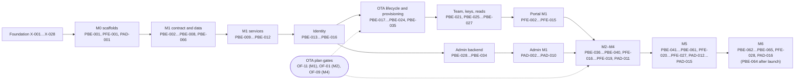

# Platform agent tasks (`PBE-`, `PFE-`, `PAD-`)

This plan breaks the platform group's MVP work (platform backend, portal and platform admin) into small, self-contained tasks for AI coding agents, ordered by the shared milestones M0–M6. Each task names the documents to read, the files to touch, the steps, the acceptance criteria and the command that proves it. Every endpoint of the platform API inventory is implemented by a backend task and, where people use it, by a portal or admin task with a test. The plan follows [`decisions.md`](../../../docs/mvp/decisions.md), [ADR-0020](../../../docs/mvp/adr/0020-ai-agent-development-workflow.md) and the platform ADRs, and is validated by `node tools/plan-lint/plan-lint.mjs`.

Related: [`implementation-plan.md`](implementation-plan.md) (milestones, epics, risks, traceability), [`solo-developer-plan.md`](solo-developer-plan.md) (week by week), [`../scope.md`](../scope.md), [`../architecture.md`](../architecture.md), [`../api-inventory.md`](../api-inventory.md), [`../api-inventory-resources.md`](../api-inventory-resources.md), [`../api-inventory-admin.md`](../api-inventory-admin.md), [`../data-model.md`](../data-model.md), [flows](../README.md#flows), [platform ADRs](../adr/README.md), [`../../../docs/mvp/plans/foundation-tasks.md`](../../../docs/mvp/plans/foundation-tasks.md) (`X-` tasks), [`../../../AGENTS.md`](../../../AGENTS.md).

## How to use this file

1. **Pick** the lowest-milestone task whose **Depends on** tasks are all done and that nobody has claimed (no open PR, no branch `task/<ID>-*`). Prefer the critical path that `node tools/plan-lint/plan-lint.mjs` prints. Finish the `X-` tasks a task depends on first ([AGENTS.md](../../../AGENTS.md) §3).
2. **Claim** it by adding `- **Status:** in progress (PR #n)` under its heading in your PR. plan-lint ignores the extra field.
3. **Finish** it in one branch and one PR. When the PR is merged, the heading ends with ` ✅` (for example `### PBE-012 · Implement … ✅`) and the status line says `done (PR #n)`. A heading with ` ✅` means "done" for every task that depends on it.
4. **Gates.** A few tasks need work of the OTA group. Their first step is a **Gate** naming the OTA feature id of [`../../../ota/docs/scope.md`](../../../ota/docs/scope.md) (OF-01, OF-09, OF-11 …). If the gate is not met, stop and report; never fake the other side ([PADR-0017](../adr/0017-platform-test-doubles-and-end-to-end-harness.md)).
5. **Contract first.** The platform OpenAPI document grows in milestone slices; every operation that is documented but not implemented yet is listed in `platform/backend/test/contract/pending-operations.ts` with its task id, and the implementing task removes it ([PADR-0016](../adr/0016-contract-rollout-per-milestone-and-route-parity.md)).
6. **Milestone switches.** M5 code is merged behind the `FEATURE_*` switches of [PADR-0015](../adr/0015-milestone-feature-switches.md). M5 tests run with the switch on, and at least one test per M5 endpoint proves `403 FEATURE_DISABLED` with it off.
7. **Tests** end their names with the task and criterion, for example `it("locks after five failures [PBE-014 AC2]")`. Integration tests use `createTestApp()` (PBE-008) on a database from `@velexis/testing`, never shared mutable fixtures.
8. **After editing this file**, run `node tools/plan-lint/plan-lint.mjs docs/mvp/plans/foundation-tasks.md platform/docs/plans/agent-tasks.md` and fix every error. New work found during a task becomes a new task here (next free id).

Common commands: backend `pnpm --filter @velexis/platform-backend test`, `test:int`, `test:xb`; portal `pnpm --filter @velexis/platform-frontend test`; admin `pnpm --filter @velexis/platform-admin test`; end-to-end `pnpm test:e2e -- --project=portal` or `--project=platform-admin`.

## Milestone summary

| Milestone | Tasks | Demo at the end |
|---|---|---|
| M0 Foundations | PBE-001, PFE-001, PAD-001 | The three platform apps build, start and answer `/health/live`; the release contains them. |
| M1 Platform core | PBE-002 … PBE-035, PBE-066, PFE-002 … PFE-015, PAD-002 … PAD-010 | Sign up, verify, MFA, create an OTA that becomes active through the real OTA worker, reveal test keys, manage keys and team; staff sign in to the admin, see the tenant, its job and office, suspend and resume it. |
| M2 Search & price | PBE-036, PAD-011 | A key created in the portal works on the OTA API and stops working after revocation; a suspension reaches the storefront. |
| M3 Book & pay | PBE-037, PBE-038, PFE-016 | Owners edit the card statement descriptor of the Velexis payment connection. |
| M4 OTA admin | PBE-039, PBE-040, PFE-017 … PFE-019 | "Open console" signs a member into the OTA admin; Amadeus office settings are editable. |
| M5 Monetisation & self-service | PBE-041 … PBE-061, PFE-020 … PFE-027, PAD-012 … PAD-015 | Checkout and Customer Portal, own Stripe (Connect or keys), payout account and settlements, own Amadeus credentials and live office, custom domains with TLS, go-live. |
| M6 Hardening & launch | PBE-062 … PBE-065, PFE-028, PAD-016 | Security review closed, performance measured, end-to-end suite green nightly, launch checklist ready. The switches are removed after the launch: PBE-064 is a named exception to "every M6 task done" ([ADR-0025](../../../docs/mvp/adr/0025-roadmap-scheduling-and-tracking.md) item 4). |

## M0 — Foundations

### PBE-001 · Scaffold the platform backend with API, worker and CLI entry points ✅
- **Status:** done (branch claude/intelligent-bardeen-90hhu7)
- **Component:** platform-backend
- **Milestone:** M0
- **Depends on:** X-002, X-003, X-009, X-010
- **Size:** M
- **Read first:** platform/backend/README.md §1, §2, §5; platform/docs/architecture.md §1 and §2.1; docs/mvp/conventions.md §2 and §8; docs/mvp/tech-stack.md §2 and §3 (Platform backend); docs/mvp/adr/0024-reference-data-sources-and-loader.md (Loader)
- **Files:** `platform/backend/package.json`, `platform/backend/nest-cli.json`, `platform/backend/tsconfig.json`, `platform/backend/tsconfig.build.json`, `platform/backend/vitest.config.ts`, `platform/backend/vitest.int.config.ts`, `platform/backend/src/main.ts`, `platform/backend/src/worker.ts`, `platform/backend/src/cli.ts`, `platform/backend/src/app.module.ts`, `platform/backend/src/worker.module.ts`, `platform/backend/src/config.ts`, `platform/backend/src/config.test.ts`, `platform/backend/src/health/health.module.ts`, `platform/backend/src/health/health.controller.ts`, `platform/backend/src/health/health.service.ts`, `platform/backend/test/integration/health/health.int.test.ts`
- **Steps:**
  1. Create `@velexis/platform-backend` (private, CommonJS output) with the exact versions of tech-stack §2: `@nestjs/core`, `@nestjs/common`, `@nestjs/platform-express` 11, `@nestjs/config`, `nestjs-pino`, `pino-http`, `nestjs-cls`, `ioredis`, and the workspace packages `@velexis/config`, `@velexis/logger`, `@velexis/db`, `@velexis/errors`. Scripts: `build` (three entry points `dist/main.js`, `dist/worker.js`, `dist/cli.js`), `dev` (runs `dev:api` and `dev:worker`), `test`, `test:int`, `typecheck`, `lint`, `clean`.
  2. Write `src/config.ts` with `defineConfig`: `APP_ENV`, `LOG_LEVEL`, `PORT` (3100), `HEALTH_PORT` (3101, worker), `TRUST_PROXY` (`loopback`), `DATABASE_URL`, `REDIS_URL`. Call `loadDevEnvFiles` outside production. Later tasks extend this schema.
  3. `main.ts`: bind to `127.0.0.1:PORT`, set Express `trust proxy` from `TRUST_PROXY`, use `nestjs-pino` with the `@velexis/logger` HTTP options, `nestjs-cls` with `requestId` taken from `X-Request-Id` or generated, and shutdown hooks. `worker.ts`: a Nest application context plus a small `node:http` server on `HEALTH_PORT`. `cli.ts`: a command dispatcher with `help` (PBE-028 and PBE-034 add commands).
  4. `HealthModule`: `GET /health/live` answers `200 {status: "ok"}`; `GET /health/ready` checks PostgreSQL (`SELECT 1` on a `createPool` pool) and Redis (`PING`) and answers `200` or `503` with the status of each dependency. The worker serves the same two paths.
  5. Add the package script `ref:load`, which runs `pnpm --dir ../.. db:seed:reference` (README §5). The backend has no `reference-data/` folder and no loader of its own: the datasets and the loader are `tools/reference-data` (ADR-0024, X-017, X-018), and the platform docs already say so.
- **Acceptance:**
  - `pnpm --filter @velexis/platform-backend build` produces `dist/main.js`, `dist/worker.js` and `dist/cli.js`.
  - With PostgreSQL and Redis running, `/health/ready` answers 200 on 3100 and 3101; with Redis unreachable it answers 503 naming `redis` (integration test).
  - Starting without `DATABASE_URL` exits non-zero with a `ConfigError` that names the variable (unit test of `config.ts`).
  - Every request log line carries `requestId`; lint finds no `console.*` and no `process.env`.
  - `src/` has no `reference/` loader and the package has no `reference-data/` folder; `ref:load` only calls the root `db:seed:reference`.
- **Verify:** `pnpm --filter @velexis/platform-backend build && pnpm --filter @velexis/platform-backend test && pnpm --filter @velexis/platform-backend test:int`

### PFE-001 · Scaffold the portal Next.js app with Tailwind, shadcn/ui and health routes ✅
- **Status:** done (branch claude/intelligent-bardeen-90hhu7)
- **Component:** platform-frontend
- **Milestone:** M0
- **Depends on:** X-002, X-003
- **Size:** M
- **Read first:** platform/frontend/README.md §1, §3, §7, §8; docs/mvp/conventions.md §3; docs/mvp/adr/0014-frontend-stack-nextjs-tailwind.md; docs/mvp/tech-stack.md §3 (Portal)
- **Files:** `platform/frontend/package.json`, `platform/frontend/next.config.ts`, `platform/frontend/tsconfig.json`, `platform/frontend/postcss.config.mjs`, `platform/frontend/vitest.config.ts`, `platform/frontend/components.json`, `platform/frontend/src/app/layout.tsx`, `platform/frontend/src/app/globals.css`, `platform/frontend/src/app/(marketing)/page.tsx`, `platform/frontend/src/app/health/live/route.ts`, `platform/frontend/src/app/health/ready/route.ts`, `platform/frontend/src/app/health/ready/route.test.ts`, `platform/frontend/src/lib/config.ts`, `platform/frontend/src/lib/config.test.ts`, `platform/frontend/src/components/ui/button.tsx`, `platform/frontend/README.md`
- **Steps:**
  1. Create `@velexis/platform-frontend`: Next.js 15 App Router, React 19, Tailwind CSS 4 through `@tailwindcss/postcss`, `server-only`, `zod`, `lucide-react`, `openapi-fetch`; `output: "standalone"`; scripts `dev` (port 3000), `build`, `start`, `test`, `typecheck`, `lint`.
  2. Write `src/lib/config.ts` (`import "server-only"`) with `@velexis/config`: `APP_ENV`, `LOG_LEVEL`, `PORT`, `HOSTNAME` (`127.0.0.1`), `PLATFORM_API_URL`, `PUBLIC_PORTAL_URL`, `PUBLIC_OTA_ADMIN_URL`, `STOREFRONT_BASE_DOMAIN`, optional `SENTRY_DSN`.
  3. Initialise shadcn/ui (`components.json`, `Button` as the first copied component), design tokens with `@theme` in `globals.css`, a root layout with `lang="en"` and a skip link, and a placeholder landing page.
  4. Add static security headers in `next.config.ts`: `X-Content-Type-Options: nosniff`, `Referrer-Policy: strict-origin-when-cross-origin`, `Permissions-Policy` minimal. The nonce-based CSP comes with PFE-002's middleware.
  5. Route handlers `/health/live` (200) and `/health/ready` (200 when `PLATFORM_API_URL/health/live` answers within 2 seconds, otherwise 503).
- **Acceptance:**
  - `pnpm --filter @velexis/platform-frontend build` produces `.next/standalone`.
  - `/health/ready` answers 503 when the platform API is down and 200 when it answers (unit test with a mocked `fetch`).
  - No `NEXT_PUBLIC_` variable exists; the config test refuses a missing `PLATFORM_API_URL`.
- **Verify:** `pnpm --filter @velexis/platform-frontend build && pnpm --filter @velexis/platform-frontend test && pnpm --filter @velexis/platform-frontend lint`

### PAD-001 · Scaffold the platform admin Next.js app with health routes ✅
- **Status:** done (branch claude/intelligent-bardeen-90hhu7)
- **Component:** platform-admin
- **Milestone:** M0
- **Depends on:** X-002, X-003
- **Size:** S
- **Read first:** platform/admin/README.md §1, §3, §5; docs/mvp/conventions.md §3; docs/mvp/adr/0014-frontend-stack-nextjs-tailwind.md
- **Files:** `platform/admin/package.json`, `platform/admin/next.config.ts`, `platform/admin/tsconfig.json`, `platform/admin/postcss.config.mjs`, `platform/admin/vitest.config.ts`, `platform/admin/components.json`, `platform/admin/src/app/layout.tsx`, `platform/admin/src/app/globals.css`, `platform/admin/src/app/health/live/route.ts`, `platform/admin/src/app/health/ready/route.ts`, `platform/admin/src/lib/config.ts`, `platform/admin/src/lib/config.test.ts`, `platform/admin/README.md`
- **Steps:**
  1. Create `@velexis/platform-admin` like PFE-001 (same versions), plus `@tanstack/react-table`; port 3001; `output: "standalone"`.
  2. `src/lib/config.ts` (`server-only`): `APP_ENV`, `LOG_LEVEL`, `PORT`, `HOSTNAME`, `PLATFORM_API_URL`, `PUBLIC_PLATFORM_ADMIN_URL`, `PUBLIC_PORTAL_URL`, optional `SENTRY_DSN`.
  3. Headers on every response: `X-Robots-Tag: noindex`, `X-Content-Type-Options: nosniff`, `Referrer-Policy: same-origin`.
  4. `/health/live` and `/health/ready` as in PFE-001.
- **Acceptance:**
  - `pnpm --filter @velexis/platform-admin build` produces `.next/standalone`; `/health/live` answers 200 with `X-Robots-Tag: noindex`.
  - The config test refuses a missing `PLATFORM_API_URL`.
- **Verify:** `pnpm --filter @velexis/platform-admin build && pnpm --filter @velexis/platform-admin test`

## M1 — Platform core

### PBE-002 · Add migration 0002 with the MVP platform deltas ✅
- **Status:** done (branch claude/intelligent-bardeen-90hhu7)
- **Component:** platform-backend
- **Milestone:** M1
- **Depends on:** X-012, X-014, X-015, PBE-001
- **Size:** M
- **Read first:** platform/docs/data-model.md (whole); platform/docs/data-model-migration-0002.md ("How to use it"); docs/mvp/conventions.md §9; docs/mvp/adr/0021-migration-cli-and-repeatable-grants.md; platform/backend/migrations/README.md
- **Files:** `platform/backend/migrations/platform/0002_add_mvp_platform_deltas.sql`, `platform/backend/migrations/README.md`, `platform/backend/test/contract/migration-0002.contract.test.ts`, `platform/backend/test/integration/migrations/migrate-0002.int.test.ts`, `packages/db/src/generated/platform.ts`
- **Steps:**
  1. Create `0002_add_mvp_platform_deltas.sql` by concatenating, in order and byte for byte, the ```sql blocks of `data-model-migration-0002.md`, `data-model-migration-0002-part2.md` and `data-model-migration-0002-part3.md`, ending with one newline. Do not reformat: the runner stores the checksum.
  2. Contract test: read the three documents, extract the SQL blocks with a regex, concatenate them and compare with the file; check the first line is `-- velexis:phase expand`.
  3. Integration test, from scratch: the `@velexis/testing` template database has the ledger row `0002_add_mvp_platform_deltas` (phase `expand`) and the 11 new tables. As an upgrade: run the runner on a temporary directory holding only `0001_baseline.sql`, insert one tenant with a valid key and one subscription, then apply the real directory; the rows survive.
  4. Run `pnpm db:migrate` twice (the second run applies nothing), then `pnpm db:codegen`, and commit `packages/db/src/generated/platform.ts`.
  5. Note in the migrations README that `0002` holds every planned MVP delta and that the next platform delta is `0003`.
- **Acceptance:**
  - The contract test passes, and fails when one character of the migration changes.
  - The migration applies from scratch and as an upgrade from `0001`, in one transaction.
  - The generated types contain `platform.amadeus_accounts`, `platform.email_outbox`, `platform.settlements` and `accounts.terms_version`; a second `pnpm db:codegen` gives no diff.
- **Verify:** `pnpm db:migrate && pnpm db:codegen && git diff --exit-code packages/db/src/generated && pnpm --filter @velexis/platform-backend test && pnpm --filter @velexis/platform-backend test:int -- migrations`

### PBE-003 · Prove the 0002 constraints and privileges with integration tests ✅
- **Status:** done (branch claude/intelligent-bardeen-90hhu7)
- **Component:** platform-backend
- **Milestone:** M1
- **Depends on:** PBE-002, X-015
- **Size:** M
- **Read first:** platform/docs/data-model-migration-0002.md ("How to use it"); platform/docs/data-model.md §4, §5, §6; docs/mvp/adr/0004-postgresql-schema-per-tenant.md (Database roles); platform/backend/migrations/platform/R__ota_read_access.sql
- **Files:** `platform/backend/test/builders/platform-rows.ts`, `platform/backend/test/integration/migrations/constraints-0002.int.test.ts`, `platform/backend/test/integration/migrations/privileges-0002.int.test.ts`
- **Steps:**
  1. Write builders with `defineBuilder` for `accounts`, `plans`, `tenants`, `subscriptions`, `amadeus_accounts`, `amadeus_offices`, `supplier_connections`, `payment_provider_connections`, `settlements`, `settlement_lines`, `tenant_domains` and `email_outbox` (plain SQL inserts as `velexis_platform_app`). Later backend tests reuse them.
  2. Constraint tests, one `it` per rule, asserting the violated constraint name: a key with `_` (`tenants_key_dns_ck`); an unknown suspension reason; a `live` supplier connection on the test Amadeus account (composite foreign key); `credential_source = 'velexis'` without `amadeus_account_id`; a second `assigned` office for one tenant and account; a second current subscription, with `unpaid` counting as current; the old `subscriptions_status_check` gone and `incomplete_expired` accepted; a settlement whose net does not equal its parts; a duplicate `balance_transaction_id`; a `sent` e-mail still holding `secret_payload_ciphertext`; a custom domain without `verification_token`; two `connect_standard` rows with the same account reference; the seeded `early_access` plan.
  3. Privilege tests: `velexis_platform_app` can insert into `platform_audit_log` but cannot update, delete or truncate it; `velexis_ota_app` can select `amadeus_accounts`, `amadeus_offices` and the tables of `R__ota_read_access.sql`, and cannot select `settlements`, `settlement_lines`, `tenant_payout_accounts`, `credential_submissions`, `stripe_events`, `email_outbox`, `account_tokens`, `account_recovery_codes` or `billing_customers`.
- **Acceptance:**
  - Every rule of step 2 has a passing test that checks the constraint name in the error.
  - The privilege matrix of step 3 holds on a fresh test database.
- **Verify:** `pnpm --filter @velexis/platform-backend test:int -- migrations`

### PBE-004 · Define the tenant job messages and invalidation events in @velexis/api-types/jobs ✅
- **Status:** done (branch claude/intelligent-bardeen-90hhu7)
- **Component:** platform-backend
- **Milestone:** M1
- **Depends on:** X-008
- **Size:** M
- **Read first:** platform/docs/architecture.md §6.1 and §6.3; platform/docs/adr/0001-tenant-provisioning-orchestration.md (items 3–5 and 9); platform/docs/adr/0016-contract-rollout-per-milestone-and-route-parity.md (item 3); docs/mvp/adr/0009-background-jobs-bullmq.md; packages/api-types/src/jobs/envelope.ts
- **Files:** `packages/api-types/src/jobs/queues.ts`, `packages/api-types/src/jobs/tenant-ops.ts`, `packages/api-types/src/jobs/tenant-events.ts`, `packages/api-types/src/jobs/invalidation.ts`, `packages/api-types/src/jobs/validate.ts`, `packages/api-types/src/jobs/index.ts`, `packages/api-types/src/jobs/jobs.test.ts`, `packages/api-types/fixtures/jobs/tenant-provision.json`, `packages/api-types/fixtures/jobs/tenant-provisioned.json`, `packages/api-types/fixtures/jobs/tenant-provision-failed.json`, `packages/api-types/fixtures/jobs/tenant-migrated-fanout.json`, `packages/api-types/package.json`, `packages/api-types/README.md`
- **Steps:**
  1. `queues.ts`: `OTA_TENANT_OPS = "ota-tenant-ops"`, `PLATFORM_TENANT_EVENTS = "platform-tenant-events"`, the BullMQ prefix `vx`, `bullmqJobId(jobId, attempt)` returning `<jobId>-<attempt>`, and two arrays used by the admin queue view: `PLATFORM_QUEUES` (the eight queues of architecture §5) and `OTA_QUEUES` (starting with `ota-tenant-ops`; the OTA plan appends its own queue names here).
  2. `tenant-ops.ts`: types and JSON Schemas (draft 2020-12, `additionalProperties: false`) on the X-008 envelope (`v: 1`, `jobId`, `tenantId`, `requestedAt`, `requestId`) for `tenant.provision`, `tenant.migrate {targetVersion?}`, `tenant.suspend {reason}`, `tenant.resume`.
  3. `tenant-events.ts`: `tenant.provisioned {schemaName, schemaVersion, migrations[{version, checksum, phase, appliedAt, durationMs}], steps[]}`, `tenant.provision_failed {error{code, message}, retryable, steps[]}`, `tenant.migrated {schemaVersion, migrations[]}`, `tenant.migration_failed {version, error}`, `tenant.suspended`, `tenant.resumed`. `jobId` may be `null` only on `tenant.migrated` and `tenant.migration_failed` (deploy fan-out).
  4. `invalidation.ts`: channel `vx:invalidate` and the union `{v: 1, type, …}` for `tenant {id}`, `domain {hostname}`, `api_key {prefix}`, `connection {tenantId}`, `membership {accountId, tenantId}`, `account {accountId}`, `amadeus_account {id}`, `plan {code}`, with its schema.
  5. `validate.ts`: `validateJob(name, data)` and `validateInvalidation(event)` on Ajv, compiled once. Export the fixtures for both backends' tests. Document everything in the README.
- **Acceptance:**
  - Every fixture validates; a fixture with an extra `clientSecret` field or without `jobId` fails.
  - `bullmqJobId("job_01HZX", 2)` returns `job_01HZX-2`.
  - Type tests: the event union narrows on `name`; a `tenant.provisioned` without `schemaVersion` does not compile (`// @ts-expect-error`).
- **Verify:** `pnpm --filter @velexis/api-types build && pnpm --filter @velexis/api-types test`

### PBE-005 · Write the platform OpenAPI document with conventions, error catalogue, identity and plan operations ✅
- **Status:** done (branch claude/intelligent-bardeen-90hhu7)
- **Component:** platform-backend
- **Milestone:** M1
- **Depends on:** X-007, X-008, X-009
- **Size:** L
- **Read first:** platform/docs/api-inventory.md §1–§6; platform/docs/api-inventory-admin.md §9; platform/docs/adr/0009-platform-api-surface-and-authentication.md; platform/docs/adr/0016-contract-rollout-per-milestone-and-route-parity.md; docs/mvp/adr/0006-contract-first-openapi.md; ota/backend/openapi/velexis-ota-booking-api.openapi.yaml (grep `x-error-catalogue:` and the error envelope schema only)
- **Files:** `platform/backend/openapi/velexis-platform-api.openapi.yaml`, `platform/backend/openapi/README.md`, `packages/api-types/src/generated/platform.ts`, `packages/api-types/src/generated/operations.ts`, `packages/errors/src/generated/catalogue.ts`
- **Steps:**
  1. Create the OpenAPI 3.1 document `velexis-platform-api.openapi.yaml`: `info`, server `https://api.platform.example.com`, security schemes `portalBearer` and `adminBearer`, and shared components: the error envelope with the same shape as the OTA one, `Money`, `Page {nextCursor, limit}`, parameters `Idempotency-Key`, `If-Match`, `cursor`, `limit`, `tenantId`, and response headers `X-Request-Id`, `ETag`.
  2. Add `x-error-catalogue` with every code of api-inventory §3 and its status. A code shared with the OTA catalogue must have the same status, or the X-009 generator fails.
  3. Add these operations with the inventory's `operationId`, method and path: §4 auth (11 operations), §5 account (9), `listPlans`, `tlsAsk`, `healthLive`, `healthReady`. Every operation carries `x-scope` (`public`, `portal_unverified` for the inventory's `portal*`, `portal`, `platform_admin`, `internal`, `webhook`), plus `x-idempotent: true` (Idem), `x-mfa-step-up: true` (MFA↑), `x-feature: <switch>` (F:) and `x-reason-required: true` (admin **reason**) where the inventory says so, and `x-internal: true` on internal and webhook operations. Request bodies use `additionalProperties: false`; responses that carry a secret document `Cache-Control: no-store`.
  4. Run `pnpm contracts:lint` until clean, then `pnpm contracts:generate`, and commit the generated files.
  5. Write `openapi/README.md`: where operations come from (the inventory, by milestone slice), the `x-` extensions, and the regenerate commands.
- **Acceptance:**
  - `pnpm contracts:lint` reports zero errors for both documents.
  - The operations index lists the 24 platform operations, each with a `scope`; `PlatformErrorCode` contains `REAUTH_REQUIRED`, `TENANT_KEY_UNAVAILABLE` and `LIVE_PRECONDITIONS_UNMET`.
  - A second `pnpm contracts:generate` gives no diff.
- **Verify:** `pnpm contracts:lint && pnpm contracts:generate && git diff --exit-code packages/api-types/src/generated packages/errors/src/generated`

### PBE-006 · Add tenant, team, API key and M1 resource operations to the OpenAPI document ✅
- **Status:** done (branch claude/intelligent-bardeen-90hhu7)
- **Component:** platform-backend
- **Milestone:** M1
- **Depends on:** PBE-005
- **Size:** L
- **Read first:** platform/docs/api-inventory.md §7 and §8; platform/docs/api-inventory-resources.md §1–§6 (M1 rows); platform/docs/adr/0005-api-key-format-and-hashing.md; ota/backend/openapi/velexis-ota-booking-api.openapi.yaml (grep `ConsoleApiKeyScope:` and `StaffPermission:` only)
- **Files:** `platform/backend/openapi/velexis-platform-api.openapi.yaml`, `packages/api-types/src/generated/platform.ts`, `packages/api-types/src/generated/operations.ts`, `packages/errors/src/generated/catalogue.ts`
- **Steps:**
  1. Add the tenant operations of §7 except `goLive`: `checkTenantKey`, `createTenant`, `listTenants`, `getTenant`, `updateTenant`, `getProvisioning`, `retryProvisioning`, `revealInitialKeys`, `getOnboarding`. `createTenant` already has the M5 fields (`planCode`, `billingInterval`, nullable `checkoutUrl`, `checkoutError`), so its shape does not change later.
  2. Add the team operations of §8 except `createConsoleToken`: `listMembers`, `updateMember`, `removeMember`, `listInvitations`, `createInvitation`, `resendInvitation`, `revokeInvitation`, `lookupInvitation`, `acceptInvitation`.
  3. Add the API key operations `listApiKeys`, `createApiKey`, `updateApiKey`, `rollApiKey`, `revokeApiKey`, and the M1 reads `listDomains`, `listAmadeusConnections`, `listPaymentConnections`, `getSubscription`. API key `scopes` are strings validated by the service against the OTA types (PADR-0005 item 6).
  4. Shared schemas: `Tenant`, `TenantSummary`, `ProvisioningStatus`, `OnboardingItem`, `Member`, `Invitation`, `ApiKey`, `Domain` (with `dnsRecords`), `AmadeusConnection`, `PaymentConnection`, `Subscription`. None of them has a property for a secret or ciphertext.
  5. Lint, regenerate and commit the generated files.
- **Acceptance:**
  - `pnpm contracts:lint` is clean; the operations index has 27 more platform operations, each with `x-scope`.
  - `createTenant` has `x-idempotent: true`; the responses of `createApiKey`, `rollApiKey` and `revealInitialKeys` document `Cache-Control: no-store`.
  - No response schema of the 27 operations has a property whose name ends in `Ciphertext` or `Hash` (checked by grepping the generated `platform.ts` in the PR).
- **Verify:** `pnpm contracts:lint && pnpm contracts:generate && git diff --exit-code packages/api-types/src/generated`

### PBE-007 · Add the M1 admin auth, dashboard, tenant, job and queue operations to the OpenAPI document ✅
- **Status:** done (branch claude/intelligent-bardeen-90hhu7)
- **Component:** platform-backend
- **Milestone:** M1
- **Depends on:** PBE-006
- **Size:** L
- **Read first:** platform/docs/api-inventory-admin.md §1–§3 (M1 rows); platform/docs/adr/0006-platform-admin-access-and-audit.md; platform/docs/adr/0016-contract-rollout-per-milestone-and-route-parity.md (slices); platform/admin/README.md §2
- **Files:** `platform/backend/openapi/velexis-platform-api.openapi.yaml`, `packages/api-types/src/generated/platform.ts`, `packages/api-types/src/generated/operations.ts`, `platform/docs/api-inventory-admin.md`
- **Steps:**
  1. Admin auth and dashboard: `adminSignIn`, `adminVerifyMfa`, `adminRefresh`, `adminStepUp`, `adminSignOut`, `adminGetMe`, `adminGetDashboard` (M5 counters present and nullable). `adminGetMe` also returns the `features` object of `getMe`, because the admin cannot call the portal-scoped `getMe` and PADR-0015 item 3 makes the backend the only source of the switches; note this addition in `platform/docs/api-inventory-admin.md` §2.
  2. Tenants, jobs and queues: `adminListTenants`, `adminGetTenant`, `adminUpdateTenant`, `adminSuspendTenant`, `adminResumeTenant`, `adminMigrateTenant`, `adminSetConnectionStatus`, `adminListProvisioningJobs`, `adminGetProvisioningJob`, `adminRetryProvisioningJob`, `adminCancelProvisioningJob`, `adminListQueues`, `adminListFailedQueueJobs`, `adminRetryQueueJob`.
  3. Every operation has `x-scope: platform_admin` except the public sign-in steps; **reason** actions have a required `reason` (5–500 characters) and `x-reason-required: true`; MFA↑ actions have `x-mfa-step-up: true`.
  4. Lint, regenerate and commit. The other M1 admin operations follow in PBE-066, so the two slices never edit the document at the same time (PADR-0016).
- **Acceptance:**
  - `pnpm contracts:lint` is clean and the operations index has 21 more platform operations.
  - Every operation path starting with `/v1/admin/` has `x-scope: platform_admin` except `adminSignIn`, `adminVerifyMfa` and `adminRefresh` (checked by a small script in the PR or by PBE-008's parity test).
  - `adminSuspendTenant`, `adminResumeTenant`, `adminSetConnectionStatus` and `adminCancelProvisioningJob` require `reason`.
- **Verify:** `pnpm contracts:lint && pnpm contracts:generate && git diff --exit-code packages/api-types/src/generated`

### PBE-066 · Add the M1 admin plan, Amadeus, account, admin and audit operations to the OpenAPI document ✅
- **Status:** done (branch claude/intelligent-bardeen-90hhu7)
- **Component:** platform-backend
- **Milestone:** M1
- **Depends on:** PBE-007
- **Size:** L
- **Read first:** platform/docs/api-inventory-admin.md §4, §5 and §7 (M1 rows); platform/docs/adr/0006-platform-admin-access-and-audit.md; platform/docs/adr/0012-amadeus-office-pool.md; platform/docs/adr/0016-contract-rollout-per-milestone-and-route-parity.md (slices); platform/admin/README.md §2
- **Files:** `platform/backend/openapi/velexis-platform-api.openapi.yaml`, `packages/api-types/src/generated/platform.ts`, `packages/api-types/src/generated/operations.ts`
- **Steps:**
  1. Plans and subscriptions (M1 rows): `adminListPlans`, `adminCreatePlan`, `adminUpdatePlan` (without the Stripe id fields, which PBE-042 adds), `adminListSubscriptions`, `adminGetSubscription`, `adminUpdateManualSubscription`.
  2. Amadeus (M1 rows): `adminListAmadeusAccounts`, `adminCreateAmadeusAccount`, `adminUpdateAmadeusAccount`, `adminVerifyAmadeusAccount`, `adminListAmadeusOffices`, `adminAddAmadeusOffices`, `adminUpdateAmadeusOffice`, `adminAssignAmadeusOffice`, `adminRetireAmadeusOffice`.
  3. Accounts, admins and audit: `adminListAccounts`, `adminGetAccount`, `adminDisableAccount`, `adminEnableAccount`, `adminUnlockAccount`, `adminResetAccountMfa`, `adminListAdmins`, `adminGrantAdmin`, `adminRevokeAdmin`, `adminListAudit`, `adminExportAudit` (`text/csv`).
  4. Apply the same `x-scope: platform_admin`, `reason` / `x-reason-required` and `x-mfa-step-up` rules as PBE-007, then lint, regenerate and commit.
- **Acceptance:**
  - `pnpm contracts:lint` is clean and the operations index has 26 more platform operations (47 M1 admin operations with PBE-007).
  - `adminExportAudit` documents a `text/csv` response; `adminCreateAmadeusAccount`, `adminGrantAdmin` and `adminResetAccountMfa` carry `x-mfa-step-up: true`; no response schema of the 26 operations has a property ending in `Secret`, `Ciphertext` or `Hash`.
- **Verify:** `pnpm contracts:lint && pnpm contracts:generate && git diff --exit-code packages/api-types/src/generated`

### PBE-008 · Build the HTTP pipeline with request context, error filter, OpenAPI validation and route parity ✅
- **Status:** done (branch claude/intelligent-bardeen-90hhu7)
- **Component:** platform-backend
- **Milestone:** M1
- **Depends on:** PBE-001, PBE-066, X-005, X-015
- **Size:** L
- **Read first:** platform/docs/architecture.md §3 and §3.2; platform/docs/adr/0016-contract-rollout-per-milestone-and-route-parity.md; platform/docs/adr/0019-end-user-ip-forwarding-from-the-portal-and-admin.md; docs/mvp/conventions.md §2 and §6; docs/mvp/adr/0006-contract-first-openapi.md (Runtime validation, Checks in CI); packages/testing/README.md
- **Files:** `platform/backend/src/common/common.module.ts`, `platform/backend/src/common/http/openapi-operation.decorator.ts`, `platform/backend/src/common/http/openapi-validation.interceptor.ts`, `platform/backend/src/common/http/openapi-validation.interceptor.test.ts`, `platform/backend/src/common/http/error.filter.ts`, `platform/backend/src/common/http/error.filter.test.ts`, `platform/backend/src/common/http/request-context.ts`, `platform/backend/src/common/http/end-user.ts`, `platform/backend/src/common/http/end-user.test.ts`, `platform/backend/src/common/http/raw-body.ts`, `platform/backend/src/common/clock.ts`, `platform/backend/src/common/ids.ts`, `platform/backend/src/common/ids.test.ts`, `platform/backend/src/main.ts`, `platform/backend/test/contract/route-parity.contract.test.ts`, `platform/backend/test/contract/pending-operations.ts`, `platform/backend/test/support/app.ts`, `platform/backend/test/integration/common/request-context.int.test.ts`, `platform/backend/src/config.ts`, `packages/logger/src/redact-paths.ts`, `packages/logger/src/redaction.test.ts`, `.env.example`, `deploy/env/platform-backend.env.example`, `deploy/scripts/provision-vm.sh`, `docs/mvp/architecture.md`
- **Steps:**
  1. `@OpenApiOperation(operationId)` stores metadata on a handler. `OpenApiValidationInterceptor` compiles Ajv 2020 + `ajv-formats` validators for path, query, headers and body of each operation from the YAML at start-up (unknown `operationId` fails the start), and throws `AppError("VALIDATION_FAILED", { fieldErrors })` whose messages never contain the rejected value.
  2. `ErrorFilter` uses `toErrorEnvelope` from `@velexis/errors`, sets `X-Request-Id`, logs unknown errors with their stack, and never returns the stack.
  3. `request-context.ts`: the `nestjs-cls` store `{requestId, ip, userAgent, actor?}`. `end-user.ts` fills `ip` and `userAgent` as architecture §3.2 and PADR-0019 say: the `X-Velexis-End-User-IP` and `X-Velexis-End-User-Agent` headers count only when the socket peer is loopback, there is no `X-Forwarded-For`, and `X-Velexis-Bff-Key` equals `PLATFORM_BFF_KEY` (new required config variable, compared in constant time). A valid key with a missing or invalid IP answers `400 VALIDATION_FAILED`; otherwise `req.ip` and `User-Agent` are used. Add `PLATFORM_BFF_KEY` to the root `.env.example`, `deploy/env/platform-backend.env.example` (`@@PLATFORM_BFF_KEY@@`, generated once by `provision-vm.sh` like `OTA_ADMIN_SERVICE_KEY`) and the configuration matrix, and `x-velexis-bff-key` to the logger's redaction paths. `raw-body.ts`: keep the raw body only for `/webhooks/*` (Express `verify` callback); add `helmet` and `cookie-parser` in `main.ts`.
  4. `Clock` (injectable `now()`) and `IdGenerator.new(prefix)` on `newId` of `@velexis/crypto`, for the prefixes of api-inventory §2.
  5. Route parity test as PADR-0016 item 2. Seed `pending-operations.ts` with every operation of PBE-005, PBE-006, PBE-007 and PBE-066 except `healthLive` and `healthReady`, each with the id of the task in this plan that implements it.
  6. `test/support/app.ts`: `createTestApp({ overrides })` boots the Nest app on `createTestDatabase()` and `useRedis()` and returns `{ app, http (supertest), db, redis, clock, close }`. Every later integration test uses it.
- **Acceptance:**
  - A body with an unknown property answers `400 VALIDATION_FAILED` with `fieldErrors[].field` and without the submitted value (unit test with a `password` field).
  - A thrown `TypeError` becomes `500 INTERNAL_ERROR` with the `requestId` and no stack in the body.
  - The parity test passes, and fails when a test controller binds an operation that is not in the document.
  - `IdGenerator.new("ten")` matches `^ten_[0-9A-HJKMNP-TV-Z]{26}$`.
  - With a valid `X-Velexis-Bff-Key` from loopback and no `X-Forwarded-For`, the request context holds the forwarded IP and user agent. With a wrong key, or with `X-Forwarded-For` present, both headers are ignored and `req.ip` is used. A valid key without a valid IP answers `400 VALIDATION_FAILED` (integration test) [PADR-0019].
- **Verify:** `pnpm --filter @velexis/platform-backend test && pnpm --filter @velexis/platform-backend test:int`

### PBE-009 · Add Redis, BullMQ queues, the invalidation publisher, idempotency and rate limits ✅
- **Status:** done (branch claude/intelligent-bardeen-90hhu7)
- **Component:** platform-backend
- **Milestone:** M1
- **Depends on:** PBE-008, PBE-004
- **Size:** L
- **Read first:** platform/docs/architecture.md §3 (items 4 and 10), §5, §6.3, §6.4; platform/docs/api-inventory.md §2 (rate limits); docs/mvp/adr/0009-background-jobs-bullmq.md; docs/mvp/conventions.md §2 (Idempotency)
- **Files:** `platform/backend/src/common/redis/redis.module.ts`, `platform/backend/src/common/redis/redis-keys.ts`, `platform/backend/src/common/redis/redis-keys.test.ts`, `platform/backend/src/common/redis/invalidation.publisher.ts`, `platform/backend/src/common/queues/queues.module.ts`, `platform/backend/src/common/queues/queue-names.ts`, `platform/backend/src/common/queues/scheduler.registry.ts`, `platform/backend/src/common/queues/scheduler.registry.test.ts`, `platform/backend/src/common/http/idempotency.interceptor.ts`, `platform/backend/src/common/http/throttler.config.ts`, `platform/backend/src/worker.module.ts`, `platform/backend/test/integration/common/idempotency.int.test.ts`, `platform/backend/test/integration/common/throttler.int.test.ts`, `platform/backend/test/integration/common/invalidation.int.test.ts`
- **Steps:**
  1. An `ioredis` client module on `REDIS_URL`. `redis-keys.ts` builds every key of architecture §6.4 (`ptk:`, `staffdeny:acct:`, `apikey:used:`, `vx:idem:`, `mfach:`, `mfasetup:`, `stripe:oauth:`, `tlsask:`, `rl:`) and its TTL; writing a key without a TTL is impossible through the helpers (`noeviction`).
  2. `InvalidationPublisher.publishAfterCommit(trx, event)` collects events during a platform transaction and publishes them on `vx:invalidate` only after commit, validated with `validateInvalidation`; `publish(event)` for non-transactional use.
  3. `@nestjs/bullmq` with prefix `vx`, the eight queues of architecture §5, defaults `attempts: 5`, exponential backoff from 30 s, failed jobs kept 30 days. `scheduler.registry.ts` registers `upsertJobScheduler` entries at worker start and skips a scheduler whose feature switch is off.
  4. Idempotency interceptor for operations with `x-idempotent`: `Idempotency-Key` required (400 when missing); Redis key `vx:idem:<accountId>:<key>` holds a hash of the body and the response for 24 h; same key and body replays status and body; another body answers `409 IDEMPOTENCY_KEY_REUSED`; a concurrent duplicate waits on a 10-second lock; `no-store` responses are never stored; Redis down answers `503 SERVICE_UNAVAILABLE`.
  5. `@nestjs/throttler` with Redis storage and one named throttler per row of the rate-limit table of api-inventory §2; `429 RATE_LIMITED` with `Retry-After`. The per-IP tracker is the request-context IP of PBE-008 (the end user's IP, PADR-0019), never `req.ip`.
- **Acceptance:**
  - Two concurrent identical idempotent requests to a test-only controller cause one side effect and identical responses; a changed body with the same key answers 409.
  - An invalidation published in a transaction that rolls back is never delivered; after a commit a subscriber receives it.
  - A test-only route with the sign-up throttler answers 429 with `Retry-After` on the sixth call from one IP within an hour.
  - Two clients sending the valid BFF key with different `X-Velexis-End-User-IP` values get separate buckets: after one of them is throttled, the other still passes [PADR-0019].
  - The registry registers no scheduler for a disabled feature.
- **Verify:** `pnpm --filter @velexis/platform-backend test && pnpm --filter @velexis/platform-backend test:int -- common`

### PBE-010 · Add the audit module and the platform redaction paths ✅
- **Status:** done (branch claude/intelligent-bardeen-90hhu7)
- **Component:** platform-backend
- **Milestone:** M1
- **Depends on:** PBE-003, PBE-008
- **Size:** M
- **Read first:** platform/docs/adr/0006-platform-admin-access-and-audit.md; platform/docs/architecture.md §4 and §8; platform/docs/flows/*.md ("Tables touched" for audit action names); docs/mvp/conventions.md §7; packages/logger/README.md
- **Files:** `platform/backend/src/audit/audit.module.ts`, `platform/backend/src/audit/audit.service.ts`, `platform/backend/src/audit/audit.repository.ts`, `platform/backend/src/audit/audit-actions.ts`, `platform/backend/src/audit/audit.service.test.ts`, `platform/backend/test/integration/audit/audit.int.test.ts`, `packages/logger/src/redact-paths.ts`, `packages/logger/src/redaction.test.ts`
- **Steps:**
  1. `audit-actions.ts`: a string-literal union of every action named in the flows and the inventory (`account.signed_up`, `auth.sign_in`, `auth.locked`, `tenant.created`, `tenant.activated`, `tenant.suspended`, `console.token_issued`, `api_key.created`, `amadeus.credentials_applied`, `payments.connect_connected`, …). New actions are added here first.
  2. `AuditService.record(trx, {actorType, actorAccountId?, action, targetType, targetId, tenantId?, before?, after?, details?})` inserts one `platform_audit_log` row in the caller's transaction, takes `request_id`, IP and user agent from the request context, and passes `before`, `after` and `details` through `redactPayload` of `@velexis/logger`.
  3. Add the platform paths of architecture §8 to the central redaction list: `secretKey`, `webhookSecret`, `iban`, `accountNumber`, `recoveryCode`, `recoveryCodes`, `totpSecret`, `otpauthUrl`, `mfaChallengeToken`, `invitationToken`, and `code` and `state` under MFA and OAuth bodies, each with a unit test.
- **Acceptance:**
  - A row recorded in a rolled-back transaction does not exist; a committed one carries the request id.
  - `before` or `after` values holding `clientSecret` or `iban` are stored redacted.
  - The redaction test covers every new path.
  - `UPDATE platform.platform_audit_log` through the app role fails with a permission error.
- **Verify:** `pnpm --filter @velexis/logger test && pnpm --filter @velexis/platform-backend test && pnpm --filter @velexis/platform-backend test:int -- audit`

### PBE-011 · Add the e-mail outbox, templates and the e-mail processor ✅
- **Status:** done (branch claude/intelligent-bardeen-90hhu7)
- **Component:** platform-backend
- **Milestone:** M1
- **Depends on:** PBE-009, PBE-010, X-004, X-025
- **Size:** L
- **Read first:** platform/docs/adr/0013-platform-email-outbox.md; docs/mvp/adr/0017-email-documents-storage.md (E-mail); platform/docs/scope.md PF-97; platform/docs/data-model-migration-0002-part3.md (`email_outbox`); docs/mvp/adr/0010-secrets-envelope-encryption.md
- **Files:** `platform/backend/src/notifications/notifications.module.ts`, `platform/backend/src/notifications/outbox.service.ts`, `platform/backend/src/notifications/outbox.repository.ts`, `platform/backend/src/notifications/email.processor.ts`, `platform/backend/src/notifications/mailer.gateway.ts`, `platform/backend/src/notifications/templates.ts`, `platform/backend/src/notifications/templates.test.ts`, `platform/backend/src/notifications/templates/`, `platform/backend/src/common/crypto.provider.ts`, `platform/backend/src/config.ts`, `platform/backend/test/integration/notifications/email-outbox.int.test.ts`, `.env.example`
- **Steps:**
  1. Config: `SMTP_URL`, `MAIL_FROM`, `OPS_ALERT_EMAIL`, `PUBLIC_PORTAL_URL`, `PUBLIC_PLATFORM_ADMIN_URL`, `MASTER_KEY_DIR`, `MASTER_KEY_CURRENT`. `crypto.provider.ts` exposes the `@velexis/crypto` envelope service with the local-file key provider to every module.
  2. `OutboxService.queue(trx, {templateKey, to, accountId?, tenantId?, data, secretData?, idempotencyKey?})` inserts an `email_outbox` row (`pending`) in the caller's transaction, encrypts `secretData` (links with tokens) into `secret_payload_ciphertext` with associated data `platform.email_outbox.secret_payload_ciphertext:<id>`, and enqueues `email.send {emailId}` after commit. The same `idempotencyKey` never queues twice.
  3. `email.processor.ts` (queue `platform-emails`, concurrency 4): load the row, mark it `sending`, decrypt the secret data, render the Handlebars subject, HTML and text (escaped, strict mode), send with Nodemailer, then mark `sent` and erase the ciphertext in one update. On an SMTP error the row goes back to `pending` and BullMQ retries; after the last attempt it becomes `failed` and the ciphertext is erased.
  4. Templates (`<key>.subject.hbs`, `<key>.html.hbs`, `<key>.txt.hbs`) for `auth.verify_email`, `auth.account_exists`, `auth.password_reset`, `auth.password_changed`, `auth.mfa_changed`, `team.invitation`, `tenant.welcome`, `tenant.provisioning_failed`, `tenant.suspended`, `tenant.resumed` and `ops.alert`. M5 tasks add their own templates.
  5. Add the new variables to the root `.env.example`.
- **Acceptance:**
  - A queued e-mail arrives in Mailpit with its link (`waitForMessage`, `extractLinks`); the row is then `sent` with a null `secret_payload_ciphertext`.
  - With SMTP unreachable the row stays `pending`, and it is sent once SMTP answers again.
  - No captured log line and no BullMQ job payload contains the token.
  - Every template renders with sample data in strict mode.
- **Verify:** `pnpm --filter @velexis/platform-backend test && pnpm --filter @velexis/platform-backend test:int -- notifications`

### PBE-012 · Add token signing, auth guards and the milestone feature switches ✅
- **Status:** done (branch claude/intelligent-bardeen-90hhu7)
- **Component:** platform-backend
- **Milestone:** M1
- **Depends on:** PBE-008, X-005
- **Size:** L
- **Read first:** platform/docs/architecture.md §3 and §3.1; platform/docs/adr/0009-platform-api-surface-and-authentication.md; platform/docs/adr/0008-email-verification-and-mfa-policy.md; platform/docs/adr/0015-milestone-feature-switches.md; docs/mvp/adr/0008-identity-accounts-customers-sessions.md (tokens)
- **Files:** `platform/backend/src/auth/token.service.ts`, `platform/backend/src/auth/token.service.test.ts`, `platform/backend/src/common/auth/portal-auth.guard.ts`, `platform/backend/src/common/auth/admin-auth.guard.ts`, `platform/backend/src/common/auth/internal-only.guard.ts`, `platform/backend/src/common/auth/recent-mfa.guard.ts`, `platform/backend/src/common/auth/feature.guard.ts`, `platform/backend/src/common/auth/decorators.ts`, `platform/backend/src/common/auth/guards.test.ts`, `platform/backend/src/common/features.ts`, `platform/backend/src/config.ts`, `.env.example`, `deploy/env/platform-backend.env.example`, `deploy/env/platform-worker.env.example`, `docs/mvp/architecture.md`
- **Steps:**
  1. `TokenService` with `jose`: the Ed25519 key from `JWT_PRIVATE_KEY_FILE` (`readKeyFile`), `kid` = JWK thumbprint; `sign({aud: "portal" | "platform_admin", sub, sid, ev, amr, mfa_at?})` for 15 minutes with `iss = https://api.platform.example.com`; `verify(token, audience)`.
  2. Guards selected from the operation's `x-scope` in the operations index: `PortalAuthGuard` (`portal` requires `ev = true`, else `403 EMAIL_NOT_VERIFIED`; `portal_unverified` accepts unverified accounts), `AdminAuthGuard` (audience `platform_admin`; re-reads `is_platform_admin` and `status` on every request), `InternalOnlyGuard` (loopback source and no `X-Forwarded-For`, else `404`), and no guard for `public`. No or expired token gives `401 UNAUTHENTICATED` or `TOKEN_EXPIRED`. The actor goes into the request context.
  3. `RecentMfaGuard` for `x-mfa-step-up`: `mfa_at` within 15 minutes, else `401 REAUTH_REQUIRED`; an account without MFA gets `403 MFA_REQUIRED`.
  4. `features.ts` and config: the six `FEATURE_*` booleans (default `false`) and `MAX_TENANTS_PER_ACCOUNT` (default 3). `FeatureGuard` for `x-feature` answers `403 FEATURE_DISABLED` with `details.feature`. `featuresFor()` builds the `features` object of `getMe`.
  5. Add `JWT_PRIVATE_KEY_FILE`, `TRUST_PROXY`, `MAX_TENANTS_PER_ACCOUNT` and the `FEATURE_*` switches to the root `.env.example`, both `deploy/env/platform-*.env.example` files and the configuration matrix of `docs/mvp/architecture.md` §6.
- **Acceptance:**
  - A portal token is refused on an admin route, and an admin token on a portal route (401).
  - An unverified token reaches `portal_unverified` routes and gets `403 EMAIL_NOT_VERIFIED` on `portal` routes.
  - `mfa_at` 16 minutes old gives `401 REAUTH_REQUIRED`; an account without MFA gets `403 MFA_REQUIRED`.
  - With `FEATURE_CUSTOM_DOMAINS=false`, a route tagged `x-feature: custom_domains` answers `403 FEATURE_DISABLED`.
  - An internal route called with `X-Forwarded-For` answers 404.
- **Verify:** `pnpm --filter @velexis/platform-backend test && pnpm --filter @velexis/platform-backend test:int`

### PBE-013 · Implement sign-up, e-mail verification and resend ✅
- **Status:** done (branch claude/intelligent-bardeen-90hhu7)
- **Component:** platform-backend
- **Milestone:** M1
- **Depends on:** PBE-011, PBE-012
- **Size:** M
- **Read first:** platform/docs/flows/signup-and-create-ota.md (steps 1–3, failure handling); platform/docs/scope.md PF-01 and PF-02; platform/docs/api-inventory.md §4; platform/docs/adr/0008-email-verification-and-mfa-policy.md; docs/mvp/adr/0008-identity-accounts-customers-sessions.md (passwords)
- **Files:** `platform/backend/src/auth/auth.module.ts`, `platform/backend/src/auth/auth.controller.ts`, `platform/backend/src/auth/sign-up.service.ts`, `platform/backend/src/auth/password-policy.ts`, `platform/backend/src/auth/password-policy.test.ts`, `platform/backend/src/auth/breached-passwords.txt`, `platform/backend/src/auth/accounts.repository.ts`, `platform/backend/src/auth/account-tokens.repository.ts`, `platform/backend/test/builders/accounts.ts`, `platform/backend/test/integration/auth/sign-up.int.test.ts`, `platform/backend/test/contract/pending-operations.ts`
- **Steps:**
  1. `password-policy.ts`: at least 10 characters and not in `breached-passwords.txt` (a public top-10 000 list, lower-cased, loaded once); hashing with `argon2` (Argon2id, OWASP parameters).
  2. `signUp` (throttle 5 per IP per hour): trim the e-mail and compare lower-cased. New e-mail: insert `accounts` (`pending_verification`, `terms_accepted_at`, `terms_version`), `account_tokens` (`email_verification`, SHA-256 of a 256-bit token, 24 h) and an outbox e-mail `auth.verify_email` whose link `PUBLIC_PORTAL_URL/verify-email?token=…` is secret data. Existing e-mail: only queue `auth.account_exists`. Audit `account.signed_up`. Always answer `202 {status: "verification_sent"}`.
  3. `verifyEmail`: look up the token hash; unused and unexpired sets `email_verified_at`, `status = 'active'`, consumes the token and audits `account.email_verified`; anything else answers `400 VERIFICATION_TOKEN_INVALID`.
  4. `resendVerification`: always `202`; for an unverified account, consume older verification tokens and send a new link. Throttles: 3 per e-mail and 10 per IP per hour.
  5. Remove the three operations from `pending-operations.ts`; check every response with `expectResponseToMatch`.
- **Acceptance:**
  - A new and an existing e-mail get byte-identical `202` responses and different e-mails in Mailpit [PF-01 AC1].
  - A 9-character password and a breached password answer `422 PASSWORD_TOO_WEAK`; the sixth sign-up from one IP within an hour answers 429 [PF-01 AC2, AC3].
  - A verification token works once; a reused, unknown or 25-hour-old token (FakeClock) answers `VERIFICATION_TOKEN_INVALID` [PF-02 AC1].
  - Resend always answers 202 and sends at most 3 e-mails per hour [PF-02 AC2].
  - The stored hash starts with `$argon2id$` and no captured log contains the password or the token.
- **Verify:** `pnpm --filter @velexis/platform-backend test && pnpm --filter @velexis/platform-backend test:int -- auth`

### PBE-014 · Implement sign-in, lockout, refresh rotation and sign-out ✅
- **Status:** done (branch claude/intelligent-bardeen-90hhu7)
- **Component:** platform-backend
- **Milestone:** M1
- **Depends on:** PBE-013
- **Size:** L
- **Read first:** platform/docs/flows/signup-and-create-ota.md (step 4); platform/docs/scope.md PF-03 and PF-06; platform/docs/api-inventory.md §4; platform/docs/adr/0009-platform-api-surface-and-authentication.md (lifetimes); platform/docs/adr/0007-portal-to-ota-admin-sso-token.md (`staffdeny`); platform/docs/architecture.md §3.1
- **Files:** `platform/backend/src/auth/sign-in.service.ts`, `platform/backend/src/auth/sessions.service.ts`, `platform/backend/src/auth/sessions.repository.ts`, `platform/backend/src/auth/sessions.service.test.ts`, `platform/backend/src/auth/mfa-challenge.store.ts`, `platform/backend/src/auth/auth.controller.ts`, `platform/backend/test/integration/auth/sign-in.int.test.ts`, `platform/backend/test/integration/auth/refresh.int.test.ts`, `platform/backend/test/contract/pending-operations.ts`
- **Steps:**
  1. `signIn` (throttle 10 per IP per minute): `locked_until` in the future answers `423 ACCOUNT_LOCKED` with `Retry-After`. A wrong e-mail and a wrong password give the same `401 INVALID_CREDENTIALS` and take the same time (verify against a dummy hash for unknown e-mails). Five consecutive failures lock the account for 15 minutes (audit `auth.locked`). A disabled account answers `403 ACCOUNT_DISABLED` only after a correct password. Success resets the counters, sets `last_login_at` and audits `auth.sign_in`.
  2. Without MFA, create a refresh family in `account_sessions` (`audience = 'portal'`, `family_expires_at` = 30 days, SHA-256 of an opaque 256-bit refresh token, user agent, IP) and return `PortalSession`. With MFA, store a challenge in `mfach:<sha256>` (5 minutes, 5 attempts) and return `{mfaRequired: true, mfaChallengeToken, expiresIn: 300}`; PBE-015 completes it.
  3. `refreshSession` rotates on use. Presenting an already rotated token revokes the whole family (`401 REFRESH_TOKEN_REUSED`); an expired family answers `REFRESH_TOKEN_INVALID`. The new access token copies `mfa_at` from `mfa_verified_at`.
  4. `signOut` revokes the current family. `signOutEverywhere` revokes every family of the account (portal and admin), writes `staffdeny:acct:<accountId> = now` with a 30-day TTL, publishes an `account` invalidation and audits.
- **Acceptance:**
  - Valid credentials return a 15-minute access token and a refresh token [PF-03 AC1].
  - Wrong e-mail and wrong password give identical bodies; the fifth failure locks for 15 minutes with `Retry-After` [PF-03 AC2].
  - Reusing a rotated refresh token revokes the family, so the newest token of the family fails too [PF-03 AC3].
  - Sign out everywhere revokes every family and sets `staffdeny:acct:<id>` with a TTL [PF-06 AC2].
- **Verify:** `pnpm --filter @velexis/platform-backend test && pnpm --filter @velexis/platform-backend test:int -- auth`

### PBE-015 · Implement TOTP MFA, recovery codes and step-up ✅
- **Status:** done (branch claude/intelligent-bardeen-90hhu7)
- **Component:** platform-backend
- **Milestone:** M1
- **Depends on:** PBE-014
- **Size:** L
- **Read first:** platform/docs/scope.md PF-04; platform/docs/api-inventory.md §4 (`verifyMfa`, `stepUp`) and §5 (MFA rows); platform/docs/adr/0008-email-verification-and-mfa-policy.md; docs/mvp/adr/0010-secrets-envelope-encryption.md (associated data)
- **Files:** `platform/backend/src/accounts/accounts.module.ts`, `platform/backend/src/accounts/mfa.controller.ts`, `platform/backend/src/accounts/mfa.service.ts`, `platform/backend/src/accounts/mfa.service.test.ts`, `platform/backend/src/accounts/recovery-codes.repository.ts`, `platform/backend/src/auth/auth.controller.ts`, `platform/backend/src/auth/mfa-challenge.store.ts`, `platform/backend/test/integration/accounts/mfa.int.test.ts`, `platform/backend/test/contract/pending-operations.ts`
- **Steps:**
  1. `startMfaSetup` (`portal_unverified`): `otplib` secret, encrypted into `mfasetup:<accountId>` for 10 minutes; returns `{secret, otpauthUrl, expiresIn: 600}` with `no-store`; `MFA_ALREADY_ENABLED` when on.
  2. `enableMfa`: a valid code (±1 step) stores `mfa_secret_ciphertext` (associated data `platform.accounts.mfa_secret_ciphertext:<id>`), `mfa_enabled`, `mfa_enabled_at`, creates 10 recovery codes (shown once, stored as SHA-256), queues `auth.mfa_changed`, publishes an `account` invalidation and audits. An expired set-up answers `MFA_SETUP_EXPIRED`.
  3. `verifyMfa`: accepts a TOTP code or an unused recovery code (marks `used_at`), 5 attempts per challenge then the challenge is deleted, 10 attempts per account per 10 minutes; success creates the refresh family with `mfa_verified_at = now`.
  4. `stepUp` (`portal`): a valid code returns a new access token in the same family with `mfa_at = now` and updates `mfa_verified_at`. A code already used in the same 30-second step is refused (last step kept in Redis).
  5. `disableMfa` and `regenerateRecoveryCodes` require `x-mfa-step-up`; platform admins cannot disable MFA (`403 FORBIDDEN`, `details.reason = "platform_admin"`). Both audit, and `disableMfa` queues `auth.mfa_changed`.
- **Acceptance:**
  - Set-up returns a secret and URI; enabling with a valid code returns 10 recovery codes once [PF-04 AC1].
  - Sign-in with MFA returns a challenge; a TOTP code or an unused recovery code completes it; the sixth wrong code fails with `MFA_CHALLENGE_INVALID` [PF-04 AC2].
  - Disabling needs a step-up within 15 minutes; a platform admin is refused [PF-04 AC3].
  - The TOTP secret and recovery codes never appear in a log, a queue payload or an audit row.
- **Verify:** `pnpm --filter @velexis/platform-backend test && pnpm --filter @velexis/platform-backend test:int -- accounts`

### PBE-016 · Implement password reset and change, profile and session management ✅
- **Status:** done (branch claude/intelligent-bardeen-90hhu7)
- **Component:** platform-backend
- **Milestone:** M1
- **Depends on:** PBE-014
- **Size:** M
- **Read first:** platform/docs/scope.md PF-05, PF-06, PF-07; platform/docs/api-inventory.md §4 (reset rows) and §5; platform/docs/flows/team-and-ota-admin-sso.md §D; platform/docs/adr/0015-milestone-feature-switches.md (item 3)
- **Files:** `platform/backend/src/auth/password-reset.service.ts`, `platform/backend/src/accounts/accounts.controller.ts`, `platform/backend/src/accounts/accounts.service.ts`, `platform/backend/src/accounts/accounts.mapper.ts`, `platform/backend/src/auth/auth.controller.ts`, `platform/backend/test/integration/auth/password-reset.int.test.ts`, `platform/backend/test/integration/accounts/me.int.test.ts`, `platform/backend/test/contract/pending-operations.ts`
- **Steps:**
  1. `requestPasswordReset`: always `202`; for an active account, a `password_reset` token (1 hour, single use) and the e-mail `auth.password_reset`. Throttles as for resend.
  2. `confirmPasswordReset`: checks the token, applies the password policy, sets `password_changed_at`, revokes every family, writes `staffdeny:acct:<id>`, queues `auth.password_changed`, publishes an `account` invalidation and audits.
  3. `changePassword` (`portal`): `CURRENT_PASSWORD_INCORRECT` on a wrong current password; revokes every other family and writes `staffdeny`.
  4. `getMe` (`portal_unverified`): the account, its memberships with tenant key, name, status and role, and `features` from `featuresFor()`. `updateMe`: `If-Match` on `version`, `ETag` on the response, `412 PRECONDITION_FAILED` when stale.
  5. `listSessions` (families with audience, user agent, IP, last use, `current`) and `revokeSession` (`NOT_FOUND` for a family of another account).
- **Acceptance:**
  - The reset request answers 202 for known and unknown e-mails; the link works once within 1 hour [PF-05 AC1].
  - A reset revokes every session and sets `staffdeny:acct:<id>` [PF-05 AC2].
  - The session list shows the current family, and revoking another family makes its refresh token fail [PF-06 AC1].
  - `updateMe` with a stale `If-Match` answers 412 [PF-07 AC1]; `getMe` works for an unverified account and shows all six switches.
- **Verify:** `pnpm --filter @velexis/platform-backend test && pnpm --filter @velexis/platform-backend test:int -- auth accounts`

### PBE-017 · Implement tenant key rules, tenant reads and updates, plans and subscription reads ✅
- **Status:** done (branch claude/intelligent-bardeen-90hhu7)
- **Component:** platform-backend
- **Milestone:** M1
- **Depends on:** PBE-006, PBE-009, PBE-010, PBE-012
- **Size:** L
- **Read first:** platform/docs/scope.md §1.2, PF-10 AC1, PF-13, PF-70; platform/docs/api-inventory.md §6 and §7; platform/docs/api-inventory-resources.md §6 (`getSubscription`); platform/docs/flows/signup-and-create-ota.md (step 6, reserved keys); platform/docs/architecture.md §3 (item 6)
- **Files:** `platform/backend/src/tenants/tenants.module.ts`, `platform/backend/src/tenants/tenants.controller.ts`, `platform/backend/src/tenants/tenants.service.ts`, `platform/backend/src/tenants/tenants.repository.ts`, `platform/backend/src/tenants/tenant-key.ts`, `platform/backend/src/tenants/tenant-key.test.ts`, `platform/backend/src/memberships/memberships.module.ts`, `platform/backend/src/memberships/memberships.repository.ts`, `platform/backend/src/memberships/tenant-roles.ts`, `platform/backend/src/memberships/tenant-roles.test.ts`, `platform/backend/src/common/auth/tenant-role.guard.ts`, `platform/backend/src/billing/billing.module.ts`, `platform/backend/src/billing/plans.controller.ts`, `platform/backend/src/billing/plans.repository.ts`, `platform/backend/src/billing/subscriptions.controller.ts`, `platform/backend/src/billing/subscriptions.repository.ts`, `platform/backend/test/builders/tenants.ts`, `platform/backend/test/integration/tenants/tenants.int.test.ts`, `platform/backend/test/integration/billing/plans.int.test.ts`, `platform/backend/test/contract/pending-operations.ts`
- **Steps:**
  1. `tenant-key.ts`: the pattern `^[a-z][a-z0-9]{2,29}$`, the reserved list of the sign-up flow (step 6), and `storefrontHost(key)` = `<key>.<STOREFRONT_BASE_DOMAIN>`. `checkTenantKey` answers `{key, available, reason?, storefrontHost}` with `invalid`, `reserved` or `taken` (any tenant row in any status); throttle 30 per account per minute.
  2. `TenantRoleGuard` with `@TenantRoles(...)`: reads the caller's **active** membership of `{tenantId}` from the database on every request; a non-member gets `404 NOT_FOUND`, a member with another role `403 FORBIDDEN`. `tenant-roles.ts` encodes the matrix of scope §1.2 for all later tasks.
  3. `listTenants` (`portal_unverified`), `getTenant` (member; `myRole`, `primaryHost`, `schemaVersion`), `updateTenant` (owner, admin; `If-Match`; `TENANT_NOT_ACTIVE` unless `active`; audit `tenant.updated`; `tenant` invalidation after commit).
  4. `listPlans` (public): public active plans by `sort_order`; `checkoutAvailable` is false for an interval without a Stripe price. `getSubscription` (owner, finance): the current subscription with `banner` from its status and `tenants.billing_notice`, and `canManageInStripe = false` for manual rows.
- **Acceptance:**
  - Key rules: `ab`, `1abc`, `a_bc` are invalid, `admin` is reserved, a failed tenant's key is taken [PF-10 AC1].
  - Owners and admins edit the profile with `If-Match`; the key and currency cannot be changed (not in the schema) [PF-13 AC1].
  - The pricing data lists only public active plans in `sort_order` [PF-70 AC1].
  - Every route under `/v1/tenants/{tenantId}` answers 404 to a non-member, and a `tenant` invalidation follows a profile update.
- **Verify:** `pnpm --filter @velexis/platform-backend test && pnpm --filter @velexis/platform-backend test:int -- tenants billing`

### PBE-018 · Implement createTenant in one idempotent transaction ✅
- **Status:** done (branch claude/intelligent-bardeen-90hhu7)
- **Component:** platform-backend
- **Milestone:** M1
- **Depends on:** PBE-017, PBE-013
- **Size:** L
- **Read first:** platform/docs/flows/signup-and-create-ota.md (steps 5–7, failure handling); platform/docs/scope.md PF-10 and PF-40; platform/docs/api-inventory.md §7 (`createTenant`); docs/mvp/adr/0013-subscription-billing-stripe-billing.md (point 4, the pre-M5 path)
- **Files:** `platform/backend/src/provisioning/provisioning.module.ts`, `platform/backend/src/provisioning/lifecycle.service.ts`, `platform/backend/src/provisioning/lifecycle.controller.ts`, `platform/backend/src/provisioning/provisioning-jobs.repository.ts`, `platform/backend/src/domains/domains.module.ts`, `platform/backend/src/domains/domains.repository.ts`, `platform/backend/src/memberships/memberships.repository.ts`, `platform/backend/src/billing/subscriptions.repository.ts`, `platform/backend/test/integration/provisioning/create-tenant.int.test.ts`, `platform/backend/test/contract/pending-operations.ts`
- **Steps:**
  1. Checks: verified and active account (`EMAIL_NOT_VERIFIED`); key rules (`409 TENANT_KEY_UNAVAILABLE`); fewer than `MAX_TENANTS_PER_ACCOUNT` owned tenants that are not `failed` (`422 UNPROCESSABLE`, `details.reason = "tenant_limit"`). While `FEATURE_STRIPE_BILLING` is off the plan is always `early_access`, whatever the request says.
  2. One transaction: `tenants` (`provisioning`, `schema_name = tenant_<key>`, `storefront_environment = 'test'`, `created_by_account_id`), the owner membership, the subscription (`trialing`, `billing_provider = 'manual'`, `trial_ends_at = now + plans.trial_days`), the sub-domain row (`<key>.<STOREFRONT_BASE_DOMAIN>`, `kind = 'subdomain'`, `purpose = 'storefront'`, primary, `verified`), `provisioning_jobs` (`provision`, `queued`, `max_attempts = 5`) and audit `tenant.created`.
  3. A unique violation on the key maps to `409 TENANT_KEY_UNAVAILABLE`. The operation is idempotent through the PBE-009 interceptor.
  4. Answer `202 {tenant, provisioningJob {id, status}, checkoutUrl: null}`. The job stays `queued`; PBE-019 wires the dispatch.
- **Acceptance:**
  - One call writes the five rows and the audit row; an error injected after the membership insert leaves no row at all [PF-10 AC2].
  - Before M5 the subscription is `trialing`, `manual`, on `early_access` [PF-10 AC3].
  - The fourth non-failed OTA of an account answers `422` with `details.reason = "tenant_limit"` [PF-10 AC4].
  - The sub-domain row is verified and primary at creation [PF-40 AC1].
  - The same `Idempotency-Key` replays the `202`; another body with that key answers 409; with Redis down the call answers 503 before writing.
- **Verify:** `pnpm --filter @velexis/platform-backend test && pnpm --filter @velexis/platform-backend test:int -- provisioning`

### PBE-019 · Implement provisioning dispatch and a fake OTA worker for tests ✅
- **Status:** done (branch claude/intelligent-bardeen-90hhu7)
- **Component:** platform-backend
- **Milestone:** M1
- **Depends on:** PBE-018, PBE-004
- **Size:** M
- **Read first:** platform/docs/flows/provisioning.md §1; platform/docs/adr/0001-tenant-provisioning-orchestration.md (items 2–4); platform/docs/adr/0017-platform-test-doubles-and-end-to-end-harness.md (item 1)
- **Files:** `platform/backend/src/provisioning/dispatcher.ts`, `platform/backend/src/provisioning/dispatcher.test.ts`, `platform/backend/src/provisioning/lifecycle.service.ts`, `platform/backend/test/support/fake-ota-worker.ts`, `platform/backend/test/support/README.md`, `platform/backend/test/integration/provisioning/dispatch.int.test.ts`
- **Steps:**
  1. `dispatch(jobId)`: check the gate (tenant `provisioning` and current subscription `trialing`, `active` or `billing_provider = 'manual'`); run the conditional update `queued → running`, `attempt + 1`, `step = 'dispatch'`, `started_at = coalesce(started_at, now())`, `locked_until = now() + 15 min` where `scheduled_at <= now()`; after commit, `queue.add` on `ota-tenant-ops` with the message validated by `validateJob` and `{jobId: bullmqJobId(jobId, attempt), attempts: 3, backoff: {type: "exponential", delay: 30000}}`.
  2. Call `dispatch` right after `createTenant` commits.
  3. Write `fake-ota-worker.ts`: a BullMQ worker on `ota-tenant-ops` that answers on `platform-tenant-events` with a per-tenant outcome: `provisioned` (fake ledger of two migrations), `failed {retryable}`, `silent`, and the answers to `suspend`, `resume` and `migrate`. It never opens a tenant schema. Document it in `test/support/README.md`.
- **Acceptance:**
  - Two concurrent `dispatch` calls produce one `running` row and one BullMQ job `<jobId>-1`.
  - With the gate closed (subscription `incomplete`) nothing is dispatched.
  - The message on `ota-tenant-ops` validates against the PBE-004 schema; the fake worker's events validate too.
- **Verify:** `pnpm --filter @velexis/platform-backend test && pnpm --filter @velexis/platform-backend test:int -- provisioning`

### PBE-020 · Implement the Velexis Amadeus accounts and office pool admin endpoints ✅
- **Status:** done (branch claude/intelligent-bardeen-90hhu7)
- **Component:** platform-backend
- **Milestone:** M1
- **Depends on:** PBE-066, PBE-010, PBE-011, PBE-012, X-027
- **Size:** L
- **Read first:** platform/docs/flows/amadeus-connection.md §A, §B, failure handling; platform/docs/adr/0012-amadeus-office-pool.md; docs/mvp/adr/0012-amadeus-account-model.md; platform/docs/api-inventory-admin.md §1 and §5; platform/docs/scope.md PF-90
- **Files:** `platform/backend/src/supplier-connections/supplier-connections.module.ts`, `platform/backend/src/supplier-connections/amadeus-accounts.service.ts`, `platform/backend/src/supplier-connections/amadeus-accounts.repository.ts`, `platform/backend/src/supplier-connections/amadeus-offices.service.ts`, `platform/backend/src/supplier-connections/amadeus-offices.repository.ts`, `platform/backend/src/supplier-connections/supplier-connections.repository.ts`, `platform/backend/src/supplier-connections/amadeus-oauth.gateway.ts`, `platform/backend/src/supplier-connections/verification.processor.ts`, `platform/backend/src/supplier-connections/pool-level.scheduler.ts`, `platform/backend/src/admin/admin.module.ts`, `platform/backend/src/admin/admin-amadeus.controller.ts`, `platform/backend/test/integration/supplier-connections/amadeus-accounts.int.test.ts`, `platform/backend/test/integration/supplier-connections/amadeus-offices.int.test.ts`, `platform/backend/test/contract/pending-operations.ts`
- **Steps:**
  1. `adminCreateAmadeusAccount` (MFA↑): one row per environment (`CONFLICT` if it exists), `client_secret_ciphertext` with associated data `platform.amadeus_accounts.client_secret_ciphertext:<id>`, status `pending_verification`, then the job `amadeus_account.verify` on `platform-connections`. `adminUpdateAmadeusAccount` (`If-Match`; MFA↑ when the secret changes) re-verifies and publishes `amadeus_account` after commit. `adminVerifyAmadeusAccount` re-runs the job. `adminListAmadeusAccounts` returns office counts and never a secret.
  2. `amadeus-oauth.gateway.ts`: `POST {baseUrl}/v1/security/oauth2/token` with `client_credentials`, 10-second timeout, token discarded. The processor sets `active` and `last_verified_at`, or `invalid_credentials` with a short `last_error` (HTTP status and Amadeus code, never the body).
  3. Offices: `adminAddAmadeusOffices` (one id per line, 9 characters, upper-cased, duplicates reported in `skipped`), `adminListAmadeusOffices` (filters and cursor), `adminUpdateAmadeusOffice` (notes, `If-Match`), `adminRetireAmadeusOffice` (**reason**, only `available`), `adminAssignAmadeusOffice` (creates or completes the tenant's `velexis` connection with `office_ids = {office}` and the three default offices, `status = 'active'`; `AMADEUS_OFFICE_UNAVAILABLE`; `CONFLICT` when the tenant uses its own credentials or already has an assigned office in that environment; publishes `connection` and `amadeus_account`).
  4. `pool-level.scheduler.ts` (`amadeus.pool_level`, 06:55 UTC): an `ops.alert` e-mail when fewer than 3 offices are `available` in an environment.
  5. Every change audits with `actor_type = 'platform_admin'`. Tests mint admin tokens with `TokenService` (admin sign-in comes in PBE-028) and run the Amadeus stub with `startAmadeusStub`.
- **Acceptance:**
  - Verification succeeds against the stub and fails with `server-error`; neither the secret nor the token appears in logs, rows or job data [PF-90].
  - Bulk add of `NCE1A0955`, `nce1a0955`, `PAR1A0001` creates two offices and skips one.
  - Two concurrent assignments of one office: one succeeds, the other answers `AMADEUS_OFFICE_UNAVAILABLE`.
  - With two available test offices the daily job sends one `ops.alert` e-mail (Mailpit).
- **Verify:** `pnpm --filter @velexis/platform-backend test && pnpm --filter @velexis/platform-backend test:int -- supplier-connections`

### PBE-021 · Implement API keys with the generator, endpoints and usage flush ✅
- **Status:** done (branch claude/intelligent-bardeen-90hhu7)
- **Component:** platform-backend
- **Milestone:** M1
- **Depends on:** PBE-017
- **Size:** L
- **Read first:** platform/docs/adr/0005-api-key-format-and-hashing.md; platform/docs/flows/api-keys.md; platform/docs/api-inventory-resources.md §1; platform/docs/scope.md PF-30; ota/backend/openapi/velexis-ota-booking-api.openapi.yaml (grep `ConsoleApiKeyScope:` and `StaffPermission:`)
- **Files:** `platform/backend/src/api-keys/api-keys.module.ts`, `platform/backend/src/api-keys/api-key-generator.ts`, `platform/backend/src/api-keys/api-key-generator.test.ts`, `platform/backend/src/api-keys/api-key-rules.ts`, `platform/backend/src/api-keys/api-key-rules.test.ts`, `platform/backend/src/api-keys/api-keys.service.ts`, `platform/backend/src/api-keys/api-keys.repository.ts`, `platform/backend/src/api-keys/api-keys.controller.ts`, `platform/backend/src/api-keys/usage-flush.processor.ts`, `platform/backend/src/config.ts`, `platform/backend/test/integration/api-keys/api-keys.int.test.ts`, `platform/backend/test/integration/api-keys/usage-flush.int.test.ts`, `platform/backend/test/contract/pending-operations.ts`
- **Steps:**
  1. `api-key-generator.ts` per PADR-0005: `<pk|sk>_<env>_` + 40 base62 characters from the CSPRNG, 14-character prefix, `key_hash = hex(HMAC-SHA-256(pepper, key))` with the pepper from `API_KEY_PEPPER_FILE`, `last4`, at most three tries on a prefix collision. `issueInitialTestKeys(trx, tenantId)` returns the raw `pk_test` and `sk_test` keys for provisioning.
  2. `api-key-rules.ts`: origins (exact `https://host[:port]`; `http://localhost:<port>` and `http://127.0.0.1:<port>` only for test keys; no wildcards, paths or trailing slash; at most 20) and scopes (default `["storefront"]`; `storefront` excludes console scopes; `console:automation` needs at least one permission; permissions only with it), validated against the generated OTA `ConsoleApiKeyScope` and `StaffPermission` types.
  3. Endpoints (owner, admin): `listApiKeys` (filters `environment`, `includeRevoked`), `createApiKey` (limit `plans.limits.apiKeys` over keys neither revoked nor expired → `PLAN_LIMIT_REACHED`; `environment = live` answers `LIVE_MODE_NOT_ENABLED` until the tenant is live; `TENANT_NOT_ACTIVE` unless active; `no-store`, never stored for replay), `updateApiKey` (name, origins; `api_key` invalidation), `rollApiKey` (`expireOldIn` now, 1h, 24h, 7d), `revokeApiKey` (`revoked_at`, `revoked_by_account_id`, invalidation). Audit `api_key.created`, `api_key.rolled`, `api_key.revoked` with prefix, kind, environment and scopes only.
  4. `usage-flush.processor.ts` (`api_keys.flush_usage`, every 5 minutes): `GETDEL apikey:used:<keyId>` for each pending key and update `last_used_at` and `last_used_ip`.
- **Acceptance:**
  - Create shows the full key once; neither the row nor any log holds it, only its HMAC [PF-30 AC1].
  - A publishable key with `https://*.acme.com` or a secret key with permissions but no `console:automation` answers `VALIDATION_FAILED` [PF-30 AC2].
  - Revoke publishes `{type: "api_key", prefix}` after commit [PF-30 AC3]; roll with `24h` sets the old key's `expires_at` 24 hours ahead (FakeClock) [PF-30 AC4].
  - After a usage counter is written to Redis, the next flush updates `last_used_at` [PF-30 AC5]; revoked and expired keys do not count against the limit.
- **Verify:** `pnpm --filter @velexis/platform-backend test && pnpm --filter @velexis/platform-backend test:int -- api-keys`

### PBE-022 · Consume tenant events and run the provisioning post-steps ✅
- **Status:** done (branch claude/intelligent-bardeen-90hhu7)
- **Component:** platform-backend
- **Milestone:** M1
- **Depends on:** PBE-019, PBE-020, PBE-021
- **Size:** L
- **Read first:** platform/docs/flows/provisioning.md §3; platform/docs/adr/0001-tenant-provisioning-orchestration.md (items 1 and 5); platform/docs/flows/stripe-payments-account.md §A; platform/docs/scope.md PF-50 and PF-60
- **Files:** `platform/backend/src/provisioning/tenant-events.processor.ts`, `platform/backend/src/provisioning/post-steps/post-steps.runner.ts`, `platform/backend/src/provisioning/post-steps/record-migrations.step.ts`, `platform/backend/src/provisioning/post-steps/assign-amadeus-office.step.ts`, `platform/backend/src/provisioning/post-steps/create-payment-connection.step.ts`, `platform/backend/src/provisioning/post-steps/issue-api-keys.step.ts`, `platform/backend/src/provisioning/post-steps/activate.step.ts`, `platform/backend/src/provisioning/post-steps/notify.step.ts`, `platform/backend/src/payment-connections/payment-connections.module.ts`, `platform/backend/src/payment-connections/payment-connections.repository.ts`, `platform/backend/src/payment-connections/descriptor.ts`, `platform/backend/src/payment-connections/descriptor.test.ts`, `platform/backend/test/integration/provisioning/post-steps.int.test.ts`
- **Steps:**
  1. `tenant-events.processor.ts` on `platform-tenant-events` (concurrency 4): validate with `validateJob`; load the job; ignore events of jobs that are `succeeded`, `failed` or `canceled` and of attempts older than the current one (attempt from the BullMQ id).
  2. `post-steps.runner.ts` on `tenant.provisioned`: runs the steps in order, each in its own short transaction, appends `{step, status, startedAt, finishedAt, error?}` to `provisioning_jobs.steps`, updates `step`, and resumes at the first step not `succeeded`.
  3. Steps as the flow's table: `record_migrations` (upsert `tenant_schema_migrations`, set `tenants.schema_version`); `assign_amadeus_office` (oldest `available` test office with `FOR UPDATE SKIP LOCKED`, connection `velexis`/`active`; with no office or no active account, a `pending_verification` connection and an `ops.alert` e-mail; without any account row, `skipped`); `create_payment_connection` (`stripe`, `test`, `velexis`, `manual` capture, `active`, descriptor suffix from `descriptor.ts`: ASCII letters, digits and spaces, at most 22 characters; `ON CONFLICT DO NOTHING`); `issue_api_keys` (PBE-021 generator, raw keys envelope-encrypted into `reveal_ciphertext`; skip when `result.apiKeyIds` exists); `activate` (conditional update to `active`, job `succeeded`, `result`, audit `tenant.activated` as `system`); `notify` (after commit: `tenant` and `connection` invalidations, `tenant.welcome` keyed by the job id).
- **Acceptance:**
  - With the fake OTA worker, a created tenant becomes `active` with one test office, a `velexis` test payment connection, two keys and the mirrored ledger [PF-50 AC1, PF-60 AC1].
  - Delivering `tenant.provisioned` twice creates no duplicate row and sends one welcome e-mail; an event of an older attempt is ignored.
  - Two tenants provisioned concurrently get different offices; with an empty pool the tenant is active with a `pending_verification` connection and ops get an e-mail [PF-50 AC2].
  - A crash injected after `issue_api_keys` resumes at `activate` on retry.
- **Verify:** `pnpm --filter @velexis/platform-backend test && pnpm --filter @velexis/platform-backend test:int -- provisioning`

### PBE-023 · Add the reconciler, retries, setup progress and the one-time key reveal ✅
- **Status:** done (branch claude/intelligent-bardeen-90hhu7)
- **Component:** platform-backend
- **Milestone:** M1
- **Depends on:** PBE-022
- **Size:** L
- **Read first:** platform/docs/flows/provisioning.md §4 and failure handling; platform/docs/adr/0001-tenant-provisioning-orchestration.md (items 4, 6, 7 and follow-ups); platform/docs/scope.md PF-11; platform/docs/api-inventory.md §7 (`getProvisioning`, `retryProvisioning`, `revealInitialKeys`)
- **Files:** `platform/backend/src/provisioning/reconciler.scheduler.ts`, `platform/backend/src/provisioning/reconciler.test.ts`, `platform/backend/src/provisioning/failure-handler.ts`, `platform/backend/src/provisioning/failure-handler.test.ts`, `platform/backend/src/provisioning/purge-reveals.scheduler.ts`, `platform/backend/src/provisioning/lifecycle.controller.ts`, `platform/backend/src/provisioning/lifecycle.service.ts`, `platform/backend/src/provisioning/tenant-events.processor.ts`, `platform/backend/test/integration/provisioning/failures.int.test.ts`, `platform/backend/test/integration/provisioning/reveal.int.test.ts`, `platform/backend/test/contract/pending-operations.ts`
- **Steps:**
  1. `failure-handler.ts`, one entry point for every job kind: a retryable failure with `attempt < max_attempts` puts the job back to `queued` with `scheduled_at = now() + 30 s × 2^attempt` and the error; otherwise the job becomes `failed`, and the effect depends on the kind (PADR-0001 item 7). A `provision` job also sets the tenant `failed` (conditional on `status = 'provisioning'`), audits `tenant.provisioning_failed` and sends the `ops.alert` and `tenant.provisioning_failed` e-mails. A `migrate`, `suspend` or `resume` job never changes `tenants.status` and sends only `ops.alert`. `tenant.provision_failed` events go through it. A post-step error that exhausts BullMQ's attempts marks the job `failed` with the step name.
  2. `provisioning.reconcile` (every 5 minutes): dispatch due `queued` jobs whose gate is open; for `running` jobs past `locked_until`, look up `bullmqJobId(jobId, attempt)` in BullMQ: `waiting`, `active` or `delayed` extends the lease; missing or failed without an event counts as a retryable failure of that job and goes through `failure-handler.ts`, whatever its kind. Send one `ops.alert` when a job stays `running` across two leases (PADR-0001 follow-up). Never touch jobs younger than their lease.
  3. `getProvisioning` (member): tenant status, job steps, attempts, error, `initialKeysAvailable`. `retryProvisioning` (owner): only for a `failed` tenant (`409 PROVISIONING_NOT_RETRYABLE`), sets it back to `provisioning`, inserts a new `provision` job and dispatches it, audit.
  4. `revealInitialKeys` (owner): decrypts `reveal_ciphertext`, answers with `no-store`, and in the same update sets `revealed_at`, `revealed_by_account_id` and erases the ciphertext; afterwards, or 24 hours after `finished_at`, `410 KEYS_ALREADY_REVEALED`. `provisioning.purge_reveals` (hourly) erases unrevealed ciphertext older than 24 hours.
- **Acceptance:**
  - The progress endpoint shows the steps and `active` once done [PF-11 AC1].
  - After 5 retryable failures from the fake worker the tenant is `failed`; an owner retry creates a new job and the tenant becomes active [PF-11 AC2].
  - With a `silent` fake worker and the clock moved past the lease, the reconciler re-dispatches as attempt 2.
  - Unit test of `failure-handler.ts`: an exhausted `suspend`, `resume` or `migrate` job leaves `tenants.status` unchanged and sends only `ops.alert`; only an exhausted `provision` job of a `provisioning` tenant sets the tenant `failed`.
  - The keys are revealed once; a second reveal and a reveal after 24 hours answer 410 [PF-11 AC3].
- **Verify:** `pnpm --filter @velexis/platform-backend test && pnpm --filter @velexis/platform-backend test:int -- provisioning`

### PBE-024 · Compute the onboarding checklist ✅
- **Status:** done (branch claude/intelligent-bardeen-90hhu7)
- **Component:** platform-backend
- **Milestone:** M1
- **Depends on:** PBE-021, PBE-022
- **Size:** S
- **Read first:** platform/docs/adr/0018-onboarding-checklist-computation.md; platform/docs/scope.md PF-12; platform/docs/api-inventory.md §7 (`getOnboarding`)
- **Files:** `platform/backend/src/provisioning/onboarding.service.ts`, `platform/backend/src/provisioning/onboarding.service.test.ts`, `platform/backend/src/provisioning/lifecycle.controller.ts`, `platform/backend/test/integration/provisioning/onboarding.int.test.ts`, `platform/backend/test/contract/pending-operations.ts`
- **Steps:**
  1. Implement `getOnboarding` (member) with exactly the items, order, done rules and links of PADR-0018. Account items are computed for the caller.
  2. M5 items appear only when their switch is on; read everything in one read-only transaction and write nothing.
- **Acceptance:**
  - Each item flips to done when its rule becomes true (one test per item), and every item has an `href` [PF-12 AC1].
  - With all switches off only the seven M1 items appear; with them on, eleven.
- **Verify:** `pnpm --filter @velexis/platform-backend test && pnpm --filter @velexis/platform-backend test:int -- provisioning`

### PBE-025 · Implement members and role rules ✅
- **Status:** done (branch claude/intelligent-bardeen-90hhu7)
- **Component:** platform-backend
- **Milestone:** M1
- **Depends on:** PBE-017
- **Size:** M
- **Read first:** platform/docs/flows/team-and-ota-admin-sso.md §B; platform/docs/scope.md §1.2 and PF-21; platform/docs/api-inventory.md §8
- **Files:** `platform/backend/src/memberships/members.controller.ts`, `platform/backend/src/memberships/members.service.ts`, `platform/backend/src/memberships/members.service.test.ts`, `platform/backend/src/memberships/memberships.repository.ts`, `platform/backend/test/integration/memberships/members.int.test.ts`, `platform/backend/test/contract/pending-operations.ts`
- **Steps:**
  1. `listMembers` (member): active members with name, e-mail, role, MFA flag and `version`.
  2. `updateMember` (owner, admin; `If-Match`): admins may set `agent`, `finance` or `viewer` on members who are not owners or admins; only owners grant or remove `owner` and `admin`; granting `owner` needs a step-up; the last active owner cannot be demoted (`409 LAST_OWNER`).
  3. `removeMember` (owner, admin, or the member themself to leave): `status = 'removed'` (the row stays); not the last owner.
  4. Every change audits and publishes `{type: "membership", accountId, tenantId}` after commit.
- **Acceptance:**
  - The role matrix of scope §1.2 holds for both endpoints, with a table-driven test over all role pairs [PF-21 AC1].
  - Demoting or removing the last owner answers `LAST_OWNER` [PF-21 AC2].
  - Removal publishes the `membership` invalidation the OTA admin relies on [PF-21 AC3].
- **Verify:** `pnpm --filter @velexis/platform-backend test && pnpm --filter @velexis/platform-backend test:int -- memberships`

### PBE-026 · Implement invitations ✅
- **Status:** done (branch claude/intelligent-bardeen-90hhu7)
- **Component:** platform-backend
- **Milestone:** M1
- **Depends on:** PBE-025, PBE-011
- **Size:** M
- **Read first:** platform/docs/flows/team-and-ota-admin-sso.md §A; platform/docs/scope.md PF-20; platform/docs/api-inventory.md §8
- **Files:** `platform/backend/src/memberships/invitations.controller.ts`, `platform/backend/src/memberships/invitations.service.ts`, `platform/backend/src/memberships/invitations.repository.ts`, `platform/backend/src/memberships/invitations-expire.scheduler.ts`, `platform/backend/test/integration/memberships/invitations.int.test.ts`, `platform/backend/test/contract/pending-operations.ts`
- **Steps:**
  1. `createInvitation` (owner, admin): only owners invite owners or admins; `ALREADY_MEMBER`, `INVITATION_PENDING`; seats = active members + pending invitations < `plans.limits.staffSeats` (`PLAN_LIMIT_REACHED` with `details.limit` and `details.used`); token SHA-256, 7 days; `team.invitation` with the link `PUBLIC_PORTAL_URL/invitations/accept?token=…` as secret data; audit.
  2. `listInvitations`, `resendInvitation` (new token, 7 more days, old link dead; `CONFLICT` unless pending), `revokeInvitation`.
  3. `lookupInvitation` (public, 20 per IP per hour) and `acceptInvitation` (`portal`): pending and unexpired, and the caller's verified e-mail equals the invited one case-insensitively (`INVITATION_EMAIL_MISMATCH`); inserts the membership or re-activates a `removed` one; invitation `accepted`; audit; `membership` invalidation.
  4. `invitations.expire` (hourly) sets `expired`.
- **Acceptance:**
  - Admins invite agents, finance and viewers; inviting an admin as an admin answers 403 [PF-20 AC1].
  - With `staffSeats = 3`, two members and one pending invitation, a new invitation answers `PLAN_LIMIT_REACHED` [PF-20 AC2].
  - Accepting with another verified e-mail answers `INVITATION_EMAIL_MISMATCH`; an 8-day-old link answers `INVITATION_INVALID` [PF-20 AC3].
  - After resend the old token fails and the new one works; a revoked invitation cannot be accepted [PF-20 AC4].
- **Verify:** `pnpm --filter @velexis/platform-backend test && pnpm --filter @velexis/platform-backend test:int -- memberships`

### PBE-027 · Implement connection and domain reads and the TLS ask endpoint ✅
- **Status:** done (branch claude/intelligent-bardeen-90hhu7)
- **Component:** platform-backend
- **Milestone:** M1
- **Depends on:** PBE-022
- **Size:** M
- **Read first:** platform/docs/api-inventory-resources.md §2–§4 (list rows); platform/docs/api-inventory-admin.md §9 (`tlsAsk`); docs/mvp/adr/0018-hosted-storefront-custom-domains.md; platform/docs/adr/0004-custom-domain-verification.md (`ask` rules); platform/docs/scope.md PF-40, PF-42
- **Files:** `platform/backend/src/domains/domains.controller.ts`, `platform/backend/src/domains/domains.service.ts`, `platform/backend/src/domains/tls-ask.controller.ts`, `platform/backend/src/domains/tls-ask.service.ts`, `platform/backend/src/domains/tls-ask.service.test.ts`, `platform/backend/src/domains/tls-ask.negative-cache.ts`, `platform/backend/src/supplier-connections/connections.controller.ts`, `platform/backend/src/payment-connections/payment-connections.controller.ts`, `platform/backend/src/common/redis/invalidation.subscriber.ts`, `platform/backend/test/integration/domains/tls-ask.int.test.ts`, `platform/backend/test/integration/connections/connection-reads.int.test.ts`, `platform/backend/test/contract/pending-operations.ts`
- **Steps:**
  1. `listDomains` (member): sub-domain and custom domains with DNS records, deadline, last check and TLS fields.
  2. `listAmadeusConnections` and `listPaymentConnections` (owner, admin, finance): test and live rows mapped without any ciphertext column; `pendingSubmission` stays `null` until M5.
  3. `tlsAsk` (`internal`): `200` for `<key>.<STOREFRONT_BASE_DOMAIN>` of a tenant in `provisioning`, `active` or `suspended`, or for a verified custom storefront domain of an `active` tenant whose plan has `customDomains > 0` while `FEATURE_CUSTOM_DOMAINS` is on; `404` otherwise. Order (PADR-0004 item 6): first the host syntax check (lower-cased, at most 253 characters, labels of 1–63 characters of `a-z`, `0-9` and inner `-`, at least two labels, not an IP), which answers `404` with no cache or database access; then Redis `tlsask:<host>` (60 s, **positive answers only**); then `tls-ask.negative-cache.ts`, a bounded in-process LRU (10 000 entries, 60 s) for `404`s of well-formed hosts; then the database.
  4. `invalidation.subscriber.ts`: the API process subscribes to `vx:invalidate` and, on `domain` events and for the tenant's hosts on `tenant` events, deletes both the `tlsask:<host>` key and the matching negative-cache entries.
- **Acceptance:**
  - `ask` answers 200 for the sub-domain of an active, provisioning or suspended tenant and 404 for a failed one [PF-40 AC1, PF-42 AC1].
  - A pending custom domain, a plan without custom domains, or the switch off gives 404; a request with `X-Forwarded-For` gives 404.
  - A cached answer is dropped by a `domain` invalidation within one second, and a host refused a moment before is accepted right after its domain is verified.
  - 10 000 asks for random well-formed unknown hosts create no `tlsask:` key (`SCAN` in the integration test), and the negative cache never holds more than 10 000 entries; a 300-character host answers 404 without a database query.
  - A `viewer` gets 403 on the connection lists; responses contain no field ending in `Ciphertext`.
- **Verify:** `pnpm --filter @velexis/platform-backend test && pnpm --filter @velexis/platform-backend test:int -- domains connections`

### PBE-028 · Implement admin sign-in, step-up and the admin bootstrap CLI ✅
- **Status:** done (branch claude/intelligent-bardeen-90hhu7)
- **Component:** platform-backend
- **Milestone:** M1
- **Depends on:** PBE-015, PBE-007
- **Size:** M
- **Read first:** platform/docs/adr/0006-platform-admin-access-and-audit.md; platform/docs/api-inventory-admin.md §1 and §2; platform/docs/flows/platform-admin-operations.md §A; platform/docs/scope.md PF-80; platform/backend/README.md §5 (CLI commands)
- **Files:** `platform/backend/src/admin/admin-auth.controller.ts`, `platform/backend/src/admin/admin-auth.service.ts`, `platform/backend/src/admin/admin-cli.commands.ts`, `platform/backend/src/cli.ts`, `platform/backend/test/integration/admin/admin-auth.int.test.ts`, `platform/backend/test/integration/admin/admin-cli.int.test.ts`, `platform/backend/test/contract/pending-operations.ts`
- **Steps:**
  1. `adminSignIn` (public, sign-in throttle): returns an MFA challenge only for active platform admins with MFA; a non-admin gets the same `401 INVALID_CREDENTIALS` as a wrong password; an admin without MFA gets `403 MFA_REQUIRED`; lockout as in PBE-014.
  2. `adminVerifyMfa` creates an `account_sessions` family with `audience = 'platform_admin'` and a 12-hour `family_expires_at`, returning `AdminSession`. `adminRefresh` rotates only admin families (a portal refresh token answers `REFRESH_TOKEN_INVALID`). `adminStepUp`, `adminSignOut`, `adminGetMe` (with `features` from `featuresFor()`).
  3. CLI: `node dist/cli.js admin:grant <email>` (account verified with MFA, else exit 1 with a message) and `admin:reset-mfa <email>` (emergency reset of an admin, revokes sessions, writes `staffdeny`); both audited with `actor_type = 'system'`.
- **Acceptance:**
  - Only active admins with MFA get a challenge; TOTP is required on every sign-in; a family older than 12 hours cannot refresh [PF-80].
  - Portal and admin refresh tokens never refresh each other.
  - `admin:grant` refuses an account without MFA and grants a verified one with MFA, writing one audit row.
- **Verify:** `pnpm --filter @velexis/platform-backend build && pnpm --filter @velexis/platform-backend test:int -- admin`

### PBE-029 · Implement the admin dashboard and tenant views ✅
- **Status:** done (branch claude/intelligent-bardeen-90hhu7)
- **Component:** platform-backend
- **Milestone:** M1
- **Depends on:** PBE-028, PBE-022
- **Size:** M
- **Read first:** platform/docs/api-inventory-admin.md §2 (`adminGetDashboard`) and §3 (tenant rows); platform/docs/flows/platform-admin-operations.md §B; platform/docs/scope.md PF-81
- **Files:** `platform/backend/src/admin/admin-dashboard.controller.ts`, `platform/backend/src/admin/admin-dashboard.service.ts`, `platform/backend/src/admin/admin-tenants.controller.ts`, `platform/backend/src/admin/admin-tenants.service.ts`, `platform/backend/src/admin/admin-tenants.mapper.ts`, `platform/backend/test/integration/admin/admin-tenants.int.test.ts`, `platform/backend/test/contract/pending-operations.ts`
- **Steps:**
  1. `adminGetDashboard`: tenants by status, failed provisioning in the last 24 hours, failed jobs per platform queue (BullMQ counts), office pool per environment; the M5 counters are `null` while their switch is off.
  2. `adminListTenants`: `q` matches key, name or owner e-mail (case-insensitive), filters `status` and `planCode`, cursor pagination (limit 50, max 200).
  3. `adminGetTenant`: tenant, members, invitations, subscription, Amadeus and payment connections (masked, no ciphertext), domains, the last 20 jobs and the last 50 audit rows.
  4. `adminUpdateTenant`: `notes` (stored in `metadata.notes`) and `legalName` with `If-Match`; audit; `tenant` invalidation.
- **Acceptance:**
  - Searching by part of an owner's e-mail finds the tenant; pagination returns every tenant exactly once across pages [PF-81].
  - The detail response validates against the document and contains no property ending in `Ciphertext`.
  - With all switches off, the M5 dashboard counters are `null`.
- **Verify:** `pnpm --filter @velexis/platform-backend test:int -- admin`

### PBE-030 · Implement suspend, resume, migrate and connection status ✅
- **Status:** done (branch claude/intelligent-bardeen-90hhu7)
- **Component:** platform-backend
- **Milestone:** M1
- **Depends on:** PBE-029, PBE-019, PBE-023
- **Size:** M
- **Read first:** platform/docs/adr/0014-tenant-suspension-and-resume.md; platform/docs/flows/provisioning.md §5; platform/docs/api-inventory-admin.md §3; platform/docs/scope.md PF-82; platform/docs/architecture.md §6.1
- **Files:** `platform/backend/src/provisioning/suspension.service.ts`, `platform/backend/src/provisioning/migrate.service.ts`, `platform/backend/src/provisioning/tenant-events.processor.ts`, `platform/backend/src/admin/admin-tenants.controller.ts`, `platform/backend/test/integration/provisioning/suspension.int.test.ts`, `platform/backend/test/integration/provisioning/migrate.int.test.ts`, `platform/backend/test/contract/pending-operations.ts`
- **Steps:**
  1. `suspend(tenantId, reason, actor)` used by the admin and later by billing: one transaction (`suspended`, `suspended_at`, `suspension_reason`, `version + 1`, a `suspend` job, audit); after commit a `tenant` invalidation, dispatch `tenant.suspend {reason}`, e-mail `tenant.suspended` to the owners. `resume` mirrors it with `tenant.resume` and `tenant.resumed`. `adminSuspendTenant` (**reason**, `abuse`, `request` or `admin`; `CONFLICT` unless active) and `adminResumeTenant` (**reason**; `CONFLICT` unless suspended, or when suspended for `billing` without a `trialing` or `active` subscription).
  2. `adminMigrateTenant` (`targetVersion?`): a `migrate` job dispatched as `tenant.migrate`; `CONFLICT` when a migrate job is active or the tenant has no schema yet.
  3. Event handling: `tenant.suspended` and `tenant.resumed` mark their job `succeeded`; `tenant.migrated` mirrors `tenant_schema_migrations` and `schema_version` (also when `jobId` is `null`, from the deploy fan-out); `tenant.migration_failed` marks the job `failed` and sends `ops.alert`.
  4. `adminSetConnectionStatus` (**reason**): `active` or `disabled` for the `amadeus` or `payment` connection of an environment; audit; `connection` invalidation.
  5. Until the OTA consumer for `tenant.suspend` and `tenant.resume` exists (OBE-074, M4), the real OTA worker rejects these jobs as unknown names. The reconciler (PBE-023) retries them, then marks them `failed` with an `ops.alert`, and the tenant keeps its status because `failure-handler.ts` never changes `tenants.status` for these kinds (PADR-0001 item 7). The status switch is the effect. The admin shows the job state.
- **Acceptance:**
  - Suspend sets the status, writes one audit row with `actor_type = 'platform_admin'`, publishes the `tenant` invalidation, sends `tenant.suspend` and e-mails the owners [PF-82].
  - Resume of a `billing` suspension without a valid subscription answers 409; of an `admin` suspension it succeeds.
  - A fan-out `tenant.migrated` with `jobId: null` updates the mirror and `schema_version`.
  - Disabling the test Amadeus connection publishes `{type: "connection", tenantId}`.
  - With a `silent` fake worker, a suspend job ends `failed` after the reconciler's attempts (FakeClock past each lease) and the tenant stays `suspended`; the same holds for a resume job and an `active` tenant [PADR-0001 item 7].
- **Verify:** `pnpm --filter @velexis/platform-backend test:int -- provisioning admin`

### PBE-031 · Implement admin provisioning jobs and queue inspection ✅
- **Status:** done (branch claude/intelligent-bardeen-90hhu7)
- **Component:** platform-backend
- **Milestone:** M1
- **Depends on:** PBE-023, PBE-028
- **Size:** M
- **Read first:** platform/docs/api-inventory-admin.md §3 (jobs and queues); platform/docs/flows/platform-admin-operations.md §C; platform/docs/scope.md PF-83, PF-84; docs/mvp/adr/0009-background-jobs-bullmq.md
- **Files:** `platform/backend/src/admin/admin-jobs.controller.ts`, `platform/backend/src/admin/admin-jobs.service.ts`, `platform/backend/src/admin/queue-inspector.ts`, `platform/backend/test/integration/admin/admin-jobs.int.test.ts`, `platform/backend/test/contract/pending-operations.ts`
- **Steps:**
  1. `adminListProvisioningJobs` (filters `status`, `kind`, `tenantId`; cursor) and `adminGetProvisioningJob` (steps, payload, `result` without ciphertext, `lockedUntil`, BullMQ state of `<jobId>-<attempt>`).
  2. `adminRetryProvisioningJob`: a new job of the same kind for a failed one (a failed `provision` job sets the tenant back to `provisioning`); `PROVISIONING_NOT_RETRYABLE` otherwise. When the schema already exists, the OTA run is a no-op and only the post-steps run again.
  3. `adminCancelProvisioningJob` (**reason**): only `queued` jobs (`CONFLICT` when running).
  4. `queue-inspector.ts`: counts (`waiting`, `active`, `delayed`, `failed`, oldest waiting age) for every queue in `PLATFORM_QUEUES` and `OTA_QUEUES` of `@velexis/api-types/jobs`; `adminListFailedQueueJobs` with reasons and id-only payloads; `adminRetryQueueJob` only for platform queues (`403 FORBIDDEN` for `ota-*`).
- **Acceptance:**
  - Filters return the right jobs; the detail never contains `reveal_ciphertext` [PF-83].
  - Retrying a failed provisioning job with the fake worker set to succeed activates the tenant; cancelling a running job answers 409.
  - Queue counts match jobs added in the test; retry on `ota-tenant-ops` answers 403 [PF-84].
- **Verify:** `pnpm --filter @velexis/platform-backend test:int -- admin`

### PBE-032 · Implement admin accounts, platform admins and the audit log ✅
- **Status:** done (branch claude/intelligent-bardeen-90hhu7)
- **Component:** platform-backend
- **Milestone:** M1
- **Depends on:** PBE-028, PBE-016
- **Size:** L
- **Read first:** platform/docs/api-inventory-admin.md §7 (accounts, admins, audit); platform/docs/flows/platform-admin-operations.md §H and §I; platform/docs/scope.md PF-85, PF-86, PF-87; platform/docs/adr/0006-platform-admin-access-and-audit.md
- **Files:** `platform/backend/src/admin/admin-accounts.controller.ts`, `platform/backend/src/admin/admin-accounts.service.ts`, `platform/backend/src/admin/admin-admins.controller.ts`, `platform/backend/src/admin/admin-audit.controller.ts`, `platform/backend/src/audit/audit-query.service.ts`, `platform/backend/src/audit/audit-csv.ts`, `platform/backend/src/audit/audit-csv.test.ts`, `platform/backend/test/integration/admin/admin-accounts.int.test.ts`, `platform/backend/test/integration/admin/admin-audit.int.test.ts`, `platform/backend/test/contract/pending-operations.ts`
- **Steps:**
  1. `adminListAccounts` (search and status filter), `adminGetAccount` (memberships, active session count, recent audit).
  2. `adminDisableAccount` and `adminEnableAccount` (**reason**): disable revokes sessions, writes `staffdeny:acct:<id>`, publishes `account`; never oneself or the last admin. `adminUnlockAccount` clears the lockout. `adminResetAccountMfa` (**reason**, MFA↑): MFA off, recovery codes deleted, sessions revoked, `staffdeny`, `auth.mfa_changed` e-mail; refused for a platform admin target.
  3. `adminListAdmins`, `adminGrantAdmin` (**reason**, MFA↑; `UNPROCESSABLE` with `email_not_verified` or `mfa_not_enabled`), `adminRevokeAdmin` (MFA↑; never oneself or the last admin; revokes admin sessions).
  4. `adminListAudit` (filters of the inventory, cursor) and `adminExportAudit` (`text/csv`, streamed, at most 100 000 rows, a range over one year answers `VALIDATION_FAILED`; the export itself writes an audit row).
- **Acceptance:**
  - Filters by tenant, actor, action and period return the right rows; the CSV export is audited [PF-85].
  - Granting needs an existing verified account with MFA; revoking oneself or the last admin answers 403 [PF-86].
  - Unlock, disable, enable and reset MFA each require a reason where listed, write one audit row and e-mail the account on MFA reset [PF-87].
  - Every state-changing admin endpoint of this task writes exactly one audit row with `actor_type = 'platform_admin'`.
- **Verify:** `pnpm --filter @velexis/platform-backend test && pnpm --filter @velexis/platform-backend test:int -- admin`

### PBE-033 · Implement admin plans and manual subscriptions ✅
- **Status:** done (branch claude/intelligent-bardeen-90hhu7)
- **Component:** platform-backend
- **Milestone:** M1
- **Depends on:** PBE-028, PBE-017
- **Size:** M
- **Read first:** platform/docs/api-inventory-admin.md §4 (M1 rows); platform/docs/flows/subscription-billing.md §A and §G; platform/docs/scope.md PF-75; platform/docs/adr/0002-stripe-billing-integration.md
- **Files:** `platform/backend/src/admin/admin-billing.controller.ts`, `platform/backend/src/billing/plans.service.ts`, `platform/backend/src/billing/subscriptions.service.ts`, `platform/backend/test/integration/admin/admin-plans.int.test.ts`, `platform/backend/test/integration/admin/admin-subscriptions.int.test.ts`, `platform/backend/test/contract/pending-operations.ts`
- **Steps:**
  1. `adminListPlans` (with tenant counts), `adminCreatePlan` (`CONFLICT` when the code exists), `adminUpdatePlan` (any field except `code` and `currency`, `If-Match`; a change of `limits` or `features` publishes `{type: "plan", code}`).
  2. `adminListSubscriptions` (filters `status`, `provider`, `planCode`), `adminGetSubscription` (with invoices and Stripe events, empty before M5).
  3. `adminUpdateManualSubscription` (**reason**, `If-Match`): `planCode`, `trialEndsAt` or status `trialing`/`canceled` on manual rows only (`CONFLICT` for Stripe-billed rows); a change of plan updates `tenants.plan_code` and publishes `tenant`.
- **Acceptance:**
  - Creating a plan with an existing code answers 409; changing a plan's limits publishes the `plan` invalidation.
  - An admin moves a manual trial's end date with a reason, and the audit row holds the reason [PF-75].
  - Editing a Stripe-billed subscription answers 409.
- **Verify:** `pnpm --filter @velexis/platform-backend test:int -- admin`

### PBE-034 · Add the daily purge and the dev:seed command ✅
- **Status:** done (branch claude/intelligent-bardeen-90hhu7)
- **Component:** platform-backend
- **Milestone:** M1
- **Depends on:** PBE-020, PBE-023, PBE-026, X-026
- **Size:** M
- **Read first:** platform/docs/architecture.md §5 (`purge.daily`); platform/backend/README.md §5 (`dev:seed`); platform/docs/flows/amadeus-connection.md §A (item 4)
- **Files:** `platform/backend/src/common/purge.scheduler.ts`, `platform/backend/src/common/purge.repository.ts`, `platform/backend/src/dev/dev-seed.command.ts`, `platform/backend/src/cli.ts`, `platform/backend/package.json`, `platform/backend/test/integration/common/purge.int.test.ts`, `platform/backend/test/integration/dev/dev-seed.int.test.ts`, `platform/backend/README.md`
- **Steps:**
  1. `purge.daily` (02:50 UTC): consumed or expired `account_tokens` older than 7 days, `account_sessions` expired more than 30 days ago, `sent` outbox rows older than 30 days, `processed` `stripe_events` older than 90 days, final `credential_submissions` older than 90 days. Batches of 1 000 rows; counts logged.
  2. `dev:seed` CLI command and `pnpm --filter @velexis/platform-backend dev:seed`: refused when `APP_ENV=production`; creates (idempotently) a platform admin `admin@example.com` with MFA and prints its `otpauth://` URI once, a Velexis test Amadeus account pointing at `AMADEUS_BASE_URL_TEST` (the stub) and verified, and 10 test offices.
- **Acceptance:**
  - The purge removes only rows past their retention (FakeClock) and never touches `platform_audit_log`.
  - Running `dev:seed` twice creates no duplicates; with `APP_ENV=production` it exits 1 without writing.
- **Verify:** `pnpm --filter @velexis/platform-backend test:int -- common dev`

### PBE-035 · Prove provisioning end to end with the real OTA worker
- **Status:** in progress (branch claude/intelligent-bardeen-90hhu7; pending: AC2's first GitHub CI run of the new `test:xb` step after `Build` in `build-test` (workflow_dispatch by the integrator))
- **Component:** platform-backend
- **Milestone:** M1
- **Depends on:** PBE-023, PBE-034
- **Size:** M
- **Read first:** platform/docs/flows/provisioning.md ("Tests that prove it"); platform/docs/adr/0017-platform-test-doubles-and-end-to-end-harness.md (item 2); ota/docs/adr/0007-tenant-migration-runner-and-provisioning-worker.md
- **Files:** `platform/backend/test/cross-backend/provisioning.xb.test.ts`, `platform/backend/test/cross-backend/stack.ts`, `platform/backend/vitest.xb.config.ts`, `platform/backend/package.json`, `.github/workflows/ci.yml`
- **Steps:**
  1. **Gate:** the OTA provisioning worker (OTA feature OF-11) and the OTA worker build (`ota/backend/dist/worker.js`) are merged. If not, stop and report.
  2. `stack.ts` starts the platform API and worker and the OTA worker against one `createTestDatabase()` database and one Redis database, with `DATABASE_PROVISIONER_URL` (role `velexis_provisioner`, ADR-0004) for the OTA worker. PBE-036 and PFE-019 reuse it.
  3. The test signs up and verifies an account through the API (token from Mailpit), creates an OTA, polls `getProvisioning` until `active` (at most 60 seconds), and asserts: `tenant_<key>` exists with the same migrations as `platform.tenant_schema_migrations`, one test office is assigned and two test keys exist.
  4. Add the script `test:xb` and a step in the CI `build-test` job that runs it **after the `Build` step**. `pnpm test:int` only builds each package's dependencies (`^build`), so `ota/backend/dist/worker.js` exists only after `pnpm build`.
- **Acceptance:**
  - A new OTA becomes `active` through the real OTA worker within 60 seconds, with matching ledgers, one office and two keys.
  - The test runs in CI after the `Build` step, and fails clearly (not by timeout) when `ota/backend/dist/worker.js` is missing.
- **Verify:** `pnpm --filter @velexis/ota-backend build && pnpm --filter @velexis/platform-backend test:xb`

### PFE-002 · Add the API client, session cookies and middleware to the portal ✅
- **Status:** done (branch claude/intelligent-bardeen-90hhu7)
- **Component:** platform-frontend
- **Milestone:** M1
- **Depends on:** PFE-001, PBE-005
- **Size:** L
- **Read first:** platform/frontend/README.md §5, §6, §7; docs/mvp/conventions.md §3; docs/mvp/adr/0014-frontend-stack-nextjs-tailwind.md; platform/docs/api-inventory.md §3 (error catalogue); platform/docs/adr/0019-end-user-ip-forwarding-from-the-portal-and-admin.md
- **Files:** `platform/frontend/src/lib/api.ts`, `platform/frontend/src/lib/session.ts`, `platform/frontend/src/lib/session.test.ts`, `platform/frontend/src/lib/errors.ts`, `platform/frontend/src/lib/errors.test.ts`, `platform/frontend/src/lib/strings.ts`, `platform/frontend/src/lib/csp.ts`, `platform/frontend/src/middleware.ts`, `platform/frontend/src/middleware.test.ts`, `platform/frontend/src/lib/end-user.ts`, `platform/frontend/src/lib/end-user.test.ts`, `platform/frontend/src/lib/config.ts`, `platform/frontend/.env.example`, `deploy/env/platform-frontend.env.example`, `platform/frontend/package.json`
- **Steps:**
  1. `lib/api.ts` (`server-only`): `openapi-fetch` typed by `@velexis/api-types/platform`, base `PLATFORM_API_URL`, bearer from `__Host-vxp_at`, `cache: "no-store"`, forwards `X-Request-Id`; returns `{data}` or `{error: {code, fieldErrors, details}}`. Every call, including the refresh in `middleware.ts`, adds the headers of `lib/end-user.ts` (README §5, PADR-0019): `X-Velexis-End-User-IP` (right-most `X-Forwarded-For` entry, `127.0.0.1` without one), `X-Velexis-End-User-Agent` (at most 512 characters) and `X-Velexis-Bff-Key` from the new config variable `PLATFORM_BFF_KEY` (added to `.env.example` and `deploy/env/platform-frontend.env.example` as `@@PLATFORM_BFF_KEY@@`).
  2. `lib/session.ts` (`server-only`): read and write the cookies of README §6 (`HttpOnly; Secure; SameSite=Lax; Path=/`, `__Host-` prefix; `SameSite=Strict` for MFA, reset and invitation cookies); `refresh()` single-flighted in-process by refresh-token hash for 10 seconds.
  3. `middleware.ts`: refresh an expired access token before rendering; send unauthenticated `(app)` requests to `/sign-in?next=<relative path>` (absolute or protocol-relative `next` values are dropped) and unverified accounts to `/verify-pending`; set the nonce-based CSP of README §7 from `lib/csp.ts`, with `form-action 'self'` plus the origin of `PUBLIC_OTA_ADMIN_URL`.
  4. `lib/errors.ts` maps every `PlatformErrorCode` to a user message in `lib/strings.ts`; the test fails when a code of the generated catalogue has no message.
- **Acceptance:**
  - Five parallel requests with an expired access token cause exactly one refresh call (unit test with a mocked `fetch`).
  - `next=https://evil.example/x` and `next=//evil.example` are ignored.
  - Every platform error code has a message.
  - A test scanning `src/` fails if a file with `"use client"` imports `lib/api` or `lib/session`.
  - `lib/end-user.ts` takes the right-most `X-Forwarded-For` entry and ignores a browser-supplied left-most one, falls back to `127.0.0.1`, cuts the user agent to 512 characters; every mocked API call carries the three headers [PADR-0019].
- **Verify:** `pnpm --filter @velexis/platform-frontend test && pnpm --filter @velexis/platform-frontend typecheck`

### PFE-003 · Add the portal app shell and shared components ✅
- **Status:** done (branch claude/intelligent-bardeen-90hhu7)
- **Component:** platform-frontend
- **Milestone:** M1
- **Depends on:** PFE-002
- **Size:** M
- **Read first:** platform/frontend/README.md §2 (route map), §4 (components), §5; platform/docs/scope.md §1.2; docs/mvp/conventions.md §3 (UI rules)
- **Files:** `platform/frontend/src/app/(app)/layout.tsx`, `platform/frontend/src/components/app-shell.tsx`, `platform/frontend/src/components/side-nav.tsx`, `platform/frontend/src/components/ota-switcher.tsx`, `platform/frontend/src/components/tenant-banner.tsx`, `platform/frontend/src/components/status-badge.tsx`, `platform/frontend/src/components/form-field.tsx`, `platform/frontend/src/components/form-error-summary.tsx`, `platform/frontend/src/components/step-up-dialog.tsx`, `platform/frontend/src/components/secret-reveal-panel.tsx`, `platform/frontend/src/components/copy-field.tsx`, `platform/frontend/src/components/confirm-dialog.tsx`, `platform/frontend/src/components/data-table.tsx`, `platform/frontend/src/components/money.tsx`, `platform/frontend/src/components/date-time.tsx`, `platform/frontend/src/components/ui/`, `platform/frontend/src/lib/roles.ts`, `platform/frontend/src/lib/roles.test.ts`, `platform/frontend/src/components/components.test.tsx`, `platform/frontend/src/app/(app)/step-up-actions.ts`
- **Steps:**
  1. Copy the needed shadcn/ui components (dialog, input, label, table, badge, dropdown, tabs, alert, toast).
  2. `(app)/layout.tsx` loads `getMe` once and renders `AppShell` with `SideNav` filtered by role (`lib/roles.ts`, the matrix of scope §1.2) and by `features`; `OtaSwitcher` lists memberships.
  3. `StepUpDialog` + `step-up-actions.ts`: when an action returns `REAUTH_REQUIRED`, ask for a TOTP code, call `stepUp`, store the new access token, and re-submit the original action.
  4. `SecretRevealPanel` and `CopyField` keep values in memory only and warn they cannot be shown again; `FormField` links errors with `aria-describedby`; `FormErrorSummary` takes focus; `Money` and `DateTime` use `Intl`.
- **Acceptance:**
  - A viewer's navigation shows no API keys, team management, billing or connection settings entries; a finance member sees billing (table-driven test over the five roles).
  - `StepUpDialog` re-submits after a successful step-up (component test).
  - `SecretRevealPanel` writes nothing to `localStorage`, `sessionStorage` or cookies.
  - Every `FormField` error is announced through `aria-describedby`.
- **Verify:** `pnpm --filter @velexis/platform-frontend test`

### PFE-004 · Build the landing, pricing and legal pages ✅
- **Status:** done (branch claude/intelligent-bardeen-90hhu7)
- **Component:** platform-frontend
- **Milestone:** M1
- **Depends on:** PFE-003, PBE-017
- **Size:** S
- **Read first:** platform/frontend/README.md §2 (Public); platform/docs/scope.md §2.2 and PF-70
- **Files:** `platform/frontend/src/app/(marketing)/page.tsx`, `platform/frontend/src/app/(marketing)/pricing/page.tsx`, `platform/frontend/src/app/(marketing)/legal/terms/page.tsx`, `platform/frontend/src/app/(marketing)/legal/privacy/page.tsx`, `platform/frontend/src/lib/terms.ts`, `platform/frontend/src/app/(marketing)/pricing/pricing.test.tsx`
- **Steps:**
  1. Landing page with static content and a call to action to `/sign-up`.
  2. `/pricing` renders `listPlans` (monthly and annual price with `Money`, limits, trial days); "Start" links to `/sign-up?plan=<code>`.
  3. Legal pages with placeholder text; `lib/terms.ts` exports the current `termsVersion` used by sign-up.
- **Acceptance:**
  - The pricing page lists only the plans returned by the API, in order, with formatted prices [PF-70 AC1].
  - The landing and pricing pages render without JavaScript errors and with one `h1` each.
- **Verify:** `pnpm --filter @velexis/platform-frontend test`

### PFE-005 · Build sign-up, e-mail verification and the verify-pending page
- **Status:** in progress (branch claude/intelligent-bardeen-90hhu7; pending: AC3, the PFE-015 end-to-end journey through Mailpit, which PFE-015 writes)
- **Component:** platform-frontend
- **Milestone:** M1
- **Depends on:** PFE-003, PBE-013
- **Size:** M
- **Read first:** platform/docs/flows/signup-and-create-ota.md (steps 1–3); platform/frontend/README.md §2 (Auth); platform/docs/scope.md PF-01, PF-02
- **Files:** `platform/frontend/src/app/(auth)/sign-up/page.tsx`, `platform/frontend/src/app/(auth)/sign-up/actions.ts`, `platform/frontend/src/app/(auth)/sign-up/sign-up-form.tsx`, `platform/frontend/src/app/(auth)/sign-up/check-email/page.tsx`, `platform/frontend/src/app/verify-email/route.ts`, `platform/frontend/src/app/verify-email/route.test.ts`, `platform/frontend/src/app/(auth)/verify-pending/page.tsx`, `platform/frontend/src/app/(auth)/verify-pending/actions.ts`, `platform/frontend/src/app/(auth)/sign-up/sign-up-form.test.tsx`
- **Steps:**
  1. `/sign-up`: full name, e-mail, password, terms checkbox; Zod validation; `signUp` with `termsVersion`; field errors mapped; on success redirect to `/sign-up/check-email`.
  2. `/sign-up/check-email` and `/verify-pending`: explain the next step and offer "send a new link" (`resendVerification`), with the 3-per-hour message on `RATE_LIMITED`.
  3. `/verify-email` route handler (GET): call `verifyEmail` with `?token=` on the server, then `303` to `/sign-in?verified=1` (or `/dashboard` when signed in); `Referrer-Policy: no-referrer`; an invalid token redirects to `/verify-pending?error=token`.
- **Acceptance:**
  - Submitting the form shows field errors for a short password (`PASSWORD_TOO_WEAK`) and redirects on success (component test) [PF-01].
  - The route handler answers `303` without the token in `Location` and with `Referrer-Policy: no-referrer` [PF-02 AC1].
  - The end-to-end journey of PFE-015 covers the full path through Mailpit.
- **Verify:** `pnpm --filter @velexis/platform-frontend test`

### PFE-006 · Build sign-in with MFA, password reset and sign-out ✅
- **Status:** done (branch claude/intelligent-bardeen-90hhu7)
- **Component:** platform-frontend
- **Milestone:** M1
- **Depends on:** PFE-005, PBE-015, PBE-016
- **Size:** M
- **Read first:** platform/frontend/README.md §2 (Auth) and §6; platform/docs/scope.md PF-03, PF-04 AC2, PF-05
- **Files:** `platform/frontend/src/app/(auth)/sign-in/page.tsx`, `platform/frontend/src/app/(auth)/sign-in/actions.ts`, `platform/frontend/src/app/(auth)/sign-in/mfa/page.tsx`, `platform/frontend/src/app/(auth)/sign-in/mfa/actions.ts`, `platform/frontend/src/app/(auth)/forgot-password/page.tsx`, `platform/frontend/src/app/(auth)/forgot-password/actions.ts`, `platform/frontend/src/app/(auth)/reset-password/page.tsx`, `platform/frontend/src/app/(auth)/reset-password/actions.ts`, `platform/frontend/src/app/sign-out/route.ts`, `platform/frontend/src/app/(auth)/sign-in/sign-in.test.tsx`
- **Steps:**
  1. `/sign-in`: e-mail and password; on `PortalSession` set cookies and redirect to the validated `next` or `/dashboard`; on `mfaRequired` store the challenge in `__Host-vxp_mfa` (5 minutes) and go to `/sign-in/mfa`; show `INVALID_CREDENTIALS`, `ACCOUNT_LOCKED` (with the wait time) and `ACCOUNT_DISABLED` messages.
  2. `/sign-in/mfa`: TOTP code or a "use a recovery code" toggle; `verifyMfa`; clear the challenge cookie.
  3. `/forgot-password` (`requestPasswordReset`, always the same confirmation) and `/reset-password` (move `?token=` into `__Host-vxp_reset` for 15 minutes and redirect to the clean URL; then the new-password form; `confirmPasswordReset`).
  4. `/sign-out` (POST, `Origin` checked against `PUBLIC_PORTAL_URL`): `signOut` and clear cookies.
- **Acceptance:**
  - A locked account shows the wait time from `Retry-After` [PF-03 AC2].
  - The MFA page accepts a recovery code [PF-04 AC2].
  - After `/reset-password?token=…` the browser URL has no token and the token cookie is `HttpOnly` [PF-05 AC1].
  - `/sign-out` with a foreign `Origin` answers 403.
- **Verify:** `pnpm --filter @velexis/platform-frontend test`

### PFE-007 · Build the account profile and security pages
- **Component:** platform-frontend
- **Milestone:** M1
- **Depends on:** PFE-006
- **Size:** M
- **Read first:** platform/frontend/README.md §2 (`/account`, `/account/security`) and §5 (secrets shown once); platform/docs/scope.md PF-04, PF-06, PF-07; docs/mvp/tech-stack.md (adding a dependency)
- **Files:** `platform/frontend/src/app/(app)/account/page.tsx`, `platform/frontend/src/app/(app)/account/actions.ts`, `platform/frontend/src/app/(app)/account/security/page.tsx`, `platform/frontend/src/app/(app)/account/security/actions.ts`, `platform/frontend/src/app/(app)/account/security/mfa-setup.tsx`, `platform/frontend/src/app/(app)/account/security/sessions-table.tsx`, `platform/frontend/src/lib/qr.ts`, `platform/frontend/src/app/(app)/account/security/security.test.tsx`, `platform/frontend/package.json`
- **Steps:**
  1. `/account`: name, locale and time zone with `If-Match` (`updateMe`); a `PRECONDITION_FAILED` asks the user to reload.
  2. `/account/security`: password change; MFA set-up showing a QR code rendered on the server as SVG (`lib/qr.ts` with the `qrcode` package, exact version, justified in the PR as tech-stack requires) and the base32 secret, confirm with a code, then the 10 recovery codes in `SecretRevealPanel`; regenerate codes and disable MFA through `StepUpDialog`.
  3. Sessions table (`listSessions`) with "revoke" and "Sign out everywhere" (`ConfirmDialog`).
- **Acceptance:**
  - Enabling MFA shows the recovery codes once; reloading the page does not show them again [PF-04 AC1].
  - Disabling MFA asks for a step-up and succeeds after it [PF-04 AC3].
  - The sessions table marks the current session and revoking another removes it [PF-06 AC1]; a stale profile edit shows the reload message [PF-07 AC1].
- **Verify:** `pnpm --filter @velexis/platform-frontend test`

### PFE-008 · Build the dashboard and the create-OTA wizard ✅
- **Status:** done (branch claude/intelligent-bardeen-90hhu7)
- **Component:** platform-frontend
- **Milestone:** M1
- **Depends on:** PFE-006, PBE-018
- **Size:** L
- **Read first:** platform/docs/flows/signup-and-create-ota.md (steps 5–7, failure handling); platform/frontend/README.md §2 (`/dashboard`, `/otas/new`) and §4 (Wizard components); platform/docs/scope.md PF-10
- **Files:** `platform/frontend/src/app/(app)/dashboard/page.tsx`, `platform/frontend/src/app/(app)/otas/new/page.tsx`, `platform/frontend/src/app/(app)/otas/new/actions.ts`, `platform/frontend/src/app/(app)/otas/new/wizard.tsx`, `platform/frontend/src/app/(app)/otas/new/key-availability-field.tsx`, `platform/frontend/src/app/(app)/otas/new/plan-picker.tsx`, `platform/frontend/src/app/(app)/otas/new/wizard.test.tsx`
- **Steps:**
  1. `/dashboard`: my OTAs (`listTenants`) with status, plan, role and storefront link `https://<key>.<STOREFRONT_BASE_DOMAIN>`; "Create OTA" (hidden for unverified accounts).
  2. `/otas/new` wizard: step 1 details (name, key prefilled from the name, country, default currency, time zone); `KeyAvailabilityField` calls a debounced server action with `checkTenantKey` and shows `<key>.ota.example.com` and the reason when unavailable; step 2 plan (`PlanPicker`; before M5 only `early_access`, read from `getMe.features.stripeBilling`); step 3 review.
  3. The wizard creates one `Idempotency-Key` (UUID) when it opens, keeps it in a hidden field, and sends it with the final submit, so a double click creates one OTA; success redirects to `/otas/{id}/setup`; `TENANT_KEY_UNAVAILABLE` returns to step 1 with the message; `tenant_limit` shows the limit message.
- **Acceptance:**
  - Typing a taken key shows "taken" without submitting [PF-10 AC1].
  - Two quick submits send the same `Idempotency-Key` (component test) [PF-10 AC2].
  - Before M5 the plan step shows only `early_access` [PF-10 AC3]; the tenant-limit error is shown [PF-10 AC4].
- **Verify:** `pnpm --filter @velexis/platform-frontend test`

### PFE-009 · Build the setup page with progress, retry and key reveal
- **Component:** platform-frontend
- **Milestone:** M1
- **Depends on:** PFE-008, PBE-023
- **Size:** M
- **Read first:** platform/docs/flows/provisioning.md §4; platform/frontend/README.md §2 (`/otas/[tenantId]/setup`) and §5 (polling, secrets); platform/docs/scope.md PF-11
- **Files:** `platform/frontend/src/app/(app)/otas/[tenantId]/setup/page.tsx`, `platform/frontend/src/app/(app)/otas/[tenantId]/setup/actions.ts`, `platform/frontend/src/components/provisioning-progress.tsx`, `platform/frontend/src/app/(app)/otas/[tenantId]/setup/setup.test.tsx`
- **Steps:**
  1. `ProvisioningProgress` (client) calls a server action with `getProvisioning` every 2 seconds and stops at `active` or `failed`; it renders the steps with `StatusBadge`.
  2. When `active`: the storefront link, "Reveal test keys" (owner only; `revealInitialKeys`, shown in `SecretRevealPanel`; `KEYS_ALREADY_REVEALED` explains how to create keys) and a link to the OTA dashboard.
  3. When `failed`: the error summary and "Retry" for owners (`retryProvisioning`), which restarts polling.
- **Acceptance:**
  - Polling stops at a final state (component test with fake timers) [PF-11 AC1].
  - Owners see "Retry" on a failed tenant and other roles do not [PF-11 AC2].
  - The revealed keys render once and are not in the page after a reload [PF-11 AC3].
- **Verify:** `pnpm --filter @velexis/platform-frontend test`

### PFE-010 · Build the OTA dashboard, onboarding checklist and settings
- **Component:** platform-frontend
- **Milestone:** M1
- **Depends on:** PFE-008, PBE-024
- **Size:** M
- **Read first:** platform/frontend/README.md §2 (`/otas/[tenantId]`, `/settings`); platform/docs/adr/0018-onboarding-checklist-computation.md; platform/docs/adr/0014-tenant-suspension-and-resume.md (item 5); platform/docs/scope.md PF-12, PF-13
- **Files:** `platform/frontend/src/app/(app)/otas/[tenantId]/layout.tsx`, `platform/frontend/src/app/(app)/otas/[tenantId]/page.tsx`, `platform/frontend/src/components/onboarding-checklist.tsx`, `platform/frontend/src/app/(app)/otas/[tenantId]/settings/page.tsx`, `platform/frontend/src/app/(app)/otas/[tenantId]/settings/actions.ts`, `platform/frontend/src/app/(app)/otas/[tenantId]/settings/settings-form.tsx`, `platform/frontend/src/app/(app)/otas/[tenantId]/ota-dashboard.test.tsx`
- **Steps:**
  1. `otas/[tenantId]/layout.tsx` loads `getTenant` once (role, status) and passes it down; a `NOT_FOUND` renders the not-found page.
  2. The dashboard shows `TenantBanner` (suspended with reason and, for `billing`, a billing link; `billing_notice`; "Test mode"), the storefront link, and `OnboardingChecklist` from `getOnboarding` with each item linking to its `href`.
  3. `/settings` (owner, admin): name, legal name, support e-mail, country, time zone with `If-Match`; key and currency shown read-only; writes disabled with an explanation while the tenant is not active.
- **Acceptance:**
  - Every checklist item links to its page and shows its done state [PF-12 AC1].
  - Owners and admins can save the profile; agents see no settings link and get the not-allowed page by URL [PF-13 AC1].
  - A suspended tenant shows the banner with its reason.
- **Verify:** `pnpm --filter @velexis/platform-frontend test`

### PFE-011 · Build the API keys page
- **Component:** platform-frontend
- **Milestone:** M1
- **Depends on:** PFE-010, PBE-021
- **Size:** M
- **Read first:** platform/docs/flows/api-keys.md; platform/docs/adr/0005-api-key-format-and-hashing.md (items 5–7); platform/frontend/README.md §2 (`/api-keys`) and §4 (`ScopePicker`, `OriginsField`); platform/docs/scope.md PF-30
- **Files:** `platform/frontend/src/app/(app)/otas/[tenantId]/api-keys/page.tsx`, `platform/frontend/src/app/(app)/otas/[tenantId]/api-keys/actions.ts`, `platform/frontend/src/app/(app)/otas/[tenantId]/api-keys/create-key-form.tsx`, `platform/frontend/src/components/scope-picker.tsx`, `platform/frontend/src/components/origins-field.tsx`, `platform/frontend/src/app/(app)/otas/[tenantId]/api-keys/api-keys.test.tsx`
- **Steps:**
  1. Page (owner, admin) with a "Test" tab (and a "Live" tab only when the tenant is live, wired in PFE-026): name, kind, prefix and `…last4`, origins or scopes, created by, last used, expiry, revoked.
  2. Create form: kind; for publishable keys `OriginsField` (exact origins, `http://localhost:<port>` allowed only for test keys, at most 20); for secret keys `ScopePicker` (`storefront` default, `console`, or `console:automation` with permissions from the generated OTA `StaffPermission` type); optional expiry. The new key appears once in `SecretRevealPanel` with the recommended set-ups of the flow.
  3. Edit name and origins; roll with `expireOldIn` (now, 1 h, 24 h, 7 days; shows the new key once); revoke through `ConfirmDialog`.
- **Acceptance:**
  - The created key is shown once and is absent after reload [PF-30 AC1].
  - `ScopePicker` forbids permissions without `console:automation`, and server `fieldErrors` appear next to the field [PF-30 AC2].
  - Roll shows the new key and the old key's expiry [PF-30 AC4]; "last used" is displayed [PF-30 AC5].
- **Verify:** `pnpm --filter @velexis/platform-frontend test`

### PFE-012 · Build the team page and invitation acceptance
- **Component:** platform-frontend
- **Milestone:** M1
- **Depends on:** PFE-010, PBE-026
- **Size:** M
- **Read first:** platform/docs/flows/team-and-ota-admin-sso.md §A and §B; platform/frontend/README.md §2 (`/team`, `/invitations/accept`) and §6; platform/docs/scope.md PF-20, PF-21
- **Files:** `platform/frontend/src/app/(app)/otas/[tenantId]/team/page.tsx`, `platform/frontend/src/app/(app)/otas/[tenantId]/team/actions.ts`, `platform/frontend/src/components/members-table.tsx`, `platform/frontend/src/components/invite-form.tsx`, `platform/frontend/src/app/(auth)/invitations/accept/page.tsx`, `platform/frontend/src/app/(auth)/invitations/accept/actions.ts`, `platform/frontend/src/app/(app)/otas/[tenantId]/team/team.test.tsx`
- **Steps:**
  1. Team page (any member; changes for owner and admin): members with role selector (only allowed roles offered, owner grant through `StepUpDialog`), remove, "leave"; pending invitations with resend and revoke; `InviteForm` with e-mail and role. Show `LAST_OWNER`, `PLAN_LIMIT_REACHED` (with used and limit), `ALREADY_MEMBER` and `INVITATION_PENDING` messages.
  2. `/invitations/accept`: move `?token=` into `__Host-vxp_invite` (15 minutes) and redirect to the clean URL; show `lookupInvitation` details; a visitor who is not signed in gets sign-in and sign-up links with the e-mail prefilled and `next` back to this page; signed in, "Accept" calls `acceptInvitation` and redirects to the OTA dashboard; `INVITATION_EMAIL_MISMATCH` explains which address was invited.
- **Acceptance:**
  - An admin cannot pick `owner` or `admin` in the role selector or the invite form [PF-20 AC1, PF-21 AC1].
  - The seat-limit error shows used and limit [PF-20 AC2]; the mismatch message names the invited address [PF-20 AC3].
  - The accept URL loses its token after the first request.
- **Verify:** `pnpm --filter @velexis/platform-frontend test`

### PFE-013 · Build the read-only domains, Amadeus, payments and billing pages
- **Component:** platform-frontend
- **Milestone:** M1
- **Depends on:** PFE-010, PBE-027, PBE-017
- **Size:** M
- **Read first:** platform/frontend/README.md §2 (`/domains`, `/amadeus`, `/payments`, `/billing`); platform/docs/flows/amadeus-connection.md §B; platform/docs/flows/stripe-payments-account.md §A; platform/docs/scope.md PF-40, PF-50, PF-60, PF-75
- **Files:** `platform/frontend/src/app/(app)/otas/[tenantId]/domains/page.tsx`, `platform/frontend/src/app/(app)/otas/[tenantId]/amadeus/page.tsx`, `platform/frontend/src/app/(app)/otas/[tenantId]/payments/page.tsx`, `platform/frontend/src/app/(app)/otas/[tenantId]/billing/page.tsx`, `platform/frontend/src/components/connection-card.tsx`, `platform/frontend/src/components/dns-records-table.tsx`, `platform/frontend/src/app/(app)/otas/[tenantId]/resources.test.tsx`
- **Steps:**
  1. `/domains` (member): the sub-domain as primary and verified, with a link; the custom-domain section appears only when `features.customDomains` is on (PFE-022).
  2. `/amadeus` and `/payments` (owner, admin, finance): `ConnectionCard` per environment ("Velexis test account, office NCE1A0955, active"; "Velexis Stripe account, test, active"); a `pending_verification` Amadeus connection explains that Velexis assigns an office soon.
  3. `/billing` (owner, finance): plan, status, trial end, and for manual trials "Paid plans arrive soon"; actions come in PFE-021.
- **Acceptance:**
  - The domains page shows the sub-domain as primary and verified [PF-40 AC1].
  - The Amadeus page shows the assigned test office or the pending explanation [PF-50 AC1, AC2]; the payments page shows the Velexis test connection [PF-60 AC1].
  - A viewer gets the not-allowed page on `/amadeus`, `/payments` and `/billing`; the billing page shows the trial end [PF-75].
- **Verify:** `pnpm --filter @velexis/platform-frontend test`

### PFE-014 · Create the tools/e2e Playwright harness ✅
- **Status:** done (branch claude/intelligent-bardeen-90hhu7)
- **Component:** platform-frontend
- **Milestone:** M1
- **Depends on:** PBE-001, PFE-001, PAD-001, X-025, X-026
- **Size:** M
- **Read first:** platform/docs/adr/0017-platform-test-doubles-and-end-to-end-harness.md; docs/mvp/adr/0015-testing-strategy.md (End-to-end, CI); docs/mvp/local-development.md; packages/testing/README.md (`mailpit`)
- **Files:** `tools/e2e/package.json`, `tools/e2e/tsconfig.json`, `tools/e2e/playwright.config.ts`, `tools/e2e/support/stack.ts`, `tools/e2e/support/seed.ts`, `tools/e2e/support/mailpit.ts`, `tools/e2e/support/totp.ts`, `tools/e2e/support/a11y.ts`, `tools/e2e/support/fixtures.ts`, `tools/e2e/specs/smoke.e2e.ts`, `tools/e2e/README.md`, `.github/workflows/e2e.yml`
- **Steps:**
  1. Create `@velexis/e2e` (devDependencies only: Playwright 1.5x, `@axe-core/playwright`, `otplib`, workspace `@velexis/testing`) with the script `test:e2e` that the root script calls.
  2. `playwright.config.ts`: projects `portal` (base URL `http://127.0.0.1:3000`), `platform-admin` (`http://127.0.0.1:3001`) and `portal-stripe` (nightly only); `testMatch` `specs/**/*.e2e.ts`; traces and screenshots on failure. The OTA plan adds its projects here.
  3. `support/stack.ts` (global setup): create a fresh database, run `pnpm db:migrate`, start the built platform API and worker, the portal and the admin, and, when `E2E_WITH_OTA=1`, the Amadeus stub and the OTA worker; wait for every `/health/ready`; stop everything in teardown.
  4. Helpers: `mailpit.ts` (wraps `@velexis/testing/mailpit`), `totp.ts` (codes from a secret), `a11y.ts` (`expectNoSeriousA11yViolations(page)`), `seed.ts` (builders for data that cannot be created through the UI), `fixtures.ts` (a signed-in portal user, a signed-in admin).
  5. `smoke.e2e.ts`: the portal landing page loads with no serious or critical axe violation, and the admin's `/health/live` answers 200 (the admin has no page yet; PAD-010 adds the admin journeys). `.github/workflows/e2e.yml`: nightly, `workflow_dispatch`, and pull requests labelled `e2e`; services PostgreSQL, Redis and Mailpit; uploads traces on failure.
- **Acceptance:**
  - `pnpm test:e2e -- --project=portal --project=platform-admin specs/smoke.e2e.ts` passes locally against the built apps.
  - The workflow file is valid (`actionlint` or GitHub's check in the PR) and runs the two projects.
- **Verify:** `pnpm --filter @velexis/platform-backend build && pnpm --filter @velexis/platform-frontend build && pnpm --filter @velexis/platform-admin build && pnpm test:e2e -- --project=portal --project=platform-admin specs/smoke.e2e.ts`

### PFE-015 · Write the portal M1 end-to-end journeys
- **Component:** platform-frontend
- **Milestone:** M1
- **Depends on:** PFE-014, PFE-007, PFE-009, PFE-011, PFE-012, PFE-013, PBE-035
- **Size:** L
- **Read first:** platform/docs/flows/signup-and-create-ota.md ("Tests that prove it"); platform/frontend/README.md §9; tools/e2e/README.md
- **Files:** `tools/e2e/specs/portal-signup.e2e.ts`, `tools/e2e/specs/portal-account-security.e2e.ts`, `tools/e2e/specs/portal-api-keys.e2e.ts`, `tools/e2e/specs/portal-team.e2e.ts`
- **Steps:**
  1. `portal-signup.e2e.ts` (with `E2E_WITH_OTA=1`): sign up, open the verification link from Mailpit, enable MFA (secret read from the page), sign out, sign in with TOTP, create an OTA, see it become active within 60 seconds, reveal the test keys once, see the checklist.
  2. `portal-account-security.e2e.ts`: forgot password, reset through the Mailpit link, sign in with the new password; sign out everywhere ends the other browser context's session.
  3. `portal-api-keys.e2e.ts`: create a secret key (shown once), reload (gone), revoke it, see it revoked.
  4. `portal-team.e2e.ts`: an owner invites a second user (second browser context), who signs up with the invited address, accepts, gets a role change and is removed.
  5. Call `expectNoSeriousA11yViolations` on every page visited.
- **Acceptance:**
  - The four specs pass locally and in the `e2e` workflow, covering PF-01 to PF-07, PF-10, PF-11, PF-20, PF-21 and PF-30 from the browser.
  - No serious or critical accessibility violation on the visited pages.
- **Verify:** `E2E_WITH_OTA=1 pnpm test:e2e -- --project=portal`

### PAD-002 · Add the admin API client, session and TOTP sign-in ✅
- **Status:** done (branch claude/intelligent-bardeen-90hhu7)
- **Component:** platform-admin
- **Milestone:** M1
- **Depends on:** PAD-001, PBE-028
- **Size:** L
- **Read first:** platform/admin/README.md §2 (sign-in routes) and §4; platform/docs/adr/0006-platform-admin-access-and-audit.md; platform/docs/adr/0009-platform-api-surface-and-authentication.md; platform/docs/adr/0019-end-user-ip-forwarding-from-the-portal-and-admin.md; docs/mvp/conventions.md §3
- **Files:** `platform/admin/src/lib/api.ts`, `platform/admin/src/lib/end-user.ts`, `platform/admin/src/lib/end-user.test.ts`, `platform/admin/src/lib/config.ts`, `platform/admin/.env.example`, `deploy/env/platform-admin.env.example`, `platform/admin/src/lib/session.ts`, `platform/admin/src/lib/session.test.ts`, `platform/admin/src/lib/errors.ts`, `platform/admin/src/lib/strings.ts`, `platform/admin/src/middleware.ts`, `platform/admin/src/app/(auth)/sign-in/page.tsx`, `platform/admin/src/app/(auth)/sign-in/actions.ts`, `platform/admin/src/app/(auth)/sign-in/mfa/page.tsx`, `platform/admin/src/app/(auth)/sign-in/mfa/actions.ts`, `platform/admin/src/app/sign-out/route.ts`, `platform/admin/src/app/(auth)/sign-in/sign-in.test.tsx`
- **Steps:**
  1. `lib/api.ts` and `lib/session.ts` (`server-only`) as in the portal, with the cookies `__Host-vxa_at`, `__Host-vxa_rt`, `__Host-vxa_mfa` (`HttpOnly; Secure; SameSite=Strict; Path=/`), single-flighted refresh, and the three end-user headers of PFE-002 on every call (`lib/end-user.ts`, `PLATFORM_BFF_KEY` added to `.env.example` and `deploy/env/platform-admin.env.example`; PADR-0019).
  2. `middleware.ts`: redirect to `/sign-in` without a session; refresh expired access tokens; CSP with a nonce and `form-action 'self'`; `X-Robots-Tag: noindex`.
  3. `/sign-in` (`adminSignIn`) then `/sign-in/mfa` (`adminVerifyMfa` with a code or recovery code); `MFA_REQUIRED` explains that MFA must be enabled in the portal and links to `PUBLIC_PORTAL_URL/account/security`; `/sign-out` (POST, `Origin` checked).
  4. `lib/errors.ts` covers every platform error code (test as in PFE-002).
- **Acceptance:**
  - Sign-in requires the TOTP step every time; the access cookie is `SameSite=Strict` [PF-80].
  - Without a session every `(app)` route redirects to `/sign-in`.
  - Five parallel requests with an expired token cause one refresh.
  - Every mocked API call, the sign-in calls included, carries `X-Velexis-End-User-IP` from the right-most `X-Forwarded-For` entry, `X-Velexis-End-User-Agent` and `X-Velexis-Bff-Key` [PADR-0019].
- **Verify:** `pnpm --filter @velexis/platform-admin test && pnpm --filter @velexis/platform-admin typecheck`

### PAD-003 · Add the admin shell, reason and step-up dialogs and data tables
- **Component:** platform-admin
- **Milestone:** M1
- **Depends on:** PAD-002
- **Size:** M
- **Read first:** platform/admin/README.md §2 (step-up and reason), §3, §4
- **Files:** `platform/admin/src/app/(app)/layout.tsx`, `platform/admin/src/components/admin-shell.tsx`, `platform/admin/src/components/data-table.tsx`, `platform/admin/src/components/filter-bar.tsx`, `platform/admin/src/components/status-badge.tsx`, `platform/admin/src/components/reason-dialog.tsx`, `platform/admin/src/components/step-up-dialog.tsx`, `platform/admin/src/components/confirm-dialog.tsx`, `platform/admin/src/components/json-view.tsx`, `platform/admin/src/components/masked-value.tsx`, `platform/admin/src/components/reveal-panel.tsx`, `platform/admin/src/components/money.tsx`, `platform/admin/src/components/date-time.tsx`, `platform/admin/src/components/ui/`, `platform/admin/src/app/(app)/step-up-actions.ts`, `platform/admin/src/components/components.test.tsx`
- **Steps:**
  1. `AdminShell` with navigation for every area of README §2 and an environment badge (`APP_ENV`); M5 areas are hidden while their switch is off, read from `features` in `adminGetMe` (PADR-0015 item 3).
  2. `DataTable` on `@tanstack/react-table` with filters and cursor in URL search params, so lists are linkable.
  3. `ReasonDialog` (5–500 characters, required for **reason** actions), `StepUpDialog` (TOTP → `adminStepUp` → retry), `ConfirmDialog`, `JsonView` (id-only payloads and audit details), `MaskedValue`, `RevealPanel` (hides after 60 seconds, no copy of the full value), `Money`, `DateTime`.
- **Acceptance:**
  - `ReasonDialog` refuses 4 characters and accepts 5 (component test).
  - `StepUpDialog` retries the action after a successful step-up.
  - `RevealPanel` clears its content after 60 seconds (fake timers).
  - Changing a filter updates the URL and keeps the other filters.
- **Verify:** `pnpm --filter @velexis/platform-admin test`

### PAD-004 · Build the admin dashboard and the tenant list and detail pages
- **Component:** platform-admin
- **Milestone:** M1
- **Depends on:** PAD-003, PBE-029
- **Size:** L
- **Read first:** platform/admin/README.md §2 (`/`, `/tenants`, `/tenants/[tenantId]`); platform/docs/flows/platform-admin-operations.md §B; platform/docs/scope.md PF-81
- **Files:** `platform/admin/src/app/(app)/page.tsx`, `platform/admin/src/app/(app)/tenants/page.tsx`, `platform/admin/src/app/(app)/tenants/[tenantId]/page.tsx`, `platform/admin/src/app/(app)/tenants/[tenantId]/tabs.tsx`, `platform/admin/src/app/(app)/tenants/tenants.test.tsx`
- **Steps:**
  1. Dashboard: tenants by status, failed provisioning (24 h), failed jobs per queue, office pool levels (warning below 3), live office requests; each count links to its filtered list.
  2. `/tenants`: `FilterBar` (search, status, plan) and `DataTable` with cursor paging.
  3. `/tenants/[tenantId]` tabs: overview, members and invitations, subscription and invoices, connections (masked), domains, provisioning jobs, audit. Actions come in PAD-005.
- **Acceptance:**
  - Searching by owner e-mail finds the tenant and the URL is shareable [PF-81].
  - The detail page shows every tab with data from `adminGetTenant` and no secret value.
- **Verify:** `pnpm --filter @velexis/platform-admin test`

### PAD-005 · Build the tenant actions in the platform admin
- **Component:** platform-admin
- **Milestone:** M1
- **Depends on:** PAD-004, PBE-030, PBE-020
- **Size:** M
- **Read first:** platform/admin/README.md §2 (tenant key actions); platform/docs/adr/0014-tenant-suspension-and-resume.md; platform/docs/scope.md PF-82
- **Files:** `platform/admin/src/app/(app)/tenants/[tenantId]/actions.ts`, `platform/admin/src/app/(app)/tenants/[tenantId]/suspend-form.tsx`, `platform/admin/src/app/(app)/tenants/[tenantId]/connection-status-form.tsx`, `platform/admin/src/app/(app)/tenants/[tenantId]/notes-form.tsx`, `platform/admin/src/app/(app)/tenants/[tenantId]/assign-office-form.tsx`, `platform/admin/src/app/(app)/tenants/[tenantId]/actions.test.tsx`
- **Steps:**
  1. Suspend (reason type `abuse`, `request`, `admin` plus `ReasonDialog`) and resume (`ReasonDialog`); show the resulting job and its state.
  2. Migrate (optional target version) and show the job.
  3. Disable or enable the Amadeus or payment connection of an environment (`ReasonDialog`); edit notes and legal name with `If-Match`.
  4. "Assign office" on a tenant whose Amadeus connection is pending: pick an available office of the environment (`adminAssignAmadeusOffice`).
- **Acceptance:**
  - Suspend and resume each require a reason and show the new status and job [PF-82].
  - A stale notes edit shows the reload message (412).
  - Assigning an office turns the connection active on the page.
- **Verify:** `pnpm --filter @velexis/platform-admin test`

### PAD-006 · Build the provisioning jobs and queues pages
- **Component:** platform-admin
- **Milestone:** M1
- **Depends on:** PAD-003, PBE-031
- **Size:** M
- **Read first:** platform/admin/README.md §2 (`/provisioning-jobs`, `/queues`); platform/docs/scope.md PF-83, PF-84
- **Files:** `platform/admin/src/app/(app)/provisioning-jobs/page.tsx`, `platform/admin/src/app/(app)/provisioning-jobs/[jobId]/page.tsx`, `platform/admin/src/app/(app)/provisioning-jobs/[jobId]/actions.ts`, `platform/admin/src/app/(app)/queues/page.tsx`, `platform/admin/src/app/(app)/queues/[queue]/page.tsx`, `platform/admin/src/app/(app)/queues/[queue]/actions.ts`, `platform/admin/src/app/(app)/provisioning-jobs/jobs.test.tsx`
- **Steps:**
  1. Jobs list with status and kind filters; job detail with the step log, attempts, errors, lease and BullMQ state; "Retry" on failed jobs and "Cancel" (reason) on queued ones.
  2. Queues page with counts for every queue of both backends and the oldest waiting age; failed jobs per queue with reasons and `JsonView` payloads; "Retry" only on platform queues.
- **Acceptance:**
  - Retry and cancel appear only in the states the API allows [PF-83].
  - OTA queues show counts and failures but no retry button [PF-84].
- **Verify:** `pnpm --filter @velexis/platform-admin test`

### PAD-007 · Build the Amadeus accounts and office pool pages
- **Component:** platform-admin
- **Milestone:** M1
- **Depends on:** PAD-003, PBE-020
- **Size:** M
- **Read first:** platform/admin/README.md §2 (`/amadeus/accounts`, `/amadeus/offices`); platform/docs/flows/amadeus-connection.md §A; platform/docs/scope.md PF-90
- **Files:** `platform/admin/src/app/(app)/amadeus/accounts/page.tsx`, `platform/admin/src/app/(app)/amadeus/accounts/actions.ts`, `platform/admin/src/app/(app)/amadeus/accounts/account-form.tsx`, `platform/admin/src/app/(app)/amadeus/offices/page.tsx`, `platform/admin/src/app/(app)/amadeus/offices/actions.ts`, `platform/admin/src/app/(app)/amadeus/offices/add-offices-form.tsx`, `platform/admin/src/app/(app)/amadeus/amadeus.test.tsx`
- **Steps:**
  1. Accounts per environment with verification state and last error; create and rotate the secret through `StepUpDialog` (the secret field is never pre-filled or echoed); verify; disable.
  2. Office pool filtered by environment and status with the assigned tenant; bulk add (textarea, one id per line, result lists created and skipped); assign to a tenant; retire (reason); notes. Release comes in PAD-014.
- **Acceptance:**
  - Creating an account asks for a step-up and then shows `pending_verification`, later `active` [PF-90].
  - Bulk add reports created and skipped ids.
- **Verify:** `pnpm --filter @velexis/platform-admin test`

### PAD-008 · Build the plans and subscriptions pages
- **Component:** platform-admin
- **Milestone:** M1
- **Depends on:** PAD-003, PBE-033
- **Size:** M
- **Read first:** platform/admin/README.md §2 (`/plans`, `/subscriptions`); platform/docs/flows/subscription-billing.md §A and §G; platform/docs/scope.md PF-75
- **Files:** `platform/admin/src/app/(app)/plans/page.tsx`, `platform/admin/src/app/(app)/plans/[planCode]/page.tsx`, `platform/admin/src/app/(app)/plans/actions.ts`, `platform/admin/src/app/(app)/plans/plan-form.tsx`, `platform/admin/src/app/(app)/subscriptions/page.tsx`, `platform/admin/src/app/(app)/subscriptions/[subscriptionId]/page.tsx`, `platform/admin/src/app/(app)/subscriptions/actions.ts`, `platform/admin/src/app/(app)/plans/plans.test.tsx`
- **Steps:**
  1. Plans list with tenant counts; create; edit (limits and features as structured fields, not raw JSON; `If-Match`); retire (inactive).
  2. Subscriptions list with filters; detail; "Edit manual subscription" (plan, trial end, status, `ReasonDialog`) for manual rows only.
- **Acceptance:**
  - A new plan appears on the portal pricing page when public and active.
  - A manual trial end date can be moved with a reason [PF-75]; the edit form is absent for Stripe-billed rows.
- **Verify:** `pnpm --filter @velexis/platform-admin test`

### PAD-009 · Build the accounts, platform admins and audit pages
- **Component:** platform-admin
- **Milestone:** M1
- **Depends on:** PAD-003, PBE-032
- **Size:** M
- **Read first:** platform/admin/README.md §2 (`/accounts`, `/admins`, `/audit`); platform/docs/scope.md PF-85, PF-86, PF-87
- **Files:** `platform/admin/src/app/(app)/accounts/page.tsx`, `platform/admin/src/app/(app)/accounts/[accountId]/page.tsx`, `platform/admin/src/app/(app)/accounts/[accountId]/actions.ts`, `platform/admin/src/app/(app)/admins/page.tsx`, `platform/admin/src/app/(app)/admins/actions.ts`, `platform/admin/src/app/(app)/audit/page.tsx`, `platform/admin/src/app/(app)/audit/export.csv/route.ts`, `platform/admin/src/app/(app)/accounts/accounts.test.tsx`
- **Steps:**
  1. Accounts search and detail (memberships, sessions, recent audit) with unlock, disable and enable (reason), reset MFA (reason and step-up).
  2. Admins list; grant (e-mail, reason, step-up) and revoke (step-up); the buttons are disabled for oneself and the last admin.
  3. Audit search with all filters and `JsonView` details; `export.csv` route handler streams `adminExportAudit` with the admin token.
- **Acceptance:**
  - Each account action asks for exactly the reason and step-up the API requires [PF-87].
  - Revoking oneself is not offered [PF-86].
  - The audit filters are kept in the URL and the CSV download streams [PF-85].
- **Verify:** `pnpm --filter @velexis/platform-admin test`

### PAD-010 · Write the platform admin M1 end-to-end journeys
- **Component:** platform-admin
- **Milestone:** M1
- **Depends on:** PFE-014, PFE-010, PFE-013, PAD-005, PAD-006, PAD-007, PAD-008, PAD-009
- **Size:** M
- **Read first:** platform/admin/README.md §6; platform/docs/flows/platform-admin-operations.md ("Tests that prove it"); tools/e2e/README.md
- **Files:** `tools/e2e/specs/admin-signin.e2e.ts`, `tools/e2e/specs/admin-tenant-lifecycle.e2e.ts`, `tools/e2e/specs/admin-amadeus-pool.e2e.ts`, `tools/e2e/specs/admin-audit.e2e.ts`
- **Steps:**
  1. `admin-signin.e2e.ts`: an admin created by `seed.ts` signs in with password and TOTP; a portal user without admin rights cannot.
  2. `admin-tenant-lifecycle.e2e.ts`: with a tenant created through the API, suspend it with a reason, see the suspended banner in the portal as its owner, resume it, and find both actions in the tenant's audit tab.
  3. `admin-amadeus-pool.e2e.ts`: add offices in bulk, assign one to a tenant whose connection is pending, see the portal's Amadeus page show the office.
  4. `admin-audit.e2e.ts`: filter the audit log by tenant and download the CSV.
- **Acceptance:**
  - The four specs pass locally and in the `e2e` workflow, covering PF-80 to PF-87 and PF-90 from the browser, with no serious accessibility violation.
- **Verify:** `pnpm test:e2e -- --project=platform-admin`

## M2 — Search & price

The OTA group builds tenancy, shopping and the storefront in M2. The platform proves that what it publishes (keys, domains, tenant status, invalidations) works on the OTA side.

### PBE-036 · Prove invalidation coverage and API key acceptance across the backends
- **Component:** platform-backend
- **Milestone:** M2
- **Depends on:** PBE-021, PBE-030, PBE-032, PBE-033, PBE-035
- **Size:** M
- **Read first:** platform/docs/architecture.md §6.2 and §6.3; platform/docs/flows/api-keys.md ("Tests that prove it"); platform/docs/adr/0017-platform-test-doubles-and-end-to-end-harness.md (item 2); ota/backend/openapi/velexis-ota-booking-api.openapi.yaml (grep `operationId: getStorefront`)
- **Files:** `platform/backend/test/integration/common/invalidation-coverage.int.test.ts`, `platform/backend/test/cross-backend/api-keys.xb.test.ts`, `platform/backend/test/cross-backend/stack.ts`
- **Steps:**
  1. Coverage test (no OTA needed): a table of every platform mutation that changes a row the OTA backend caches and the event it must publish, from architecture §6.3: tenant profile update, suspend, resume, plan change (`tenant`); key revoke, roll, origins change (`api_key`); connection status, office assignment (`connection`); member role change and removal, invitation acceptance (`membership`); account disable, MFA reset, password change and reset, sign out everywhere (`account`); shared account rotation (`amadeus_account`); plan limits change (`plan`). Subscribe to `vx:invalidate` and assert exactly the expected event per mutation.
  2. **Gate:** OTA tenant resolution and key verification (OTA feature OF-01) are merged. If not, stop after step 1 and report.
  3. Cross-backend test with the OTA API started by `stack.ts`: a secret key created through `createApiKey` authenticates `getStorefront` (`GET /v1/storefront`, `storefront.get`) on the OTA API; after `revokeApiKey` the same call fails within one second; a suspended tenant gets `403 TENANT_SUSPENDED` within one second of `adminSuspendTenant`.
- **Acceptance:**
  - Every row of the coverage table publishes its event; a mutation added later without an event fails the test when added to the table.
  - A portal-created key works on the OTA API and stops working within one second of revocation [PF-30 AC3].
  - A suspension is visible on the OTA API within one second (60 seconds is the documented bound) [PF-82].
- **Verify:** `pnpm --filter @velexis/platform-backend test:int -- invalidation-coverage && pnpm --filter @velexis/platform-backend test:xb`

### PAD-011 · Prove that a suspension reaches the storefront
- **Component:** platform-admin
- **Milestone:** M2
- **Depends on:** PAD-010, PBE-036
- **Size:** S
- **Read first:** platform/docs/flows/platform-admin-operations.md ("Tests that prove it"); platform/docs/adr/0014-tenant-suspension-and-resume.md (item 5); tools/e2e/README.md
- **Files:** `tools/e2e/specs/admin-suspension-storefront.e2e.ts`
- **Steps:**
  1. **Gate:** the hosted storefront and its Playwright project (OTA plan, OF-01) are merged. If not, stop and report.
  2. With `E2E_WITH_OTA=1`: create and provision a tenant, open its storefront home page, suspend the tenant in the admin with a reason, reload the storefront until it shows the "temporarily unavailable" state (at most 60 seconds), resume, and see the storefront work again.
- **Acceptance:**
  - The storefront follows a suspension and a resume within 60 seconds each [PF-82].
- **Verify:** `E2E_WITH_OTA=1 pnpm test:e2e -- --project=platform-admin specs/admin-suspension-storefront.e2e.ts`

## M3 — Book & pay

The OTA group builds checkout, Stripe payments on the Velexis account and the airline-card path in M3. The platform only adds the statement descriptor that Velexis-mode payments show on cards.

### PBE-037 · Add the M3 and M4 operations to the OpenAPI document ✅
- **Status:** done (branch claude/intelligent-bardeen-90hhu7)
- **Component:** platform-backend
- **Milestone:** M3
- **Depends on:** PBE-066
- **Size:** S
- **Read first:** platform/docs/api-inventory-resources.md §3 and §4 (`updateAmadeusConnection`, `updatePaymentConnection`); platform/docs/api-inventory.md §8 (`createConsoleToken`); platform/docs/adr/0007-portal-to-ota-admin-sso-token.md; platform/docs/adr/0016-contract-rollout-per-milestone-and-route-parity.md
- **Files:** `platform/backend/openapi/velexis-platform-api.openapi.yaml`, `packages/api-types/src/generated/platform.ts`, `packages/api-types/src/generated/operations.ts`, `platform/backend/test/contract/pending-operations.ts`
- **Steps:**
  1. Add `updatePaymentConnection` (`PATCH …/payment-connections/{environment}`, `If-Match`, `{statementDescriptorSuffix}`), `createConsoleToken` (`POST …/console-token`, `no-store`, response `{portalToken, expiresAt, consoleSsoUrl}`) and `updateAmadeusConnection` (`PATCH …/amadeus-connections/{environment}`, `If-Match`, office fields, `ticketingDefaults`, `monitoredQueues`).
  2. Lint, regenerate, and add the three operations to `pending-operations.ts` with PBE-038, PBE-039 and PBE-040.
- **Acceptance:**
  - `pnpm contracts:lint` is clean; the parity test passes with the three new pending entries.
- **Verify:** `pnpm contracts:lint && pnpm contracts:generate && pnpm --filter @velexis/platform-backend test`

### PBE-038 · Implement the statement descriptor update
- **Component:** platform-backend
- **Milestone:** M3
- **Depends on:** PBE-037, PBE-027
- **Size:** S
- **Read first:** platform/docs/flows/stripe-payments-account.md §A (item 3); docs/mvp/adr/0011-payments-stripe-and-airline-card.md (Velexis mode); platform/docs/api-inventory-resources.md §4
- **Files:** `platform/backend/src/payment-connections/payment-connections.controller.ts`, `platform/backend/src/payment-connections/payment-connections.service.ts`, `platform/backend/src/payment-connections/descriptor.ts`, `platform/backend/src/payment-connections/descriptor.test.ts`, `platform/backend/test/integration/connections/payment-descriptor.int.test.ts`, `platform/backend/test/contract/pending-operations.ts`
- **Steps:**
  1. `updatePaymentConnection` (owner, admin; `If-Match`): the suffix must contain only ASCII letters, digits and spaces, at least one letter, at most 22 characters, and none of Stripe's forbidden characters (`<`, `>`, `\`, `'`, `"`, `*`).
  2. Update the row, audit `payments.descriptor_updated`, publish `connection` after commit.
- **Acceptance:**
  - A valid suffix is saved and published as a `connection` invalidation; `"ACME*TRAVEL"` and a 23-character suffix answer `VALIDATION_FAILED`; a stale `If-Match` answers 412 [PF-60].
- **Verify:** `pnpm --filter @velexis/platform-backend test && pnpm --filter @velexis/platform-backend test:int -- connections`

### PFE-016 · Add the statement descriptor form to the payments page
- **Component:** platform-frontend
- **Milestone:** M3
- **Depends on:** PFE-013, PBE-038
- **Size:** S
- **Read first:** platform/frontend/README.md §2 (`/payments`); platform/docs/flows/stripe-payments-account.md §A
- **Files:** `platform/frontend/src/app/(app)/otas/[tenantId]/payments/actions.ts`, `platform/frontend/src/app/(app)/otas/[tenantId]/payments/descriptor-form.tsx`, `platform/frontend/src/app/(app)/otas/[tenantId]/payments/page.tsx`, `platform/frontend/src/app/(app)/otas/[tenantId]/payments/descriptor-form.test.tsx`
- **Steps:**
  1. On each Velexis-mode connection card, owners and admins edit the descriptor suffix with a live preview of the card statement line; Zod applies the same rules as the API.
  2. Map `VALIDATION_FAILED` and `PRECONDITION_FAILED` to field and reload messages.
- **Acceptance:**
  - Owners and admins can save a valid suffix; finance members see it read-only; invalid characters are refused before submit [PF-60].
- **Verify:** `pnpm --filter @velexis/platform-frontend test`

## M4 — OTA admin

The OTA group builds the OTA admin and the console in M4. The platform issues the one-time console token and lets owners edit the Amadeus office settings that the console uses.

### PBE-039 · Implement the one-time console token for OTA admin SSO
- **Component:** platform-backend
- **Milestone:** M4
- **Depends on:** PBE-037, PBE-025
- **Size:** M
- **Read first:** platform/docs/adr/0007-portal-to-ota-admin-sso-token.md; platform/docs/flows/team-and-ota-admin-sso.md §C and §D; platform/docs/adr/0008-email-verification-and-mfa-policy.md (live OTAs); platform/docs/scope.md PF-22
- **Files:** `platform/backend/src/memberships/console-token.service.ts`, `platform/backend/src/memberships/console-token.service.test.ts`, `platform/backend/src/memberships/members.controller.ts`, `platform/backend/src/config.ts`, `platform/backend/test/integration/memberships/console-token.int.test.ts`, `platform/backend/test/contract/pending-operations.ts`
- **Steps:**
  1. `createConsoleToken` (any active member of a verified, active account; throttle 30 per account per minute): `TENANT_NOT_ACTIVE` with `details.status` (and `details.suspensionReason`) unless the tenant is `active`; when `storefront_environment = 'live'`, an account without MFA gets `403 MFA_REQUIRED`.
  2. Generate `ptk_` + 43 base62 characters (256 bits); `SET ptk:<sha256> <json> EX 60 NX` with `{v: 1, accountId, tenantId, membershipId, role, mfa, issuedAt, requestId}`; audit `console.token_issued` (never the token); answer `201 {portalToken, expiresAt, consoleSsoUrl: PUBLIC_OTA_ADMIN_URL + "/sso"}` with `no-store`. Add `PUBLIC_OTA_ADMIN_URL` to the config.
- **Acceptance:**
  - An active member gets a token stored with a TTL of 60 seconds and `NX`, and the audit row holds no token [PF-22 AC2].
  - A suspended tenant answers `TENANT_NOT_ACTIVE` with its status; a live tenant and an account without MFA answer `MFA_REQUIRED` [PF-22 AC3].
  - The token never appears in logs or in idempotency storage.
- **Verify:** `pnpm --filter @velexis/platform-backend test && pnpm --filter @velexis/platform-backend test:int -- memberships`

### PBE-040 · Implement the Amadeus connection settings update
- **Component:** platform-backend
- **Milestone:** M4
- **Depends on:** PBE-037, PBE-027
- **Size:** S
- **Read first:** platform/docs/flows/amadeus-connection.md §E; platform/docs/api-inventory-resources.md §3; docs/velexis-sdk/db/platform.sql (grep `ticketing_defaults` and `monitored_queues` comments); platform/docs/scope.md PF-53
- **Files:** `platform/backend/src/supplier-connections/connections.controller.ts`, `platform/backend/src/supplier-connections/connections.service.ts`, `platform/backend/src/supplier-connections/connections.service.test.ts`, `platform/backend/test/integration/connections/amadeus-settings.int.test.ts`, `platform/backend/test/contract/pending-operations.ts`
- **Steps:**
  1. `updateAmadeusConnection` (owner, admin; `If-Match`): default, queuing and owner offices must be in `office_ids` (`VALIDATION_FAILED` otherwise); `ticketingDefaults` `{ticketingAgreement: {option, delay}, automatedProcess, issue}` and `monitoredQueues` `[{officeId, queueId, category}]` validated by the schema.
  2. Update with `version + 1`, audit `amadeus.settings_updated`, publish `connection` after commit.
- **Acceptance:**
  - Saving a default office outside `office_ids` answers `VALIDATION_FAILED`; a valid change publishes `{type: "connection", tenantId}`; a stale `If-Match` answers 412 [PF-53 AC1].
- **Verify:** `pnpm --filter @velexis/platform-backend test && pnpm --filter @velexis/platform-backend test:int -- connections`

### PFE-017 · Build the Open console launch handler and the console picker
- **Component:** platform-frontend
- **Milestone:** M4
- **Depends on:** PFE-010, PBE-039
- **Size:** M
- **Read first:** platform/docs/flows/team-and-ota-admin-sso.md §C; platform/docs/adr/0007-portal-to-ota-admin-sso-token.md; platform/frontend/README.md §2 (`/console`, route handlers) and §7; docs/mvp/conventions.md §12 (Origin checks)
- **Files:** `platform/frontend/src/app/(app)/otas/[tenantId]/console/launch/route.ts`, `platform/frontend/src/app/(app)/otas/[tenantId]/console/launch/route.test.ts`, `platform/frontend/src/app/(app)/console/page.tsx`, `platform/frontend/src/components/open-console-button.tsx`, `platform/frontend/src/app/(app)/otas/[tenantId]/page.tsx`, `platform/frontend/src/app/(app)/dashboard/page.tsx`
- **Steps:**
  1. `OpenConsoleButton`: a small `<form method="post">` to `/otas/{tenantId}/console/launch`, so prefetching never mints tokens; shown on the OTA dashboard and on each dashboard row.
  2. The route handler checks `Origin` against `PUBLIC_PORTAL_URL` (403 otherwise), calls `createConsoleToken`, and answers a minimal HTML page with a form `POST {consoleSsoUrl}` holding a hidden `portalToken`, a nonce-allowed script that submits it, and a visible "Continue" button. Headers: `Cache-Control: no-store`, `Referrer-Policy: no-referrer`, CSP `form-action` limited to the origin of `PUBLIC_OTA_ADMIN_URL`.
  3. Errors: `TENANT_NOT_ACTIVE` redirects to the OTA dashboard with an explanation (and a billing link for `billing` suspensions); `MFA_REQUIRED` redirects to `/account/security` with a message.
  4. `/console?tenant=`: after sign-in, the user's OTAs with an "Open console" button each, the `tenant` one pre-selected; with one OTA, a single button.
- **Acceptance:**
  - The launch response contains the token only in the form body, never in a URL, and carries `no-store` and `no-referrer` [PF-22 AC2].
  - A foreign `Origin` gets 403; `MFA_REQUIRED` leads to the security page [PF-22 AC3].
  - `/console?tenant=<id>` pre-selects that OTA.
- **Verify:** `pnpm --filter @velexis/platform-frontend test`

### PFE-018 · Add the Amadeus connection settings form
- **Component:** platform-frontend
- **Milestone:** M4
- **Depends on:** PFE-013, PBE-040
- **Size:** S
- **Read first:** platform/docs/flows/amadeus-connection.md §E; platform/frontend/README.md §2 (`/amadeus`); platform/docs/scope.md PF-53
- **Files:** `platform/frontend/src/app/(app)/otas/[tenantId]/amadeus/actions.ts`, `platform/frontend/src/app/(app)/otas/[tenantId]/amadeus/settings-form.tsx`, `platform/frontend/src/app/(app)/otas/[tenantId]/amadeus/page.tsx`, `platform/frontend/src/app/(app)/otas/[tenantId]/amadeus/settings-form.test.tsx`
- **Steps:**
  1. Owners and admins edit default, queuing and owner offices (select lists limited to the connection's offices), ticketing defaults and monitored queues (add and remove rows) with `If-Match`.
  2. Finance members see the same values read-only.
- **Acceptance:**
  - Office selects offer only the connection's offices; saving shows the new values; a stale version shows the reload message [PF-53 AC1].
- **Verify:** `pnpm --filter @velexis/platform-frontend test`

### PFE-019 · Write the console SSO journey and cross-backend test
- **Component:** platform-frontend
- **Milestone:** M4
- **Depends on:** PFE-017, PFE-014
- **Size:** M
- **Read first:** platform/docs/flows/team-and-ota-admin-sso.md ("Tests that prove it"); platform/docs/adr/0017-platform-test-doubles-and-end-to-end-harness.md (item 2); ota/backend/openapi/velexis-ota-booking-api.openapi.yaml (grep `operationId: consoleSignIn`)
- **Files:** `tools/e2e/specs/console-sso.e2e.ts`, `platform/backend/test/cross-backend/console-token.xb.test.ts`
- **Steps:**
  1. **Gate:** the OTA admin `/sso` route and the `portal_token` grant of `consoleSignIn` (OTA feature OF-09) are merged, with the `ota-admin` Playwright project. If not, stop and report.
  2. Cross-backend test: a token from `createConsoleToken` is redeemed once by `consoleSignIn` (`POST /v1/console/auth/sign-in`, `grantType: "portal_token"`) on the OTA API; a second redemption fails; a token for a removed member fails.
  3. `console-sso.e2e.ts` (`E2E_WITH_OTA=1`): sign in to the portal, click "Open console", land on `/bookings` of the right OTA in the OTA admin; posting the captured form a second time fails; after the owner removes the member, the member's console session ends within 60 seconds.
- **Acceptance:**
  - The journey and the cross-backend test pass [PF-22 AC1, AC2, PF-21 AC3].
- **Verify:** `pnpm --filter @velexis/platform-backend test:xb && E2E_WITH_OTA=1 pnpm test:e2e -- --project=portal specs/console-sso.e2e.ts`

## M5 — Monetisation & self-service

M5 work is merged behind the `FEATURE_*` switches (PADR-0015). The switches are turned on in production when the outside steps are done: legal and Stripe review of Velexis-collected payments, Amadeus live contracts, Stripe Connect approval.

### PBE-041 · Add the M5 tenant resource operations to the OpenAPI document ✅
- **Status:** done (branch claude/intelligent-bardeen-90hhu7)
- **Component:** platform-backend
- **Milestone:** M5
- **Depends on:** PBE-037
- **Size:** L
- **Read first:** platform/docs/api-inventory.md §7 (`goLive`); platform/docs/api-inventory-resources.md §2–§6 (M5 rows); platform/docs/adr/0016-contract-rollout-per-milestone-and-route-parity.md; platform/docs/adr/0015-milestone-feature-switches.md
- **Files:** `platform/backend/openapi/velexis-platform-api.openapi.yaml`, `packages/api-types/src/generated/platform.ts`, `packages/api-types/src/generated/operations.ts`, `packages/errors/src/generated/catalogue.ts`, `platform/backend/test/contract/pending-operations.ts`
- **Steps:**
  1. Lifecycle and domains: `goLive` (`x-feature: live_switch`, MFA↑), `addDomain` (`x-feature: custom_domains`), `checkDomain`, `makeDomainPrimary`, `removeDomain`.
  2. Amadeus: `requestLiveAmadeus` (`live_switch`), `submitAmadeusCredentials` (`own_amadeus`, MFA↑; request with `clientSecret` marked `writeOnly`), `getCredentialSubmission`.
  3. Payments: `startStripeConnect` (`own_stripe`, MFA↑), `completeStripeConnect`, `submitStripeApiKeys` (`own_stripe`, MFA↑, `writeOnly` secrets), `useVelexisPayments` (MFA↑).
  4. Payout and settlements: `getPayoutAccount`, `setPayoutAccount` (`settlements`, MFA↑, `writeOnly` bank fields), `listSettlements`, `getSettlement`, `downloadSettlementLines` (`text/csv`).
  5. Billing: `createCheckoutSession` (`stripe_billing`, Idem), `createCustomerPortalSession` (`stripe_billing`), `listInvoices`. Lint, regenerate, and add the 20 operations to `pending-operations.ts` with their implementing tasks (PBE-043 to PBE-061).
- **Acceptance:**
  - `pnpm contracts:lint` is clean and the operations index has 20 more platform operations with the right `x-feature` and `x-mfa-step-up` flags.
  - No response schema exposes a secret field; secret request fields are `writeOnly`.
- **Verify:** `pnpm contracts:lint && pnpm contracts:generate && pnpm --filter @velexis/platform-backend test`

### PBE-042 · Add the M5 admin and webhook operations to the OpenAPI document
- **Component:** platform-backend
- **Milestone:** M5
- **Depends on:** PBE-041
- **Size:** M
- **Read first:** platform/docs/api-inventory-admin.md §4–§8 (M5 rows); platform/docs/adr/0016-contract-rollout-per-milestone-and-route-parity.md (item 4)
- **Files:** `platform/backend/openapi/velexis-platform-api.openapi.yaml`, `packages/api-types/src/generated/platform.ts`, `packages/api-types/src/generated/operations.ts`, `platform/backend/test/contract/pending-operations.ts`, `platform/docs/api-inventory-admin.md`
- **Steps:**
  1. Billing admin: `adminCheckPlanPrices`, `adminResyncSubscription`, `adminListInvoices`, `adminListStripeEvents`, `adminReprocessStripeEvent`; extend the `adminUpdatePlan` body and `AdminPlan` with `stripeProductId`, `stripePriceIdMonth`, `stripePriceIdYear` and `priceWarnings`.
  2. Amadeus: `adminReleaseAmadeusOffice` (**reason**, `confirmNoOpenBookings: true`).
  3. Settlements and payout: `adminListSettlements`, `adminGenerateSettlements`, `adminGetSettlement`, `adminListSettlementLines`, `adminDownloadSettlementLines` (new name for the `…/lines.csv` path; add it to §6 of the inventory), `adminAddSettlementAdjustment`, `adminApproveSettlement`, `adminMarkSettlementPaid`, `adminVoidSettlement`, `adminGetPayoutAccount`, `adminRevealPayoutAccount`, `adminReviewPayoutAccount`.
  4. Domains: `adminListDomains`, `adminRecheckDomain`, `adminRemoveDomain`. Webhooks: `receiveStripeBillingEvent` and `receiveStripeConnectAccountEvent` (`x-scope: webhook`, `x-internal: true`, header `Stripe-Signature`).
  5. Lint, regenerate, and add every new operation to `pending-operations.ts` with its task.
- **Acceptance:**
  - `pnpm contracts:lint` is clean; the operations index has 23 more platform operations; the inventory lists `adminDownloadSettlementLines`.
- **Verify:** `pnpm contracts:lint && pnpm contracts:generate && pnpm --filter @velexis/platform-backend test`

### PBE-043 · Add the Stripe client, the webhook inbox and the billing webhook receiver
- **Component:** platform-backend
- **Milestone:** M5
- **Depends on:** PBE-042, PBE-009, X-028
- **Size:** L
- **Read first:** platform/docs/flows/subscription-billing.md §C and failure handling; platform/docs/api-inventory-admin.md §8; platform/docs/adr/0002-stripe-billing-integration.md; platform/docs/adr/0015-milestone-feature-switches.md (item 4); platform/docs/architecture.md §7 (Stripe rules); docs/mvp/adr/0013-subscription-billing-stripe-billing.md
- **Files:** `platform/backend/src/common/stripe/stripe.client.ts`, `platform/backend/src/common/stripe/stripe-signature.guard.ts`, `platform/backend/src/common/stripe/stripe-events.repository.ts`, `platform/backend/src/common/stripe/stripe-inbox.service.ts`, `platform/backend/src/billing/sync/billing-sync.module.ts`, `platform/backend/src/billing/sync/billing-webhook.controller.ts`, `platform/backend/src/billing/sync/stripe-events.processor.ts`, `platform/backend/src/billing/sync/stripe-events-sweep.scheduler.ts`, `platform/backend/src/config.ts`, `platform/backend/test/integration/billing/billing-webhook.int.test.ts`, `platform/backend/test/support/fake-stripe.ts`, `platform/backend/test/contract/pending-operations.ts`, `.env.example`
- **Steps:**
  1. `stripe.client.ts`: the `stripe` Node SDK 18.x with `apiVersion` pinned in code, 10-second timeout, and `idempotencyKey(purpose, rowId)` returning `<purpose>:<rowId>` for every POST. Config: `STRIPE_SECRET_KEY`, `STRIPE_BILLING_WEBHOOK_SECRET`, `STRIPE_CONNECT_CLIENT_ID`, `STRIPE_CONNECT_WEBHOOK_SECRET` (required only when a Stripe switch is on). `test/support/fake-stripe.ts` is an injectable fake of the few Stripe calls the platform makes.
  2. `StripeSignatureGuard(endpoint)`: verifies `Stripe-Signature` on the raw body with the endpoint's secret; failure answers `400 WEBHOOK_SIGNATURE_INVALID` and logs a security event.
  3. `receiveStripeBillingEvent`: refuse an event whose `livemode` differs from the deployment (`APP_ENV=production` means live) with 400; insert `stripe_events {id, endpoint: "billing", type, livemode, object_type, object_id, api_version, stripe_created_at}` with `ON CONFLICT DO NOTHING`; enqueue `stripe.event` on `platform-stripe-events` with the event id as BullMQ job id; answer `200 {received: true}` within 2 seconds. A database error answers 500 so Stripe retries.
  4. `stripe-events.processor.ts` (concurrency 2): sets `processing`, routes by type to handlers registered by later tasks, marks unknown types and disabled features `ignored`, records `attempts` and `last_error`, and marks `failed` after the last attempt.
  5. `stripe_events.sweep` (every 5 minutes): re-enqueue `received` rows, and `failed` rows marked retryable, older than 2 minutes whose BullMQ job is missing.
- **Acceptance:**
  - Each X-028 fixture signed with the test secret is stored once and enqueued once, even when delivered twice; a payload changed after signing answers 400.
  - With `FEATURE_STRIPE_BILLING=false` events are still stored and end `ignored`.
  - An event whose enqueue is lost after commit is enqueued by the sweep (FakeClock).
- **Verify:** `pnpm --filter @velexis/platform-backend test && pnpm --filter @velexis/platform-backend test:int -- billing`

### PBE-044 · Implement Stripe customers, Checkout and the Customer Portal session
- **Component:** platform-backend
- **Milestone:** M5
- **Depends on:** PBE-043, PBE-018
- **Size:** L
- **Read first:** platform/docs/flows/subscription-billing.md §B and §F; platform/docs/flows/signup-and-create-ota.md (step 7, Stripe failure rows); platform/docs/adr/0002-stripe-billing-integration.md; platform/docs/scope.md PF-71, PF-72
- **Files:** `platform/backend/src/billing/stripe-billing.gateway.ts`, `platform/backend/src/billing/billing-customers.repository.ts`, `platform/backend/src/billing/checkout.service.ts`, `platform/backend/src/billing/checkout.service.test.ts`, `platform/backend/src/billing/billing.controller.ts`, `platform/backend/src/provisioning/lifecycle.service.ts`, `platform/backend/test/integration/billing/checkout.int.test.ts`, `platform/backend/test/contract/pending-operations.ts`
- **Steps:**
  1. `createTenant` with `FEATURE_STRIPE_BILLING` on: a public, active plan with a Stripe price for the interval (`PLAN_NOT_AVAILABLE`); subscription `incomplete`, `billing_provider = 'stripe'`; after commit, create or reuse the Stripe Customer (`billing_customers`, `email` = owner e-mail, `name` = legal name or name, `metadata.velexis_tenant_id`) and a Checkout Session with the parameters of flow §B (mode `subscription`, `client_reference_id`, metadata, `trial_period_days` only for the tenant's first Stripe subscription, `payment_method_collection: "always"`, success and cancel URLs on `PUBLIC_PORTAL_URL`, idempotency key `checkout:<tenantId>:<Idempotency-Key>`); store `checkout_session_id` and return `checkoutUrl`. If Stripe fails, return `checkoutUrl: null` and `checkoutError`; the tenant and job stay committed.
  2. The dispatch gate of PBE-019 stays closed while the subscription is `incomplete`.
  3. `createCheckoutSession` (owner, Idem): for an existing tenant (manual trial ending, canceled, abandoned Checkout); `CONFLICT` when an active Stripe subscription exists. `retryProvisioning` on a tenant failed by an abandoned Checkout returns a new `checkoutUrl`.
  4. `createCustomerPortalSession` (owner): `billingPortal.sessions.create({customer, return_url: PUBLIC_PORTAL_URL/otas/{id}/billing})`; `CONFLICT` without a Stripe customer.
- **Acceptance:**
  - With the switch on, `createTenant` returns a Checkout URL built with the flow's parameters (asserted on the fake Stripe), and the tenant stays `provisioning` until the webhook [PF-71 AC1].
  - A Stripe failure returns `checkoutUrl: null` with `checkoutError`, and `createCheckoutSession` later succeeds.
  - Owners get a Customer Portal URL; finance members get 403 [PF-72 AC1].
  - With the switch off, `createTenant` behaves as in M1 and both endpoints answer `403 FEATURE_DISABLED`.
- **Verify:** `pnpm --filter @velexis/platform-backend test && pnpm --filter @velexis/platform-backend test:int -- billing`

### PBE-045 · Process billing events with re-fetch and apply the status rules
- **Component:** platform-backend
- **Milestone:** M5
- **Depends on:** PBE-044, PBE-030
- **Size:** L
- **Read first:** platform/docs/flows/subscription-billing.md §D and §E; platform/docs/adr/0014-tenant-suspension-and-resume.md; platform/docs/scope.md PF-73, PF-74
- **Files:** `platform/backend/src/billing/sync/handlers/checkout-session-completed.handler.ts`, `platform/backend/src/billing/sync/handlers/subscription-changed.handler.ts`, `platform/backend/src/billing/sync/status-rules.ts`, `platform/backend/src/billing/sync/status-rules.test.ts`, `platform/backend/src/billing/sync/price-to-plan.ts`, `platform/backend/src/billing/sync/stripe-events.processor.ts`, `platform/backend/test/integration/billing/billing-events.int.test.ts`
- **Steps:**
  1. `checkout.session.completed` (subscription mode): retrieve the session with `expand: ["subscription"]`; tenant from `client_reference_id`; upsert `billing_customers`; find the subscription row by `metadata.velexis_subscription_id`, else insert one, cancelling a different current row (manual trial) first in the same transaction; copy status, ids, price, interval, periods and trial end; map the price to a plan (`price-to-plan.ts`; an unknown price fails the event with `UNKNOWN_PRICE`) and set `tenants.plan_code`; dispatch a `queued` provision job; resume a `billing` suspension.
  2. `customer.subscription.created`, `.updated`, `.deleted`: retrieve the subscription, locate the row by `provider_subscription_id` (or metadata), update status, periods, `cancel_at_period_end`, `canceled_at`, price and plan, then apply `status-rules.ts`.
  3. `status-rules.ts` (flow §E): `trialing`/`active` clear `billing_notice` and resume a `billing` suspension; `past_due` and `paused` set `billing_notice = 'past_due'`; `canceled`, `unpaid`, `incomplete_expired` suspend an `active` tenant with reason `billing` (PBE-030) and e-mail the owners. Every change audits and publishes `tenant`.
  4. Handlers never trust the payload or the event order: they always re-fetch, so duplicates and reordering converge.
- **Acceptance:**
  - Delivering the fixture events twice and in reverse order gives the same final rows [PF-73 AC1].
  - `checkout.session.completed` dispatches provisioning exactly once and replaces the manual row.
  - `past_due` sets the banner state [PF-74 AC1]; `unpaid` suspends with reason `billing` and a later `active` resumes it, while an `abuse` suspension is not resumed [PF-74 AC2].
- **Verify:** `pnpm --filter @velexis/platform-backend test && pnpm --filter @velexis/platform-backend test:int -- billing`

### PBE-046 · Sync and list invoices
- **Component:** platform-backend
- **Milestone:** M5
- **Depends on:** PBE-045
- **Size:** M
- **Read first:** platform/docs/flows/subscription-billing.md §D (invoice row); platform/docs/api-inventory-resources.md §6 (`listInvoices`); docs/mvp/adr/0017-email-documents-storage.md (platform invoices); platform/docs/scope.md PF-73 AC2
- **Files:** `platform/backend/src/billing/sync/handlers/invoice.handler.ts`, `platform/backend/src/billing/invoices.repository.ts`, `platform/backend/src/billing/invoices.controller.ts`, `platform/backend/src/billing/minor-units.ts`, `platform/backend/src/billing/minor-units.test.ts`, `platform/backend/src/notifications/templates/`, `platform/backend/test/integration/billing/invoices.int.test.ts`, `platform/backend/test/contract/pending-operations.ts`
- **Steps:**
  1. `invoice.finalized`, `invoice.paid`, `invoice.payment_failed`, `invoice.voided`: retrieve the invoice; tenant from `billing_customers` or the subscription metadata; upsert `invoices` by `provider_invoice_id` with number, status, amounts (minor units converted with the currency exponent from `reference.currencies`, `decimal.js`), period, hosted and PDF URLs, dates.
  2. `invoice.payment_failed` also queues `billing.payment_failed` to the owners (new template).
  3. `listInvoices` (owner, finance), newest first.
- **Acceptance:**
  - A JPY invoice of 5000 minor units is stored as `5000` and a EUR invoice of 4900 as `49.00` [PF-73 AC2].
  - The list shows number, period, total, status and Stripe links; a payment failure e-mails the owners.
- **Verify:** `pnpm --filter @velexis/platform-backend test && pnpm --filter @velexis/platform-backend test:int -- billing`

### PBE-047 · Add the abandoned-Checkout and manual-trial schedulers
- **Component:** platform-backend
- **Milestone:** M5
- **Depends on:** PBE-045
- **Size:** M
- **Read first:** platform/docs/flows/subscription-billing.md §G and §H; platform/docs/scope.md PF-71 AC2 and PF-75
- **Files:** `platform/backend/src/billing/sync/abandoned-checkouts.scheduler.ts`, `platform/backend/src/billing/sync/manual-trials.scheduler.ts`, `platform/backend/src/notifications/templates/`, `platform/backend/test/integration/billing/billing-schedules.int.test.ts`
- **Steps:**
  1. `billing.abandoned_checkouts` (03:20 UTC): tenants in `provisioning` whose current subscription is `incomplete` and older than 48 hours → subscription `incomplete_expired`, job `canceled`, tenant `failed`, audit. The key stays reserved.
  2. `billing.manual_trials` (08:10 UTC): for manual trials, e-mail `billing.trial_ending` 14 and 3 days before `trial_ends_at` and set `billing_notice = 'trial_ending'`; on the end date set the row `past_due`; 14 days later set it `canceled` and suspend the tenant with reason `billing`.
  3. Both schedulers are registered only with `FEATURE_STRIPE_BILLING` on.
- **Acceptance:**
  - A 49-hour-old abandoned Checkout fails the tenant and keeps its key reserved [PF-71 AC2].
  - With FakeClock, a manual trial gets the two notices, then `past_due`, then suspension 14 days after the end [PF-75 AC1].
- **Verify:** `pnpm --filter @velexis/platform-backend test:int -- billing`

### PBE-048 · Implement the admin billing endpoints
- **Component:** platform-backend
- **Milestone:** M5
- **Depends on:** PBE-046, PBE-033
- **Size:** M
- **Read first:** platform/docs/api-inventory-admin.md §4; platform/docs/flows/subscription-billing.md §A; platform/docs/adr/0002-stripe-billing-integration.md; platform/docs/scope.md PF-88, PF-89
- **Files:** `platform/backend/src/admin/admin-billing.controller.ts`, `platform/backend/src/billing/price-check.ts`, `platform/backend/src/billing/price-check.test.ts`, `platform/backend/src/billing/plans.service.ts`, `platform/backend/test/integration/admin/admin-billing.int.test.ts`, `platform/backend/test/contract/pending-operations.ts`
- **Steps:**
  1. `adminUpdatePlan` accepts the Stripe product and price ids (unique); `price-check.ts` retrieves each price and returns warnings when amount, currency, interval or `active` differ from the plan; warnings never block the save. `adminCheckPlanPrices` re-runs the comparison.
  2. `adminResyncSubscription`: re-fetch from Stripe and apply PBE-045's update path; `CONFLICT` for manual rows.
  3. `adminListInvoices` (filters `tenantId`, `status`), `adminListStripeEvents` (filters `status`, `type`, `tenantId`; failed and ignored first), `adminReprocessStripeEvent` (re-enqueue a `failed` or `ignored` event; `CONFLICT` while `processing`).
- **Acceptance:**
  - A price of another currency produces a warning but the plan is saved [PF-88].
  - Resync updates a drifted row; reprocessing a failed event after linking its price processes it [PF-89].
- **Verify:** `pnpm --filter @velexis/platform-backend test && pnpm --filter @velexis/platform-backend test:int -- admin`

### PBE-049 · Implement custom domain add, primary and removal
- **Component:** platform-backend
- **Milestone:** M5
- **Depends on:** PBE-041, PBE-027
- **Size:** M
- **Read first:** platform/docs/flows/custom-domains.md (steps 1, 5, 7); platform/docs/adr/0004-custom-domain-verification.md; platform/docs/api-inventory-resources.md §2; platform/docs/scope.md PF-41
- **Files:** `platform/backend/src/domains/hostname-rules.ts`, `platform/backend/src/domains/hostname-rules.test.ts`, `platform/backend/src/domains/domains.service.ts`, `platform/backend/src/domains/domains.controller.ts`, `platform/backend/src/config.ts`, `platform/backend/test/integration/domains/custom-domains.int.test.ts`, `platform/backend/test/contract/pending-operations.ts`
- **Steps:**
  1. `hostname-rules.ts`: lower-case, IDN to punycode (`node:url` `domainToASCII`), strip a trailing dot; valid syntax, at least two labels, at most 253 characters, not an IP, not under `STOREFRONT_BASE_DOMAIN` or any Velexis host of decisions §4, not on the shared-suffix deny list (`github.io`, `herokuapp.com`, `vercel.app`, `netlify.app`, …); `DOMAIN_INVALID` otherwise.
  2. `addDomain` (owner, admin, `F:custom_domains`): plan `limits.customDomains` greater than current custom domains (`PLAN_LIMIT_REACHED`); insert `pending` with `vx-verify-` + 32 base32 characters and a 72-hour deadline; unique host (`DOMAIN_TAKEN`); return the TXT record and both routing options (CNAME to `<key>.<STOREFRONT_BASE_DOMAIN>`, or A/AAAA to `STOREFRONT_IPV4`/`STOREFRONT_IPV6`, new config values).
  3. `makeDomainPrimary` (verified only, `DOMAIN_NOT_VERIFIED`): swap `is_primary` in one transaction; invalidate both hosts. `removeDomain` (custom only, `CONFLICT` with `details.reason = "subdomain"`): delete, move primary back to the sub-domain, invalidate, audit.
- **Acceptance:**
  - `Travel.Acme.com.` is stored as `travel.acme.com` with both record options [PF-41 AC1]; `acme.ota.example.com`, `1.2.3.4` and `x.github.io` answer `DOMAIN_INVALID`.
  - A pending domain cannot become primary; a verified one can, and exactly one primary remains [PF-41 AC4].
  - A plan without custom domains, or the switch off, answers `FEATURE_DISABLED` [PF-41 AC5].
- **Verify:** `pnpm --filter @velexis/platform-backend test && pnpm --filter @velexis/platform-backend test:int -- domains`

### PBE-050 · Implement DNS verification and check now
- **Component:** platform-backend
- **Milestone:** M5
- **Depends on:** PBE-049
- **Size:** M
- **Read first:** platform/docs/flows/custom-domains.md (step 2, failure handling); platform/docs/adr/0004-custom-domain-verification.md; platform/docs/scope.md PF-41 AC2
- **Files:** `platform/backend/src/domains/dns.gateway.ts`, `platform/backend/src/domains/domain-checks.ts`, `platform/backend/src/domains/domain-checks.test.ts`, `platform/backend/src/domains/domain-checks.processor.ts`, `platform/backend/src/domains/verify-pending.scheduler.ts`, `platform/backend/src/domains/domains.controller.ts`, `platform/backend/src/config.ts`, `platform/backend/src/notifications/templates/`, `platform/backend/test/integration/domains/domain-verification.int.test.ts`, `platform/backend/test/contract/pending-operations.ts`
- **Steps:**
  1. `dns.gateway.ts`: a `node:dns/promises` `Resolver` on `DNS_RESOLVERS` with a 5-second timeout (new config value). `domain-checks.ts` (pure, takes a resolver): ownership (TXT of `_velexis.<host>` contains the token) and routing (CNAME chain ends at `<key>.<STOREFRONT_BASE_DOMAIN>`, or every A/AAAA is a storefront address); error codes `txt_missing`, `txt_mismatch`, `cname_missing`, `cname_wrong_target`, `a_wrong_address`, `dns_timeout`.
  2. `domain.verify` processor on `platform-domains`: success sets `verified`, `verified_at`, `check_failures = 0`, audits, publishes `domain`, e-mails `domain.verified` and schedules `domain.tls_probe` in one minute; otherwise stores `last_checked_at` and `last_check_error`; past the deadline sets `failed` and e-mails `domain.failed`.
  3. `domains.verify_pending` (every 5 minutes) enqueues one job per pending domain. `checkDomain` (owner, admin; 1 per domain per minute; `CONFLICT` for the sub-domain) enqueues now and restarts a failed domain's window with the same token.
- **Acceptance:**
  - With a fake resolver, every error code is produced by its case and correct records verify the domain [PF-41 AC2].
  - A domain past 72 hours becomes `failed` and the owners get an e-mail; "check now" on it restarts the window.
- **Verify:** `pnpm --filter @velexis/platform-backend test && pnpm --filter @velexis/platform-backend test:int -- domains`

### PBE-051 · Add the TLS probe, the daily re-check and the admin domain endpoints
- **Component:** platform-backend
- **Milestone:** M5
- **Depends on:** PBE-050, PBE-042
- **Size:** M
- **Read first:** platform/docs/flows/custom-domains.md (steps 3, 4, 6, 8); platform/docs/api-inventory-admin.md §7 (domain rows); platform/docs/scope.md PF-41 AC3, PF-92
- **Files:** `platform/backend/src/domains/tls-probe.ts`, `platform/backend/src/domains/tls-probe.test.ts`, `platform/backend/src/domains/domain-checks.processor.ts`, `platform/backend/src/domains/recheck.scheduler.ts`, `platform/backend/src/admin/admin-domains.controller.ts`, `platform/backend/test/integration/domains/domain-recheck.int.test.ts`, `platform/backend/test/integration/admin/admin-domains.int.test.ts`, `platform/backend/test/contract/pending-operations.ts`
- **Steps:**
  1. `domain.tls_probe`: `tls.connect` to `127.0.0.1:443` with SNI = host, read the peer certificate, store `tls_status` (`issued`, `expired`, `failed`), `tls_expires_at`, `tls_checked_at`. `domains.tls_probe` (04:40 UTC) probes every storefront host.
  2. `domains.recheck_verified` (04:10 UTC): the DNS checks for verified domains; a failure increments `check_failures`; at 3 consecutive failures the domain becomes `failed`, the primary flag returns to the sub-domain, `domain` is published and the owners are e-mailed; a success resets the counter.
  3. Admin: `adminListDomains` (filters), `adminRecheckDomain` (DNS check and TLS probe now), `adminRemoveDomain` (**reason**; custom only; invalidation; owner e-mailed).
- **Acceptance:**
  - The probe stores `issued` and the expiry for a local test TLS server, and `failed` on a handshake error [PF-41 AC3].
  - Three failed re-checks fail the domain and move the primary flag back.
  - An admin removes an abusive domain with a reason and the owner gets an e-mail [PF-92].
- **Verify:** `pnpm --filter @velexis/platform-backend test && pnpm --filter @velexis/platform-backend test:int -- domains admin`

### PBE-052 · Add the credential submission framework
- **Component:** platform-backend
- **Milestone:** M5
- **Depends on:** PBE-041, PBE-009
- **Size:** M
- **Read first:** platform/docs/adr/0010-credential-submission-and-verification.md; platform/docs/data-model-migration-0002.md (`credential_submissions`); platform/docs/data-model.md §5; platform/docs/api-inventory-resources.md §3 (`getCredentialSubmission`)
- **Files:** `platform/backend/src/common/credentials/credential-submissions.repository.ts`, `platform/backend/src/common/credentials/credential-submissions.service.ts`, `platform/backend/src/common/credentials/credentials-verify.processor.ts`, `platform/backend/src/common/credentials/credential-submissions.controller.ts`, `platform/backend/src/notifications/templates/`, `platform/backend/test/integration/connections/credential-submissions.int.test.ts`, `platform/backend/test/contract/pending-operations.ts`
- **Steps:**
  1. `submit(trx, {tenantId, kind, environment, publicData, secrets, submittedBy})`: supersede an open submission of the same tenant, kind and environment (its secrets erased), insert `pending` with each secret encrypted (associated data `platform.credential_submissions.<column>:<id>`), audit without secrets, enqueue `credentials.verify {submissionId}` after commit.
  2. `credentials-verify.processor.ts` on `platform-connections`: set `verifying`, call the verifier registered for the `kind` (PBE-053, PBE-057), then `applied` or `failed` with `error_code`; always erase the secrets at a final status; e-mail the submitter `connections.credentials_verified` or `connections.credentials_failed`. A crash leaves `verifying` and the retry finds it.
  3. `getCredentialSubmission` (owner, admin): status and error, never secrets.
- **Acceptance:**
  - A new submission supersedes the open one and erases its secrets.
  - After `applied` or `failed`, both secret columns are null; no secret appears in logs or job data.
- **Verify:** `pnpm --filter @velexis/platform-backend test:int -- connections`

### PBE-053 · Implement own Amadeus credentials
- **Component:** platform-backend
- **Milestone:** M5
- **Depends on:** PBE-052, PBE-020
- **Size:** M
- **Read first:** platform/docs/flows/amadeus-connection.md §D and failure handling; platform/docs/adr/0010-credential-submission-and-verification.md; platform/docs/adr/0012-amadeus-office-pool.md; platform/docs/scope.md PF-52
- **Files:** `platform/backend/src/supplier-connections/amadeus-credentials.service.ts`, `platform/backend/src/supplier-connections/amadeus-credentials.verifier.ts`, `platform/backend/src/supplier-connections/connections.controller.ts`, `platform/backend/src/config.ts`, `platform/backend/test/integration/supplier-connections/own-credentials.int.test.ts`, `platform/backend/test/contract/pending-operations.ts`
- **Steps:**
  1. `submitAmadeusCredentials` (owner, admin, MFA↑, `F:own_amadeus`): validate formats (office ids 9 characters, the three default offices within `officeIds`), then `submit` with `kind = 'amadeus'`, the non-secret fields in `public_data` and `clientSecret` encrypted; audit `amadeus.credentials_submitted`; answer `202 {submission}`.
  2. Verifier: token request to `AMADEUS_BASE_URL_TEST` or `AMADEUS_BASE_URL_LIVE` (defaults `https://test.travel.api.amadeus.com` and `https://travel.api.amadeus.com`; new config values). Success applies in one transaction: the tenant's connection for that environment (inserted if missing) becomes `credential_source = 'tenant'`, `amadeus_account_id = NULL`, `base_url`, `client_id`, the secret re-encrypted with the connection's associated data, office fields, `active`, `last_verified_at`, `version + 1`; the previously assigned Velexis office becomes `releasing` with `release_requested_at`; audit `amadeus.credentials_applied`; after commit `connection` and `amadeus_account` invalidations. A 401 or `invalid_client` fails with `AMADEUS_CREDENTIALS_INVALID`; timeouts and 5xx retry, then fail with `PROVIDER_UNAVAILABLE`.
- **Acceptance:**
  - Valid credentials against the Amadeus stub switch the connection to `tenant`, re-encrypt the secret (the connection's ciphertext differs from the submission's and decrypts with the connection's associated data) and set the old office `releasing` [PF-52 AC2].
  - Rejected credentials leave the connection unchanged and e-mail the submitter; the step-up is required [PF-52 AC1].
- **Verify:** `pnpm --filter @velexis/platform-backend test:int -- supplier-connections`

### PBE-054 · Implement live office requests and office release
- **Component:** platform-backend
- **Milestone:** M5
- **Depends on:** PBE-042, PBE-020
- **Size:** M
- **Read first:** platform/docs/flows/amadeus-connection.md §C and §D (item 5); platform/docs/adr/0012-amadeus-office-pool.md; platform/docs/api-inventory-resources.md §3 (`requestLiveAmadeus`); platform/docs/api-inventory-admin.md §5; platform/docs/scope.md PF-51, PF-90
- **Files:** `platform/backend/src/supplier-connections/live-office.service.ts`, `platform/backend/src/supplier-connections/amadeus-offices.service.ts`, `platform/backend/src/supplier-connections/connections.controller.ts`, `platform/backend/src/admin/admin-amadeus.controller.ts`, `platform/backend/src/notifications/templates/`, `platform/backend/test/integration/supplier-connections/live-office.int.test.ts`, `platform/backend/test/contract/pending-operations.ts`
- **Steps:**
  1. `requestLiveAmadeus` (owner, `F:live_switch`): plan with `limits.liveMode` (`FEATURE_DISABLED` otherwise), tenant `active`, no live connection (`CONFLICT`); insert the live connection (`velexis`, live account, no office, `pending_verification`), audit, `ops.alert` e-mail; answer 202.
  2. `adminAssignAmadeusOffice` for a live office completes that connection (`active`) and e-mails the owners (`amadeus.live_ready`).
  3. `adminReleaseAmadeusOffice` (**reason**, `confirmNoOpenBookings: true`): `releasing` → `available` with `released_at` and no tenant; `CONFLICT` for an `assigned` office that backs an active `velexis` connection; publish `amadeus_account`.
- **Acceptance:**
  - An owner requests live access, an admin assigns a live office, and the connection becomes `active` with an e-mail to the owner [PF-51 AC1].
  - A `releasing` office returns to the pool only with the confirmation and a reason [PF-90].
- **Verify:** `pnpm --filter @velexis/platform-backend test:int -- supplier-connections`

### PBE-055 · Implement Stripe Connect Standard OAuth
- **Component:** platform-backend
- **Milestone:** M5
- **Depends on:** PBE-043, PBE-041
- **Size:** L
- **Read first:** platform/docs/flows/stripe-payments-account.md §C and failure handling; platform/docs/adr/0011-stripe-connect-standard-and-api-key-connections.md; docs/mvp/adr/0011-payments-stripe-and-airline-card.md (account modes); platform/docs/scope.md PF-61
- **Files:** `platform/backend/src/payment-connections/stripe-connect.service.ts`, `platform/backend/src/payment-connections/stripe-connect.service.test.ts`, `platform/backend/src/payment-connections/stripe-connect.controller.ts`, `platform/backend/src/payment-connections/payment-connections.repository.ts`, `platform/backend/test/integration/connections/stripe-connect.int.test.ts`, `platform/backend/test/contract/pending-operations.ts`
- **Steps:**
  1. `startStripeConnect` (owner, admin, MFA↑, `F:own_stripe`): a 256-bit `state`; `stripe:oauth:<sha256(state)> = {tenantId, accountId, membershipId}` for 10 minutes; return the authorize URL of the flow with `STRIPE_CONNECT_CLIENT_ID`, `scope=read_write`, `redirect_uri = PUBLIC_PORTAL_URL/connect/stripe/callback` and the owner's e-mail.
  2. `completeStripeConnect` (`portal`): `GETDEL` the state (`CONNECT_STATE_INVALID`); same account, still owner or admin of the tenant; `{error: "access_denied"}` answers `UNPROCESSABLE` with that reason; exchange the code with `oauth.token`; `livemode` must match the deployment (`UNPROCESSABLE`, `livemode_mismatch`); an `acct_` connected to another tenant answers `STRIPE_ACCOUNT_ALREADY_CONNECTED`; retrieve the account for `charges_enabled`, `payouts_enabled`, `details_submitted`. The OAuth tokens are discarded.
  3. Apply in one transaction: the test row becomes `connect_standard`, `account_reference = acct_…`, `publishable_key` and secrets `NULL`, `capabilities`, `connected_at`, `active` if charges are enabled else `pending`; the live row the same when the tenant is live. Audit `payments.connect_connected`; publish `connection`.
- **Acceptance:**
  - A state is single use and bound to the account that started it [PF-61 AC1].
  - A test-mode code in a live deployment answers `livemode_mismatch`; a duplicate `acct_` answers 409.
  - The connection row holds no Stripe token or secret after connecting.
- **Verify:** `pnpm --filter @velexis/platform-backend test && pnpm --filter @velexis/platform-backend test:int -- connections`

### PBE-056 · Process Connect account events
- **Component:** platform-backend
- **Milestone:** M5
- **Depends on:** PBE-055
- **Size:** M
- **Read first:** platform/docs/flows/stripe-payments-account.md §C (item 5); platform/docs/api-inventory-admin.md §8 (`receiveStripeConnectAccountEvent`); platform/docs/adr/0011-stripe-connect-standard-and-api-key-connections.md; platform/docs/scope.md PF-61 AC2
- **Files:** `platform/backend/src/payment-connections/connect-webhook.controller.ts`, `platform/backend/src/payment-connections/connect-account-events.handler.ts`, `platform/backend/src/notifications/templates/`, `platform/backend/test/integration/connections/connect-events.int.test.ts`, `platform/backend/test/contract/pending-operations.ts`
- **Steps:**
  1. `receiveStripeConnectAccountEvent` (`POST /webhooks/stripe/connect-accounts`, signature with `STRIPE_CONNECT_WEBHOOK_SECRET`): the same inbox handling as PBE-043 with `endpoint = "connect-accounts"`.
  2. Handler for `account.updated`: re-fetch the account, update `capabilities` and `status` (`pending` ↔ `active`) of every row with that `account_reference`. Handler for `account.application.deauthorized`: `status = 'disabled'`, `disconnected_at`, audit, e-mail `payments.stripe_disconnected` to the owners, publish `connection`. There is no fallback to Velexis mode.
  3. Events for an unknown account are `ignored`.
- **Acceptance:**
  - A signed `account.application.deauthorized` fixture disables the row and e-mails the owners, and the mode stays `connect_standard` [PF-61 AC2].
  - `account.updated` with charges enabled turns a `pending` row `active`.
- **Verify:** `pnpm --filter @velexis/platform-backend test:int -- connections`

### PBE-057 · Implement Stripe API-key connections and the return to Velexis payments
- **Component:** platform-backend
- **Milestone:** M5
- **Depends on:** PBE-052, PBE-055, PBE-058
- **Size:** M
- **Read first:** platform/docs/flows/stripe-payments-account.md §D and §E; platform/docs/adr/0011-stripe-connect-standard-and-api-key-connections.md; platform/docs/api-inventory-resources.md §4; platform/docs/scope.md PF-62
- **Files:** `platform/backend/src/payment-connections/stripe-api-keys.service.ts`, `platform/backend/src/payment-connections/stripe-api-keys.verifier.ts`, `platform/backend/src/payment-connections/use-velexis.service.ts`, `platform/backend/src/payment-connections/payment-connections.controller.ts`, `platform/backend/test/integration/connections/stripe-api-keys.int.test.ts`, `platform/backend/test/contract/pending-operations.ts`
- **Steps:**
  1. `submitStripeApiKeys` (owner, admin, MFA↑, `F:own_stripe`): `pk_<env>_`, `sk_<env>_` or `rk_<env>_` and `whsec_` prefixes matching the environment (`VALIDATION_FAILED`); `submit` with `kind = 'stripe_api_keys'`; answer the webhook URL `https://api.ota.example.com/webhooks/stripe/c/<ppc_id>` and the list of events to enable.
  2. Verifier: `GET /v1/account` with the secret key; it must succeed and `livemode` must match the environment. Success applies in one transaction: `api_keys` mode, `account_reference`, `publishable_key`, both secrets re-encrypted with the connection's associated data, `active`; audit; publish `connection`.
  3. `useVelexisPayments` (owner, MFA↑): for `connect_standard` call `oauth.deauthorize` (a failure is logged and does not block); clear account reference, keys and secrets; `velexis` mode, `active`; for the live environment a verified payout account is required (`PAYOUT_ACCOUNT_REQUIRED`); audit; publish `connection`.
- **Acceptance:**
  - Valid keys (mocked `/v1/account`) switch the row to `api_keys` with re-encrypted secrets; a live key on the test environment answers `VALIDATION_FAILED` [PF-62 AC1].
  - Switching back clears every secret and reference; live without a verified payout account answers 422.
- **Verify:** `pnpm --filter @velexis/platform-backend test:int -- connections`

### PBE-058 · Implement payout accounts
- **Component:** platform-backend
- **Milestone:** M5
- **Depends on:** PBE-042
- **Size:** M
- **Read first:** platform/docs/flows/stripe-payments-account.md §B; platform/docs/adr/0003-settlement-of-velexis-collected-payments.md; platform/docs/api-inventory-resources.md §5 (payout rows); platform/docs/api-inventory-admin.md §6 (payout rows); platform/docs/scope.md PF-64
- **Files:** `platform/backend/src/settlements/settlements.module.ts`, `platform/backend/src/settlements/payout-accounts.service.ts`, `platform/backend/src/settlements/payout-accounts.repository.ts`, `platform/backend/src/settlements/iban.ts`, `platform/backend/src/settlements/iban.test.ts`, `platform/backend/src/settlements/payout-accounts.controller.ts`, `platform/backend/src/admin/admin-payouts.controller.ts`, `platform/backend/src/notifications/templates/`, `platform/backend/test/integration/settlements/payout-accounts.int.test.ts`, `platform/backend/test/contract/pending-operations.ts`
- **Steps:**
  1. `setPayoutAccount` (owner, MFA↑, `F:settlements`): IBAN (mod-97 check, optional BIC) or local account and routing numbers; bank details encrypted as JSON in `bank_details_ciphertext`; `last4` in clear; status back to `pending_review`; audit without numbers; `ops.alert` e-mail.
  2. `getPayoutAccount` (owner, finance) masked.
  3. Admin: `adminGetPayoutAccount` (masked), `adminRevealPayoutAccount` (**reason**, MFA↑, audited, `no-store`), `adminReviewPayoutAccount` (`verified` or `rejected` with a note, `If-Match`, owner e-mailed with `payouts.reviewed`).
- **Acceptance:**
  - An IBAN with a wrong checksum answers `VALIDATION_FAILED`; a valid one is stored encrypted and shown as `…last4` [PF-64 AC1].
  - Revealing in the admin needs a reason and a step-up and writes an audit row; review sets the status and e-mails the owner [PF-64 AC2].
- **Verify:** `pnpm --filter @velexis/platform-backend test && pnpm --filter @velexis/platform-backend test:int -- settlements`

### PBE-059 · Generate monthly settlement drafts from Stripe balance transactions
- **Component:** platform-backend
- **Milestone:** M5
- **Depends on:** PBE-043, PBE-058
- **Size:** L
- **Read first:** platform/docs/flows/stripe-payments-account.md §F; platform/docs/adr/0003-settlement-of-velexis-collected-payments.md; platform/docs/data-model-migration-0002-part2.md (`settlements`, `settlement_lines`); platform/docs/scope.md PF-63 AC1
- **Files:** `platform/backend/src/settlements/settlement-generator.ts`, `platform/backend/src/settlements/settlement-generator.test.ts`, `platform/backend/src/settlements/settlement-formula.ts`, `platform/backend/src/settlements/settlement-formula.test.ts`, `platform/backend/src/settlements/settlements.processor.ts`, `platform/backend/src/settlements/settlements-monthly.scheduler.ts`, `platform/backend/src/settlements/settlements.repository.ts`, `platform/backend/src/admin/admin-settlements.controller.ts`, `platform/backend/test/integration/settlements/settlement-generation.int.test.ts`, `platform/backend/test/contract/pending-operations.ts`
- **Steps:**
  1. `settlements.monthly` (05:00 UTC on day 3) enqueues `settlement.generate {periodStart}` for the previous calendar month; `adminGenerateSettlements` enqueues it for a closed period (`VALIDATION_FAILED` otherwise), optionally for one tenant.
  2. The generator pages `balanceTransactions.list({created: {gte, lt}, expand: ["data.source"]})` once for all tenants, resolves the tenant from `metadata.velexis_tenant_id` of the charge, its PaymentIntent, the refund's charge or the dispute's charge, and skips transactions without a tenant.
  3. Per tenant and balance currency it rebuilds the **draft**: deletes draft lines, inserts one `settlement_lines` row per transaction (`charge`, `refund`, `dispute`, `dispute_reversal`) with amount and Stripe fee, adds a `carry_forward` line for earlier `carried_forward` statements not yet absorbed, and computes the totals with `decimal.js`. `settlement-formula.ts`: Velexis fee = `round(fee_bps × (gross − refunds) / 10 000)`, never negative, `fee_bps` copied from the plan. `approved` and `paid` statements are never touched; a transaction already on one of them is skipped (unique key).
- **Acceptance:**
  - Unit tests: a month with charges, a refund, a lost and a won dispute, two currencies, and a carried-forward negative balance give the expected totals [PF-63 AC1].
  - Running the generation twice gives the same drafts; an approved statement is unchanged by a re-run.
- **Verify:** `pnpm --filter @velexis/platform-backend test && pnpm --filter @velexis/platform-backend test:int -- settlements`

### PBE-060 · Implement the settlement review workflow and portal statements
- **Component:** platform-backend
- **Milestone:** M5
- **Depends on:** PBE-059
- **Size:** L
- **Read first:** platform/docs/flows/stripe-payments-account.md §F (items 4 and 5); platform/docs/flows/platform-admin-operations.md (settlement sequence, §F); platform/docs/api-inventory-admin.md §6; platform/docs/api-inventory-resources.md §5; platform/docs/scope.md PF-63, PF-91
- **Files:** `platform/backend/src/settlements/settlement-review.service.ts`, `platform/backend/src/settlements/settlement-csv.ts`, `platform/backend/src/settlements/settlement-csv.test.ts`, `platform/backend/src/settlements/settlements.controller.ts`, `platform/backend/src/admin/admin-settlements.controller.ts`, `platform/backend/src/notifications/templates/`, `platform/backend/test/integration/settlements/settlement-review.int.test.ts`, `platform/backend/test/contract/pending-operations.ts`
- **Steps:**
  1. Admin: `adminListSettlements`, `adminGetSettlement` (with payout account status), `adminListSettlementLines` (cursor) and `adminDownloadSettlementLines` (CSV).
  2. `adminAddSettlementAdjustment` (**reason**, drafts only, totals recomputed); `adminApproveSettlement` (MFA↑, `If-Match`): net > 0 → `approved` (requires a verified payout account, `PAYOUT_ACCOUNT_REQUIRED`), net ≤ 0 → `carried_forward`; `adminMarkSettlementPaid` (MFA↑, `If-Match`, `paidAt`, `payoutReference`) → `paid`, e-mail `settlements.paid` to owners and finance members; `adminVoidSettlement` (**reason**, drafts only, lines deleted). Wrong states answer `SETTLEMENT_STATE_INVALID`.
  3. Portal (owner, finance): `listSettlements` (never drafts), `getSettlement`, `downloadSettlementLines` (CSV columns of the inventory).
- **Acceptance:**
  - Approve, mark paid and void follow the state rules, with step-up and reasons where listed [PF-91, PF-63 AC2].
  - Owners and finance get the paid e-mail; the portal lists the statement but never a draft, and the CSV has the documented columns [PF-63 AC3].
- **Verify:** `pnpm --filter @velexis/platform-backend test && pnpm --filter @velexis/platform-backend test:int -- settlements`

### PBE-061 · Implement go-live and live API keys
- **Component:** platform-backend
- **Milestone:** M5
- **Depends on:** PBE-054, PBE-057, PBE-058, PBE-045
- **Size:** M
- **Read first:** platform/docs/scope.md PF-14 and PF-30 AC6; platform/docs/api-inventory.md §7 (`goLive`); platform/docs/flows/stripe-payments-account.md §A (item 2); docs/mvp/adr/0018-hosted-storefront-custom-domains.md (environment switch); platform/docs/adr/0008-email-verification-and-mfa-policy.md
- **Files:** `platform/backend/src/provisioning/go-live.service.ts`, `platform/backend/src/provisioning/go-live.service.test.ts`, `platform/backend/src/provisioning/lifecycle.controller.ts`, `platform/backend/src/api-keys/api-keys.service.ts`, `platform/backend/test/integration/provisioning/go-live.int.test.ts`, `platform/backend/test/contract/pending-operations.ts`
- **Steps:**
  1. `goLive` (owner, MFA↑, `F:live_switch`, `{confirm: true}`): collect every missing precondition into `details.missing` and answer `422 LIVE_PRECONDITIONS_UNMET`: `amadeus_live` (active live supplier connection), `payments_live` (a usable live payment mode), `payout_account` (verified, when the mode is `velexis`), `plan_live_mode` (`limits.liveMode`), `subscription` (Stripe `trialing` or `active`), `mfa` (owner MFA on).
  2. Success in one transaction: `storefront_environment = 'live'`, `live_enabled_at`, `live_enabled_by_account_id`, and the live `velexis` payment row when the test row is in `velexis` mode (a `connect_standard` test row is copied to live); audit `tenant.went_live`; after commit publish `tenant` and `connection`.
  3. Live API keys: `createApiKey` and `rollApiKey` accept `environment = live` only for live tenants and with `F:live_switch`; a live secret key requires a step-up.
- **Acceptance:**
  - Each missing precondition appears in `details.missing`; with all met the tenant is live and a `tenant` invalidation is published [PF-14 AC1, AC2].
  - A live secret key without a recent step-up answers `REAUTH_REQUIRED` [PF-30 AC6].
- **Verify:** `pnpm --filter @velexis/platform-backend test && pnpm --filter @velexis/platform-backend test:int -- provisioning api-keys`

### PFE-020 · Add the plan step and the Checkout hand-off to the create-OTA wizard
- **Component:** platform-frontend
- **Milestone:** M5
- **Depends on:** PFE-009, PBE-044
- **Size:** M
- **Read first:** platform/docs/flows/signup-and-create-ota.md (steps 5–8, Stripe failure rows); platform/frontend/README.md §2 (`/otas/new`, `/setup`) and §5 (external navigations); platform/docs/scope.md PF-71
- **Files:** `platform/frontend/src/app/(app)/otas/new/plan-picker.tsx`, `platform/frontend/src/app/(app)/otas/new/actions.ts`, `platform/frontend/src/app/(app)/otas/new/wizard.tsx`, `platform/frontend/src/app/(app)/otas/[tenantId]/setup/page.tsx`, `platform/frontend/src/app/(app)/otas/[tenantId]/setup/actions.ts`, `platform/frontend/src/app/(app)/otas/new/checkout.test.tsx`
- **Steps:**
  1. With `features.stripeBilling` on, step 2 shows the public plans with a monthly or annual switch (`checkoutAvailable` per interval) and the trial length.
  2. The submit action `redirect()`s to the `checkoutUrl` returned by `createTenant`; with `checkoutUrl: null` it goes to the setup page, which shows "Continue to payment" (`createCheckoutSession`, then `redirect()`).
  3. The setup page with `?checkout=success` keeps polling and explains that payment confirmation can take a minute; a tenant waiting for payment shows "Continue to payment" instead of the steps; a tenant failed by an abandoned Checkout offers "Retry" (new Checkout URL).
- **Acceptance:**
  - Choosing a plan redirects to the Stripe URL from the API, never one built in the browser [PF-71 AC1].
  - A missing `checkoutUrl` shows "Continue to payment", which redirects after `createCheckoutSession`.
  - With the switch off the wizard behaves as in M1.
- **Verify:** `pnpm --filter @velexis/platform-frontend test`

### PFE-021 · Build the billing page actions and invoices
- **Component:** platform-frontend
- **Milestone:** M5
- **Depends on:** PFE-013, PBE-046
- **Size:** M
- **Read first:** platform/docs/flows/subscription-billing.md §B, §E, §F; platform/frontend/README.md §2 (`/billing`) and §4 (`TenantBanner`); platform/docs/scope.md PF-72, PF-73, PF-74
- **Files:** `platform/frontend/src/app/(app)/otas/[tenantId]/billing/page.tsx`, `platform/frontend/src/app/(app)/otas/[tenantId]/billing/actions.ts`, `platform/frontend/src/app/(app)/otas/[tenantId]/billing/invoices-table.tsx`, `platform/frontend/src/components/tenant-banner.tsx`, `platform/frontend/src/app/(app)/otas/[tenantId]/billing/billing.test.tsx`
- **Steps:**
  1. Owners: "Choose a plan" (manual trial, canceled or no Stripe subscription) through `createCheckoutSession`; "Manage in Stripe" (`createCustomerPortalSession`, `303` redirect) when `canManageInStripe`.
  2. Invoices table (owner, finance): number, period, total with `Money`, status, links to the Stripe-hosted page and PDF.
  3. `TenantBanner`: `past_due` ("update your card", link to billing), `trial_ending` (days left), and the billing suspension message; `?checkout=canceled` shows a neutral notice.
- **Acceptance:**
  - Owners see both actions in the right states and finance members see neither [PF-72 AC1].
  - Invoices list number, period, total, status and Stripe links [PF-73 AC2]; a `past_due` subscription shows the banner on every OTA page [PF-74 AC1].
- **Verify:** `pnpm --filter @velexis/platform-frontend test`

### PFE-022 · Build the custom domains page
- **Component:** platform-frontend
- **Milestone:** M5
- **Depends on:** PFE-013, PBE-051
- **Size:** M
- **Read first:** platform/docs/flows/custom-domains.md; platform/frontend/README.md §2 (`/domains`) and §4 (`DnsRecordsTable`); platform/docs/scope.md PF-41
- **Files:** `platform/frontend/src/app/(app)/otas/[tenantId]/domains/page.tsx`, `platform/frontend/src/app/(app)/otas/[tenantId]/domains/actions.ts`, `platform/frontend/src/app/(app)/otas/[tenantId]/domains/add-domain-form.tsx`, `platform/frontend/src/components/dns-records-table.tsx`, `platform/frontend/src/app/(app)/otas/[tenantId]/domains/domains.test.tsx`
- **Steps:**
  1. With `features.customDomains` on, owners and admins add a host name; the result shows `DnsRecordsTable` with the TXT record and both routing options (CNAME for sub-domains such as `travel.acme.com`, A/AAAA for an apex), with copy buttons.
  2. Each domain shows verification status, deadline, last check and its error in plain words (`txt_missing` → "TXT record not found yet"), TLS status and expiry; actions "Check now" (rate-limit message on 429), "Make primary" (verified only), "Remove" (`ConfirmDialog`).
  3. Plans without custom domains show an upgrade hint instead of the form (`FEATURE_DISABLED`).
- **Acceptance:**
  - Adding a domain shows the records to create [PF-41 AC1]; a pending domain shows its last check error [PF-41 AC2].
  - TLS status and expiry are displayed [PF-41 AC3]; "Make primary" is offered only for verified domains [PF-41 AC4].
- **Verify:** `pnpm --filter @velexis/platform-frontend test`

### PFE-023 · Build live Amadeus access and own credentials in the portal
- **Component:** platform-frontend
- **Milestone:** M5
- **Depends on:** PFE-018, PBE-053, PBE-054
- **Size:** M
- **Read first:** platform/docs/flows/amadeus-connection.md §C and §D; platform/frontend/README.md §2 (`/amadeus`) and §5 (polling); platform/docs/scope.md PF-51, PF-52
- **Files:** `platform/frontend/src/app/(app)/otas/[tenantId]/amadeus/page.tsx`, `platform/frontend/src/app/(app)/otas/[tenantId]/amadeus/actions.ts`, `platform/frontend/src/app/(app)/otas/[tenantId]/amadeus/own-credentials-form.tsx`, `platform/frontend/src/app/(app)/otas/[tenantId]/amadeus/submission-status.tsx`, `platform/frontend/src/app/(app)/otas/[tenantId]/amadeus/amadeus.test.tsx`
- **Steps:**
  1. "Request live access" (owner, `features.liveSwitch`, plan with live mode) creates the pending live connection and explains the commercial onboarding.
  2. "Use my own Amadeus credentials" (owner, admin, `features.ownAmadeus`) per environment: client id, client secret (password field, never echoed back), office ids, default, queuing and owner offices; submit through `StepUpDialog`.
  3. `SubmissionStatus` polls `getCredentialSubmission` every 2 seconds until `applied` or `failed` and shows the error code in plain words; the connection card then shows "Own credentials".
- **Acceptance:**
  - A live request shows the pending live connection [PF-51 AC1].
  - Submitting own credentials asks for a step-up, polls, and shows success or the rejection reason while the old connection stays in place [PF-52 AC1, AC2].
- **Verify:** `pnpm --filter @velexis/platform-frontend test`

### PFE-024 · Build Stripe Connect, API-key connections and the return to Velexis payments
- **Component:** platform-frontend
- **Milestone:** M5
- **Depends on:** PFE-016, PBE-056, PBE-057
- **Size:** L
- **Read first:** platform/docs/flows/stripe-payments-account.md §C, §D, §E; platform/frontend/README.md §2 (`/payments`, `/connect/stripe/callback`) and §7 (CSP navigation targets); platform/docs/scope.md PF-61, PF-62
- **Files:** `platform/frontend/src/app/(app)/otas/[tenantId]/payments/page.tsx`, `platform/frontend/src/app/(app)/otas/[tenantId]/payments/actions.ts`, `platform/frontend/src/app/(app)/otas/[tenantId]/payments/stripe-keys-form.tsx`, `platform/frontend/src/app/(app)/otas/[tenantId]/payments/use-velexis-dialog.tsx`, `platform/frontend/src/app/connect/stripe/callback/route.ts`, `platform/frontend/src/app/connect/stripe/callback/route.test.ts`, `platform/frontend/src/app/(app)/otas/[tenantId]/payments/payments.test.tsx`
- **Steps:**
  1. With `features.ownStripe` on: "Connect Stripe" (owner, admin) runs `startStripeConnect` behind `StepUpDialog` and `redirect()`s to the authorize URL.
  2. `/connect/stripe/callback` (GET, signed-in user required): posts `{code, state}` or `{error, state}` to `completeStripeConnect`, never logs or renders the query, and `303`s to the OTA's payments page with an outcome flag; errors map to messages (`CONNECT_STATE_INVALID` → "try again", `STRIPE_ACCOUNT_ALREADY_CONNECTED`, `access_denied`).
  3. "Use my own Stripe keys": publishable key, secret or restricted key and webhook secret (password fields) behind a step-up; the result shows the webhook URL and the events to enable, plus the reminder to send a test event; submission status polled as in PFE-023.
  4. Connection card: mode, status (`pending` explains that Stripe onboarding is not finished, `disabled` explains the deauthorisation), capabilities; "Use Velexis payments" (owner, step-up, `ConfirmDialog` warning that existing payments stay on their account).
- **Acceptance:**
  - The callback handler never renders the code and redirects with the outcome [PF-61 AC1]; a disabled connection shows the reconnect choice [PF-61 AC2].
  - API keys submission shows the webhook URL and polls to success or failure [PF-62 AC1].
  - Switching back asks for confirmation and a step-up.
- **Verify:** `pnpm --filter @velexis/platform-frontend test`

### PFE-025 · Build the payout account and settlements pages
- **Component:** platform-frontend
- **Milestone:** M5
- **Depends on:** PFE-013, PBE-060
- **Size:** M
- **Read first:** platform/docs/flows/stripe-payments-account.md §B and §F; platform/frontend/README.md §2 (payout and settlement routes, CSV route handler); platform/docs/scope.md PF-63, PF-64
- **Files:** `platform/frontend/src/app/(app)/otas/[tenantId]/payments/payout-account/page.tsx`, `platform/frontend/src/app/(app)/otas/[tenantId]/payments/payout-account/actions.ts`, `platform/frontend/src/app/(app)/otas/[tenantId]/payments/payout-account/payout-form.tsx`, `platform/frontend/src/app/(app)/otas/[tenantId]/payments/settlements/page.tsx`, `platform/frontend/src/app/(app)/otas/[tenantId]/payments/settlements/[settlementId]/page.tsx`, `platform/frontend/src/app/(app)/otas/[tenantId]/payments/settlements/[settlementId]/lines.csv/route.ts`, `platform/frontend/src/app/(app)/otas/[tenantId]/payments/settlements/settlements.test.tsx`
- **Steps:**
  1. Payout account (owner edits behind a step-up, finance reads): holder, country, currency, IBAN (+ BIC) or local numbers; shown masked with the review status and note; editing resets it to "pending review".
  2. Settlements list and detail (owner, finance): period, currency, status, net, paid date, and the totals breakdown; the CSV route handler streams `downloadSettlementLines` with the user's token.
- **Acceptance:**
  - The payout account is shown masked and editing needs a step-up [PF-64 AC1].
  - Paid statements and their CSV are available to owners and finance members; drafts never appear [PF-63 AC3].
- **Verify:** `pnpm --filter @velexis/platform-frontend test`

### PFE-026 · Build the go-live page and live API keys
- **Component:** platform-frontend
- **Milestone:** M5
- **Depends on:** PFE-011, PBE-061
- **Size:** M
- **Read first:** platform/docs/scope.md PF-14 and PF-30 AC6; platform/frontend/README.md §2 (`/go-live`, `/api-keys`)
- **Files:** `platform/frontend/src/app/(app)/otas/[tenantId]/go-live/page.tsx`, `platform/frontend/src/app/(app)/otas/[tenantId]/go-live/actions.ts`, `platform/frontend/src/app/(app)/otas/[tenantId]/api-keys/page.tsx`, `platform/frontend/src/app/(app)/otas/[tenantId]/go-live/go-live.test.tsx`
- **Steps:**
  1. `/go-live` (owner, `features.liveSwitch`): a checklist of the six preconditions, each linking to the page that fixes it, filled from `details.missing` of a dry-run or the onboarding items; "Go live" with `ConfirmDialog` and `StepUpDialog`; success shows the live storefront URL and that it takes effect within 60 seconds.
  2. The API keys page shows the "Live" tab once the tenant is live; creating a live secret key asks for a step-up.
- **Acceptance:**
  - Missing preconditions are listed with links, and the switch succeeds once they are met [PF-14 AC1, AC2].
  - Creating a live secret key asks for a step-up [PF-30 AC6].
- **Verify:** `pnpm --filter @velexis/platform-frontend test`

### PFE-027 · Write the portal M5 end-to-end journeys
- **Component:** platform-frontend
- **Milestone:** M5
- **Depends on:** PFE-020, PFE-021, PFE-022, PFE-024, PFE-025, PFE-026
- **Size:** M
- **Read first:** platform/frontend/README.md §9; platform/docs/adr/0017-platform-test-doubles-and-end-to-end-harness.md (items 4 and 5); tools/e2e/README.md
- **Files:** `tools/e2e/specs/portal-checkout.e2e.ts`, `tools/e2e/specs/portal-domains.e2e.ts`, `tools/e2e/specs/portal-payments.e2e.ts`, `tools/e2e/specs/portal-go-live.e2e.ts`, `tools/e2e/playwright.config.ts`
- **Steps:**
  1. `portal-checkout.e2e.ts` in the `portal-stripe` project (nightly, Stripe test keys and `stripe listen` forwarding to `/webhooks/stripe/billing`): create an OTA with a paid plan, pay on Stripe Checkout with the test card `4242 4242 4242 4242`, return, see the OTA become active, open the Customer Portal link.
  2. `portal-domains.e2e.ts` (`portal` project, switch on): add a custom domain and see the pending view with the DNS records and "Check now".
  3. `portal-payments.e2e.ts`: set a payout account with a valid test IBAN behind a step-up and see it masked and pending review.
  4. `portal-go-live.e2e.ts`: the go-live page lists the missing preconditions; after `seed.ts` arranges them, the switch succeeds.
- **Acceptance:**
  - The `portal` specs pass in the `e2e` workflow and the `portal-stripe` spec passes in the nightly run, covering PF-14, PF-41, PF-64, PF-71 and PF-72 from the browser.
- **Verify:** `pnpm test:e2e -- --project=portal specs/portal-domains.e2e.ts specs/portal-payments.e2e.ts specs/portal-go-live.e2e.ts`

### PAD-012 · Build the plan price links, subscriptions, invoices and Stripe events pages
- **Component:** platform-admin
- **Milestone:** M5
- **Depends on:** PAD-008, PBE-048
- **Size:** M
- **Read first:** platform/admin/README.md §2 (`/plans/[planCode]`, `/subscriptions/[subscriptionId]`, `/invoices`, `/stripe-events`); platform/docs/scope.md PF-88, PF-89
- **Files:** `platform/admin/src/app/(app)/plans/[planCode]/page.tsx`, `platform/admin/src/app/(app)/plans/actions.ts`, `platform/admin/src/app/(app)/plans/stripe-prices-form.tsx`, `platform/admin/src/app/(app)/subscriptions/[subscriptionId]/page.tsx`, `platform/admin/src/app/(app)/invoices/page.tsx`, `platform/admin/src/app/(app)/stripe-events/page.tsx`, `platform/admin/src/app/(app)/stripe-events/actions.ts`, `platform/admin/src/app/(app)/billing-admin.test.tsx`
- **Steps:**
  1. Plan page: link the Stripe product and the month and year prices; show `priceWarnings` next to each field; "Check prices".
  2. Subscription detail: "Resync from Stripe" for Stripe rows; related invoices and Stripe events.
  3. `/invoices` with filters and Stripe links; `/stripe-events` (failed and ignored first) with "Reprocess".
- **Acceptance:**
  - Price warnings are visible and do not block saving [PF-88].
  - Resync and reprocess are offered only in the states the API allows [PF-89].
- **Verify:** `pnpm --filter @velexis/platform-admin test`

### PAD-013 · Build the settlements and payout account pages in the admin
- **Component:** platform-admin
- **Milestone:** M5
- **Depends on:** PAD-004, PBE-060
- **Size:** L
- **Read first:** platform/admin/README.md §2 (`/settlements`, tenant payout actions) and §4 (reveal); platform/docs/flows/platform-admin-operations.md (settlement sequence); platform/docs/scope.md PF-64 AC2, PF-91
- **Files:** `platform/admin/src/app/(app)/settlements/page.tsx`, `platform/admin/src/app/(app)/settlements/actions.ts`, `platform/admin/src/app/(app)/settlements/[settlementId]/page.tsx`, `platform/admin/src/app/(app)/settlements/[settlementId]/actions.ts`, `platform/admin/src/app/(app)/settlements/[settlementId]/lines.csv/route.ts`, `platform/admin/src/app/(app)/tenants/[tenantId]/payout-account.tsx`, `platform/admin/src/app/(app)/tenants/[tenantId]/payout-actions.ts`, `platform/admin/src/app/(app)/settlements/settlements.test.tsx`
- **Steps:**
  1. Settlements list by period, status and tenant; "Generate drafts" for a closed period.
  2. Detail: totals, paginated lines, CSV download, payout account status; "Add adjustment" (amount, description, reason), "Approve" (step-up), "Mark paid" (paid date, bank reference, step-up), "Void draft" (reason). Buttons follow the statement's status.
  3. Tenant page: payout account masked, "Reveal" (reason, step-up, `RevealPanel` hiding after 60 seconds), "Verify" or "Reject" with a note.
- **Acceptance:**
  - The full review path works from draft to paid with the reasons and step-ups the API requires [PF-91].
  - Revealing the payout account needs a reason and a step-up and hides itself after 60 seconds [PF-64 AC2].
- **Verify:** `pnpm --filter @velexis/platform-admin test`

### PAD-014 · Build the domains page and the live office workflow in the admin
- **Component:** platform-admin
- **Milestone:** M5
- **Depends on:** PAD-007, PBE-051, PBE-054
- **Size:** M
- **Read first:** platform/admin/README.md §2 (`/domains`, `/amadeus/offices`); platform/docs/flows/amadeus-connection.md §C and §D (item 5); platform/docs/scope.md PF-90, PF-92
- **Files:** `platform/admin/src/app/(app)/domains/page.tsx`, `platform/admin/src/app/(app)/domains/actions.ts`, `platform/admin/src/app/(app)/amadeus/offices/page.tsx`, `platform/admin/src/app/(app)/amadeus/offices/actions.ts`, `platform/admin/src/app/(app)/amadeus/offices/release-dialog.tsx`, `platform/admin/src/app/(app)/page.tsx`, `platform/admin/src/app/(app)/domains/domains.test.tsx`
- **Steps:**
  1. `/domains`: every custom domain with verification and TLS state; "Re-check"; "Remove" (reason).
  2. Office pool: live offices; "Release" on `releasing` offices with the "no open bookings" confirmation and a reason.
  3. Dashboard: live office requests (pending live connections) link to the tenant with "Assign office", plus the M5 counters (domains pending, settlements to review, failed Stripe events, past-due subscriptions).
- **Acceptance:**
  - An admin re-checks and removes a domain with a reason [PF-92].
  - Releasing an office requires the confirmation and a reason; a live request can be served from the dashboard [PF-90].
- **Verify:** `pnpm --filter @velexis/platform-admin test`

### PAD-015 · Write the platform admin M5 end-to-end journeys
- **Component:** platform-admin
- **Milestone:** M5
- **Depends on:** PAD-010, PAD-012, PAD-013, PAD-014
- **Size:** M
- **Read first:** platform/admin/README.md §6; platform/docs/adr/0017-platform-test-doubles-and-end-to-end-harness.md (item 5); tools/e2e/README.md
- **Files:** `tools/e2e/specs/admin-settlements.e2e.ts`, `tools/e2e/specs/admin-live-office.e2e.ts`, `tools/e2e/specs/admin-domains.e2e.ts`, `tools/e2e/support/seed.ts`
- **Steps:**
  1. `admin-settlements.e2e.ts`: `seed.ts` creates a draft statement with lines and a verified payout account; the admin adds an adjustment, approves (step-up), marks it paid (step-up); the owner receives the e-mail in Mailpit and sees the statement in the portal.
  2. `admin-live-office.e2e.ts`: an owner requests live access in the portal; the admin assigns a live office from the dashboard; the owner sees the live connection active. Then the office is set `releasing` by an own-credentials apply arranged by `seed.ts`, and the admin releases it with the confirmation.
  3. `admin-domains.e2e.ts`: a pending custom domain arranged by `seed.ts` is listed; the admin removes it with a reason and the owner gets the e-mail.
- **Acceptance:**
  - The three specs pass in the `e2e` workflow, covering PF-51, PF-63, PF-90, PF-91 and PF-92 from the browser.
- **Verify:** `pnpm test:e2e -- --project=platform-admin specs/admin-settlements.e2e.ts specs/admin-live-office.e2e.ts specs/admin-domains.e2e.ts`

## M6 — Hardening & launch

### PBE-062 · Run the platform security review and close the auth matrix gaps
- **Component:** platform-backend
- **Milestone:** M6
- **Depends on:** PBE-061, PBE-060, PBE-036
- **Size:** L
- **Read first:** docs/mvp/conventions.md §12; platform/docs/architecture.md §8; platform/docs/scope.md §1.2; platform/docs/adr/0008-email-verification-and-mfa-policy.md (follow-up: MFA for all owners); docs/mvp/adr/0016-observability.md (redaction)
- **Files:** `platform/docs/security-review.md`, `platform/backend/test/integration/security/auth-matrix.int.test.ts`, `platform/backend/test/integration/security/rate-limits.int.test.ts`, `platform/backend/test/integration/security/secrets-at-rest.int.test.ts`, `platform/backend/test/contract/pending-operations.ts`
- **Steps:**
  1. `auth-matrix.int.test.ts`, generated from the operations index: for every operation, the expected answer for no token, a portal token, an admin token, a non-member (404 on tenant paths) and each of the five roles (scope §1.2). The test fails when an operation has no row.
  2. `rate-limits.int.test.ts`: one test per row of the api-inventory §2 table (`429` with `Retry-After`); the per-IP rows run as the portal and admin servers do, with the BFF key and forwarded end-user IPs (PADR-0019), and prove that one IP's lockout does not throttle another.
  3. `secrets-at-rest.int.test.ts`: run the main flows (sign-up, MFA, keys, own credentials, Connect, payout account, invitations), then scan every `text` and `jsonb` column of the platform schema, the captured logs and the BullMQ job data for key patterns (`sk_test_`, `sk_live_`, `rk_`, `whsec_`, `ptk_`, IBAN-shaped strings, TOTP secrets, invitation and reset tokens); expect none outside the ciphertext columns.
  4. Assert that `pending-operations.ts` is empty (M5 exit, PADR-0016).
  5. Write `platform/docs/security-review.md`: the checklist of conventions §12 for each platform module, `pnpm audit` results (no high or critical), the CSP and cookie flags of both Next.js apps, the decision on making MFA mandatory for owners (PADR-0008 follow-up), and every finding as a new task id in this plan.
- **Acceptance:**
  - The auth matrix covers 100 % of the platform operations and passes.
  - No secret pattern is found outside the allowed ciphertext columns.
  - `pending-operations.ts` is empty; the review document lists findings with task ids or "none".
- **Verify:** `pnpm --filter @velexis/platform-backend test:int -- security && pnpm audit --audit-level high`

### PBE-063 · Measure platform performance and memory against the VM budget
- **Component:** platform-backend
- **Milestone:** M6
- **Depends on:** PBE-061
- **Size:** M
- **Read first:** docs/mvp/architecture.md §3 (memory budget); docs/mvp/deployment-single-vm.md (capacity section); platform/docs/architecture.md §1 and §5
- **Files:** `tools/perf/platform-smoke.mjs`, `tools/perf/README.md`, `platform/docs/performance.md`
- **Steps:**
  1. Write `tools/perf/platform-smoke.mjs` (plain Node, `fetch` and a small concurrency limiter, no new dependency): against a production build on `http://127.0.0.1:3100` it runs sign-in (10 per second), `getTenant` and `listApiKeys` (50 per second), `tlsAsk` (100 per second, cached and uncached) and `createTenant` (1 per second) for 60 seconds each, and prints p50, p95 and error counts.
  2. Record the API and worker RSS during the run (from `/proc/<pid>/status`) and compare with the budget (768 MB API, 512 MB worker).
  3. Write `platform/docs/performance.md` with the results and the targets: p95 below 300 ms for reads, below 800 ms for sign-in (Argon2id), below 20 ms for a cached `ask`; RSS within budget. Each missed target becomes a task.
- **Acceptance:**
  - `node tools/perf/platform-smoke.mjs --base http://127.0.0.1:3100` runs and prints the table.
  - The results are recorded and meet the targets, or each miss has a task id.
- **Verify:** `node tools/perf/platform-smoke.mjs --base http://127.0.0.1:3100 --duration 10`

### PBE-064 · Remove the milestone feature switches
- **Component:** platform-backend
- **Milestone:** M6
- **Depends on:** PBE-061, PFE-027, PAD-015
- **Size:** M
- **Read first:** platform/docs/adr/0015-milestone-feature-switches.md (item 5 and follow-ups); platform/backend/README.md §3
- **Files:** `platform/backend/src/config.ts`, `platform/backend/src/common/features.ts`, `platform/backend/src/common/auth/feature.guard.ts`, `platform/backend/src/common/queues/scheduler.registry.ts`, `platform/backend/openapi/velexis-platform-api.openapi.yaml`, `platform/frontend/src/components/side-nav.tsx`, `platform/admin/src/components/admin-shell.tsx`, `.env.example`, `deploy/env/platform-backend.env.example`, `deploy/env/platform-worker.env.example`, `docs/mvp/architecture.md`, `platform/backend/README.md`, `platform/docs/adr/0015-milestone-feature-switches.md`
- **Steps:**
  1. **Gate:** all six switches have been on in production for at least one release (the developer confirms in the PR). If not, stop and report. The switches stay off until their outside approvals, which the launch does not wait for, so this task runs after the launch: it is a named exception to the M6 go criterion "every task done" ([ADR-0025](../../../docs/mvp/adr/0025-roadmap-scheduling-and-tracking.md) items 4 and 5; roadmap "After launch").
  2. Remove the six `FEATURE_*` variables from config, env templates and the configuration matrix; `FeatureGuard` keeps only the plan checks (`limits` and `features` of the plan), and `x-feature` tags that were pure milestone switches are removed from the document.
  3. `getMe.features` and `adminGetMe.features` keep their shape for one more release and always report `true`; simplify the portal and admin navigation that read them. Mark the PADR-0015 follow-up done.
- **Acceptance:**
  - No `FEATURE_` string remains in `platform/` source or `deploy/env/`; plan-based checks (`customDomains`, `liveMode`) still answer `FEATURE_DISABLED` for plans without them.
  - The whole backend, portal and admin test suites pass.
- **Verify:** `pnpm --filter @velexis/platform-backend test && pnpm --filter @velexis/platform-backend test:int && pnpm --filter @velexis/platform-frontend test && pnpm --filter @velexis/platform-admin test`

### PBE-065 · Write the platform launch checklist and runbooks
- **Component:** platform-backend
- **Milestone:** M6
- **Depends on:** PBE-062
- **Size:** S
- **Read first:** docs/mvp/deployment-single-vm.md; platform/backend/README.md §5 and §9; platform/docs/flows/platform-admin-operations.md (failure handling); docs/mvp/adr/0010-secrets-envelope-encryption.md (rotation)
- **Files:** `platform/docs/runbooks/launch-checklist.md`, `platform/docs/runbooks/platform-operations.md`, `platform/docs/README.md`
- **Steps:**
  1. `launch-checklist.md`: Stripe live keys and the two webhook endpoints with their events; Customer Portal configuration; Connect platform settings; the first admin through `admin:grant`; the live Velexis Amadeus account and offices; the order in which switches are turned on; `OPS_ALERT_EMAIL`; legal sign-off of Velexis-collected payments (PADR-0003 follow-up); every item with an owner and a check.
  2. `platform-operations.md`: stuck provisioning job, failed Stripe event, Stripe deauthorisation, abusive custom domain, lost authenticator of an owner or admin, rotation of the JWT key (new `kid`, both keys accepted for 15 minutes), master key rotation (ADR-0010), and why the API key pepper is never rotated (keys are rolled instead).
  3. Add both runbooks to the platform documentation index.
- **Acceptance:**
  - Both runbooks exist, use only the placeholder hosts of decisions §4, and every launch item has an owner and a verification step.
- **Verify:** `node tools/plan-lint/plan-lint.mjs docs/mvp/plans/foundation-tasks.md platform/docs/plans/agent-tasks.md && grep -c "\[ \]" platform/docs/runbooks/launch-checklist.md`

### PFE-028 · Complete the portal end-to-end suite with accessibility and security checks
- **Component:** platform-frontend
- **Milestone:** M6
- **Depends on:** PFE-027, PFE-019
- **Size:** L
- **Read first:** docs/mvp/adr/0015-testing-strategy.md; platform/frontend/README.md §6, §7, §9; docs/mvp/conventions.md §3 and §12
- **Files:** `tools/e2e/specs/portal-a11y.e2e.ts`, `tools/e2e/specs/portal-roles.e2e.ts`, `tools/e2e/specs/portal-headers.e2e.ts`, `tools/e2e/specs/portal-keyboard.e2e.ts`, `tools/e2e/README.md`
- **Steps:**
  1. `portal-a11y.e2e.ts`: visit every portal route of README §2 as an owner and check no serious or critical axe violation.
  2. `portal-keyboard.e2e.ts`: sign up, verify, create an OTA and invite a member using the keyboard only; focus moves to error summaries.
  3. `portal-roles.e2e.ts`: viewer, finance, agent and admin see exactly the navigation and actions of scope §1.2.
  4. `portal-headers.e2e.ts`: CSP with a nonce, `frame-ancestors 'none'`, `no-referrer` on token pages, `__Host-` cookies with `HttpOnly`, `Secure`, `SameSite`; no page HTML or script contains an access token (`eyJ`), a `ptk_` or a full API key after creation.
  5. Run the suite nightly for three consecutive green runs and record it in the README.
- **Acceptance:**
  - The four specs pass and the nightly run is green three times in a row.
  - No serious accessibility violation on any portal route.
- **Verify:** `pnpm test:e2e -- --project=portal`

### PAD-016 · Complete the admin end-to-end suite with accessibility and header checks
- **Component:** platform-admin
- **Milestone:** M6
- **Depends on:** PAD-015
- **Size:** M
- **Read first:** platform/admin/README.md §4 and §6; docs/mvp/conventions.md §12; platform/docs/adr/0006-platform-admin-access-and-audit.md
- **Files:** `tools/e2e/specs/admin-a11y.e2e.ts`, `tools/e2e/specs/admin-headers.e2e.ts`, `tools/e2e/specs/admin-step-up.e2e.ts`
- **Steps:**
  1. `admin-a11y.e2e.ts`: every admin route with no serious or critical axe violation.
  2. `admin-headers.e2e.ts`: `X-Robots-Tag: noindex`, CSP with `form-action 'self'`, `SameSite=Strict` cookies, and a portal session cookie that does not work on the admin host.
  3. `admin-step-up.e2e.ts`: every step-up action of README §2 asks for a TOTP code when the last step-up is older than 15 minutes. The test sets the admin session's `mfa_verified_at` to 20 minutes ago through `seed.ts` and clears the access cookie, so the refreshed token carries the old `mfa_at`. Every reason action refuses an empty reason.
- **Acceptance:**
  - The three specs pass in the nightly run; no serious accessibility violation on any admin route.
- **Verify:** `pnpm test:e2e -- --project=platform-admin`

## Dependency overview

The full graph is printed by `node tools/plan-lint/plan-lint.mjs --graph platform/docs/plans/agent-tasks.md docs/mvp/plans/foundation-tasks.md`. In short:


