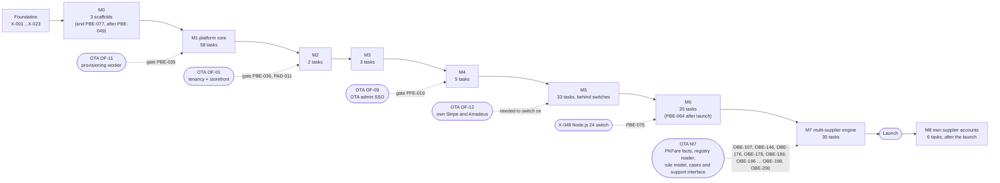

# Platform implementation plan

This plan explains how the platform group (platform backend, portal, platform admin) delivers its MVP scope across the shared milestones M0–M8 (M8 after the launch): for each milestone the goal, the epics in scope, the demo at the end, the exit criteria, what is needed from and given to the OTA group, and the risks with their mitigations. It ends with a traceability table from every scope item to its epic and tasks. The tasks themselves, small enough for an AI coding agent, are in [`agent-tasks.md`](agent-tasks.md); the week-by-week order for one developer is in [`solo-developer-plan.md`](solo-developer-plan.md). Everything here follows [`decisions.md`](../../../docs/mvp/decisions.md), the [cross-cutting ADRs](../../../docs/mvp/adr/README.md) and the [platform ADRs](../adr/README.md).

Related: [`../scope.md`](../scope.md) (features PF-01 … PF-98), [`../architecture.md`](../architecture.md), [`../api-inventory.md`](../api-inventory.md) with [part 2](../api-inventory-resources.md) and [part 3](../api-inventory-admin.md), [`../data-model.md`](../data-model.md), [flows](../README.md#flows), [`../../../docs/mvp/README.md`](../../../docs/mvp/README.md#1-shared-milestones) (milestone definitions), [`../../../docs/mvp/plans/foundation-tasks.md`](../../../docs/mvp/plans/foundation-tasks.md) (`X-` tasks), [`../../../ota/docs/scope.md`](../../../ota/docs/scope.md) (OTA features OF-xx).

## 1. How the plan is built

| Item | Value |
|---|---|
| Agent tasks | 166: 107 backend (`PBE-`), 34 portal (`PFE-`), 25 admin (`PAD-`), since 2026-11-25. M7 holds 35 of them (25 `PBE-`, 2 `PFE-`, 8 `PAD-`), before the launch, and M8 holds 6 (5 `PBE-`, 1 `PFE-`), after the launch; M0–M6 hold 125 (77, 31 and 17), as before |
| Estimate | 806 agent-hours by the plan-lint sizes (S 2 h, M 4 h, L 8 h, review included); about 201.5 developer-days without agents (S ½ day, M 1 day, L 2 days), since 2026-11-25. M7 holds 168 agent-hours and 42 days, M8 24 agent-hours and 6 days after the launch, and M0–M6 614 agent-hours and 153.5 days, as before |
| Foundation dependencies | `X-001` … `X-028` ([`foundation-tasks.md`](../../../docs/mvp/plans/foundation-tasks.md)); the platform never re-does them. Since 2026-11-25 the M7 and M8 tasks also need X-052, X-057, X-061, X-062, X-066, X-067, X-068 and X-075 |
| Validation | `node tools/plan-lint/plan-lint.mjs docs/mvp/plans/foundation-tasks.md platform/docs/plans/agent-tasks.md` (0 errors). Since 2026-11-25 the M7 and M8 tasks depend on OTA tasks, as PBE-069 does on OBE-094, and a run over these two files reports them as unknown. Run plan-lint over the three task files instead: `node tools/plan-lint/plan-lint.mjs` prints `tasks: 540  estimated hours: 2478` and `ERRORS: 0` |
| Reference material reused | Baseline DDL [`platform.sql`](../../../docs/velexis-sdk/db/platform.sql) and [`reference.sql`](../../../docs/velexis-sdk/db/reference.sql) as `0001`, the exact `0002` SQL in [`../data-model-migration-0002.md`](../data-model-migration-0002.md) (parts 1–3), the OTA contract's `ConsoleApiKeyScope`, `StaffPermission`, error envelope and `consoleSignIn` grant in [`velexis-ota-booking-api.openapi.yaml`](../../../docs/velexis-sdk/openapi/velexis-ota-booking-api.openapi.yaml) |

Rules that shape the order of the tasks:

- **Contract first, in slices.** The platform OpenAPI document is written at the start of each milestone that adds operations (M1, M3–M4, M5), before any implementation of that milestone. A route parity test with a pending list keeps CI green and must be empty at the M5 exit ([PADR-0016](../adr/0016-contract-rollout-per-milestone-and-route-parity.md)).
- **One migration for all planned deltas.** Migration `0002` lands in M1 with every delta of [`../data-model.md`](../data-model.md) §4, including tables first used in M5; two tasks own it (PBE-002 writes it, PBE-003 proves its constraints and privileges).
- **Backend first, then the screens that use it.** Each portal or admin task depends on the backend task of its endpoints. Every user-facing feature has a component test and an end-to-end journey.
- **M5 behind switches.** M5 code merges continuously behind the six `FEATURE_*` switches of [PADR-0015](../adr/0015-milestone-feature-switches.md); the switches are turned on when the outside steps (legal review, Stripe Connect approval, Amadeus live contracts) are done, and removed by PBE-064 one release after all six are on, which is after the launch ([ADR-0025](../../../docs/mvp/adr/0025-roadmap-scheduling-and-tracking.md) item 4). Since 2026-11-25 `FEATURE_OWN_AMADEUS` stays off at launch, because the functionality for an OTA's own Amadeus account comes after the launch, in a different release ([ADR-0030](../../../docs/mvp/adr/0030-suppliers-supply-sources-and-ingestion-engine.md) item 21). All six switches can be on in production only from that release on, which the lead reads as milestone M8, so PBE-064 waits for it ([PADR-0015](../adr/0015-milestone-feature-switches.md), note of 2026-11-25).
- **Cross-group work is gated, not faked.** Platform integration tests use a fake OTA worker; the few tasks that need the real OTA side start with a gate naming the OTA feature id ([PADR-0017](../adr/0017-platform-test-doubles-and-end-to-end-harness.md)).
- **M7 before the launch, M8 after it (since 2026-11-25).** The owner decided that M7, the multi-supplier engine, is built before the launch ([ADR-0030](../../../docs/mvp/adr/0030-suppliers-supply-sources-and-ingestion-engine.md) item 19). Its tasks start while the open tasks of M0 to M6 wait on the owner's steps, a nightly run or the launch, and the launch go/no-go waits for M7 ([ADR-0025](../../../docs/mvp/adr/0025-roadmap-scheduling-and-tracking.md) item 3, note of 2026-11-25). They follow the phases A to L of the lead's re-scope ([multi-supplier plan](../../../docs/mvp/plans/multi-supplier-plan.md#0-re-scope-of-2026-11-25) §0). M8, the lead's reading of the release for an OTA's own supplier accounts (ADR-0030 item 21), starts after the launch. An M7 or M8 task that adds operations writes them into the platform OpenAPI document first and binds them in the same pull request.

## 2. Epics

| Epic | Name | What it delivers | Tasks |
|---|---|---|---|
| E1 | Scaffolds and contracts | The three apps, the platform OpenAPI document in slices, the `tenant.*` job messages and invalidation events, the HTTP pipeline and route parity | PBE-001, PFE-001, PAD-001, PBE-004 … PBE-008, PBE-066, PBE-037, PBE-041, PBE-042 |
| E2 | Platform data | Migration `0002` and the proof of its constraints and privileges | PBE-002, PBE-003 |
| E3 | Backend services | Redis keys, BullMQ queues and schedulers, idempotency, rate limits, audit, e-mail outbox, tokens, guards, milestone switches, purge, dev seed | PBE-009 … PBE-012, PBE-034 |
| E4 | Identity | Sign-up, verification, sign-in, lockout, refresh rotation, MFA, step-up, reset, profile, sessions | PBE-013 … PBE-016, PFE-002, PFE-005 … PFE-007 |
| E5 | OTA lifecycle and provisioning | Key rules, create OTA, dispatch, post-steps, reconciler, retries, key reveal, onboarding checklist, OTA dashboard | PBE-017 … PBE-019, PBE-022 … PBE-024, PBE-035, PFE-003, PFE-008 … PFE-010 |
| E6 | API keys | Generator, endpoints, usage flush, cross-backend acceptance | PBE-021, PBE-036, PFE-011 |
| E7 | Team and console | Members, roles, invitations, console token, Open console, console picker | PBE-025, PBE-026, PBE-039, PFE-012, PFE-017, PFE-019 |
| E8 | Amadeus connections | Velexis accounts and office pool, connection reads and settings, own credentials, live offices | PBE-020, PBE-027, PBE-040, PBE-052 … PBE-054, PFE-013, PFE-018, PFE-023, PAD-007, PAD-014 |
| E9 | Payments and settlements | Velexis-mode rows, statement descriptor, Connect Standard, API-key connections, payout accounts, monthly settlements | PBE-038, PBE-055 … PBE-060, PFE-016, PFE-024, PFE-025, PAD-013 |
| E10 | Billing | Plans and pricing, manual trials, Stripe inbox, Checkout, Customer Portal, event processing, invoices, dunning, admin billing | PBE-033, PBE-043 … PBE-048, PFE-004, PFE-020, PFE-021, PAD-008, PAD-012 |
| E11 | Domains and TLS | Sub-domain, `ask` endpoint, custom domains, DNS verification, TLS probe, re-check, admin domains; since 2026-11-16 host names whose punycode labels do not decode refused, in custom domains and API-key origins (Node.js 24) | PBE-027, PBE-049 … PBE-051, PFE-022, PAD-014, PBE-077 |
| E12 | Platform admin | Admin sign-in, dashboard, tenants, suspend and resume, jobs, queues, accounts, admins, audit | PBE-028 … PBE-032, PAD-002 … PAD-006, PAD-009, PAD-011 |
| E13 | Go-live | Live preconditions, the environment switch, live keys | PBE-061, PFE-026 |
| E14 | Quality and launch | End-to-end harness and journeys, cross-backend tests, security review and its follow-ups, performance, switch removal, runbooks | PFE-014, PFE-015, PFE-027, PFE-028, PAD-010, PAD-015, PAD-016, PBE-062 … PBE-065; the security review's follow-ups PBE-067 … PBE-071, PFE-029, PFE-030, PAD-017; since 2026-11-11, PBE-072 (`secrets:rewrap`), PBE-073 (the breached-password list) and PBE-074 (the official Amadeus hosts in production); since 2026-11-13, PBE-075 (the production demo OTA with its reserved key); since 2026-11-15, PFE-031 (the approved terms of service and privacy notice); since 2026-11-16, PBE-076 (the platform measured on Node.js 24) |
| E15 | M7 F. Platform: registry, switches, Velexis accounts, wallet, Suppliers page (since 2026-11-25) | The supplier registry and supply sources with their opaque supply ids and the id history, the global switch, the per-tenant switch and the source stop, the daily limit per OTA (default 0), Velexis's supplier accounts with the PKFare balance gateway and the wallet watch, the portal's Suppliers page with its Velexis section, the onboarding item and go-live precondition renamed to `supply_test` and `supply_live`, the staff settings of a Velexis connection, and the platform admin's "Suppliers" area and "Supply" tab | PBE-078 … PBE-087, PBE-105, PFE-032, PFE-033, PAD-018 … PAD-020, PAD-025 (PBE-105 and PAD-025 also to E8) |
| E16 | M7 J. Rules at the hooks and the platform screen (since 2026-11-25) | Velexis's rules at the hooks, kept on the platform with versions and a reason; the OTA backend's read of them; the rules screen of the platform admin | PBE-088, PBE-089, PAD-021 |
| E17 | M7 K. Reconciliation (since 2026-11-25) | The reconciliation role with its sign-in and scope; the ledger kept from the OTA's facts; cases with due times; the one-time, audited handoff to one booking; the ledger export and recovery mark; the daily check; statements; alerts; supplier disclosure on request; the platform admin's "Reconciliation" area | PBE-090 … PBE-100, PAD-022 … PAD-024 |
| E18 | M7 L. Proof and launch readiness (since 2026-11-25) | The security review of the platform supply modules | PBE-101 |
| E19 | M8 Own supplier accounts (after the launch; since 2026-11-25) | An OTA's own PKFare account and its own Amadeus account beside Velexis supply, the OTA's choice between them, the PKFare section of the Suppliers page, the contract step of a connection's supply source, the cap of open cases per supply source | PBE-102 … PBE-104, PBE-106, PBE-107, PFE-034 |

## 3. Milestones at a glance

| Milestone | Platform goal | Tasks | Agent-hours | Solo days | What the OTA group does in the same milestone |
|---|---|---|---|---|---|
| M0 Foundations | Three apps scaffolded and in the release; since 2026-11-16 punycode host names refused before the switch to Node.js 24 (PBE-077) | 4 | 12 | 3 | Foundation work is shared (`X-` tasks); OTA scaffolds |
| M1 Platform core | Sign-up to active OTA, keys, team, admin basics | 58 | 316 | 79 | OTA backend scaffold and the provisioning worker (OF-11) |
| M2 Search & price | Platform data proven on the OTA side | 2 | 6 | 1.5 | Tenancy, Amadeus client, shopping, SDK, storefront (OF-01, OF-02) |
| M3 Book & pay | Card statement descriptor | 3 | 6 | 1.5 | Checkout, customer auth, Stripe and airline-card payments, orders, e-mails (OF-03 … OF-08) |
| M4 OTA admin | Console SSO, Amadeus office settings | 5 | 16 | 4 | OTA admin, console, settings (OF-09, OF-10) |
| M5 Monetisation & self-service | Billing, own Stripe, settlements, own Amadeus, custom domains, go-live | 33 | 168 | 42 | Gateways that follow the account mode and credential source (OF-12), Connect webhooks, live environment |
| M6 Hardening & launch | Security review and its follow-ups (PBE-067 … PBE-071, PFE-029, PFE-030, PAD-017), performance, full end-to-end suite, runbooks, `secrets:rewrap` (PBE-072), the breached-password list (PBE-073), the official Amadeus hosts in production (PBE-074), the production demo OTA (PBE-075), the approved terms of service and privacy notice (PFE-031), the platform measured on Node.js 24 (PBE-076, since 2026-11-16); switch removal after the launch (PBE-064) | 20 | 90 | 22.5 | PCI controls of the airline-card flow, OTA end-to-end suite; foundation monitoring and restore drill |
| M7 Multi-supplier engine (since 2026-11-25; before the launch) | The supplier registry with supply sources, supply ids and the switches; Velexis's supplier accounts and the wallet watch; the daily limit per OTA (default 0); the portal's Suppliers page with its Velexis section; Velexis's supply rules and their screen; the reconciliation role with the ledger, cases, export, daily check, statements and alerts; the security review of the supply modules | 35 | 168 | 42 | The ingestion engine with its adapters (Amadeus, then PKFare), the Amadeus tools hidden, the supplier hidden from an OTA on Velexis supply, PKFare booking with extras and low-cost content, the rules at the hooks, the OTA side of reconciliation (the fact outbox, cases, the support interface); foundation: the PKFare fixtures, the supply events, the end-to-end proofs and launch readiness |
| M8 Own supplier accounts (since 2026-11-25; after the launch) | An OTA's own PKFare account and its own Amadeus account beside Velexis supply, the OTA's choice between them, the contract step of a connection's supply source, the cap of open cases per supply source | 6 | 24 | 6 | An OTA's own Amadeus connection beside Velexis's, an OTA's own rules and their screen, the work that the multi-supplier plan called "Later", the contract step of the OTA's new columns |
| **Total** | Since 2026-11-25 (125 tasks, 614 agent-hours and 153.5 solo days before). M8's 6 tasks, 24 agent-hours and 6 solo days come after the launch | **166** | **806** | **201.5** | |

## 4. Milestones in detail

### M0 — Foundations

**Goal.** The platform backend, portal and platform admin exist as workspace packages that build, start, answer health checks and are packed into the release by the foundation pipeline.

**Scope.** E1 (scaffolds only): PBE-001, PFE-001, PAD-001. Everything else of M0 (monorepo, shared packages, baselines, migration runner, CI, VM, Caddy, deploy) is foundation work, `X-001` to `X-023`. Reference data is loaded by the foundation loader `tools/reference-data` ([ADR-0024](../../../docs/mvp/adr/0024-reference-data-sources-and-loader.md)); the backend has no loader of its own, and PBE-001 only adds the `ref:load` shortcut for `pnpm db:seed:reference`.

*Note (2026-11-16, lead decisions (25a) and (25n), approved by the owner; FIX-W56-PLAN).* PBE-077 (S, E11: custom domains and API-key origins refuse host names whose punycode labels do not decode, with one exported check that gives the same results on Node 22 and 24) joins M0, so it holds 4 tasks, 12 agent-hours and 3 solo days. It carries the M0 tag so that agents take it before the switch to Node.js 24 (X-048, [ADR-0029](../../../docs/mvp/adr/0029-nodejs-24-runtime.md) item 7), which waits for it; it depends on PBE-021 (M1) and PBE-049 (M5), both done when it was planned. The [solo plan](solo-developer-plan.md) places it in Week 30f, in the roadmap's Node.js 24 block.

**Demo.** `pnpm build` builds the three apps; started locally they answer `/health/live`, and `/health/ready` reports PostgreSQL and Redis; the release built by `pack-release.sh` contains `dist/main.js`, `dist/worker.js`, `dist/cli.js` and the two Next.js standalone outputs.

**Exit criteria.**
- PBE-001, PFE-001 and PAD-001 are merged with CI green.
- `/health/ready` of the backend answers 503 when Redis is down.
- No `process.env` outside `@velexis/config`, no `NEXT_PUBLIC_` variable.

**Dependencies on the OTA group.** None. Both groups depend on the same foundation tasks.

**Risks and mitigations.**

| Risk | Mitigation |
|---|---|
| Scaffolds drift from the conventions (layout, versions) and every later task inherits it | Exact versions from [`tech-stack.md`](../../../docs/mvp/tech-stack.md), folder trees from the component READMEs, lint rules from M0 |
| Entry point names differ from what the deploy script and systemd units expect | PBE-001 builds exactly `dist/main.js`, `dist/worker.js`, `dist/cli.js` as [ADR-0023](../../../docs/mvp/adr/0023-release-artefact-and-deploy-user.md) and the units name them |

### M1 — Platform core

**Goal.** A person signs up, verifies the e-mail, turns on MFA, creates an OTA and sees it become active through the real OTA worker with a test Amadeus office, a Velexis test payment connection and two test keys revealed once; manages API keys and the team. Velexis staff sign in to the platform admin with TOTP, manage the shared Amadeus account and office pool, see tenants, jobs, queues and the audit log, and suspend and resume a tenant.

**Scope.**

| Epic | Tasks |
|---|---|
| E1 contracts and pipeline | PBE-004 (job messages), PBE-005 … PBE-007 and PBE-066 (M1 contract slices), PBE-008 (pipeline, parity) |
| E2 data | PBE-002, PBE-003 |
| E3 services | PBE-009 … PBE-012, PBE-034 |
| E4 identity | PBE-013 … PBE-016, PFE-002, PFE-005 … PFE-007 |
| E5 lifecycle | PBE-017 … PBE-019, PBE-022 … PBE-024, PBE-035, PFE-003, PFE-004, PFE-008 … PFE-010 |
| E6, E7 keys and team | PBE-021, PBE-025, PBE-026, PFE-011, PFE-012 |
| E8, E9, E11 reads and pool | PBE-020, PBE-027, PFE-013 |
| E12 admin | PBE-028 … PBE-033, PAD-002 … PAD-009 |
| E14 journeys | PFE-014, PFE-015, PAD-010 |

Internal checkpoints keep this long milestone reviewable:

| Checkpoint | Tasks done | Shows |
|---|---|---|
| M1a backend core | PBE-002 … PBE-016, PBE-066 | Contract, data, pipeline, identity API with Mailpit e-mails |
| M1b OTA lifecycle | PBE-017 … PBE-027, PBE-034, PBE-035 | Create OTA to active through the fake worker, then the real one |
| M1c portal | PFE-002 … PFE-015 | The whole portal journey in a browser |
| M1d admin | PBE-028 … PBE-033, PAD-002 … PAD-010 | Staff operations in a browser |

**Demo.**
1. Sign up on `https://platform.example.com`, open the verification e-mail, enable MFA, sign out and in with TOTP.
2. Create OTA "Acme" with key `acme`; the setup page shows the steps; the tenant is active within a minute; reveal the test keys once; the checklist shows what is done.
3. Create and revoke a secret key; invite a teammate, who accepts and gets a role change.
4. In `https://admin.platform.example.com`, sign in with TOTP, find Acme, see its job, office, connections and audit; suspend it with a reason (the portal shows the banner) and resume it.

**Exit criteria.**
- Every M1 task is done; the end-to-end journeys of PFE-015 and PAD-010 are green in the `e2e` workflow.
- Tests prove PF-01 … PF-07, PF-10 … PF-13, PF-20, PF-21, PF-30 (test keys), PF-40, PF-42, PF-50, PF-60, PF-70, PF-75 (manual trial), PF-80 … PF-87, PF-90 (test environment), PF-95, PF-96, PF-97 (M1 templates).
- The cross-backend provisioning test (PBE-035) is green in CI with the real OTA worker.
- The release is deployed on the VM, the first platform admin is granted with `admin:grant`, and nightly backups run (X-024).

**Dependencies on the OTA group.**

| Needs from the OTA group | For | When |
|---|---|---|
| OTA backend scaffold and the `tenant.provision` consumer (OF-11), consuming PBE-004's messages | PBE-035, PFE-015 (gated) | Before checkpoint M1b ends |
| The `tenant.suspend` / `tenant.resume` consumer ([PADR-0014](../adr/0014-tenant-suspension-and-resume.md) follow-up, OBE-074) | Clean completion of suspend jobs | M4 in the OTA plan; until then the job ends `failed` after the reconciler's attempts while the status switch still blocks traffic, and the tenant stays `suspended` (PBE-023, PBE-030 step 5, [PADR-0001](../adr/0001-tenant-provisioning-orchestration.md) item 7) |

| Gives to the OTA group | Task |
|---|---|
| `tenant.*` message schemas and fixtures, `vx:invalidate` event types | PBE-004 |
| Rows the OTA backend reads: tenants, sub-domains, API keys, memberships, connections, plans | PBE-018, PBE-021, PBE-022, PBE-025 |
| `vx:invalidate` events after every cached change, `staffdeny:acct:<id>` keys | PBE-009, PBE-014, PBE-016, PBE-032 |
| A Velexis test Amadeus account pointing at the stub and 40 offices for local development (10 until 2026-10-30: the lead raised it to 20 for the e2e journeys, FIX-W34-SHARED; 40 since 2026-11-05, lead decision (5m), PAD-015) | PBE-034 (`dev:seed`) |

**Risks and mitigations.**

| Risk | Mitigation |
|---|---|
| M1 is the largest milestone (58 tasks, about 16 developer-weeks) and could hide slippage | Four checkpoints with their own demos; the critical path printed by plan-lint is reviewed weekly |
| The OTA provisioning worker arrives late | The fake OTA worker lets every platform task finish; only PBE-035 and PFE-015 wait; the combined roadmap schedules OF-11 before checkpoint M1b |
| Authentication mistakes (token audiences, refresh reuse, lockout, MFA bypass) | Guards and token service unit-tested in PBE-012; every endpoint integration-tested for auth failure; full auth matrix in PBE-062 |
| Secrets or tokens leak into logs, queues or audit rows | Redaction paths with tests (PBE-010), outbox secrets encrypted and purged (PBE-011), ids-only job payloads validated by schema (PBE-004), secret scan in PBE-062 |
| Contract churn while screens are built | M1 contract written first in three slices; types generated; parity test |
| Duplicate provisioning or lost jobs across two backends | Attempt-suffixed BullMQ ids, conditional dispatch, idempotent post-steps and the reconciler (PADR-0001), each with an integration test |

### M2 — Search & price

**Goal.** Prove that what the platform publishes drives the OTA side: a key created in the portal authenticates on the OTA API and stops working right after revocation, every cached change is announced on `vx:invalidate`, and a suspension reaches the storefront.

**Scope.** E6 and E12: PBE-036 (invalidation coverage and cross-backend key test), PAD-011 (suspension seen on the storefront).

**Demo.** Create a secret key in the portal, call `getStorefront` (`GET /v1/storefront`) on `https://api.ota.example.com` with it, revoke it, call again and get refused; suspend the tenant in the admin and watch `https://acme.ota.example.com` show "temporarily unavailable", then resume.

**Exit criteria.**
- PBE-036 and PAD-011 are done with their gates met.
- The coverage test lists every cached row type of [`../architecture.md`](../architecture.md) §6.3 and passes.

**Dependencies on the OTA group.** Needs tenant resolution, key verification, the invalidation subscriber and the hosted storefront (OF-01) with its Playwright project. Gives nothing new; the M1 data is what the OTA group builds on.

**Risks and mitigations.**

| Risk | Mitigation |
|---|---|
| A platform change is not announced and the OTA cache serves stale data for 60 s | The coverage test fails for any listed mutation without its event; the 60 s TTL bounds the damage |
| The OTA side reads a column the platform does not fill | The read contract is fixed in [`../architecture.md`](../architecture.md) §6.2; the cross-backend tests exercise it |

### M3 — Book & pay

**Goal.** Card statements of Velexis-collected payments carry the OTA's brand.

**Scope.** E1 and E9: PBE-037 (the M3–M4 contract slice), PBE-038 (descriptor update), PFE-016 (form).

**Demo.** An owner edits the descriptor suffix on the payments page; a test payment made through the storefront (OTA plan) shows it on the PaymentIntent in the Stripe test dashboard.

**Exit criteria.** The three tasks are done; PF-60 tests pass, including the validation rules for Stripe descriptors.

**Dependencies on the OTA group.** The OTA Stripe gateway (OF-04) reads `statement_descriptor_suffix` from the payment connection. The platform has filled it since provisioning (PBE-022).

**Risks and mitigations.**

| Risk | Mitigation |
|---|---|
| Stripe rejects a descriptor at payment time | The same character and length rules are enforced by the API and the form, with unit tests |

### M4 — OTA admin

**Goal.** "Open console" signs any active member into the OTA admin for that OTA without a second password; owners and admins edit the Amadeus office settings that the console uses.

**Scope.** E7 and E8: PBE-039 (console token), PBE-040 (Amadeus settings), PFE-017 (launch handler, console picker), PFE-018 (settings form), PFE-019 (SSO journey and cross-backend test).

**Demo.** From the OTA dashboard, click "Open console" and land on `https://admin.ota.example.com/bookings` for Acme; reuse the captured token and fail; remove the member and see the console session end within a minute; change the queuing office on the Amadeus page.

**Exit criteria.**
- The five tasks are done; PF-22 and PF-53 tests pass; the `console-sso` journey is green.
- The console token is never in a URL, a log, an audit row or idempotency storage (tests).

**Dependencies on the OTA group.** Needs the OTA admin `/sso` route, the `portal_token` grant of `consoleSignIn`, and the staff guard checking `staffdeny:acct:<id>` and membership invalidations (OF-09, [PADR-0007](../adr/0007-portal-to-ota-admin-sso-token.md) follow-up). Gives one-time tokens in `ptk:<sha256>`, the deny keys (since M1) and the office settings on `supplier_connections`.

**Risks and mitigations.**

| Risk | Mitigation |
|---|---|
| Token leakage through prefetch, history or `Referer` | POST-only launch form, `no-store`, `Referrer-Policy: strict-origin` (the portal's origin only; `no-referrer` would send `Origin: null`, which the OTA admin's `/sso` refuses, PADR-0007 point 4), 60 s single-use token in Redis with `NX` and `GETDEL` |
| Cross-origin hand-off breaks on cookies or CSP | The end-to-end journey runs across the real portal and OTA admin origins; the portal CSP allows exactly the OTA admin origin in `form-action` |

### M5 — Monetisation & self-service

**Goal.** OTAs pay Velexis through Stripe Billing; they can bring their own Stripe (Connect Standard or API keys) or stay on Velexis's account and receive monthly settlements to a verified payout account; they can bring their own Amadeus credentials or ask for a live Velexis office; they can serve the storefront on their own domain with automatic TLS; and they can switch to live.

**Scope.** In this order, so that each part is demonstrable on its own:

| Order | Part | Tasks |
|---|---|---|
| 1 | M5 contract slices | PBE-041, PBE-042 |
| 2 | Billing (E10) | PBE-043 … PBE-048, PFE-020, PFE-021, PAD-012 |
| 3 | Custom domains (E11) | PBE-049 … PBE-051, PFE-022 |
| 4 | Amadeus self-service (E8) | PBE-052 … PBE-054, PFE-023, PAD-014 |
| 5 | Payments and settlements (E9) | PBE-055 … PBE-060, PFE-024, PFE-025, PAD-013 |
| 6 | Go-live (E13) and journeys (E14) | PBE-061, PFE-026, PFE-027, PAD-015 |

**Demo.**
1. With the switches on locally and Stripe in test mode: create an OTA with a paid plan, pay on Checkout with a test card, see it provision on the webhook, open the Customer Portal, see the invoice.
2. Add `travel.acme.com`, see the DNS records, verify it (fake resolver locally; a real test domain with Let's Encrypt staging for the exit check), see TLS issued.
3. Submit own Amadeus test credentials against the stub, see them applied and the Velexis office `releasing`; request a live office and have an admin assign it.
4. Connect a Stripe test account through OAuth; switch back to Velexis payments; set a payout account; generate, approve and mark paid a settlement.
5. Go live: the page lists missing preconditions, then the switch succeeds and the storefront serves live within 60 seconds.

**Exit criteria.**
- Every M5 task is done; `pending-operations.ts` is empty (PADR-0016).
- Tests prove PF-14, PF-30 (live keys), PF-41, PF-51, PF-52, PF-61 … PF-64, PF-71 … PF-75, PF-88, PF-89, PF-91, PF-92 and the M5 e-mail templates of PF-97; every M5 endpoint also has a test showing `403 FEATURE_DISABLED` with its switch off.
- The `portal-stripe` journey passes in the nightly run; a real test domain receives a Let's Encrypt staging certificate.
- Before any live Velexis-mode payment or settlement in production: legal and Stripe review done ([PADR-0003](../adr/0003-settlement-of-velexis-collected-payments.md) follow-up). Before live Connect: Stripe Connect platform approval. Each switch is turned on in production only when its outside step is done.

**Dependencies on the OTA group.**

| Needs from the OTA group | For |
|---|---|
| Gateways that follow `account_mode` and `credential_source` with no per-tenant code path, including the rule that orders owned by a `releasing` Velexis office keep using the Velexis account (OF-12, [PADR-0012](../adr/0012-amadeus-office-pool.md) follow-up) | Own Stripe, own Amadeus, office release |
| Payment webhooks for connected accounts and for API-key connections (`/webhooks/stripe/connect/{env}`, `/webhooks/stripe/c/<ppc_id>`) | Own Stripe |
| Resolution of verified custom domains and the live storefront environment from `tenants.storefront_environment` | Custom domains, go-live |
| The `billing_notice` banner in the OTA admin | Dunning |

The platform gives every row and column these features read (all created by `0002` in M1), their invalidations, and the webhook URL shown to owners.

**Risks and mitigations.**

| Risk | Mitigation |
|---|---|
| Outside approvals (legal review, Stripe Connect, Amadeus live contracts) arrive late | Code merges behind switches; each switch is independent; manual billing keeps working until `FEATURE_STRIPE_BILLING` is on |
| Out-of-order or duplicate Stripe events corrupt subscriptions | Inbox with the event id as key, handlers that always re-fetch, tests with reversed and duplicated fixtures, the sweep scheduler |
| Settlement amounts are wrong or settled twice | Unique balance transaction per line, immutable approved statements, `decimal.js`, edge-case unit tests, admin review with step-up before every payout |
| DNS and certificate issuance behave differently from tests | Public resolvers, fake-resolver unit tests for every error, the TLS probe, a manual staging check with a real domain, existing certificates unaffected by `ask` failures |
| A tenant loses access to payments when switching modes | No silent fallback; switching never moves existing payments; live switch-back requires a verified payout account |
| Secret handling for own credentials | Staged in `credential_submissions`, verified by a worker, re-encrypted per row, purged at the end, secret scan in PBE-062 |

### M6 — Hardening & launch

**Goal.** The platform is reviewed for security, measured against the VM budget, covered by a nightly end-to-end suite, documented for operations, and launched. The milestone switches are removed after the launch, once all six have been on in production for one release (PBE-064).

**Scope.** E14: PBE-062 (security review, auth matrix, rate limits, secret scan), PBE-063 (performance and memory), PBE-064 (switch removal, gated, after the launch), PBE-065 (launch checklist and runbooks), PFE-028 and PAD-016 (complete end-to-end suites with accessibility and header checks). Foundation tasks X-029 … X-032 (uptime monitoring, on-VM checks, restore drill, managed-services proof) run in the same milestone.

*Note (2026-11-05, FIX-W44-PLATFORM, lead decision 7(f)).* The security review's follow-ups are M6 tasks too, and the milestone's count and hours in §1 and §3 include them (14 tasks, 68 agent-hours, 17 solo days): PBE-067 (the portal tokens of disabled and erased accounts refused at once), PBE-068 (nodemailer), PBE-069 (the multer override, no multipart route in the platform API), PBE-070 (the test and contract tooling), PFE-029 and PAD-017 (zod in the portal and the platform admin), and PBE-071 and PFE-030 (MFA for the owners and admins of live OTAs, the [PADR-0008](../adr/0008-email-verification-and-mfa-policy.md) revision of 2026-11-05).

*Note (2026-11-11, lead decision (15m), FIX-W48-SHARED).* PBE-072 (M: the platform backend's `secrets:rewrap`, ADR-0010 "Rotation" item 3 and X-040; the OTA's command is OBE-100) joins M6, so it holds 15 tasks, 72 agent-hours and 18 solo days: without it a master-key rotation can never remove the old key ([`../runbooks/platform-operations.md`](../runbooks/platform-operations.md) §8 and §10). It belongs to E14; the [solo plan](solo-developer-plan.md) places it in Week 30c, and the roadmap's re-baseline of 2026-11-11 places that week ([`../../../docs/mvp/plans/roadmap.md`](../../../docs/mvp/plans/roadmap.md) §1.3).

*Note (2026-11-11, lead decisions (17b) and (17k), approved by the owner; FIX-W49-SHARED).* Two more platform tasks join M6, so it holds 17 tasks, 80 agent-hours and 20 solo days: PBE-073 (M: portal passwords checked against the entries of a public list of about a million breached passwords that meet the 12-character letter-and-digit rule, instead of the top-10 000 list, none of whose entries meets it; with the dated note of [ADR-0008](../../../docs/mvp/adr/0008-identity-accounts-customers-sessions.md) of 2026-11-11) and PBE-074 (M: with `APP_ENV=production` the platform refuses a Velexis Amadeus account whose base URL is not the official Amadeus host of its environment, as it refuses AMADEUS_BASE_URL_* already, because X-041's outbound allow-list holds only those hosts; [`../../../docs/mvp/runbooks/outbound-allow-list.md`](../../../docs/mvp/runbooks/outbound-allow-list.md) §2). Both belong to E14 (PBE-073 also to E4, PBE-074 to E8); the [solo plan](solo-developer-plan.md) places PBE-073 in Week 30c and PBE-074 in a new split Week 30d, and the roadmap's second re-baseline of 2026-11-11 places them in C78 and C79 ([`../../../docs/mvp/plans/roadmap.md`](../../../docs/mvp/plans/roadmap.md) §1.3).

*Note (2026-11-13, lead decisions (20a) and (20r), approved by the owner; FIX-W51-SHARED).* PBE-075 (M: a platform command creates Velexis's production demo OTA with the reserved key `demo` for an existing portal account with MFA, through `createTenant`'s own transaction, with the audit rows of the portal path and one naming the command, and keeps it out of billing; `demo` stays reserved for everyone else, so the portal and `createTenant` keep answering `409 TENANT_KEY_UNAVAILABLE`) joins M6, so it holds 18 tasks, 84 agent-hours and 21 solo days. It turns the platform launch checklist's demo OTA item, "not possible yet" since 2026-11-12, into the command ([`../runbooks/launch-checklist.md`](../runbooks/launch-checklist.md) §6). It belongs to E14 (and E5); the [solo plan](solo-developer-plan.md) places it in a new split Week 30e, and the roadmap's re-baseline of 2026-11-13 places that week in C80 ([`../../../docs/mvp/plans/roadmap.md`](../../../docs/mvp/plans/roadmap.md) §1.3).

*Note (2026-11-15, lead decision (23n), approved by the owner; FIX-W54-DOCS).* PFE-031 (S: the product owner's approved terms of service and privacy notice replace the placeholder text that `/legal/terms` and `/legal/privacy` have shown since PFE-004, under a new `termsVersion` that sign-up sends, so the acceptance the API stores names the final text) joins M6, so it holds 19 tasks, 86 agent-hours and 21.5 solo days. It waits for the approved text, a human step of the product owner with legal counsel, and the platform launch checklist's §5 item points at it ([`../runbooks/launch-checklist.md`](../runbooks/launch-checklist.md) §5); if the terms carry the OTAs' acknowledgement of Velexis's PCI DSS responsibility, they also meet precondition P23 of the airline-card go-live ([`../../../ota/docs/runbooks/airline-card-go-live.md`](../../../ota/docs/runbooks/airline-card-go-live.md) §2). It belongs to E14 (and E4, for PF-01's acceptance of the terms); the [solo plan](solo-developer-plan.md) places it in ½ day of Week 30e's buffer, in C80 ([`../../../docs/mvp/plans/roadmap.md`](../../../docs/mvp/plans/roadmap.md) §1.3).

*Note (2026-11-16, lead decisions (25a) and (25n), approved by the owner; FIX-W56-PLAN).* PBE-076 (M, E14: the platform API and worker measured on Node.js 24 against Node 22 and the VM budget, from one build and the units' flags, with a garbage-collection preload and the share of time in garbage collection; [ADR-0029](../../../docs/mvp/adr/0029-nodejs-24-runtime.md) items 3 and 5) joins M6, so it holds 20 tasks, 90 agent-hours and 22.5 solo days. It waits for the switch to Node.js 24 (X-048, foundation, M0) and for PBE-063; a missed target or threshold becomes a proposed task for the lead. The [solo plan](solo-developer-plan.md) places it in Week 30f, in C83 of the roadmap's Node.js 24 block ([`../../../docs/mvp/plans/roadmap.md`](../../../docs/mvp/plans/roadmap.md) §1.3, re-baseline of 2026-11-16).

*Note (2026-11-25, the owner's decision (43a) of 2026-11-25, [ADR-0030](../../../docs/mvp/adr/0030-suppliers-supply-sources-and-ingestion-engine.md) item 19; [ADR-0025](../../../docs/mvp/adr/0025-roadmap-scheduling-and-tracking.md) item 3, note of 2026-11-25).* The launch now waits for M7: the owner decided that the multi-supplier engine is built before the launch. M6 keeps its 20 tasks, its hours and the exit criteria below; it ends with its own go/no-go. "Launched" in its goal moves to the end of M7, and the launch go/no-go needs M7's exit criteria ([M7](#m7--multi-supplier-engine)) beside M6's ([roadmap](../../../docs/mvp/plans/roadmap.md), M7 section). `FEATURE_OWN_AMADEUS` stays off at launch, because the functionality for an OTA's own Amadeus account comes after the launch (ADR-0030 item 21). So PBE-064 waits for that later release, which the lead reads as M8 ([PADR-0015](../adr/0015-milestone-feature-switches.md), note of 2026-11-25).

**Demo.** Walk through `platform/docs/security-review.md` and `platform/docs/performance.md`; show three consecutive green nightly runs of the portal and admin projects; walk through the launch checklist on the VM with the developer.

**Exit criteria.**
- PBE-062, PBE-063, PBE-065, PFE-028 and PAD-016 are done; the security review lists no open high finding.
- PBE-064 stays open at launch. It is a named exception to the go criterion "every task of the milestone is done" ([ADR-0025](../../../docs/mvp/adr/0025-roadmap-scheduling-and-tracking.md) item 4, roadmap go criterion 1), because the switches stay off until their outside approvals and the launch does not wait for them (item 5). It runs in the first release after all six switches have been on in production for one release.
- p95 targets and memory budgets are met or have tasks.
- Every launch checklist item is checked by its owner.

**Dependencies on the OTA group.** Shared: the restore drill and monitoring (foundation), the end-to-end suite configuration (`tools/e2e`). The PCI controls of the airline-card flow are OTA work and not part of this plan.

**Risks and mitigations.**

| Risk | Mitigation |
|---|---|
| Switches removed before they have run in production | PBE-064 starts with a gate confirmed by the developer and is scheduled after the launch |
| The 8 GB VM is too small under load | PBE-063 measures RSS and latency against the budget of [`architecture.md`](../../../docs/mvp/architecture.md) §3; findings become tasks before launch |
| Flaky end-to-end tests block the launch | Three consecutive green nightly runs required; Stripe journeys isolated in their own project |

### M7 — Multi-supplier engine

*Added 2026-11-25 (the owner's decisions of 2026-11-24 and 2026-11-25, [ADR-0030](../../../docs/mvp/adr/0030-suppliers-supply-sources-and-ingestion-engine.md) items 1 to 13 and 19 to 25; the lead's re-scope, [multi-supplier plan](../../../docs/mvp/plans/multi-supplier-plan.md#0-re-scope-of-2026-11-25) §0).* M7 is built before the launch, and the launch go/no-go waits for it ([ADR-0025](../../../docs/mvp/adr/0025-roadmap-scheduling-and-tracking.md) item 3, note of 2026-11-25). Its tasks start while the open tasks of M0 to M6 wait on the owner's steps, a nightly run or the launch. The platform holds 35 of its 169 tasks: 168 of its 776 agent-hours and 42 of its 194 solo days. In the roadmap's example calendars M7 is W33–W47 with agents and C87–C133 without, and the launch moves to its end. That M7 follows M6's weeks there is the lead's choice: in fact M7's tasks start now ([roadmap](../../../docs/mvp/plans/roadmap.md) §1.2 and §1.3).

**Goal.** Velexis supplies its OTAs from more than one supplier, PKFare after Amadeus, and the platform's part of that supply is ready at the launch (ADR-0030 item 19):

- Velexis staff switch a supplier on and off globally and per OTA in the platform admin (item 2).
- An OTA on Velexis supply sees an opaque id for its supply, and an id that changes stays traceable through a history (items 3, 9 and 11). That the id belongs to a supply source, and its form `sup_` plus 16 random characters, are the lead's proposals (items 14 and 15).
- Velexis's own supplier accounts are kept in the platform admin, and the Velexis PKFare wallet through which OTAs pay (item 5) is watched: under its floor the source stops selling for every OTA.
- The daily limit per OTA is 0 by default and is set in the platform admin's OTA management (item 23). What 0 means is open: question (44a). 2026-11-26: answered: "no ticket is paid from the wallet until staff set a limit." (ADR-0030 item 27).
- The portal's Amadeus page becomes the Suppliers page, with a Velexis section that names no supplier (item 6). The Amadeus tools are hidden (item 21). What exists today for an OTA's own Amadeus account moves into the page behind `FEATURE_OWN_AMADEUS`, which stays off at launch.
- Velexis's rules for the hooks are kept on the platform, with their screen in the platform admin: the base rule engine of item 20, as the lead reads it.
- Velexis staff with the reconciliation role get a reference to OTA bookings (item 8), and the launch has the reconciliation process ready from the platform (item 22). In the lead's proposals ([PADR-0021](../adr/0021-reconciliation-role-ledger-and-cases.md) items 4 to 9, proposed), that process is the ledger, cases, the handoff to one booking, the export, the daily check, statements and alerts.

**Scope.** By the phases of the lead's re-scope. The platform has tasks in four of the twelve phases; the other eight phases hold foundation and OTA work.

| Phase | Epic | Part | Tasks |
|---|---|---|---|
| F | E15 | Registry, supply sources and ids, switches, stops and the daily limit | PBE-078, PBE-080, PBE-081, PBE-082, PAD-018, PAD-019 |
| F | E15 | Velexis's supplier accounts and the wallet | PBE-079, PBE-083, PBE-084, PBE-087, PAD-020 |
| F | E15 | The Suppliers page, the renamed checklist item and go-live precondition | PBE-085, PBE-086, PFE-032, PFE-033 |
| F | E15 | Staff settings of a Velexis connection | PBE-105, PAD-025 |
| J | E16 | Velexis's supply rules and their screen | PBE-089, PBE-088, PAD-021 |
| K | E17 | The role, the ledger, cases and the handoff to one booking | PBE-090, PBE-091, PBE-092, PBE-093, PBE-094, PAD-022, PAD-024 |
| K | E17 | Ledger operations, the daily check, statements and alerts | PBE-095, PBE-096, PBE-097, PBE-098, PAD-023 |
| K | E17 | Supplier disclosure on request | PBE-099, PBE-100 |
| L | E18 | Security review of the supply modules | PBE-101 |

Inside a phase the tasks follow their dependencies, as the batch table of the roadmap's M7 section orders them. PBE-078, PBE-079 and PBE-080, with the foundation's X-061 between them, start the remaining critical path, and PAD-022 is on it too ([roadmap](../../../docs/mvp/plans/roadmap.md) §3.1).

**Human steps.**

- The limit parts of PBE-082 and PAD-019 wait for the owner's answer to (44a); the other steps of both tasks start before it. 2026-11-26: the answer came (ADR-0030 item 27), so they may start.
- PBE-100 needs counsel's approved notice text, which the owner hands over (43d, open); an agent never writes legal text. No supplier is hidden in live use before counsel's answer (plan §4.14). 2026-11-26: counsel answered for Velexis supply, as relayed by the owner (ADR-0030 question 4), so by the lead's reading the condition of this sentence is met for Velexis supply. The answer holds no notice text, so PBE-100 still waits for it (ADR-0030 question 19).
- PBE-097 waits for PKFare's statement sample in the fixture set of X-057. PBE-083, PBE-084, PBE-087 and PBE-096 read the PKFare facts file of OBE-107 and stop on a difference.
- The reconciliation role needs its holders before the launch: a holder, a stand-in and cover hours (43e, open). X-074 adds that gate to the launch checklist.

**Demo.**

- *On the VM* (`APP_ENV=production`, real test accounts; [ADR-0025](../../../docs/mvp/adr/0025-roadmap-scheduling-and-tracking.md) item 7). In the platform admin, switch a supplier off and on in `test` with a reason and find both audit rows. Create a Velexis PKFare test account, see it verified against PKFare's test host once X-071 allows that host on the VM, and see its wallet panel and the dashboard tile. On an OTA's tab "Supply", switch a Velexis source on, rotate its supply id and resolve the old one, and set the OTA's daily limit once (44a) is answered. Open that OTA's Suppliers page in the portal and find no supplier name, office id or host. Grant the reconciliation role with a step-up and sign in as its holder. 2026-11-26: (44a) is answered (ADR-0030 item 27).
- *Local stack* (the Amadeus stub, the PKFare fake, Mailpit). A wallet reading under the floor stops the source and one above it resumes it, with the alerts in Mailpit. A PKFare booking on the fake gives a ledger row. A case opened on the OTA side appears in the "Reconciliation" area; the holder opens the booking with a reason and works the case to its outcome. Export the ledger, run the daily check and match the statement sample in three lists. A rule switched on in the rules screen skips a supplier in the next search. With `FEATURE_OWN_AMADEUS` on, the section "Amadeus" shows today's own-account parts.

**Exit criteria.**

- Every M7 task of this plan is done (35 tasks), and plan-lint shows `ERRORS: 0`.
- The security review of the platform supply modules lists no open high finding; the auth matrix holds every operation added in M7, and the secrets scan covers the supplier account's key and signature (PBE-101).
- For an OTA on Velexis supply with `FEATURE_OWN_AMADEUS` off, no answer of `getSuppliersPage` and no text of the Suppliers page, the menu, the banner or the `amadeus.live_ready` e-mail names a supplier, an office id or a host (PBE-085, PFE-032). X-062 proves the switches and the page end to end.
- The new admin writes of the registry, the switches, the daily limit, the supplier accounts and the rules each store one audit row and publish one invalidation event after the commit, and those that the contract marks `x-reason-required` refuse a missing reason (PBE-080, PBE-081, PBE-082, PBE-084, PBE-089).
- The ledger keeps the facts of the highest sequence (the replay and out-of-order tests of PBE-092), and a role holder takes each kind of case through its steps (PBE-094). X-068 proves the cases end to end through both admins.
- The daily limit is configured for each OTA, 0 until staff change it (PBE-082, PAD-019), and `FEATURE_OWN_AMADEUS` is off in production ([launch checklist](../runbooks/launch-checklist.md) §7, switch 3).
- The reconciliation role has its holders, as the after-sales gate of the launch checklist asks (X-074; who staffs it is question (43e)).
- The launch go/no-go checks these criteria beside M6's ([roadmap](../../../docs/mvp/plans/roadmap.md), M7 section).

**Dependencies on the OTA group.**

| Needs from the OTA group | For | When |
|---|---|---|
| The PKFare facts file, the question list and the index of the saved reference (OBE-107) | PBE-083, PBE-084, PBE-087, PBE-096, PBE-097 | Phase C, before phase F |
| The OTA backend's read of the supply registry and its resolution of sources (OBE-146) | PBE-088 | Phase F |
| The supply rule model and its matcher (OBE-189) | PBE-088, PBE-089 | Phase J, first |
| `supply.case_opened` from the OTA backend (OBE-176), under the envelope of X-067; the facts of `supply.booking_fact` come from the fact outbox (OBE-195) | PBE-092 and the reconciliation tasks after it | Phases I and K |
| The support caller and the handoff redeem (OBE-196), the support reads (OBE-197) and the support actions on a case (OBE-200) | PAD-022; PBE-093 agrees the token's form with OBE-196 | Phase K |
| The staff alerts and case texts (OBE-178, OBE-198, OBE-200) | PBE-098 (the test for neutral words) | Phases I and K |

| Gives to the OTA group | Task |
|---|---|
| The registry tables and the OTA role's read grants, the wallet's currency among them (read by OBE-146, OBE-159, OBE-165 and OBE-177) | PBE-078, PBE-079 |
| Supply ids and their history (OBE-147, OBE-148) | PBE-080 |
| The per-tenant switch, and the daily limit on the cached tenant row (OBE-177) | PBE-082 |
| The invalidation events of suppliers, supplier accounts and supply sources | PBE-080, PBE-081, PBE-084, with X-061 |
| Velexis's rules: the read grant, the cache key and the event (OBE-190, OBE-193, OBE-194) | PBE-088, PBE-089 |
| The one-time handoff token that the support interface redeems (OBE-196) | PBE-093 |
| The platform consumer of the supply messages, and the ledger (OBE-211 in M8) | PBE-092 |
| The Suppliers page, whose neutral texts the OTA admin follows (OAD-025) | PFE-032 |
| The admin areas and the security review that the supplier go-live runbook names (OBE-206) | PAD-018, PAD-019, PBE-101 |

**Risks and mitigations.**

| Risk | Mitigation |
|---|---|
| The one reviewer's hours: M7 adds 15 full review weeks before the launch (likely 17, high 22), and every M7 pull request needs the same reviewer | The phases in order and batches by the rule of the roadmap's §2.0; a re-baseline with a dated reason when M7 overruns by more than one week ([ADR-0025](../../../docs/mvp/adr/0025-roadmap-scheduling-and-tracking.md) item 6); plan §7 lists the tasks that could be cut, PBE-097, PBE-099 and PBE-100 among them, and a cut is the owner's decision |
| PKFare's facts differ from the plan (the balance answer, the signature, the statement format), or its certification comes late | OBE-107's facts file comes first, in phase C, and every task that reads it stops and tells the lead on a difference; PBE-097 does not start without the statement sample of X-057; PKFare stays switched off in production until it is certified, and the lead reads PKFare's live step, X-073, as a named exception that does not hold the launch (question (44b), open). 2026-11-26: the owner answered (44b) (ADR-0030 item 28), and X-073 is a named exception by the lead's reading of that answer |
| Counsel's answer on Velexis's role (43d) is open | Neutral texts need no wording from counsel; PBE-100 starts only with counsel's approved text, and no supplier is hidden in live use before counsel's answer; PBE-099 and PBE-100 are possible cuts (plan §7). 2026-11-26: counsel answered for Velexis supply, as relayed by the owner (ADR-0030 question 4); the texts are still open (ADR-0030 question 19), so PBE-100 still waits for them |
| Who staffs the reconciliation role (43e) is open | PBE-091 and PAD-024 let staff grant the role with a step-up and a reason; the after-sales gate of the launch checklist (X-074) holds the launch until the role has holders |
| What a daily limit of 0 means (44a) is open | The limit parts of PBE-082 and PAD-019 wait for the answer; the default is 0 either way, and OBE-177 enforces the limit before the capture. 2026-11-26: closed: the owner answered (ADR-0030 item 27), and the limit parts may start |
| The wallet runs dry, and a ticket cannot be paid | The wallet watch alerts below the warning level and stops the source under the floor (PBE-087); a live account is active only with a floor (PBE-084); the daily check reports differences (PBE-096) |
| A supplier name reaches an OTA through the platform: the page, an e-mail, an alert | Tests that search the serialised answers and the pages for supplier names (PBE-085, PFE-032), the test for neutral words in the OTA-facing texts (PBE-098) and the end-to-end proof of X-062 |
| A PKFare key or signature leaks | The key is write-only and envelope-encrypted, and `secrets:rewrap` covers it (PBE-079); the signature is built at send time and redacted, with a test (PBE-083); the secrets scan of PBE-101 |
| A role holder reaches more than the booking of a case | A one-time, audited handoff to one booking with a reason (PBE-093); a revoke acts at the next request (PBE-091); X-070 proves that nothing crosses tenants |
| The breaking rename to `supply_test` and `supply_live` breaks a client | Its clients, the portal and the end-to-end helpers, change in the same pull request (PBE-086) |

### M8 — Own supplier accounts (after the launch)

*Added 2026-11-25 ([ADR-0030](../../../docs/mvp/adr/0030-suppliers-supply-sources-and-ingestion-engine.md) item 21, as the lead reads it).* The owner decided: "Hide Amadeus tools right now (I would resurface them later when there is functionality of adding OTAs own Amadeus, that would be post launch in a different release)." The lead reads that release as milestone M8 ([ADR-0025](../../../docs/mvp/adr/0025-roadmap-scheduling-and-tracking.md) item 3, note of 2026-11-25). No M8 task starts before the launch, so M8 does not move it. The platform holds 6 of its 17 tasks: 24 of its 84 agent-hours and 6 of its 21 solo days. In the roadmap's example calendars M8 is W48–W49 with agents and C134–C139 without, after the launch; that its weeks are not counted in the calendars' length is the lead's choice.

**Goal.** An OTA connects its own supplier accounts beside Velexis supply and chooses between them ([`decisions.md`](../../../docs/mvp/decisions.md) §2, "Whose supplier account"; ADR-0030 items 3 and 21): its own Amadeus account as a second connection beside Velexis's, without releasing the Velexis office, and its own PKFare account (the lead's reading, question (44d)). Two follow-ups of M7 come with it: a connection's supply source becomes NOT NULL, and the open paid-and-not-ticketed cases are counted per supply source over all OTAs. 2026-11-26: the owner answered (44d): "Yes." (ADR-0030 item 30). So an OTA's own PKFare account comes after the launch on the owner's decision; that this release is M8 stays the lead's reading.

**Scope.**

| Part | Tasks |
|---|---|
| An OTA's own PKFare account (the lead's reading, question (44d); since 2026-11-26 the owner's decision, ADR-0030 item 30) | PBE-102, PFE-034 |
| An OTA's own Amadeus account beside Velexis supply | PBE-103 |
| The OTA's choice between Velexis supply and its own accounts | PBE-104 |
| The contract step of the supply source of `supplier_connections` | PBE-106 |
| The cap of open cases per supply source | PBE-107 |

**Demo.**

- *On the VM.* An owner connects an own PKFare test account on the Suppliers page and sees the state of the submission, then of the connection. With `FEATURE_OWN_AMADEUS` on, an OTA's own Amadeus test account serves beside Velexis supply, and the Velexis office stays assigned. The owner unselects Velexis supply for one environment and selects it again.
- *Local stack.* K open paid-and-not-ticketed cases of one source, from two OTAs, stop that source, and staff lift the stop with a reason. After PBE-106 an insert of a connection without a supply source fails.

**Exit criteria.**

- Every M8 task of this plan is done; PBE-106 ships in a release after the one that holds X-075 ([`conventions.md`](../../../docs/mvp/conventions.md) §9).
- With `FEATURE_OWN_AMADEUS` on, an OTA's own Amadeus account serves beside Velexis supply, and disabling one connection leaves the other serving (PBE-103).
- No table, log line or answer holds an OTA's own PKFare key, its signature or its balance (PBE-102).
- All six milestone switches can be on in production only from this release on. PBE-064 then follows by its own rule, in the first release after all six have been on in production for one release ([PADR-0015](../adr/0015-milestone-feature-switches.md), note of 2026-11-25).

**Dependencies on the OTA group.**

| Needs from the OTA group | For |
|---|---|
| The Amadeus adapter for booking (OBE-126 … OBE-138, M7) and the OTA backend serving an OTA's own Amadeus connection beside Velexis's (OBE-216) | PBE-103 |
| The OTA backend's resolution of sources (OBE-146, M7) | PBE-104 |
| The stops before the capture (OBE-177, M7) | PBE-107 |
| The PKFare facts file (OBE-107, M7) | PBE-102 |

| Gives to the OTA group | Task |
|---|---|
| An OTA's own PKFare and Amadeus sources, to which an OTA's own rules apply (OBE-207) | PBE-102, PBE-103 |
| The ledger, into which the cases driven by the adapter report (OBE-211) | PBE-092 (M7) |

**Risks and mitigations.**

| Risk | Mitigation |
|---|---|
| Question (44d) is answered the other way, and an OTA's own PKFare account belongs to the launch | PBE-102 and PFE-034 move to M7 by a plan edit with the reason, and the launch waits for them (a re-baseline under [ADR-0025](../../../docs/mvp/adr/0025-roadmap-scheduling-and-tracking.md) item 6). 2026-11-26: closed: the owner answered "Yes." (ADR-0030 item 30), so the account moves after the launch |
| An OTA's own credentials leak | As for Velexis's accounts: a write-only key, envelope encryption and redaction tests; the verifier calls the official host only (PBE-102) |
| A contract step ships too early and breaks a writer of the previous release | PBE-106 ships a release after X-075's (conventions §9); its migration stops and changes nothing while a connection has no source |
| The selection stops an OTA's sales by mistake | An unselected source keeps serving its existing bookings; each change stores an audit row and publishes an event (PBE-104) |

## 5. Interface with the OTA group

| What | Direction | Milestone | Platform task | OTA feature |
|---|---|---|---|---|
| `tenant.provision`, `tenant.migrate`, `tenant.suspend`, `tenant.resume` and their answers | both | M1 | PBE-004, PBE-019, PBE-022, PBE-023, PBE-030 | OF-11; suspend consumer M4/M5 |
| Read-only platform tables and columns ([`../architecture.md`](../architecture.md) §6.2) | platform → OTA | M1 | PBE-002, PBE-018, PBE-021, PBE-022 | OF-01 |
| `vx:invalidate` events | platform → OTA | M1 | PBE-009 and every mutating task; PBE-036 proves coverage | OF-01 |
| `apikey:used:<keyId>` usage counters | OTA → platform | M2 | PBE-021 (flush) | OF-01 |
| `ptk:<sha256>` console tokens and `staffdeny:acct:<id>` | platform → OTA | M4 (deny keys from M1) | PBE-039, PBE-014, PBE-016, PBE-032 | OF-09 |
| Payment connection modes and secrets, Amadeus credential source, releasing offices | platform → OTA | M5 | PBE-053 … PBE-057 | OF-12 |
| `storefront_environment`, verified custom domains, `billing_notice` | platform → OTA | M5 | PBE-045, PBE-050, PBE-061 | OF-01, OF-12 |
| `tools/e2e` harness | shared | M1 | PFE-014 | OTA adds its projects |
| Since 2026-11-25: the supplier registry, supply sources and ids, the switches and the daily limit, read-only for the OTA role, and their invalidation events | platform → OTA | M7 | PBE-078 … PBE-082, PBE-084, PBE-087, with X-061 | No feature id; OTA tasks OBE-146, OBE-147, OBE-148, OBE-159, OBE-165, OBE-177 |
| Since 2026-11-25: Velexis's supply rules (read grant, cache key, event) | platform → OTA | M7 | PBE-089, PBE-088 | OBE-190, OBE-193, OBE-194 |
| Since 2026-11-25: `supply.booking_fact` and `supply.case_opened` under one envelope (X-067), and `supply.balance_refused` (X-066) | OTA → platform | M7 | PBE-092, and X-066's consumer | OBE-195, OBE-176, OBE-198 |
| Since 2026-11-25: the one-time handoff to one booking, and the support interface it opens | both | M7 | PBE-093, PAD-022 | OBE-196, OBE-197, OBE-200 |
| Since 2026-11-25: an OTA's own PKFare and Amadeus sources and the OTA's selection | platform → OTA | M8 | PBE-102, PBE-103, PBE-104 | OBE-207, OBE-216 |

## 6. Traceability

Every feature of [`../scope.md`](../scope.md) §3, the data-model deltas and the cross-cutting needs, with the epic and the tasks that deliver and prove it. Backend tasks implement and integration-test; portal and admin tasks build the screens with component tests; `PFE-015`, `PFE-019`, `PFE-027`, `PFE-028`, `PAD-010`, `PAD-011`, `PAD-015` and `PAD-016` prove them in a browser.

| Scope item | Milestone | Epic | Tasks |
|---|---|---|---|
| PF-01 Sign-up | M1 | E4 | PBE-013, PFE-005, PFE-015; the breached-password list of 2026-11-11: PBE-073 (M6); the approved terms and privacy notice that sign-up accepts (2026-11-15): PFE-031 (M6) |
| PF-02 E-mail verification | M1 | E4 | PBE-012 (unverified access), PBE-013, PFE-005, PFE-015 |
| PF-03 Sign-in and lockout | M1 | E4 | PBE-014, PFE-006, PFE-015 |
| PF-04 MFA (TOTP) | M1 | E4 | PBE-014 (challenge), PBE-015, PFE-006, PFE-007, PFE-015 |
| PF-05 Password reset | M1 | E4 | PBE-016, PFE-006, PFE-015 |
| PF-06 Sessions | M1 | E4 | PBE-014, PBE-016, PFE-007, PFE-015 |
| PF-07 Profile | M1 | E4 | PBE-016, PFE-007 |
| PF-10 Create OTA | M1, M5 | E5, E10 | PBE-017, PBE-018, PBE-019, PFE-008, PFE-015; Checkout: PBE-044, PFE-020; Velexis's own demo OTA with the reserved key (2026-11-13): PBE-075 (M6) |
| PF-11 Provisioning progress | M1 | E5 | PBE-019, PBE-022, PBE-023, PBE-035, PFE-009, PFE-015 |
| PF-12 Onboarding checklist | M1 | E5 | PBE-024 ([PADR-0018](../adr/0018-onboarding-checklist-computation.md)), PFE-010; the item renamed to `supply_test` (2026-11-25): PBE-086 (M7) |
| PF-13 OTA profile | M1 | E5 | PBE-017, PFE-010 |
| PF-14 Live switch | M5 | E13 | PBE-061, PFE-026, PFE-027; the precondition renamed to `supply_live` (2026-11-25): PBE-086 (M7) |
| PF-20 Invitations | M1 | E7 | PBE-026, PFE-012, PFE-015 |
| PF-21 Roles and removal | M1 | E7 | PBE-025, PFE-012, PFE-015; reach into the OTA admin: PBE-036, PFE-019 |
| PF-22 Open console | M4 | E7 | PBE-039, PFE-017, PFE-019 |
| PF-30 API keys | M1, M5 | E6 | PBE-021, PFE-011, PFE-015, PBE-036; live keys: PBE-061, PFE-026; origins whose punycode labels do not decode refused: PBE-077 (M0, 2026-11-16) |
| PF-40 Sub-domain | M1 | E11 | PBE-018, PBE-027, PFE-013 |
| PF-41 Custom domains | M5 | E11 | PBE-049, PBE-050, PBE-051, PFE-022, PFE-027; host names whose punycode labels do not decode refused: PBE-077 (M0, 2026-11-16) |
| PF-42 TLS ask | M1 | E11 | PBE-027 (positive answers in Redis, negative in a bounded in-process cache, [PADR-0004](../adr/0004-custom-domain-verification.md) item 6; Caddy side: X-022) |
| PF-50 Shared test office | M1 | E8 | PBE-020, PBE-022, PFE-013, PAD-010 |
| PF-51 Live office | M5 | E8 | PBE-054, PFE-023, PAD-014, PAD-015 |
| PF-52 Own Amadeus credentials | M5 | E8 | PBE-052, PBE-053, PFE-023; since 2026-11-25 in the section "Amadeus" of the Suppliers page, behind `FEATURE_OWN_AMADEUS`, which stays off at launch: PFE-033 (M7); an own account beside Velexis supply: PBE-103 (M8) |
| PF-53 Connection settings | M4 | E8 | PBE-040, PFE-018; since 2026-11-25 staff set those of a Velexis connection, PBE-105 and PAD-025 (M7), and the portal edits an own connection's only (PFE-032) |
| PF-60 Velexis Stripe by default | M1, M3 | E9 | PBE-022, PBE-038, PFE-013, PFE-016; live row: PBE-061 |
| PF-61 Stripe Connect Standard | M5 | E9 | PBE-055, PBE-056, PFE-024 |
| PF-62 Stripe API keys | M5 | E9 | PBE-052, PBE-057, PFE-024 |
| PF-63 Settlements | M5 | E9 | PBE-059, PBE-060, PFE-025, PAD-013, PAD-015 |
| PF-64 Payout account | M5 | E9 | PBE-058, PFE-025, PFE-027, PAD-013 |
| PF-70 Plans and pricing page | M1 | E10 | PBE-017, PFE-004 |
| PF-71 Checkout | M5 | E10 | PBE-044, PBE-047, PFE-020, PFE-027 |
| PF-72 Customer Portal | M5 | E10 | PBE-044, PFE-021, PFE-027 |
| PF-73 Sync and invoices | M5 | E10 | PBE-043, PBE-045, PBE-046, PFE-021 |
| PF-74 Dunning | M5 | E10 | PBE-045, PFE-021 |
| PF-75 Manual trial | M1, M5 | E10 | PBE-018, PBE-033, PFE-013, PAD-008; M5 notices: PBE-047 |
| PF-80 Admin sign-in | M1 | E12 | PBE-028, PAD-002, PAD-010 |
| PF-81 Tenants | M1 | E12 | PBE-029, PAD-004, PAD-010 |
| PF-82 Suspend and resume | M1 | E12 | PBE-030, PAD-005, PAD-010, PBE-036, PAD-011 |
| PF-83 Provisioning jobs | M1 | E12 | PBE-031, PAD-006 |
| PF-84 Queues view | M1 | E12 | PBE-031, PAD-006 |
| PF-85 Audit log | M1 | E12 | PBE-010, PBE-032, PAD-009, PAD-010 |
| PF-86 Platform admins | M1 | E12 | PBE-028 (CLI bootstrap), PBE-032, PAD-009 |
| PF-87 Account support | M1 | E12 | PBE-032, PAD-009 |
| PF-88 Plans and Stripe prices | M1, M5 | E10 | PBE-033, PBE-048, PAD-008, PAD-012 |
| PF-89 Subscriptions, invoices, Stripe events | M1, M5 | E10 | PBE-033, PBE-048, PAD-008, PAD-012 |
| PF-90 Amadeus accounts and offices | M1, M5 | E8 | PBE-020, PBE-054, PAD-007, PAD-014, PAD-010, PAD-015; the official hosts in production (2026-11-11): PBE-074 (M6) |
| PF-91 Settlements (admin) | M5 | E9 | PBE-060, PAD-013, PAD-015 |
| PF-92 Domains (admin) | M5 | E11 | PBE-051, PAD-014, PAD-015 |
| PF-95 Audit | M1 | E3 | PBE-010, every state-changing task, PBE-032, PBE-062 |
| PF-96 Rate limits | M1 | E3 | PBE-008 (end-user IP, [PADR-0019](../adr/0019-end-user-ip-forwarding-from-the-portal-and-admin.md)), PFE-002 and PAD-002 (forward it), PBE-009 (limits), each endpoint task (applies them), PBE-062 (one test per limit) |
| PF-97 Platform e-mails | M1, M5 | E3 | PBE-011 (outbox and M1 templates); M5 templates in PBE-046, PBE-047, PBE-050, PBE-052, PBE-054, PBE-056, PBE-058, PBE-060 |
| PF-98 Reference data | M0 | — | X-017, X-018 (foundation, [ADR-0024](../../../docs/mvp/adr/0024-reference-data-sources-and-loader.md)); PBE-001 adds the `ref:load` shortcut |
| Migration `0002` ([`../data-model.md`](../data-model.md) §4.1–§4.8) | M1 | E2 | PBE-002 (file, parity with the documents, codegen), PBE-003 (constraints, privileges) |
| Platform OpenAPI document | M1, M3, M5 | E1 | PBE-005, PBE-006, PBE-007, PBE-066, PBE-037, PBE-041, PBE-042 |
| Job messages and invalidation events | M1 | E1 | PBE-004 |
| Milestone switches ([PADR-0015](../adr/0015-milestone-feature-switches.md)) | M1, M6 | E3 | PBE-012, PBE-064; since 2026-11-25 PBE-064 waits for the release after the launch, M8 as the lead reads it, because `FEATURE_OWN_AMADEUS` stays off at launch |
| Security, performance, operations | M6 | E14 | PBE-062, PBE-063, PBE-065, PFE-028, PAD-016; the security review's follow-ups (2026-11-06, FIX-W45-PLATFORM): PBE-067 … PBE-071, PFE-029, PFE-030, PAD-017; master-key rotation (2026-11-11, FIX-W48-SHARED): PBE-072; the lead's second set of 2026-11-11 (FIX-W49-SHARED): PBE-073 and PBE-074; the production demo OTA (2026-11-13, FIX-W51-SHARED): PBE-075; the approved terms of service and privacy notice (2026-11-15, FIX-W54-DOCS): PFE-031; the platform measured on Node.js 24 (2026-11-16, FIX-W56-PLAN): PBE-076 |
| Owner's decision ([ADR-0030](../../../docs/mvp/adr/0030-suppliers-supply-sources-and-ingestion-engine.md) item 2): a supplier switched on and off globally from the platform admin and per tenant | M7 | E15 | PBE-081 (the global switch and the source stop), PBE-082 (per tenant), PAD-018, PAD-019; X-062 proves it end to end |
| Owner's decisions (ADR-0030 items 3, 9 and 11): an opaque id identifies the supplier on the OTA's side, and a history keeps the earlier ids | M7 | E15 | PBE-078 (supply sources and the id history), PBE-080 (the generator, rotation and look-up), PAD-019; the supply source and the id format are the lead's proposals (items 14 and 15) |
| Owner's decision (ADR-0030 item 5): OTAs pay through the Velexis PKFare wallet | M7 | E15 | PBE-079, PBE-083, PBE-084, PBE-087, PAD-018, PAD-020 |
| Owner's decisions (ADR-0030 items 6 and 21): one Suppliers page with the sections Velexis, Amadeus and PKFare; the Amadeus tools hidden now, back with an OTA's own Amadeus account after the launch | M7, M8 | E15, E19 | PBE-085, PBE-086, PFE-032, PFE-033 (M7); PFE-034, PBE-104 (M8) |
| Owner's decision (ADR-0030 item 7): the ticket cost comes back from the OTAs offline | M7 | E17 | PBE-095 (the ledger export and the recovery mark), PBE-096, PBE-097 |
| Owner's decision (ADR-0030 item 8): a reconciliation role for Velexis staff with a reference to OTA bookings | M7 | E17 | PBE-090, PBE-091, PBE-093, PBE-094, PAD-022, PAD-024 |
| Owner's decision (ADR-0030 item 9): an OTA may ask which supplier served it | M7 | E17 | PBE-099, PBE-100 (with counsel's text, (43d)); 2026-11-26: counsel answered for Velexis supply, as relayed by the owner (ADR-0030 question 4), and the text is still to come |
| Owner's decisions (ADR-0030 items 13 and 20): the hooks, and the base rule engine before the launch | M7 | E16 | PBE-089, PBE-088, PAD-021 (Velexis's rules; the engine and its hooks are OTA work) |
| Owner's decision (ADR-0030 item 22): the launch has the reconciliation process ready from the platform | M7 | E17, E18 | PBE-090 … PBE-100, PAD-022 … PAD-024, PBE-101; X-068 proves it end to end |
| Owner's decision (ADR-0030 item 23): the daily limit per OTA, 0 by default, set in the platform admin's OTA management | M7 | E15 | PBE-082, PAD-019 (their limit parts wait for (44a)); 2026-11-26: answered, ADR-0030 item 27 |
| Owner's decisions (ADR-0030 items 3 and 21): an OTA's own Amadeus or PKFare account beside Velexis supply; the own Amadeus account after the launch (item 21), the own PKFare account after it too only by the lead's reading (question (44d), open); 2026-11-26: the owner's decision too (ADR-0030 item 30) | M8 | E19 | PBE-103 (own Amadeus), PBE-102 and PFE-034 (own PKFare, the lead's reading, (44d); since 2026-11-26 the owner's decision, ADR-0030 item 30), PBE-104 (the choice) |
| Found in the review of 2026-11-25 (the lead's rulings): staff settings of a Velexis connection, the contract step of a connection's supply source, the cap of open cases per supply source | M7, M8 | E15, E19 | PBE-105, PAD-025 (M7); PBE-106, PBE-107 (M8) |
| Security of the supply modules | M7 | E18 | PBE-101 |

*Note (2026-11-25).* The rows from "Owner's decision (ADR-0030 item 2)" on trace the owner's decisions of 2026-11-24 and 2026-11-25 that the platform builds in M7 and M8 (ADR-0030 items 1 to 13 and 19 to 25). [`../scope.md`](../scope.md) has no feature id for them yet, so each row names its decision. Item 19 (M7 before the launch) sets the milestone of the M7 rows. Items 1, 4, 10 and 12 (the adapters, one flow for every supplier, the PKFare sign-up, extras and low-cost content) and items 24 and 25 (the SDK notes, the published tasks) have no platform task.

**Endpoint coverage.** All 150 operations of the three inventory parts appear in [`agent-tasks.md`](agent-tasks.md) in the task that implements them, and each user-facing one also in a portal or admin task. The check is mechanical: every `operationId` in the first column of the inventory tables is found in the plan, and at run time the route parity test with its pending list ([PADR-0016](../adr/0016-contract-rollout-per-milestone-and-route-parity.md)) ends empty at the M5 exit. Since 2026-11-25 each M7 task that adds platform operations adds them to the inventory in the same pull request, so the check holds after M7 too.

## 7. Decisions and alignments made while planning

| Topic | Decision | Where |
|---|---|---|
| Contract rollout | The platform OpenAPI document grows in milestone slices; route parity with a pending list; the platform owns the `tenant.*` messages; `adminDownloadSettlementLines` for the CSV path | [PADR-0016](../adr/0016-contract-rollout-per-milestone-and-route-parity.md) |
| Test doubles and end-to-end | Fake OTA worker in platform integration tests; gated cross-backend tests; `tools/e2e` created by PFE-014 in M1; Stripe journeys nightly only | [PADR-0017](../adr/0017-platform-test-doubles-and-end-to-end-harness.md) |
| Onboarding checklist | Exact done rule per item; "storefront opened" is done once the storefront can be opened | [PADR-0018](../adr/0018-onboarding-checklist-computation.md) |
| Reference data | The foundation loader of ADR-0024 is the only loader; the backend's `ref:load` delegates to `pnpm db:seed:reference`; the backend README, architecture §2.1 and data-model §1 were corrected during the planning review | PBE-001 |
| Switches in the admin | `adminGetMe` returns the same `features` object as `getMe`, because admins cannot call the portal-scoped endpoint | PBE-007, PBE-028 |
| M1 admin contract | Split in two L tasks (PBE-007, PBE-066), 21 and 26 operations, so each fits the L size | [PADR-0016](../adr/0016-contract-rollout-per-milestone-and-route-parity.md) |
| End-user IP | The portal and admin servers forward the visitor's IP and user agent with a shared key; rate limits, audit and sessions use it | [PADR-0019](../adr/0019-end-user-ip-forwarding-from-the-portal-and-admin.md), PBE-008, PBE-009, PFE-002, PAD-002 |
| TLS `ask` cache | Host syntax checked first; only positive answers cached in Redis; negative answers in a bounded in-process cache | [PADR-0004](../adr/0004-custom-domain-verification.md) item 6, PBE-027 |
| Switch removal | PBE-064 keeps its M6 tag and runs after the launch as a named exception; since 2026-11-25 it waits for the release after the launch, because `FEATURE_OWN_AMADEUS` stays off at launch | [ADR-0025](../../../docs/mvp/adr/0025-roadmap-scheduling-and-tracking.md) item 4, [PADR-0015](../adr/0015-milestone-feature-switches.md) (note of 2026-11-25) |
| Milestones M7 and M8 (2026-11-25) | M7, the multi-supplier engine, is built before the launch, and the launch go/no-go waits for it (the owner's decision); the release after the launch for an OTA's own supplier accounts is M8, and the phases A to L of M7 are the lead's re-scope (the lead's readings) | [ADR-0030](../../../docs/mvp/adr/0030-suppliers-supply-sources-and-ingestion-engine.md) items 19 and 21, [ADR-0025](../../../docs/mvp/adr/0025-roadmap-scheduling-and-tracking.md) item 3 (note of 2026-11-25), [multi-supplier plan](../../../docs/mvp/plans/multi-supplier-plan.md#0-re-scope-of-2026-11-25) §0 |
| Suspension before the OTA consumer exists | The status switch is the effect; a suspend job without an answer ends `failed` until the OTA plan delivers the consumer (OBE-074), and only `provision` jobs can set a tenant `failed` | PBE-023, PBE-030, [PADR-0001](../adr/0001-tenant-provisioning-orchestration.md) item 7 |

**After the MVP** (recorded so nobody plans them now): office time zone stored with `amadeus_offices` for ticketing deadlines (OTA [OADR-0008](../../../ota/docs/adr/0008-ticketing-policy.md) follow-up); hosting keys and `api_key_tenant_grants`; automated payouts; bounce and complaint webhooks; WebAuthn; self-service e-mail change; a daily Stripe drift check if event gaps appear.
