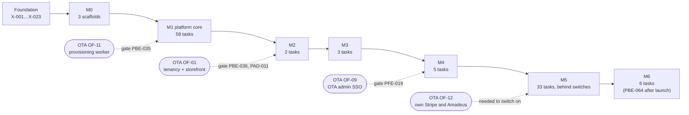

# Platform implementation plan

This plan explains how the platform group (platform backend, portal, platform admin) delivers its MVP scope across the shared milestones M0–M6: for each milestone the goal, the epics in scope, the demo at the end, the exit criteria, what is needed from and given to the OTA group, and the risks with their mitigations. It ends with a traceability table from every scope item to its epic and tasks. The tasks themselves, small enough for an AI coding agent, are in [`agent-tasks.md`](agent-tasks.md); the week-by-week order for one developer is in [`solo-developer-plan.md`](solo-developer-plan.md). Everything here follows [`decisions.md`](../../../docs/mvp/decisions.md), the [cross-cutting ADRs](../../../docs/mvp/adr/README.md) and the [platform ADRs](../adr/README.md).

Related: [`../scope.md`](../scope.md) (features PF-01 … PF-98), [`../architecture.md`](../architecture.md), [`../api-inventory.md`](../api-inventory.md) with [part 2](../api-inventory-resources.md) and [part 3](../api-inventory-admin.md), [`../data-model.md`](../data-model.md), [flows](../README.md#flows), [`../../../docs/mvp/README.md`](../../../docs/mvp/README.md#1-shared-milestones) (milestone definitions), [`../../../docs/mvp/plans/foundation-tasks.md`](../../../docs/mvp/plans/foundation-tasks.md) (`X-` tasks), [`../../../ota/docs/scope.md`](../../../ota/docs/scope.md) (OTA features OF-xx).

## 1. How the plan is built

| Item | Value |
|---|---|
| Agent tasks | 110: 66 backend (`PBE-`), 28 portal (`PFE-`), 16 admin (`PAD-`) |
| Estimate | 552 agent-hours by the plan-lint sizes (S 2 h, M 4 h, L 8 h, review included); about 138 developer-days without agents (S ½ day, M 1 day, L 2 days) |
| Foundation dependencies | `X-001` … `X-028` ([`foundation-tasks.md`](../../../docs/mvp/plans/foundation-tasks.md)); the platform never re-does them |
| Validation | `node tools/plan-lint/plan-lint.mjs docs/mvp/plans/foundation-tasks.md platform/docs/plans/agent-tasks.md` (0 errors) |
| Reference material reused | Baseline DDL [`platform.sql`](../../../docs/velexis-sdk/db/platform.sql) and [`reference.sql`](../../../docs/velexis-sdk/db/reference.sql) as `0001`, the exact `0002` SQL in [`../data-model-migration-0002.md`](../data-model-migration-0002.md) (parts 1–3), the OTA contract's `ConsoleApiKeyScope`, `StaffPermission`, error envelope and `consoleSignIn` grant in [`velexis-ota-booking-api.openapi.yaml`](../../../docs/velexis-sdk/openapi/velexis-ota-booking-api.openapi.yaml) |

Rules that shape the order of the tasks:

- **Contract first, in slices.** The platform OpenAPI document is written at the start of each milestone that adds operations (M1, M3–M4, M5), before any implementation of that milestone. A route parity test with a pending list keeps CI green and must be empty at the M5 exit ([PADR-0016](../adr/0016-contract-rollout-per-milestone-and-route-parity.md)).
- **One migration for all planned deltas.** Migration `0002` lands in M1 with every delta of [`../data-model.md`](../data-model.md) §4, including tables first used in M5; two tasks own it (PBE-002 writes it, PBE-003 proves its constraints and privileges).
- **Backend first, then the screens that use it.** Each portal or admin task depends on the backend task of its endpoints. Every user-facing feature has a component test and an end-to-end journey.
- **M5 behind switches.** M5 code merges continuously behind the six `FEATURE_*` switches of [PADR-0015](../adr/0015-milestone-feature-switches.md); the switches are turned on when the outside steps (legal review, Stripe Connect approval, Amadeus live contracts) are done, and removed by PBE-064 one release after all six are on, which is after the launch ([ADR-0025](../../../docs/mvp/adr/0025-roadmap-scheduling-and-tracking.md) item 4).
- **Cross-group work is gated, not faked.** Platform integration tests use a fake OTA worker; the few tasks that need the real OTA side start with a gate naming the OTA feature id ([PADR-0017](../adr/0017-platform-test-doubles-and-end-to-end-harness.md)).

## 2. Epics

| Epic | Name | What it delivers | Tasks |
|---|---|---|---|
| E1 | Scaffolds and contracts | The three apps, the platform OpenAPI document in slices, the `tenant.*` job messages and invalidation events, the HTTP pipeline and route parity | PBE-001, PFE-001, PAD-001, PBE-004 … PBE-008, PBE-066, PBE-037, PBE-041, PBE-042 |
| E2 | Platform data | Migration `0002` and the proof of its constraints and privileges | PBE-002, PBE-003 |
| E3 | Backend services | Redis keys, BullMQ queues and schedulers, idempotency, rate limits, audit, e-mail outbox, tokens, guards, milestone switches, purge, dev seed | PBE-009 … PBE-012, PBE-034 |
| E4 | Identity | Sign-up, verification, sign-in, lockout, refresh rotation, MFA, step-up, reset, profile, sessions | PBE-013 … PBE-016, PFE-002, PFE-005 … PFE-007 |
| E5 | OTA lifecycle and provisioning | Key rules, create OTA, dispatch, post-steps, reconciler, retries, key reveal, onboarding checklist, OTA dashboard | PBE-017 … PBE-019, PBE-022 … PBE-024, PBE-035, PFE-003, PFE-008 … PFE-010 |
| E6 | API keys | Generator, endpoints, usage flush, cross-backend acceptance | PBE-021, PBE-036, PFE-011 |
| E7 | Team and console | Members, roles, invitations, console token, Open console, console picker | PBE-025, PBE-026, PBE-039, PFE-012, PFE-017, PFE-019 |
| E8 | Amadeus connections | Velexis accounts and office pool, connection reads and settings, own credentials, live offices | PBE-020, PBE-027, PBE-040, PBE-052 … PBE-054, PFE-013, PFE-018, PFE-023, PAD-007, PAD-014 |
| E9 | Payments and settlements | Velexis-mode rows, statement descriptor, Connect Standard, API-key connections, payout accounts, monthly settlements | PBE-038, PBE-055 … PBE-060, PFE-016, PFE-024, PFE-025, PAD-013 |
| E10 | Billing | Plans and pricing, manual trials, Stripe inbox, Checkout, Customer Portal, event processing, invoices, dunning, admin billing | PBE-033, PBE-043 … PBE-048, PFE-004, PFE-020, PFE-021, PAD-008, PAD-012 |
| E11 | Domains and TLS | Sub-domain, `ask` endpoint, custom domains, DNS verification, TLS probe, re-check, admin domains | PBE-027, PBE-049 … PBE-051, PFE-022, PAD-014 |
| E12 | Platform admin | Admin sign-in, dashboard, tenants, suspend and resume, jobs, queues, accounts, admins, audit | PBE-028 … PBE-032, PAD-002 … PAD-006, PAD-009, PAD-011 |
| E13 | Go-live | Live preconditions, the environment switch, live keys | PBE-061, PFE-026 |
| E14 | Quality and launch | End-to-end harness and journeys, cross-backend tests, security review, performance, switch removal, runbooks | PFE-014, PFE-015, PFE-027, PFE-028, PAD-010, PAD-015, PAD-016, PBE-062 … PBE-065 |

## 3. Milestones at a glance

| Milestone | Platform goal | Tasks | Agent-hours | Solo days | What the OTA group does in the same milestone |
|---|---|---|---|---|---|
| M0 Foundations | Three apps scaffolded and in the release | 3 | 10 | 2.5 | Foundation work is shared (`X-` tasks); OTA scaffolds |
| M1 Platform core | Sign-up to active OTA, keys, team, admin basics | 58 | 316 | 79 | OTA backend scaffold and the provisioning worker (OF-11) |
| M2 Search & price | Platform data proven on the OTA side | 2 | 6 | 1.5 | Tenancy, Amadeus client, shopping, SDK, storefront (OF-01, OF-02) |
| M3 Book & pay | Card statement descriptor | 3 | 6 | 1.5 | Checkout, customer auth, Stripe and airline-card payments, orders, e-mails (OF-03 … OF-08) |
| M4 OTA admin | Console SSO, Amadeus office settings | 5 | 16 | 4 | OTA admin, console, settings (OF-09, OF-10) |
| M5 Monetisation & self-service | Billing, own Stripe, settlements, own Amadeus, custom domains, go-live | 33 | 168 | 42 | Gateways that follow the account mode and credential source (OF-12), Connect webhooks, live environment |
| M6 Hardening & launch | Security review, performance, full end-to-end suite, runbooks; switch removal after the launch (PBE-064) | 6 | 30 | 7.5 | PCI controls of the airline-card flow, OTA end-to-end suite; foundation monitoring and restore drill |
| **Total** | | **110** | **552** | **138** | |

## 4. Milestones in detail

### M0 — Foundations

**Goal.** The platform backend, portal and platform admin exist as workspace packages that build, start, answer health checks and are packed into the release by the foundation pipeline.

**Scope.** E1 (scaffolds only): PBE-001, PFE-001, PAD-001. Everything else of M0 (monorepo, shared packages, baselines, migration runner, CI, VM, Caddy, deploy) is foundation work, `X-001` to `X-023`. Reference data is loaded by the foundation loader `tools/reference-data` ([ADR-0024](../../../docs/mvp/adr/0024-reference-data-sources-and-loader.md)); the backend has no loader of its own, and PBE-001 only adds the `ref:load` shortcut for `pnpm db:seed:reference`.

**Demo.** `pnpm build` builds the three apps; started locally they answer `/health/live`, and `/health/ready` reports PostgreSQL and Redis; the release built by `pack-release.sh` contains `dist/main.js`, `dist/worker.js`, `dist/cli.js` and the two Next.js standalone outputs.

**Exit criteria.**
- PBE-001, PFE-001 and PAD-001 are merged with CI green.
- `/health/ready` of the backend answers 503 when Redis is down.
- No `process.env` outside `@velexis/config`, no `NEXT_PUBLIC_` variable.

**Dependencies on the OTA group.** None. Both groups depend on the same foundation tasks.

**Risks and mitigations.**

| Risk | Mitigation |
|---|---|
| Scaffolds drift from the conventions (layout, versions) and every later task inherits it | Exact versions from [`tech-stack.md`](../../../docs/mvp/tech-stack.md), folder trees from the component READMEs, lint rules from M0 |
| Entry point names differ from what the deploy script and systemd units expect | PBE-001 builds exactly `dist/main.js`, `dist/worker.js`, `dist/cli.js` as [ADR-0023](../../../docs/mvp/adr/0023-release-artefact-and-deploy-user.md) and the units name them |

### M1 — Platform core

**Goal.** A person signs up, verifies the e-mail, turns on MFA, creates an OTA and sees it become active through the real OTA worker with a test Amadeus office, a Velexis test payment connection and two test keys revealed once; manages API keys and the team. Velexis staff sign in to the platform admin with TOTP, manage the shared Amadeus account and office pool, see tenants, jobs, queues and the audit log, and suspend and resume a tenant.

**Scope.**

| Epic | Tasks |
|---|---|
| E1 contracts and pipeline | PBE-004 (job messages), PBE-005 … PBE-007 and PBE-066 (M1 contract slices), PBE-008 (pipeline, parity) |
| E2 data | PBE-002, PBE-003 |
| E3 services | PBE-009 … PBE-012, PBE-034 |
| E4 identity | PBE-013 … PBE-016, PFE-002, PFE-005 … PFE-007 |
| E5 lifecycle | PBE-017 … PBE-019, PBE-022 … PBE-024, PBE-035, PFE-003, PFE-004, PFE-008 … PFE-010 |
| E6, E7 keys and team | PBE-021, PBE-025, PBE-026, PFE-011, PFE-012 |
| E8, E9, E11 reads and pool | PBE-020, PBE-027, PFE-013 |
| E12 admin | PBE-028 … PBE-033, PAD-002 … PAD-009 |
| E14 journeys | PFE-014, PFE-015, PAD-010 |

Internal checkpoints keep this long milestone reviewable:

| Checkpoint | Tasks done | Shows |
|---|---|---|
| M1a backend core | PBE-002 … PBE-016, PBE-066 | Contract, data, pipeline, identity API with Mailpit e-mails |
| M1b OTA lifecycle | PBE-017 … PBE-027, PBE-034, PBE-035 | Create OTA to active through the fake worker, then the real one |
| M1c portal | PFE-002 … PFE-015 | The whole portal journey in a browser |
| M1d admin | PBE-028 … PBE-033, PAD-002 … PAD-010 | Staff operations in a browser |

**Demo.**
1. Sign up on `https://platform.example.com`, open the verification e-mail, enable MFA, sign out and in with TOTP.
2. Create OTA "Acme" with key `acme`; the setup page shows the steps; the tenant is active within a minute; reveal the test keys once; the checklist shows what is done.
3. Create and revoke a secret key; invite a teammate, who accepts and gets a role change.
4. In `https://admin.platform.example.com`, sign in with TOTP, find Acme, see its job, office, connections and audit; suspend it with a reason (the portal shows the banner) and resume it.

**Exit criteria.**
- Every M1 task is done; the end-to-end journeys of PFE-015 and PAD-010 are green in the `e2e` workflow.
- Tests prove PF-01 … PF-07, PF-10 … PF-13, PF-20, PF-21, PF-30 (test keys), PF-40, PF-42, PF-50, PF-60, PF-70, PF-75 (manual trial), PF-80 … PF-87, PF-90 (test environment), PF-95, PF-96, PF-97 (M1 templates).
- The cross-backend provisioning test (PBE-035) is green in CI with the real OTA worker.
- The release is deployed on the VM, the first platform admin is granted with `admin:grant`, and nightly backups run (X-024).

**Dependencies on the OTA group.**

| Needs from the OTA group | For | When |
|---|---|---|
| OTA backend scaffold and the `tenant.provision` consumer (OF-11), consuming PBE-004's messages | PBE-035, PFE-015 (gated) | Before checkpoint M1b ends |
| The `tenant.suspend` / `tenant.resume` consumer ([PADR-0014](../adr/0014-tenant-suspension-and-resume.md) follow-up, OBE-074) | Clean completion of suspend jobs | M4 in the OTA plan; until then the job ends `failed` after the reconciler's attempts while the status switch still blocks traffic, and the tenant stays `suspended` (PBE-023, PBE-030 step 5, [PADR-0001](../adr/0001-tenant-provisioning-orchestration.md) item 7) |

| Gives to the OTA group | Task |
|---|---|
| `tenant.*` message schemas and fixtures, `vx:invalidate` event types | PBE-004 |
| Rows the OTA backend reads: tenants, sub-domains, API keys, memberships, connections, plans | PBE-018, PBE-021, PBE-022, PBE-025 |
| `vx:invalidate` events after every cached change, `staffdeny:acct:<id>` keys | PBE-009, PBE-014, PBE-016, PBE-032 |
| A Velexis test Amadeus account pointing at the stub and 20 offices for local development (10 until 2026-10-30: the lead raised it to 20 for the e2e journeys, FIX-W34-SHARED) | PBE-034 (`dev:seed`) |

**Risks and mitigations.**

| Risk | Mitigation |
|---|---|
| M1 is the largest milestone (58 tasks, about 16 developer-weeks) and could hide slippage | Four checkpoints with their own demos; the critical path printed by plan-lint is reviewed weekly |
| The OTA provisioning worker arrives late | The fake OTA worker lets every platform task finish; only PBE-035 and PFE-015 wait; the combined roadmap schedules OF-11 before checkpoint M1b |
| Authentication mistakes (token audiences, refresh reuse, lockout, MFA bypass) | Guards and token service unit-tested in PBE-012; every endpoint integration-tested for auth failure; full auth matrix in PBE-062 |
| Secrets or tokens leak into logs, queues or audit rows | Redaction paths with tests (PBE-010), outbox secrets encrypted and purged (PBE-011), ids-only job payloads validated by schema (PBE-004), secret scan in PBE-062 |
| Contract churn while screens are built | M1 contract written first in three slices; types generated; parity test |
| Duplicate provisioning or lost jobs across two backends | Attempt-suffixed BullMQ ids, conditional dispatch, idempotent post-steps and the reconciler (PADR-0001), each with an integration test |

### M2 — Search & price

**Goal.** Prove that what the platform publishes drives the OTA side: a key created in the portal authenticates on the OTA API and stops working right after revocation, every cached change is announced on `vx:invalidate`, and a suspension reaches the storefront.

**Scope.** E6 and E12: PBE-036 (invalidation coverage and cross-backend key test), PAD-011 (suspension seen on the storefront).

**Demo.** Create a secret key in the portal, call `getStorefront` (`GET /v1/storefront`) on `https://api.ota.example.com` with it, revoke it, call again and get refused; suspend the tenant in the admin and watch `https://acme.ota.example.com` show "temporarily unavailable", then resume.

**Exit criteria.**
- PBE-036 and PAD-011 are done with their gates met.
- The coverage test lists every cached row type of [`../architecture.md`](../architecture.md) §6.3 and passes.

**Dependencies on the OTA group.** Needs tenant resolution, key verification, the invalidation subscriber and the hosted storefront (OF-01) with its Playwright project. Gives nothing new; the M1 data is what the OTA group builds on.

**Risks and mitigations.**

| Risk | Mitigation |
|---|---|
| A platform change is not announced and the OTA cache serves stale data for 60 s | The coverage test fails for any listed mutation without its event; the 60 s TTL bounds the damage |
| The OTA side reads a column the platform does not fill | The read contract is fixed in [`../architecture.md`](../architecture.md) §6.2; the cross-backend tests exercise it |

### M3 — Book & pay

**Goal.** Card statements of Velexis-collected payments carry the OTA's brand.

**Scope.** E1 and E9: PBE-037 (the M3–M4 contract slice), PBE-038 (descriptor update), PFE-016 (form).

**Demo.** An owner edits the descriptor suffix on the payments page; a test payment made through the storefront (OTA plan) shows it on the PaymentIntent in the Stripe test dashboard.

**Exit criteria.** The three tasks are done; PF-60 tests pass, including the validation rules for Stripe descriptors.

**Dependencies on the OTA group.** The OTA Stripe gateway (OF-04) reads `statement_descriptor_suffix` from the payment connection. The platform has filled it since provisioning (PBE-022).

**Risks and mitigations.**

| Risk | Mitigation |
|---|---|
| Stripe rejects a descriptor at payment time | The same character and length rules are enforced by the API and the form, with unit tests |

### M4 — OTA admin

**Goal.** "Open console" signs any active member into the OTA admin for that OTA without a second password; owners and admins edit the Amadeus office settings that the console uses.

**Scope.** E7 and E8: PBE-039 (console token), PBE-040 (Amadeus settings), PFE-017 (launch handler, console picker), PFE-018 (settings form), PFE-019 (SSO journey and cross-backend test).

**Demo.** From the OTA dashboard, click "Open console" and land on `https://admin.ota.example.com/bookings` for Acme; reuse the captured token and fail; remove the member and see the console session end within a minute; change the queuing office on the Amadeus page.

**Exit criteria.**
- The five tasks are done; PF-22 and PF-53 tests pass; the `console-sso` journey is green.
- The console token is never in a URL, a log, an audit row or idempotency storage (tests).

**Dependencies on the OTA group.** Needs the OTA admin `/sso` route, the `portal_token` grant of `consoleSignIn`, and the staff guard checking `staffdeny:acct:<id>` and membership invalidations (OF-09, [PADR-0007](../adr/0007-portal-to-ota-admin-sso-token.md) follow-up). Gives one-time tokens in `ptk:<sha256>`, the deny keys (since M1) and the office settings on `supplier_connections`.

**Risks and mitigations.**

| Risk | Mitigation |
|---|---|
| Token leakage through prefetch, history or `Referer` | POST-only launch form, `no-store`, `Referrer-Policy: strict-origin` (the portal's origin only; `no-referrer` would send `Origin: null`, which the OTA admin's `/sso` refuses, PADR-0007 point 4), 60 s single-use token in Redis with `NX` and `GETDEL` |
| Cross-origin hand-off breaks on cookies or CSP | The end-to-end journey runs across the real portal and OTA admin origins; the portal CSP allows exactly the OTA admin origin in `form-action` |

### M5 — Monetisation & self-service

**Goal.** OTAs pay Velexis through Stripe Billing; they can bring their own Stripe (Connect Standard or API keys) or stay on Velexis's account and receive monthly settlements to a verified payout account; they can bring their own Amadeus credentials or ask for a live Velexis office; they can serve the storefront on their own domain with automatic TLS; and they can switch to live.

**Scope.** In this order, so that each part is demonstrable on its own:

| Order | Part | Tasks |
|---|---|---|
| 1 | M5 contract slices | PBE-041, PBE-042 |
| 2 | Billing (E10) | PBE-043 … PBE-048, PFE-020, PFE-021, PAD-012 |
| 3 | Custom domains (E11) | PBE-049 … PBE-051, PFE-022 |
| 4 | Amadeus self-service (E8) | PBE-052 … PBE-054, PFE-023, PAD-014 |
| 5 | Payments and settlements (E9) | PBE-055 … PBE-060, PFE-024, PFE-025, PAD-013 |
| 6 | Go-live (E13) and journeys (E14) | PBE-061, PFE-026, PFE-027, PAD-015 |

**Demo.**
1. With the switches on locally and Stripe in test mode: create an OTA with a paid plan, pay on Checkout with a test card, see it provision on the webhook, open the Customer Portal, see the invoice.
2. Add `travel.acme.com`, see the DNS records, verify it (fake resolver locally; a real test domain with Let's Encrypt staging for the exit check), see TLS issued.
3. Submit own Amadeus test credentials against the stub, see them applied and the Velexis office `releasing`; request a live office and have an admin assign it.
4. Connect a Stripe test account through OAuth; switch back to Velexis payments; set a payout account; generate, approve and mark paid a settlement.
5. Go live: the page lists missing preconditions, then the switch succeeds and the storefront serves live within 60 seconds.

**Exit criteria.**
- Every M5 task is done; `pending-operations.ts` is empty (PADR-0016).
- Tests prove PF-14, PF-30 (live keys), PF-41, PF-51, PF-52, PF-61 … PF-64, PF-71 … PF-75, PF-88, PF-89, PF-91, PF-92 and the M5 e-mail templates of PF-97; every M5 endpoint also has a test showing `403 FEATURE_DISABLED` with its switch off.
- The `portal-stripe` journey passes in the nightly run; a real test domain receives a Let's Encrypt staging certificate.
- Before any live Velexis-mode payment or settlement in production: legal and Stripe review done ([PADR-0003](../adr/0003-settlement-of-velexis-collected-payments.md) follow-up). Before live Connect: Stripe Connect platform approval. Each switch is turned on in production only when its outside step is done.

**Dependencies on the OTA group.**

| Needs from the OTA group | For |
|---|---|
| Gateways that follow `account_mode` and `credential_source` with no per-tenant code path, including the rule that orders owned by a `releasing` Velexis office keep using the Velexis account (OF-12, [PADR-0012](../adr/0012-amadeus-office-pool.md) follow-up) | Own Stripe, own Amadeus, office release |
| Payment webhooks for connected accounts and for API-key connections (`/webhooks/stripe/connect/{env}`, `/webhooks/stripe/c/<ppc_id>`) | Own Stripe |
| Resolution of verified custom domains and the live storefront environment from `tenants.storefront_environment` | Custom domains, go-live |
| The `billing_notice` banner in the OTA admin | Dunning |

The platform gives every row and column these features read (all created by `0002` in M1), their invalidations, and the webhook URL shown to owners.

**Risks and mitigations.**

| Risk | Mitigation |
|---|---|
| Outside approvals (legal review, Stripe Connect, Amadeus live contracts) arrive late | Code merges behind switches; each switch is independent; manual billing keeps working until `FEATURE_STRIPE_BILLING` is on |
| Out-of-order or duplicate Stripe events corrupt subscriptions | Inbox with the event id as key, handlers that always re-fetch, tests with reversed and duplicated fixtures, the sweep scheduler |
| Settlement amounts are wrong or settled twice | Unique balance transaction per line, immutable approved statements, `decimal.js`, edge-case unit tests, admin review with step-up before every payout |
| DNS and certificate issuance behave differently from tests | Public resolvers, fake-resolver unit tests for every error, the TLS probe, a manual staging check with a real domain, existing certificates unaffected by `ask` failures |
| A tenant loses access to payments when switching modes | No silent fallback; switching never moves existing payments; live switch-back requires a verified payout account |
| Secret handling for own credentials | Staged in `credential_submissions`, verified by a worker, re-encrypted per row, purged at the end, secret scan in PBE-062 |

### M6 — Hardening & launch

**Goal.** The platform is reviewed for security, measured against the VM budget, covered by a nightly end-to-end suite, documented for operations, and launched. The milestone switches are removed after the launch, once all six have been on in production for one release (PBE-064).

**Scope.** E14: PBE-062 (security review, auth matrix, rate limits, secret scan), PBE-063 (performance and memory), PBE-064 (switch removal, gated, after the launch), PBE-065 (launch checklist and runbooks), PFE-028 and PAD-016 (complete end-to-end suites with accessibility and header checks). Foundation tasks X-029 … X-032 (uptime monitoring, on-VM checks, restore drill, managed-services proof) run in the same milestone.

**Demo.** Walk through `platform/docs/security-review.md` and `platform/docs/performance.md`; show three consecutive green nightly runs of the portal and admin projects; walk through the launch checklist on the VM with the developer.

**Exit criteria.**
- PBE-062, PBE-063, PBE-065, PFE-028 and PAD-016 are done; the security review lists no open high finding.
- PBE-064 stays open at launch. It is a named exception to the go criterion "every task of the milestone is done" ([ADR-0025](../../../docs/mvp/adr/0025-roadmap-scheduling-and-tracking.md) item 4, roadmap go criterion 1), because the switches stay off until their outside approvals and the launch does not wait for them (item 5). It runs in the first release after all six switches have been on in production for one release.
- p95 targets and memory budgets are met or have tasks.
- Every launch checklist item is checked by its owner.

**Dependencies on the OTA group.** Shared: the restore drill and monitoring (foundation), the end-to-end suite configuration (`tools/e2e`). The PCI controls of the airline-card flow are OTA work and not part of this plan.

**Risks and mitigations.**

| Risk | Mitigation |
|---|---|
| Switches removed before they have run in production | PBE-064 starts with a gate confirmed by the developer and is scheduled after the launch |
| The 8 GB VM is too small under load | PBE-063 measures RSS and latency against the budget of [`architecture.md`](../../../docs/mvp/architecture.md) §3; findings become tasks before launch |
| Flaky end-to-end tests block the launch | Three consecutive green nightly runs required; Stripe journeys isolated in their own project |

## 5. Interface with the OTA group

| What | Direction | Milestone | Platform task | OTA feature |
|---|---|---|---|---|
| `tenant.provision`, `tenant.migrate`, `tenant.suspend`, `tenant.resume` and their answers | both | M1 | PBE-004, PBE-019, PBE-022, PBE-023, PBE-030 | OF-11; suspend consumer M4/M5 |
| Read-only platform tables and columns ([`../architecture.md`](../architecture.md) §6.2) | platform → OTA | M1 | PBE-002, PBE-018, PBE-021, PBE-022 | OF-01 |
| `vx:invalidate` events | platform → OTA | M1 | PBE-009 and every mutating task; PBE-036 proves coverage | OF-01 |
| `apikey:used:<keyId>` usage counters | OTA → platform | M2 | PBE-021 (flush) | OF-01 |
| `ptk:<sha256>` console tokens and `staffdeny:acct:<id>` | platform → OTA | M4 (deny keys from M1) | PBE-039, PBE-014, PBE-016, PBE-032 | OF-09 |
| Payment connection modes and secrets, Amadeus credential source, releasing offices | platform → OTA | M5 | PBE-053 … PBE-057 | OF-12 |
| `storefront_environment`, verified custom domains, `billing_notice` | platform → OTA | M5 | PBE-045, PBE-050, PBE-061 | OF-01, OF-12 |
| `tools/e2e` harness | shared | M1 | PFE-014 | OTA adds its projects |

## 6. Traceability

Every feature of [`../scope.md`](../scope.md) §3, the data-model deltas and the cross-cutting needs, with the epic and the tasks that deliver and prove it. Backend tasks implement and integration-test; portal and admin tasks build the screens with component tests; `PFE-015`, `PFE-019`, `PFE-027`, `PFE-028`, `PAD-010`, `PAD-011`, `PAD-015` and `PAD-016` prove them in a browser.

| Scope item | Milestone | Epic | Tasks |
|---|---|---|---|
| PF-01 Sign-up | M1 | E4 | PBE-013, PFE-005, PFE-015 |
| PF-02 E-mail verification | M1 | E4 | PBE-012 (unverified access), PBE-013, PFE-005, PFE-015 |
| PF-03 Sign-in and lockout | M1 | E4 | PBE-014, PFE-006, PFE-015 |
| PF-04 MFA (TOTP) | M1 | E4 | PBE-014 (challenge), PBE-015, PFE-006, PFE-007, PFE-015 |
| PF-05 Password reset | M1 | E4 | PBE-016, PFE-006, PFE-015 |
| PF-06 Sessions | M1 | E4 | PBE-014, PBE-016, PFE-007, PFE-015 |
| PF-07 Profile | M1 | E4 | PBE-016, PFE-007 |
| PF-10 Create OTA | M1, M5 | E5, E10 | PBE-017, PBE-018, PBE-019, PFE-008, PFE-015; Checkout: PBE-044, PFE-020 |
| PF-11 Provisioning progress | M1 | E5 | PBE-019, PBE-022, PBE-023, PBE-035, PFE-009, PFE-015 |
| PF-12 Onboarding checklist | M1 | E5 | PBE-024 ([PADR-0018](../adr/0018-onboarding-checklist-computation.md)), PFE-010 |
| PF-13 OTA profile | M1 | E5 | PBE-017, PFE-010 |
| PF-14 Live switch | M5 | E13 | PBE-061, PFE-026, PFE-027 |
| PF-20 Invitations | M1 | E7 | PBE-026, PFE-012, PFE-015 |
| PF-21 Roles and removal | M1 | E7 | PBE-025, PFE-012, PFE-015; reach into the OTA admin: PBE-036, PFE-019 |
| PF-22 Open console | M4 | E7 | PBE-039, PFE-017, PFE-019 |
| PF-30 API keys | M1, M5 | E6 | PBE-021, PFE-011, PFE-015, PBE-036; live keys: PBE-061, PFE-026 |
| PF-40 Sub-domain | M1 | E11 | PBE-018, PBE-027, PFE-013 |
| PF-41 Custom domains | M5 | E11 | PBE-049, PBE-050, PBE-051, PFE-022, PFE-027 |
| PF-42 TLS ask | M1 | E11 | PBE-027 (positive answers in Redis, negative in a bounded in-process cache, [PADR-0004](../adr/0004-custom-domain-verification.md) item 6; Caddy side: X-022) |
| PF-50 Shared test office | M1 | E8 | PBE-020, PBE-022, PFE-013, PAD-010 |
| PF-51 Live office | M5 | E8 | PBE-054, PFE-023, PAD-014, PAD-015 |
| PF-52 Own Amadeus credentials | M5 | E8 | PBE-052, PBE-053, PFE-023 |
| PF-53 Connection settings | M4 | E8 | PBE-040, PFE-018 |
| PF-60 Velexis Stripe by default | M1, M3 | E9 | PBE-022, PBE-038, PFE-013, PFE-016; live row: PBE-061 |
| PF-61 Stripe Connect Standard | M5 | E9 | PBE-055, PBE-056, PFE-024 |
| PF-62 Stripe API keys | M5 | E9 | PBE-052, PBE-057, PFE-024 |
| PF-63 Settlements | M5 | E9 | PBE-059, PBE-060, PFE-025, PAD-013, PAD-015 |
| PF-64 Payout account | M5 | E9 | PBE-058, PFE-025, PFE-027, PAD-013 |
| PF-70 Plans and pricing page | M1 | E10 | PBE-017, PFE-004 |
| PF-71 Checkout | M5 | E10 | PBE-044, PBE-047, PFE-020, PFE-027 |
| PF-72 Customer Portal | M5 | E10 | PBE-044, PFE-021, PFE-027 |
| PF-73 Sync and invoices | M5 | E10 | PBE-043, PBE-045, PBE-046, PFE-021 |
| PF-74 Dunning | M5 | E10 | PBE-045, PFE-021 |
| PF-75 Manual trial | M1, M5 | E10 | PBE-018, PBE-033, PFE-013, PAD-008; M5 notices: PBE-047 |
| PF-80 Admin sign-in | M1 | E12 | PBE-028, PAD-002, PAD-010 |
| PF-81 Tenants | M1 | E12 | PBE-029, PAD-004, PAD-010 |
| PF-82 Suspend and resume | M1 | E12 | PBE-030, PAD-005, PAD-010, PBE-036, PAD-011 |
| PF-83 Provisioning jobs | M1 | E12 | PBE-031, PAD-006 |
| PF-84 Queues view | M1 | E12 | PBE-031, PAD-006 |
| PF-85 Audit log | M1 | E12 | PBE-010, PBE-032, PAD-009, PAD-010 |
| PF-86 Platform admins | M1 | E12 | PBE-028 (CLI bootstrap), PBE-032, PAD-009 |
| PF-87 Account support | M1 | E12 | PBE-032, PAD-009 |
| PF-88 Plans and Stripe prices | M1, M5 | E10 | PBE-033, PBE-048, PAD-008, PAD-012 |
| PF-89 Subscriptions, invoices, Stripe events | M1, M5 | E10 | PBE-033, PBE-048, PAD-008, PAD-012 |
| PF-90 Amadeus accounts and offices | M1, M5 | E8 | PBE-020, PBE-054, PAD-007, PAD-014, PAD-010, PAD-015 |
| PF-91 Settlements (admin) | M5 | E9 | PBE-060, PAD-013, PAD-015 |
| PF-92 Domains (admin) | M5 | E11 | PBE-051, PAD-014, PAD-015 |
| PF-95 Audit | M1 | E3 | PBE-010, every state-changing task, PBE-032, PBE-062 |
| PF-96 Rate limits | M1 | E3 | PBE-008 (end-user IP, [PADR-0019](../adr/0019-end-user-ip-forwarding-from-the-portal-and-admin.md)), PFE-002 and PAD-002 (forward it), PBE-009 (limits), each endpoint task (applies them), PBE-062 (one test per limit) |
| PF-97 Platform e-mails | M1, M5 | E3 | PBE-011 (outbox and M1 templates); M5 templates in PBE-046, PBE-047, PBE-050, PBE-052, PBE-054, PBE-056, PBE-058, PBE-060 |
| PF-98 Reference data | M0 | — | X-017, X-018 (foundation, [ADR-0024](../../../docs/mvp/adr/0024-reference-data-sources-and-loader.md)); PBE-001 adds the `ref:load` shortcut |
| Migration `0002` ([`../data-model.md`](../data-model.md) §4.1–§4.8) | M1 | E2 | PBE-002 (file, parity with the documents, codegen), PBE-003 (constraints, privileges) |
| Platform OpenAPI document | M1, M3, M5 | E1 | PBE-005, PBE-006, PBE-007, PBE-066, PBE-037, PBE-041, PBE-042 |
| Job messages and invalidation events | M1 | E1 | PBE-004 |
| Milestone switches ([PADR-0015](../adr/0015-milestone-feature-switches.md)) | M1, M6 | E3 | PBE-012, PBE-064 |
| Security, performance, operations | M6 | E14 | PBE-062, PBE-063, PBE-065, PFE-028, PAD-016 |

**Endpoint coverage.** All 150 operations of the three inventory parts appear in [`agent-tasks.md`](agent-tasks.md) in the task that implements them, and each user-facing one also in a portal or admin task. The check is mechanical: every `operationId` in the first column of the inventory tables is found in the plan, and at run time the route parity test with its pending list ([PADR-0016](../adr/0016-contract-rollout-per-milestone-and-route-parity.md)) ends empty at the M5 exit.

## 7. Decisions and alignments made while planning

| Topic | Decision | Where |
|---|---|---|
| Contract rollout | The platform OpenAPI document grows in milestone slices; route parity with a pending list; the platform owns the `tenant.*` messages; `adminDownloadSettlementLines` for the CSV path | [PADR-0016](../adr/0016-contract-rollout-per-milestone-and-route-parity.md) |
| Test doubles and end-to-end | Fake OTA worker in platform integration tests; gated cross-backend tests; `tools/e2e` created by PFE-014 in M1; Stripe journeys nightly only | [PADR-0017](../adr/0017-platform-test-doubles-and-end-to-end-harness.md) |
| Onboarding checklist | Exact done rule per item; "storefront opened" is done once the storefront can be opened | [PADR-0018](../adr/0018-onboarding-checklist-computation.md) |
| Reference data | The foundation loader of ADR-0024 is the only loader; the backend's `ref:load` delegates to `pnpm db:seed:reference`; the backend README, architecture §2.1 and data-model §1 were corrected during the planning review | PBE-001 |
| Switches in the admin | `adminGetMe` returns the same `features` object as `getMe`, because admins cannot call the portal-scoped endpoint | PBE-007, PBE-028 |
| M1 admin contract | Split in two L tasks (PBE-007, PBE-066), 21 and 26 operations, so each fits the L size | [PADR-0016](../adr/0016-contract-rollout-per-milestone-and-route-parity.md) |
| End-user IP | The portal and admin servers forward the visitor's IP and user agent with a shared key; rate limits, audit and sessions use it | [PADR-0019](../adr/0019-end-user-ip-forwarding-from-the-portal-and-admin.md), PBE-008, PBE-009, PFE-002, PAD-002 |
| TLS `ask` cache | Host syntax checked first; only positive answers cached in Redis; negative answers in a bounded in-process cache | [PADR-0004](../adr/0004-custom-domain-verification.md) item 6, PBE-027 |
| Switch removal | PBE-064 keeps its M6 tag and runs after the launch as a named exception | [ADR-0025](../../../docs/mvp/adr/0025-roadmap-scheduling-and-tracking.md) item 4 |
| Suspension before the OTA consumer exists | The status switch is the effect; a suspend job without an answer ends `failed` until the OTA plan delivers the consumer (OBE-074), and only `provision` jobs can set a tenant `failed` | PBE-023, PBE-030, [PADR-0001](../adr/0001-tenant-provisioning-orchestration.md) item 7 |

**After the MVP** (recorded so nobody plans them now): office time zone stored with `amadeus_offices` for ticketing deadlines (OTA [OADR-0008](../../../ota/docs/adr/0008-ticketing-policy.md) follow-up); hosting keys and `api_key_tenant_grants`; automated payouts; bounce and complaint webhooks; WebAuthn; self-service e-mail change; a daily Stripe drift check if event gaps appear.
