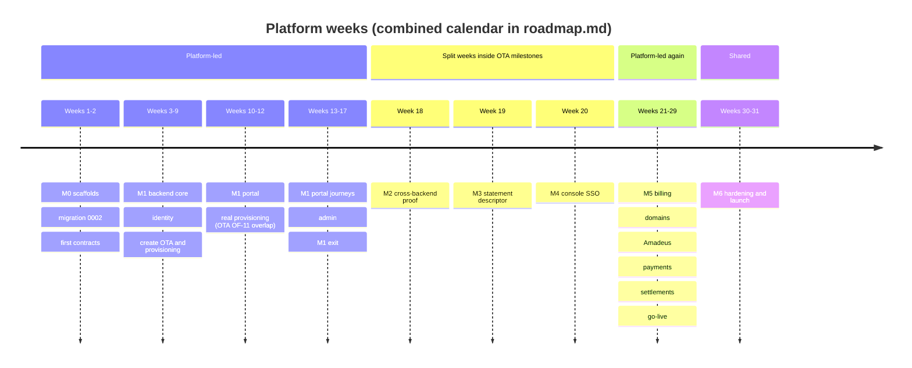

# Platform solo developer plan

This plan lays out the platform group's MVP work (platform backend, portal, platform admin) for one developer working without AI agents, week by week: what to build each week, in which order, what is delivered and demonstrated on Friday, and where the buffer sits. It uses exactly the tasks of [`agent-tasks.md`](agent-tasks.md) (it references their ids, it does not redefine them) and the milestones and exit criteria of [`implementation-plan.md`](implementation-plan.md). It covers only the platform group's share; the combined schedule with the OTA group is in `docs/mvp/plans/roadmap.md` (written after this plan), and the weeks that share calendar time with OTA work are marked below.

Related: [`implementation-plan.md`](implementation-plan.md), [`agent-tasks.md`](agent-tasks.md), [`../../../docs/mvp/plans/foundation-tasks.md`](../../../docs/mvp/plans/foundation-tasks.md), [`../../../docs/mvp/README.md`](../../../docs/mvp/README.md#1-shared-milestones), [`../../../docs/mvp/local-development.md`](../../../docs/mvp/local-development.md), [`../../../AGENTS.md`](../../../AGENTS.md) (definition of done applies to the developer too).

## 1. Assumptions

| Assumption | Value |
|---|---|
| People | One developer, no agents, five working days a week |
| Effort per task size | S = ½ day, M = 1 day, L = 2 days, including tests, docs and self-review against the definition of done |
| Platform work | 109 tasks = 135.5 days (M0 2.5, M1 76.5, M2 1.5, M3 1.5, M4 4, M5 42, M6 7.5) |
| Buffer | 11.5 days inside platform weeks (Weeks 1, 12, 17, 29, 31) |
| Length | **31 platform weeks**, of which three (Weeks 18–20) are split weeks holding only 7.5 platform days |
| Start | Week 1 starts when the foundation tasks `X-001` to `X-016` are merged (the foundation's own weekly plan schedules them) |
| Week numbers | Platform-plan weeks. The roadmap maps them to calendar weeks; between Weeks 17 and 21 it places several OTA-only weeks |

**How a day works.** Morning: pick the next task from this plan, read its **Read first**, write the contract or the failing test first. Afternoon: implement until **Acceptance** and **Verify** pass, open the PR, run the checklist of [`conventions.md` §12](../../../docs/mvp/conventions.md#12-security-checklist-every-pr), merge, append ` ✅` to the task heading. **Friday afternoon** is the weekly demo (recorded in a short note in the PR of the last task) and a re-plan if the week slipped.

## 2. Overview

| Week | Milestone | Goal | Tasks | Overlap with the OTA group |
|---|---|---|---|---|
| 1 | M0 → M1 | Scaffolds, job contracts, migration `0002` | PBE-001, PFE-001, PAD-001, PBE-004, PBE-002 | Runs after foundation M0; OTA scaffolds may sit in the same calendar weeks |
| 2 | M1 | Data proven, first contract slices | PBE-003, PBE-005, PBE-006 | Platform only |
| 3 | M1 | Admin contract, HTTP pipeline, audit | PBE-007, PBE-008, PBE-010 | Platform only |
| 4 | M1 | Redis, queues, guards, outbox start | PBE-009, PBE-012, PBE-011 (1/2) | Platform only |
| 5 | M1 | Sign-up and sign-in API, portal client | PBE-011 (2/2), PBE-013, PBE-014, PFE-002 (1/2) | Platform only |
| 6 | M1 | MFA, portal shell and sign-up pages | PFE-002 (2/2), PBE-015, PFE-003, PFE-005 | Platform only |
| 7 | M1 (checkpoint M1a) | Identity complete, tenant reads | PBE-016, PFE-006, PFE-007, PBE-017 | Platform only |
| 8 | M1 | Create OTA, dispatch, API keys | PBE-018, PBE-019, PBE-021 | Platform only |
| 9 | M1 | Office pool, post-steps, reconciler start | PBE-020, PBE-022, PBE-023 (1/2) | Platform only |
| 10 | M1 | Portal wizard and setup page | PBE-023 (2/2), PFE-004, PFE-008, PFE-009, PBE-024 | **Overlap:** the OTA provisioning worker (OF-11) must be built in this calendar window (roadmap inserts its OTA days around Weeks 10–11) |
| 11 | M1 | Team, reads, OTA dashboard, keys page | PBE-025, PBE-026, PBE-027, PFE-010, PFE-011 | **Overlap:** as Week 10 |
| 12 | M1 (checkpoint M1b) | Real provisioning, e2e harness | PFE-012, PFE-013, PBE-034, PBE-035, PFE-014 | Gate: OF-11 merged before PBE-035 |
| 13 | M1 (checkpoint M1c) | Portal journeys, admin sign-in | PFE-015, PBE-028, PAD-002 | Platform only |
| 14 | M1 | Admin tenants, lifecycle, jobs | PBE-029, PBE-030, PBE-031, PAD-003, PAD-004 (1/2) | Platform only |
| 15 | M1 | Admin pages, accounts and audit API | PAD-004 (2/2), PAD-005, PAD-006, PBE-032 | Platform only |
| 16 | M1 (checkpoint M1d) | Plans, pool, accounts pages, admin journeys | PBE-033, PAD-007, PAD-008, PAD-009, PAD-010 | Platform only |
| 17 | M1 exit | Buffer, deploy, M1 demo | — (buffer) | Platform only |
| 18 | M2 | Cross-backend proof | PBE-036, PAD-011 | **Split week** inside OTA M2: 1.5 platform days, 3.5 OTA days; needs OF-01 |
| 19 | M3 | Statement descriptor | PBE-037, PBE-038, PFE-016 | **Split week** inside OTA M3: 1.5 platform days, 3.5 OTA days |
| 20 | M4 | Console SSO, Amadeus settings | PBE-039, PBE-040, PFE-017, PFE-018, PFE-019 | **Split week** inside OTA M4: 4 platform days, 1 OTA day; needs OF-09 |
| 21 | M5 | M5 contracts, Stripe inbox | PBE-041, PBE-042, PBE-043 | **Overlap:** OTA M5 (OF-12) runs in the same calendar months |
| 22 | M5 | Checkout and billing events | PBE-044, PBE-045, PBE-046 | Overlap with OTA M5 |
| 23 | M5 | Billing schedules, admin billing, billing UI | PBE-047, PBE-048, PFE-020, PFE-021, PAD-012 | Overlap with OTA M5 |
| 24 | M5 | Custom domains, credential framework | PBE-049, PBE-050, PBE-051, PFE-022, PBE-052 | Overlap with OTA M5 |
| 25 | M5 | Own Amadeus, live offices, payout accounts | PBE-053, PBE-054, PFE-023, PAD-014, PBE-058 | Overlap with OTA M5 (releasing-office rule) |
| 26 | M5 | Stripe Connect and API keys | PBE-055, PBE-056, PBE-057, PFE-024 (1/2) | Overlap with OTA M5 (Connect webhooks) |
| 27 | M5 | Settlements | PFE-024 (2/2), PBE-059, PBE-060 | Overlap with OTA M5 |
| 28 | M5 | Settlement UI, go-live | PFE-025, PAD-013, PBE-061, PFE-026 | Overlap with OTA M5 (live environment) |
| 29 | M5 exit | M5 journeys, buffer | PFE-027, PAD-015 | OTA M5 must be done before switches go on |
| 30 | M6 | Security review, performance, runbooks | PBE-062, PBE-063, PBE-065, PFE-028 (1/2) | **Overlap:** shared hardening (OTA M6, X-029 … X-032) |
| 31 | M6 exit | E2E suites, switch removal, launch | PFE-028 (2/2), PAD-016, PBE-064 | Shared launch week |

## 3. Weeks 1 and 2, day by day

### Week 1 — M0 scaffolds, then the first M1 data and contracts

**Before Monday:** foundation tasks `X-001` to `X-016` are merged: config, logger, crypto, api-types, errors, db, migration runner, baselines, tenant runner, codegen, `@velexis/testing` and local setup. `pnpm db:migrate` works locally.

| Day | Work | Done when |
|---|---|---|
| Monday | **PBE-001** (M): package, three entry points, `config.ts`, health module, integration test; fix the reference-data rows in the platform docs | `pnpm --filter @velexis/platform-backend build` and `test:int` pass; `/health/ready` answers 503 with Redis stopped |
| Tuesday | **PFE-001** (M): portal package, Tailwind, shadcn/ui, config, health routes | `.next/standalone` builds; health tests pass |
| Wednesday | Morning **PAD-001** (S): admin package with `noindex`. Afternoon: **M0 check**, run `deploy/scripts/pack-release.sh` locally and confirm the three apps are in the release; start **PBE-004** (queue names, message schemas) | Release contains `dist/main.js`, `dist/worker.js`, `dist/cli.js` and both standalone outputs |
| Thursday | Morning: finish **PBE-004** (fixtures, `validateJob`, type tests). Afternoon: start **PBE-002**, concatenate the three SQL blocks into `0002_add_mvp_platform_deltas.sql` | `pnpm --filter @velexis/api-types test` passes |
| Friday | Morning: finish **PBE-002** (contract parity test, upgrade test, `pnpm db:codegen`). Afternoon: **demo** and half a day of buffer | `pnpm db:migrate` applies `0002`; the generated types contain the new tables |

**Deliverables:** three scaffolded apps (M0 done for the platform), job message contracts, migration `0002` with generated types.
**Demo:** the three apps start and answer health checks; `psql` shows the `0002` ledger row and the 11 new tables; a fixture message validates and a tampered one fails.

### Week 2 — M1 data proven and the first contract slices

| Day | Work | Done when |
|---|---|---|
| Monday | **PBE-003** (M): builders for platform rows, one test per constraint of `0002`, the privilege matrix for the three roles | Every constraint test asserts its constraint name; the OTA role cannot read settlements |
| Tuesday | **PBE-005** (L, day 1): document skeleton, components, error envelope, `x-error-catalogue` | `pnpm contracts:lint` passes with the catalogue |
| Wednesday | **PBE-005** (L, day 2): the 24 identity, plan, internal and health operations with `x-scope` and the other `x-` flags; regenerate types and errors | `PlatformErrorCode` and the operations index are generated and stable |
| Thursday | **PBE-006** (L, day 1): tenant and lifecycle operations, team operations | Lint clean |
| Friday | **PBE-006** (L, day 2): API keys and the M1 reads; regenerate. Afternoon: **demo** | 27 more operations in the index; no secret or ciphertext field in any response |

**Deliverables:** `0002` proven by tests; the platform OpenAPI document with 51 operations; generated `@velexis/api-types/platform` and platform error codes.
**Demo:** browse the document in Redocly's preview; show the generated `paths` for `createTenant` and the error codes used by the portal.

## 4. Weeks 3 to 31

Each week lists its goal, the tasks in order with their days, the deliverables, the Friday demo and the overlap with OTA work.

### Week 3 — M1: admin contract, HTTP pipeline, audit

- **Tasks:** PBE-007 (2 days), PBE-008 (2 days), PBE-010 (1 day).
- **Deliverables:** the M1 contract complete (98 operations); validation interceptor, error filter, ids, `createTestApp()`, the route parity test with every M1 operation pending; `AuditService` and the platform redaction paths.
- **Demo:** a request with an unknown field answers `VALIDATION_FAILED` without echoing the value; the parity test fails when a fake route is added.
- **Overlap:** none.

### Week 4 — M1: Redis, queues, guards, start of the outbox

- **Tasks:** PBE-009 (2 days), PBE-012 (2 days), PBE-011 (first day).
- **Deliverables:** Redis key helpers with TTLs, invalidation publisher after commit, the eight queues and the scheduler registry, idempotency and throttling; token service, all guards, the six milestone switches in config and env templates.
- **Demo:** two identical idempotent requests give one effect; a portal token is refused on an admin test route; a disabled switch answers `FEATURE_DISABLED`.
- **Overlap:** none.

### Week 5 — M1: sign-up and sign-in API, portal client

- **Tasks:** PBE-011 (second day), PBE-013 (1 day), PBE-014 (2 days), PFE-002 (first day).
- **Deliverables:** e-mail outbox with M1 templates and secret purge; sign-up, verification, resend; sign-in, lockout, refresh rotation, sign-out everywhere with `staffdeny`.
- **Demo:** sign up with `curl`, read the e-mail in Mailpit, verify, sign in, lock the account with five wrong passwords.
- **Overlap:** none.

### Week 6 — M1: MFA, portal shell and sign-up pages

- **Tasks:** PFE-002 (second day), PBE-015 (2 days), PFE-003 (1 day), PFE-005 (1 day).
- **Deliverables:** MFA set-up, challenge, recovery codes and step-up; the portal API client, session cookies with single-flight refresh, middleware and CSP; the app shell, shared components; sign-up, check-e-mail, verify-email handler, verify-pending page.
- **Demo:** sign up in the browser and verify through the Mailpit link.
- **Overlap:** none.

### Week 7 — M1 checkpoint M1a: identity complete, tenant reads

- **Tasks:** PBE-016 (1 day), PFE-006 (1 day), PFE-007 (1 day), PBE-017 (2 days).
- **Deliverables:** password reset and change, profile and sessions; sign-in with MFA, reset and sign-out pages; account and security pages with QR set-up; tenant key rules, `TenantRoleGuard`, tenant reads and update, plans and subscription reads.
- **Demo (M1a):** the full identity journey in the browser: sign up, verify, enable MFA, sign in with TOTP, reset the password, sign out everywhere.
- **Overlap:** none.

### Week 8 — M1: create OTA, dispatch, API keys

- **Tasks:** PBE-018 (2 days), PBE-019 (1 day), PBE-021 (2 days).
- **Deliverables:** `createTenant` in one idempotent transaction with the sub-domain and the queued job; dispatch with the gate and attempt-suffixed BullMQ ids; the fake OTA worker; the API key generator, rules, endpoints and usage flush.
- **Demo:** create an OTA with `curl` and see the `tenant.provision` message (validated) on `ota-tenant-ops`; create, roll and revoke a key and see the `api_key` invalidation.
- **Overlap:** none.

### Week 9 — M1: office pool, post-steps, reconciler start

- **Tasks:** PBE-020 (2 days), PBE-022 (2 days), PBE-023 (first day).
- **Deliverables:** Velexis Amadeus accounts verified against the stub, the office pool and assignment; the tenant-events consumer and the six post-steps; failure handling of `tenant.provision_failed`.
- **Demo:** with the fake worker, a new OTA becomes `active` with a test office, a Velexis test payment connection and two keys; with an empty pool it is still active and ops get an e-mail.
- **Overlap:** none.

### Week 10 — M1: portal wizard and setup page

- **Tasks:** PBE-023 (second day), PFE-004 (½ day), PFE-008 (2 days), PFE-009 (1 day), PBE-024 (½ day).
- **Deliverables:** the reconciler, owner retry and one-time key reveal; landing, pricing and legal pages; the dashboard and create-OTA wizard with live key availability; the setup page with polling, retry and reveal; the onboarding checklist API (PADR-0018).
- **Demo:** create an OTA in the browser and watch it become active (fake worker); reveal the keys once.
- **Overlap:** the OTA provisioning worker (OF-11) is built in this calendar window by the same developer, as scheduled by the roadmap, so that Week 12 can use it.

### Week 11 — M1: team, reads, OTA dashboard, keys page

- **Tasks:** PBE-025 (1 day), PBE-026 (1 day), PBE-027 (1 day), PFE-010 (1 day), PFE-011 (1 day).
- **Deliverables:** members and the role matrix; invitations with seats and e-mail matching; domain and connection reads and the TLS `ask` endpoint; the OTA dashboard with banners, checklist and settings; the API keys page.
- **Demo:** invite a teammate by e-mail, accept in a second browser, change the role; `curl 127.0.0.1:3100/internal/tls/ask?domain=acme.ota.example.com` answers 200.
- **Overlap:** as Week 10 (OF-11).

### Week 12 — M1 checkpoint M1b: real provisioning and the end-to-end harness

- **Tasks:** PFE-012 (1 day), PFE-013 (1 day), PBE-034 (1 day), PBE-035 (½ day), PFE-014 (1 day); ½ day buffer.
- **Deliverables:** team and invitation pages; read-only domains, Amadeus, payments and billing pages; daily purge and `dev:seed`; the cross-backend provisioning test in CI; `tools/e2e` with the smoke spec and the nightly workflow.
- **Demo (M1b):** an OTA created in the portal becomes active through the **real** OTA worker; `psql` shows `tenant_acme` with the same migrations as the platform mirror.
- **Overlap:** gate of PBE-035, OF-11 merged. If it is late, do Week 13's PBE-028 and PAD-002 first and come back to PBE-035.

### Week 13 — M1 checkpoint M1c: portal journeys and admin sign-in

- **Tasks:** PFE-015 (2 days), PBE-028 (1 day), PAD-002 (2 days).
- **Deliverables:** the four portal journeys green in the `e2e` workflow; admin sign-in with TOTP, refresh within the admin audience, `admin:grant` and `admin:reset-mfa`; the admin API client, session and sign-in pages.
- **Demo (M1c):** the portal journey end to end in Playwright's trace viewer; an admin signs in with TOTP.
- **Overlap:** none.

### Week 14 — M1: admin tenants, lifecycle and jobs

- **Tasks:** PBE-029 (1 day), PBE-030 (1 day), PBE-031 (1 day), PAD-003 (1 day), PAD-004 (first day).
- **Deliverables:** admin dashboard and tenant views; suspend, resume, migrate and connection status, with the event handling; jobs and queue inspection; the admin shell with reason and step-up dialogs.
- **Demo:** suspend a tenant with `curl` as an admin and see the `tenant.suspend` message and the owner e-mail.
- **Overlap:** none.

### Week 15 — M1: admin pages, accounts and audit API

- **Tasks:** PAD-004 (second day), PAD-005 (1 day), PAD-006 (1 day), PBE-032 (2 days).
- **Deliverables:** dashboard, tenant list and detail; tenant actions; jobs and queues pages; accounts support, platform admins, audit search and CSV export.
- **Demo:** in the admin, find Acme by its owner's e-mail, suspend and resume it, retry a failed job.
- **Overlap:** none.

### Week 16 — M1 checkpoint M1d: plans, pool and accounts pages, admin journeys

- **Tasks:** PBE-033 (1 day), PAD-007 (1 day), PAD-008 (1 day), PAD-009 (1 day), PAD-010 (1 day).
- **Deliverables:** admin plans and manual subscriptions; Amadeus accounts and pool pages; plans and subscriptions pages; accounts, admins and audit pages; the four admin journeys.
- **Demo (M1d):** add offices in bulk and assign one to a pending tenant; filter the audit log and download it.
- **Overlap:** none.

### Week 17 — M1 exit: buffer, deploy and demo

- **Work:** catch up on any slipped task; run the full M1 exit list of [`implementation-plan.md`](implementation-plan.md#m1--platform-core); deploy the release to the VM with the Deploy workflow; grant the first admin with `node dist/cli.js admin:grant`; check the backups (X-024).
- **Demo:** the M1 demo script of the implementation plan, on the real hosts `https://platform.example.com` and `https://admin.platform.example.com`.
- **Overlap:** none. After this week the roadmap moves to OTA M2 for several weeks.

### Week 18 — M2: cross-backend proof (split week)

- **Tasks:** PBE-036 (1 day), PAD-011 (½ day). The other 3.5 days of the calendar week belong to OTA M2.
- **Deliverables:** the invalidation coverage test; a portal key accepted and then refused by the OTA API; a suspension visible on the storefront.
- **Demo:** `curl https://api.ota.example.com/v1/storefront` with a new key, revoke, repeat; the storefront follows a suspension.
- **Overlap:** inside OTA M2; needs OF-01 (tenancy and storefront).

### Week 19 — M3: statement descriptor (split week)

- **Tasks:** PBE-037 (½ day), PBE-038 (½ day), PFE-016 (½ day). The other 3.5 days belong to OTA M3.
- **Deliverables:** the M3–M4 contract slice; the descriptor update API and form.
- **Demo:** edit the suffix; an OTA test payment shows it in the Stripe test dashboard.
- **Overlap:** inside OTA M3 (Stripe gateway reads the suffix).

### Week 20 — M4: console SSO and Amadeus settings (split week)

- **Tasks:** PBE-039 (1 day), PBE-040 (½ day), PFE-017 (1 day), PFE-018 (½ day), PFE-019 (1 day). One day belongs to OTA M4.
- **Deliverables:** the one-time console token; Amadeus office settings; the launch handler and console picker; the SSO journey and cross-backend test.
- **Demo:** "Open console" lands on the OTA admin's bookings page of the right OTA; a reused token fails.
- **Overlap:** inside OTA M4; needs OF-09 (OTA admin `/sso` and the `portal_token` grant).

### Week 21 — M5: contracts and the Stripe inbox

- **Tasks:** PBE-041 (2 days), PBE-042 (1 day), PBE-043 (2 days).
- **Deliverables:** the M5 contract (43 operations, pending list updated); Stripe client, signature guard, inbox, billing webhook receiver, event processor skeleton and sweep.
- **Demo:** `stripe listen --forward-to localhost:3100/webhooks/stripe/billing` and `stripe trigger checkout.session.completed`: the event is stored once even when resent.
- **Overlap:** OTA M5 work (OF-12) shares these calendar months; the roadmap alternates them.

### Week 22 — M5: Checkout and billing events

- **Tasks:** PBE-044 (2 days), PBE-045 (2 days), PBE-046 (1 day).
- **Deliverables:** Stripe customers, Checkout on create OTA, Checkout for existing tenants, Customer Portal; event processing with re-fetch and status rules; invoices.
- **Demo:** with switches on, create an OTA, pay on Stripe Checkout (test card), see provisioning start on the webhook; mark the subscription `unpaid` in Stripe and see the tenant suspended for billing.
- **Overlap:** OTA M5.

### Week 23 — M5: billing schedules, admin billing and billing screens

- **Tasks:** PBE-047 (1 day), PBE-048 (1 day), PFE-020 (1 day), PFE-021 (1 day), PAD-012 (1 day).
- **Deliverables:** abandoned-Checkout and manual-trial schedulers; price links and checks, resync, Stripe events admin; wizard plan step and Checkout hand-off; billing page actions and invoices; admin billing pages.
- **Demo (billing part):** the full billing story in the browser, including the Customer Portal and a reprocessed failed event in the admin.
- **Overlap:** OTA M5.

### Week 24 — M5: custom domains and the credential framework

- **Tasks:** PBE-049 (1 day), PBE-050 (1 day), PBE-051 (1 day), PFE-022 (1 day), PBE-052 (1 day).
- **Deliverables:** host name rules, add, primary and removal; DNS verification and check now; TLS probe, three-strike re-check and admin domain endpoints; the domains page; credential submissions.
- **Demo (domains part):** add a domain, see the records, verify it with a real test domain and Let's Encrypt staging on a scratch host.
- **Overlap:** OTA M5 (custom domain resolution).

### Week 25 — M5: own Amadeus credentials, live offices, payout accounts

- **Tasks:** PBE-053 (1 day), PBE-054 (1 day), PFE-023 (1 day), PAD-014 (1 day), PBE-058 (1 day).
- **Deliverables:** own credentials applied with re-encryption and the office set `releasing`; live office requests and release; the portal Amadeus self-service; the admin domains page and live office workflow; payout accounts with admin review and reveal.
- **Demo (Amadeus part):** submit own credentials against the stub, see them applied; request a live office and assign it in the admin.
- **Overlap:** OTA M5 (credential resolver with the releasing-office rule).

### Week 26 — M5: Stripe Connect and API-key connections

- **Tasks:** PBE-055 (2 days), PBE-056 (1 day), PBE-057 (1 day), PFE-024 (first day).
- **Deliverables:** Connect Standard OAuth; Connect account events; API-key connections and the return to Velexis payments.
- **Demo:** connect a Stripe test account through OAuth and deauthorise it from the Stripe dashboard: the connection becomes disabled and the owner gets an e-mail.
- **Overlap:** OTA M5 (Connect and per-connection payment webhooks).

### Week 27 — M5: settlements

- **Tasks:** PFE-024 (second day), PBE-059 (2 days), PBE-060 (2 days).
- **Deliverables:** the payments page with Connect, API keys and switch-back; settlement generation from balance transactions; the review workflow and portal statements.
- **Demo:** generate a draft from Stripe test-mode balance transactions, approve and mark it paid with step-ups; the owner sees the statement and its CSV.
- **Overlap:** OTA M5.

### Week 28 — M5: settlement screens and go-live

- **Tasks:** PFE-025 (1 day), PAD-013 (2 days), PBE-061 (1 day), PFE-026 (1 day).
- **Deliverables:** payout account and settlements pages in the portal; settlements and payout pages in the admin; go-live with live keys; the go-live page.
- **Demo (go-live part):** the go-live page lists what is missing, then the switch succeeds and the storefront serves live within 60 seconds.
- **Overlap:** OTA M5 (live storefront environment).

### Week 29 — M5 exit: journeys and buffer

- **Tasks:** PFE-027 (1 day), PAD-015 (1 day); 3 days of buffer.
- **Work in the buffer:** the M5 exit list (empty pending list, every switch tested on and off, the nightly `portal-stripe` run), and a rehearsal of turning the switches on in production, one at a time, as their outside steps complete.
- **Demo:** the M5 demo script of the implementation plan.
- **Overlap:** the OTA M5 work must be merged before any switch is turned on in production.

### Week 30 — M6: security review, performance, runbooks

- **Tasks:** PBE-062 (2 days), PBE-063 (1 day), PBE-065 (½ day), PFE-028 (1½ days).
- **Deliverables:** `platform/docs/security-review.md` with the auth matrix, rate-limit tests and the secret scan; `platform/docs/performance.md`; the launch checklist and operations runbook; most of the portal end-to-end suite.
- **Demo:** the security review findings (each with a task id or "none") and the performance table against the VM budget.
- **Overlap:** shared hardening with OTA M6 and the foundation tasks X-029 … X-032.

### Week 31 — M6 exit: suites, switch removal and launch

- **Tasks:** PFE-028 (last ½ day), PAD-016 (1 day), PBE-064 (1 day, only if the switches have been on in production for one release; otherwise it moves to the first week after launch); 2½ days of buffer for launch.
- **Deliverables:** three green nightly runs of the portal and admin projects; switches removed (or scheduled); the launch checklist completed with the developer.
- **Demo:** launch.
- **Overlap:** shared launch week with the OTA group.

## 5. Buffer and re-planning rules

| Rule | Why |
|---|---|
| Buffer is 11.5 days: ½ day in Weeks 1 and 12, all of Week 17, 3 days in Week 29, 2½ days in Week 31 | Placed at milestone exits, where integration surprises appear |
| A task more than one day late moves the next task of the same epic, never a task of another epic that is on time | Keeps checkpoints demonstrable |
| When a cross-group gate (OF-11, OF-01, OF-09, OF-12) is not met, do the next task without the gate and return to the gated one; never write a fake of the OTA side outside the test doubles of PADR-0017 | Keeps the platform moving without hiding integration risk |
| If a week slips by more than two days, re-plan on Friday: move the lowest-value task of the milestone (for example a non-critical admin page) after the exit demo, never a test or a security step | The exit criteria stay honest |
| Any new work found becomes a task in [`agent-tasks.md`](agent-tasks.md) with an id and a size before it is scheduled here | One source of truth for scope |
